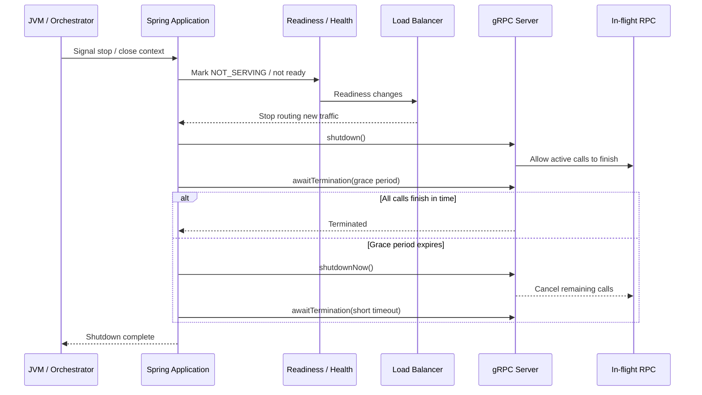

# Not Gracefully Shutting Down the Server

A **SPRING_GRPC** service must handle both startup and shutdown properly. In real environments, a server may need to stop during a new version deployment, configuration change, replica scale-in, or application shutdown. If the process terminates immediately upon receiving a stop signal, in-flight RPCs can be aborted mid-flight, clients receive unexpected errors, and business operations risk being re-executed.

A common mistake is calling `shutdownNow()` directly, calling `System.exit()`, or letting the process/container be killed before the gRPC server finishes releasing active calls. Proper shutdown requires a **graceful shutdown** window: stop accepting new work, let in-flight RPCs finish within a defined limit, and only then force-terminate the remainder if the timeout expires.

## 1. Distinguishing graceful shutdown from immediate shutdown

In gRPC Java, `io.grpc.Server` provides two primary stop operations:

| API | Behavior | When to use |
| --- | --- | --- |
| `shutdown()` | Initiates an orderly shutdown. The server stops accepting new RPCs and allows existing RPCs to continue to completion. | Start graceful shutdown during normal operational stops. |
| `awaitTermination(timeout, unit)` | Waits for the server to terminate until the timeout elapses or the server has stopped. | Bound the drain wait time. |
| `shutdownNow()` | Requests cancellation of active RPCs and stops the server as quickly as possible. | Final step once the grace period expires or when an emergency stop is needed. |
| `awaitTermination()` | Waits indefinitely until the server terminates. | Only when the process and orchestrator guarantee infinite waiting is safe; typically unsuitable for container termination deadlines. |

`shutdown()` does not mean every RPC finishes instantaneously. A unary RPC with bounded processing time can usually finish during the drain window. A streaming RPC may live much longer if the client keeps the stream open or the server waits for the next message. Therefore, graceful shutdown must pair with deadlines, stream duration policies, and a final wait cap.

## 2. Consequences of abrupt server shutdown

Common failures show up in several ways:

- **In-flight RPCs interrupted:** clients receive `UNAVAILABLE`, `CANCELLED`, or transport errors depending on when the connection closes. Clients cannot assume by default whether the business operation committed or not.
- **Streams cut mid-flight:** client-streaming, server-streaming, and bidirectional-streaming can lose unexchanged messages or miss the expected terminal status.
- **Retries create duplicate side effects:** if a client automatically retries a write that the server already committed before the response arrived, the operation may execute twice without idempotency.
- **Disruptive deployments:** old instances leave the cluster before the load balancer stops routing requests, spiking errors during rollouts.
- **Resources not released in order:** background work, callbacks, dependency connections, or data writes may still be incomplete when the application context closes.
- **Unpredictable shutdown times:** waiting indefinitely allows a single stuck stream to stall rollouts or scale-in operations.

An `UNAVAILABLE` error during a deployment is not necessarily a security or network bug. Inspect shutdown timing, instance state, server lifecycle logs, and RPC traces to pinpoint the cause.

## 3. Orderly shutdown sequence

A typical operational sequence follows these steps:

1. Receive the stop signal from Spring `ApplicationContext`, the JVM, or the orchestration platform.
2. Mark the instance as no longer ready for new traffic; update readiness or gRPC Health Checking status if used.
3. Wait for the load balancer, service discovery, or Kubernetes to update endpoints and stop routing new requests to the instance.
4. Call `Server.shutdown()` to begin stopping the server and draining active RPCs.
5. Wait up to the configured grace period. During this time, existing RPCs keep processing and return responses if they finish in time.
6. If the grace period expires, call `shutdownNow()` to cancel remaining RPCs.
7. Wait briefly for transport and callbacks to finish, log the shutdown outcome, and allow the process to exit.



The order of readiness updates and `shutdown()` must match your infrastructure. If `shutdown()` is called before routing stops sending requests, new requests can be rejected while the endpoint is still considered healthy. Conversely, marking readiness without stopping RPC acceptance can leave the instance receiving traffic from direct clients or alternate routes.

## 4. Implementing bounded waits with gRPC Java

The example below illustrates shutdown coordination for an application-created and owned `Server`:

```java
import io.grpc.Server;

import java.util.concurrent.TimeUnit;
import java.util.logging.Level;
import java.util.logging.Logger;

public final class GrpcServerShutdown {
    private static final Logger LOGGER =
            Logger.getLogger(GrpcServerShutdown.class.getName());

    private final Server server;

    public GrpcServerShutdown(Server server) {
        this.server = server;
    }

    public void stop() {
        LOGGER.info("Starting graceful gRPC server shutdown");
        server.shutdown();

        try {
            if (server.awaitTermination(20, TimeUnit.SECONDS)) {
                LOGGER.info("gRPC server terminated gracefully");
                return;
            }

            LOGGER.warning("Grace period expired; forcing remaining RPCs to stop");
            server.shutdownNow();

            if (!server.awaitTermination(5, TimeUnit.SECONDS)) {
                LOGGER.severe("gRPC server did not terminate after forced shutdown");
            } else {
                LOGGER.info("gRPC server terminated after forced shutdown");
            }
        } catch (InterruptedException ex) {
            LOGGER.log(Level.WARNING, "Interrupted while waiting for gRPC shutdown", ex);
            server.shutdownNow();
            Thread.currentThread().interrupt();
        }
    }
}
```

Key details in this example:

- Start with `shutdown()` to give active RPCs a chance to complete.
- Use `awaitTermination()` with a timeout so shutdown duration is always bounded.
- Only call `shutdownNow()` after the grace period has expired.
- If the thread is interrupted, trigger forced shutdown and restore the interrupt flag via `Thread.currentThread().interrupt()`.
- Log clearly between normal termination, grace period expiration, and failure to terminate after forcing.

If the application manages the server via a Spring bean, invoke the coordinator from a bean lifecycle callback such as `@PreDestroy`:

```java
import jakarta.annotation.PreDestroy;
import org.springframework.stereotype.Component;

@Component
public final class CustomGrpcServerLifecycle {
    private final GrpcServerShutdown shutdown;

    public CustomGrpcServerLifecycle(GrpcServerShutdown shutdown) {
        this.shutdown = shutdown;
    }

    @PreDestroy
    public void stop() {
        shutdown.stop();
    }
}
```

This example applies when the application creates and owns `io.grpc.Server` directly; Spring Boot 3 uses `jakarta.annotation.PreDestroy`. If a Spring gRPC starter or another integration already manages the server lifecycle, use the shutdown mechanism provided by that integration and configure the grace period at the appropriate layer. Do not add a second shutdown bean stopping a framework-owned server, because two lifecycle controllers can produce unpredictable stop ordering. Exact APIs and configuration properties depend on the starter and version in use.

## 5. Coordinating readiness, load balancers, and Kubernetes

Transport-level graceful shutdown only handles stopping acceptance and completing RPCs on the server. It does not guarantee the load balancer has removed the instance from endpoint lists. Readiness and drain timing must be coordinated:

- **Readiness:** mark the instance unready before draining begins. With the gRPC Health Checking Protocol, switch the service status to `NOT_SERVING` if clients or load balancers query the health service.
- **Service discovery/load balancer:** allow time for endpoint updates to propagate to routing components. Do not assume all proxies update instantaneously.
- **Kubernetes:** readiness probes determine whether the pod receives traffic via a Service; `terminationGracePeriodSeconds` caps the total time the pod has to exit after termination starts. A `preStop` hook can assist draining if designed alongside how the application handles `SIGTERM`.
- **JVM/Spring:** let Spring close `ApplicationContext` through its standard lifecycle upon receiving `SIGTERM`. Avoid calling `System.exit()` directly on signal receipt, as it can cut off shutdown callbacks.

Condensed Kubernetes configuration example:

```yaml
spec:
  terminationGracePeriodSeconds: 40
  containers:
    - name: spring-grpc
      lifecycle:
        preStop:
          exec:
            command: ["/bin/sh", "-c", "sleep 5"]
```

This only illustrates a buffer window for endpoint propagation. `sleep` does not replace application graceful shutdown logic; choose a drain strategy aligned with your actual ingress, service mesh, and health check mechanisms. Total wait time inside the application must remain short enough to leave headroom before Kubernetes sends `SIGKILL` when `terminationGracePeriodSeconds` expires.

Do not confuse Spring Boot's embedded HTTP server graceful shutdown properties with the lifecycle of a standalone gRPC server. If the application runs both HTTP and gRPC simultaneously, verify whether both servers have independent lifecycles and grace periods or are coordinated by the integration.

## 6. Handling open streaming RPCs

Streaming is a common reason graceful shutdown takes longer than expected. A server-streaming RPC may keep sending data until data runs out; client-streaming or bidirectional-streaming may wait for the client's next message. `shutdown()` lets active RPCs keep running to completion, so an open-ended stream can keep the server alive indefinitely.

Design streams with explicit bounds:

1. Clients set a deadline or timeout on stream sessions when business logic permits.
2. Servers enforce stream duration limits or periodic reconnect cycles to avoid immortal connections.
3. Servers check cancellation and stop background work when clients cancel or transport closes.
4. For long streams, define resumption from a checkpoint/sequence number after reconnecting so clients neither lose nor duplicate data.
5. During draining, stop accepting new streams and let active streams finish within the configured limit; accept controlled cancellation once time runs out.

Example checking cancellation inside stream processing logic:

```java
import io.grpc.Context;
import io.grpc.stub.StreamObserver;

public void streamUpdates(StreamObserver<Update> observer) {
    Context context = Context.current();

    while (!context.isCancelled() && hasNextUpdate()) {
        Update update = nextUpdate();
        observer.onNext(update);
    }

    if (!context.isCancelled()) {
        observer.onCompleted();
    }
}
```

This is an illustrative skeleton for synchronous logic; `Update`, `hasNextUpdate()`, and `nextUpdate()` belong to business implementation. With blocking operations or async callbacks, propagate cancellation to the data source, cancel subscriptions, or close underlying resources. Checking `isCancelled()` in a loop is insufficient if the thread is blocked long-term in an I/O call.

## 7. Client deadlines, retries, and idempotency

Graceful shutdown reduces interrupted RPCs, but cannot eliminate every transport failure. Clients must still handle a server disappearing or an RPC being cancelled:

- Set RPC deadlines so clients do not wait indefinitely.
- Retry with backoff and jitter, cap attempt counts, and only retry statuses allowed by API policy.
- Never blindly retry non-idempotent writes. Use an idempotency key or unique operation ID stored and checked by the server to avoid duplicate execution.
- For streams, design resume tokens or sequence numbers to reconnect from an acknowledged position.
- Distinguish errors occurring before server processing from errors after the server may have committed. Transport status is never proof that a transaction did not execute.

Example: a client sends an order creation request, the server records the order successfully, and the pod is terminated before the response reaches the client. The client observes `UNAVAILABLE` and retries. If the API supports idempotency keys, the retry can return the previous operation's result instead of creating a second order.

## 8. Common implementation mistakes

| Mistake | Problem | Fix |
| --- | --- | --- |
| Calling `shutdownNow()` immediately on SIGTERM | Immediately cancels active RPCs | Call `shutdown()`, wait for grace period, then force only if needed |
| Calling `awaitTermination()` indefinitely | Pod or rollout can hang on non-terminating streams | Use a finite timeout and a final forced step |
| Updating readiness only without stopping the server | Direct callers can still reach the instance | Pair readiness drain with `Server.shutdown()` |
| Calling `shutdown()` without waiting for completion | Process may exit before active RPCs finish | Wait with `awaitTermination()` within a bounded timeout |
| Writing a custom `@PreDestroy` for a starter-managed server | Two components fight over lifecycle control | Leave shutdown ownership to a single owner |
| Setting grace period longer than Kubernetes allows | Container gets SIGKILLed before draining finishes | Coordinate app timeouts, hooks, load balancer, and `terminationGracePeriodSeconds` |
| Leaving streaming RPCs unbounded | A single stream can keep the server alive forever | Set deadlines, max stream age, and resume mechanisms |
| Retrying every `UNAVAILABLE` error | May repeat committed write operations | Design idempotency and per-method retry policies |
| Calling `System.exit()` inside shutdown callbacks | Interrupts cleanup of other resources | Let Spring/JVM exit after lifecycle completes |

## 9. Observing and recording shutdown outcomes

Shutdown also needs telemetry to know whether the server drains cleanly or repeatedly resorts to forced termination. Record:

- Time the stop signal arrived and time shutdown started.
- Active RPC count at drain start, broken down by method and RPC type.
- Number of RPCs completed within the grace period and number cancelled after `shutdownNow()`.
- Elapsed time from shutdown start until server termination.
- Open streams at drain start and forcibly terminated streams.
- Shutdown reason: rollout, scale-in, application failure, or administrative action.

Never put tokens, sensitive metadata, or payloads in shutdown logs. Metrics should use bounded labels such as `method`, `rpc_type`, and `shutdown_result`; never use request IDs or arbitrary principals as high-cardinality labels.

Useful metrics that can be implemented with your existing metrics system:

| Metric | Purpose |
| --- | --- |
| `grpc_shutdown_duration_seconds` | Measures total drain duration until server stops |
| `grpc_shutdown_active_calls` | Active RPC count when shutdown begins |
| `grpc_shutdown_forced_calls_total` | Remaining RPCs when `shutdownNow()` is required |
| `grpc_shutdown_timeout_total` | Count of grace period expirations |
| `grpc_active_streams` | Active stream count over time |

The metric names above are suggestions, not mandatory gRPC standard names. Keep definitions consistent across application versions to compare graceful shutdown success rates and detect streams held open too long.

## 10. Testing graceful shutdown

Do not merely check that the process exits. Verify active RPCs get a chance to finish and that forced timeouts actually fire:

1. **Fast unary RPC finishes:** start an RPC, trigger stop while in flight, and confirm the response returns before the server terminates.
2. **RPC outlives grace period:** hold an unfinished call open, initiate shutdown, and confirm `shutdownNow()` is invoked after timeout.
3. **Open streaming RPC:** keep a stream active, check readiness transitions, confirm streams finish within bounds and cancel cleanly upon expiration.
4. **Client calls during drain:** confirm the load balancer stops routing to the instance and direct callers against the shut-down server receive a handleable error.
5. **Interrupted thread:** confirm the server triggers emergency stop and the interrupt flag is restored.
6. **Multi-replica deployment:** perform a rolling update under load, tracking `UNAVAILABLE` rates, latency, and retried requests.
7. **Idempotent write:** simulate server commit followed by lost response, resend with the same idempotency key, and confirm no duplicate side effect.
8. **Time budget:** verify that preStop + endpoint propagation + grace period + force timeout is less than the orchestrator's total termination budget.

## 11. Pre-production checklist

- [ ] One component has clear ownership of the gRPC server lifecycle.
- [ ] During normal shutdown, the server calls `shutdown()` before `shutdownNow()`.
- [ ] A finite drain timeout and a short post-force wait are configured.
- [ ] Readiness/health updates stop new incoming traffic.
- [ ] Load balancer endpoint propagation delay is included in the shutdown budget.
- [ ] Streaming RPCs have deadlines, max duration limits, or appropriate resume mechanisms.
- [ ] Clients have deadlines, bounded retries, and idempotency for retryable writes.
- [ ] Application grace period is shorter than the platform's termination allowance.
- [ ] Logs/metrics capture drain duration, active RPCs, and forcibly cancelled RPCs.
- [ ] Rolling updates under load and mid-RPC server stops are tested.

Graceful shutdown is part of end-to-end reliability: the server must stop in order, infrastructure must stop routing new traffic, and clients must handle safe reconnection and retries. When all three sides coordinate around a shared time budget, deploying or scaling Spring gRPC services causes far fewer mid-flight RPC disruptions and makes diagnosing incomplete calls much easier.
