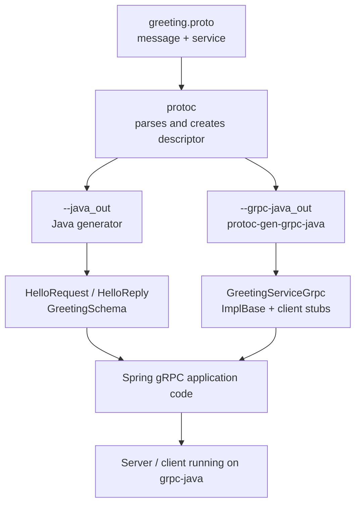

# protoc and Code Generation Plugins in Spring gRPC

In a **Spring gRPC** service, the contract between client and server is typically written using **Protocol Buffers** (`.proto` files). From that contract, `protoc` and its plugins generate Java classes representing messages, service descriptors, and RPC stubs. The generated code keeps data types and method signatures aligned on both sides; developers still need to implement business logic, Spring configuration, security, and service operations.

After this lesson, you will be able to:

- Distinguish the responsibilities of `protoc`, the built-in Java generator, and the `protoc-gen-grpc-java` plugin.
- Generate message classes and gRPC stubs from the same `.proto` file using the command line or Gradle.
- Use generated code to write a server and client in a Spring gRPC application.
- Identify code generation errors, version compatibility issues, and the boundary between the RPC contract and runtime configuration.

## 1. How Does the Code Generation Toolchain Work?

`protoc` is the Protocol Buffers compiler. It parses syntax, validates declarations, and builds structured descriptors from one or more `.proto` files. Depending on the output flags, `protoc` invokes the appropriate code generators.

| Component | Input | Primary Output | Responsibility |
| --- | --- | --- | --- |
| `protoc` | `.proto` files and imports | Descriptors and generator outputs | Parses, validates the contract, orchestrates code generation |
| Built-in Java generator | Message, enum descriptors, etc. | Protocol Buffers Java classes | Serialization, deserialization, builders, field accessors |
| `protoc-gen-grpc-java` | `service` and `rpc` descriptors | `*Grpc` classes, server base classes, and client stubs | Maps RPC calls to the grpc-java API |
| Spring gRPC and grpc-java runtime | Generated classes with application configuration | Server, channel, interceptors, and live calls | Executes RPCs, manages connections, and integrates with Spring |

`--java_out` requests generating Protocol Buffers classes for Java; `--grpc-java_out` requests invoking the gRPC Java plugin. **Generating Java messages does not automatically generate gRPC stubs.** Conversely, having only gRPC stubs without message classes is also insufficient to compile the application.



The two groups of generated code serve different purposes: `HelloRequest` and `HelloReply` define the data being transmitted; `GreetingServiceGrpc` defines how clients invoke and servers receive those RPCs. `protoc` does not replace `javac`: the generated `.java` files still need to be compiled like regular Java code.

## 2. Writing the Protocol Buffers Contract as the Source of Truth

Create `src/main/proto/greeting.proto`:

```proto
syntax = "proto3";

package learning.greeting.v1;

option java_package = "vn.example.springgrpc.greeting.v1";
option java_multiple_files = true;
option java_outer_classname = "GreetingSchema";

service GreetingService {
  rpc SayHello(HelloRequest) returns (HelloReply);
  rpc StreamHello(HelloRequest) returns (stream HelloReply);
}

message HelloRequest {
  string name = 1;
}

message HelloReply {
  string message = 1;
}
```

Key declarations to read carefully:

- `syntax = "proto3"` selects Protocol Buffers syntax version 3.
- `package learning.greeting.v1` defines the namespace at the gRPC contract level; the fully qualified service name will be `learning.greeting.v1.GreetingService`. This is not necessarily the Java package.
- `java_package` selects the package for the generated Java classes, avoiding coupling to how `package` is named in the contract.
- `java_multiple_files = true` causes `HelloRequest`, `HelloReply`, and top-level types to be generated as separate Java classes. `GreetingSchema` mainly holds descriptor metadata.
- `SayHello` is a **unary RPC**: one request and one response. `StreamHello` is a **server-streaming RPC**: one request and a stream of responses.
- The numbers `= 1` are **field numbers** on the wire format. When evolving the API, do not arbitrarily change or reuse previously assigned numbers.

From this example, you will work with the following typical Java names:

| Declaration in `.proto` | Generated Java Code | Purpose |
| --- | --- | --- |
| `message HelloRequest` | `HelloRequest` | Build and read requests |
| `message HelloReply` | `HelloReply` | Build and read responses |
| `service GreetingService` | `GreetingServiceGrpc` | Service descriptor, stub factory |
| `rpc SayHello` | `sayHello(...)` | RPC method on stub or server base |
| `rpc StreamHello` | `streamHello(...)` | Method returning a response stream |

Java class names and locations are also affected by `option java_*` settings. If `java_multiple_files` is not enabled, message classes may be nested inside an outer class instead of standing alone.

## 3. Generating Code Directly with protoc

To understand the tooling underneath Gradle, you can run `protoc` directly in an environment where `protoc` is installed and the gRPC Java plugin executable matching your operating system is available:

```bash
# Check the compiler.
protoc --version

# Create the two output directories in advance.
mkdir -p build/generated/manual/java build/generated/manual/grpc

protoc \
  --proto_path=src/main/proto \
  --java_out=build/generated/manual/java \
  --plugin=protoc-gen-grpc-java=/path/to/protoc-gen-grpc-java \
  --grpc-java_out=build/generated/manual/grpc \
  src/main/proto/greeting.proto
```

The command above uses Unix-style shell syntax; on Windows, you can create directories with PowerShell and point `--plugin` to the `.exe` executable. The directory after `--proto_path` is the root used to resolve imports and input file paths. `--java_out` and `--grpc-java_out` can point to two separate directories to make comparing outputs easier.

Following the example, you will typically see:

```text
build/generated/manual/
├── java/vn/example/springgrpc/greeting/v1/
│   ├── GreetingSchema.java
│   ├── HelloRequest.java
│   └── HelloReply.java
└── grpc/vn/example/springgrpc/greeting/v1/
    └── GreetingServiceGrpc.java
```

**Why must the plugin be specified?** `protoc` does not natively know how to generate grpc-java-specific APIs. Through the plugin mechanism, the `--grpc-java_out` flag instructs `protoc` to look for an executable with the conventional name `protoc-gen-grpc-java`, or to use the exact path passed via `--plugin`. The plugin communicates with `protoc` using Protocol Buffers messages `CodeGeneratorRequest` and `CodeGeneratorResponse`: it receives contract descriptors and returns file names along with the code contents to create. Because of this design, a single contract can be processed by multiple generators for different languages or purposes.

In addition to source code, you can export a descriptor set for tooling and contract inspection:

```bash
protoc \
  -I=src/main/proto \
  --include_imports \
  --descriptor_set_out=build/greeting-descriptor.pb \
  src/main/proto/greeting.proto
```

A descriptor set is a binary representation of the schema; it is **not** a Java class, nor does it automatically enable server reflection. Reflection must be configured separately at runtime if the application uses that feature.

## 4. Automating Code Generation in Gradle

In a real Spring Boot/Spring gRPC application, code generation should be tied to the build lifecycle so the schema and Java code always stay in sync. The example below uses Gradle Groovy DSL and the `com.google.protobuf` plugin. The versions are illustrative; pin a protobuf/grpc-java pair compatible with your project's BOM or dependency management.

```properties
# gradle.properties — example versions, review against your project
protobufVersion=4.30.2
grpcVersion=1.71.0
```

```groovy
// build.gradle — code generation configuration section
plugins {
    id 'java'
    id 'com.google.protobuf' version '0.9.5'
}

def protobufVersion = project.property('protobufVersion')
def grpcVersion = project.property('grpcVersion')

dependencies {
    implementation "com.google.protobuf:protobuf-java:$protobufVersion"
    implementation platform("io.grpc:grpc-bom:$grpcVersion")
    implementation 'io.grpc:grpc-protobuf'
    implementation 'io.grpc:grpc-stub'

    // Needed when code generated by some plugin versions contains @javax.annotation.Generated.
    compileOnly 'javax.annotation:javax.annotation-api:1.3.2'
}

protobuf {
    protoc {
        artifact = "com.google.protobuf:protoc:$protobufVersion"
    }
    plugins {
        grpc {
            artifact = "io.grpc:protoc-gen-grpc-java:$grpcVersion"
        }
    }
    generateProtoTasks {
        all().configureEach { task ->
            task.plugins {
                grpc {}
            }
        }
    }
}
```

The `dependencies` section above serves compiling messages and stubs. A complete Spring gRPC application also requires starters and runtime dependencies matching the Spring Boot/Spring gRPC version chosen by your project; do not treat this code generation setup as the entire server configuration.

Place `greeting.proto` in `src/main/proto/` and run:

```bash
./gradlew generateProto compileJava
# On Windows: .\gradlew.bat generateProto compileJava
```

The Gradle plugin orchestrates the steps: locating proto sources, downloading `protoc` and the plugin matching the OS, generating Java code, and exposing the generated sources to the compilation task. With the default layout, you can inspect:

```text
build/generated/source/proto/main/java/
build/generated/source/proto/main/grpc/
```

Do not edit files inside `build/generated` directly: the next build may overwrite them. Edit `.proto` if you want to change the contract; edit implementation code or build configuration if you want to change business behavior or how code is generated. In CI pipelines, run generation/compilation from source to catch schema errors and version mismatches early.

## 5. Using Generated Code in a Spring gRPC Server

`GreetingServiceGrpc.GreetingServiceImplBase` is the server base class created by the plugin. This class declares the RPCs according to the contract; you need to override them to implement actual behavior. Here is an example of a Spring bean implementing both unary and server streaming:

```java
package vn.example.springgrpc.greeting;

import io.grpc.stub.StreamObserver;
import org.springframework.stereotype.Service;
import vn.example.springgrpc.greeting.v1.GreetingServiceGrpc;
import vn.example.springgrpc.greeting.v1.HelloReply;
import vn.example.springgrpc.greeting.v1.HelloRequest;

@Service
public class GreetingServiceImpl
        extends GreetingServiceGrpc.GreetingServiceImplBase {

    @Override
    public void sayHello(
            HelloRequest request,
            StreamObserver<HelloReply> responseObserver) {

        String name = request.getName().isBlank()
                ? "friend" : request.getName();

        HelloReply reply = HelloReply.newBuilder()
                .setMessage("Hello, " + name)
                .build();

        responseObserver.onNext(reply);
        responseObserver.onCompleted();
    }

    @Override
    public void streamHello(
            HelloRequest request,
            StreamObserver<HelloReply> responseObserver) {

        for (int i = 1; i <= 3; i++) {
            responseObserver.onNext(HelloReply.newBuilder()
                    .setMessage("Greeting " + i + " to " + request.getName())
                    .build());
        }
        responseObserver.onCompleted();
    }
}
```

In an application using Spring gRPC with auto-configuration that registers `BindableService` beans, this implementation class is wired into the gRPC server. Some other Spring-gRPC integration libraries have their own annotation/service registration mechanisms, so check your project's actual starter. Regardless of the registration mechanism, the **method contract** still comes from `GreetingServiceGrpc`, while the **business logic** lives in `GreetingServiceImpl`.

Note the `StreamObserver` lifecycle: for a successful call, the server sends `onNext(...)` and then finishes with `onCompleted()`; on error, use `onError(...)` with an appropriate gRPC status. Never call both `onCompleted()` and `onError()` for the same call. The server-streaming example only emits three items for illustration; for long-lived streams, you must handle call cancellation, resource cleanup, and backpressure.

## 6. Using Client Stubs and Understanding RPC Types

The gRPC Java plugin typically provides three client stub families: blocking, async, and future (future is mainly for unary). Minimal unary client example using grpc-java:

```java
import io.grpc.ManagedChannel;
import io.grpc.ManagedChannelBuilder;
import java.util.concurrent.TimeUnit;
import vn.example.springgrpc.greeting.v1.GreetingServiceGrpc;
import vn.example.springgrpc.greeting.v1.HelloRequest;
import vn.example.springgrpc.greeting.v1.HelloReply;

ManagedChannel channel = ManagedChannelBuilder
        .forAddress("localhost", 9090)
        .usePlaintext() // For local non-TLS demonstration only.
        .build();

try {
    GreetingServiceGrpc.GreetingServiceBlockingStub stub =
            GreetingServiceGrpc.newBlockingStub(channel)
                    .withDeadlineAfter(2, TimeUnit.SECONDS);

    HelloRequest request = HelloRequest.newBuilder()
            .setName("Lan")
            .build();

    HelloReply reply = stub.sayHello(request);
    System.out.println(reply.getMessage());
} finally {
    channel.shutdown();
}
```

`ManagedChannel` manages connections, while the stub is the object that uses the channel to invoke RPCs. In Spring gRPC, applications typically let Spring manage channels and stubs according to the client configuration mechanism of the version in use rather than creating a new channel per request. `usePlaintext()` is only suitable for local examples; production environments require TLS and authentication configured per system requirements.

Look at the contract signature to choose the stub:

| RPC Type | Syntax in `.proto` | Common Java Usage |
| --- | --- | --- |
| Unary | `rpc A(Req) returns (Res)` | Blocking stub receives one `Res`; async stub receives `StreamObserver<Res>` |
| Server streaming | `rpc B(Req) returns (stream Res)` | Blocking stub returns `Iterator<Res>`; async stub emits multiple `onNext` calls |
| Client streaming | `rpc C(stream Req) returns (Res)` | Async stub receives multiple requests via `StreamObserver<Req>` |
| Bidirectional streaming | `rpc D(stream Req) returns (stream Res)` | Async stub uses request and response streams concurrently |

For `StreamHello` in the example, a blocking client can iterate over the incoming messages:

```java
java.util.Iterator<HelloReply> replies = stub.streamHello(request);
while (replies.hasNext()) {
    System.out.println(replies.next().getMessage());
}
```

This loop must run **within** the lifetime of the channel and the call's deadline. The blocking API is good for understanding short examples; the async API is usually more flexible for long-running streams or when asynchronous processing is needed.

## 7. What Does Code Generation NOT Generate?

The `.proto` contract and stubs only define methods, message types, and the RPC invocation mechanism. The following aspects belong to runtime configuration and application code:

| Concern | Appropriate Place to Handle |
| --- | --- |
| Metadata such as authorization tokens, correlation IDs | Client/server interceptors, call credentials, or context |
| Deadlines, call cancellation | Stub configuration/invocation, server-side cancellation handling |
| Statuses like `INVALID_ARGUMENT`, `NOT_FOUND`, `UNAVAILABLE` | Business validation, exception handling, and gRPC status mapping |
| TLS, certificates, mutual authentication | Channel and server transport configuration |
| Tracing, metrics, logging | Interceptors, instrumentation, and observability tooling |
| Retries, load balancing, health checks | Client/server policies and infrastructure |
| Service registration, lifecycle, dependency injection | Spring gRPC and Spring Boot configuration |

For example, `withDeadlineAfter(...)` is an API on the generated stub, but the **deadline value** is decided by the caller. Similarly, the plugin generates the `sayHello` signature but does not generate user authorization rules or business error mappings. Separating these two layers of responsibility helps keep environment details out of Protocol Buffers contracts.

## 8. Schema Compatibility and Version Management

Successful code generation does not guarantee that client and server are semantically compatible on the data. Some principles when modifying `.proto`:

1. **Do not change the meaning of published field numbers.** Changing `string name = 1` to a field with a different meaning while keeping number `1` can cause older clients to misinterpret the data.
2. **Do not reuse removed field numbers or names.** Use `reserved` to record identifiers that must not be reassigned.
3. **Adding new fields is usually safer than replacing old fields**, though you still need to consider proto3 defaults, validation, and business behavior.
4. **Do not arbitrarily change package/service/method names.** The full RPC name is called by clients using the namespace and service name; changing them can cause `UNIMPLEMENTED`.
5. **Keep generator and runtime aligned**: `protoc`, `protobuf-java`, `protoc-gen-grpc-java`, the grpc-java runtime, and Spring gRPC dependency management must belong to a combination tested by the project.

Example of preventing reuse of old fields:

```proto
message HelloRequest {
  reserved 2;
  reserved "legacy_id";
  string name = 1;
  string locale = 3;
}
```

If an organization has multiple clients and servers released independently, treat `.proto` files as **versioned contracts**; check for breaking changes in CI and test communication between old and new versions, not just Java compilation.

## 9. Diagnosing Common Errors

| Symptom | Cause to Check | Resolution |
| --- | --- | --- |
| `protoc-gen-grpc-java: program not found or is not executable` | Missing executable, wrong path, or wrong OS/architecture | Check `--plugin`, execute permissions, plugin classifier, or let Gradle download the matching artifact |
| `File does not reside within any path specified using --proto_path` | Proto/import path does not lie under the import root | Align `--proto_path` and file paths consistently |
| `HelloRequest.java` exists, but `GreetingServiceGrpc.java` is missing | Only `--java_out` was configured or the `grpc` plugin was not applied to the task | Enable `--grpc-java_out` or `task.plugins { grpc {} }` |
| `cannot find symbol: GreetingServiceGrpc` | Generation was not run, source set does not include generated code, wrong package/import | Run `generateProto compileJava` and verify the generated directory and `java_package` |
| `NoSuchMethodError` / protobuf or grpc class linkage errors | Generator and runtime/dependencies pulled incompatible versions | Inspect the dependency tree, use a BOM, and align versions |
| `javax.annotation.Generated` error | Some generated code versions use an annotation unavailable in newer JDKs | Add the appropriate annotation dependency or upgrade the generator |
| RPC returns `UNIMPLEMENTED` despite successful compilation | Service not registered, wrong RPC name, or server running a different version | Check the full service name, Spring bean registration, server address, and deployed contract |

**Quick verification after adding a new RPC:** confirm the `.proto` file is saved, run generation, find the new method in `GreetingServiceGrpc.java`, compile the implementation class, and then run an integration test calling a real server. When an error occurs, determine whether it happens at the schema, code generation, Java compilation, or runtime layer to isolate the right tool.

## 10. Self-Check Practice

1. Create `greeting.proto` as in section 2, run `generateProto compileJava`, and compare the two generated directories. Explain why both `HelloRequest.java` and `GreetingServiceGrpc.java` are present.
2. Add `rpc Echo(HelloRequest) returns (HelloReply);` and run generation again. Locate the generated `echo(...)` signature and implement a unary RPC that returns the received name.
3. Add an RPC `rpc Chat(stream HelloRequest) returns (stream HelloReply);`. Verify from the generated code that bidirectional streaming requires an async observer and cannot be implemented as a blocking unary call.
4. Simulate removing an old field and using `reserved` for its field number. Explain why this relates to wire-format compatibility rather than directly to Gradle.
5. Intentionally remove the `task.plugins { grpc {} }` block from the configuration and rebuild from scratch. Identify which group of files is still generated, which group is missing, and why.

### Key Takeaway

`protoc` reads the **contract**, the Java generator produces **messages**, and `protoc-gen-grpc-java` produces **service APIs and stubs**. Gradle integrates these steps into the build; Spring gRPC provides the environment to deploy clients and servers built from the generated code. Understanding this boundary helps you evolve schemas, troubleshoot errors, and operate unary and streaming RPCs with control.
