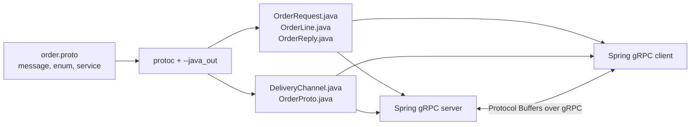

# Generating Message Classes from Proto in Spring gRPC

In **Spring gRPC**, the request and response of an RPC call are typically described as `message` types in a **Protocol Buffers** (`.proto`) file. The `protoc` compiler converts those declarations into strongly typed Java classes with APIs for object construction, field access, and binary serialization/deserialization. Client and server use the same contract to exchange data for both **unary RPCs** and **streaming RPCs**.

This lesson belongs to the **Code generation** section of SPRING_GRPC and focuses on **message classes**: how to declare a schema, generate code, understand the generated Java API, and use it safely. Generating service stubs, configuring channels/servers, metadata, deadlines, interceptors, TLS, and observability are related responsibilities that remain independent of message code.

After this lesson, you will be able to:

- Create a `.proto` schema with scalars, nested messages, enums, `repeated`, `map`, `optional`, and `oneof`.
- Run Java code generation and identify the exact package, class names, and generated methods.
- Build and read message objects using `Builder`; understand immutability, default values, and field presence.
- Serialize, deserialize, and update messages, and distinguish protobuf binary from protobuf JSON.
- Evolve the contract without accidentally breaking communication between client and server versions.

## 1. From .proto Declarations to Java Classes

A `.proto` file is a **data contract**. It defines field names, types, numbers, and structure; the auto-generated Java code is the representation of that contract in Java.



`protoc` parses and validates the schema, then uses the **Java generator** to produce message classes. For each message type, the generated code typically provides:

| Component | Function |
| --- | --- |
| `newBuilder()` | Creates a builder to assign fields |
| `build()` | Finalizes the builder and creates an immutable message |
| `getXxx()` | Reads a field's value |
| `hasXxx()` | Checks presence, **only on fields that support presence** |
| `parseFrom(...)` | Parses a binary representation into a message |
| `toByteArray()` / `writeTo(...)` | Writes the binary representation |
| `toBuilder()` | Creates a new builder initialized from an existing message |
| `getDescriptor()` | Accesses structural metadata for reflection/tooling |

**Do not hand-write or edit generated classes.** They are regenerated from `.proto` and may be overwritten on the next build. Change the contract in the schema; change business rules in application classes.

## 2. Example Order Placement Contract

Suppose a Spring gRPC system receives order requests via a unary RPC `SubmitOrder`. A request contains an order ID, customer ID, line items, free-form labels, an optional coupon code, a delivery channel, and one of two payment methods. The creation time is represented using `google.protobuf.Timestamp`.

Create `src/main/proto/order.proto`:

```proto
syntax = "proto3";

package learning.orders.v1;

import "google/protobuf/timestamp.proto";

option java_package = "vn.example.springgrpc.orders.v1";
option java_multiple_files = true;
option java_outer_classname = "OrderProto";

enum DeliveryChannel {
  DELIVERY_CHANNEL_UNSPECIFIED = 0;
  DELIVERY_CHANNEL_COURIER = 1;
  DELIVERY_CHANNEL_PICKUP = 2;
}

message OrderLine {
  string sku = 1;
  int32 quantity = 2;
}

message OrderRequest {
  string order_id = 1;
  int64 customer_id = 2;
  repeated OrderLine lines = 3;
  map<string, string> labels = 4;
  optional string coupon_code = 5;
  DeliveryChannel delivery_channel = 6;

  oneof payment {
    string card_token = 7;
    string wallet_id = 8;
  }

  google.protobuf.Timestamp created_at = 9;
  bytes audit_digest = 10;
}

message OrderReply {
  string confirmation_id = 1;
  bool accepted = 2;
}

service OrderService {
  rpc SubmitOrder(OrderRequest) returns (OrderReply);
}
```

Key points to understand before generating code:

1. **Field numbers** such as `order_id = 1` and `lines = 3` are the identifiers used on the wire format. Client and server rely on these numbers to interpret data, not on declaration order or Java names.
2. `repeated OrderLine` represents a list of order lines inside **a single** message. It **does not mean** RPC streaming: streaming is a property of the `rpc` signature.
3. `map<string, string>` is a key-value collection. Keys have allowed types per Protocol Buffers rules; this example uses `string`.
4. `optional string coupon_code` allows distinguishing between a field that **was not provided** and a field that **was provided as an empty string**.
5. `oneof payment` ensures at most one field is active at a time between `card_token` and `wallet_id`.
6. `DeliveryChannel` uses numeric value `0` as the default/unspecified state, useful when the client omits the field.
7. `google.protobuf.Timestamp` is a **well-known type** with a corresponding Java runtime API; you do not need to define your own timestamp type.

At the gRPC level, `SubmitOrder` accepts one `OrderRequest` and returns one `OrderReply`. If you later add a server-streaming, client-streaming, or bidirectional-streaming RPC, these same message classes are still used to represent **each individual** request/response; only how multiple messages are exchanged changes.

## 3. Package Configuration and Generated Code Layout

Three important options in `.proto` are frequently confused:

| Declaration | Effect |
| --- | --- |
| `package learning.orders.v1` | Protocol Buffers namespace; contributes to the fully qualified name of services, messages, and RPCs |
| `option java_package = "vn.example.springgrpc.orders.v1"` | Java package of the generated classes |
| `option java_multiple_files = true` | Generates top-level messages/enums as separate Java classes |
| `option java_outer_classname = "OrderProto"` | Names the class containing descriptors and shared metadata |

With the options in the example, the Java output will look like:

```text
vn/example/springgrpc/orders/v1/
├── DeliveryChannel.java
├── OrderLine.java
├── OrderProto.java
├── OrderReply.java
└── OrderRequest.java
```

`OrderRequest` and `OrderReply` are used directly in Java; `OrderProto` holds descriptor metadata and shared elements for the generated code.

If you omit `java_multiple_files = true` (the default is `false`), top-level messages and enums become **nested types** inside the outer class, such as `OrderProto.OrderRequest`. This organization affects Java imports, **not** the Protocol Buffers wire format. If `java_outer_classname` is not set, the generator derives the outer class name from the filename and handles name collisions.

> **Recommended convention:** For Java projects with multiple messages, explicitly set `java_package` and use `java_multiple_files = true` so client and server code remain readable and easy to import. This is a code organization choice; teams may use another convention if agreed upon.

## 4. Generating Message Classes with protoc

Your machine needs a `protoc` version compatible with the schema and Java runtime in use. Verify it:

```bash
protoc --version
```

In a Unix-style shell environment, an example generating Java files into a temporary directory:

```bash
mkdir -p build/generated/manual/java

protoc \
  --proto_path=src/main/proto \
  --java_out=build/generated/manual/java \
  src/main/proto/order.proto
```

The `--proto_path` flag sets the root for locating sources and imports; `--java_out` specifies where to write Java code. The `google/protobuf/timestamp.proto` import must exist in the import path bundled with your `protoc` distribution. If using third-party proto files, add their import roots via `-I`/`--proto_path`.

Here **only message and enum code is generated**. Even though the contract declares `service OrderService`, passing only `--java_out` will **not** produce `OrderServiceGrpc.java`. grpc-java stubs and service base classes are generated separately by the `protoc-gen-grpc-java` plugin via `--grpc-java_out`.

You should verify both the **file location** and the **exact package** at the top of the generated source. Two common mistakes are looking for classes in the wrong package due to confusing `package` with `java_package`, and running only the message generator while application code imports `OrderServiceGrpc`.

## 5. Automating Code Generation in a Gradle Project

To integrate with the Spring gRPC build lifecycle, configure the protobuf Gradle plugin instead of running `protoc` manually after every schema edit. A minimal example using Gradle **Groovy DSL**, illustrating **message generation**:

```groovy
// build.gradle
plugins {
    id 'java'
    id 'com.google.protobuf' version '0.9.5'
}

def protobufVersion = '4.30.2' // Example: choose version per project.

dependencies {
    implementation "com.google.protobuf:protobuf-java:$protobufVersion"
}

protobuf {
    protoc {
        artifact = "com.google.protobuf:protoc:$protobufVersion"
    }
}
```

Place `order.proto` in `src/main/proto/` and run:

```bash
./gradlew generateProto compileJava
# On Windows: .\gradlew.bat generateProto compileJava
```

Under the typical default layout, Java output is placed in:

```text
build/generated/source/proto/main/java/
```

The Gradle plugin adds the generated source directory to the Java source set so `compileJava` can use it. If you need an actual gRPC server or client, the project must also add the **gRPC Java codegen plugin**, grpc-java runtime, and appropriate Spring gRPC dependencies. The short configuration above is only enough to demonstrate **message classes**; it does not yet generate the `OrderServiceGrpc` stub or run a gRPC server.

The `protoc` and `protobuf-java` versions must be compatible; the example shares `protobufVersion` to reduce drift. The versions listed here are **illustrative baselines**, not a recommendation to use the latest version for every project.

## 6. Mapping from Proto Fields to Java APIs

Assuming `java_multiple_files` is enabled, we get the Java class `OrderRequest` with the corresponding accessor methods:

| Proto Declaration | Java Type / Read Value | Common APIs |
| --- | --- | --- |
| `string order_id` | `String` | `getOrderId()`, `setOrderId(String)` |
| `int64 customer_id` | `long` | `getCustomerId()`, `setCustomerId(long)` |
| `repeated OrderLine lines` | `List<OrderLine>` | `getLinesList()`, `getLinesCount()`, `addLines(...)`, `clearLines()` |
| `map<string,string> labels` | `Map<string,String>` | `getLabelsMap()`, `putLabels(...)`, `clearLabels()` |
| `optional string coupon_code` | `String` plus presence | `getCouponCode()`, `hasCouponCode()`, `clearCouponCode()` |
| `DeliveryChannel delivery_channel` | `DeliveryChannel` | `getDeliveryChannel()`, `setDeliveryChannel(...)`, `getDeliveryChannelValue()` |
| `oneof payment` | One choice in the group | `getPaymentCase()`, `setCardToken(...)`, `setWalletId(...)` |
| `google.protobuf.Timestamp created_at` | `Timestamp` | `hasCreatedAt()`, `getCreatedAt()`, `setCreatedAt(...)` |
| `bytes audit_digest` | `ByteString` | `getAuditDigest()`, `setAuditDigest(ByteString)` |

The generator converts `snake_case` field names to `camelCase` Java method names: `order_id` becomes `getOrderId()`; `coupon_code` becomes `getCouponCode()`. Certain special names or name collisions follow dedicated code generation rules, so when in doubt, inspect the actual API of the generated class.

Common scalar types:

| Proto | Java | Notes |
| --- | --- | --- |
| `string` | `String` | UTF-8 on the wire |
| `bool` | `boolean` | Default value `false` |
| `int32`, `sint32`, `fixed32` | `int` | Same Java type, different wire encodings |
| `uint32` | `int` | Must account for **unsigned** semantics when processing |
| `int64`, `sint64`, `fixed64` | `long` | Same Java type, different wire encodings |
| `uint64` | `long` | Must account for **unsigned** semantics when processing |
| `float` / `double` | `float` / `double` | Floating-point values subject to IEEE 754 rounding |
| `bytes` | `ByteString` | Immutable byte sequence object, not `byte[]` |
| `enum` | Generated Java enum | Includes APIs to read numeric values |
| `message` | Generated message class | Supports presence and its own builder |

**Note:** A protobuf message is a data class generated from a schema, not a JPA entity or a Java `record`. It does not automatically perform business validation, access databases, or register RPCs.

## 7. Creating Messages with Builder

Generated messages are immutable once built. You assign values through a builder, then call `build()` to obtain a value that can be passed across application layers or RPCs.

```java
import com.google.protobuf.ByteString;
import com.google.protobuf.Timestamp;
import java.time.Instant;
import vn.example.springgrpc.orders.v1.DeliveryChannel;
import vn.example.springgrpc.orders.v1.OrderLine;
import vn.example.springgrpc.orders.v1.OrderRequest;

public class BuildOrderExample {
    public static void main(String[] args) {
        Instant now = Instant.parse("2026-11-19T08:00:00Z");
        Timestamp createdAt = Timestamp.newBuilder()
                .setSeconds(now.getEpochSecond())
                .setNanos(now.getNano())
                .build();

        OrderRequest request = OrderRequest.newBuilder()
                .setOrderId("ORD-2048")
                .setCustomerId(42L)
                .addLines(OrderLine.newBuilder()
                        .setSku("BOOK-101")
                        .setQuantity(2)
                        .build())
                .addLines(OrderLine.newBuilder()
                        .setSku("PEN-202")
                        .setQuantity(3)
                        .build())
                .putLabels("source", "mobile")
                .putLabels("region", "vn")
                .setCouponCode("") // Sends coupon_code, even though the value is empty.
                .setDeliveryChannel(
                        DeliveryChannel.DELIVERY_CHANNEL_PICKUP)
                .setWalletId("wallet-ref-123")
                .setCreatedAt(createdAt)
                .setAuditDigest(
                        ByteString.copyFrom(new byte[]{0x1A, 0x2B}))
                .build();

        System.out.println(request.getOrderId());
        System.out.println(request.getLinesCount());     // 2
        System.out.println(request.hasCouponCode());     // true
        System.out.println(request.getPaymentCase());    // WALLET_ID
    }
}
```

In this example:

- `addLines(...)` appends each `OrderLine` to the `repeated` field. For multiple items, the builder also provides `addAllLines(...)`.
- `putLabels(...)` inserts an entry into the `map`.
- `setCouponCode("")` still marks the `optional` field as **present**; `getCouponCode()` returns an empty string, while `hasCouponCode()` returns `true`.
- `setWalletId(...)` selects the `wallet_id` branch of `oneof payment`. If `setCardToken(...)` is called afterward, the `wallet_id` branch is replaced.
- `Timestamp` and `ByteString` are dedicated types, rather than assigning `Instant` or `byte[]` directly to the field.

A builder is mutable during construction; the object returned by `build()` is immutable. Do not treat a builder as thread-safe for sharing across threads. For an already-created message, you can update it in a **copy-on-write** style:

```java
OrderRequest revised = request.toBuilder()
        .putLabels("reviewed", "true")
        .clearCouponCode()
        .build();

System.out.println(request.hasCouponCode()); // true: original unchanged
System.out.println(revised.hasCouponCode()); // false: updated copy
```

In application code, store and pass **built messages**, rather than holding onto and sharing builders across requests.

## 8. Default Values, Field Presence, and Oneof

This is the most error-prone area when working with proto3. **The value read back does not always indicate whether a field was actually sent.**

### 8.1. Regular Scalars Have Default Values

With the schema in section 2, an `OrderRequest` with no fields assigned returns:

```java
OrderRequest empty = OrderRequest.getDefaultInstance();

System.out.println(empty.getOrderId());         // ""
System.out.println(empty.getCustomerId());      // 0
System.out.println(empty.getLinesCount());      // 0
System.out.println(empty.getLabelsMap().size());// 0
System.out.println(empty.getDeliveryChannel()); // DELIVERY_CHANNEL_UNSPECIFIED
```

For regular proto3 scalars such as `string order_id` and `int64 customer_id`, there is no `hasOrderId()` or `hasCustomerId()` to ask whether the client actually sent the field. For instance, `0` could be the default value from an omitted field or a value the client explicitly sent. If you need to distinguish them, choose **`optional`**, **`oneof`**, or a wrapper message according to contract requirements.

### 8.2. Optional Distinguishes "Absent" from "Empty"

```java
OrderRequest a = OrderRequest.newBuilder().build();
OrderRequest b = OrderRequest.newBuilder()
        .setCouponCode("")
        .build();

System.out.println(a.getCouponCode().equals("")); // true
System.out.println(b.getCouponCode().equals("")); // true
System.out.println(a.hasCouponCode());            // false
System.out.println(b.hasCouponCode());            // true
```

This matters for partial update APIs: **not providing a coupon** can mean something different from **explicitly clearing the coupon**. You must define the business semantics clearly. `optional` describes data presence; it does not automatically choose database update behavior.

### 8.3. Message Fields Also Track Presence

`created_at` is a message field, so it has `hasCreatedAt()`. When the field has not been set, `getCreatedAt()` still returns a default instance for convenience, so:

```java
if (request.hasCreatedAt()) {
    Timestamp value = request.getCreatedAt();
    Instant created = Instant.ofEpochSecond(
            value.getSeconds(), value.getNanos());
    System.out.println(created);
}
```

Do not conclude that a timestamp was provided merely because `getCreatedAt()` returns a non-`null` object.

### 8.4. Oneof Represents Mutually Exclusive Choices

```java
switch (request.getPaymentCase()) {
    case CARD_TOKEN -> {
        System.out.println("Card payment: " + request.getCardToken());
    }
    case WALLET_ID -> {
        System.out.println("Wallet: " + request.getWalletId());
    }
    case PAYMENT_NOT_SET -> {
        System.out.println("No payment method selected");
    }
}
```

`getPaymentCase()` tells you which branch is selected. With `oneof`, setting one member clears the other member, even if the new value is an empty string. Checking `PaymentCase` is safer than inferring the choice from whether `getCardToken().isEmpty()` or `getWalletId().isEmpty()`.

### 8.5. Enums Must Handle Unrecognized Values

`getDeliveryChannel()` returns the Java enum, while `getDeliveryChannelValue()` returns the numeric value. With data arriving from a client on a newer schema, an enum may carry a numeric value not defined in the current version. Never assume only `COURIER` and `PICKUP` can appear.

```java
switch (request.getDeliveryChannel()) {
    case DELIVERY_CHANNEL_COURIER -> {
        // Deliver via courier.
    }
    case DELIVERY_CHANNEL_PICKUP -> {
        // Customer picks up in person.
    }
    default -> {
        // UNSPECIFIED or an enum value unknown to this client.
    }
}
```

The `default` branch prevents mishandling unset selections or newer schemas not yet rolled out uniformly.

## 9. Repeated, Map, and Bytes: Reading Data Types Correctly

**Lists:** `getLinesList()` returns a list you can iterate over, but you should not mutate it directly to change the message. Use a builder instead:

```java
for (OrderLine line : request.getLinesList()) {
    if (line.getQuantity() <= 0) {
        throw new IllegalArgumentException(
                "quantity must be greater than 0: " + line.getSku());
    }
}

OrderRequest updated = request.toBuilder()
        .addLines(OrderLine.newBuilder()
                .setSku("NOTE-303")
                .setQuantity(1)
                .build())
        .build();
```

**Maps:** `getLabelsMap()` lets you look up labels. To add or remove labels, use `putLabels` / `removeLabels` on the builder:

```java
String source = request.getLabelsOrDefault("source", "unknown");

OrderRequest sanitized = request.toBuilder()
        .removeLabels("internal-only")
        .build();
```

**Bytes:** `bytes` maps to `ByteString` to preserve immutability and avoid confusion with character types.

```java
byte[] digestBytes = request.getAuditDigest().toByteArray();

OrderRequest withDigest = request.toBuilder()
        .setAuditDigest(ByteString.copyFrom(digestBytes))
        .build();
```

`ByteString` does not compute checksums or digital signatures on its own. The `audit_digest` example only illustrates holding bytes; the application must define the algorithm and verification logic. Likewise, protobuf does not validate line counts, positive/negative quantities, or SKU formats: that belongs to the business layer.

## 10. Binary Serialization and Deserialization

Most Spring gRPC applications do not need to call `toByteArray()` directly: grpc-java uses a protobuf marshaller to encode and decode messages for RPCs. However, understanding this API is very useful when writing data to files, building fixtures, or diagnosing issues.

```java
import com.google.protobuf.InvalidProtocolBufferException;
import vn.example.springgrpc.orders.v1.OrderRequest;

public static OrderRequest roundTrip(OrderRequest input)
        throws InvalidProtocolBufferException {

    byte[] wire = input.toByteArray();
    OrderRequest decoded = OrderRequest.parseFrom(wire);

    if (!decoded.equals(input)) {
        throw new IllegalStateException("Round-trip mismatch");
    }
    return decoded;
}
```

`parseFrom(byte[])` can throw `InvalidProtocolBufferException` if the input is invalid. Protobuf binary data is **not a human-readable format**, and hand-written JSON is not a substitute for the protobuf wire format.

When processing multiple messages sequentially in a stream, you must delimit boundaries between them. The `writeDelimitedTo(OutputStream)` and `parseDelimitedFrom(InputStream)` APIs use a **length-prefixed** (length-delimited) format:

```java
import java.io.ByteArrayInputStream;
import java.io.ByteArrayOutputStream;

ByteArrayOutputStream output = new ByteArrayOutputStream();
request.writeDelimitedTo(output);

ByteArrayInputStream input =
        new ByteArrayInputStream(output.toByteArray());
OrderRequest restored = OrderRequest.parseDelimitedFrom(input);
```

If the stream ends before the next message, `parseDelimitedFrom` can return `null`; check for this in loops. This API is useful for application-managed files/streams; **you do not need to manually frame** requests when using gRPC, as HTTP/2 and grpc-java handle transport framing.

For untrusted input, configure size and resource limits at the transport/parser level appropriate for your system; a successful `parseFrom` only proves the payload is syntactically valid, **not** that it is business-valid or safe to process.

### How Does Protobuf JSON Differ from Regular JSON?

When interoperating with systems using JSON, use the protobuf JSON mapping instead of assuming general-purpose JSON libraries understand generated messages. Add the `protobuf-java-util` library matching your `protobuf-java` version:

```groovy
dependencies {
    implementation "com.google.protobuf:protobuf-java-util:$protobufVersion"
}
```

```java
import com.google.protobuf.util.JsonFormat;

String json = JsonFormat.printer().print(request);

OrderRequest.Builder builder = OrderRequest.newBuilder();
JsonFormat.parser().merge(json, builder);
OrderRequest fromJson = builder.build();
```

Protobuf JSON mapping has specific conventions: field `order_id` can be represented as `orderId`, `int64` is typically formatted as a decimal string, `bytes` uses base64, and `Timestamp` uses an RFC 3339 timestamp string. For `oneof` and `optional`, field presence behavior must also be considered. Do not use this JSON example to infer the size, performance, or format of gRPC payloads on the wire.

## 11. How Are Message Classes Used in Spring gRPC?

In Spring gRPC, client and server exchange generated Java types, but **message classes contain no RPC logic**. When the gRPC Java service stub plugin is also configured, a unary RPC implementation can receive `OrderRequest` directly and return `OrderReply`:

```java
import io.grpc.Status;
import io.grpc.stub.StreamObserver;
import org.springframework.stereotype.Service;
import vn.example.springgrpc.orders.v1.OrderReply;
import vn.example.springgrpc.orders.v1.OrderRequest;
import vn.example.springgrpc.orders.v1.OrderServiceGrpc;

@Service
public class OrderServiceImpl
        extends OrderServiceGrpc.OrderServiceImplBase {

    @Override
    public void submitOrder(
            OrderRequest request,
            StreamObserver<OrderReply> responseObserver) {

        if (request.getOrderId().isBlank()
                || request.getLinesCount() == 0) {
            responseObserver.onError(Status.INVALID_ARGUMENT
                    .withDescription("Missing order_id or lines")
                    .asRuntimeException());
            return;
        }

        // Illustrative example: real business logic needs validation and order persistence.
        OrderReply reply = OrderReply.newBuilder()
                .setConfirmationId("CONF-" + request.getOrderId())
                .setAccepted(true)
                .build();

        responseObserver.onNext(reply);
        responseObserver.onCompleted();
    }
}
```

`OrderServiceGrpc` is **not** generated by `--java_out` alone; it requires the `protoc-gen-grpc-java` plugin and Spring gRPC/grpc-java dependencies. How Spring registers `BindableService` beans and creates client stubs depends on the integration starter/version used.

Clear separation of responsibilities:

| Aspect | Who Is Responsible? |
| --- | --- |
| Field names and types, field numbers, encoding, parse/builder | `.proto` contract and generated message classes |
| Service name, RPCs, stubs, and server base class | `service/rpc` contract and gRPC Java generator |
| Validating `order_id`, `quantity`, looking up orders | Spring business logic |
| Metadata, deadlines, interceptors, TLS, channels | grpc-java/Spring gRPC and runtime configuration |
| Error statuses, timing, tracing, metrics | RPC handling and observability stack |

A request may pass through an auth interceptor, be decoded into `OrderRequest`, get validated, and be answered by the server as `OrderReply`. Having an `order_id` field in the schema does not make security tokens or deadlines appear inside the message. Those are separate layers of information.

## 12. Contract Compatibility Across Code Generation Runs

Renaming a Java method can break application compilation; changing a field number in `.proto` can cause **data on the network to be misinterpreted**. Both kinds of compatibility must be evaluated separately.

| Schema Change | Initial Assessment |
| --- | --- |
| Adding a new field with a new number | Usually compatible with older clients, though default semantics must be reviewed |
| Removing a previously used field | Can be ignored by newer clients; requires `reserved` and data requirement analysis |
| Changing an existing field number | Carries serious risk of breaking wire compatibility |
| Changing a field's type | Depends on old/new types and wire types; never assume safe without verification |
| Changing `java_package` | Affects Java code/imports, does not directly alter wire field numbers |
| Changing `package` or service/method names | Changes the full RPC name, causing gRPC routing errors |
| Changing a regular field to `optional` | Affects presence API and handling; requires testing old/new versions |
| Adding enum values | Older clients may encounter unknown enum numbers; must have an appropriate fallback branch |

When removing an old field, record its field number and name with `reserved` so they are never accidentally reused:

```proto
message OrderLine {
  string sku = 1;
  int32 quantity = 2;

  reserved 3;
  reserved "legacy_display_name";
}
```

This example assumes field number `3` and name `legacy_display_name` previously existed and were retired. `reserved` does not strip old data from payloads or perform data migration; it makes the compiler block new declarations from reusing reserved identifiers.

Field values unknown to a given version may be preserved by protobuf as **unknown fields**, though the level of preservation depends on conversion paths (for example, binary → JSON → binary can differ from binary → binary). Do not rely on unknown fields to implement business logic that needs to understand a new field; instead, upgrade schemas, clients, and servers deliberately.

## 13. Common Errors and Misconceptions

| Symptom | What to Check |
| --- | --- |
| `cannot find symbol: OrderRequest` | `generateProto` has not run, source set lacks generated code, wrong `java_package` or import |
| `cannot find symbol: OrderServiceGrpc` | Only messages were generated; gRPC stub plugin is not configured |
| Cannot find `hasOrderId()` | `order_id` is a proto3 scalar without explicit presence; use `optional` if the contract requires it |
| `getCouponCode()` returns `""` causing flawed logic checks | Must use `hasCouponCode()` to check whether an optional field was set |
| Modifying `getLinesList()` with `add(...)` throws an error | Messages are immutable; add items via `toBuilder().addLines(...)` |
| Passing `byte[]` directly to `setAuditDigest` | `bytes` in Java is `ByteString`; use `ByteString.copyFrom(...)` |
| `InvalidProtocolBufferException` | Malformed, corrupted/truncated payload, or binary for a different message than expected |
| Runtime errors like `NoSuchMethodError`, `RuntimeVersion` | Check `protoc`/`protobuf-java` versions and transitive dependencies |
| Renamed a field and Java builds, but clients misread data | Check field numbers, wire types, and application compatibility; compilation does not guarantee deployed contract compatibility |
| Confusing `repeated` with RPC streaming | `repeated` is a collection **within one message**; `stream` in an RPC signature is **multiple messages over time** |

An effective diagnostic workflow is to pinpoint whether the failure occurs at **schema parsing**, **code generation**, **Java compilation**, **binary parsing**, or **RPC handling**. Do not edit generated Java to hide symptoms; fix the schema, library versions, build configuration, or application logic depending on the root cause.

## 14. Hands-On Practice

1. **Generate and inspect classes:** Create `order.proto` as in section 2, run `generateProto compileJava`, and locate `OrderRequest.java` and `OrderProto.java`. Explain why these two classes exist and why `OrderServiceGrpc.java` has not appeared yet.
2. **Builder and immutability:** Create an `OrderRequest` with two order lines and update it to three lines using `toBuilder()`. Verify the original message still has exactly two lines.
3. **Presence:** Create two requests—one omitting `coupon_code` and one calling `setCouponCode("")`. Compare `getCouponCode()` with `hasCouponCode()`.
4. **Oneof:** Create a builder and call `setCardToken("T")` followed by `setWalletId("W")`. After `build()`, check `getPaymentCase()` and explain why both choices cannot be retained.
5. **Binary round-trip:** Serialize an `OrderRequest` to `byte[]`, read it back with `parseFrom`, and confirm `equals`; then check what happens when the binary data is truncated.
6. **Compatibility:** Simulate retiring field number `3` in another message. Add `reserved` and explain the difference between wire compatibility, Java source compatibility, and business compatibility.
7. **RPC usage:** Write a validator checking that `order_id` is non-blank, `lines` is non-empty, and every `quantity` is positive. Call the validator before the server returns `OrderReply`; use `Status.INVALID_ARGUMENT` when data is invalid.

### Key Takeaway

**Message classes are the Java representation of a Protocol Buffers data contract.** `protoc --java_out` generates immutable data types and builders to construct, read, and serialize messages; a separate gRPC plugin generates service stubs. When using them in Spring gRPC, pay close attention to **field presence**, `oneof` rules, the difference between `repeated` and RPC streaming, and field number compatibility across versions. Generated code standardizes the exchange format, while business logic, security, and operations remain the application's responsibility.
