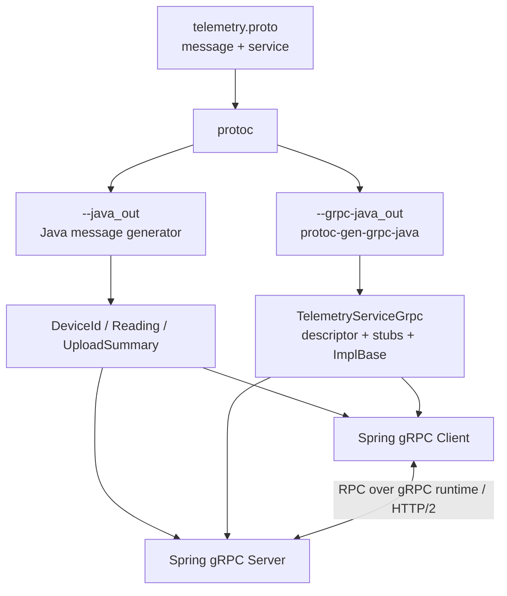
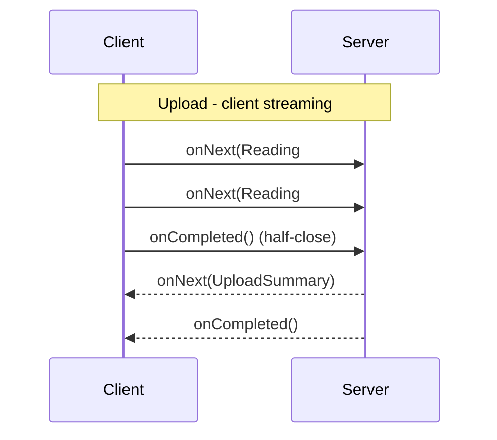
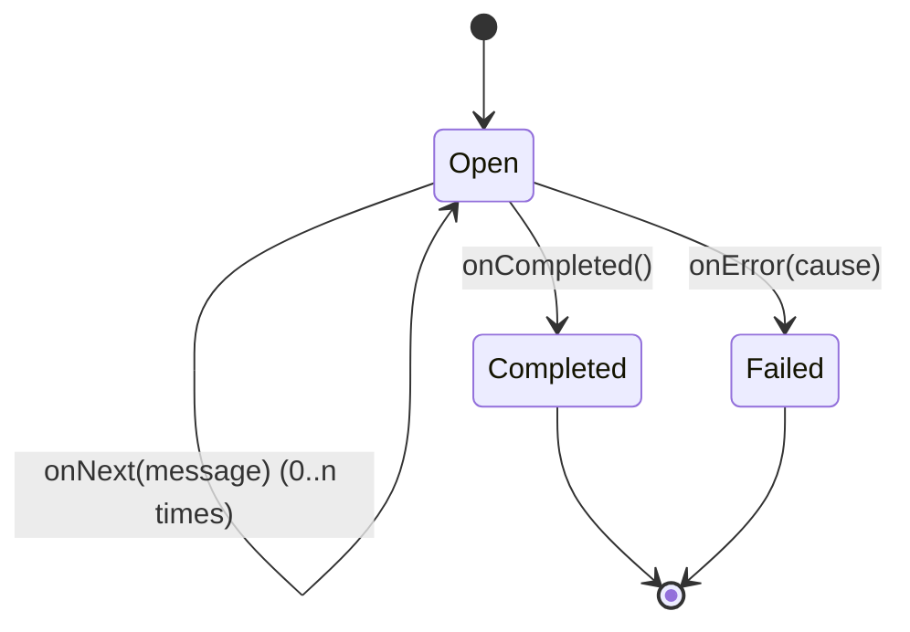

# Generating Client Stubs and Server Base Classes from Protocol Buffers Contracts

In **Spring gRPC**, the client invokes methods on a **stub**, while the server implements methods declared in a **server base class**. Both kinds of code are generated from the `service` and `rpc` sections of a `.proto` file by the `protoc-gen-grpc-java` plugin. Sharing a single contract ensures RPC names, request/response types, and streaming modes are defined consistently between client and server.

This lesson belongs to the **Code generation** chapter of the **SPRING_GRPC** module. It focuses on **generating client stubs and server base classes**, how to read the generated Java API, and how to wire them into a Spring application to build unary or streaming services. Topics such as metadata, deadlines, statuses, interceptors, TLS, integration testing, and observability are also referenced where relevant, because they directly affect how stubs and server base classes are used in real deployments.

After this lesson, you will be able to:

- Distinguish message code produced by `--java_out` from service/stub code produced by `--grpc-java_out`.
- Identify `*Grpc` classes, `*ImplBase`, asynchronous stubs, blocking stubs, and future stubs.
- Understand the generated Java signatures for unary, server streaming, client streaming, and bidirectional streaming.
- Write a Spring gRPC server from a server base class and invoke RPCs through a client stub.
- Use `StreamObserver` with proper lifecycle management, manage channels/deadlines, and diagnose code generation configuration errors.

## 1. What Do Stubs and Server Base Classes Solve?

Suppose the contract declares `rpc GetLatest(DeviceId) returns (Reading);`. The client side needs a Java method `getLatest(...)` to call the server, while the server side needs an extension point to implement how the latest reading is retrieved. Hand-writing all service names, descriptors, marshallers, and RPC invocation logic is both tedious and error-prone.

`protoc-gen-grpc-java` reads the **service descriptor** from `protoc` and generates a class such as `TelemetryServiceGrpc`. This class contains:

| Component | Role |
| --- | --- |
| `SERVICE_NAME` | Full gRPC service name, including the protobuf package |
| Method descriptors | Describe names, RPC types, and request/response marshallers |
| `TelemetryServiceImplBase` | Server base class for the application to implement the RPCs |
| `TelemetryServiceStub` | Asynchronous client stub using callbacks/`StreamObserver` |
| `TelemetryServiceBlockingStub` | Synchronous client stub for unary and server streaming in the common blocking API |
| `TelemetryServiceFutureStub` | Client stub returning a future for unary RPCs |
| `newStub(...)`, `newBlockingStub(...)`, `newFutureStub(...)` | Factory methods to create stubs from a `Channel` |
| `getServiceDescriptor()` | Service descriptor metadata for grpc-java and tooling |

The client **does not instantiate the server implementation class directly**; it creates a stub bound to a `Channel`. The server **does not call a stub to implement business logic**; it extends or implements the API provided by the generator and registers the service with the gRPC runtime. Message classes such as `DeviceId` and `Reading` are generated separately by the standard Java generator.



Importantly: **code generation creates the communication scaffolding—it does not generate business logic, active connections, or automatic Spring configuration**. You still must implement the service, configure the server/channel, handle authentication, error handling, and observability.

## 2. Defining a Contract with All Four RPC Types

Consider an IoT device telemetry service. Place `src/main/proto/telemetry.proto`:

```proto
syntax = "proto3";

package learning.telemetry.v1;

option java_package = "vn.example.springgrpc.telemetry.v1";
option java_multiple_files = true;
option java_outer_classname = "TelemetryProto";

message DeviceId {
  string value = 1;
}

message Reading {
  string device_id = 1;
  int64 sequence = 2;
  double temperature_c = 3;
}

message UploadSummary {
  int32 received = 1;
}

service TelemetryService {
  // One request, one response.
  rpc GetLatest(DeviceId) returns (Reading);

  // One request, multiple responses.
  rpc Watch(DeviceId) returns (stream Reading);

  // Multiple requests, one response.
  rpc Upload(stream Reading) returns (UploadSummary);

  // Multiple requests and multiple responses independently over time.
  rpc Exchange(stream Reading) returns (stream Reading);
}
```

With this contract:

- `package learning.telemetry.v1` is the protobuf namespace. The full gRPC service name is `learning.telemetry.v1.TelemetryService`; the RPC path for GetLatest has the form `/learning.telemetry.v1.TelemetryService/GetLatest`.
- `java_package` determines the generated Java package, here `vn.example.springgrpc.telemetry.v1`. Do not confuse the Java package with the protobuf package.
- `java_multiple_files = true` produces standalone classes `DeviceId`, `Reading`, and `UploadSummary`.
- The `stream` keyword before the request/response type in the **RPC signature** indicates multiple messages over time. It differs from `repeated`, which is a list **inside a single message**.

These four methods use the same message system but generate **different API shapes** depending on the streaming mode.

## 3. Generating Both Code Groups: Java Messages and gRPC Service

Once `protoc` is installed and an OS-compatible `protoc-gen-grpc-java` executable is available, you can run it manually:

```bash
protoc --version

mkdir -p build/generated/manual/java build/generated/manual/grpc

protoc \
  --proto_path=src/main/proto \
  --java_out=build/generated/manual/java \
  --plugin=protoc-gen-grpc-java=/path/to/protoc-gen-grpc-java \
  --grpc-java_out=build/generated/manual/grpc \
  src/main/proto/telemetry.proto
```

This uses Unix-style shell syntax; on Windows, adjust directory creation, line continuations, and the path to the `.exe` executable. If `protoc-gen-grpc-java` is already in `PATH`, the default plugin lookup mechanism can be used instead of `--plugin=...`.

Illustrative output:

```text
build/generated/manual/
├── java/vn/example/springgrpc/telemetry/v1/
│   ├── DeviceId.java
│   ├── Reading.java
│   ├── UploadSummary.java
│   └── TelemetryProto.java
└── grpc/vn/example/springgrpc/telemetry/v1/
    └── TelemetryServiceGrpc.java
```

| Flag | What Is Generated | What Is Missing If Used Alone? |
| --- | --- | --- |
| `--java_out` | Java messages/enums, descriptors | Missing `TelemetryServiceGrpc`, client stubs, and server base class |
| `--grpc-java_out` | grpc-java API for the service | Missing the message classes referenced by the service API |
| Both | Message code and gRPC service code | Still needs runtime dependencies and business implementation code |

The gRPC plugin communicates with `protoc` via `CodeGeneratorRequest` and `CodeGeneratorResponse`, receiving processed descriptors and returning the contents of the Java files. `protoc` does not compile those Java files; `javac`/`compileJava` runs afterward.

**Do not edit code in generated directories directly.** If you need to change an RPC signature, edit `.proto` and regenerate. If you need to change request handling, edit the server implementation class or client call logic.

## 4. Configuring Gradle for Automatic Stub Generation

In a Java/Spring Boot project using Gradle Groovy DSL, you can configure it as follows. The versions below are **illustrative examples**, not an implication that these are the latest versions or a combination tested across every Spring gRPC release:

```groovy
// build.gradle - code generation and compile configuration section
plugins {
    id 'java'
    id 'com.google.protobuf' version '0.9.5'
}

def protobufVersion = '4.30.2'
def grpcVersion = '1.71.0'

dependencies {
    implementation "com.google.protobuf:protobuf-java:$protobufVersion"
    implementation platform("io.grpc:grpc-bom:$grpcVersion")
    implementation 'io.grpc:grpc-protobuf'
    implementation 'io.grpc:grpc-stub'

    // Commonly used by runtime/server if not provided by a Spring starter.
    runtimeOnly 'io.grpc:grpc-netty-shaded'

    // Some generator versions use @javax.annotation.Generated.
    compileOnly 'javax.annotation:javax.annotation-api:1.3.2'
}

protobuf {
    protoc {
        artifact = "com.google.protobuf:protoc:$protobufVersion"
    }
    plugins {
        grpc {
            artifact = "io.grpc:protoc-gen-grpc-java:$grpcVersion"
        }
    }
    generateProtoTasks {
        all().configureEach { task ->
            task.plugins {
                grpc {}
            }
        }
    }
}
```

Running the tasks in a real project:

```bash
./gradlew generateProto compileJava
# Windows PowerShell: .\gradlew.bat generateProto compileJava
```

The common default paths of the Gradle protobuf plugin are:

```text
build/generated/source/proto/main/java/
build/generated/source/proto/main/grpc/
```

Here, the `java` directory holds messages and the `grpc` directory holds `TelemetryServiceGrpc.java`. The plugin wires generated sources into the Java source set so the compiler can find those classes. Do not commit the generated directory to Git if the project standardizes on generating code during build/CI.

This is the **basic code generation and grpc-java configuration**, not the full Spring gRPC application setup: to run a server/client through Spring Boot you also need the corresponding starter, service registration mechanism, port/channel configuration, and Spring-managed dependencies. For projects using Spring dependency management/BOM, review version management to avoid overlapping declarations.

## 5. Reading the TelemetryServiceGrpc Class Structure

A `*Grpc` class produced by the generator can be read according to this layout:

```text
TelemetryServiceGrpc
├── SERVICE_NAME
├── getServiceDescriptor()
├── descriptors for GetLatest / Watch / Upload / Exchange
├── TelemetryServiceImplBase          // server base
├── TelemetryServiceStub              // async
├── TelemetryServiceBlockingStub      // blocking
├── TelemetryServiceFutureStub        // future
├── newStub(Channel)
├── newBlockingStub(Channel)
└── newFutureStub(Channel)
```

Depending on the `grpc-java` version, the generated class may also include an `AsyncService` interface, `bindService(...)` methods, internal helper classes, or newer blocking API variants. Therefore, prefer the **actual public API in your project's version** rather than relying on private internal structure of the generated file.

### 5.1. Service Descriptor and Method Descriptors

`SERVICE_NAME` reflects the protobuf package and service name, for example:

```text
learning.telemetry.v1.TelemetryService
```

Each `rpc` has a descriptor specifying its `MethodType`:

| RPC | MethodType in grpc-java |
| --- | --- |
| `GetLatest` | `UNARY` |
| `Watch` | `SERVER_STREAMING` |
| `Upload` | `CLIENT_STREAMING` |
| `Exchange` | `BIDI_STREAMING` |

The descriptor also references protobuf marshallers for request/response types. grpc-java uses this metadata to dispatch calls without the application manually serializing messages.

### 5.2. What Extension Points Does the Server Base Provide?

`TelemetryServiceImplBase` is the base class for server implementations. In many modern grpc-java versions, it implements `BindableService` and delegates handling to the `AsyncService` API. You typically **extend `ImplBase` and override the methods corresponding to each RPC**.

If an RPC is not overridden, the default implementation typically returns an `UNIMPLEMENTED` status. This explains cases where the server starts up fine, but calling an unimplemented method fails.

### 5.3. Client Stubs Work with a Channel

Factory methods:

```java
TelemetryServiceGrpc.TelemetryServiceBlockingStub blocking =
        TelemetryServiceGrpc.newBlockingStub(channel);

TelemetryServiceGrpc.TelemetryServiceStub async =
        TelemetryServiceGrpc.newStub(channel);

TelemetryServiceGrpc.TelemetryServiceFutureStub future =
        TelemetryServiceGrpc.newFutureStub(channel);
```

`channel` is an `io.grpc.Channel` (commonly a `ManagedChannel` for lifecycle management). A stub is not a socket; it holds metadata to send calls over the configured channel. You can create multiple stubs on a single reused channel.

## 6. Mapping the Four RPC Types to Java Signatures

The most important difference in generated code is the number of requests/responses and the placement of `StreamObserver`:

| Proto Method | Server `ImplBase` (Signature Semantics) | Client Async Stub |
| --- | --- | --- |
| `GetLatest(DeviceId) returns (Reading)` | `void getLatest(DeviceId, StreamObserver<Reading>)` | `void getLatest(DeviceId, StreamObserver<Reading>)` |
| `Watch(DeviceId) returns (stream Reading)` | `void watch(DeviceId, StreamObserver<Reading>)` | `void watch(DeviceId, StreamObserver<Reading>)` |
| `Upload(stream Reading) returns (UploadSummary)` | `StreamObserver<Reading> upload(StreamObserver<UploadSummary>)` | `StreamObserver<Reading> upload(StreamObserver<UploadSummary>)` |
| `Exchange(stream Reading) returns (stream Reading)` | `StreamObserver<Reading> exchange(StreamObserver<Reading>)` | `StreamObserver<Reading> exchange(StreamObserver<Reading>)` |

How to read this table:

- For **unary** and **server streaming**, the request appears directly in the parameter list. The server receives `responseObserver` to emit one or more responses and terminate the call.
- For **client streaming** and **bidirectional streaming**, the request parameter is a **stream**. The server returns a `StreamObserver<Reading>` so grpc-java can deliver each incoming request via `onNext(...)`. The async client likewise receives a request observer from the stub to actively send requests.
- The observer returned on the **client** is used to **send** requests; the observer passed into the client is used to **receive** responses. On the **server**, the observer returned by the method is used to **receive** requests; the observer passed in is used to **send** responses.

Newcomers often mix up directions because both sides use `StreamObserver`, but its meaning depends on which side is sending or receiving.



Here, calling `onCompleted()` on the client's request observer means **the client has finished sending requests**, not that the entire RPC is complete. The server still needs to send a response or an error on the response stream.

### How Do Blocking Stub and Future Stub Differ?

Common grpc-java blocking stub forms:

```java
Reading latest = blocking.getLatest(deviceId);

java.util.Iterator<Reading> stream = blocking.watch(deviceId);
while (stream.hasNext()) {
    Reading item = stream.next();
    // Process each response.
}
```

Common future stub supports unary calls:

```java
com.google.common.util.concurrent.ListenableFuture<Reading> result =
        future.getLatest(deviceId);
```

Client-streaming and bidirectional-streaming RPCs are typically implemented via the **async stub** with two-way observers. Some grpc-java versions provide additional blocking APIs for streaming; do not assume those variants exist in every generator version. For applications that process streams over time or use callbacks, the async stub is a consistent starting point.

## 7. Implementing the Server Base Class in Spring gRPC

With the generated classes above, a Spring bean can extend `TelemetryServiceImplBase`. The example below implements all four methods to demonstrate signatures and observer lifecycles; the data source is mocked for clarity.

```java
package vn.example.springgrpc.telemetry;

import io.grpc.Status;
import io.grpc.stub.StreamObserver;
import org.springframework.stereotype.Service;
import vn.example.springgrpc.telemetry.v1.DeviceId;
import vn.example.springgrpc.telemetry.v1.Reading;
import vn.example.springgrpc.telemetry.v1.TelemetryServiceGrpc;
import vn.example.springgrpc.telemetry.v1.UploadSummary;

@Service
public class TelemetryServiceImpl
        extends TelemetryServiceGrpc.TelemetryServiceImplBase {

    @Override
    public void getLatest(
            DeviceId request,
            StreamObserver<Reading> responseObserver) {

        if (request.getValue().isBlank()) {
            responseObserver.onError(Status.INVALID_ARGUMENT
                    .withDescription("device id must not be blank")
                    .asRuntimeException());
            return;
        }

        responseObserver.onNext(Reading.newBuilder()
                .setDeviceId(request.getValue())
                .setSequence(10)
                .setTemperatureC(24.5)
                .build());
        responseObserver.onCompleted();
    }

    @Override
    public void watch(
            DeviceId request,
            StreamObserver<Reading> responseObserver) {

        // Finite example; a real service needs cancellation and backpressure handling.
        for (int i = 1; i <= 3; i++) {
            responseObserver.onNext(Reading.newBuilder()
                    .setDeviceId(request.getValue())
                    .setSequence(i)
                    .setTemperatureC(24.0 + i)
                    .build());
        }
        responseObserver.onCompleted();
    }

    @Override
    public StreamObserver<Reading> upload(
            StreamObserver<UploadSummary> responseObserver) {

        return new StreamObserver<Reading>() {
            private int count;

            @Override
            public void onNext(Reading reading) {
                // Each onNext is one message from the client.
                count++;
            }

            @Override
            public void onError(Throwable error) {
                // Client cancelled or stream failed: release resources if any.
            }

            @Override
            public void onCompleted() {
                responseObserver.onNext(UploadSummary.newBuilder()
                        .setReceived(count)
                        .build());
                responseObserver.onCompleted();
            }
        };
    }

    @Override
    public StreamObserver<Reading> exchange(
            StreamObserver<Reading> responseObserver) {

        return new StreamObserver<Reading>() {
            @Override
            public void onNext(Reading incoming) {
                // Demonstrates replying to each incoming message.
                responseObserver.onNext(incoming.toBuilder()
                        .setSequence(incoming.getSequence() + 1)
                        .build());
            }

            @Override
            public void onError(Throwable error) {
                // Stream termination/error from request side: release resources.
            }

            @Override
            public void onCompleted() {
                responseObserver.onCompleted();
            }
        };
    }
}
```

`TelemetryServiceImpl` only contains mocked logic; `Reading`, `UploadSummary`, and `TelemetryServiceGrpc` are generated code. Java methods use `camelCase`, even though the RPC names in the schema are `GetLatest`/`Upload`.

In **Spring gRPC** versions with auto-configuration that registers Spring beans of type `BindableService`, this bean is wired into the gRPC server. Other Spring–gRPC integration libraries may require specific annotations or registration. Check your actual starter to ensure the service is bound; merely adding `@Service` does not guarantee every library automatically registers the RPC.

### Why Must onError Terminate the Processing Path?

For a successful call, the server sends responses with `onNext(...)` and closes the response stream with `onCompleted()`. On error, call `onError(...)` with an appropriate gRPC status and **do not** call `onNext` or `onCompleted` afterward on the same observer.

For instance, `getLatest` returns `INVALID_ARGUMENT` and exits with `return`. Omitting `return` would allow subsequent code to call `onNext` after `onError`, violating the observer lifecycle.

The `onError` callbacks of a server-side **request observer** in client-streaming/bidi calls represent an error or cancellation from the request side; typically you should clean up resources and log appropriately. Avoid attempting to send further responses on a cancelled call.

## 8. Creating Client Stubs and Calling Unary/Server-Streaming RPCs

A standalone grpc-java example to clarify the API, even when Spring ultimately manages channels and stubs in the application:

```java
package vn.example.springgrpc.telemetry;

import io.grpc.ManagedChannel;
import io.grpc.ManagedChannelBuilder;
import io.grpc.StatusRuntimeException;
import java.util.Iterator;
import java.util.concurrent.TimeUnit;
import vn.example.springgrpc.telemetry.v1.DeviceId;
import vn.example.springgrpc.telemetry.v1.Reading;
import vn.example.springgrpc.telemetry.v1.TelemetryServiceGrpc;

public final class TelemetryBlockingClient {
    public static void main(String[] args) throws InterruptedException {
        ManagedChannel channel = ManagedChannelBuilder
                .forAddress("localhost", 9090)
                .usePlaintext() // For local examples only.
                .build();

        try {
            TelemetryServiceGrpc.TelemetryServiceBlockingStub stub =
                    TelemetryServiceGrpc.newBlockingStub(channel)
                            .withDeadlineAfter(3, TimeUnit.SECONDS);

            DeviceId device = DeviceId.newBuilder()
                    .setValue("sensor-7")
                    .build();

            Reading latest = stub.getLatest(device);
            System.out.println("Latest: " + latest.getTemperatureC());

            Iterator<Reading> updates = stub.watch(device);
            while (updates.hasNext()) {
                Reading item = updates.next();
                System.out.println("Sequence: " + item.getSequence());
            }
        } catch (StatusRuntimeException error) {
            System.err.println("RPC status: " + error.getStatus().getCode());
        } finally {
            channel.shutdown();
            if (!channel.awaitTermination(3, TimeUnit.SECONDS)) {
                channel.shutdownNow();
            }
        }
    }
}
```

The snippet involves three distinct objects:

1. `ManagedChannel`: the gRPC communication channel, which has its own lifecycle and can be reused across many RPCs.
2. `TelemetryServiceBlockingStub`: a call wrapper holding the channel and call options such as deadlines; it is not a server and does not manage connection lifecycle itself.
3. `DeviceId`/`Reading`: message classes used to exchange protobuf data.

`withDeadlineAfter(3, TimeUnit.SECONDS)` returns a **derived stub with a deadline configured**, rather than mutating a shared stub in place. The deadline applies to each call made with that derived stub. For long-lived streaming RPCs, choose an appropriate deadline; avoid accidentally using a short deadline that expires mid-stream.

In Spring gRPC applications, channels and stubs are usually created and managed via client configuration and starter dependency injection. The exact injection style depends on the Spring gRPC version. For local examples, `usePlaintext()` avoids certificate setup; in production, configure TLS and authentication according to your environment rather than keeping plaintext connections.

## 9. Calling Client-Streaming with the Async Stub

For `Upload(stream Reading) returns (UploadSummary)`, the client sends multiple `Reading` messages and receives one `UploadSummary`. The async stub signature looks like:

```java
StreamObserver<Reading> requestObserver =
        async.upload(responseObserver);
```

`responseObserver` receives the result from the server; `requestObserver` is where the client sends messages one by one. Example using an already-created channel and an async stub bound to it:

```java
import io.grpc.stub.StreamObserver;
import java.util.concurrent.CountDownLatch;
import java.util.concurrent.TimeUnit;
import vn.example.springgrpc.telemetry.v1.Reading;
import vn.example.springgrpc.telemetry.v1.TelemetryServiceGrpc;
import vn.example.springgrpc.telemetry.v1.UploadSummary;

TelemetryServiceGrpc.TelemetryServiceStub async =
        TelemetryServiceGrpc.newStub(channel)
                .withDeadlineAfter(5, TimeUnit.SECONDS);

CountDownLatch completed = new CountDownLatch(1);

StreamObserver<UploadSummary> responseObserver =
        new StreamObserver<UploadSummary>() {
            @Override
            public void onNext(UploadSummary summary) {
                System.out.println("Received: " + summary.getReceived());
            }

            @Override
            public void onError(Throwable error) {
                System.err.println("Upload error: " + error);
                completed.countDown();
            }

            @Override
            public void onCompleted() {
                completed.countDown();
            }
        };

StreamObserver<Reading> requestObserver =
        async.upload(responseObserver);

requestObserver.onNext(Reading.newBuilder()
        .setDeviceId("sensor-7")
        .setSequence(1)
        .setTemperatureC(25.1)
        .build());
requestObserver.onNext(Reading.newBuilder()
        .setDeviceId("sensor-7")
        .setSequence(2)
        .setTemperatureC(25.3)
        .build());
requestObserver.onCompleted(); // Client finished sending, waiting for response.

if (!completed.await(6, TimeUnit.SECONDS)) {
    throw new IllegalStateException("Did not receive RPC completion");
}
```

This snippet assumes `channel` already exists and is shut down after the callback completes; it sits inside a method declaring `throws InterruptedException` or handling interruption equivalently. In real applications, **propagate asynchronous errors** from `onError` back to the caller (for example via `CompletableFuture` or a unified result type) rather than only printing to the console.

### Bidi Calls Also Use Two Observers

`Exchange(stream Reading) returns (stream Reading)` has a similar pattern, except the response callback can receive **multiple** `Reading` messages:

```java
StreamObserver<Reading> outbound = async.exchange(
        new StreamObserver<Reading>() {
            @Override
            public void onNext(Reading incoming) {
                System.out.println("Server sent #" + incoming.getSequence());
            }

            @Override
            public void onError(Throwable error) {
                // Report error and release resources.
            }

            @Override
            public void onCompleted() {
                // Server completed the response stream.
            }
        });

outbound.onNext(Reading.newBuilder()
        .setDeviceId("sensor-7")
        .setSequence(10)
        .setTemperatureC(26.0)
        .build());
outbound.onCompleted(); // End the client's request stream.
```

In bidirectional streaming, the two directions can progress **independently**: the server does not have to wait for the client to finish sending before replying, and there is no guarantee that response count matches request count. Message ordering **within each direction** is preserved by gRPC for the scope of an RPC, while any one-to-one correlation between the two directions is entirely up to the contract and application.

## 10. StreamObserver Lifecycle, Cancellation, and Backpressure

For streaming RPCs, how you manage observers matters just as much as the generated data types. A typical lifecycle consists of:



- `onNext(...)` can occur multiple times depending on the streaming mode; for unary specifically, the response side has at most one successful message.
- `onCompleted()` signals that there are no more messages on the **corresponding direction**.
- `onError(...)` terminates that direction with an error; **do not** emit further messages after termination.
- In client-streaming/bidi, `onCompleted()` on the request observer is a **half-close** operation. The client still waits for the final response or status.
- Client errors/cancellations, expired deadlines, or connection drops can terminate an RPC before normal completion.

`StreamObserver` is an asynchronous abstraction; do not assume you can call `onNext(...)` concurrently from multiple threads on the same request or response observer. If multiple data sources emit in parallel, synchronize them or use an appropriate sequential emission pipeline. Response callbacks must also avoid long blocking operations on gRPC execution threads.

For large or unbounded streams, the three-item `for` loop in section 7 is **not sufficient**. You need to:

- Observe transport send readiness via `ServerCallStreamObserver` or `ClientCallStreamObserver` and `isReady()`/`setOnReadyHandler(...)` where appropriate.
- Respect call cancellation and deadlines, and clean up subscriptions, file handles, or background tasks when the client is gone.
- Choose flow control settings and allocation/buffering strategies matching producer/consumer rates.
- Avoid unbounded in-memory message accumulation if the receiver is slower than the producer.

Generated stubs provide the stream interface, while **flow control policies, resource limits, and stream termination** belong to the runtime and application implementation.

## 11. How Do Metadata, Deadlines, Statuses, Interceptors, and TLS Relate?

gRPC operational options do not turn into fields in `.proto`. They are placed at the call, channel, server, or interceptor layer:

| Concern | Configuration or Handling Point |
| --- | --- |
| Metadata such as tokens/correlation IDs | `ClientInterceptor`, `ServerInterceptor`, `CallCredentials`, or metadata context |
| Deadlines | `stub.withDeadlineAfter(...)` or `withDeadline(...)` per call |
| Error statuses | `Status.INVALID_ARGUMENT`, `Status.NOT_FOUND`, `Status.UNAVAILABLE`, etc. in RPC handling |
| TLS/mTLS | `ManagedChannel`/server transport and certificate configuration |
| Tracing, metrics, logs | Interceptors, instrumentation, and observability tooling |
| Connection management | `ManagedChannel` or Spring-managed channel beans |
| Service registration and lifecycle | `BindableService`, `ServerServiceDefinition`, and Spring gRPC auto-configuration |

For example, a call terminated with `Status.INVALID_ARGUMENT` is observed by the client as an error (typically `StatusRuntimeException` on a blocking stub), even though the server declared the response type as `Reading`. RPC status belongs to the protocol/call, unlike a business error field inside `Reading`.

Do not put secret tokens, TLS URLs, or hardcoded deadlines into `.proto` just so generated classes "have them". Metadata and deadlines are **per-call** concerns, whereas `.proto` primarily describes the data and method contract.

## 12. Calling the Right Server: Service Name, Version, and Registration

Client and server code compiling together is not enough to prove they can connect. A unary call must match on:

1. **Server address/port and endpoint** of the gRPC server.
2. **Exact protobuf package + service name**: e.g., `learning.telemetry.v1.TelemetryService`.
3. **Exact RPC name**: e.g., `GetLatest`.
4. **Compatible message contract** between client and server.
5. **Proper service implementation registration** on the gRPC server.

When `package`, `service`, or `rpc` names change, the full RPC path changes even if the Java package looks nearly identical. When the server has not registered the service or has not overridden the method, the client may receive `UNIMPLEMENTED`.

Some systems publish multiple proto versions simultaneously. Put the contract version in the namespace such as `learning.telemetry.v1` when designing APIs; when evolving, evaluate compatibility of field numbers, message types, RPC names, and business behavior. **Successful code regeneration does not guarantee older clients can call the new server.**

## 13. Common Errors and How to Diagnose Them

| Symptom | Common Cause | How to Check |
| --- | --- | --- |
| `Reading.java` exists, but `TelemetryServiceGrpc.java` is missing | Only Java generator ran; gRPC plugin did not run | Check `--grpc-java_out` or the `task.plugins { grpc {} }` block |
| `protoc-gen-grpc-java: program not found or is not executable` | Missing plugin, wrong path, or wrong OS/architecture | Fix `--plugin`, executable/permissions, or Gradle artifact classifier |
| `cannot find symbol TelemetryServiceGrpc` | Codegen did not run, wrong Gradle source set, wrong `java_package` | Run `generateProto compileJava`, inspect `main/grpc` output |
| Cannot override `getLatest(...)` | Wrong `DeviceId`/`Reading` import, wrong method name or signature | Match method signatures in generated `ImplBase` |
| Client receives `UNIMPLEMENTED` | Service not registered, wrong endpoint/RPC name, method not overridden | Check service bean and fully qualified RPC name |
| Client receives `DEADLINE_EXCEEDED` | Server responded too slowly or deadline is too short | Check latency, stub timeout, and downstream calls |
| Client receives `UNAVAILABLE` | Cannot connect, TLS/endpoint/transport issue | Check channel target, port, TLS, and server status |
| `StatusRuntimeException` on blocking call | Server returned an error gRPC status or transport failed | Read `getStatus().getCode()` and exposed error details |
| Future/async does not return data immediately | Async RPC has not finished or caller did not await callback | Use `ListenableFuture`/latch/future with timeout and error handling |
| Streaming hangs or memory grows | Missing half-close, missing terminal callback, or no backpressure | Check `onCompleted`, `onError`, cancellation, and flow control |
| `NoSuchMethodError`, runtime linkage errors | Mismatch between grpc-java/protobuf generator and runtime | Audit dependency tree, BOM, and versions |
| `javax.annotation.Generated` error on newer JDKs | Some generated code versions need annotation API | Add appropriate `javax.annotation-api` or upgrade generator |

Categorizing errors by **stage of occurrence** helps isolate the right layer: `.proto` syntax → code generation → Java compilation → server startup/registration → channel connection → RPC invocation → business processing. Editing `*Grpc.java` directly almost always masks the root cause.

## 14. Testing and Verifying Generated Code

To prove the pipeline works properly, follow this workflow:

1. Verify `telemetry.proto` is saved in the right source set with no syntax errors; run `generateProto`.
2. Confirm both `DeviceId.java`/`Reading.java`/`UploadSummary.java` and `TelemetryServiceGrpc.java` are generated.
3. Inspect the `newStub`/`newBlockingStub`/`newFutureStub` factories and server `ImplBase` in the generated class.
4. Implement the server overriding `getLatest`, run `compileJava`; verify Spring gRPC registers the service bean on the server.
5. Use a unary client to call `getLatest` with a valid request and with a missing device ID; verify both the returned value and `INVALID_ARGUMENT`.
6. Call `watch` to verify multiple messages and the terminal callback; call `upload` to verify half-close and the summary response.
7. For `exchange`, test bidirectional send/receive, completion, errors, cancellation, and deadlines; use integration tests launching server and client in a controlled environment.

When writing grpc-java integration tests, you can use an **in-process server/channel** to quickly test the service/stub path without opening TCP ports:

```java
// grpc-java test harness sketch, requires grpc-inprocess dependency:
String name = io.grpc.inprocess.InProcessServerBuilder
        .generateName();

io.grpc.Server server =
        io.grpc.inprocess.InProcessServerBuilder
                .forName(name)
                .directExecutor()
                .addService(new TelemetryServiceImpl())
                .build()
                .start();

io.grpc.ManagedChannel channel =
        io.grpc.inprocess.InProcessChannelBuilder
                .forName(name)
                .directExecutor()
                .build();

try {
    DeviceId id = DeviceId.newBuilder()
            .setValue("sensor-test")
            .build();
    Reading result = TelemetryServiceGrpc
            .newBlockingStub(channel)
            .getLatest(id);
    // Assert result.getDeviceId().equals("sensor-test").
} finally {
    channel.shutdownNow();
    server.shutdownNow();
}
```

This example tests the grpc-java layer directly. To verify **Spring Boot auto-configuration** (bean registration, interceptors, security, ports, TLS config, etc.), add integration tests suited to the Spring gRPC starter you are using. `directExecutor()` is convenient for simple tests; avoid relying on it to simulate production concurrency or performance.

## 15. Hands-On Practice

1. **Distinguish the two generators:** From `telemetry.proto`, generate code using only `--java_out`. Note which files are present and explain why code referencing `TelemetryServiceGrpc` cannot compile. Enable `--grpc-java_out` to complete it.
2. **Read generated signatures:** Locate the four RPCs in the server base class and in the async stub. Identify which observer is the request stream and which is the response stream for `Upload` and `Exchange`.
3. **Implement unary with error handling:** Return `Status.NOT_FOUND` when `device_id` does not exist; return `INVALID_ARGUMENT` when the string is blank. Ensure `onCompleted()` is never called after `onError()`.
4. **Switch client call styles:** Write both a blocking unary call and an async unary call for `GetLatest`. Set a deadline on each call and handle success/error in the async callback.
5. **Streaming:** Send five `Reading` messages via `Upload`; verify the server receives all five items, the client calls `onCompleted()` on the request observer, and receives exactly one `UploadSummary`.
6. **Resource cleanup:** Open `Watch` and cancel before completion. Design how the server stops its emission task and cleans up the subscription.
7. **Contract changes:** Change `package` from `learning.telemetry.v1` to `learning.telemetry.v2` while keeping `java_package` unchanged. Explain why Java code may still compile while older clients may receive `UNIMPLEMENTED`.
8. **Integration test:** Spin up an in-process server/channel, call `GetLatest`, and verify success/error; then write a test for `Upload` to verify the terminal event and wait timeout.

### Key Takeaway

`protoc --java_out` generates **message classes**, whereas `protoc-gen-grpc-java` via `--grpc-java_out` generates **client stubs, server base classes, and RPC descriptors**. The server implements methods on `*ImplBase`; the client creates stubs from a `Channel` and invokes RPCs using the generated signatures. For both unary and streaming RPCs, pay attention to the request/response direction of `StreamObserver`, the difference between half-close and RPC completion, and handling statuses, deadlines, cancellation, and backpressure. Spring gRPC integrates the generated components into the application lifecycle, while business logic and operational policies remain the application's responsibility.
