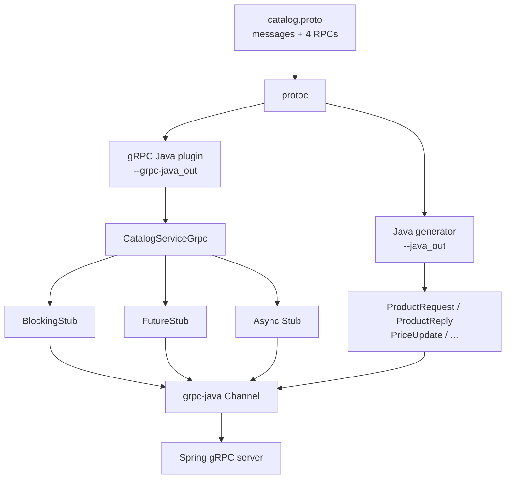
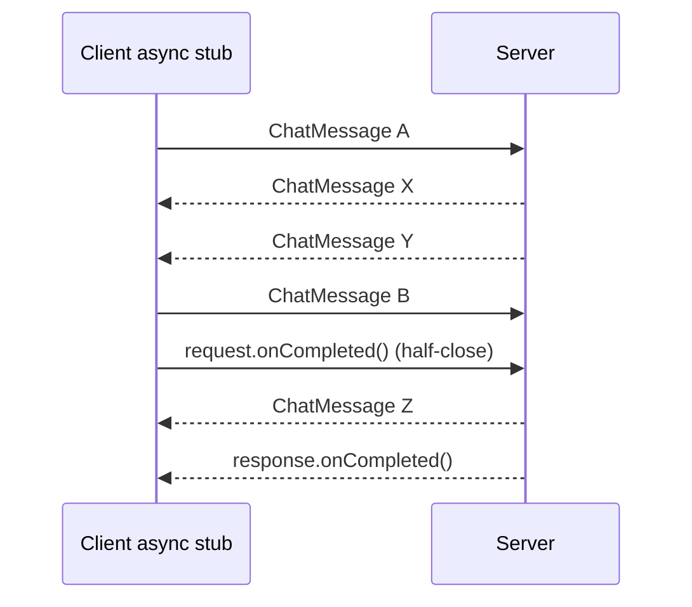
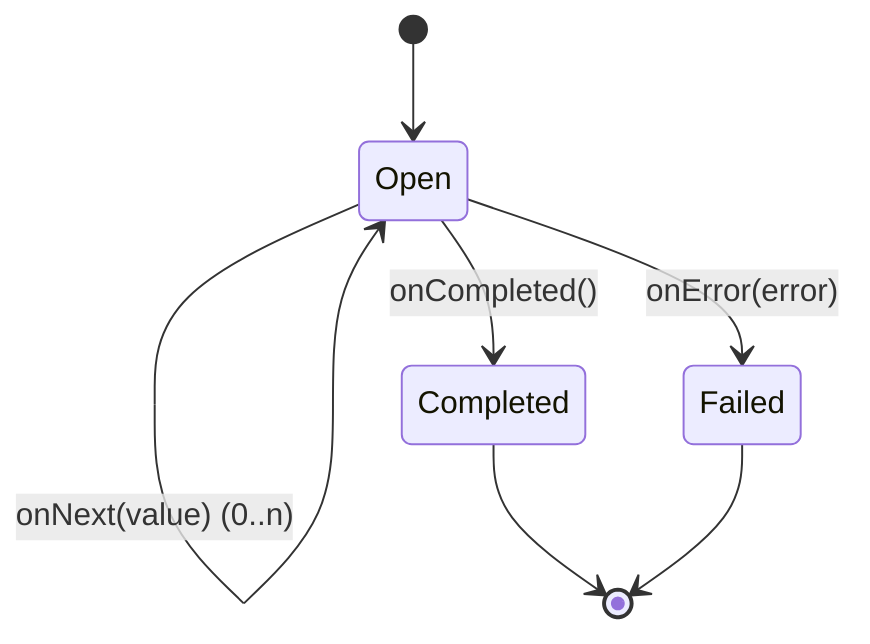

# Blocking, Future, and Async Stubs in Spring gRPC

When a client calls a **Spring gRPC** service, the program does not normally construct HTTP/2 requests manually or serialize individual Protocol Buffers messages by hand. Instead, **`protoc-gen-grpc-java`** generates **client stubs** with Java methods matching the RPCs in the `.proto` file. A single contract can provide a **blocking stub**, a **future stub**, and an **async stub**. They call the exact same service, but differ in how they return results, occupy threads, and support streaming.

This lesson belongs to the **Code generation** chapter of the **SPRING_GRPC** module. It focuses on understanding and choosing among the three stub families when building clients for unary or streaming RPCs, while also identifying where to place metadata, deadlines, status handling, interceptors, TLS, and testing so the application operates reliably.

After this lesson, you will be able to:

- Identify the three stub families generated inside a `*Grpc` class and determine which RPCs each supports.
- Write a unary client using blocking, future, or async APIs, handling results and errors appropriately.
- Use a blocking iterator or async `StreamObserver` when consuming a server-streaming RPC.
- Use an async stub for client-streaming and bidirectional-streaming, distinguishing request completion from RPC completion.
- Manage channels, deadlines, cancellation, backpressure, and threads when integrating with Spring.

## 1. Where Are Stubs Generated From?

In gRPC Java, a contract typically defines both **messages** and **services**. For example, a product catalog service:

```proto
// src/main/proto/catalog.proto
syntax = "proto3";

package learning.catalog.v1;

option java_package = "vn.example.springgrpc.catalog.v1";
option java_multiple_files = true;
option java_outer_classname = "CatalogProto";

message ProductRequest {
  string sku = 1;
}

message ProductReply {
  string sku = 1;
  string title = 2;
  int64 price_minor = 3;
}

message PriceUpdate {
  string sku = 1;
  int64 price_minor = 2;
}

message ViewEvent {
  string sku = 1;
  string visitor_id = 2;
}

message UploadSummary {
  int32 accepted = 1;
}

message ChatMessage {
  string text = 1;
}

service CatalogService {
  rpc GetProduct(ProductRequest) returns (ProductReply);
  rpc WatchPrices(ProductRequest) returns (stream PriceUpdate);
  rpc UploadViews(stream ViewEvent) returns (UploadSummary);
  rpc Chat(stream ChatMessage) returns (stream ChatMessage);
}
```

Java method names and types are derived from the declarations above. For `GetProduct`, the generated method is named `getProduct(...)`; `WatchPrices` becomes `watchPrices(...)`. The Java package `vn.example.springgrpc.catalog.v1` comes from `java_package`; the full gRPC service name remains `learning.catalog.v1.CatalogService` per the protobuf `package`.

To get both message classes and stubs, two generation steps are required:

| Tool | What Does It Generate? |
| --- | --- |
| `protoc --java_out=...` | `ProductRequest`, `ProductReply`, `PriceUpdate`, `ViewEvent`, `UploadSummary`, `ChatMessage`, and descriptors |
| `protoc-gen-grpc-java` with `--grpc-java_out=...` | `CatalogServiceGrpc` containing the server API, client stub families, and RPC descriptors |



With the `com.google.protobuf` Gradle plugin, an illustrative minimal configuration:

```groovy
// build.gradle (Groovy DSL) — code generation section example
plugins {
    id 'java'
    id 'com.google.protobuf' version '0.9.5'
}

def protobufVersion = '4.30.2'
def grpcVersion = '1.71.0'

dependencies {
    implementation "com.google.protobuf:protobuf-java:$protobufVersion"
    implementation platform("io.grpc:grpc-bom:$grpcVersion")
    implementation 'io.grpc:grpc-protobuf'
    implementation 'io.grpc:grpc-stub'
    runtimeOnly 'io.grpc:grpc-netty-shaded'

    // Some plugin versions generate @javax.annotation.Generated.
    compileOnly 'javax.annotation:javax.annotation-api:1.3.2'
}

protobuf {
    protoc {
        artifact = "com.google.protobuf:protoc:$protobufVersion"
    }
    plugins {
        grpc {
            artifact = "io.grpc:protoc-gen-grpc-java:$grpcVersion"
        }
    }
    generateProtoTasks {
        all().configureEach { task ->
            task.plugins { grpc {} }
        }
    }
}
```

Run `./gradlew generateProto compileJava` (Windows: `.\gradlew.bat generateProto compileJava`). Under typical defaults, message code goes to `build/generated/source/proto/main/java` and stubs go to `build/generated/source/proto/main/grpc`. This configuration covers **code generation and compilation** only—it does not yet include all Spring Boot starters, service registration, or client/server runtime setup. Versions are illustrative: projects must verify compatibility across `protoc`, `protobuf-java`, grpc-java, and the Spring gRPC BOM/starter.

## 2. The Three Generated Client Stub Families

In `CatalogServiceGrpc`, you typically find these factory methods:

```java
CatalogServiceGrpc.CatalogServiceBlockingStub blocking =
        CatalogServiceGrpc.newBlockingStub(channel);

CatalogServiceGrpc.CatalogServiceFutureStub future =
        CatalogServiceGrpc.newFutureStub(channel);

CatalogServiceGrpc.CatalogServiceStub async =
        CatalogServiceGrpc.newStub(channel);
```

Here `channel` is an `io.grpc.Channel` (usually a `ManagedChannel`). A stub holds a reference to the channel along with **call options**. It is not a server and does not create a separate connection per RPC.

| Criterion | Blocking Stub | Future Stub | Async Stub |
| --- | --- | --- | --- |
| Unary result | Returns message directly | `ListenableFuture<Response>` | Result via `StreamObserver<Response>` |
| Blocks caller thread? | Yes, until result or error returns | Starting the RPC does not block for response; `get()` can block | Starting the RPC does not block for response; callbacks handle later |
| Server streaming | `Iterator<Response>` | No standard future API for this type | `StreamObserver<Response>` |
| Client streaming | Not in the common grpc-java blocking stub | No | Request `StreamObserver<Request>` |
| Bidirectional streaming | Not in the common grpc-java blocking stub | No | Request and response `StreamObserver` |
| Error handling | Usually throws `StatusRuntimeException` on call/iterator iteration | Future fails; unwrap `ExecutionException` or use callback | `onError(Throwable)` callback |
| Best suited for | Sequential calls, short tasks, thread-per-request model | Unary calls combining multiple tasks or async results | Asynchronous communication and all streaming forms |

**Version caveat:** The table describes the three commonly generated stub families. Some grpc-java versions add newer blocking APIs for streaming; do not assume those APIs exist in all generated stubs. Check the actual signatures of `CatalogServiceGrpc` in your project.

### Typical Signatures for the Four RPCs

| RPC | Blocking Stub | Future Stub | Async Stub |
| --- | --- | --- | --- |
| `GetProduct` (unary) | `ProductReply getProduct(ProductRequest)` | `ListenableFuture<ProductReply> getProduct(ProductRequest)` | `void getProduct(ProductRequest, StreamObserver<ProductReply>)` |
| `WatchPrices` (server streaming) | `Iterator<PriceUpdate> watchPrices(ProductRequest)` | — | `void watchPrices(ProductRequest, StreamObserver<PriceUpdate>)` |
| `UploadViews` (client streaming) | — | — | `StreamObserver<ViewEvent> uploadViews(StreamObserver<UploadSummary>)` |
| `Chat` (bidirectional streaming) | — | — | `StreamObserver<ChatMessage> chat(StreamObserver<ChatMessage>)` |

Distinguish `repeated` in a message from `stream` in an RPC signature. A `repeated PriceUpdate` is a list inside **one** protobuf message; `returns (stream PriceUpdate)` is a sequence of **multiple messages** sent over the RPC during the lifetime of the call.

## 3. Channel, Stubs, and Call Options

The client needs a channel pointing to the gRPC server:

```java
import io.grpc.ManagedChannel;
import io.grpc.ManagedChannelBuilder;
import vn.example.springgrpc.catalog.v1.CatalogServiceGrpc;

ManagedChannel channel = ManagedChannelBuilder
        .forAddress("localhost", 9090)
        .usePlaintext() // Use only for local practice.
        .build();

CatalogServiceGrpc.CatalogServiceBlockingStub base =
        CatalogServiceGrpc.newBlockingStub(channel);
```

In practice, a `ManagedChannel` is normally **reused** across many RPCs. Creating and closing a channel per call increases connection setup overhead and defeats resource management. grpc-java stubs are lightweight objects immutable with respect to call configuration; you can keep a base stub and derive variants with deadlines, interceptors/call credentials, compression, or other call options.

```java
import java.util.concurrent.TimeUnit;

CatalogServiceGrpc.CatalogServiceBlockingStub quickCall =
        base.withDeadlineAfter(2, TimeUnit.SECONDS);

// base remains unchanged; quickCall holds the new call options.
```

**Deadline note:** `withDeadlineAfter(...)` sets a relative deadline for calls created using the derived stub. The deadline applies to the **entire RPC**, including the full response stream of a server-streaming call; it is not a per-`onNext` timeout. If the deadline expires, grpc-java terminates the call, typically with status `DEADLINE_EXCEEDED`.

In Spring gRPC, prefer the channel and stub management provided by your starter (client configuration, beans, dependency injection). To understand the underlying generated API, you can construct beans directly with grpc-java in a local example:

```java
import io.grpc.ManagedChannel;
import io.grpc.ManagedChannelBuilder;
import org.springframework.context.annotation.Bean;
import org.springframework.context.annotation.Configuration;
import vn.example.springgrpc.catalog.v1.CatalogServiceGrpc;

@Configuration
class CatalogClientConfig {
    @Bean(destroyMethod = "shutdown")
    ManagedChannel catalogChannel() {
        return ManagedChannelBuilder.forAddress("localhost", 9090)
                .usePlaintext()
                .build();
    }

    @Bean
    CatalogServiceGrpc.CatalogServiceBlockingStub catalogBlockingStub(
            ManagedChannel catalogChannel) {
        return CatalogServiceGrpc.newBlockingStub(catalogChannel);
    }

    @Bean
    CatalogServiceGrpc.CatalogServiceFutureStub catalogFutureStub(
            ManagedChannel catalogChannel) {
        return CatalogServiceGrpc.newFutureStub(catalogChannel);
    }

    @Bean
    CatalogServiceGrpc.CatalogServiceStub catalogAsyncStub(
            ManagedChannel catalogChannel) {
        return CatalogServiceGrpc.newStub(catalogChannel);
    }
}
```

This example uses plaintext on localhost to illustrate how stubs are built from a channel. Production requires TLS/mTLS, target resolution, load balancing, and an appropriate lifecycle policy. If the Spring gRPC starter already creates a channel bean, do not define a duplicate channel just to expose all three stub families.

## 4. Blocking Stub for Unary RPCs

For `GetProduct`, the blocking stub provides a call style close to a normal Java method:

```java
import io.grpc.StatusRuntimeException;
import java.util.concurrent.TimeUnit;
import vn.example.springgrpc.catalog.v1.CatalogServiceGrpc;
import vn.example.springgrpc.catalog.v1.ProductReply;
import vn.example.springgrpc.catalog.v1.ProductRequest;

public class CatalogBlockingClient {
    private final CatalogServiceGrpc.CatalogServiceBlockingStub stub;

    public CatalogBlockingClient(
            CatalogServiceGrpc.CatalogServiceBlockingStub stub) {
        this.stub = stub;
    }

    public ProductReply load(String sku) {
        ProductRequest request = ProductRequest.newBuilder()
                .setSku(sku)
                .build();

        try {
            return stub.withDeadlineAfter(2, TimeUnit.SECONDS)
                    .getProduct(request);
        } catch (StatusRuntimeException error) {
            System.err.println(
                    "GetProduct error: " + error.getStatus().getCode());
            throw error;
        }
    }
}
```

`getProduct(request)` blocks the calling Java thread until the RPC completes or fails. On success, the caller receives `ProductReply`; on a gRPC-level error, the caller typically receives `StatusRuntimeException`.

This is a good fit for linear logic, short queries, batch jobs, or code executing on threads dedicated to blocking I/O. Do not invoke a blocking stub directly on an event loop or latency-critical thread without offloading; a slow RPC will tie up that thread.

### Handling Error Statuses

Do not treat every error as `INTERNAL` or blindly retry forever. For example:

| gRPC Status | Common Meaning on Client | Handling Approach |
| --- | --- | --- |
| `INVALID_ARGUMENT` | Input rejected by server | Fix request or return validation error to caller |
| `NOT_FOUND` | Resource does not exist | Handle missing resource state |
| `DEADLINE_EXCEEDED` | Call exceeded deadline | Check deadline, latency, downstream timeouts |
| `UNAVAILABLE` | Service temporarily unreachable | Consider bounded retries, backoff, and idempotency |
| `UNAUTHENTICATED` | Missing or invalid credentials | Check token/call credentials |
| `PERMISSION_DENIED` | Insufficient permissions | Do not auto-retry without permission changes |
| `CANCELLED` | Call was cancelled | Stop further processing and release resources |

Some errors originate from the server, while others come from the transport or client runtime. Your application's status mapping must be consistent, with appropriate logs/metrics, while avoiding accidentally logging secret tokens.

## 5. Blocking Stub for Server Streaming

`WatchPrices(ProductRequest) returns (stream PriceUpdate)` can be consumed via `Iterator<PriceUpdate>`:

```java
import java.util.Iterator;
import java.util.concurrent.TimeUnit;
import vn.example.springgrpc.catalog.v1.PriceUpdate;
import vn.example.springgrpc.catalog.v1.ProductRequest;

ProductRequest request = ProductRequest.newBuilder()
        .setSku("BOOK-101")
        .build();

Iterator<PriceUpdate> updates =
        blocking.withDeadlineAfter(15, TimeUnit.SECONDS)
                .watchPrices(request);

while (updates.hasNext()) {
    PriceUpdate next = updates.next();
    System.out.println(
            next.getSku() + ": " + next.getPriceMinor());
}
```

Here `blocking` is a `CatalogServiceBlockingStub` variable already created in the same scope. `hasNext()` or `next()` can block while waiting for the next item and can throw `StatusRuntimeException` if the stream fails. When a stream finishes normally, the iterator runs out of elements.

**Do not run an unbounded `while` loop on an HTTP server request thread if it could run indefinitely.** Set an explicit deadline/cancellation strategy and run the reader on an appropriate thread. If the business logic needs continuous updates with async event processing and bounded memory, an async stub is usually a better choice.

## 6. Future Stub: Non-Blocking Unary at the Call Site

The future stub provides `com.google.common.util.concurrent.ListenableFuture` for unary RPCs. It is useful when the client wants to start a network call and continue doing other work, or combine results from multiple sources.

```java
import com.google.common.util.concurrent.ListenableFuture;
import java.util.concurrent.TimeUnit;
import vn.example.springgrpc.catalog.v1.CatalogServiceGrpc;
import vn.example.springgrpc.catalog.v1.ProductReply;
import vn.example.springgrpc.catalog.v1.ProductRequest;

CatalogServiceGrpc.CatalogServiceFutureStub stub =
        CatalogServiceGrpc.newFutureStub(channel)
                .withDeadlineAfter(3, TimeUnit.SECONDS);

ListenableFuture<ProductReply> pending =
        stub.getProduct(ProductRequest.newBuilder()
                .setSku("BOOK-101")
                .build());

// pending has been returned before the server necessarily responds.
```

To handle completion, register a callback with an appropriate executor:

```java
import com.google.common.util.concurrent.FutureCallback;
import com.google.common.util.concurrent.Futures;
import java.util.concurrent.Executor;

Executor callbackExecutor = java.util.concurrent.ForkJoinPool.commonPool();

Futures.addCallback(pending, new FutureCallback<ProductReply>() {
    @Override
    public void onSuccess(ProductReply reply) {
        System.out.println(reply.getTitle());
    }

    @Override
    public void onFailure(Throwable error) {
        System.err.println("GetProduct error: "
                + io.grpc.Status.fromThrowable(error).getCode());
    }
}, callbackExecutor);
```

**Note:** `ForkJoinPool.commonPool()` is only used here to illustrate passing an executor to the callback. In Spring, inject a managed executor with proper thread/queue bounds, especially when callbacks do substantial work. Avoid placing heavy CPU logic or blocking I/O on the transport's callback executor.

If you call `pending.get()`, the calling thread **blocks** until the future completes. Thus, futures remain asynchronous only when you use callbacks or proper task composition. You can call `get(timeout, unit)` to bound how long the current thread waits, but that timeout **differs** from the RPC deadline: a `get` timeout does not automatically cancel the call.

```java
try {
    ProductReply result = pending.get(4, TimeUnit.SECONDS);
    System.out.println(result.getTitle());
} catch (java.util.concurrent.TimeoutException error) {
    pending.cancel(true); // Actively request cancellation of the running RPC.
} catch (InterruptedException error) {
    pending.cancel(true);
    Thread.currentThread().interrupt();
} catch (java.util.concurrent.ExecutionException error) {
    Throwable cause = error.getCause();
    System.err.println(
            io.grpc.Status.fromThrowable(cause).getCode());
} catch (java.util.concurrent.CancellationException error) {
    // Future was cancelled.
}
```

The code above assumes `pending` is in scope. When the future fails, `ExecutionException` wraps the underlying cause; inspect `getCause()` and extract the gRPC status. When cancelling with `cancel(...)`, grpc-java normally propagates the cancellation to the corresponding RPC; cancellation does not guarantee the server has not already processed the request.

**The future stub does not turn streaming into a future of a list.** The standard generated gRPC Java future API is mainly for unary RPCs. For server streaming, client streaming, or bidi, use an async observer or an application-level streaming abstraction.

## 7. Async Stub for Unary RPCs

The async stub delivers results through `StreamObserver<Response>`. Even for unary calls, the server signals success or failure via the terminal callbacks.

```java
import io.grpc.stub.StreamObserver;
import java.util.concurrent.CompletableFuture;
import java.util.concurrent.TimeUnit;
import java.util.concurrent.atomic.AtomicReference;
import vn.example.springgrpc.catalog.v1.CatalogServiceGrpc;
import vn.example.springgrpc.catalog.v1.ProductReply;
import vn.example.springgrpc.catalog.v1.ProductRequest;

public class CatalogAsyncClient {
    private final CatalogServiceGrpc.CatalogServiceStub stub;

    public CatalogAsyncClient(CatalogServiceGrpc.CatalogServiceStub stub) {
        this.stub = stub;
    }

    public CompletableFuture<ProductReply> getProduct(String sku) {
        CompletableFuture<ProductReply> done =
                new CompletableFuture<>();
        AtomicReference<ProductReply> result =
                new AtomicReference<>();

        ProductRequest request = ProductRequest.newBuilder()
                .setSku(sku)
                .build();

        stub.withDeadlineAfter(3, TimeUnit.SECONDS)
                .getProduct(request, new StreamObserver<ProductReply>() {
                    @Override
                    public void onNext(ProductReply value) {
                        result.set(value);
                    }

                    @Override
                    public void onError(Throwable error) {
                        done.completeExceptionally(error);
                    }

                    @Override
                    public void onCompleted() {
                        ProductReply value = result.get();
                        if (value != null) {
                            done.complete(value);
                        } else {
                            done.completeExceptionally(
                                    new IllegalStateException(
                                            "Unary RPC had no response"));
                        }
                    }
                });

        return done;
    }
}
```

Key differences:

- `getProduct(...)` initiates the RPC and returns control to the caller; data arrives via callbacks.
- `onNext` receives the message; `onCompleted` confirms the response stream ended successfully; `onError` signals failure. In a successful unary call, there is exactly one response message.
- The example uses `CompletableFuture` to expose a familiar Java API. That is an **application-written adapter**, not the native return type of the generated async stub.
- The adapter above **does not yet wire `CompletableFuture` cancellation** to RPC cancellation. For full cancellation semantics, retain `ClientCallStreamObserver`/`Context` or use a runtime-supported cancellation mechanism and test cancellation propagation.

Do not perform synchronous database queries or heavy computation directly inside a grpc-java callback without configuring an appropriate executor. Depending on configuration, callbacks may run on gRPC execution threads.

## 8. Async Server Streaming: Processing Each Item as It Arrives

When calling `WatchPrices` with the async stub, you supply an observer to receive each `PriceUpdate`:

```java
import io.grpc.stub.StreamObserver;
import java.util.concurrent.CompletableFuture;
import java.util.concurrent.TimeUnit;
import vn.example.springgrpc.catalog.v1.PriceUpdate;
import vn.example.springgrpc.catalog.v1.ProductRequest;

CompletableFuture<Void> finished = new CompletableFuture<>();
ProductRequest request = ProductRequest.newBuilder()
        .setSku("BOOK-101")
        .build();

async.withDeadlineAfter(20, TimeUnit.SECONDS)
        .watchPrices(request, new StreamObserver<PriceUpdate>() {
            @Override
            public void onNext(PriceUpdate update) {
                System.out.println("New price: " + update.getPriceMinor());
            }

            @Override
            public void onError(Throwable error) {
                finished.completeExceptionally(error);
            }

            @Override
            public void onCompleted() {
                finished.complete(null);
            }
        });
```

Here `async` is an already-constructed `CatalogServiceGrpc.CatalogServiceStub`. `finished` lets the caller observe completion; the application must handle errors on that future rather than ignoring them. For long streams, **processing each message as it arrives** is usually better than accumulating indefinitely into a `List<PriceUpdate>`. If downstream processing is slow, flow control is needed.

Both the blocking iterator and async observer consume the sequence of messages emitted by the same `WatchPrices` RPC. The difference is that the blocking API **waits** on `hasNext()/next()`, whereas the async API **is called back** via `onNext()`.

## 9. Async Client Streaming: Multiple Requests, One Response

`UploadViews(stream ViewEvent) returns (UploadSummary)` requires a request stream. The generated async method accepts a **response observer** and returns a **request observer**:

```java
StreamObserver<ViewEvent> requests =
        async.uploadViews(responseObserver);
```

Complete example for sending items and tracking the result:

```java
import io.grpc.stub.StreamObserver;
import java.util.concurrent.CompletableFuture;
import java.util.concurrent.TimeUnit;
import java.util.concurrent.atomic.AtomicReference;
import vn.example.springgrpc.catalog.v1.UploadSummary;
import vn.example.springgrpc.catalog.v1.ViewEvent;

CompletableFuture<UploadSummary> finished =
        new CompletableFuture<>();
AtomicReference<UploadSummary> received =
        new AtomicReference<>();

StreamObserver<UploadSummary> responseObserver =
        new StreamObserver<UploadSummary>() {
            @Override
            public void onNext(UploadSummary value) {
                received.set(value);
            }

            @Override
            public void onError(Throwable error) {
                finished.completeExceptionally(error);
            }

            @Override
            public void onCompleted() {
                UploadSummary summary = received.get();
                if (summary != null) {
                    finished.complete(summary);
                } else {
                    finished.completeExceptionally(
                            new IllegalStateException(
                                    "Missing UploadSummary"));
                }
            }
        };

StreamObserver<ViewEvent> requests =
        async.withDeadlineAfter(10, TimeUnit.SECONDS)
                .uploadViews(responseObserver);

requests.onNext(ViewEvent.newBuilder()
        .setSku("BOOK-101")
        .setVisitorId("visitor-a")
        .build());
requests.onNext(ViewEvent.newBuilder()
        .setSku("PEN-202")
        .setVisitorId("visitor-b")
        .build());
requests.onCompleted();

// finished completes after the server returns UploadSummary and closes the response.
```

In this example:

1. The client creates `responseObserver` to **receive** `UploadSummary` or an error.
2. `uploadViews(responseObserver)` returns `requests` so the client can **send** `ViewEvent` messages.
3. The client calls `requests.onNext(...)` as many times as required by the contract, then `requests.onCompleted()`.
4. Calling `onCompleted()` on the request observer means the client has finished sending requests (**half-close**). The RPC completes only when the response side also finishes with `onCompleted` or `onError`.

The example sends two items immediately to illustrate the signature; when sending thousands or millions of messages, you must account for buffering and backpressure. When the server reports an error mid-stream, the producer must stop sending and release resources; never continue calling `onNext` after a terminal event or cancellation.

## 10. Async Bidirectional Streaming: Two Independent Directions

`Chat(stream ChatMessage) returns (stream ChatMessage)` returns a request observer just like client streaming, except the response observer can receive **multiple** messages:

```java
import io.grpc.stub.StreamObserver;
import java.util.concurrent.CompletableFuture;
import vn.example.springgrpc.catalog.v1.ChatMessage;

CompletableFuture<Void> finished = new CompletableFuture<>();

StreamObserver<ChatMessage> outbound = async.chat(
        new StreamObserver<ChatMessage>() {
            @Override
            public void onNext(ChatMessage incoming) {
                System.out.println("Server: " + incoming.getText());
            }

            @Override
            public void onError(Throwable error) {
                finished.completeExceptionally(error);
            }

            @Override
            public void onCompleted() {
                finished.complete(null);
            }
        });

outbound.onNext(ChatMessage.newBuilder()
        .setText("Hello")
        .build());
outbound.onNext(ChatMessage.newBuilder()
        .setText("More updates")
        .build());
outbound.onCompleted(); // Closes only the client's send direction.
```

The server may respond immediately after the first message, wait for multiple requests before responding, or send multiple responses for a single request. Message ordering within **each direction** is preserved for the scope of an RPC, but there is no default one-to-one pairing between requests and responses.



If you want a long-lived chat session, do not call `outbound.onCompleted()` immediately; an application lifecycle controller must decide when to close the stream. You should provide appropriate deadlines, cancellation handling, disconnect handling, and retry/reconnect policies. Retrying a bidi stream can send duplicate data unless the business protocol is designed for reconnects.

## 11. Observer Lifecycle, Thread Safety, and Backpressure

For an async stub, a response observer has this lifecycle:



`onCompleted()` and `onError()` are mutually exclusive terminal paths. Do not send any further `onNext` after a terminal event on the same stream. For client-streaming/bidi, the client's request observer follows a similar lifecycle, and closing the request stream **does not automatically close the response stream**.

**Thread safety:** Do not assume a `StreamObserver` can accept `onNext` concurrently from multiple threads. If multiple producers exist, serialize sends (via a dedicated executor/queue or appropriate synchronization). Do not block gRPC callbacks with long-running blocking I/O. Built protobuf messages are immutable and safe to share, whereas an observer represents an active stream and requires careful coordination.

**Backpressure:** Async does not mean unlimited capacity. When a producer sends faster than the network or receiver can consume, data can buffer and cause memory growth. grpc-java provides extended types `ClientCallStreamObserver` and `ServerCallStreamObserver` along with APIs such as `isReady()` and `setOnReadyHandler(...)` to coordinate send capacity. For client-streaming/bidi, you can use `ClientResponseObserver` to obtain `ClientCallStreamObserver` in `beforeStart(...)`:

```java
import io.grpc.stub.ClientCallStreamObserver;
import io.grpc.stub.ClientResponseObserver;
import io.grpc.stub.StreamObserver;
import vn.example.springgrpc.catalog.v1.UploadSummary;
import vn.example.springgrpc.catalog.v1.ViewEvent;

ClientResponseObserver<ViewEvent, UploadSummary> observer =
        new ClientResponseObserver<ViewEvent, UploadSummary>() {
            @Override
            public void beforeStart(
                    ClientCallStreamObserver<ViewEvent> requestStream) {
                requestStream.setOnReadyHandler(() -> {
                    if (requestStream.isReady()) {
                        // Notify the producer that it can send more items.
                        // Real code needs a bounded queue,
                        // logic to serialize onNext calls, and close state.
                    }
                });
            }

            @Override
            public void onNext(UploadSummary value) {
                System.out.println(value.getAccepted());
            }

            @Override
            public void onError(Throwable error) {
                // Stop producer, release resources.
            }

            @Override
            public void onCompleted() {
                // Response stream completed successfully.
            }
        };

StreamObserver<ViewEvent> requestStream = async.uploadViews(observer);
```

`isReady()` only signals **readiness to send** according to flow control, not confirmation that the server has finished processing prior messages. `setOnReadyHandler` can be invoked repeatedly; the producer must manage indices, synchronization, buffer bounds, and request stream closure. Beyond outbound flow control, inbound flow control should also be considered if callbacks process slowly. Do not use tight polling or unbounded queues as a substitute for backpressure.

## 12. Deadlines, Cancellation, and Propagation

All three stub families use grpc-java call options. However, how the caller observes deadlines and cancellation differs:

| Scenario | Blocking | Future | Async |
| --- | --- | --- | --- |
| Deadline expires | `StatusRuntimeException` on call/iterator | Future completes exceptionally | `onError` is invoked |
| Caller wants to stop | Cancel via gRPC `Context`/appropriate RPC mechanism | `ListenableFuture.cancel(...)` | Use `ClientCallStreamObserver.cancel(...)` or runtime-supported cancellation/`Context` |
| Caller has its own wait timeout | Thread waits finitely per application mechanism | `get(timeout)` only bounds waiting, does not auto-cancel | Async adapter timeout only bounds the waiter; must be wired to RPC cancellation |
| Long-lived streaming | Deadline applies to the whole stream | Not applicable in standard future API | Deadline applies to the whole stream |

If a deadline expires, retrying must account for **side effects**: for example, `UploadViews` might have already persisted some events even though the client never received `UploadSummary`. Use idempotency keys/sequence numbers or business-level exactly-once designs if required; the transport does not guarantee side effects happen only once.

When a Spring gRPC application closes an HTTP request, ends a task, or a user cancels an operation, propagate cancellation to downstream RPCs whenever possible. Simply discarding a `CompletableFuture` in the application may leave the underlying grpc-java call consuming resources.

## 13. Metadata, Interceptors, TLS, and Statuses Do Not Live in Generated Stubs

Stubs are generated to reflect the **method contract**, not to hardcode environment details. A stub accepts a channel and call options at runtime:

| Concern | How to Handle |
| --- | --- |
| Tokens, trace IDs, correlation IDs | Attach `Metadata` via client interceptors, call credentials, or the corresponding Spring gRPC mechanism |
| Deadlines, compression, wait-for-ready | Call options on stubs such as `withDeadlineAfter(...)`, per application policy |
| TLS/mTLS and certificates | Channel/transport configuration and secret management |
| Business errors | Server maps to appropriate `Status`; client observes via exception/future/`onError` |
| Logging/tracing/metrics | Client/server interceptors, OpenTelemetry/instrumentation per system |
| Retries and load balancing | Service config, channel config, idempotency, and operations |
| Caller authentication | Credentials/interceptors and server-side authorization rules |

**Do not add token or deadline fields to messages just so stubs have them built in.** Metadata belongs to individual RPC calls, while messages hold business data. For production, use TLS—do not carry `usePlaintext()` from local examples into real configurations.

Generated stubs can be shared across Spring beans, but avoid mutating per-call options via a shared variable accessed concurrently. Derive a stub for any call needing custom options:

```java
CatalogServiceGrpc.CatalogServiceStub thisCall =
        sharedAsyncStub.withDeadlineAfter(5, TimeUnit.SECONDS);
```

`sharedAsyncStub` retains its base configuration. Because each RPC creates its own call state and context, concurrent calls over the same channel/stub are normal usage as long as resource limits are properly configured.

## 14. Choosing the Stub Type Based on Application Needs

There is no single best stub for every situation. Decide based on RPC type and execution model:

| Real-World Requirement | Typically Suitable Choice | Reason |
| --- | --- | --- |
| Query a product price on a dedicated thread that can block | Blocking unary | Linear code, direct error handling |
| Combine results from multiple unary queries without blocking coordinator thread | Future unary or async unary | Allows running/composing tasks asynchronously |
| Handle unary response via an event-driven pipeline | Async unary | Receives result through callback/adapter |
| Read a small number of server-streaming items in a batch job | Blocking iterator | Simple loop when wait time is bounded |
| Subscribe to long-lived price updates | Async server-streaming | Per-item callbacks, easy to wire into streaming pipelines |
| Send large event batches from client | Async client-streaming | Sends many requests, gets one summary; needs backpressure |
| Two-way conversation, realtime device exchange | Async bidi | Both directions progress independently |

### Common Misconceptions

1. **"Futures never block."** False: `ListenableFuture.get()` still blocks; only initiating the RPC and callback composition can be non-blocking.
2. **"Async spawns a new thread per RPC."** False: the API is non-blocking while waiting for results, but grpc-java uses its runtime and executors; it does not create a dedicated thread per request by default.
3. **"Blocking stubs cannot be used with streaming."** Inaccurate: standard blocking stubs support **server-streaming** via `Iterator`; request-streaming modes typically require the async API.
4. **"Request `onCompleted` means the RPC is finished."** False for client-streaming/bidi: the server may still return a response or an error.
5. **"Cancelling `CompletableFuture` cancels the RPC."** Not automatically if `CompletableFuture` is an adapter you wrote without wiring cancellation down to gRPC.
6. **"Using async means no buffer limits are needed."** False: sending faster than the transport can drain can grow memory.
7. **"Stubs enforce security automatically."** False: TLS, credentials, and authorization must be configured on the channel, interceptors, and server.

## 15. Testing and Troubleshooting

When writing client integration tests, you can use a grpc-java **in-process server/channel** with a test service implementation. This verifies that generated stubs and server base classes interact properly without opening TCP ports. Tests for TLS, Spring Boot configuration, and real networking still require appropriate setups.

| Test Case | Key Observation |
| --- | --- |
| Blocking unary success | Returns expected `ProductReply`, does not hold thread past deadline |
| Blocking unary error | Catches `StatusRuntimeException` with expected status code |
| Future unary success/error | Callback/future completes properly, does not stall executor |
| Async unary success/error | `onNext` + `onCompleted` or `onError`, never completes twice |
| Server-streaming | All items received, terminal callback fires or iterator ends |
| Client-streaming | `onCompleted` finishes request stream, server returns one `UploadSummary` |
| Bidi-streaming | Independent send and receive, no assumed one-to-one pairing |
| Cancellation/deadline | Producer stops sending, downstream is cancelled appropriately, resources released |
| Backpressure | Producer does not accumulate unboundedly when receiver is slow |

When errors happen, diagnose by layer:

| Symptom | What to Check |
| --- | --- |
| `CatalogServiceGrpc` not found | `protoc-gen-grpc-java` has not run or generated sources were not compiled |
| Stub exists but `ProductRequest` is missing | Missing Java message generator or source set configuration |
| `UNIMPLEMENTED` | Wrong package/service/method name, service not bound, server did not override RPC |
| `UNAVAILABLE` | Endpoint, channel, connection, TLS, or server not ready |
| `DEADLINE_EXCEEDED` | Deadline too short, slow server/downstream, or long-running stream |
| Future never completes | RPC did not finish, callback not registered properly, missing deadline/cancellation |
| Async response never calls `onCompleted` | Server missing terminal event, connection error, or client cancelled |
| Client stream gets no summary | Client did not half-close, server did not finish response, or stream errored |
| Unstable callback results | Observer invoked concurrently or unsynchronized shared mutable state |
| `NoSuchMethodError` or stub runtime errors | grpc-java/protobuf version mismatch or dependency conflict |

Inspect gRPC statuses alongside logs/traces on both ends, while avoiding logging full messages containing sensitive data. Useful metrics include RPC count by status, latency, deadline exceeded count, cancellations, active streams, and message sizes/rates.

## 16. Hands-On Practice

1. **Analyze generated code:** Run code generation from `catalog.proto`, locate `CatalogServiceGrpc`, and identify the three stub factories. Record which RPCs appear in each stub family.
2. **Compare unary styles:** Write three versions calling `GetProduct` using blocking, future callback, and async observer. Measure how many caller threads are held when the server delays its response by two seconds.
3. **Deadlines and errors:** With the blocking stub, set a deadline shorter than processing time; observe `DEADLINE_EXCEEDED`. Repeat with future and async to see how errors propagate.
4. **Future cancellation:** Start a future unary call, invoke `cancel(true)`, and record `isCancelled()` and server behavior. Explain why the server may have already started processing before receiving cancellation.
5. **Server-streaming:** Implement `WatchPrices` emitting three messages. Read once via blocking iterator and once via async callback, and compare waiting behavior.
6. **Client-streaming:** Send 100 `ViewEvent` messages, call `onCompleted()`, and check `UploadSummary.accepted`. Try omitting `onCompleted()` to see why the server keeps waiting.
7. **Bidi-streaming:** Write a simple echo chat. Send a message, receive a reply, send another message, and half-close. Use `CompletableFuture` or a latch with a timeout to observe response completion.
8. **Backpressure:** Configure an event producer faster than the consumer; design a bounded queue and `isReady()`/`setOnReadyHandler(...)` mechanism so all events are not buffered in memory.
9. **Spring integration:** Register channels and stubs as beans or use the available Spring gRPC starter. Verify a single channel can be reused across many calls, then test TLS/metadata configuration in a suitable environment.
10. **Error testing:** Write integration tests for `INVALID_ARGUMENT`, `NOT_FOUND`, `UNAVAILABLE`, and `DEADLINE_EXCEEDED`. Clearly note which errors are actively returned by the server and which are determined by the client/transport.

### Key Takeaway

`CatalogServiceGrpc.newBlockingStub(channel)` fits **synchronous** calls and server-streaming iterators; `newFutureStub(channel)` supports **unary calls with future results**; `newStub(channel)` provides the **asynchronous API for all four RPC types**. The same Protocol Buffers contract and grpc-java runtime back all three cases. When bringing stubs into Spring gRPC, pick the result observation model that fits your threading model, manage deadlines and cancellation, preserve the `StreamObserver` lifecycle, bound streaming buffers, and configure metadata/TLS at runtime.
