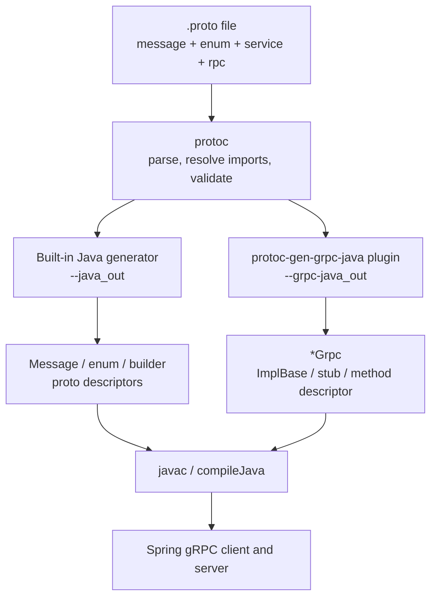

# gRPC Java Codegen: From .proto Contracts to Java Code Used in Spring gRPC

In **SPRING_GRPC**, you describe data and remote procedure calls using **Protocol Buffers**, then use **gRPC Java code generation** tooling to turn the contract into Java classes that clients and servers can compile and use. The two main parts of this process are the `protoc` compiler (which generates message code) and the `protoc-gen-grpc-java` plugin (which generates gRPC service code). When integrated with **Spring**, the generated classes form the foundation for implementing servers, creating client stubs, executing unary/streaming RPCs, and applying operational policies.

Generated code reduces errors caused by hand-writing descriptors, method names, data types, and message marshalling logic. However, it **does not** automatically provide business logic, metadata, deadlines, status mapping, interceptors, TLS, testing, or monitoring. Those belong to the application and runtime layers.

After this lesson, you will be able to:

- Accurately describe the responsibilities of `protoc`, the Java generator, and `protoc-gen-grpc-java`.
- Design and compile contracts containing unary, server-streaming, client-streaming, and bidirectional-streaming RPCs.
- Configure a reproducible Gradle build, knowing which files are generated where and why.
- Read generated `*Grpc`, server base, stub, and message class APIs to integrate with Spring gRPC.
- Distinguish errors at the schema, code generation, Java compilation, service registration, and runtime layers.
- Establish versioning, compatibility, and CI verification workflows for shared RPC contracts.

## 1. What Is gRPC Java Codegen?

**Code generation** is the step that transforms structured definitions in `.proto` files into Java source code and metadata used by the program. It normally runs **before** Java compilation:



| Component | Responsible For | Does Not Automatically Do |
| --- | --- | --- |
| `protoc` | Reading `.proto`, checking syntax and imports, creating descriptors, orchestrating generators | Compiling Java bytecode, running a gRPC server |
| Java generator | Generating messages, enums, builders, parsers, fields, and Java descriptors | Generating gRPC client stubs |
| `protoc-gen-grpc-java` | Generating service APIs, method descriptors, server base classes, and client stub families | Generating business logic or establishing live connections |
| `javac` / Gradle `compileJava` | Compiling all generated Java code and application code | Verifying whether the RPC is actually deployed |
| grpc-java runtime | Sending/receiving messages via channels and server transports, managing call state | Deciding business validity for each RPC |
| Spring gRPC | Bringing servers/clients, beans, lifecycle, and configuration into a Spring application | Guessing RPC names/types without a contract |

`--java_out` and `--grpc-java_out` are **two separate outputs**. Having message classes does not mean you have gRPC stubs; having only `*Grpc.java` without message classes is also insufficient to compile.

### Why Is the Plugin Separate from protoc?

`protoc` provides a plugin protocol. When it sees the `--grpc-java_out` flag, it looks for an executable conventionally named `protoc-gen-grpc-java` or uses the path passed via `--plugin`. `protoc` passes descriptors via `CodeGeneratorRequest`, and the plugin returns a `CodeGeneratorResponse` containing the files to write. This model lets many tools generate code from one contract without modifying the core compiler.

You do not need to write a plugin protocol implementation to use gRPC Java. You only need to select the right executable/plugin artifact and wire it into your build process.

## 2. Designing a Sample Contract for Codegen

Consider a parcel delivery system. Place the file at `src/main/proto/parcel/v1/parcel.proto`:

```proto
syntax = "proto3";

package learning.parcel.v1;

import "google/protobuf/timestamp.proto";

option java_package = "vn.example.springgrpc.parcel.v1";
option java_multiple_files = true;
option java_outer_classname = "ParcelSchema";

enum ParcelStatus {
  PARCEL_STATUS_UNSPECIFIED = 0;
  PARCEL_STATUS_CREATED = 1;
  PARCEL_STATUS_IN_TRANSIT = 2;
  PARCEL_STATUS_DELIVERED = 3;
}

message GetParcelRequest {
  string parcel_id = 1;
}

message ParcelReply {
  string parcel_id = 1;
  ParcelStatus status = 2;
}

message WatchStatusRequest {
  string parcel_id = 1;
}

message ParcelEvent {
  string parcel_id = 1;
  ParcelStatus status = 2;
  google.protobuf.Timestamp occurred_at = 3;
}

message ScanEvent {
  string parcel_id = 1;
  string location_code = 2;
  int64 sequence = 3;
}

message UploadSummary {
  int32 accepted = 1;
}

service ParcelService {
  rpc GetParcel(GetParcelRequest) returns (ParcelReply);
  rpc WatchStatus(WatchStatusRequest) returns (stream ParcelEvent);
  rpc UploadScans(stream ScanEvent) returns (UploadSummary);
  rpc SyncScans(stream ScanEvent) returns (stream ParcelEvent);
}
```

The contract illustrates all four RPC types:

| RPC | Request | Response | grpc-java Type |
| --- | --- | --- | --- |
| `GetParcel` | One `GetParcelRequest` | One `ParcelReply` | `UNARY` |
| `WatchStatus` | One `WatchStatusRequest` | Stream of `ParcelEvent` | `SERVER_STREAMING` |
| `UploadScans` | Stream of `ScanEvent` | One `UploadSummary` | `CLIENT_STREAMING` |
| `SyncScans` | Stream of `ScanEvent` | Stream of `ParcelEvent` | `BIDI_STREAMING` |

The `stream` declarations change the **RPC invocation shape**, not the message class structure. For instance, `ScanEvent` remains an ordinary message; only `UploadScans` and `SyncScans` accept multiple messages over time.

### Distinguishing the Three Naming Options

| Declaration | Effect | Value in Example |
| --- | --- | --- |
| `package` | Protobuf namespace, contributes to the RPC name on the network | `learning.parcel.v1` |
| `java_package` | Java package of generated code | `vn.example.springgrpc.parcel.v1` |
| `java_outer_classname` | Name of the outer class holding descriptors | `ParcelSchema` |

The full gRPC service name is `learning.parcel.v1.ParcelService`. The unary RPC path over HTTP/2 in gRPC is `/learning.parcel.v1.ParcelService/GetParcel`. Changing the Java package does not directly change this path; changing the protobuf `package` or service/method name does.

With `java_multiple_files = true`, top-level messages and enums are generated as standalone Java types for convenient importing. If set to `false`, they become nested types inside the outer class, affecting Java source code without changing field numbers on the wire format.

## 3. Running protoc and the Plugin Manually

To understand what Gradle executes underneath, observe the following CLI commands. The prerequisite is having `protoc` installed and a `protoc-gen-grpc-java` executable matching your OS/architecture.

```bash
protoc --version

# Create target directories in advance.
mkdir -p build/generated/manual/java build/generated/manual/grpc

protoc \
  -I=src/main/proto \
  --java_out=build/generated/manual/java \
  --plugin=protoc-gen-grpc-java=/path/to/protoc-gen-grpc-java \
  --grpc-java_out=build/generated/manual/grpc \
  src/main/proto/parcel/v1/parcel.proto
```

The command above uses Unix-style shell syntax. On Windows, adjust line continuations or run on a single line and point to the `.exe` executable. If the plugin is already on `PATH` with its standard name, `--plugin=...` can be omitted.

**Meaning of the arguments:**

- `-I=src/main/proto`: root used to resolve the compiled file and its imports. Multiple `-I` flags can be added if the project imports other protos.
- `--java_out=...`: instructs the Java generator to produce messages, enums, and helper classes.
- `--grpc-java_out=...`: instructs the grpc-java plugin to generate the API based on `service` blocks.
- `--plugin=protoc-gen-grpc-java=...`: explicitly locates the gRPC Java plugin executable when it cannot be found automatically.
- Final argument: the source `.proto` file. Keep its path consistent with the declared import root.

The proto import `google/protobuf/timestamp.proto` is a **well-known type**. Standard `protoc` distributions bundle its schema; if a custom-packaged environment lacks this import, supply the appropriate include path. Generated Java code for `Timestamp` depends on a compatible protobuf Java runtime library.

### What Does the Output Typically Contain?

```text
build/generated/manual/
├── java/vn/example/springgrpc/parcel/v1/
│   ├── GetParcelRequest.java
│   ├── ParcelReply.java
│   ├── WatchStatusRequest.java
│   ├── ParcelEvent.java
│   ├── ScanEvent.java
│   ├── UploadSummary.java
│   ├── ParcelStatus.java
│   ├── ParcelSchema.java
│   └── *OrBuilder.java       (corresponding helper interfaces)
└── grpc/vn/example/springgrpc/parcel/v1/
    └── ParcelServiceGrpc.java
```

The `*OrBuilder.java` files in the tree are grouped using a wildcard; the generator creates separate interfaces for each message depending on configuration options. Do not infer wire format layout from directory listing order.

`ParcelSchema.java` contains the proto file descriptor and supporting metadata; `ParcelServiceGrpc.java` contains service/method descriptors and the RPC API. No implementation class such as `ParcelServiceImpl.java` with business logic is pre-generated.

### Generating a Descriptor Set for Contract Distribution

In addition to Java source, `protoc` can export a binary schema descriptor:

```bash
mkdir -p build/descriptors

protoc \
  -I=src/main/proto \
  --include_imports \
  --descriptor_set_out=build/descriptors/parcel-v1.pb \
  src/main/proto/parcel/v1/parcel.proto
```

`--include_imports` bundles imported descriptors into the descriptor set as well. This file is useful for contract tooling, schema inspection, and API discovery tools; it is **not** a Java stub. Having a descriptor set also does not automatically enable **gRPC server reflection** at runtime.

## 4. Configuring gRPC Java Codegen with Gradle

In Spring Boot, a more practical approach is automating code generation via Gradle. The following example uses **Groovy DSL** and the protobuf Gradle plugin:

```groovy
// build.gradle: code generation configuration section
plugins {
    id 'java'
    id 'com.google.protobuf' version '0.9.5'
}

// Illustrative versions. In real projects, manage centrally,
// and select a combination verified by your BOM/starter and CI tests.
def protobufVersion = '4.30.2'
def grpcVersion = '1.71.0'

dependencies {
    implementation "com.google.protobuf:protobuf-java:$protobufVersion"
    implementation platform("io.grpc:grpc-bom:$grpcVersion")
    implementation 'io.grpc:grpc-protobuf'
    implementation 'io.grpc:grpc-stub'

    // Only add transport directly if not already managed by starter/runtime.
    runtimeOnly 'io.grpc:grpc-netty-shaded'

    // May be needed for generated code using @javax.annotation.Generated.
    compileOnly 'javax.annotation:javax.annotation-api:1.3.2'
}

protobuf {
    protoc {
        artifact = "com.google.protobuf:protoc:$protobufVersion"
    }

    plugins {
        grpc {
            artifact = "io.grpc:protoc-gen-grpc-java:$grpcVersion"
        }
    }

    generateProtoTasks {
        all().configureEach { task ->
            task.plugins {
                grpc {}
            }
        }
    }
}
```

In this example:

1. `com.google.protobuf` integrates discovering proto sources, invoking `protoc`, and registering generated sources with Java compilation.
2. `protobuf.protoc.artifact` specifies the `protoc` binary that Gradle resolves for the current platform.
3. `protobuf.plugins.grpc.artifact` specifies the `protoc-gen-grpc-java` plugin.
4. `generateProtoTasks` applies the `grpc` plugin to each generation task for the selected source sets.
5. `protobuf-java` is the runtime for generated messages; `grpc-protobuf` and `grpc-stub` support marshallers and client/server APIs; a transport is required for a running application, though it may already be managed by the Spring gRPC starter.

Run in a project with dependencies and wrapper configured:

```bash
./gradlew generateProto compileJava
# Windows PowerShell: .\gradlew.bat generateProto compileJava
```

With typical default plugin configuration, generated Java code resides at:

```text
build/generated/source/proto/main/java/
build/generated/source/proto/main/grpc/
```

Gradle wires both directories into the Java source set so `compileJava` recognizes the classes. When `.proto` files are added or modified, the next build must regenerate code before compiling. Do not edit source inside `build/generated`: Gradle may overwrite it when generation reruns.

**Scope note:** This Gradle snippet shows the **codegen and grpc-java dependency** setup. A Spring gRPC application still needs the appropriate starter, server/client configuration, service bean registration, channels, TLS, and runtime observability. Do not confuse "compilation succeeded" with "service runs properly".

## 5. Tracing the Build Pipeline from Source to Class

When the system works properly, the task dependency chain should be:

```text
src/main/proto/**/*.proto
          |
          v
     generateProto
       /      \
      v        v
   main/java  main/grpc     (generated source)
       \      /
        v    v
      compileJava
          |
          v
      classes / jar
          |
          v
   Spring gRPC runtime
```

If `generateProto` succeeds but Java code cannot find `ParcelServiceGrpc`, Gradle may only have the **built-in Java generator** active without the `grpc` plugin enabled, or the output directory has not been added to the source set. If `ParcelServiceGrpc` exists but `ParcelReply` cannot be found, check the Java generator, package name, and dependencies.

### Main and Test Source Sets

Projects typically place production contracts in `src/main/proto`. A test source set may contain extra protos for fixtures, mocks, or test-only services. Using `generateProtoTasks { all().configureEach { ... } }` applies the `grpc` plugin to every proto task the Gradle plugin discovers; consider whether test protos also need gRPC stubs or only messages.

When you want to scope the plugin to the main source set, configure by source set:

```groovy
protobuf {
    generateProtoTasks {
        ofSourceSet('main').configureEach { task ->
            task.plugins {
                grpc {}
            }
        }
    }
}
```

This is **an alternative** to the `generateProtoTasks` block in the previous example, not a block to insert alongside it. When task names differ due to source sets or custom builds, inspect your project's tasks and configure plugins accordingly.

### Reproducibility in CI

A reliable build pipeline must satisfy these conditions:

- Schemas live in source control with review rules for contract changes.
- Versions of `protoc`, the gRPC plugin, and runtimes are managed centrally, not depending on binaries "happening to be on `PATH`".
- CI regenerates code from source using the exact same configuration; avoid manual edits to generated code.
- The build fails if the schema is invalid, imports are missing, or Java source is incompatible with the generated API.
- Tests verify client/server interaction, covering both successful responses and gRPC errors.

To verify a clean build, teams can run in CI:

```bash
./gradlew clean generateProto compileJava test
```

This command is just a **workflow template**; exact test/verification task names depend on repository configuration. Do not commit generated Java files to Git if the build reliably produces the right output, unless your organization explicitly distributes generated sources separately.

## 6. Inside the ParcelServiceGrpc Class

`ParcelServiceGrpc` is the central class created by the gRPC Java generator. Its API typically follows this structure:

```text
ParcelServiceGrpc
├── SERVICE_NAME
├── getGetParcelMethod()
├── getWatchStatusMethod()
├── getUploadScansMethod()
├── getSyncScansMethod()
├── getServiceDescriptor()
├── ParcelServiceImplBase          (server base)
├── ParcelServiceStub              (async client)
├── ParcelServiceBlockingStub      (blocking client)
├── ParcelServiceFutureStub        (future unary client)
├── newStub(Channel)
├── newBlockingStub(Channel)
└── newFutureStub(Channel)
```

**The API names above are typical** for common grpc-java versions. Some versions also generate `AsyncService` or newer blocking API variants; always cross-check with the public API generated in your project.

In each `MethodDescriptor`, the generator declares the RPC type and marshallers for the related messages. Applications do not usually need to construct a `MethodDescriptor` manually when generated stubs are available.

| RPC | `MethodDescriptor.MethodType` | Role |
| --- | --- | --- |
| `GetParcel` | `UNARY` | One request, one response |
| `WatchStatus` | `SERVER_STREAMING` | One request, multiple responses |
| `UploadScans` | `CLIENT_STREAMING` | Multiple requests, one response |
| `SyncScans` | `BIDI_STREAMING` | Multiple requests and responses |

### The Server Base Is Scaffolding, Not a Ready-to-Run Server

Generated `ParcelServiceImplBase` gives the application override points. Unimplemented methods usually default to `UNIMPLEMENTED`. Example of a Spring service class implementing unary and server streaming:

```java
package vn.example.springgrpc.parcel;

import io.grpc.Status;
import io.grpc.stub.StreamObserver;
import org.springframework.stereotype.Service;
import vn.example.springgrpc.parcel.v1.GetParcelRequest;
import vn.example.springgrpc.parcel.v1.ParcelEvent;
import vn.example.springgrpc.parcel.v1.ParcelReply;
import vn.example.springgrpc.parcel.v1.ParcelServiceGrpc;
import vn.example.springgrpc.parcel.v1.ParcelStatus;
import vn.example.springgrpc.parcel.v1.WatchStatusRequest;

@Service
public class ParcelServiceImpl
        extends ParcelServiceGrpc.ParcelServiceImplBase {

    @Override
    public void getParcel(
            GetParcelRequest request,
            StreamObserver<ParcelReply> responseObserver) {

        if (request.getParcelId().isBlank()) {
            responseObserver.onError(Status.INVALID_ARGUMENT
                    .withDescription("parcel_id must not be blank")
                    .asRuntimeException());
            return;
        }

        ParcelReply reply = ParcelReply.newBuilder()
                .setParcelId(request.getParcelId())
                .setStatus(ParcelStatus.PARCEL_STATUS_IN_TRANSIT)
                .build();

        responseObserver.onNext(reply);
        responseObserver.onCompleted();
    }

    @Override
    public void watchStatus(
            WatchStatusRequest request,
            StreamObserver<ParcelEvent> responseObserver) {

        if (request.getParcelId().isBlank()) {
            responseObserver.onError(Status.INVALID_ARGUMENT
                    .withDescription("parcel_id must not be blank")
                    .asRuntimeException());
            return;
        }

        // Finite stream solely to demonstrate codegen and observer.
        ParcelEvent event = ParcelEvent.newBuilder()
                .setParcelId(request.getParcelId())
                .setStatus(ParcelStatus.PARCEL_STATUS_IN_TRANSIT)
                .build();
        responseObserver.onNext(event);
        responseObserver.onCompleted();
    }
}
```

The example only implements two RPCs. `UploadScans` and `SyncScans` continue to use the default implementation until overridden. `ParcelEvent.occurred_at` is also left unset; this illustrative code is not complete shipping business logic.

In Spring gRPC versions that support auto-registering `BindableService` Spring beans, the class above can be registered as a gRPC service. Some other Spring integration libraries require dedicated annotations or binding mechanisms. Check your project's starter and conventions: `@Service` by itself is a Spring bean annotation, not a guarantee that every gRPC starter will automatically bind the service.

## 7. How Are Stubs Used on the Client?

The plugin generates three common client stub families:

| Stub Family | Factory | Suitable For |
| --- | --- | --- |
| Blocking | `ParcelServiceGrpc.newBlockingStub(channel)` | Synchronous unary, server streaming via iterator |
| Future | `ParcelServiceGrpc.newFutureStub(channel)` | Unary returning `ListenableFuture<Response>` |
| Async | `ParcelServiceGrpc.newStub(channel)` | Unary and all three streaming modes via observers |

### 7.1. Blocking Unary

```java
import io.grpc.ManagedChannel;
import io.grpc.ManagedChannelBuilder;
import io.grpc.StatusRuntimeException;
import java.util.concurrent.TimeUnit;
import vn.example.springgrpc.parcel.v1.GetParcelRequest;
import vn.example.springgrpc.parcel.v1.ParcelReply;
import vn.example.springgrpc.parcel.v1.ParcelServiceGrpc;

ManagedChannel channel = ManagedChannelBuilder
        .forAddress("localhost", 9090)
        .usePlaintext() // For local environments only.
        .build();

try {
    ParcelServiceGrpc.ParcelServiceBlockingStub stub =
            ParcelServiceGrpc.newBlockingStub(channel)
                    .withDeadlineAfter(2, TimeUnit.SECONDS);

    ParcelReply reply = stub.getParcel(
            GetParcelRequest.newBuilder()
                    .setParcelId("PAR-1001")
                    .build());
    System.out.println(reply.getStatus());
} catch (StatusRuntimeException error) {
    System.err.println(error.getStatus().getCode());
} finally {
    channel.shutdown();
}
```

`ManagedChannel` can be reused across many RPCs and should be shut down according to the application lifecycle. `usePlaintext()` is only for local demonstrations; production systems need TLS/mTLS, certificates, and proper credentials configured.

`withDeadlineAfter(...)` is a stub **call option**, not a field inside `GetParcelRequest`. It returns a derived stub with a deadline without modifying the contract or generated source.

### 7.2. Async and Streaming

For `WatchStatus`, the async stub takes a `StreamObserver<ParcelEvent>` to handle each response as it arrives:

```java
import io.grpc.stub.StreamObserver;
import vn.example.springgrpc.parcel.v1.ParcelEvent;
import vn.example.springgrpc.parcel.v1.WatchStatusRequest;

ParcelServiceGrpc.ParcelServiceStub async =
        ParcelServiceGrpc.newStub(channel);

async.watchStatus(
        WatchStatusRequest.newBuilder()
                .setParcelId("PAR-1001")
                .build(),
        new StreamObserver<ParcelEvent>() {
            @Override
            public void onNext(ParcelEvent value) {
                System.out.println(value.getStatus());
            }

            @Override
            public void onError(Throwable error) {
                System.err.println(
                        io.grpc.Status.fromThrowable(error).getCode());
            }

            @Override
            public void onCompleted() {
                System.out.println("Server ended stream");
            }
        });
```

This snippet assumes `channel` remains alive while the asynchronous call is active. When integrating into Spring, manage a long-lived channel and let the application decide when to shut it down; do not shut down the channel immediately after launching an async RPC.

For `UploadScans` and `SyncScans`, the async client receives a **request observer** from the stub:

```java
StreamObserver<ScanEvent> requests =
        async.uploadScans(responseObserver);

// Example:
requests.onNext(ScanEvent.newBuilder()
        .setParcelId("PAR-1001")
        .setLocationCode("HCM")
        .setSequence(1)
        .build());
requests.onCompleted(); // Client finished sending requests, waiting for response.
```

`responseObserver` must be a `StreamObserver<UploadSummary>` created beforehand by the caller; the example is shortened to highlight the signature. For bidi, `async.syncScans(responseObserver)` also returns a `StreamObserver<ScanEvent>`, while `responseObserver` has type `StreamObserver<ParcelEvent>` and can receive multiple items.

Distinguish **half-close** (`requestObserver.onCompleted()`: client finished sending) from **RPC completion** (server emits a terminal callback on the response stream). When sending large volumes of data, bound buffers and respect flow control; having an async stub does not automatically guarantee memory safety.

## 8. Splitting Contracts into a Shared Module

In systems with multiple clients and servers, a common structure separates the **API contract** from the implementation applications:

```text
workspace/
├── parcel-contract/
│   ├── src/main/proto/parcel/v1/parcel.proto
│   └── build.gradle          (generates Java messages + gRPC stubs)
├── parcel-server/
│   └── build.gradle          (uses contract, implements business logic)
└── parcel-client/
    └── build.gradle          (uses contract, calls stubs)
```

With a Gradle multi-project build, each server/client module can depend on the contract:

```groovy
dependencies {
    implementation project(':parcel-contract')
    // Add Spring gRPC starter and module-specific dependencies.
}
```

**Benefit:** Client and server consume the exact same generated Java API, instead of each side maintaining proto copies that can drift. The contract can be packaged as a versioned JAR and published to an internal artifact repository.

**Caution:** Never allow the same fully qualified Java class to be generated or packaged into multiple dependency JARs of different versions on the same classpath. Avoid duplicate `ParcelServiceGrpc`/`ParcelReply` classes, as the classloader may pick an unexpected version and trigger `NoSuchMethodError` or source/runtime compatibility failures.

In polyglot systems (Java, Go, Python, etc.), treat the **`.proto` file** as the language-independent source of truth. Each platform can generate its own code, but must share the same contract and check for breaking changes. A generated Java JAR only serves Java clients—it does not replace a shared contract repository.

## 9. Codegen and Runtime Versions Must Align

A valid pipeline must control at least the following components:

| Component | Why Must Its Version Be Controlled? |
| --- | --- |
| `protoc` | Defines schema parsing, descriptors, and corresponding Java codegen output |
| `protobuf-java` | Provides the runtime API called by message classes |
| `protoc-gen-grpc-java` | Defines the `*Grpc` API and calls to the grpc-java runtime |
| `grpc-protobuf` / `grpc-stub` / transport | Provides marshallers, stub base classes, and transports used by generated code |
| `com.google.protobuf` Gradle plugin | Orchestrates source sets, tasks, artifact downloads, and code generation |
| Spring Boot / Spring gRPC starter | Manages integration, auto-configuration, and dependency versions |

Examples of failure scenarios:

- Generating messages with a very new `protoc` while pulling an outdated `protobuf-java`: generated classes may call runtime APIs that do not exist.
- Generating `ParcelServiceGrpc` from a plugin version mismatched with the runtime: class or method linkage errors can occur.
- A project uses the grpc-java BOM, but another dependency forces a different `grpc-api`/`grpc-stub` version, creating an inconsistent classpath.
- A Java generator version emits `@javax.annotation.Generated` while the current JDK lacks the corresponding annotation dependency.

The solution is to keep versions in a catalog/BOM or build properties, inspect the dependency graph, and run compile/runtime tests against the project's official combination. The example versions in this lesson illustrate configuration, **not** a list of latest releases.

To inspect the runtime dependency tree in Gradle, you can run:

```bash
./gradlew dependencies --configuration runtimeClasspath
```

If you suspect a library is being resolved to the wrong version, inspect it further with `dependencyInsight` for each relevant artifact. This is a **diagnostic** step, not a substitute for version alignment.

### Full Runtime vs. Lite Runtime

grpc-java offers options supporting **protobuf-lite** for environments requiring a smaller footprint. If using the lite generator/runtime, you must align message generation, gRPC stubs, and dependencies (such as `protobuf-javalite` and `grpc-protobuf-lite`), and understand the descriptor/reflection API limitations compared to the full runtime. Do not mix full-runtime generated classes with the lite runtime, as they do not share the same API surface.

For typical Java Spring servers, the **full protobuf runtime** is the straightforward starting point. Choose lite only if product constraints and actual testing show it fits.

## 10. Common Code Generation Errors

| Symptom | Possible Cause | How to Check / Fix |
| --- | --- | --- |
| `protoc-gen-grpc-java: program not found or is not executable` | Missing plugin or wrong binary path, permissions, or OS/architecture | Check `--plugin`, `PATH`, artifact classifier, or Gradle config |
| `File does not reside within any path specified using --proto_path` | Source does not reside under a valid import root | Check `-I` and input file paths |
| `Import "google/protobuf/timestamp.proto" was not found` | Missing include path or protoc distribution lacks well-known types | Add proper import root; verify `protoc` version |
| `"ParcelService" is not defined` or proto symbol error | Package/import mistake or misspelled declaration | Verify fully qualified types and `.proto` files |
| `ParcelReply.java` exists, but `ParcelServiceGrpc.java` is missing | Only `--java_out` ran; Gradle has not enabled the `grpc` plugin | Check `--grpc-java_out` and `generateProtoTasks` |
| `ParcelServiceGrpc.java` exists, but `javac` cannot find `ParcelReply` | Java generation missing, wrong source set, or wrong Java import | Check output directory, `java_package`, and Java compile classpath |
| `cannot find symbol: ParcelServiceImplBase` | Assumed server base class is a top-level class | Use `ParcelServiceGrpc.ParcelServiceImplBase` per generated API |
| `method does not override or implement a method` | Wrong Java implementation method name or parameter types | Open public methods in generated `ImplBase` and compare request/response types |
| `NoSuchMethodError`, `NoClassDefFoundError` | Incompatible runtime/codegen versions or duplicate dependencies | Audit BOM, dependency graph, and runtime JARs |
| `javax.annotation.Generated` unresolved | Newer JDK lacks annotation API used by generator | Add annotation dependency or upgrade plugin |
| Client receives `UNIMPLEMENTED` | Service not registered, RPC not overridden, or different full gRPC name | Check Spring bean binding, `SERVICE_NAME`, and RPC path |
| Client receives `UNAVAILABLE` | Wrong address/port, dropped connection, TLS mismatch, server not running | Check channel, transport, port, TLS, and readiness |
| Client receives `DEADLINE_EXCEEDED` | Deadline too short or server/downstream too slow | Check call options, metrics, and latency |

**Diagnostic rule:** Pinpoint which layer the error occurs at before fixing it:

```text
.proto syntax / imports
        -> protoc parsing
        -> plugin invocation
        -> generated Java output
        -> javac / dependency resolution
        -> Spring server registration
        -> channel connection / TLS
        -> RPC status / business logic
```

Do not edit `ParcelServiceGrpc.java` directly to mask a plugin configuration error, and do not change field numbers to fix a Java import error. Those changes operate on completely different layers.

## 11. Contract Compatibility and Schema Changes

gRPC Java codegen produces Java APIs from the schema at **build time**. Compatibility of running clients and servers must be evaluated across all three layers:

| Compatibility Layer | Example Risk |
| --- | --- |
| **Wire compatibility** | Changing a field number or wire type causes older clients to misread data |
| **Java source/binary compatibility** | Changing `java_package` or deleting message/method names breaks Java compilation/execution |
| **RPC/application compatibility** | Changing `package`, service, or RPC names causes wrong-path calls; changing business behavior breaks old assumptions |

Practical rules:

1. Never reuse published field numbers. When removing a field, use `reserved` to prevent reassignment.
2. Adding a new field with a new number is usually lower risk than changing an existing field's type or number, though proto3 default-value semantics must be considered.
3. Do not arbitrarily rename services, methods, or protobuf packages in APIs serving existing clients.
4. When changing `java_package`, plan Java application code migration even if the network service name stays the same.
5. Test old clients against new servers and vice versa according to your release plan if components deploy independently.

Example:

```proto
message GetParcelRequest {
  string parcel_id = 1;

  // Example: number 2 and name legacy_tracking_id were previously used.
  reserved 2;
  reserved "legacy_tracking_id";
}
```

`reserved` prevents new schemas from reusing those identifiers. It does not automatically migrate legacy data, strip unknown fields from payloads, or guarantee business validity.

For large-scale systems, consider CI **breaking-change checks**, contract versioning, and explicit artifact distribution. A schema that compiles cleanly yet causes older gRPC clients to receive `UNIMPLEMENTED` is still an incompatible change.

## 12. Testing Codegen and Spring gRPC Integration

Code generation should be verified at multiple levels:

### 12.1. Static Checks After Code Generation

1. Run `generateProto` to catch syntax, import, and plugin errors.
2. Verify that both Java messages and `ParcelServiceGrpc` are generated.
3. Run `compileJava` to catch incompatible dependencies or Java API usage.
4. Confirm the generated `*Grpc` class contains all four method descriptors matching the schema.

### 12.2. Testing RPCs Directly via grpc-java

To test generated stubs + server base classes without opening TCP ports, you can use an **in-process server/channel**. Basic test harness example (requires the `grpc-inprocess` test dependency at the matching version):

```java
import io.grpc.ManagedChannel;
import io.grpc.Server;
import io.grpc.inprocess.InProcessChannelBuilder;
import io.grpc.inprocess.InProcessServerBuilder;
import vn.example.springgrpc.parcel.v1.GetParcelRequest;
import vn.example.springgrpc.parcel.v1.ParcelReply;
import vn.example.springgrpc.parcel.v1.ParcelServiceGrpc;

String serverName = InProcessServerBuilder.generateName();
Server server = InProcessServerBuilder.forName(serverName)
        .directExecutor()
        .addService(new ParcelServiceImpl())
        .build()
        .start();

ManagedChannel channel = InProcessChannelBuilder.forName(serverName)
        .directExecutor()
        .build();

try {
    ParcelReply response =
            ParcelServiceGrpc.newBlockingStub(channel).getParcel(
                    GetParcelRequest.newBuilder()
                            .setParcelId("PAR-1001")
                            .build());

    if (!"PAR-1001".equals(response.getParcelId())) {
        throw new AssertionError("Wrong parcel_id");
    }
} finally {
    channel.shutdownNow();
    server.shutdownNow();
}
```

The code above assumes `ParcelServiceImpl` from section 6 can be instantiated directly without Spring dependencies and sits inside a test method that may throw `Exception`. This is a **grpc-java test**—it does not verify Spring auto-configuration.

### 12.3. Spring Integration Tests

To verify the full application, test separately that:

- The Spring gRPC starter properly registers service beans.
- The client obtains the right channel/stub from Spring configuration and targets the right port/destination.
- Metadata and authentication interceptors enforce policy.
- Deadlines, status mappings, TLS, or mTLS are applied properly.
- Streams stop when the client cancels, never emit after terminal events, and do not buffer unboundedly.
- Metrics/tracing/logging record successful RPCs, errors, and latencies.

In-process tests do not simulate TLS, load balancing, or real network transport. If your system relies on those features, add tests over a real transport in a suitable test environment.

## 13. Hands-On Practice

1. **Generate both groups:** Create `parcel.proto`, run `--java_out`, and confirm `ParcelServiceGrpc` does not exist yet. Add `--grpc-java_out` and locate the directory containing the stub.
2. **Read the generated API:** Locate `SERVICE_NAME`, the method descriptor for `UploadScans`, `ParcelServiceImplBase`, and the three stub factories. Classify unary/server/client/bidi streaming.
3. **Gradle:** Configure `com.google.protobuf`, `protoc`, and the `grpc` plugin. Run `generateProto compileJava` and explain why the compiler can see generated classes without copying them into `src/main/java`.
4. **Modify proto:** Add `string carrier_code = 4;` to `ParcelReply` and regenerate. Point out the new Java API and check compatibility with older clients.
5. **Split modules:** Put the contract in module `parcel-contract` and use `implementation project(':parcel-contract')` in server/client. Identify the dependencies needed to compile and run.
6. **Diagnose errors:** Remove `task.plugins { grpc {} }` and run a clean build. Explain why message classes are still present while `*Grpc` disappears.
7. **Test statuses:** Write an in-process test for `GetParcel` with a blank ID and verify the client gets `INVALID_ARGUMENT`; then test `UNIMPLEMENTED` by calling an un-overridden server method.
8. **Streaming:** Implement `UploadScans` to count events; verify the client sends multiple `onNext` calls followed by `onCompleted` and the server returns one `UploadSummary`. Pay attention to stopping the stream on cancellation.
9. **Compatibility:** Try changing the protobuf `package` while keeping `java_package` identical. Explain why Java classes can stay in the same package while the RPC path changes.
10. **CI and versions:** Design a job that generates code, compiles, inspects the dependency tree, and runs integration tests. Identify what conditions cause the pipeline to fail when plugin and runtime versions are incompatible.

### Key Takeaway

**gRPC Java codegen turns a `.proto` contract into two groups of Java sources:** messages/enums/builders from `protoc`'s Java generator, and service descriptors, server base classes, and client stubs from `protoc-gen-grpc-java`. Gradle orchestrates generation as a build step; grpc-java handles transport; Spring gRPC manages application integration. Controlling versions, import roots, outputs/source sets, schema compatibility, and client/server testing ensures generated code is genuinely usable across unary and streaming RPCs.
