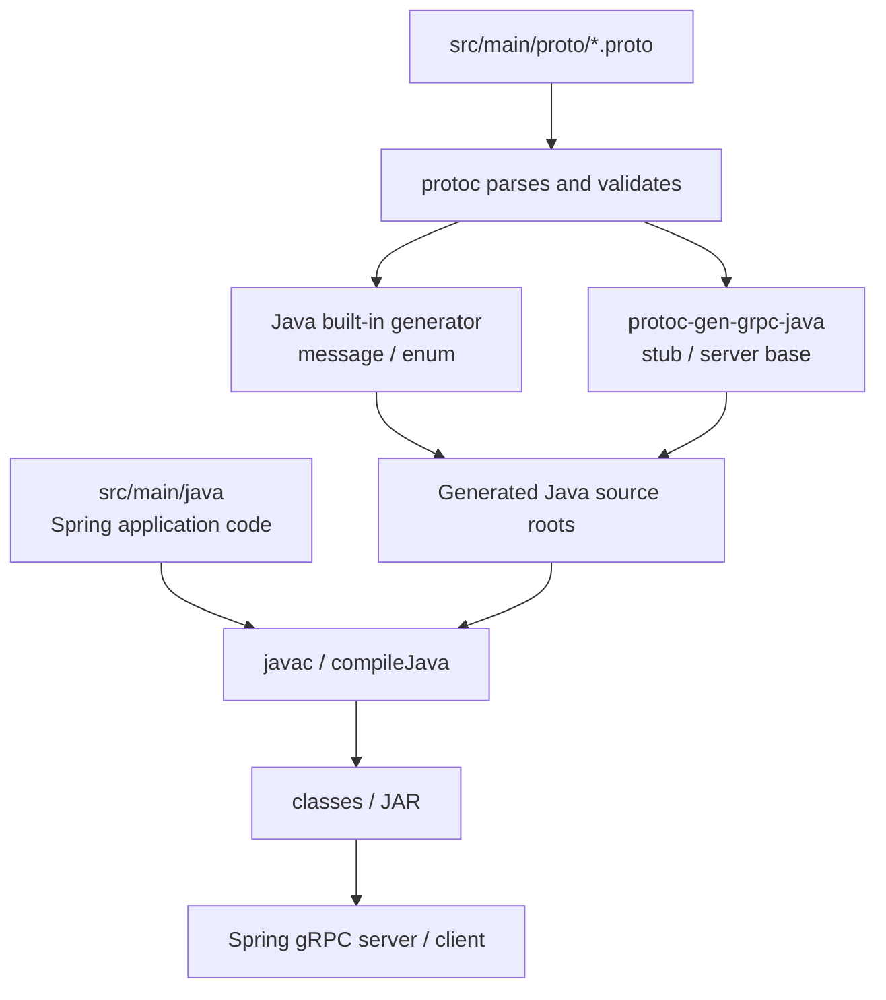

# Generated Sources in Gradle or Maven for Spring gRPC

In the **SPRING_GRPC** ecosystem, Protocol Buffers contracts (`.proto`) define data and RPC methods; **generated sources** are the Java code generated from those contracts. When properly configured, Gradle or Maven invokes `protoc` along with the `protoc-gen-grpc-java` plugin, produces files such as `StockRequest.java` and `StockServiceGrpc.java`, and adds them to the project's compilation pipeline. Developers focus on implementing clients/servers, business rules, metadata, deadlines, statuses, interceptors, TLS, testing, and monitoring instead of hand-writing protocol boilerplate.

This lesson belongs to the **Code generation** chapter and has a specific goal: **managing generated sources with Gradle or Maven**. Afterward, you will know where generated code lives, why an IDE might fail to see it, when regeneration is needed, how to organize multi-module projects, and how to verify the build pipeline works properly.

## 1. How Do Generated Sources Differ from Hand-Written Source Code?

| File Category | Example | Produced By | How to Change |
| --- | --- | --- | --- |
| Original contract | `src/main/proto/stock/v1/stock.proto` | API development team | Edit and review the `.proto` file |
| Java messages | `StockRequest.java`, `StockReply.java` | `protoc --java_out` | Regenerate from the contract |
| Java gRPC service API | `StockServiceGrpc.java` | `protoc-gen-grpc-java` via `--grpc-java_out` | Regenerate from the contract |
| Business Java code | `StockServiceImpl.java`, client adapter | Developers | Edit directly |
| Bytecode | `StockRequest.class`, `StockServiceImpl.class` | `javac` | Recompile |

Do not directly edit `*Grpc.java` or message classes inside `build/generated` or `target/generated-sources`. They may be overwritten on the next build. If you need to add a field or RPC, edit `.proto`; if you need to change behavior, edit application code.



**Code generation and compilation are two separate steps.** `protoc` produces `.java` files; the Java compiler produces `.class` files. Gradle or Maven must enforce this order while registering the generated directories with compilation sources.

## 2. Sample Contract for Comparing Gradle and Maven

We will use an inventory service with a **unary RPC** and a **server-streaming RPC**. Create `src/main/proto/stock/v1/stock.proto`:

```proto
syntax = "proto3";

package learning.stock.v1;

option java_package = "vn.example.springgrpc.stock.v1";
option java_multiple_files = true;
option java_outer_classname = "StockProto";

message StockRequest {
  string sku = 1;
}

message StockReply {
  string sku = 1;
  int64 available = 2;
  int64 version = 3;
}

service StockService {
  rpc GetStock(StockRequest) returns (StockReply);
  rpc WatchStock(StockRequest) returns (stream StockReply);
}
```

Declarations to remember:

- `package` is the **protobuf namespace**; the full gRPC service name is `learning.stock.v1.StockService`. Renaming package/service/method can change the RPC path.
- `java_package` is the **Java package**; it determines where generated classes reside: `vn.example.springgrpc.stock.v1`.
- `java_multiple_files = true` generates top-level Java messages separately, such as `StockRequest` and `StockReply`.
- `GetStock` takes one request and returns one response; `WatchStock` returns multiple responses from one request. Both use the exact same Java message classes.

If you run only the Java generator, you will have message classes without `StockServiceGrpc`. If you run only the gRPC plugin, the generated service API still requires message classes to compile.

## 3. Configuring Generated Sources with Gradle

This example uses **Gradle Groovy DSL** in `build.gradle`. The versions below are **illustrative** and must be aligned with the Spring Boot and Spring gRPC dependency management in your actual project.

```groovy
plugins {
    id 'java'
    id 'com.google.protobuf' version '0.9.5'
}

def protobufVersion = '4.30.2'
def grpcVersion = '1.71.0'

dependencies {
    implementation "com.google.protobuf:protobuf-java:$protobufVersion"

    implementation platform("io.grpc:grpc-bom:$grpcVersion")
    implementation 'io.grpc:grpc-protobuf'
    implementation 'io.grpc:grpc-stub'

    // Some generator versions use @javax.annotation.Generated.
    compileOnly 'javax.annotation:javax.annotation-api:1.3.2'
}

protobuf {
    protoc {
        artifact = "com.google.protobuf:protoc:$protobufVersion"
    }
    plugins {
        grpc {
            artifact = "io.grpc:protoc-gen-grpc-java:$grpcVersion"
        }
    }
    generateProtoTasks {
        all().configureEach { task ->
            task.plugins {
                grpc {}
            }
        }
    }
}
```

This mechanism has three parts:

1. The `com.google.protobuf` plugin integrates schemas into **Java source sets** and creates proto generation tasks.
2. `protoc.artifact` selects the `protoc` compiler. `plugins.grpc.artifact` selects the gRPC Java plugin executed alongside `protoc`.
3. `generateProtoTasks` tells tasks to apply the `grpc` plugin, producing `StockServiceGrpc.java` alongside the message classes created by the default Java generator.

Dependencies `protobuf-java`, `grpc-protobuf`, and `grpc-stub` are needed for generated code to compile and call grpc-java APIs. A running gRPC application also needs a transport and the corresponding Spring starter/configuration; do not treat the codegen configuration above as a complete application.

### 3.1. Generation and Compilation Tasks

For the standard main source set, Gradle creates the `generateProto` task. Run:

```bash
./gradlew generateProto
./gradlew compileJava

# On Windows PowerShell:
# .\gradlew.bat generateProto
# .\gradlew.bat compileJava
```

The plugin normally wires generation tasks before Java compilation; when you run `compileJava`, Gradle ensures generated sources are produced first. In CI, you can verify a clean build once from scratch:

```bash
./gradlew clean compileJava
```

`clean` deletes previous outputs and proves the project can regenerate code. You do not need `clean` on every development build because Gradle supports up-to-date checks and incremental builds depending on plugin, inputs, and outputs.

### 3.2. Generated Source Locations

Typical default output layout:

```text
build/
└── generated/
    └── source/
        └── proto/
            └── main/
                ├── java/
                │   └── vn/example/springgrpc/stock/v1/
                │       ├── StockProto.java
                │       ├── StockRequest.java
                │       ├── StockRequestOrBuilder.java
                │       ├── StockReply.java
                │       └── StockReplyOrBuilder.java
                └── grpc/
                    └── vn/example/springgrpc/stock/v1/
                        └── StockServiceGrpc.java
```

Output path names may vary if source sets, plugin versions, or build configurations differ. Do not hardcode default paths in external scripts when you can query task outputs from Gradle.

**Do not manually add those directories to `sourceSets.main.java.srcDirs` again if the protobuf plugin has already registered them.** Duplicate manual registration can cause duplicate sources and build graph errors, especially with custom source sets.

### 3.3. Test Source Set Protos

If the project has `src/test/proto`, Gradle can create `generateTestProto` and outputs like:

```text
build/generated/source/proto/test/java/
build/generated/source/proto/test/grpc/
```

The `all().configureEach` block applies the gRPC plugin to all source sets with proto tasks. If you only want the gRPC plugin applied to `main`, **replace** the `generateProtoTasks` block above with:

```groovy
protobuf {
    generateProtoTasks {
        ofSourceSet('main').configureEach { task ->
            task.plugins {
                grpc {}
            }
        }
    }
}
```

Do not include both blocks thinking it "adds another generation pass". Test-only protos should not be packaged as production APIs, and you should avoid generating duplicate classes of the main contract under test source roots.

## 4. Configuring Generated Sources with Maven

In Maven, a common choice is the `org.xolstice.maven.plugins:protobuf-maven-plugin` plugin. Maven uses **lifecycle phases** and **plugin goals** rather than a Gradle-style task graph.

The following `pom.xml` example focuses on code generation; coordinate it with your Spring Boot parent/BOM if used in a real application:

```xml
<project xmlns="http://maven.apache.org/POM/4.0.0"
         xmlns:xsi="http://www.w3.org/2001/XMLSchema-instance"
         xsi:schemaLocation="http://maven.apache.org/POM/4.0.0
         https://maven.apache.org/xsd/maven-4.0.0.xsd">
    <modelVersion>4.0.0</modelVersion>
    <groupId>vn.example</groupId>
    <artifactId>stock-contract</artifactId>
    <version>1.0.0</version>

    <properties>
        <maven.compiler.release>17</maven.compiler.release>
        <project.build.sourceEncoding>UTF-8</project.build.sourceEncoding>
        <protobuf.version>4.30.2</protobuf.version>
        <grpc.version>1.71.0</grpc.version>
    </properties>

    <dependencyManagement>
        <dependencies>
            <dependency>
                <groupId>io.grpc</groupId>
                <artifactId>grpc-bom</artifactId>
                <version>${grpc.version}</version>
                <type>pom</type>
                <scope>import</scope>
            </dependency>
        </dependencies>
    </dependencyManagement>

    <dependencies>
        <dependency>
            <groupId>com.google.protobuf</groupId>
            <artifactId>protobuf-java</artifactId>
            <version>${protobuf.version}</version>
        </dependency>
        <dependency>
            <groupId>io.grpc</groupId>
            <artifactId>grpc-protobuf</artifactId>
        </dependency>
        <dependency>
            <groupId>io.grpc</groupId>
            <artifactId>grpc-stub</artifactId>
        </dependency>
        <dependency>
            <groupId>javax.annotation</groupId>
            <artifactId>javax.annotation-api</artifactId>
            <version>1.3.2</version>
            <scope>provided</scope>
        </dependency>
    </dependencies>

    <build>
        <extensions>
            <extension>
                <groupId>kr.motd.maven</groupId>
                <artifactId>os-maven-plugin</artifactId>
                <version>1.7.1</version>
            </extension>
        </extensions>
        <plugins>
            <plugin>
                <groupId>org.xolstice.maven.plugins</groupId>
                <artifactId>protobuf-maven-plugin</artifactId>
                <version>0.6.1</version>
                <configuration>
                    <protocArtifact>
                        com.google.protobuf:protoc:${protobuf.version}:exe:${os.detected.classifier}
                    </protocArtifact>
                    <pluginId>grpc-java</pluginId>
                    <pluginArtifact>
                        io.grpc:protoc-gen-grpc-java:${grpc.version}:exe:${os.detected.classifier}
                    </pluginArtifact>
                </configuration>
                <executions>
                    <execution>
                        <phase>generate-sources</phase>
                        <goals>
                            <goal>compile</goal>
                            <goal>compile-custom</goal>
                        </goals>
                    </execution>
                </executions>
            </plugin>
        </plugins>
    </build>
</project>
```

**Two distinct goals:**

| Protobuf Maven Plugin Goal | Result |
| --- | --- |
| `protobuf:compile` | Uses protoc's built-in Java generator to generate messages, enums, and builders |
| `protobuf:compile-custom` | Uses the `grpc-java` plugin to generate `*Grpc.java`, stubs, and server base classes |

The **protobuf plugin's `compile` goal** is different from **Maven's `compile` phase**. In the configuration above, both goals run during the `generate-sources` phase, before the Java compiler processes the code.

### 4.1. Running the Maven Lifecycle

```bash
mvn generate-sources
mvn compile
mvn test
```

`mvn compile` and `mvn test` execute prior lifecycle phases, including `generate-sources`; so when the plugin is bound properly, they run codegen automatically. Running `mvn generate-sources` alone is mainly useful when inspecting generation output.

The `os-maven-plugin` extension provides `${os.detected.classifier}` so Maven selects `protoc` and plugin executables matching your OS. Missing the classifier or downloading the wrong binary can cause "plugin not found" or "cannot execute" errors.

### 4.2. Where Maven Stores Generated Sources

With `protobuf-maven-plugin` in the example, directories are typically:

```text
target/
├── generated-sources/
│   └── protobuf/
│       ├── java/
│       │   └── vn/example/springgrpc/stock/v1/
│       │       ├── StockRequest.java
│       │       ├── StockReply.java
│       │       └── ...
│       └── grpc-java/
│           └── vn/example/springgrpc/stock/v1/
│               └── StockServiceGrpc.java
└── classes/
    └── vn/example/springgrpc/stock/v1/
        ├── StockRequest.class
        ├── StockReply.class
        └── StockServiceGrpc.class
```

The plugin usually registers generated source roots with the Maven project automatically. Therefore, you **do not need** to copy generated code into `src/main/java`, nor should you add `build-helper-maven-plugin` just to re-register roots already registered by the protobuf plugin.

### 4.3. Generation for Test Sources

For `src/test/proto`, add another execution **inside the same `<executions>` block**:

```xml
<execution>
    <id>generate-test-protobuf</id>
    <phase>generate-test-sources</phase>
    <goals>
        <goal>test-compile</goal>
        <goal>test-compile-custom</goal>
    </goals>
</execution>
```

Corresponding outputs typically go to `target/generated-test-sources/protobuf/java` and `target/generated-test-sources/protobuf/grpc-java`. Only generate test services if tests actually need them; avoid duplicate classes between test and main, and avoid accidentally packaging test APIs into a production JAR.

## 5. Comparing Gradle and Maven

| Comparison Point | Gradle | Maven |
| --- | --- | --- |
| Build file | `build.gradle` or `build.gradle.kts` | `pom.xml` |
| Illustrative plugin | `com.google.protobuf` | `protobuf-maven-plugin` |
| Contract input | `src/main/proto` | `src/main/proto` |
| Message generation step | `generateProto` with Java generator | `compile` goal of protobuf plugin |
| gRPC stub generation step | `grpc` plugin in proto task | `compile-custom` goal |
| Message directory | `build/generated/source/proto/main/java` | `target/generated-sources/protobuf/java` |
| gRPC directory | `build/generated/source/proto/main/grpc` | `target/generated-sources/protobuf/grpc-java` |
| How Java compiler finds sources | Plugin registers source set and task dependency | Plugin registers compile roots and phase-bound goals |
| Clean compile command | `./gradlew clean compileJava` | `mvn clean compile` |

Paths depend on plugins and configuration; verify actual outputs if you use custom source sets, alternative plugins, or custom builds.

Despite different syntax, **the architectural requirements are identical**: one clear `.proto` source, two properly versioned generated source groups, Java compiler visibility for both, and clean-environment reproducibility.

## 6. Does the IDE Recognize Generated Sources?

A common situation: `./gradlew compileJava` or `mvn compile` succeeds, yet IntelliJ IDEA/Eclipse still shows red errors on `StockServiceGrpc`.

Check each item in order:

1. Did the IDE import the project **as a Gradle or Maven project**, or did it just open a plain Java folder?
2. Has generation run at least once so that the generated directories actually exist?
3. Have you **reloaded/synced the build project** so the IDE refreshes source roots?
4. Are both the `java` and `grpc` outputs assigned to the right **main module/source set**?
5. Is there a manual source root configuration conflicting with the plugin and causing stale IDE metadata?

For Gradle, reload the Gradle project; for Maven, reload the Maven project and inspect compile source roots. Never commit generated Java to Git just to make IDE errors go away. If the CLI build and IDE disagree, fix the project model and generated source configuration.

| Observation | Investigation Direction |
| --- | --- |
| CLI compile passes, IDE shows red errors | IDE has not synced source roots or generated folder does not exist yet |
| IDE sees `StockRequest` but lacks `StockServiceGrpc` | gRPC stubs were not generated or the `grpc` source root is not recognized |
| Running `clean` causes IDE errors | Output was deleted; regenerate and resync the IDE |
| IDE suggests editing code in `build/generated` | Generated sources should not be edited; go back to `.proto` or application code |

## 7. Should Generated Sources Be Committed?

In a Spring gRPC project with a stable build tool, you normally **commit schemas and build configuration**, while `build/` and `target/` are regenerable outputs:

```gitignore
.gradle/
build/
target/
```

Benefits: eliminates noisy generated-code diffs, avoids merge conflicts, prevents stale generated Java from drifting away from updated schemas, and forces CI to prove builds are reproducible.

Intentional exception: if an organization ships a **Java SDK or contract JAR** to consumers that do not run `protoc`, generated artifacts may be published via a versioned release process. Distributing a **JAR containing generated classes** is different from checking random build outputs into the source repository.

**Single source of truth:** `.proto` contents define the wire API. Generated Java is merely the artifact of a specific toolchain at a specific version.

## 8. Multi-Module Pattern: A Dedicated Contract Module

When both client and server are in Java, you can create a **`stock-contract`** module containing `.proto` and codegen:

```text
workspace/
├── stock-contract/
│   ├── src/main/proto/stock/v1/stock.proto
│   └── build.gradle  (or pom.xml)
├── stock-server/
│   └── src/main/java/.../StockServiceImpl.java
└── stock-client/
    └── src/main/java/.../StockGateway.java
```

The contract module generates and packages messages + `StockServiceGrpc` into a JAR. Client and server depend on that artifact.

In Gradle multi-project:

```groovy
dependencies {
    implementation project(':stock-contract')
}
```

In Maven, once the artifact has been built/published:

```xml
<dependency>
    <groupId>vn.example</groupId>
    <artifactId>stock-contract</artifactId>
    <version>1.0.0</version>
</dependency>
```

This structure keeps Java applications on the exact same schema and codegen version. Avoid both depending on a contract JAR **and regenerating the same fully qualified Java classes** inside client or server modules: two identical `StockRequest` or `StockServiceGrpc` classes on the classpath can cause unpredictable failures.

In polyglot systems, the `.proto` contract remains the language-independent source. A Java contract JAR cannot replace codegen for Go, Python, or other language clients.

## 9. Managing protoc and Dependency Versions

A codegen pipeline can generate code cleanly yet **fail at compile or runtime** when versions are mismatched:

| Component | Role |
| --- | --- |
| `protoc` | Parses schemas and generates Java messages matching its API level |
| `protobuf-java` | Message runtime: builders, parsers, serialization |
| `protoc-gen-grpc-java` | Generates service APIs, client stubs, and server base classes |
| `grpc-protobuf`, `grpc-stub`, `grpc-api` | Runtime APIs referenced by `*Grpc.java` |
| gRPC transport | HTTP/2, TLS, channel/server executing RPCs |
| Spring gRPC starter/BOM | Manages integration, beans/lifecycle, and dependencies |
| Build plugin | Wires codegen into the right task, source set, or Maven phase |

When upgrading codegen, inspect **both generated code and the runtime dependency graph**. For instance, a newer gRPC Java plugin generating code that calls APIs absent from an older `grpc-stub` can trigger `NoSuchMethodError` or compilation errors.

Inspect Gradle dependencies:

```bash
./gradlew dependencies --configuration runtimeClasspath
./gradlew dependencyInsight --configuration runtimeClasspath --dependency grpc-stub
```

Inspect Maven dependencies:

```bash
mvn dependency:tree
```

Organizations should lock versions via a BOM/version catalog/properties; the versions in the examples only illustrate build syntax. When Spring Boot/Spring gRPC starters already manage dependencies, avoid overriding them with untested versions.

## 10. Build Cache, Incremental Builds, and CI

Not every build has to re-run all of `protoc` if inputs have not changed. However, **do not assume every codegen plugin shares identical incremental/caching behavior**.

Relevant inputs may include:

- The main `.proto` file and any imported files.
- Versions of the `protoc` and `protoc-gen-grpc-java` binaries.
- Codegen flags, `java_package`, `java_multiple_files`, and output paths.
- Proto dependencies, source sets, JDK/build environment depending on the plugin.

With Gradle:

```bash
./gradlew generateProto --info
```

Observe why the task was `UP-TO-DATE` or had to re-run. Never disable generation tasks manually to hide slow-build issues.

With Maven:

```bash
mvn clean compile
```

This command is useful when stale outputs are suspected, while frequent local builds can use `mvn compile`. Ensure the Maven lifecycle binds both message and stub generation goals.

A minimal CI pipeline:

1. Check out the repository containing `.proto` files and versioned build configuration.
2. Resolve dependencies and platform-appropriate executables.
3. Run code generation and Java compilation on a clean workspace.
4. Run tests verifying message serialization, generated APIs, and an actual gRPC call.
5. Check for breaking changes when multiple clients/servers are released independently.
6. Package/publish the contract JAR or application once checks pass.

Example commands:

```bash
# Gradle
./gradlew clean build

# Maven
mvn clean verify
```

These commands assume the project already defines appropriate plugins and test goals; they **do not invent tests** if none have been written.

## 11. Using Generated Classes in Spring gRPC

After generation and compilation, the server can extend `StockServiceGrpc.StockServiceImplBase`. Here is a Spring bean illustrating unary handling:

```java
package vn.example.springgrpc.stock;

import io.grpc.Status;
import io.grpc.stub.StreamObserver;
import org.springframework.stereotype.Service;
import vn.example.springgrpc.stock.v1.StockReply;
import vn.example.springgrpc.stock.v1.StockRequest;
import vn.example.springgrpc.stock.v1.StockServiceGrpc;

@Service
public class StockServiceImpl
        extends StockServiceGrpc.StockServiceImplBase {

    @Override
    public void getStock(
            StockRequest request,
            StreamObserver<StockReply> responses) {

        if (request.getSku().isBlank()) {
            responses.onError(Status.INVALID_ARGUMENT
                    .withDescription("sku must not be blank")
                    .asRuntimeException());
            return;
        }

        StockReply reply = StockReply.newBuilder()
                .setSku(request.getSku())
                .setAvailable(8)
                .setVersion(1)
                .build();

        responses.onNext(reply);
        responses.onCompleted();
    }
}
```

`StockServiceGrpc` and `StockReply` are generated, while `StockServiceImpl` is **written by the developer**. In Spring gRPC versions that auto-register `BindableService` beans, this class can be wired into the server. If using a different starter, verify its actual annotation/service-binding mechanism.

Client invoking unary via stub:

```java
import io.grpc.ManagedChannel;
import io.grpc.ManagedChannelBuilder;
import java.util.concurrent.TimeUnit;
import vn.example.springgrpc.stock.v1.StockReply;
import vn.example.springgrpc.stock.v1.StockRequest;
import vn.example.springgrpc.stock.v1.StockServiceGrpc;

ManagedChannel channel = ManagedChannelBuilder
        .forAddress("localhost", 9090)
        .usePlaintext() // Local example only; production requires TLS.
        .build();

try {
    StockReply reply = StockServiceGrpc
            .newBlockingStub(channel)
            .withDeadlineAfter(2, TimeUnit.SECONDS)
            .getStock(StockRequest.newBuilder()
                    .setSku("BOOK-101")
                    .build());

    System.out.println(reply.getAvailable());
} finally {
    channel.shutdown();
}
```

Codegen provides **data types and APIs**, but does not generate runtime decisions:

| Concern | Where It Is Handled |
| --- | --- |
| Metadata, tokens, correlation IDs | Interceptors, call credentials, context |
| Deadlines and cancellation | Call options and gRPC status handling |
| Statuses `INVALID_ARGUMENT`, `UNAVAILABLE` | Server logic or transport; client handles exceptions/callbacks |
| TLS, mTLS | Channel and server transport |
| Metrics, tracing, logging | Instrumentation/interceptors and observability stack |
| Server streaming `WatchStock` | Server emits multiple `StockReply` items; client uses iterator or async observer |
| Flow control and stream cancellation | grpc-java runtime + application resource management |

In Spring applications, channels and stubs are typically managed by the starter via dependency injection. Do not create and shut down a channel for every production request just because a generated stub requires a `Channel`.

## 12. Pinpointing Errors at the Right Step

```text
.proto syntax/import
        ↓
protoc
        ↓
protoc-gen-grpc-java plugin
        ↓
generated source roots
        ↓
Java compiler / dependencies
        ↓
Spring service registration
        ↓
channel / TLS / metadata / deadline
        ↓
RPC status and business logic
```

| Symptom | Cause to Check | Resolution |
| --- | --- | --- |
| `Import "..." was not found` | Wrong proto import root/dependency | Check `src/main/proto`, include paths, and schema dependencies |
| `protoc-gen-grpc-java: program not found` | Wrong plugin binary/classifier | Check Gradle `plugins.grpc` or Maven `pluginArtifact` |
| `StockRequest.java` exists, but `StockServiceGrpc.java` is missing | gRPC plugin did not run | Gradle `grpc {}`; Maven `compile-custom` |
| `StockServiceGrpc.java` exists, but compiler cannot see it | Generated root not added to source set/compile roots | Check plugin integration and main/test source sets |
| IDE shows red errors despite CLI compile passing | IDE has not synced project model | Reload Gradle/Maven and generated roots |
| `javax.annotation.Generated` not found | Some generated code requires annotation dependency | Add appropriate annotation API or upgrade generator |
| `method does not override` | Server implementation signature does not match generated API | Cross-check `ImplBase`, package, and types |
| `NoSuchMethodError` or `NoClassDefFoundError` | Protobuf/grpc-java version mismatch | Check BOM, dependency tree, and duplicate JARs |
| `UNIMPLEMENTED` | Service not registered, method not overridden, or wrong RPC name | Check Spring bean and fully qualified service/method |
| `UNAVAILABLE` | Wrong endpoint/transport/TLS | Check channel target, port, certificates, readiness |
| `DEADLINE_EXCEEDED` | RPC exceeded timeout | Check latency, downstream calls, deadline |
| Output still reflects old schema | Build used stale proto source/old outputs | Check task inputs, source sets, run a clean build |

Rule of thumb: **passing compilation does not guarantee the server registered the service, the client can connect, or schemas are compatible across deployed versions**. Diagnose by stage instead of editing generated Java or arbitrarily changing field numbers.

## 13. Testing Code Generation and RPCs

To prove the pipeline works, verify both code generation and an actual gRPC call:

1. Run generation in a clean environment; confirm `StockRequest.java`, `StockReply.java`, and `StockServiceGrpc.java` exist.
2. Run Java compilation and verify no classes or dependencies are missing.
3. Use a generated client stub to call the server implementation and verify the response.
4. Send an invalid request to verify `INVALID_ARGUMENT` status.
5. For `WatchStock`, test server streaming, deadlines, cancellation, and terminal callbacks.
6. When verifying Spring Boot, test bean registration, channel configuration, interceptors, TLS, and metrics with appropriate integration tests.

You can use an **in-process server/channel** for simple grpc-java tests (requires the `grpc-inprocess` test dependency matching the runtime version):

```java
// Inside a test method that throws Exception;
// StockServiceImpl from the example above can be instantiated directly.
String name =
        io.grpc.inprocess.InProcessServerBuilder.generateName();

io.grpc.Server server =
        io.grpc.inprocess.InProcessServerBuilder.forName(name)
                .directExecutor()
                .addService(new StockServiceImpl())
                .build()
                .start();

io.grpc.ManagedChannel channel =
        io.grpc.inprocess.InProcessChannelBuilder.forName(name)
                .directExecutor()
                .build();

try {
    StockReply reply = StockServiceGrpc
            .newBlockingStub(channel)
            .getStock(StockRequest.newBuilder()
                    .setSku("BOOK-101")
                    .build());

    if (reply.getAvailable() != 8) {
        throw new AssertionError("Wrong stock");
    }
} finally {
    channel.shutdownNow();
    server.shutdownNow();
}
```

This test verifies **codegen + grpc-java dispatch**, not network transport, TLS, or Spring auto-configuration. Application-level tests must cover those aspects when required by product specifications.

## 14. Hands-On Practice

1. **Gradle:** Generate code from `stock.proto`, locate both `main/java` and `main/grpc` directories, and describe the role of each file group.
2. **Maven:** Run only the `compile` goal of the protobuf plugin, then compare with enabling `compile-custom` as well.
3. **Build lifecycle:** Delete the build output directory in a practice copy of the project and run `compileJava` or `mvn compile`. Explain why generation runs automatically before the Java compiler.
4. **IDE:** Import a Gradle/Maven project before and after generation; verify that the IDE recognizes the source roots properly.
5. **Test source set:** Create `src/test/proto/mock.proto` and let the build generate a mock service; confirm it does not end up in the production JAR.
6. **Multi-module:** Move the contract to `stock-contract` and have server/client depend on the contract JAR. Eliminate duplicate generated classes from the classpath.
7. **Versions:** Find a grpc-java dependency resolved to the wrong version using `dependencyInsight` or `dependency:tree`; fix the BOM/properties.
8. **Plugin error:** Remove `grpc {}` in Gradle or `compile-custom` in Maven, run a clean build, and explain why `*Grpc.java` is missing.
9. **Runtime:** Write an in-process test for `GetStock`, checking both success and `INVALID_ARGUMENT`, then extend it to server-streaming `WatchStock`.
10. **CI:** Design a pipeline covering generation, compilation, contract compatibility checks, and integration tests; distinguish schema, build, and runtime errors.

### Key Takeaway

**Generated sources are build artifacts produced from `.proto` contracts and must be compiled like any other Java code.** Gradle uses `com.google.protobuf` to integrate `generateProto`, the gRPC plugin, and Java source sets; Maven uses the `compile`/`compile-custom` goals during `generate-sources` and registers outputs as compile roots. For Spring gRPC, manage generated sources with reproducible builds, verify packages and source sets, align versions, and confirm client/server communication through integration tests. When a schema changes, **edit the contract and regenerate**—never edit generated Java directly.
