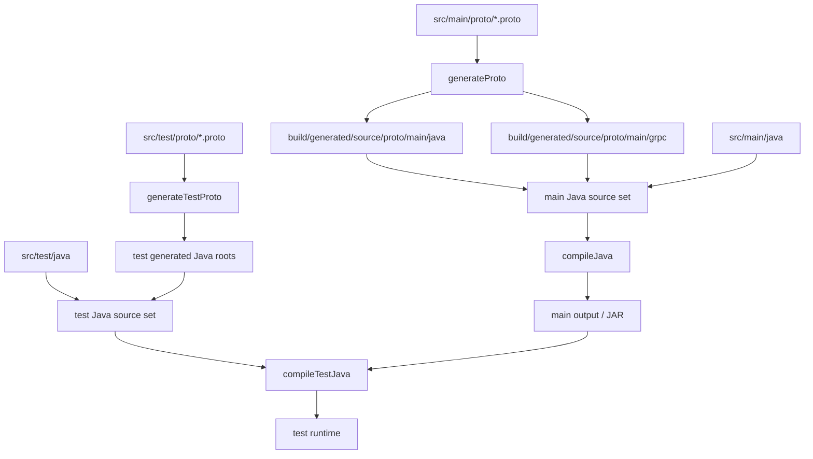

# Source Sets for Generated Code in Gradle

In a **Spring gRPC** project, Protocol Buffers Java classes are automatically generated from `.proto` files. Gradle needs to know **which source set the generated classes belong to** so it can compile them alongside application code and keep scopes cleanly separated. This is the role of **source sets for generated code**.

A source set is a collection of sources and resources for a specific build purpose, typically `main`, `test`, or a custom source set such as `integrationTest`. With the protobuf Gradle plugin, each source set can have proto sources, generated Java sources, and corresponding compilation tasks.

This lesson focuses on organizing source sets and generated sources in Gradle: where schemas live, how to attach outputs to `main`/`test`, how to create an integration test source set, and how to inspect the task graph. Generating messages/stubs, general Gradle configuration, and the Maven lifecycle are covered separately in the Code generation chapter.

## 1. How Do Source Sets and Generated Sources Relate?

In the Gradle Java plugin, a source set describes a group of Java code sharing a compilation purpose. Two important default source sets are:

| Source Set | Default Java Source | Purpose |
| --- | --- | --- |
| `main` | `src/main/java` | Code packaged into the application/library |
| `test` | `src/test/java` | Test code, excluded from production artifacts |

The protobuf Gradle plugin extends source sets to accept proto files. For a given source set, the plugin runs the Java generator and any configured generators, then registers the outputs as generated Java sources for that corresponding source set.



Key point to remember: **generated sources are bound to a source set**, not dumped into a shared Java pool without distinguishing main and test. Code generated from `src/main/proto` serves the application; code generated from `src/test/proto` serves tests.

## 2. Main Source Set: Application Generated Code

With the protobuf Gradle plugin, the default proto directory for `main` is:

```text
src/main/proto/
```

No extra declaration is needed if the project follows the default layout. When schemas also live elsewhere, you can add a proto source directory to `main`:

```groovy
sourceSets {
    main {
        proto {
            srcDir 'src/shared-proto'
        }
    }
}
```

This configuration adds `src/shared-proto` to the `main` proto source set; it does not replace the default `src/main/proto` directory. Only add a shared directory if the project actually stores schemas there.

With the Java generator and the gRPC plugin named `grpc`, typical output paths are:

```text
build/generated/source/proto/main/
├── java/       # Messages, enums, builders, descriptors
└── grpc/       # *Grpc, stubs, server base
```

The protobuf plugin automatically registers these generated directories with the Java source set. Thus, code in `src/main/java` can import directly:

```java
import vn.example.springgrpc.stock.v1.StockReply;
import vn.example.springgrpc.stock.v1.StockRequest;
import vn.example.springgrpc.stock.v1.StockServiceGrpc;
```

and the Java compiler compiles the generated classes together with application code when `compileJava` runs. If the plugin already registered the source roots, do not manually add `build/generated` directories to `sourceSets.main.java.srcDirs` out of habit; duplicate registration makes the configuration confusing and can cause duplicate source errors.

### Example Application Class Using Generated Code

```java
package vn.example.springgrpc.stock;

import io.grpc.stub.StreamObserver;
import org.springframework.stereotype.Service;
import vn.example.springgrpc.stock.v1.StockReply;
import vn.example.springgrpc.stock.v1.StockRequest;
import vn.example.springgrpc.stock.v1.StockServiceGrpc;

@Service
public class StockServiceImpl
        extends StockServiceGrpc.StockServiceImplBase {

    @Override
    public void getStock(
            StockRequest request,
            StreamObserver<StockReply> observer) {

        StockReply reply = StockReply.newBuilder()
                .setSku(request.getSku())
                .setAvailable(12)
                .setVersion(1)
                .build();

        observer.onNext(reply);
        observer.onCompleted();
    }
}
```

`StockRequest`, `StockReply`, and `StockServiceGrpc` belong to `main` generated sources; `StockServiceImpl` is application code in `src/main/java`. The service class compiles only after generated roots have been created and included in the `main` source set.

## 3. Test Source Set: Generated Code Used Only in Tests

The Gradle Java plugin defines a `test` source set. Protos dedicated exclusively to testing should be placed in:

```text
src/test/proto/
```

The protobuf Gradle plugin can create generated roots for `test`, typically:

```text
build/generated/source/proto/test/
├── java/
└── grpc/
```

The corresponding generation task is usually named `generateTestProto`; test Java compilation is `compileTestJava`. Test code can access both `main` outputs and test-specific generated code because the test compile classpath normally includes `main` outputs and test dependencies.

Example test proto for creating a dedicated mock service:

```proto
syntax = "proto3";

package learning.stock.test.v1;

option java_package = "vn.example.springgrpc.stock.test.v1";
option java_multiple_files = true;

message FakeRequest {
  string key = 1;
}

message FakeReply {
  string value = 1;
}

service FakeStockService {
  rpc Find(FakeRequest) returns (FakeReply);
}
```

If the gRPC plugin is applied to proto tasks, Gradle also generates `FakeStockServiceGrpc` under the test generated roots. Tests can use this service to verify client adapters or error cases without shipping test services inside production artifacts.

### Explicit Proto Roots Configuration

If you want to explicitly document schema locations, you can declare:

```groovy
sourceSets {
    main {
        proto {
            srcDir 'src/main/proto'
        }
    }
    test {
        proto {
            srcDir 'src/test/proto'
        }
    }
}
```

This is an explicit declaration; these two paths are already the plugin's default convention in standard setups. You do not need to add this block solely to repeat defaults.

If you only want gRPC stubs generated for `main`, scope the plugin by source set:

```groovy
protobuf {
    generateProtoTasks {
        ofSourceSet('main').configureEach { task ->
            task.plugins {
                grpc {}
            }
        }
    }
}
```

With this scoped configuration, test protos can still generate Java messages using the built-in generator, but will not generate gRPC stubs for test services. If tests need stubs, configure `test` as well or use `all().configureEach` per project needs.

## 4. Custom Source Set for Integration Tests

Some projects keep integration tests separate from unit tests. You can create an `integrationTest` source set and place test schemas in `src/integrationTest/proto`.

Example in `build.gradle`:

```groovy
sourceSets {
    integrationTest {
        java.srcDir 'src/integrationTest/java'
        proto.srcDir 'src/integrationTest/proto'

        // Allow integration tests to use compiled classes from main.
        compileClasspath += sourceSets.main.output
        runtimeClasspath += output + compileClasspath
    }
}

configurations {
    integrationTestImplementation.extendsFrom testImplementation
    integrationTestRuntimeOnly.extendsFrom testRuntimeOnly
}
```

When a source set is defined, the Gradle Java plugin also creates corresponding configurations and compile tasks, such as `compileIntegrationTestJava`. The protobuf Gradle plugin detects the custom proto source set and creates a matching generation task, typically `generateIntegrationTestProto`.

To generate gRPC stubs for this source set:

```groovy
protobuf {
    generateProtoTasks {
        ofSourceSet('integrationTest').configureEach { task ->
            task.plugins {
                grpc {}
            }
        }
    }
}
```

The block above is an additional per-source-set configuration. If the project already uses `all().configureEach` to apply the `grpc` plugin to every proto task, do not repeat it for `integrationTest`.

A layout you can use:

```text
src/
├── main/
│   ├── java/
│   └── proto/
├── test/
│   ├── java/
│   └── proto/
└── integrationTest/
    ├── java/
    └── proto/

build/generated/source/proto/
├── main/java/
├── main/grpc/
├── test/java/
├── test/grpc/
├── integrationTest/java/
└── integrationTest/grpc/
```

Exact generated paths depend on source set names and plugin configuration. Check your project's task outputs when using custom source sets or customized output directories.

**Note:** Defining a source set does not automatically create a complete `Test` task with desired filters, frameworks, and lifecycle wiring. The project must register an integration test task (or use the Gradle JVM Test Suite plugin) separately. That sits outside registering generated sources, but must be configured if you want integration tests to run with `gradlew check`.

## 5. Ensuring Generation Tasks Run Before Compilation

Generated sources are only useful if they exist before the compiler reads the source set. The protobuf Gradle plugin normally registers the required task dependencies for managed source sets.

With the default configuration:

| Command / Task | Purpose |
| --- | --- |
| `generateProto` | Generates code for `main` protos |
| `generateTestProto` | Generates code for `test` protos |
| `compileJava` | Compiles `main` Java and `main` generated sources |
| `compileTestJava` | Compiles `test` Java and `test` generated sources |
| `check` | Runs verification tasks wired into the lifecycle |

Inspect the task graph without executing a build:

```bash
./gradlew compileJava --dry-run
./gradlew compileTestJava --dry-run
```

Observe logs when running generation:

```bash
./gradlew generateProto --info
./gradlew generateTestProto --info
```

Task names may differ with custom source sets or plugin versions. Use `./gradlew tasks --all` to inspect actual tasks rather than guessing.

If `compileJava` reports `StockServiceGrpc` is missing, verify three things: whether the proto task ran, whether the `grpc` plugin was applied, and whether the generated `grpc` directory belongs to the `main` source set. If the error appears in `compileTestJava`, inspect the `test` source set and test dependencies separately.

## 6. Avoiding Mixing main, test, and integrationTest

Each source set should have clear boundaries:

| Content | Should Be Placed In | Reason |
| --- | --- | --- |
| Production contracts | `src/main/proto` | Part of the product API |
| Mock messages/services for unit tests only | `src/test/proto` | Keeps test contracts out of production |
| Protos dedicated to integration harnesses | `src/integrationTest/proto` | Scoped to integration testing |
| Real server implementations | `src/main/java` | Code running in the application |
| Unit tests | `src/test/java` | Tests logic and adapters |
| Integration tests | `src/integrationTest/java` | Tests wiring, channels, transport, or real services |

Do not put test-only schemas in `src/main/proto` just for convenient imports. Doing so causes the plugin to generate code into the `main` source set, and test classes/services may leak into the production JAR.

Conversely, if production client code needs a message or service, never put that contract in `src/test/proto`; the `main` source set will not have those classes available to compile.

### Sharing Contracts Between main and test

Tests often need generated types from `main`. You do not need to copy production protos into `test`. The Java `test` source set already sees `main` outputs per the Java plugin model. Create dedicated test protos only when you need a fake contract, such as a service simulating errors or a test-only schema.

## 7. IDEs and Generated Source Roots

IntelliJ IDEA or Eclipse may show red errors on generated classes even when the Gradle CLI build succeeds. The usual cause is that the IDE has not synced the Gradle model or generated directories are not yet recognized as source roots.

Verification checklist:

1. Import the project as a **Gradle project**, rather than just opening the Java source directory.
2. Run `generateProto` so the actual output directories exist.
3. Reload/Sync the Gradle project so the IDE refreshes source sets and the task model.
4. Check that generated sources belong to the right module and source set (`main`, `test`, or `integrationTest`).
5. Confirm the IDE does not have a stale manual source root pointing to an old output folder.

Do not commit generated code just to stop IDE errors. If CLI builds pass while the IDE complains, fix the project model / source root synchronization; keep `.proto` files and build configuration as the source of truth.

## 8. Practical Verification for Generated Sources

A quick verification should cover **both `main` and `test` source sets**.

### 8.1. Confirm Outputs Exist

After running generation, verify the key directories:

```text
build/generated/source/proto/main/java/
build/generated/source/proto/main/grpc/
build/generated/source/proto/test/java/
build/generated/source/proto/test/grpc/
```

Not every project needs test `grpc` output; if test protos contain only messages, `test/grpc` may not contain any service classes.

### 8.2. Compile Each Source Set Separately

```bash
./gradlew clean compileJava
./gradlew compileTestJava
```

The first command verifies `main` generated code compiles with the application. The second verifies `test` generated sources and test code can use `main` outputs. If an `integrationTest` source set exists, also run `compileIntegrationTestJava`.

### 8.3. Test Classes Belonging to the Right Source Set

Example of a simple Java test verifying production messages can be built and read properly:

```java
package vn.example.springgrpc.stock;

import org.junit.jupiter.api.Test;
import vn.example.springgrpc.stock.v1.StockRequest;

import static org.junit.jupiter.api.Assertions.assertEquals;

class StockGeneratedSourceTest {

    @Test
    void generatedMessageIsAvailableOnTestClasspath() {
        StockRequest request = StockRequest.newBuilder()
                .setSku("BOOK-101")
                .build();

        assertEquals("BOOK-101", request.getSku());
    }
}
```

This test does not test RPC transport; it only proves that generated messages from the **`main` source set** appear on the test compile/runtime classpath.

If tests need to exercise a generated gRPC service in the `test` source set, create a test service in `src/test/proto` and confirm `generateTestProto` + `compileTestJava` succeed. You can then use the generated test stub to call a test server or mock service.

### 8.4. Verify Clean Build and Task Graph

```bash
./gradlew clean test
./gradlew compileTestJava --dry-run
```

Expected outcome: `main` generated sources are produced before `main` compilation; `test` generated sources are produced before `test` compilation; no generated Java file ever needs to be copied into `src/main/java` or `src/test/java`.

## 9. Common Errors When Configuring Source Sets

| Symptom | Possible Cause | Resolution |
| --- | --- | --- |
| Main compile cannot find message classes | Main proto task has not run or source root not registered | Check `generateProto`, plugin integration, and `main` source set |
| Messages exist, but `*Grpc` is missing | gRPC plugin not applied to the corresponding task | Add `grpc {}` to the right `generateProtoTasks` block |
| Test compile cannot find test messages | Proto placed in wrong path or `generateTestProto` did not run | Check `src/test/proto` and `test` source set |
| Tests accidentally expose production-like fake contracts | Test schema was placed in `main` proto | Move test-only schemas to `src/test/proto` |
| Generated class appears twice | Manually registered generated directory already registered by plugin | Remove duplicate source root; keep only one mechanism |
| IDE reports errors while Gradle compile passes | Gradle project model not reloaded | Sync Gradle and verify source roots |
| Custom source set compile cannot find generated code | Source set not configured properly or plugin missed proto task | Check source set, proto root, and generation task |
| Integration tests do not run during `check` | Integration test task not wired into lifecycle | Configure a `Test` task / JVM Test Suite separately |
| Test class cannot see generated types | Missing test compile dependency or source set classpath | Check `testImplementation`, `main` outputs, and compile classpath |

## 10. Does Maven Have Source Sets Like Gradle?

Maven does not use the Gradle Java plugin's **SourceSet** model. Maven uses **compile source roots** registered on the project by plugins. With the protobuf Maven plugin, generated message and gRPC sources typically reside under `target/generated-sources/protobuf` and are added to compile roots.

Therefore, when reading Maven documentation, look for these concepts:

- `generate-sources`: lifecycle phase before `compile`, where codegen goals are bound.
- `compile source roots`: Java directories compiled by the Maven compiler.
- `generate-test-sources`: phase for generated test code.
- `target/generated-test-sources`: generated source output directory for tests.

**Do not try to apply Gradle's `sourceSets { ... }` syntax inside `pom.xml`.** The equivalent goal is keeping `main`/`test` generated roots separate and ensuring the plugin registers them in the proper lifecycle phases.

## 11. Hands-On Practice

1. Create `stock.proto` in `src/main/proto`, enabling both Java and gRPC generators. Locate the `main` generated roots and verify `compileJava`.
2. Create `fake_stock.proto` in `src/test/proto` with a test service. Run `generateTestProto` and `compileTestJava`; verify the test service does not appear in `main` generated roots.
3. Remove the `grpc` plugin configuration from test generation. Observe that test messages still generate while test service stubs are not created.
4. Create an `integrationTest` source set and its own proto root. Inspect the generation and compile tasks created for that source set name.
5. Try adding the generated directory to `sourceSets.main.java.srcDirs` even though the plugin already registers it. Observe the source root configuration, then remove the duplicate declaration.
6. Open the project in an IDE before running generation, run the Gradle task, and reload the project. Verify both `main` and `test` generated roots are recognized properly.
7. Run `compileTestJava --dry-run` and explain the generation → compilation ordering in the task graph.
8. Write a test using `StockRequest` generated in `main` to confirm the `test` source set sees `main` outputs without copying protos.

### Key Takeaway

**Source sets determine which build scope generated sources belong to.** With the Gradle protobuf plugin, `src/main/proto` generates code for `main`, `src/test/proto` generates code for `test`, and custom source sets can have their own proto roots and generated outputs. The plugin wires outputs into Java source sets and compilation tasks; keep `main`/`test` boundaries clean, avoid duplicate generated directory registrations, sync your IDE, and verify the task graph with real builds and tests. Maven uses compile source roots and lifecycle phases instead of Gradle `SourceSet`s.
