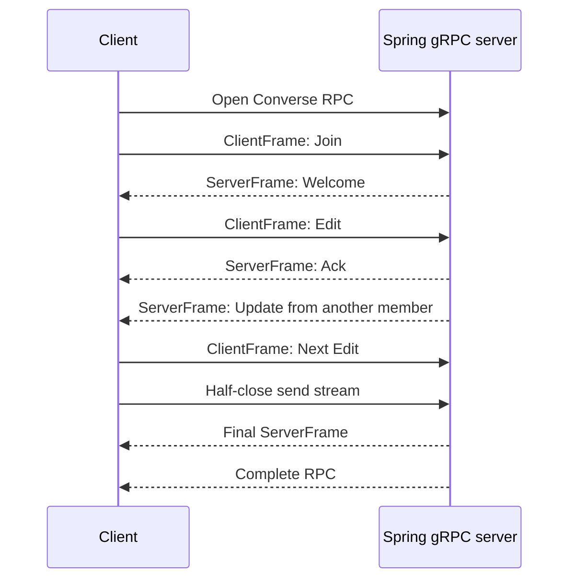
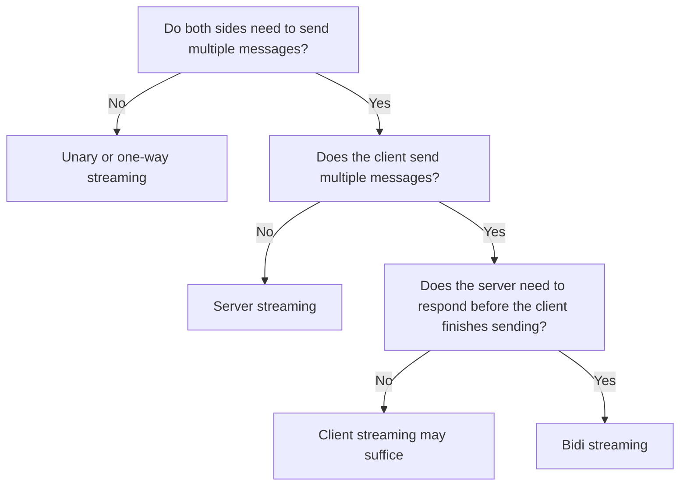

# Choosing Bidi Streaming for Two-Way Interaction

Bidirectional streaming (bidi streaming) is appropriate when the client and server need to send multiple messages to each other within the same RPC, and each side can continue sending without waiting for the other side to finish its turn. It is an option for interactive sessions with continuous two-way exchange, such as real-time collaboration, device control, conversational sessions, or interactive event processing.

However, a stream increases complexity around lifecycle, synchronization, cancellation, retries, and load control. Choose bidi when the business flow truly needs both directions operating independently; if you only need one request and one response, one side emitting multiple messages, or one side sending a batch of data and receiving a final result, simpler RPC types are usually easier to operate.

## 1. How Does Bidi Streaming Work?

In a Protocol Buffers contract, a bidi RPC declares `stream` on both the request and response types:

```protobuf
service SessionService {
  rpc Converse (stream ClientFrame) returns (stream ServerFrame);
}
```

The client opens a `Converse` RPC and receives a response stream. The client can then send multiple `ClientFrame` messages; the server can send multiple `ServerFrame` messages while continuing to receive requests. Both message streams operate independently within the same RPC.



Key points to remember:

- Each RPC has one request stream and one response stream. The server can reply before the client finishes sending all requests.
- Message order is preserved within each direction: the server receives requests in the order the client sent them, and the client receives responses in the order the server sent them. There is no guaranteed global total order across both directions.
- The client calls `onCompleted()` on the request observer to indicate it will send no more requests. This is *half-close*: the server can still send remaining responses before completing the response stream.
- `onCompleted()` or `onError()` terminates the respective stream. After a terminal event, do not send any further messages on that stream.
- A bidi RPC is an RPC session with a start and an end. It does not automatically become a durable session that can recover after a network drop or process restart.

## 2. Comparing the Four RPC Types Before Choosing

Protocol Buffers supports four primary communication styles. Choose based on message direction and how both sides coordinate:

| RPC Type | Message Flow | Best Fit | Examples |
| --- | --- | --- | --- |
| Unary | One request, one response | An independent operation with a clear outcome | Profile lookup, order creation |
| Server streaming | One request, multiple responses | Client requests once, then receives continuous data | Status monitoring, downloading results in batches |
| Client streaming | Multiple requests, one response | Client sends a sequence of data, then server aggregates the result | Chunked file upload, sending measurement batches |
| Bidirectional streaming | Multiple requests, multiple responses | Both sides need multiple exchanges in the same session without waiting for the other to finish sending | Real-time collaboration, interactive control |

Some quick selection rules:

- One operation maps to one result: choose unary.
- Client requests data once, then only the server emits events: choose server streaming.
- Client sends multiple data parts, server only needs to return a final result: choose client streaming.
- Both client and server need to emit messages while the session is ongoing: consider bidi streaming.



The flowchart is an initial filter. If the client sends multiple messages and the server also needs to return acknowledgements while receiving, bidi is usually a better fit than client streaming. Conversely, if a response only makes sense after all input is sent, client streaming has a simpler protocol.

## 3. When Should You Choose Bidi Streaming?

Choose bidi when the business flow involves an extended exchange session, either side can proactively emit messages, and messages in both directions are related within the same session.

### Real-Time Collaboration

Multiple users concurrently edit a document or dashboard. Clients send edits, cursor positions, or presence state; the server sends acknowledgements, changes from other users, and sync notices. The client does not need to open a new RPC for every small action.

### Interactive Control and Monitoring

The client sends configuration commands or device control actions; the server sends status, progress, and alerts while subsequent commands can still be sent. Design explicit command confirmations and execution permissions, because sending a message does not mean the device executed it successfully.

### Conversational or Interactive Processing Sessions

The client sends chunks of content or control signals; the server returns partial results, processing status, or follow-up prompts. Bidi helps when the client adjusts input based on incoming responses.

### Do Not Choose Bidi Just Because There Are Many Messages

- If the client only uploads a stream of data and receives one final result, client streaming suffices.
- If the client only subscribes once and the server emits events, server streaming suffices.
- If operations are independent and can be handled separately, multiple concurrent unary RPCs are usually easier to retry, authorize, observe, and load-balance.
- If you need to broadcast events to many consumers, retain events, replay, or deliver durably, evaluate a message broker or event log. A bidi RPC does not inherently provide event storage and replay.

## 4. Designing the Message Contract for a Two-Way Session

Do not create a generic message full of arbitrary strings or ad-hoc fields. Define message types and state-transition rules that both client and server interpret identically.

Example of a collaboration session protocol:

```protobuf
syntax = "proto3";

package acme.collaboration.v1;

service CollaborationService {
  rpc Connect (stream ClientFrame) returns (stream ServerFrame);
}

message ClientFrame {
  string session_id = 1;
  uint64 client_sequence = 2;

  oneof body {
    Join join = 10;
    Edit edit = 11;
    Ping ping = 12;
    Leave leave = 13;
  }
}

message ServerFrame {
  uint64 server_sequence = 1;
  uint64 acknowledged_client_sequence = 2;

  oneof body {
    Welcome welcome = 10;
    Ack ack = 11;
    Update update = 12;
    Notice notice = 13;
  }
}

message Join {
  string document_id = 1;
}

message Edit {
  string operation_id = 1;
  string content = 2;
}

message Ping {}
message Leave {}
message Welcome { string participant_id = 1; }
message Ack { string operation_id = 1; }
message Update { string operation_id = 1; string content = 2; }
message Notice { string message = 1; }
```

In this contract, `oneof` makes each frame represent a clear event type. `client_sequence` and `server_sequence` illustrate per-direction numbering; `acknowledged_client_sequence` shows which request the server has processed up to. These are application conventions, not fields added automatically by gRPC.

When designing a real contract, agree on these rules:

1. **Handshake:** the first message can be `Join`/`Open` to select a resource or session. The server authenticates metadata, checks permissions, and returns `Welcome` or terminates the RPC with an appropriate status.
2. **Session identity:** determine which user, tenant, and resource the session belongs to. Do not trust `session_id` in the payload as authentication proof; verify it against the authenticated identity.
3. **Ordering and acknowledgements:** if business order matters, number messages and define clearly whether an acknowledgement confirms receipt, validation, or commit.
4. **Duplicate messages:** clients may resend operations after timeouts or reconnects. Use `operation_id`/idempotency keys to detect duplicates and prevent executing side effects twice.
5. **Business errors:** a single operation error can be a `Notice`/`Error` frame so the session continues. Protocol errors, auth failures, or unrecoverable states can terminate the entire RPC with a gRPC status.
6. **Version compatibility:** add new fields with new field numbers; never reuse removed field numbers. Changing message meaning or event order should be treated as a contract change.

Not every frame needs `session_id` or sequences if the RPC uniquely identifies a single session and transport order suffices. Add them only when the application needs routing, acknowledgements, deduplication, or interruption recovery.

## 5. Stream Lifecycle and States

A bidi RPC can be modeled with the following states:

| State | What Happens | Application Action |
| --- | --- | --- |
| Session open | Client creates RPC; server begins handling | Authenticate, authorize, create session context and resources |
| Exchange | Both sides send/receive multiple frames | Validate schema and state, process messages, emit responses |
| Client half-close | Client signals no more requests will be sent | Server can finish remaining work and send final responses |
| Complete | Server finishes response stream with `onCompleted()` | Release subscriptions, timers, buffers, and session resources |
| Error or cancel | One side errors or client cancels RPC | Stop related work, cancel subtasks, and record the cause |

`onCompleted()` on the client does not mean the server must stop sending responses immediately. For example, the client may finish sending a set of commands while the server still needs to return results for received commands. The server completes the response stream only after finishing all accepted work.

Conversely, when the client cancels the RPC or the connection drops, the server must stop session-bound work if possible. A background task must not continue running indefinitely just because it was submitted to an executor before the client left.

## 6. Implementing a Bidi Service in Spring gRPC

Code generated by `protoc` creates the service base class. For `CollaborationService`, the Java implementation extends `CollaborationServiceGrpc.CollaborationServiceImplBase`. Register this class using the service/bean mechanism of the Spring gRPC starter in use; specific annotations and configuration depend on the project's starter.

A bidi method accepts a `StreamObserver` for responses and returns a `StreamObserver` to receive requests. The condensed example below processes each frame synchronously:

```java
import io.grpc.Status;
import io.grpc.stub.ServerCallStreamObserver;
import io.grpc.stub.StreamObserver;

import java.util.concurrent.atomic.AtomicBoolean;
import java.util.concurrent.atomic.AtomicLong;

public class CollaborationServiceImpl
        extends CollaborationServiceGrpc.CollaborationServiceImplBase {

    @Override
    public StreamObserver<ClientFrame> connect(
            StreamObserver<ServerFrame> responseObserver) {

        ServerCallStreamObserver<ServerFrame> serverObserver =
                (ServerCallStreamObserver<ServerFrame>) responseObserver;
        AtomicBoolean closed = new AtomicBoolean(false);
        AtomicLong serverSequence = new AtomicLong(0);

        serverObserver.setOnCancelHandler(() -> {
            closed.set(true);
            // Cancel session subscriptions or bound tasks here.
        });

        return new StreamObserver<>() {
            @Override
            public void onNext(ClientFrame frame) {
                if (closed.get()) {
                    return;
                }

                try {
                    // Validate session state and process frame.
                    ServerFrame reply = handle(
                            frame, serverSequence.incrementAndGet());
                    if (!closed.get()) {
                        serverObserver.onNext(reply);
                    }
                } catch (IllegalArgumentException ex) {
                    if (closed.compareAndSet(false, true)) {
                        serverObserver.onError(Status.INVALID_ARGUMENT
                                .withDescription("Invalid client frame")
                                .asRuntimeException());
                    }
                }
            }

            @Override
            public void onError(Throwable error) {
                closed.set(true);
                // Record the error and release session resources.
            }

            @Override
            public void onCompleted() {
                if (closed.compareAndSet(false, true)) {
                    // Synchronous example: no pending work remaining.
                    serverObserver.onCompleted();
                }
            }
        };
    }

    private ServerFrame handle(ClientFrame frame, long sequence) {
        // Replace with business logic and build the corresponding ServerFrame.
        return ServerFrame.newBuilder()
                .setServerSequence(sequence)
                .setAcknowledgedClientSequence(frame.getClientSequence())
                .build();
    }
}
```

This is an illustrative skeleton; add authentication, session state checks, error mapping, and cleanup per business requirements. `onCompleted()` in the example finishes the response immediately after client half-close because processing is synchronous. If the server has queued work or is awaiting dependencies, call `serverObserver.onCompleted()` only after accepted work completes.

Guidelines for production applications:

- **Keep callbacks short:** do not run slow queries or long blocking I/O directly in callbacks if doing so stalls the RPC executor. Offload work to an appropriate executor or async pipeline.
- **Serialize outbound sends:** `StreamObserver` is not thread-safe if multiple threads call `onNext`, `onError`, or `onCompleted` concurrently. If multiple tasks can emit responses, funnel them through a queue/serial executor or synchronization lock to preserve order and emit only one terminal event.
- **Monitor cancellation:** `ServerCallStreamObserver.setOnCancelHandler` detects when the client cancels the RPC. Cancel related subscriptions, timers, and background tasks; do not just flip a flag and let resources keep running.
- **Bound session resources:** limit concurrent streams, message counts, message sizes, send rates, session lifetimes, and per-session buffers.
- **Isolate from Spring bean scope:** service beans typically outlive a single RPC. Per-session mutable state must live in an RPC-scoped context, not in shared fields of a singleton service without explicit synchronization and isolation.

## 7. Flow Control and Slow Clients

A bidi stream can generate responses faster than the client consumes them. If the server keeps pushing messages into an unbounded queue, memory grows over time and can crash the process.

gRPC has transport-level flow control to regulate message sending. On the server side, `ServerCallStreamObserver` provides `isReady()` and `setOnReadyHandler()` to check when sending can resume. If manual inbound control is needed, the server API supports disabling auto inbound flow control and requesting the next batch of messages via `request(n)`.

Your design should follow these principles:

- Generate or fetch more data only when the receiver has capacity to consume it; avoid pre-building a large list of responses in memory.
- Use bounded queues. When a queue is full, choose an explicit policy: pause reading, reject operations, coalesce events, drop droppable data, or terminate the session.
- Distinguish transport flow control from business acknowledgements. `isReady()` does not mean the client application has processed the message; if processing confirmation is required, define an ACK in the contract.
- For replaceable state data, consider sending only the latest snapshot instead of keeping every intermediate state. For non-droppable commands, require ACKs, persistence, or application-layer retry mechanisms.
- Bound message sizes and send rates in both directions so a faulty client cannot exhaust server resources.

Never call `onNext()` continuously in an unbounded data-generation loop. Flow control must be wired into how the application reads data, not treated merely as a gRPC toggle.

## 8. Errors, Retries, and Connection Recovery

A gRPC status terminates an RPC. Once a stream ends with `onError()`, no more messages can be sent on that same RPC. Therefore, distinguish a single-message error from a session-fatal error:

| Scenario | Typically Appropriate Handling |
| --- | --- |
| One operation has invalid data while session stays valid | Return a corresponding error/validation frame; continue receiving messages if the contract permits |
| Unauthenticated or unauthorized to open session | Terminate the RPC with `UNAUTHENTICATED` or `PERMISSION_DENIED` |
| Client sends out-of-order message or unrecoverable invalid state | Return protocol error or terminate with an agreed status |
| Dependency temporarily fails but is retryable | Apply bounded retries for idempotent operations or emit temporary status so the client can decide |
| Client disconnects | Clean up RPC resources; client opens a new RPC if it wants to reconnect |

Do not assume automatic retries can safely replay a bidi stream that has already sent multiple messages. When an RPC drops after several operations were processed, the client may not know precisely whether the last operation committed. Blind retries can cause duplicate operations.

If the business requires continuing after reconnect, design recovery at the application layer:

1. Each session has a stable identifier or server-issued resume token with permission checks.
2. Each operation has a unique `operation_id` or sequence so the server identifies already-processed messages.
3. The server persists checkpoints/acknowledgements sufficient for the client to know the confirmed position.
4. On reconnect, the client sends the last confirmed cursor or sequence; the server validates it and replays missing events if retained.
5. The client handles potentially replayed messages idempotently.

If recovery is unnecessary, define reconnect as a new session and require the client to resynchronize initial state. This rule is simpler and avoids false expectations that transport retains sessions automatically.

## 9. Deadlines, Heartbeats, and Lifetimes

A deadline applies to the entire RPC. For long-lived bidi streams, a deadline that is too short closes active sessions; one that is too long or unbounded can hold resources longer than intended. Choose lifetimes aligned with business needs and infrastructure limits.

If you need to detect when a peer or session has lost contact, design application-layer heartbeats, such as `Ping` and `Pong` messages with timestamps or sequences. Define wait intervals and how sessions terminate when heartbeats stop arriving.

Transport-layer HTTP/2 keepalive pings and business heartbeats serve different purposes. Keepalive checks the transport connection according to configuration; it does not prove the client application is still processing messages or that the business session remains valid. Proxies and load balancers may also enforce their own idle timeouts, so verify timeout settings across the entire path.

When designing long-lived sessions:

- Set a maximum lifetime limit and a renewal policy if needed.
- Define handling when the client goes silent, the server goes silent, or only one direction remains active.
- Cancel timers and heartbeats when the RPC completes or is canceled.
- Avoid overly frequent heartbeats that add unnecessary load.
- Check idle timeouts on ingress, load balancers, and proxies; never assume connections live indefinitely.

## 10. Security and Operational Observability

gRPC metadata is typically sent when opening an RPC and fits call-scoped authentication info, such as bearer tokens or trace context. Metadata is not a channel for arbitrarily changing identity per frame. If individual operations need separate context, represent it in the message and authorize each operation.

With bidi streaming, protect both session opening and individual in-session actions:

- Use TLS; use mTLS if the system needs client identity verification at the connection layer.
- Check resource permissions during the handshake and re-check sensitive actions per business policy.
- Bound frame sizes, concurrent streams, message rates, sessions per principal, and queue capacity.
- Never write tokens, personal data, or sensitive payloads into full logs.
- When access is revoked or a session expires, close or restrict the session per defined policy.

An RPC can live long and carry thousands of messages, so measuring overall request duration alone is insufficient. Monitor active streams, stream age, inbound/outbound message counts, inbound/outbound bytes, terminal statuses, reconnect counts, queue depth, per-frame-type processing duration, and slow-client occurrences. Attach request/trace IDs and an obfuscated or non-identifying session ID to correlate logs, metrics, and traces.

## 11. Testing Bidi Streaming

A unary test does not prove bidi works properly. You must test message interactions and the lifecycle of both directions.

Scenarios to include in integration tests:

1. Client sends the first frame and receives the corresponding response.
2. Server emits a notification while the client is still sending requests; client receives responses in order.
3. Client half-closes; server finishes received operations and sends final responses before completing the RPC.
4. Client cancels the stream mid-session; server stops subscriptions, timers, and background tasks.
5. Server returns a terminal error; client receives the right status and stops sending on the closed stream.
6. Client sends duplicate or out-of-order sequences; server enforces deduplication/validation rules properly.
7. Client reads slowly or server emits fast; queues and flow control keep memory bounded.
8. Connection drops and reopens; resume or new-session creation follows the contract.
9. Multiple concurrent sessions; data and permissions never leak between sessions.

You can use grpcurl to probe the service and send manual messages, but two-way interaction, race conditions, cancellation, and reconnect scenarios should be tested using a gRPC client generated from the same contract in integration tests. Use bounded test deadlines so tests do not hang if a stream fails to terminate.

## 12. Checklist Before Choosing Bidi

Before adding a bidi RPC to your API, answer these questions:

- Does the client need to send new messages while still receiving responses?
- Does the server need to proactively send messages while the client is still sending requests?
- Do messages belong to the same business session and require ordering/acknowledgement relationships?
- Are handshake, half-close, completion, error, and cancellation rules clear?
- Are there limits on concurrent streams, message rates, frame sizes, and buffers?
- If the client reconnects, does the system start a new session or resume with checkpoints and deduplication?
- Have deadlines, heartbeats, idle timeouts, TLS, authorization, and observability been designed?
- Could those requirements be met more simply with unary or one-way streaming?

Bidi streaming is the right choice when both sides genuinely need to exchange independent messages within the same RPC. Treat the stream as a stateful session protocol: define the contract, lifecycle, flow control, errors, and recovery upfront. When only one direction or one final result is needed, choosing a simpler RPC style makes the client, Spring server, and operations easier to understand and test.
