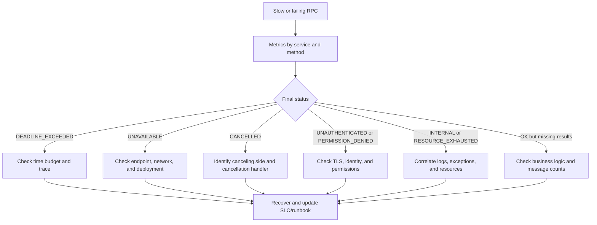

# Evaluating Observability and Operations

When choosing a communication mechanism for a Spring system, evaluate observability and operations alongside latency, throughput, and data structure. An API with good speed that is hard to troubleshoot when failing, hard to deploy in new versions, or unable to recover after connection loss will increase operational costs.

Spring gRPC fits when services need Protocol Buffers contracts, Java code generated from `.proto`, unary or streaming communication, and transport over HTTP/2. To operate well, the system must observe each RPC, terminal status, processing time, message flows, network errors, and dependency health. Check these signals from client to server and across intermediary components.

## 1. Distinguishing Observability from Operability

**Observability** is the ability to infer the internal state of a system from the telemetry it emits. Three commonly used signal groups are:

- **Metrics:** aggregated time-series measurements such as RPC counts, error rates, latency, active stream counts, and resource usage.
- **Logs:** contextualized events identifying method, gRPC status, failure cause, and timestamp.
- **Traces:** the path of a request across client, server, and dependent services, pinpointing which segment caused slowness or failure.

**Operability** is broader than telemetry collection. It covers health checks, readiness, TLS configuration, deadline management, resource limits, compatible deployments, scaling, graceful shutdown, alerting, and incident response procedures.

These two aspects are directly linked: health checks indicate whether an instance can accept traffic; metrics and traces explain why an instance is slow or unhealthy; operational procedures determine how to drain an instance from load and restore service.

## 2. Choosing Meaningful Metrics for RPCs

For gRPC, measure at the method and RPC status levels. A foundational metric set can include:

| Group | Metrics to Track | Operational Question |
|---|---|---|
| Traffic | RPC count by method and client/service | Which method is seeing rising load? |
| Latency | RPC duration histograms, p50/p95/p99 percentiles | Which method is slow and how slow? |
| Errors | Counts and rates by gRPC status | Do errors stem from application, auth, deadlines, or network? |
| Streaming | Active streams, stream duration, messages and bytes sent/received | Are streams held open too long or stalled emitting data? |
| Resources | CPU, heap, GC, threads, queues, and connections | Is the bottleneck in the application or infrastructure? |
| Recovery | Retry counts, cancellations, reconnects, and recovery time | Does the service self-recover after transient failures? |

For unary RPCs, duration and error rate per method are usually good starting points. For streaming RPCs, measuring total duration alone is insufficient: a stream may stay open for hours without sending messages, or send huge message bursts briefly. Also track active stream count, time since last message, message count, total bytes, and termination reason.

Categorizing by gRPC status enables rapid isolation:

| Status | Interpretation When Monitoring |
|---|---|
| `OK` | RPC completed successfully; still verify whether the business result has sufficient data |
| `CANCELLED` | One side canceled the RPC; determine which side initiated cancellation |
| `DEADLINE_EXCEEDED` | RPC exceeded its deadline; correlate per-hop latencies and wait times |
| `UNAVAILABLE` | Service or connection temporarily unavailable; check endpoints, restarts, and network |
| `UNAUTHENTICATED` / `PERMISSION_DENIED` | Check identity, tokens, certificates, and access permissions |
| `RESOURCE_EXHAUSTED` | Check quotas, message limits, memory, and processing capacity |
| `INTERNAL` / `UNKNOWN` | Cross-check server logs and root exceptions to find unclassified errors |

Do not lump every non-`OK` status into a single error bucket. `CANCELLED` can be normal behavior when a user navigates away; `DEADLINE_EXCEEDED` usually needs inspection alongside latency; `UNAVAILABLE` can spike during deployments. Proper classification makes alerts less noisy.

Metric labels should have low, stable cardinality, such as service, method, status, application version, or deployment region. Never put user IDs, request IDs, trace IDs, email addresses, or arbitrary metadata values into labels because each new value creates a separate time series. Put identifiers needed for investigation into logs or traces.

## 3. Designing Correlated Logs and Traces

An RPC log entry should include structured fields such as:

- Service name and full method name.
- Start time, duration, and final status.
- Correlation ID or trace ID.
- Message count and total bytes if it is a streaming RPC.
- Remaining deadline or relevant timeout details.
- Error cause category and safely handled exception.

Do not log entire payloads by default. Messages can contain personal information, tokens, business data, or large payloads. If inspecting payloads is necessary for investigation, use sampling, redact sensitive data, and restrict access.

Traces connect the processing segments of the same request. For an RPC passing through an API gateway, a Spring gRPC server, and a dependent service, the trace should show time per segment and parent-child span relationships. OpenTelemetry instrumentation libraries can automatically create spans and propagate trace context via gRPC metadata. Prefer proven instrumentation for your library version; only propagate trace context manually when no built-in mechanism exists, avoiding duplicate traces or broken span hierarchies.

For long-lived streams, do not create a child span for every single message under high volume. Record message counts, bytes, first/last message timestamps, and key milestones on the RPC span; use logs or metrics for continuous detail. Bound trace retention and sampling so telemetry costs do not scale linearly with message count.

## 4. Using Interceptors to Add RPC Context

Interceptors are the right extension point to record common information across many RPCs without duplicating logic in every service. Server interceptors can capture the method name, start time, and status when the server closes the call. Client interceptors can attach correlation metadata or record outcomes on the calling side.

The following example illustrates measuring server duration and status using the gRPC Java API. `RpcMetrics` is the application's adapter to Micrometer or the active metrics system; metric names and export settings must be standardized within the project.

```java
public final class RpcMetricsInterceptor implements ServerInterceptor {

    private final RpcMetrics rpcMetrics;

    public RpcMetricsInterceptor(RpcMetrics rpcMetrics) {
        this.rpcMetrics = rpcMetrics;
    }

    @Override
    public <ReqT, RespT> ServerCall.Listener<ReqT> interceptCall(
            ServerCall<ReqT, RespT> call,
            Metadata headers,
            ServerCallHandler<ReqT, RespT> next) {

        String method = call.getMethodDescriptor().getFullMethodName();
        long startedAt = System.nanoTime();

        ServerCall<ReqT, RespT> measuredCall =
                new ForwardingServerCall.SimpleForwardingServerCall<>(call) {
                    @Override
                    public void close(Status status, Metadata trailers) {
                        long elapsedNanos = System.nanoTime() - startedAt;
                        try {
                            rpcMetrics.record(method, status.getCode(), elapsedNanos);
                        } finally {
                            super.close(status, trailers);
                        }
                    }
                };

        return next.startCall(measuredCall, headers);
    }
}
```

This is a skeleton example: add imports, implement `RpcMetrics`, and register the interceptor per the configuration mechanism of your project's Spring gRPC version. `System.nanoTime()` is suitable for measuring elapsed intervals because it does not depend on wall-clock time. Metric recording must be lightweight, performing no synchronous I/O or remote calls on the RPC handling thread.

Interceptors do not replace business-layer error handling. Services must still deliberately map errors to gRPC statuses, keep root exceptions in internal logs, and return safe descriptions to clients. Never put stack traces or sensitive data in status descriptions.

## 5. Health Checks, Readiness, and Service Discovery

A running process does not mean it is ready to receive requests. Distinguish:

- **Liveness:** the process is alive and not stuck in a state requiring restart.
- **Readiness:** the instance has finished initializing, can receive traffic, and required dependencies meet serving conditions.
- **Startup:** the application has completed initial startup, preventing premature liveness checks.

gRPC has a Health Checking Protocol with the `grpc.health.v1.Health` service. Clients or deployment platforms can use `SERVING` and `NOT_SERVING` statuses to decide whether to route requests. In Spring gRPC, check the health service integration of your version or register the corresponding service; also configure platform readiness and liveness probes according to their intended semantics.

Readiness should not mark `NOT_SERVING` just because an optional dependency temporarily fails if the service can still handle most requests. Conversely, if a database or authentication service is a mandatory dependency, readiness must reflect inability to serve safely. Avoid heavy health checks or continuous deep queries.

gRPC reflection helps tools discover services and descriptors during development, testing, or diagnostics. It is an API discovery surface; enable it only in controlled environments and networks. Never treat reflection as an authentication or authorization mechanism.

## 6. Deadlines, Cancellation, and Retries Are Part of Operations

Clients should set RPC deadlines based on the business time budget. If a request spans multiple services, downstream step budgets must fit within the remaining overall request deadline. Do not set deadlines too short and cut off valid requests; nor let requests wait indefinitely holding threads, connections, or resources.

When a client cancels an RPC, the server must stop related work as early as possible. With streaming, cancellation must propagate to queries, subscriptions, or background tasks. If the server keeps processing after the client has left, the system wastes resources on a result nobody will receive.

Retries can improve reliability against transient errors, but should only be applied with an explicit policy:

- Determine whether the method is safe to retry. For creating orders, charging payments, or writing data, require an idempotency key or anti-duplication mechanism.
- Cap attempt counts, use exponential backoff with jitter, and enforce a retry budget to avoid amplifying load when the system is degraded.
- Retry only statuses and conditions matching the method's contract.
- Track retry counts and total latency, not just single-attempt latency.
- Be cautious with streaming and RPCs that have already emitted messages or caused side effects; a new call does not automatically resume from the previous point.

Do not use keepalive in place of health checks. Keepalive helps detect unresponsive HTTP/2 connections; health checks indicate whether a service is ready to accept requests. Keepalive settings must align with server, proxy, and load balancer policies.

## 7. Operating Streaming, Flow Control, and Graceful Shutdown

Streaming creates longer-lived connections than unary RPCs, so monitor concurrent streams, durations, inter-message intervals, and data volumes. Some issues surface only when consumers slow down or stream counts climb:

- Server emits faster than the client can process, growing buffers and memory pressure.
- Client fails to request more messages under manual inbound flow control, making the stream appear hung.
- A stream idle for too long gets closed by a proxy or load balancer due to idle timeout.
- Server restarts while streams are open, forcing clients to reconnect and recover business state.

Use flow control to throttle emission rates and avoid holding all data in memory. For event streams requiring recovery after interruption, design application-layer cursors or sequence numbers. Clients save checkpoints after processing messages; on reopening the stream, they send the confirmed cursor and handle duplicate messages idempotently.

When deploying a new version, servers need an adequate drain period. Stop accepting new RPCs, let in-flight RPCs complete within a grace period, then close connections. Clients must handle connection errors and reconnect with backoff. For long-lived streams, define maximum stream lifetimes and resume rules; do not keep old instances alive forever solely to preserve connections.

## 8. TLS, Authentication, and Securing Telemetry

gRPC typically runs over HTTP/2 with TLS in production. When using TLS or mutual TLS, monitor:

- Certificate expiration, trust chains, hostname/SAN, and certificate rotation procedures.
- ALPN configuration and HTTP/2 support across clients, servers, and proxies.
- Client identity, per-service/method permissions, and credential revocation.
- Handshake errors, authentication failures, and rejected request rates.

If TLS terminates at a proxy, clearly define which segments remain encrypted and how the proxy authenticates to backends. Never assume metadata is trustworthy: clients can send arbitrary metadata. Read only defined keys, validate formats, and bound sizes. Never write access tokens, secret keys, or sensitive data into logs, traces, or metric labels.

Metrics, traces, health, and reflection endpoints must also be access-restricted by environment. Telemetry often contains service names, system topology, request identifiers, or operational details valuable to attackers.

## 9. Ensuring Compatibility During Deployments and Protobuf Changes

Protobuf contracts are part of operability. Incompatible schema changes can break old clients after the server deploys or vice versa. When modifying messages:

- Never reuse deleted field numbers; mark retired numbers with `reserved`.
- Prefer adding new fields compatibly and define defaults when old clients omit them.
- Never assume old clients understand new enum values; handle unknown values safely.
- Avoid changing field types or altering the meaning of existing fields without a migration plan.
- Test clients and servers across version combinations that can coexist during rolling deployments.

Deploy in compatible order: the new server continues serving old clients, and only afterward are clients released using new fields or behaviors. Remove old fields only after verifying no clients still depend on them.

## 10. Comparing Operational Costs Across gRPC, REST, and Message Brokers

No single protocol is always easiest to operate. Evaluate based on your communication model and existing observability capabilities.

| Criterion | Spring gRPC | REST/HTTP | Message broker |
|---|---|---|---|
| Contract | Protobuf, auto-generated client/server code | Typically OpenAPI or HTTP contract | Message schemas and event rules |
| Request observability | Method, status, latency, metadata, and trace context | HTTP method, route, status code, latency | Publish/consume, queue/topic, consumer group |
| Latency observability | RPC duration and per-hop processing time | Request duration and per-hop processing time | Publish latency, queue lag, and message processing time |
| Streaming/async | Server, client, and bidirectional streaming over RPC | HTTP streaming or supplementary mechanisms by platform | Message storage, independent consumers, and async processing |
| Specific operations | HTTP/2, deadlines, flow control, channel and stream lifecycle | Gateways, HTTP timeouts, caching, and API compatibility | Broker cluster, partitions, retention, retries, and dead-letter |
| Fault diagnosis | gRPC status, interceptors, traces, and two-sided logs | HTTP status, access logs, and traces | Broker metrics, message IDs, consumer logs, and dead-letter |
| Recovery capability | Client reconnect; resume requires application-layer design | Retries per HTTP semantics and idempotency | Messages can be retained and redelivered per broker config |

gRPC generally fits service-to-service communication with strict contracts, performance needs, and streaming. REST has advantages in browser accessibility, widespread HTTP tooling, and external system integration. Message brokers fit when decoupling send time from processing time, absorbing bursts, or broadcasting events to multiple consumers. Brokers also add components to operate such as partitions, retention, consumer lag, and dead-letter queues.

Do not pick gRPC solely because binary payloads or HTTP/2 look faster. If the operations team lacks HTTP/2 inspection tools, stream lifecycle metrics, or certificate rotation processes, deployment costs can outweigh performance gains. Conversely, once the system has gRPC instrumentation, cross-service tracing, and protobuf governance, gRPC delivers clear contracts and consistent operations.

## 11. Testing Observability and Operations

Integration tests must verify both communication behavior and emitted operational signals:

| Scenario | Expected Outcome to Verify |
|---|---|
| Successful unary RPC | Request metric, latency, `OK` status, and matching trace recorded |
| Service returns error | Client receives appropriate status; server log retains root exception |
| Deadline expires | Client receives `DEADLINE_EXCEEDED`; server stops work when possible |
| Client cancels stream | Server receives cancellation and releases subscriptions/background tasks |
| Slow consumer | Flow control throttles rate; memory does not grow unboundedly |
| Invalid TLS or expired certificate | Connection fails cleanly; telemetry does not leak secrets |
| Rolling deployment | Old clients and new servers remain compatible per plan; streams drain or resume |
| Telemetry exporter failure | Business RPCs still execute; telemetry failure is detected separately |

Beyond functional tests, verify alerts against realistic data: error rates by method, p95/p99 latency, open stream counts, expired deadlines, and resources. Confirm dashboards filter by service, method, version, and status without using personal identifiers as metric labels.

## 12. Incident Troubleshooting Procedure

When an RPC is slow or failing, follow this sequence:

1. Identify the service, full method name, client/server versions, and onset time.
2. Check request rates and latency by method to determine whether the issue affects the whole service or one method.
3. Group by gRPC status; correlate deadlines, cancellations, auth, and resource errors.
4. Open traces of representative requests to locate slow segments or failing dependencies.
5. Correlate two-sided logs via trace ID or correlation ID; check proxies, load balancers, and TLS if the server never sees the request.
6. For streaming, inspect active stream counts, last message time, idle intervals, cancellations, and reconnect progress.
7. After recovery, identify the root cause, update alerts/runbooks, and add regression tests.

Investigation workflow diagram:



## 13. Checklist Before Selecting and Deploying gRPC to Production

- [ ] Metrics exist by service, method, status, and latency.
- [ ] Structured logs, cross-service trace context, and data-masking policies exist.
- [ ] Streaming is monitored via stream count, duration, messages, and cancellations.
- [ ] Clients set deadlines; retries are bounded and respect idempotency.
- [ ] Cancellation stops background work and releases resources.
- [ ] Health checks, readiness, and graceful shutdown are configured.
- [ ] TLS/mTLS, authentication, authorization, and certificate rotation are tested.
- [ ] Message limits, flow control, and load testing are in place.
- [ ] Protobuf changes are compatible with rolling deployments.
- [ ] Dashboards, alerts, and runbooks exist for common statuses.

Deploy gRPC to production only when development and operations teams can answer three questions for every critical RPC: where did the request go, why did it terminate, and how does the system recover. If those answers are missing, add telemetry or operational procedures before expanding adoption.
