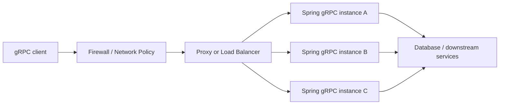
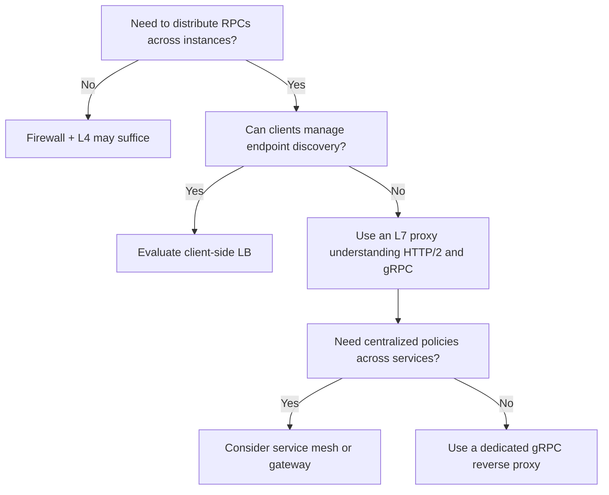
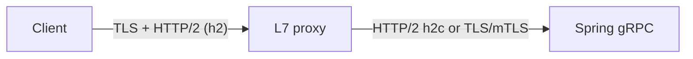

# Evaluating Firewalls, Proxies, and Load Balancers

When deploying Spring gRPC services, firewalls, proxies, and load balancers all participate in the path of an RPC while fulfilling different roles. A firewall controls which network flows are allowed through. A proxy accepts connections and forwards requests to backends. A load balancer selects a backend to serve the request. A single product may perform multiple roles, but it must be evaluated by its actual capabilities and how it handles HTTP/2.

The decisive factor for gRPC is HTTP/2 multiplexing: a single TCP connection can carry multiple concurrent RPCs. Consequently, a load balancer distributing connections at L4 may send all RPCs from one client to the same backend. If you need per-RPC distribution, method-based routing, or application-layer policies, you need a gRPC-aware L7 proxy or client-side load balancing.

## 1. Assigning the Right Role to Each Component

### Firewall

A firewall enforces rules at the network or application layer depending on the product. Network firewalls typically control source/destination addresses, protocols, and TCP ports. They are suited for restricting who can connect to the gRPC port, who can access administrative ports, and which services may call which backends.

A network firewall cannot inspect the meaning of individual RPCs when filtering only TCP. For example, allowing TCP to port 9090 does not restrict a client to calling only `OrderService/GetOrder`. To restrict by gRPC service, method, or metadata, you need L7 policies or application-level enforcement.

### Proxy

A proxy sits between client and server. Depending on the proxy type, it may simply forward TCP connection bytes, or terminate HTTP/2, read each request, and open a new upstream connection. An L7 proxy can support TLS termination, authority/path routing, adding or removing headers, rate limiting, health checks, and metrics.

A standard HTTP proxy supporting only HTTP/1.1 will not necessarily forward gRPC. The proxy must support HTTP/2 on the client side and compatible HTTP/2 settings upstream. Verify that the proxy preserves gRPC trailers, statuses, and streaming behavior.

### Load Balancer

A load balancer distributes requests or connections across backends. Backend selection depends on the operating layer:

- L4 selects a backend when establishing the TCP connection.
- L7 selects a backend after parsing the HTTP/2/gRPC request.
- Client-side load balancing selects a backend directly inside the client's gRPC channel based on endpoint lists and policies.

A load balancer may live in the cloud, Kubernetes ingress/gateway, a service mesh, or a dedicated network appliance. When evaluating one, identify whether it balances by connection, HTTP/2 stream, or individual RPC.



## 2. How HTTP/2 Changes Load Balancing

In HTTP/1.1, a client often opens multiple connections to run concurrent requests. An L4 load balancer can spread those connections across multiple servers. With gRPC, a client usually reuses a single channel and HTTP/2 connection. HTTP/2 lets multiple RPCs run on separate streams inside the same TCP connection.

For example, a client opens one channel to the load balancer address and issues 100 concurrent RPCs. If the L4 load balancer picks backend A when the TCP connection is established, all 100 RPCs on that connection can go to A. When different clients maintain different numbers of connections, load can skew significantly even with round-robin L4 balancing.

| Mechanism | Distribution Unit | Behavior with gRPC |
|---|---|---|
| L4 TCP load balancing | TCP connection | RPCs multiplexed on the same connection usually hit the same backend |
| L7 gRPC-aware proxy | HTTP/2 stream/RPC | Can pick a backend per RPC |
| Client-side load balancing | Client-initiated RPC | Client selects an endpoint per RPC according to policy |
| An established stream | One streaming RPC | All messages of the stream remain on the backend that accepted it |

L4 remains useful when you want a simple TCP entry point, end-to-end TLS preservation, or lower proxy overhead. But if the requirement is even distribution per short RPC, L4 alone may fall short.

An L7 proxy can terminate HTTP/2 from the client, inspect each request, and open an HTTP/2 stream to an appropriate backend. This adds a network hop and processing overhead, yet provides method-based routing, gRPC-level health checks, and per-request policies.

Client-side load balancing removes the intermediate proxy hop and can reduce latency. In return, the client must obtain endpoint lists, detect failing endpoints, and apply consistent policies. Inspect the resolver and load-balancing policy actually configured on the gRPC channel; a channel pointing to one fixed address will not automatically distribute across all instances.

### Streaming and Load Distribution Limits

A load balancer can pick a backend when a stream starts. Afterward, the stream is an active RPC and cannot migrate mid-flight to another instance. If a backend restarts or the connection drops, the client may have to open a new RPC; the application must handle state and resume from a checkpoint if required by business rules.

Long-lived streams also hold backend resources longer than unary RPCs. A small number of clients holding continuous streams can unbalance load even when initial connection or RPC counts look small. Measure active streams, stream durations, message rates, and resources per instance.

## 3. Choosing the Right Deployment Model

| Model | When to Choose | Key Trade-offs |
|---|---|---|
| Firewall + L4 load balancer | Simple TCP forwarding, TLS passthrough, minimal per-RPC routing needs | Does not balance individual RPCs on a single HTTP/2 connection |
| L7 gRPC-aware proxy | Need per-RPC distribution, method routing, gRPC health checks, or centralized policy | Adds latency, configuration, and another component to monitor |
| Client-side load balancing | Clients control resolvers, endpoint discovery, and policies; need fewer intermediate hops | Every client type must support and operate discovery/LB |
| API gateway | Need an entry point with auth, quotas, routing, and centralized API management | Must confirm gateway supports native gRPC and streaming; some features only support gRPC-Web |
| Service mesh | Many internal services need mTLS, workload identity, routing, and unified telemetry | Increases proxy count, configuration, and operational overhead |

Do not pick a solution based solely on a product label like "HTTP/2 supported". Explicitly verify that the product supports native gRPC, upstream HTTP/2, trailers, streaming, health checks, and timeouts in the way your application requires.

### Decision Tree



## 4. Designing Firewalls and Network Policies

Firewalls should enforce the principle of opening only necessary flows. Reference configuration:

| Flow | Recommended Rule |
|---|---|
| External client → ingress/proxy | Open only the public TLS port, typically TCP 443 |
| Ingress/proxy → Spring gRPC | Allow only from the proxy's subnet, security group, or workload identity to the internal gRPC port |
| Internal client → Spring gRPC | Open only if a direct-call use case exists with proper authentication |
| Spring gRPC → downstream | Allow only to databases/services and ports actually required |
| Internet → backend or admin ports | Deny by default |
| Monitoring/health checker → probe endpoints | Allow only from identified health-checker sources |

If Spring gRPC listens on port 9090 behind an ingress, there is typically no need to expose that port to the Internet. A firewall or Kubernetes NetworkPolicy should restrict sources accessing that port. Internet clients see only the ingress port.

For example, the application may declare the server port:

```yaml
spring:
  grpc:
    server:
      port: 9090
```

In Spring Boot using a native gRPC server, `spring.grpc.server.port` configures the gRPC port. If the application runs via an integrated servlet server, this property may be ignored and the web server port `server.port` is used. Verify which server factory is active before writing firewall rules.

With Kubernetes, a NetworkPolicy can restrict ingress to pods only from the gateway's namespace or pod label. Illustrative example:

```yaml
apiVersion: networking.k8s.io/v1
kind: NetworkPolicy
metadata:
  name: orders-grpc-ingress
  namespace: applications
spec:
  podSelector:
    matchLabels:
      app: orders-grpc
  policyTypes:
    - Ingress
  ingress:
    - from:
        - namespaceSelector:
            matchLabels:
              kubernetes.io/metadata.name: edge
          podSelector:
            matchLabels:
              app: grpc-gateway
      ports:
        - protocol: TCP
          port: 9090
```

Selectors in the example must match actual cluster labels. NetworkPolicy takes effect only when the cluster's CNI supports policy enforcement. Also check egress policies: DNS, telemetry, databases, and downstream services can be blocked if the namespace uses default-deny.

An L3/L4 firewall does not replace gRPC authentication. You must still authenticate callers in the application or via workload identity/mTLS and check permissions on every method. Never rely solely on IP addresses to identify end users.

## 5. TLS Termination and HTTP/2 at Each Hop

Native gRPC runs over HTTP/2. When clients use TLS, ALPN must negotiate the `h2` protocol. If a proxy terminates TLS but connects upstream using HTTP/1.1, native gRPC requests may fail or be converted into a different protocol.

There are three common models:

### TLS Passthrough

The firewall or L4 proxy forwards TCP/TLS without decrypting. TLS is established directly between the client and the Spring gRPC server.

The advantage is that the proxy never sees encrypted tokens or payloads, and the server can verify client certificates directly when using mTLS. In return, the proxy cannot route by gRPC method or perform gRPC health checks. It usually selects backends only by IP, port, or SNI if it can inspect ClientHello without decrypting.

### TLS Termination at Proxy, Internal HTTP/2

The client establishes TLS/HTTP/2 to the proxy. The proxy decrypts the request and opens an HTTP/2 connection to Spring gRPC. The internal hop can use HTTP/2 cleartext (h2c) in a private network or TLS/mTLS.

This model lets the proxy route by path and run L7 health checks. However, if the internal hop uses h2c, decrypted data travels unencrypted on that network segment. Use this only when the internal network is protected and trust boundaries have been evaluated. In multi-node environments or shared networks, encrypt the upstream hop and consider mTLS.

### TLS on Both Hops

The client uses TLS to the proxy; the proxy verifies the backend's certificate and establishes a new TLS connection to Spring gRPC. This model fits when L7 routing is needed while keeping internal network traffic encrypted. If workload authentication is required, enable mTLS and manage trust stores/certificate rotation on both sides.



With Spring gRPC using Netty, TLS/mTLS can be configured via SSL bundles and server properties. Example:

```yaml
spring:
  grpc:
    server:
      port: 9090
      ssl:
        bundle: grpc-server
        client-auth: require
```

The name `grpc-server` must point to an SSL bundle configured in Spring Boot. `client-auth: require` requires the client to present a certificate; trust material must verify client certificates against the system PKI. When a proxy already terminates TLS and connects upstream with h2c, do not enable `client-auth: require` on the backend unless the proxy sends a client certificate; instead, configure upstream TLS/mTLS to match the architecture.

## 6. Verifying True gRPC Proxy Support

Before putting a proxy into production, verify these capabilities:

- Accepts HTTP/2 over TLS with ALPN `h2`.
- Sends requests upstream over HTTP/2, or h2c if intentionally using internal plaintext.
- Preserves gRPC paths formatted as `/package.Service/Method`.
- Forwards `content-type: application/grpc` and gRPC trailers, including `grpc-status` and `grpc-message`.
- Supports unary, server streaming, client streaming, and bidirectional streaming.
- Does not buffer entire streams in a way that negates streaming benefits or increases latency.
- Has explicit connect timeout, idle/read timeout, request deadline, or route timeout settings.
- Has gRPC health checks or an appropriate readiness mechanism.
- Enforces limits on concurrent streams, header sizes, connection counts, and buffers.
- Emits metrics by upstream, method, status, and processing time.

gRPC often returns HTTP status `200` even when the RPC terminates with an error status. The gRPC business outcome lives in the `grpc-status` trailer. A proxy or monitoring system inspecting only HTTP status codes may report requests as successful even when the RPC returned `UNAUTHENTICATED`, `PERMISSION_DENIED`, or `UNAVAILABLE`.

Some API gateways only support gRPC-Web. gRPC-Web is a browser-compatible protocol that typically requires a proxy translating to native gRPC at the backend. It does not mean the gateway can accept all native gRPC types, especially client streaming or bidirectional streaming. Check the feature matrix and limits of your deployed version.

## 7. Reverse Proxy Example with NGINX

NGINX provides the `ngx_http_grpc_module` module with the `grpc_pass` directive to forward gRPC requests. The condensed example below accepts TLS/HTTP/2 on port 443 and forwards HTTP/2 cleartext to internal backends:

```nginx
upstream spring_grpc_upstream {
    server 10.20.0.11:9090;
    server 10.20.0.12:9090;
    server 10.20.0.13:9090;
}

server {
    listen 443 ssl;
    http2 on;
    server_name grpc.example.com;

    ssl_certificate     /etc/nginx/tls/server.crt;
    ssl_certificate_key /etc/nginx/tls/server.key;

    location / {
        grpc_pass grpc://spring_grpc_upstream;
        grpc_read_timeout 75s;
        grpc_send_timeout 75s;
    }
}
```

The `http2 on` directive applies to newer NGINX versions; in older versions, enabling HTTP/2 may be declared in `listen`. Check the documentation for your exact NGINX version before deploying.

`grpc_pass grpc://` uses an unencrypted HTTP/2 connection to upstream. If upstream requires TLS, use the `grpcs://` scheme and configure upstream certificate verification, server name, and trusted certificates per NGINX documentation. Never disable certificate verification to work around configuration errors.

`grpc_read_timeout` and `grpc_send_timeout` are the maximum intervals between two successive read or write operations, not the overall deadline of the entire RPC. If a stream sends no data during that timeout window, the proxy may close the connection even though the RPC remains valid by business rules. Pick timeouts based on the longest expected silent interval in a stream and test with realistic traffic.

NGINX can forward trailers from upstream to the client. However, test gRPC statuses and errors when upstream closes connections. When a proxy times out mid-response, it cannot transparently replay a partially sent response to another backend. Never configure blind retries for RPCs with side effects or streams that have already begun emitting data.

## 8. Timeouts, Deadlines, and Keepalive

These mechanisms solve different problems:

| Mechanism | Meaning | Where Configured |
|---|---|---|
| gRPC deadline | Maximum duration the client waits for an RPC to complete | gRPC client |
| Proxy timeout | Bounds connections, upstream wait times, or silent intervals | Reverse proxy/load balancer |
| HTTP/2 keepalive | PING frames to check whether a connection is still alive | gRPC client/server and some proxies |
| Health check | Checks whether an instance is ready to accept RPCs | Load balancer/orchestrator and health service |

The client's deadline should be the overall bound of the RPC. Proxy timeouts must be generous enough not to sever valid requests before the expected deadline, accounting for connection setup and processing. If a proxy timeout is shorter than the deadline, clients can receive errors from proxy connection closure before the gRPC deadline expires. If a proxy timeout is too long, resources can be held when a backend hangs.

For instance, for a unary RPC with a 5-second deadline, you might set the upstream timeout slightly higher to leave room for overhead while keeping the client deadline as the business limit. For streaming RPCs that may live for minutes or hours, a short fixed overall timeout is usually inappropriate; use idle-interval timeouts and explicit stream closure mechanisms.

Keepalive PINGs do not replace health checks and do not extend RPC deadlines. Some proxies enforce idle timeouts based on HTTP/2 or TCP activity; never assume PINGs always count as response data. Test how your proxy handles PINGs and idle connections.

Avoid configuring clients to send keepalives too frequently. Servers or proxies may rate-limit PINGs and reject connections if clients violate policy. Align `keepalive time`, `keepalive timeout`, idle timeouts, and maximum connection age across components.

## 9. Health Checks, Readiness, and Graceful Draining

A successful TCP connect only proves a port is accepting connections. It does not prove the service has loaded configuration, connected to databases, is ready to process requests, or can perform business work.

Prefer the gRPC Health Checking Protocol (`grpc.health.v1.Health`) if your load balancer supports it. The health service reports status per service name; proxies can call health check RPCs instead of just opening TCP sockets. Envoy supports active health checks via gRPC. If using an HTTP actuator endpoint, verify the proxy actually probes that HTTP endpoint and that it reflects application readiness.

Distinguish the states:

- **Startup:** whether the application has finished its startup phase.
- **Liveness:** whether the process is still alive or needs restarting.
- **Readiness:** whether the instance can accept new requests.
- **gRPC health:** service status published through the health protocol.

Do not tie liveness to a transient dependency like a database if repeated restarts will not help recover. Readiness can switch to `NOT_SERVING` when the application must stop accepting new RPCs.

During new deployments or scale-downs, the draining process should:

1. Mark the instance unready so the load balancer stops routing new RPCs.
2. Wait for endpoint/health state updates to propagate.
3. Stop accepting new RPCs and let in-flight RPCs complete within a grace period.
4. After the grace period, close remaining connections/streams per policy.
5. Exit the process only after completion or timeout expiry.

Spring Boot gRPC provides `spring.grpc.server.shutdown.grace-period` to configure server shutdown wait time. The server grace period, Kubernetes `terminationGracePeriodSeconds`, and load balancer deregistration timing must be coordinated. An infinite stream cannot complete on its own during draining; clients and servers need reconnect rules or bounded stream lifetimes.

## 10. Retries, Failover, and Idempotency

Retries at the client, proxy, and service mesh can compound. For example, a client trying 3 times while a proxy also tries 3 backends can cause far more executions than intended. This is especially dangerous when RPCs process payments, create orders, or write data.

Enable retries only when:

- The error falls within the policy's retryable set, such as certain `UNAVAILABLE` cases.
- The request has not been processed or the operation is idempotent.
- Sufficient deadline remains for the next attempt.
- Backoff and jitter exist to avoid synchronized retry storms.
- Attempt limits and a retry budget are enforced.

For operations creating resources or writing data, design idempotency keys or deduplication at the business layer. Never assume a proxy knows whether an RPC has already caused side effects.

For streaming, an active stream cannot be migrated to another backend while preserving stream state. If the connection drops, the client must start a new RPC and the application must determine which messages were already processed. You can use sequence numbers, checkpoints, resume tokens, or business acknowledgements to resume safely.

HTTP 502/503/504 errors at a proxy and gRPC `UNAVAILABLE` status do not always mean the same thing. Inspect the status received by the client, the `grpc-status` trailer, upstream logs, and failure timing before adding retries.

## 11. Resource Limits and Protecting the Proxy

Proxies and load balancers also have resource limits. When evaluating configurations, check:

- Concurrent TCP connections and HTTP/2 streams per connection.
- Concurrent RPCs per backend and concurrency limits.
- Request header/metadata sizes and message sizes.
- Buffer, memory, and queue limits when upstream is slow.
- Connection idle timeout, maximum connection age, and keepalive.
- Circuit breakers, outlier detection, and failing backend ejection.
- Rate limits or quotas per client/service if required.
- How the proxy reacts when a backend is overloaded or returns `RESOURCE_EXHAUSTED`.

Do not size limits solely for average throughput. A single client can open many streams, send bursts, or send oversized metadata. Use load tests to measure peak concurrent RPCs, stream duration, message size, latency, and memory across both proxies and Spring gRPC instances.

L7 firewalls/WAFs must be tested specifically for gRPC support. Some HTTP rules assume complete request bodies or only understand HTTP/1.1; they can corrupt streams or falsely block gRPC frames. If a WAF does not understand gRPC, rely on network policies and in-application authentication rather than enabling generic HTTP rules blindly.

## 12. Observing and Diagnosing the RPC Path

To pinpoint the failing component, observe client, proxy, and server together. Collect:

| Layer | Data to Observe |
|---|---|
| Client | RPC method, deadline, gRPC status, retry count, channel state, latency |
| Firewall/network | Allowed/denied flows, TCP resets, packet loss, connection timeouts |
| Proxy/LB | Selected upstream, upstream connect time, response time, reset reasons, active streams, retries |
| Spring gRPC | Method, gRPC status, request duration, active calls, queues/thread pools, application errors |
| Downstream | Latency and errors of databases/services the RPC depends on |

Propagate trace context across hops using tracing libraries. Use request IDs to correlate logs when needed, without logging bearer tokens or sensitive metadata. Ensure proxies do not strip trace headers or generate conflicting values without an explicit policy.

Common symptoms:

- `UNAVAILABLE` accompanied by TCP resets: check proxies, backend restarts, network policies, and connection age.
- `DEADLINE_EXCEEDED` concentrated on one route: compare client deadlines against proxy timeouts and backend processing time.
- HTTP 200 while the RPC reports an error: inspect `grpc-status` in trailers.
- One instance overloaded despite low total traffic: check HTTP/2 connection pinning, long streams, and how the LB picks backends.
- Streams closed after a fixed silent interval: check idle/read timeouts at each hop.
- Client connects but RPCs never reach the service: check HTTP/2 ALPN, upstream protocol, path routing, and trailer handling.

## 13. Evaluation Process Before Choosing a Solution

Follow this sequence to avoid selecting infrastructure only to discover protocol incompatibility later:

1. **Characterize traffic:** unary/streaming ratio, concurrent RPCs, stream lifetimes, message sizes, and latency requirements.
2. **Map network boundaries:** where clients live, where proxies sit, where backends run, and which services are called directly.
3. **Lock security requirements:** where TLS terminates, whether mTLS is needed, who may call which methods, and which metadata is trusted.
4. **Choose load-balancing layer:** L4 if connection balancing suffices; L7 if per-RPC distribution is needed; client-side if clients can manage discovery.
5. **Verify protocols:** HTTP/2 and ALPN externally, HTTP/2/h2c/TLS upstream, gRPC trailers, and streaming.
6. **Set timeouts and health policies:** deadlines, idle timeouts, keepalive, health checks, readiness, and graceful draining.
7. **Test failure modes:** backend restarts, proxy reloads, connection drops, timeouts, idle streams, expired certificates, and backend overload.
8. **Measure under load:** verify per-instance RPC distribution, p95/p99 latency, active streams, resets, retries, and proxy resources.

### Acceptance Test Matrix

| Test Case | Expected Result |
|---|---|
| Unary through proxy | Client receives response and accurate gRPC status |
| Server/client/bidirectional streaming | Messages flow in both directions in order; streams are not buffered or cut prematurely |
| Multiple RPCs on one HTTP/2 connection | L7/client-side LB distributes according to the chosen policy |
| Backend marked unhealthy | New RPCs are not routed to that backend |
| Backend restarts during active stream | Client receives appropriate error and can reconnect per design |
| TLS and mTLS | Certificates, hostnames, ALPN, and trust chains are verified |
| RPC hits deadline | Client receives `DEADLINE_EXCEEDED` within the configured budget |
| Proxy idle timeout | Stream closure matches policy without unexpected timeouts |
| Backend rolling update | Instance drains new requests and finishes in-flight requests within grace period |
| Backend returns gRPC error | `grpc-status` is preserved through the proxy |
| Backend overloaded | Circuit breaker/limits engage without triggering a retry storm |

You can use `grpcurl` to verify connectivity and methods in staging environments:

```bash
grpcurl -v grpc.example.com:443 list

grpcurl -v \
  -H 'authorization: Bearer <access-token>' \
  -d '{"orderId":"A-100"}' \
  grpc.example.com:443 \
  orders.v1.OrderService/GetOrder
```

The `list` command requires reflection to be enabled and accessible. If production disables reflection, use a descriptor set or the corresponding `.proto` files. Never place real tokens in shell history or CI logs.

## 14. Deployment Checklist

- [ ] Expose only necessary ingress ports; restrict access to backend ports.
- [ ] Firewalls/NetworkPolicies allow exact sources and destinations.
- [ ] Clarify whether the LB balances TCP connections or individual RPCs.
- [ ] Proxies support native gRPC, upstream HTTP/2, trailers, and the streaming types used.
- [ ] ALPN `h2`, SNI, hostnames, and certificates are properly verified.
- [ ] Clearly choose TLS passthrough, TLS termination, or TLS/mTLS on both hops.
- [ ] Deadlines, timeouts, and idle timeouts are configured consistently.
- [ ] Health checks reflect gRPC service readiness.
- [ ] Graceful draining is in place for scale-downs and rolling updates.
- [ ] Retries apply only to safe operations and are bounded.
- [ ] Monitor gRPC statuses, active streams, upstream resets, and load distribution.
- [ ] Test unary, streaming, network failures, and failover before production.

## 15. References

- [gRPC Load Balancing](https://grpc.io/blog/grpc-load-balancing/) — compares L3/L4 proxies, L7 proxies, and client-side load balancing.
- [gRPC Load Balancing in gRPC Core](https://grpc.github.io/grpc/core/md_doc_load-balancing.html) — per-RPC subchannel selection model and client-side policies.
- [gRPC Performance Best Practices](https://grpc.io/docs/guides/performance/) — channel reuse, keepalive, and stream load-distribution limits.
- [gRPC Core Concepts](https://grpc.io/docs/what-is-grpc/core-concepts/) — RPC lifecycle and deadlines.
- [NGINX gRPC Module](https://nginx.org/en/docs/http/ngx_http_grpc_module.html) — `grpc_pass`, timeouts, upstream, and trailer forwarding.
- [Envoy Health Checking](https://www.envoyproxy.io/docs/envoy/latest/intro/arch_overview/upstream/health_checking) — active HTTP, gRPC, and L3/L4 health checks.
- [Spring gRPC Server Reference](https://docs.spring.io/spring-grpc/reference/server.html) — server configuration and TLS/mTLS.
- [Spring Boot gRPC Properties](https://docs.spring.io/spring-boot/appendix/application-properties/) — `spring.grpc.server.*` properties, ports, and SSL bundles.
