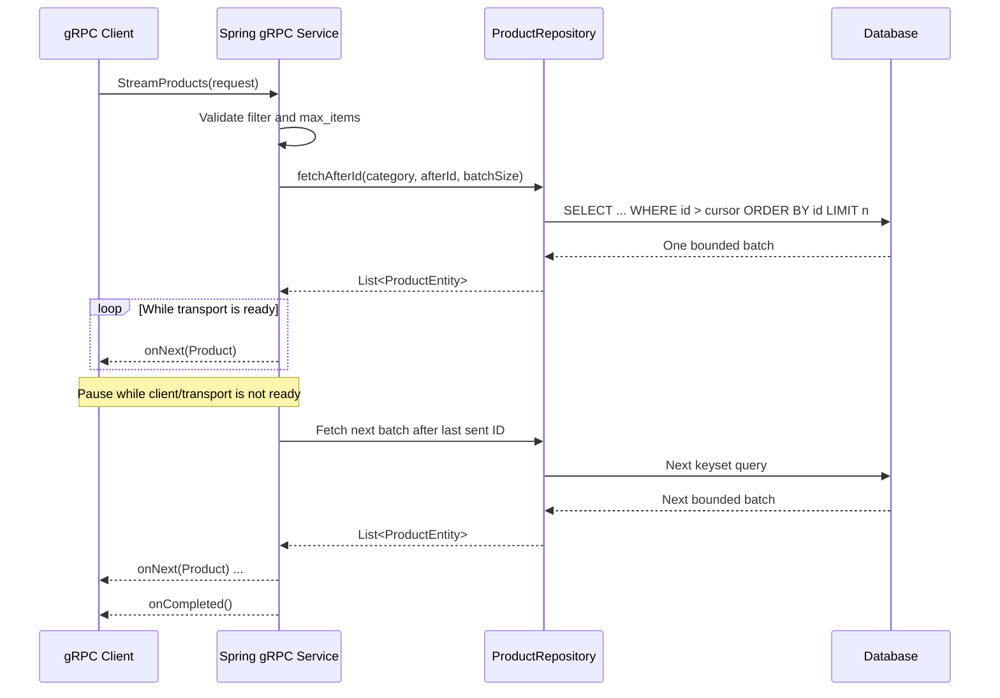

# Building Server Streaming for Large Lists

In this project, you will build a server streaming RPC to return a large list of products from a Spring gRPC service. The client sends a request with a filter and record limit; the server reads data in small batches, sends each message over HTTP/2, and stops when finished, when the limit is reached, or when the client cancels the call.

The goal goes beyond replacing `repeated Product` with `stream Product` in Protocol Buffers. A stream can be long-lived, clients may read slowly or disconnect, and the dataset may be many times larger than process memory. The design must combine keyset-paginated queries, flow control, deadlines, cancellation, error handling, and testing with sufficiently large datasets.

## 1. Objectives and Deliverables

Build the `StreamProducts` capability with the following requirements:

1. The client can filter products by category and specify a starting position along with the maximum number of items to receive.
2. The server sends each `Product` over a server streaming RPC in ascending ID order.
3. The server reads data in bounded-size batches; it must not load the entire list onto the heap.
4. The server respects gRPC send-readiness and pauses database reads when the client cannot keep up.
5. The server stops work when the client cancels the call or the deadline expires.
6. Input errors and internal failures are mapped to appropriate gRPC statuses without exposing sensitive details in the description.
7. The client can process each message, control its receive rate, and resume from the last processed ID when needed.

**Deliverables:**

- A `.proto` file defining the streaming contract.
- A repository executing batch-by-batch keyset queries.
- A Spring gRPC service implementing `StreamProducts`.
- A client that receives and processes each message.
- Tests for empty data, multiple batches, call cancellation, deadlines, and slow clients.
- A report measuring latency, throughput, and memory on a large dataset run.

## 2. Data Flow Architecture

The client sends a single request. The server validates the input and limits, then queries a small batch. While gRPC reports send-readiness (`isReady()`), the server sends messages until the batch is exhausted or the channel is no longer ready. Only when the current batch is consumed does the server fetch the next batch.



Each layer has a clear responsibility:

| Component | Responsibility |
|---|---|
| Protocol Buffers | Describes the request and each streamed product message |
| Spring gRPC service | Validates requests, coordinates the stream, and maps entities to protobuf |
| Repository | Performs ordered cursor-based queries with bounded row limits per read |
| gRPC flow control | Signals the server when it can resume sending messages |
| Client | Processes each message, applies backpressure, and cancels when data is no longer needed |

## 3. Step 1 — Define the Protocol Buffers Contract

Create or update `src/main/proto/product_catalog.proto`:

```protobuf
syntax = "proto3";

package catalog.v1;

option java_multiple_files = true;
option java_package = "com.example.catalog.grpc";
option java_outer_classname = "ProductCatalogProto";

service ProductCatalogService {
  rpc StreamProducts(StreamProductsRequest) returns (stream Product);
}

message StreamProductsRequest {
  // Optional filter. Empty string means no category filtering.
  string category = 1;

  // Last ID processed by the client. Only returns IDs greater than this value.
  // Example assumes positive IDs with a stable ordering.
  int64 after_product_id = 2;

  // Maximum number of messages for a single RPC; server enforces a hard cap.
  int32 max_items = 3;
}

message Product {
  int64 id = 1;
  string sku = 2;
  string name = 3;
  int64 price_minor = 4;
  string currency = 5;
}
```

The key element of the contract is `returns (stream Product)`: each `onNext` corresponds to one product message. The client does not have to wait for the server to assemble a single message containing tens of thousands of elements before receiving results.

`after_product_id` lets the client resume after a disconnection. In this learning example, an ascending ID serves as the cursor. For public APIs where database IDs are internal details, replace this field with a server-signed or encrypted opaque cursor; never trust client-modified cursors. `max_items` bounds the work of a single RPC and must be validated by the server rather than granting clients an unbounded limit.

Once the server sends `max_items` messages, the RPC completes. The client can open a subsequent RPC starting from the last processed ID; if the previous call hit the exact end of the dataset, the next call may return an empty stream.

After updating `.proto`, run your project's Gradle or Maven codegen task to generate `ProductCatalogServiceGrpc`, `StreamProductsRequest`, and `Product`. Never edit generated Java files directly.

## 4. Step 2 — Query the Database with Keyset Pagination

Do not call `findAll()` or load the entire result set into a `List<ProductEntity>` before calling `onNext`. Doing so grows heap usage proportionally to data size, allocates excessive objects, and delays time-to-first-message.

Use keyset pagination: each query fetches rows with an ID greater than the latest cursor, ordered by the same key, and limited in row count. Example SQL:

```sql
SELECT id, sku, name, price_minor, currency
FROM products
WHERE category = :category
  AND id > :after_id
ORDER BY id ASC
LIMIT :batch_size;
```

When `category` is empty, the repository should run a separate query without the `category` filter rather than `:category = '' OR ...`; two distinct query forms generally help the database pick better indexes.

In a real application, include tenant scoping and access control derived from the authenticated identity, such as `tenant_id = :authenticated_tenant_id`. Never trust a tenant ID taken directly from a request field. Use repository parameter binding for category and cursor; never concatenate SQL strings from client input.

A simple repository interface:

```java
public interface ProductRepository {

    /**
     * Returns at most limit rows, ordered by ascending id,
     * containing only rows with id > afterId.
     */
    List<ProductEntity> fetchAfterId(
            String category,
            long afterId,
            int limit);
}
```

Example Java entity mapping:

```java
public record ProductEntity(
        long id,
        String sku,
        String name,
        long priceMinor,
        String currency) {
}
```

The query needs an appropriate index—at minimum consider an index on `(category, id)` or a composite matching the database's actual filter order. Inspect execution plans against production-like data; even a SQL query with `LIMIT` can be slow if the database must scan and sort many rows.

**Why use keyset instead of OFFSET?** With `OFFSET 500000 LIMIT 100`, the database may have to walk through a huge number of rows before returning the next page. The `id > lastId` cursor leverages indexes and prevents query cost from growing linearly with page depth. The requirement is a stable sort order with a unique sort key or an explicit tie-breaker.

In this example, the ascending ID is a unique key. If sorting by `created_at`, use the pair `(created_at, id)` to break ties for records sharing a timestamp. If records can be inserted, updated, or deleted mid-stream, define snapshot semantics. A high-water mark can exclude records inserted after the stream started, though it does not by itself keep earlier rows immutable; use snapshotting/versioning if business rules require strictly consistent results.

Do not hold a database transaction open for the entire lifetime of the RPC unless there is an explicit snapshot requirement; long-lived streams hold connections and snapshots open, putting pressure on connection pools and vacuum/version cleanup. Typically, each batch fetch uses a short transaction. If business rules demand a consistent snapshot across multiple batches, design a dedicated snapshot mechanism with bounded lifetime and resources.

## 5. Step 3 — Implement Server Streaming with Flow Control

`StreamObserver` provides `onNext`, `onError`, and `onCompleted`. On the server side, cast the observer to `ServerCallStreamObserver` to access `isReady()`, `setOnReadyHandler()`, and `setOnCancelHandler()`.

If the server keeps calling `onNext` while the client reads slowly, the transport layer must buffer pending outbound messages. Therefore, beyond batching queries, you must stop emitting messages whenever `isReady()` returns `false`. When the transport becomes ready again, `onReadyHandler` wakes the sending loop.

The service example below uses a dedicated executor for blocking queries, reads at most 128 rows per batch, and retains only a single batch in memory per RPC:

```java
import io.grpc.ServerCallStreamObserver;
import io.grpc.Status;
import io.grpc.stub.StreamObserver;
import org.springframework.beans.factory.annotation.Qualifier;
import org.springframework.grpc.server.service.GrpcService;

import java.util.Collections;
import java.util.Iterator;
import java.util.List;
import java.util.concurrent.Executor;
import java.util.concurrent.RejectedExecutionException;
import java.util.concurrent.atomic.AtomicBoolean;

@GrpcService
public final class ProductCatalogGrpcService
        extends ProductCatalogServiceGrpc.ProductCatalogServiceImplBase {

    private static final int BATCH_SIZE = 128;
    private static final int MAX_ITEMS_PER_CALL = 50_000;

    private final ProductRepository repository;
    private final Executor streamExecutor;

    public ProductCatalogGrpcService(
            ProductRepository repository,
            @Qualifier("grpcStreamExecutor") Executor streamExecutor) {
        this.repository = repository;
        this.streamExecutor = streamExecutor;
    }

    @Override
    public void streamProducts(
            StreamProductsRequest request,
            StreamObserver<Product> responseObserver) {

        if (request.getMaxItems() < 1
                || request.getMaxItems() > MAX_ITEMS_PER_CALL
                || request.getAfterProductId() < 0) {
            responseObserver.onError(
                    Status.INVALID_ARGUMENT
                            .withDescription("Invalid stream range")
                            .asRuntimeException());
            return;
        }

        @SuppressWarnings("unchecked")
        ServerCallStreamObserver<Product> serverObserver =
                (ServerCallStreamObserver<Product>) responseObserver;

        AtomicBoolean cancelled = new AtomicBoolean(false);
        AtomicBoolean draining = new AtomicBoolean(false);
        AtomicBoolean terminal = new AtomicBoolean(false);

        final class StreamPump {
            private long lastId = request.getAfterProductId();
            private int emitted = 0;
            private Iterator<ProductEntity> currentBatch =
                    Collections.emptyIterator();

            void schedule() {
                if (cancelled.get()
                        || terminal.get()
                        || !draining.compareAndSet(false, true)) {
                    return;
                }

                try {
                    streamExecutor.execute(this::drain);
                } catch (RejectedExecutionException rejected) {
                    draining.set(false);
                    fail(Status.RESOURCE_EXHAUSTED
                            .withDescription("Stream capacity is unavailable"));
                }
            }

            private void drain() {
                try {
                    while (!cancelled.get()
                            && !serverObserver.isCancelled()
                            && serverObserver.isReady()) {

                        if (!currentBatch.hasNext()) {
                            List<ProductEntity> nextBatch =
                                    repository.fetchAfterId(
                                            request.getCategory(),
                                            lastId,
                                            BATCH_SIZE);

                            if (nextBatch.isEmpty()) {
                                complete();
                                return;
                            }
                            currentBatch = nextBatch.iterator();
                        }

                        ProductEntity entity = currentBatch.next();
                        lastId = entity.id();
                        serverObserver.onNext(toProto(entity));
                        emitted++;

                        if (emitted >= request.getMaxItems()) {
                            complete();
                            return;
                        }
                    }
                } catch (Exception failure) {
                    // Never expose SQL, inputs, or exception messages to the client.
                    fail(Status.INTERNAL
                            .withDescription("Unable to stream products"));
                } finally {
                    draining.set(false);
                    if (!cancelled.get()
                            && !terminal.get()
                            && !serverObserver.isCancelled()
                            && serverObserver.isReady()) {
                        schedule();
                    }
                }
            }

            private void complete() {
                if (terminal.compareAndSet(false, true)
                        && !serverObserver.isCancelled()) {
                    serverObserver.onCompleted();
                }
            }

            private void fail(Status status) {
                if (terminal.compareAndSet(false, true)
                        && !serverObserver.isCancelled()) {
                    serverObserver.onError(status.asRuntimeException());
                }
            }
        }

        StreamPump pump = new StreamPump();
        serverObserver.setOnCancelHandler(() -> cancelled.set(true));
        serverObserver.setOnReadyHandler(pump::schedule);
        pump.schedule();
    }

    private static Product toProto(ProductEntity entity) {
        return Product.newBuilder()
                .setId(entity.id())
                .setSku(entity.sku())
                .setName(entity.name())
                .setPriceMinor(entity.priceMinor())
                .setCurrency(entity.currency())
                .build();
    }
}
```

This is a reference pattern for synchronous services backed by a blocking repository. The `@GrpcService` import depends on your Spring gRPC version; the example uses `org.springframework.grpc.server.service.GrpcService`. If your project's starter uses a different package or registration mechanism, use the API matching that version. Generated classes and entity types must also match the package name in `.proto` and your project models.

Several design decisions in the sending loop are worth noting:

- `BATCH_SIZE` caps how many entities are held from the database per RPC. This is an application memory bound, not the number of gRPC messages forced out in a single send.
- `isReady()` checks whether the transport can accept more messages. When it returns `false`, the loop pauses; `onReadyHandler` calls `schedule()` when sending can resume.
- `draining` ensures only one worker runs the sending loop at a time, even if a ready callback fires right as a worker finishes.
- `terminal` guarantees at most one terminal signal (`onCompleted` or `onError`) is emitted.
- `setOnCancelHandler` marks the call as cancelled. The loop checks this flag before reading and sending more items.
- Executor task rejection maps to `RESOURCE_EXHAUSTED`, signaling that the server is out of capacity.

`ServerCallStreamObserver` only controls gRPC message emission; it does not automatically cancel an in-flight SQL query. If queries can take a long time, the repository/driver must support query timeouts or cancellation, and cancellation signals should propagate to the data access layer. Never spawn a new thread per RPC; use a bounded executor with limited threads and queue capacity to protect system-wide resources.

### 5.1. Configuring a Bounded Executor

You can provide a dedicated executor as a Spring bean:

```java
import org.springframework.context.annotation.Bean;
import org.springframework.context.annotation.Configuration;
import org.springframework.scheduling.concurrent.ThreadPoolTaskExecutor;

import java.util.concurrent.Executor;

@Configuration
public class GrpcStreamingConfiguration {

    @Bean
    public ThreadPoolTaskExecutor grpcStreamExecutor() {
        ThreadPoolTaskExecutor executor = new ThreadPoolTaskExecutor();
        executor.setCorePoolSize(8);
        executor.setMaxPoolSize(16);
        executor.setQueueCapacity(100);
        executor.setThreadNamePrefix("grpc-stream-");
        return executor;
    }
}
```

These numbers are only starting values for this hands-on lesson, not production defaults. Tune them based on concurrent RPCs, query latency, message sizes, connection pool limits, and database capacity. An overly large queue merely turns overload into latency and queued memory; a bounded queue lets the system reject early when capacity is exhausted.

### 5.2. Request Limits and Authorization

Beyond `max_items`, a production service must verify:

- Whether the caller has permission to view the requested category and tenant.
- Whether `category` has a valid length and format.
- Whether `after_product_id` is valid within the caller's scope.
- Whether message count, message size, and stream duration fit within quotas.
- Whether concurrent streaming RPCs per client/tenant exceed quotas.

Do not rely solely on client-supplied `max_items` for authorization or database protection. Enforce server-side quotas, deadlines, message size limits, database pool limits, and concurrent stream caps.

## 6. Step 4 — Build a Message-by-Message Client

Server streaming uses either an asynchronous stub or a blocking stub. For large lists, an asynchronous stub lets the client process each message without waiting for the complete list.

Example client using manual inbound flow control:

```java
import io.grpc.stub.ClientCallStreamObserver;
import io.grpc.stub.ClientResponseObserver;

import java.util.concurrent.TimeUnit;

public final class ProductStreamConsumer
        implements ClientResponseObserver<StreamProductsRequest, Product> {

    private ClientCallStreamObserver<StreamProductsRequest> call;
    private long lastProcessedId;

    @Override
    public void beforeStart(
            ClientCallStreamObserver<StreamProductsRequest> requestStream) {
        this.call = requestStream;
        // Request only one message initially; the next message is requested
        // after the current message has been processed.
        requestStream.disableAutoRequestWithInitial(1);
    }

    @Override
    public void onNext(Product product) {
        try {
            processProduct(product);
            lastProcessedId = product.getId();
            call.request(1);
        } catch (RuntimeException failure) {
            call.cancel("Product processing failed", failure);
        }
    }

    @Override
    public void onError(Throwable error) {
        // Log sanitized status code and correlation ID.
        // Can restart from lastProcessedId per retry policy.
    }

    @Override
    public void onCompleted() {
        // Stream processing finished.
    }

    public void cancel() {
        if (call != null) {
            call.cancel("No longer needed", null);
        }
    }

    public long lastProcessedId() {
        return lastProcessedId;
    }

    private void processProduct(Product product) {
        // Process one product; do not accumulate the whole stream in a List.
    }
}
```

Start the call using a stub with a deadline:

```java
ProductStreamConsumer consumer = new ProductStreamConsumer();

ProductCatalogServiceGrpc.newStub(channel)
        .withDeadlineAfter(2, TimeUnit.MINUTES)
        .streamProducts(
                StreamProductsRequest.newBuilder()
                        .setCategory("books")
                        .setAfterProductId(0)
                        .setMaxItems(20_000)
                        .build(),
                consumer);
```

With manual flow control, the client requests the next message only after finishing processing the current one. If processing is expensive, offload work to a bounded consumer executor and call `request(1)` only upon completion. Never push every message into an unbounded queue, as that brings back unbounded memory accumulation on the client.

`lastProcessedId` must be updated after processing and persisting results succeeds. Updating the cursor before saving data can skip messages if the process crashes. If the business layer requires exactly-once semantics, implement idempotent writes or transactional persistence; gRPC streaming by itself does not provide exactly-once delivery.

## 7. Step 5 — Deadlines, Cancellation, and Retries

### 7.1. Setting Clear Deadlines

Clients should set deadlines based on expected item count, processing speed, and system latency budgets:

```java
ProductCatalogServiceGrpc.newStub(channel)
        .withDeadlineAfter(2, TimeUnit.MINUTES)
        .streamProducts(request, consumer);
```

Never use an infinite deadline for large streams. A deadline is the total time budget for the entire RPC, not a per-message timeout. If a workflow needs streaming over several hours, split it into multiple cursor-based RPCs with finite deadlines rather than holding a single call indefinitely.

### 7.2. Stopping Work on Client Cancellation

Clients may cancel a call when a user closes a screen, data is no longer needed, or the consumer hits an error. The server receives the signal via `setOnCancelHandler`; the sending loop must stop fetching further batches and stop calling `onNext`.

If the repository is executing a blocking query, the cancellation flag only stops subsequent iterations. Configure query timeouts and use JDBC/driver cancellation APIs if you need to abort the active query. Also verify that cursors, connections, and resources are released when a call is cancelled.

### 7.3. Resuming After Network Errors

The client can start a new RPC with `after_product_id` set to the last successfully processed ID. This resume pattern is reliable only if:

- Stream ordering is stable and the cursor defines a total order.
- Message processing is idempotent or guarded by a unique key.
- Semantics for records updated or deleted mid-stream are well-defined.
- Cursors are validated; public APIs should use opaque tokens instead of raw database IDs if internal structure must be hidden.

Do not blindly retry every status. `UNAVAILABLE` or transient network failures can be retried with exponential backoff and jitter. `INVALID_ARGUMENT`, `PERMISSION_DENIED`, and `UNAUTHENTICATED` usually require fixing the request or re-authenticating. `DEADLINE_EXCEEDED` requires evaluating whether resuming from the cursor is safe. Always cap retry attempts and total retry duration.

## 8. Step 6 — Functional and Reliability Testing

### 8.1. Testing Ordering, Filters, and Batch Boundaries

Generate test data with a count many times larger than `BATCH_SIZE`, such as 1,000 or 10,000 products. Use an in-process gRPC server to test the contract and mapping without opening TCP ports:

```java
import io.grpc.ManagedChannel;
import io.grpc.Server;
import io.grpc.inprocess.InProcessChannelBuilder;
import io.grpc.inprocess.InProcessServerBuilder;

import java.util.Iterator;
import java.util.concurrent.TimeUnit;

import static org.junit.jupiter.api.Assertions.assertEquals;
import static org.junit.jupiter.api.Assertions.assertTrue;

String serverName = InProcessServerBuilder.generateName();

Server server = InProcessServerBuilder.forName(serverName)
        .directExecutor()
        .addService(productCatalogGrpcService)
        .build()
        .start();

ManagedChannel channel = InProcessChannelBuilder.forName(serverName)
        .directExecutor()
        .build();

try {
    Iterator<Product> products =
            ProductCatalogServiceGrpc.newBlockingStub(channel)
                    .withDeadlineAfter(10, TimeUnit.SECONDS)
                    .streamProducts(request);

    long previousId = request.getAfterProductId();
    int count = 0;

    while (products.hasNext()) {
        Product product = products.next();
        assertTrue(product.getId() > previousId);
        previousId = product.getId();
        count++;
    }

    assertEquals(expectedCount, count);
} finally {
    channel.shutdownNow();
    server.shutdownNow();
}
```

Place this test snippet in a test fixture backed by a fake repository or test database. `InProcessServerBuilder` and `InProcessChannelBuilder` belong to gRPC's in-process transport; add the corresponding test dependency for your gRPC version. Ensure both channel and server are closed in all cases.

Minimum test cases:

| Test Case | Expected Result |
|---|---|
| No matching products | Stream completes normally with no `onNext` |
| Fewer than one batch | Receives all matching products and `onCompleted` |
| More than one batch | No missing or duplicate IDs across batch boundaries |
| With category filter | Receives only matching records |
| With `after_product_id` | Receives no IDs less than or equal to the cursor |
| `max_items` is 0 or exceeds limit | `INVALID_ARGUMENT` |
| Repository throws an error | Client receives a standardized error status without leaking SQL/internal messages |
| Client cancels mid-stream | Server stops emitting and does not read remaining batches indefinitely |
| Deadline expires | Client receives `DEADLINE_EXCEEDED`; server cleans up resources |

### 8.2. Testing Slow Clients and Flow Control

Testing flow control requires a real transport or test harness capable of regulating demand. Using a manual flow control client, call `request(1)` only after confirming the current message is processed. Pause requesting messages for a period and observe that the server:

- Does not keep querying the database endlessly while the client is not reading.
- Does not accumulate large lists in application memory.
- Resumes sending once the client requests more messages.
- Stops promptly when the client cancels.

The in-process transport is useful for logic testing, but does not replace real Netty/HTTP/2 testing for TLS, sockets, flow-control windows, and network behavior. Add integration tests over the actual transport used in deployment.

### 8.3. Load and Resource-Limit Testing

Run tests across varying dataset sizes—such as 1,000, 10,000, and 50,000 records—while simulating clients at different consumption speeds. Measure:

- Time to first message.
- Total completion time and throughput (messages/second).
- Per-batch query latency and number of batches fetched.
- Heap usage and GC pauses as record counts increase.
- Concurrent RPCs, executor queue depth, thread counts, and database connection pool usage.
- Cancelled calls, deadline-exceeded calls, and `RESOURCE_EXHAUSTED` errors.

Application memory should scale with batch size and concurrent stream count, not linearly with the total number of records in a single stream. If heap usage scales proportionally with total messages, inspect whether client or server code is accumulating a `List`, using an unbounded queue, or retaining references to emitted entities.

## 9. Step-by-Step Test Execution Order

1. Update `.proto` and run your build tool's source generation task.
2. Implement the repository keyset query and verify SQL uses the expected index.
3. Register the Spring gRPC service and bounded executor.
4. Start the application with a test database populated with sufficient data.
5. Call `StreamProducts` using an asynchronous or blocking client to confirm ordering and filtering.
6. Run the manual flow control client, pause consumption, and then resume.
7. Cancel a call mid-stream and verify the server stops fetching new batches.
8. Test short deadlines, invalid requests, and repository failures.
9. Run escalating load tests and record the metrics from Section 8.3.

Never log access tokens, sensitive payloads, or full protobuf messages during testing. Log only method, status code, duration, batch count, and sanitized correlation IDs.

## 10. Common Issues and Troubleshooting

| Symptom | Possible Cause | Inspection or Fix |
|---|---|---|
| Heap grows with record count | Calling `findAll`, accumulating a `List`, or unbounded client queue | Use keyset batches; process one message at a time; bound queues |
| Client receives duplicate or missing products | Cursor not updated properly, unstable sort, or wrong `>`/`>=` condition | Use a unique key, deterministic ordering, and update cursor after processing |
| Server keeps querying during slow client reads | Not checking `isReady()` or not wiring `onReadyHandler` | Pause pump when not ready and resume via callback |
| Server keeps working after cancellation | Cancelled only on client without checking cancellation on server | Register cancel handler, check flag before each fetch, and configure query timeout |
| RPC hangs indefinitely | Missing deadline or no timeout on database work | Set finite deadlines and explicit data-access timeouts |
| Multiple streams exhaust threads/DB | Unbounded executor/queue or spawning a thread per call | Use bounded pools, quotas, and controlled rejection |
| `RESOURCE_EXHAUSTED` occurs frequently | Server receiving more streams than capacity or mis-tuned batch/queue sizes | Measure load, adjust quotas, and scale to actual capacity |
| Retries create duplicate records on client | Client processed message before saving cursor or operation is non-idempotent | Persist result and cursor transactionally or use idempotency keys |

## 11. Project Completion Checklist

- [ ] Contract uses server streaming `returns (stream Product)`.
- [ ] Request includes filter, cursor, and message limit validated on the server.
- [ ] Repository uses keyset pagination with stable ordering and finite batch size.
- [ ] Queries use proper indexes, parameter binding, and tenant scoping.
- [ ] Service uses `ServerCallStreamObserver.isReady()` and `setOnReadyHandler()`.
- [ ] Only one active pump runs per call; complete/error terminal signals are never sent twice.
- [ ] Client cancellation stops the sending loop and releases data-access resources.
- [ ] Executor, queue, database pool, and concurrent stream counts are all bounded.
- [ ] Client sets a finite deadline and has an appropriate retry/cursor strategy.
- [ ] Client does not accumulate all messages in memory; manual flow control is tested.
- [ ] Tests cover empty data, multi-batch streams, filters, cursors, errors, cancellation, and deadlines.
- [ ] Integration tests run over a real transport and load tests verify slow-client behavior.
- [ ] Logs and metrics exclude payloads and credentials.

## 12. Extensions After Completing the Lesson

Once the baseline version is stable, consider extending it in the following directions:

1. Replace `after_product_id` with a signed opaque cursor bound to the filter and tenant so clients cannot alter query scope.
2. Use a snapshot or high-water mark to clearly define which records belong to an export run.
3. Add per-user/tenant quotas, total byte limits, and stream duration limits.
4. Adopt reactive mechanisms or database cursors if your driver supports end-to-end backpressure; continue enforcing resource limits and cancellation.
5. Add metrics for batch latency, message counts, byte counts, active streams, and cancellations.
6. Test TLS, metadata authentication, deadline propagation, and behavior through proxies/service meshes.

A well-engineered server stream does more than emit many messages. It keeps memory bounded, responds to the client's pace, halts work when no consumer remains, and provides clear semantics when clients need to resume after network failures.
