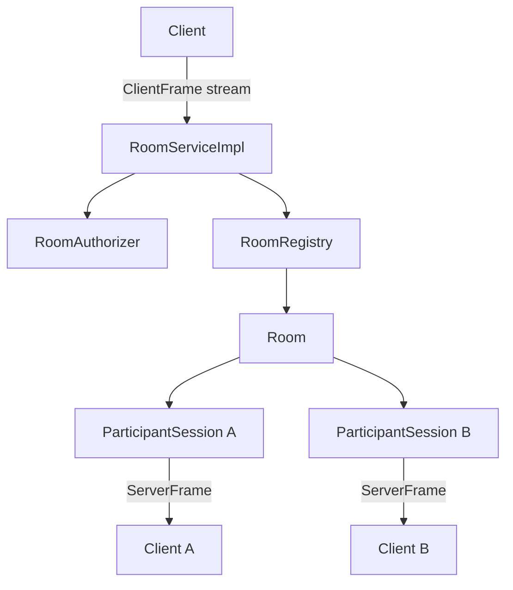

# Building Bidirectional Streaming for Interactive Sessions

In this project, you will build a simple collaboration service using Spring gRPC. Multiple clients can join the same room and send operations while simultaneously receiving acknowledgements and updates from other participants. Each client keeps a bidirectional streaming RPC open for the duration of its session.

The goal is not merely making both sides exchange multiple messages. You will design a protobuf contract, manage stream lifecycles, handle concurrency, bound send queues, authenticate metadata, and test disconnection scenarios. After this project, you will be able to explain why bidirectional streaming fits an interactive session and which responsibilities the application itself must own.

## 1. Scenario and Project Scope

Build a command-line application simulating a collaboration room. Each client connects to the server, joins a room by `room_id`, and can then send messages. The server acknowledges operations to the sender and broadcasts updates to other clients in the same room.

Example usage flow:

1. Client A opens the `JoinRoom` RPC and sends a `Join` frame containing `room_id`.
2. The server authenticates identity from metadata, checks room-join permission, and returns a `Joined` frame.
3. Client B joins the same room; the server notifies both A and B with `MemberJoined`.
4. A sends `Publish` with an `operation_id` and content. The server returns `Ack` to A while broadcasting `MessageReceived` to B.
5. B sends another operation while still receiving messages from A.
6. When a client leaves the room or closes its request stream, the server removes the member and broadcasts `MemberLeft` to the remaining clients.

The first version is scoped to a single server instance and an in-memory registry. When the server restarts, active rooms and open sessions are lost. This project focuses on protocol design and RPC lifecycle; durable persistence, multi-server synchronization, and graphical interfaces are extensions.

## 2. Learning Objectives

Completing this project will enable you to:

- Define a bidirectional RPC in Protocol Buffers and generate Java code.
- Implement a two-way streaming server using `StreamObserver` in a Spring gRPC service.
- Write a client that retains a request observer to send multiple frames and a response observer to receive messages asynchronously.
- Manage handshakes, half-closes, cancellations, terminal errors, and resource cleanup.
- Route messages to the right room and ensure every response stream is written sequentially.
- Apply backpressure using bounded queues and transport readiness.
- Verify authentication metadata, deadlines, statuses, and client disconnect behavior.
- Write integration tests for multiple concurrently interacting clients.

## 3. Functional Requirements

The server must implement the following behaviors:

| Behavior | Rule |
| --- | --- |
| Join room | First frame must be `Join`; `room_id` must be non-empty and the principal must have permission to join. |
| Publish content | Only members who have joined the room may send `Publish`. Content must stay within application-enforced size limits. |
| Acknowledgement | Sender receives `Ack` containing the `operation_id` and server-accepted sequence. ACK semantics must be clear: in this project, ACK confirms the server validated and accepted the operation into the in-memory processing flow. |
| Broadcast events | Other room members receive `MessageReceived` in server-accepted order. The sender does not receive its own broadcast back once ACK is sent. |
| Heartbeat | Client may send `Ping`; server replies with `Pong`. Heartbeats do not replace authentication or authorization checks. |
| Leave room | Client sends `Leave` or half-closes the request stream. Server removes the member and broadcasts `MemberLeft`. |
| Disconnect / cancel | When the RPC is cancelled or errors out, the server removes the member, stops related work, and sends no further responses on the closed stream. |

A client that has not sent `Join` must not send `Publish`, `Ping`, or `Leave`. A client that has already joined must not send `Join` a second time on the same RPC. Protocol violations must be handled consistently: invalid frames may terminate the RPC with `INVALID_ARGUMENT` or `FAILED_PRECONDITION` according to your documented rules.

## 4. Designing the Protocol Buffers Contract

Create `room.proto` in your project's proto directory. Adjust the file location according to your application's existing code generation setup.

```protobuf
syntax = "proto3";

package acme.collaboration.v1;

option java_multiple_files = true;
option java_package = "com.example.collaboration.grpc";

service RoomService {
  rpc JoinRoom (stream ClientFrame) returns (stream ServerFrame);
}

message ClientFrame {
  uint64 client_sequence = 1;
  oneof payload {
    Join join = 10;
    Publish publish = 11;
    Ping ping = 12;
    Leave leave = 13;
  }
}

message ServerFrame {
  uint64 server_sequence = 1;
  oneof payload {
    Joined joined = 10;
    Ack ack = 11;
    MessageReceived message_received = 12;
    MemberJoined member_joined = 13;
    MemberLeft member_left = 14;
    Pong pong = 15;
  }
}

message Join {
  string room_id = 1;
  string display_name = 2;
}

message Publish {
  string operation_id = 1;
  string text = 2;
}

message Ping {
  int64 sent_at_epoch_millis = 1;
}

message Leave {}

message Joined {
  string room_id = 1;
  string participant_id = 2;
}

message Ack {
  string operation_id = 1;
  uint64 accepted_sequence = 2;
}

message MessageReceived {
  string participant_id = 1;
  string display_name = 2;
  string operation_id = 3;
  uint64 room_sequence = 4;
  string text = 5;
}

message MemberJoined {
  string participant_id = 1;
  string display_name = 2;
}

message MemberLeft {
  string participant_id = 1;
}

message Pong {
  int64 server_time_epoch_millis = 1;
}
```

`oneof` guarantees each frame carries only one payload type. `client_sequence` and `server_sequence` are connection-scoped sequence numbers; `room_sequence` is the accepted message order within a room. These are application-managed business conventions, not sequences provided automatically by gRPC.

In the first version, sequences can increment in memory. To guarantee ordering when multiple clients send concurrently, assigning `room_sequence` and enqueuing the broadcast event must happen inside a room synchronization block. Never use client timestamps for global ordering.

## 5. Proposed Architecture

Divide responsibilities across the following components. Class names are suggestions; you may use different names as long as responsibilities remain clear.

| Component | Responsibility |
| --- | --- |
| `RoomServiceImpl` | Accepts the RPC, creates connection context, dispatches frames to session logic, and terminates the response stream. |
| `RoomRegistry` | Finds or creates rooms, adds/removes members, and manages empty room lifecycles. |
| `Room` | Manages room members and sequence; coordinates ordered broadcasts. |
| `ParticipantSession` | Holds participant ID, principal, display name, response observer, closed state, and outbound queue. |
| `RoomAuthorizer` | Checks whether the principal is allowed to join a room or perform an operation. |
| `Client` | Sends frames over the request observer and processes responses asynchronously. |

Overall processing flow:



Each RPC corresponds to one `ParticipantSession`. The registry must never retain a response observer after the RPC ends. When a member leaves a room, remove the observer reference from the registry to avoid memory leaks.

## 6. Implementation Steps

### Step 1: Generate Java Code from Proto

Add `room.proto` to your project's configured proto source set and run the code generation task for your protobuf/gRPC plugin. Verify that classes such as `RoomServiceGrpc`, `ClientFrame`, `ServerFrame`, and the nested payload messages are generated.

Never manually create or edit generated classes. When updating the contract, edit `.proto` and re-run code generation. Ensure Java and protobuf packages align consistently with service imports.

### Step 2: Build the Registry and Room

`RoomRegistry` can use `ConcurrentHashMap<String, Room>` to look up rooms by `room_id`. Each `Room` manages its own member set and sequence. Determine which operations must be atomic:

- Adding a member and emitting `MemberJoined`.
- Assigning a sequence and accepting a `Publish`.
- Dispatching the same message to remaining members in the exact accepted order.
- Removing a member on `Leave`, cancellation, or error.
- Removing a room when no members and no pending work remain.

Never hold a room lock while performing I/O or waiting for a client to consume a message. Snapshot the target recipient list inside a brief synchronized section, then enqueue the message into each member's outbound queue.

### Step 3: Implement the Bidi Service

Proto-generated code provides the `RoomServiceGrpc.RoomServiceImplBase` base class. The `joinRoom` method receives an observer for sending responses and returns an observer for receiving requests. The snippet below shows the service entry point; wire the TODO calls to your registry and session logic.

```java
import io.grpc.Status;
import io.grpc.stub.ServerCallStreamObserver;
import io.grpc.stub.StreamObserver;

public final class RoomServiceImpl
        extends RoomServiceGrpc.RoomServiceImplBase {

    private final RoomRegistry roomRegistry;
    private final RoomAuthorizer authorizer;

    public RoomServiceImpl(
            RoomRegistry roomRegistry,
            RoomAuthorizer authorizer) {
        this.roomRegistry = roomRegistry;
        this.authorizer = authorizer;
    }

    @Override
    public StreamObserver<ClientFrame> joinRoom(
            StreamObserver<ServerFrame> responseObserver) {

        ServerCallStreamObserver<ServerFrame> serverObserver =
                (ServerCallStreamObserver<ServerFrame>) responseObserver;
        ParticipantSession session =
                new ParticipantSession(serverObserver);

        serverObserver.setOnCancelHandler(() -> {
            roomRegistry.remove(session);
            session.closeLocally();
        });

        return new StreamObserver<>() {
            @Override
            public void onNext(ClientFrame frame) {
                if (session.isClosed()) {
                    return;
                }
                try {
                    // TODO: validate frame and session state.
                    // TODO: handle Join/Publish/Ping/Leave.
                } catch (IllegalArgumentException ex) {
                    session.fail(Status.INVALID_ARGUMENT
                            .withDescription("Invalid client frame")
                            .asRuntimeException());
                } catch (SecurityException ex) {
                    session.fail(Status.PERMISSION_DENIED
                            .withDescription("Operation is not allowed")
                            .asRuntimeException());
                }
            }

            @Override
            public void onError(Throwable error) {
                roomRegistry.remove(session);
                session.closeLocally();
            }

            @Override
            public void onCompleted() {
                // Half-close: clean up the session after finishing processing received requests.
                roomRegistry.remove(session);
                session.completeResponse();
            }
        };
    }
}
```

This is a skeleton for structuring the entry point, not a complete implementation. Ensure `remove`, `fail`, and `completeResponse` are idempotent so cancellation and completion callbacks never double-release the same resources. If you process frames asynchronously, do not call `completeResponse()` immediately upon `onCompleted()`; wait for accepted operations to finish before closing the response stream.

Read authentication metadata from `Context` or interceptors according to your application's gRPC setup. Never derive identity from `display_name` or `room_id` in the payload. Metadata establishes the principal; payload only specifies the resources the principal wants to access.

### Step 4: Handle Each Frame Type

Implement a state machine for each `ParticipantSession`:

| Current State | Frame | Action |
| --- | --- | --- |
| `NEW` | Valid `Join` | Authorize permissions, register in room, transition to `JOINED`, send `Joined`. |
| `NEW` | `Publish`, `Ping`, or `Leave` | Terminate RPC with `FAILED_PRECONDITION` or `INVALID_ARGUMENT`. |
| `JOINED` | Valid `Publish` | Validate content, deduplicate `operation_id`, assign room sequence, send ACK, and broadcast. |
| `JOINED` | `Ping` | Reply with `Pong`. |
| `JOINED` | `Leave` | Remove member, emit `MemberLeft`, complete response stream. |
| `JOINED` | Duplicate `Join` | Reject according to protocol rules. |
| `CLOSED` | Any frame | Ignore late callbacks and emit no further responses. |

Enforce limits on `display_name`, `room_id`, `text`, and send rates within a time window. Never use user-supplied content as metric names or high-cardinality labels.

### Step 5: Ensure Safe, Bounded Outbound Delivery

A room can broadcast messages to multiple clients. Events may arrive from multiple threads, so never call `responseObserver.onNext()` concurrently from different threads.

Each `ParticipantSession` should have a bounded outbound queue and a serialized sending path. Use `ServerCallStreamObserver.isReady()` together with `setOnReadyHandler()` to resume draining the queue when the transport is ready. When the queue fills up, enforce your chosen policy—such as rejecting new operations, closing slow sessions, or coalescing replaceable status notifications. Never silently drop business messages that must be preserved.

Distinguish two levels of acknowledgement:

- `isReady()` indicates the transport can accept more bytes at the moment of inspection.
- `Ack` in the protocol indicates the server has accepted the operation according to business rules.

Do not treat `isReady()` as proof that the client processed the message. If durable persistence is required, emit `Ack` only after the operation is committed to durable storage; this in-memory version commits acceptance only within the current server lifecycle.

### Step 6: Complete Spring gRPC Configuration

Register `RoomServiceImpl` using the discovery/registration mechanism required by your project's Spring gRPC starter. Configure ports, TLS, and interceptors at the proper integration layer. Because property names and annotations vary between starters, use your project's actual configuration rather than copying property names from a different starter's examples.

Create an interceptor or equivalent mechanism to:

- Read and validate bearer tokens or client identities.
- Populate the principal into the gRPC `Context` for the service to use.
- Attach trace/request IDs to logs.
- Map authentication failures to `UNAUTHENTICATED` and authorization failures to `PERMISSION_DENIED`.

Enable TLS in deployed environments. If using mTLS, configure trust material and verify client identities. Never commit private keys or tokens into the repository.

## 7. Writing the Interactive Client

The Java client uses an async stub to open a bidi RPC. One observer receives responses while the request observer is retained to send subsequent frames:

```java
StreamObserver<ServerFrame> responseObserver = new StreamObserver<>() {
    @Override
    public void onNext(ServerFrame frame) {
        // Print Joined, Ack, MessageReceived, MemberJoined, MemberLeft, or Pong.
    }

    @Override
    public void onError(Throwable error) {
        // Display status and close the client-side session.
    }

    @Override
    public void onCompleted() {
        // Server completed the response stream.
    }
};

StreamObserver<ClientFrame> requestObserver =
        asyncStub.joinRoom(responseObserver);

requestObserver.onNext(ClientFrame.newBuilder()
        .setJoin(Join.newBuilder()
                .setRoomId("engineering")
                .setDisplayName("An"))
        .build());

// Send Publish/Ping while the response stream remains open.
```

This is a skeletal example; attach authentication metadata via call credentials or a client interceptor. Never call `onNext()` after the request observer has been half-closed or the RPC has ended. If multiple threads send requests, serialize write calls to preserve business ordering.

Launch two independent clients, such as `An` and `Binh`, both joining the `engineering` room. Send a message from An and verify Binh receives the broadcast while An can continue sending more messages. This test clearly demonstrates the bidirectional nature of the RPC.

## 8. Integration Testing

Write integration tests running a real gRPC server or an in-process server depending on your test setup. Create client stubs generated from the same proto. Use latches/futures with timeouts to synchronize tests; never use `Thread.sleep()` as the primary synchronization mechanism.

Mandatory test scenarios:

| # | Scenario | Expected Result |
| --- | --- | --- |
| 1 | Client sends valid `Join` | Receives exactly one `Joined` and is added to the room. |
| 2 | Client sends `Publish` before `Join` | RPC terminates with the documented protocol status. |
| 3 | Two clients join the same room; A sends `Publish` | A receives `Ack`, B receives `MessageReceived` with the same `operation_id`. |
| 4 | B sends `Ping` while receiving broadcasts | B receives both `Pong` and broadcasts; neither direction blocks waiting for the other to finish. |
| 5 | Client sends `Leave` or half-closes | Member is removed, remaining clients receive `MemberLeft`, and response stream terminates cleanly. |
| 6 | Client cancels the RPC | Registry no longer retains the session; no further responses are emitted after cancellation. |
| 7 | Two clients send concurrently | No concurrent write errors; room sequences never collide and ordering is deterministic. |
| 8 | Slow-consuming client | Outbound queue does not grow unbounded; overflow policy is enforced. |
| 9 | Missing/invalid token or unauthorized principal | Receives `UNAUTHENTICATED` or `PERMISSION_DENIED` respectively. |
| 10 | Deadline expires or server stops | Client observes the appropriate status; server releases session resources. |

Also test duplicate `operation_id` submissions. If your project implements in-memory deduplication, resending the same operation within the deduplication window must not emit a duplicate broadcast. Document the key retention window and behavior after a server restart.

## 9. Observability and Error Handling

Emit structured logs for session open, room join, room leave, cancellation, errors, and RPC completion. You can log `participant_id`, sanitized `room_id`, trace ID, status, and message counts; avoid logging tokens or full chat contents.

Track at minimum:

- Number of open bidi RPCs and stream lifetimes.
- Active clients per room and total room count.
- Inbound/outbound frame counts, byte counts, and broadcast counts.
- Outbound queue depth, queue-full events, and slow-client counts.
- Completed RPCs by gRPC status.
- Reconnects, authentication failures, and rejected operations.

When debugging, categorize failures by layer:

| Symptom | Where to Investigate |
| --- | --- |
| Cannot establish connection | Host/port, DNS, firewall, HTTP/2, TLS, and proxies. |
| `UNIMPLEMENTED` | Service/method not registered, wrong RPC name, or mismatched client/server descriptors. |
| `UNAUTHENTICATED` | Tokens, credentials, and authentication interceptor. |
| `PERMISSION_DENIED` | Principal permissions for the specific room and action. |
| `FAILED_PRECONDITION` | Session state machine violations, e.g., Publish before Join. |
| `RESOURCE_EXHAUSTED` | Message limits, queue capacity, concurrent stream limits, or quotas. |
| `CANCELLED` | Client closing the session, intermediary timeouts, or explicit cancellation. |
| `DEADLINE_EXCEEDED` | RPC deadline, slow dependencies, or infrastructure idle timeouts. |

## 10. Acceptance Criteria

The project is considered complete when:

- [ ] The proto declares a bidi RPC with `stream` on both request and response; Java code is generated from the proto.
- [ ] Spring gRPC registers `RoomServiceImpl` and clients can connect to the configured endpoint.
- [ ] Two clients join the same room and exchange messages concurrently over open streams.
- [ ] The sender receives `Ack`; other members receive broadcasts in the right room and right sequence.
- [ ] The state machine rejects out-of-order frames and handles `Leave`/half-close/cancellation.
- [ ] Every response stream is written sequentially; outbound queues are bounded with an overflow policy.
- [ ] Authentication metadata and access permissions are enforced; TLS is configured for deployed environments.
- [ ] Integration tests cover the mandatory scenarios in Section 8 and complete within bounded timeouts.
- [ ] Logs/metrics suffice to trace sessions, terminal statuses, and queue health without leaking secrets.
- [ ] Project README explains how to run the server, launch two clients, run tests, and notes the limits of in-memory storage.

## 11. Extensions After Completion

Once the baseline works reliably, you can extend it in the following directions:

1. **Resume after reconnect:** persist an event log and cursor; clients reconnect with a resume token and last acknowledged sequence.
2. **Durable storage:** persist operations to a database before sending ACK if business guarantees require zero data loss across server restarts.
3. **Multiple server instances:** move registry and broadcasts onto a shared event distribution system; handle routing back to the node holding each stream.
4. **Fine-grained authorization:** enforce read/write permissions per room and operation type, including revoking permissions mid-session.
5. **High load:** benchmark many concurrent streams, high message rates, slow clients, and queue overflows; determine real resource limits.
6. **UI:** replace the CLI client with an application showing connection state, member lists, and message history.

Do not add extensions before defining requirements for ordering, durability, resilience, and load. A bidi stream only provides a two-way transport channel during an RPC's lifetime; persistence, replay, exactly-once guarantees, or multi-node distribution must be designed at the application layer.

## 12. Deliverables

When submitting the project, provide:

- `.proto` file and code generation configuration.
- Service, registry/room/session code, and test client.
- Spring gRPC configuration, sample interceptor/credentials, and sample TLS config without secrets.
- Integration tests covering the scenarios in Section 8.
- A README with run commands, instructions for launching two clients, sample message exchanges, and known limitations.
- A short note explaining why this project chose bidirectional streaming over unary, server streaming, or client streaming.

The project succeeds when two clients can send and receive messages within the same session, the server manages every stream's lifecycle cleanly, and the system keeps resources under control when clients are slow, fail, or disconnect.
