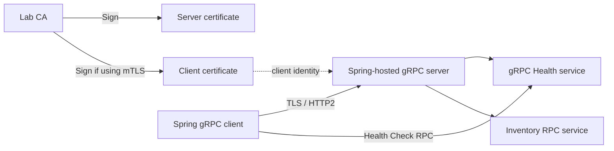

# Enabling TLS and Health Checks

In this hands-on project, you will configure a **SPRING_GRPC** service to encrypt connections with TLS and expose its serving status through the gRPC Health Checking Protocol. The expected outcome is that clients verify the server's identity, the health RPC returns `SERVING` when the service is ready, transitions to `NOT_SERVING` when shutdown begins, and supports mutual TLS (mTLS) client certificate verification.

TLS and health checks answer two different questions. TLS protects the transport channel and verifies peer identity against a trust chain. Health checks indicate whether a service is ready to accept requests. A valid TLS connection does not mean the application is ready; conversely, a health endpoint reporting `SERVING` does not encrypt traffic if the transport lacks TLS. Both must be configured and tested.

## 1. Objectives and Lab Architecture

After completing this lesson, you will be able to:

- Create a local lab CA and sign a server certificate with Subject Alternative Names (SANs).
- Configure a gRPC Java server for TLS using a certificate chain and private key.
- Register `HealthStatusManager` to publish overall server status and per-service status.
- Configure a client that trusts the CA, verifies hostnames, and calls the health RPC with a deadline.
- Enable mTLS so the server requires a client certificate signed by a trusted CA.
- Transition health status to `NOT_SERVING` before draining and shutting down the server.
- Test valid certificates, untrusted CAs, mismatched hostnames, and missing client certificates.

Deployment model:



In this lab, a Spring Boot application initializes an application-managed gRPC Netty server. If your project uses a Spring gRPC starter or integration that manages the server itself, register services and configure TLS using that starter's official extension points. Never create a second standalone `Server` on the same port when the starter owns the lifecycle. Configuration APIs vary across starters and versions; the code below illustrates the underlying `grpc-java` layer so you understand the TLS and health components.

## 2. Preparing Dependencies

This Gradle example uses the non-shaded gRPC Java Netty transport so `io.netty.handler.ssl.ClientAuth` can be referenced directly in the mTLS section:

```groovy
dependencies {
    implementation("org.springframework.boot:spring-boot-starter")

    implementation(platform("io.grpc:grpc-bom:${grpcVersion}"))
    implementation("io.grpc:grpc-netty")
    implementation("io.grpc:grpc-services")
    implementation("io.grpc:grpc-protobuf")
    implementation("io.grpc:grpc-stub")
}
```

`grpcVersion` should be managed centrally according to your project's compatible version. If your application uses `grpc-netty-shaded`, Netty classes are relocated; never mix standard Netty imports with the shaded transport. Use the SSL API matching your chosen transport.

`grpc-services` provides the health service implementation. Health Checking Protocol message/stub classes live in package `io.grpc.health.v1`. The project also needs Protobuf code generation for your business service. The examples here use `InventoryServiceGrpc.InventoryServiceImplBase` and `GetItemRequest` generated from your application's `.proto` file.

## 3. Creating the CA and Server Certificate

In your local environment, create a `certs` directory in the project root. The following commands use OpenSSL and illustrate a dedicated lab CA. Never use lab private keys in production, never commit private keys to Git, and never bake the CA private key into application containers.

### 3.1 Create the Lab CA

```bash
mkdir -p certs

openssl req -x509 -newkey rsa:4096 \
  -keyout certs/ca-key.pem \
  -out certs/ca.pem \
  -days 365 \
  -nodes \
  -addext "basicConstraints=critical,CA:TRUE" \
  -addext "keyUsage=critical,keyCertSign,cRLSign" \
  -subj "/CN=Spring gRPC Lab CA"
```

`ca.pem` is the public CA certificate clients can use as a trust anchor. `ca-key.pem` is the CA's private key; use it only to sign lab certificates and keep it protected.

### 3.2 Create the Server Private Key and CSR

```bash
openssl genpkey -algorithm RSA \
  -out certs/server-key.pem \
  -pkeyopt rsa_keygen_bits:3072

openssl req -new \
  -key certs/server-key.pem \
  -out certs/server.csr \
  -subj "/CN=localhost"
```

Create `certs/server.ext`:

```ini
basicConstraints=CA:FALSE
keyUsage=digitalSignature,keyEncipherment
extendedKeyUsage=serverAuth
subjectAltName=@alt_names

[alt_names]
DNS.1=localhost
DNS.2=grpc.inventory.local
IP.1=127.0.0.1
```

SAN is critical for client hostname verification. If the client connects to `localhost`, the certificate must include `DNS:localhost`; if the client connects to `grpc.inventory.local`, the SAN must include that DNS name. Never solve hostname errors by disabling hostname verification on the client.

Sign the CSR with the lab CA:

```bash
openssl x509 -req \
  -in certs/server.csr \
  -CA certs/ca.pem \
  -CAkey certs/ca-key.pem \
  -CAcreateserial \
  -out certs/server.pem \
  -days 90 \
  -sha256 \
  -extfile certs/server.ext
```

You should now have `server.pem` (certificate), `server-key.pem` (private key), and `ca.pem` (CA certificate). Inspect the SAN entries and verify the chain:

```bash
openssl x509 -in certs/server.pem -noout -subject -issuer -dates -ext subjectAltName
openssl verify -CAfile certs/ca.pem certs/server.pem
```

`openssl verify` must return `OK`. Check certificate validity dates and SAN entries before starting the server.

## 4. Declaring Application Configuration

Example `application.yml`:

```yaml
grpc:
  server:
    port: 8443
    tls:
      certificate-chain: ${GRPC_CERT_CHAIN:./certs/server.pem}
      private-key: ${GRPC_PRIVATE_KEY:./certs/server-key.pem}
      client-auth: ${GRPC_CLIENT_AUTH:false}
      client-ca: ${GRPC_CLIENT_CA:./certs/ca.pem}
    shutdown:
      grace-period-seconds: 20
      force-wait-seconds: 5
```

Initially in the lab, `client-auth` is `false` to test one-way TLS. When enabling mTLS, set `GRPC_CLIENT_AUTH=true`; the server will then require a client certificate signed by the CA in `client-ca`. Certificate and key paths are injected via external configuration or secret mounts. Never embed private keys or passwords in source code.

If Spring Boot also exposes an HTTP management port for Actuator, configure its port and access controls separately. Actuator's HTTP readiness endpoint and the gRPC Health service are two distinct endpoints; ensure each accurately reflects the status used by the routing component that queries it.

## 5. Creating the gRPC Health Service

The standard Health Checking Protocol defines service `grpc.health.v1.Health` with `Check` and `Watch` RPCs. `Check` returns instantaneous status; `Watch` lets clients stream status changes. In gRPC Java, `HealthStatusManager` provides an implementation ready to register directly on the server.

The service name must match the full proto service name (package + service), not the Java class name:

```java
private static final String INVENTORY_SERVICE =
        "inventory.v1.InventoryService";

private final HealthStatusManager healthStatusManager =
        new HealthStatusManager();

private void markReady() {
    healthStatusManager.setStatus(
            "",
            HealthCheckResponse.ServingStatus.SERVING);
    healthStatusManager.setStatus(
            INVENTORY_SERVICE,
            HealthCheckResponse.ServingStatus.SERVING);
}
```

An empty service name (`""`) represents the overall server status. Specific services can maintain their own statuses. Transition to `SERVING` only after mandatory dependencies and service implementations are ready. If a critical database is not yet connected, do not report `SERVING` merely because the gRPC socket is open.

## 6. Starting the TLS Server in the Spring Lifecycle

The example below demonstrates a Spring component managing a Netty gRPC server, registering the business service and the health service. `InventoryGrpcService` is the bean implementing the service generated from `.proto`.

```java
import io.grpc.Server;
import io.grpc.netty.GrpcSslContexts;
import io.grpc.netty.NettyServerBuilder;
import io.grpc.protobuf.services.HealthStatusManager;
import io.grpc.health.v1.HealthCheckResponse;
import io.netty.handler.ssl.ClientAuth;
import io.netty.handler.ssl.SslContextBuilder;
import org.springframework.beans.factory.annotation.Value;
import org.springframework.context.SmartLifecycle;
import org.springframework.stereotype.Component;

import java.io.File;
import java.io.IOException;
import java.util.concurrent.TimeUnit;
import java.util.logging.Level;
import java.util.logging.Logger;

@Component
public final class SecureGrpcServerLifecycle implements SmartLifecycle {
    private static final Logger LOGGER =
            Logger.getLogger(SecureGrpcServerLifecycle.class.getName());
    private static final String INVENTORY_SERVICE =
            "inventory.v1.InventoryService";

    private final InventoryGrpcService inventoryService;
    private final HealthStatusManager health = new HealthStatusManager();
    private final int port;
    private final File certificateChain;
    private final File privateKey;
    private final boolean clientAuthRequired;
    private final File clientCa;
    private final long gracePeriodSeconds;
    private final long forceWaitSeconds;

    private volatile Server server;
    private volatile boolean running;

    public SecureGrpcServerLifecycle(
            InventoryGrpcService inventoryService,
            @Value("${grpc.server.port:8443}") int port,
            @Value("${grpc.server.tls.certificate-chain}") File certificateChain,
            @Value("${grpc.server.tls.private-key}") File privateKey,
            @Value("${grpc.server.tls.client-auth:false}") boolean clientAuthRequired,
            @Value("${grpc.server.tls.client-ca:}") String clientCaPath,
            @Value("${grpc.server.shutdown.grace-period-seconds:20}") long gracePeriodSeconds,
            @Value("${grpc.server.shutdown.force-wait-seconds:5}") long forceWaitSeconds) {
        this.inventoryService = inventoryService;
        this.port = port;
        this.certificateChain = certificateChain;
        this.privateKey = privateKey;
        this.clientAuthRequired = clientAuthRequired;
        this.clientCa = clientCaPath.isBlank() ? null : new File(clientCaPath);
        this.gracePeriodSeconds = gracePeriodSeconds;
        this.forceWaitSeconds = forceWaitSeconds;
    }

    @Override
    public synchronized void start() {
        if (running) {
            return;
        }

        try {
            SslContextBuilder tls =
                    GrpcSslContexts.forServer(certificateChain, privateKey);

            if (clientAuthRequired) {
                if (clientCa == null || !clientCa.isFile()) {
                    throw new IllegalStateException(
                            "A readable client CA is required when mTLS is enabled");
                }
                tls.trustManager(clientCa).clientAuth(ClientAuth.REQUIRE);
            }

            health.setStatus("", HealthCheckResponse.ServingStatus.NOT_SERVING);
            health.setStatus(
                    INVENTORY_SERVICE,
                    HealthCheckResponse.ServingStatus.NOT_SERVING);

            server = NettyServerBuilder.forPort(port)
                    .sslContext(tls.build())
                    .addService(inventoryService)
                    .addService(health.getHealthService())
                    .build()
                    .start();

            // Mark ready only after the listener has started and required dependencies are ready.
            health.setStatus("", HealthCheckResponse.ServingStatus.SERVING);
            health.setStatus(
                    INVENTORY_SERVICE,
                    HealthCheckResponse.ServingStatus.SERVING);
            running = true;
            LOGGER.info("Secure gRPC server started on port " + port);
        } catch (IOException ex) {
            throw new IllegalStateException("Unable to start secure gRPC server", ex);
        }
    }

    @Override
    public void stop() {
        stop(() -> { });
    }

    @Override
    public void stop(Runnable callback) {
        Server current;
        synchronized (this) {
            current = server;
            if (current != null) {
                running = false;
                health.enterTerminalState();
                current.shutdown();
            }
        }
        if (current == null) {
            callback.run();
            return;
        }

        try {
            if (!current.awaitTermination(gracePeriodSeconds, TimeUnit.SECONDS)) {
                LOGGER.warning("gRPC drain timed out; forcing shutdown");
                current.shutdownNow();
                if (!current.awaitTermination(forceWaitSeconds, TimeUnit.SECONDS)) {
                    LOGGER.severe("gRPC server did not terminate after force shutdown");
                }
            }
        } catch (InterruptedException ex) {
            LOGGER.log(Level.WARNING, "Interrupted during gRPC shutdown", ex);
            current.shutdownNow();
            Thread.currentThread().interrupt();
        } finally {
            synchronized (this) {
                server = null;
            }
            callback.run();
        }
    }

    @Override
    public boolean isRunning() {
        return running;
    }

    @Override
    public boolean isAutoStartup() {
        return true;
    }

    @Override
    public int getPhase() {
        return Integer.MAX_VALUE;
    }
}
```

Key takeaways:

- `GrpcSslContexts.forServer(certificateChain, privateKey)` builds the server TLS configuration from the certificate and private key.
- When mTLS is enabled, `trustManager(clientCa)` sets the CA used to verify client certificates; `ClientAuth.REQUIRE` mandates that clients present a certificate.
- `health.getHealthService()` registers the health RPC on the same server and TLS transport.
- `health.enterTerminalState()` switches services to not-serving when shutdown begins. Then the server calls `shutdown()` to drain, falling back to `shutdownNow()` only if the grace period expires.
- `SmartLifecycle` lets Spring coordinate start/stop with the `ApplicationContext`. A high phase starts the server late and stops it early relative to lower-phase components; adjust the phase if your application's dependency order differs.

This example manages a custom server instance. If your starter already manages the server, keep the same TLS, health service, and status ideas, but wire them through your starter's configuration/registration hooks. Never register `SecureGrpcServerLifecycle` concurrently with an auto-configured server on the same port. The comment where `SERVING` is set marks the integration point for real readiness checks; in production, replace it with actual mandatory dependency checks rather than relying solely on listener startup.

## 7. Creating a TLS Client and Calling the Health Check

The client must trust the CA that signed the server certificate and connect using a hostname present in the SAN. The example below uses `NettyChannelBuilder` and the `grpc-services` health stub:

```java
import io.grpc.ManagedChannel;
import io.grpc.health.v1.HealthCheckRequest;
import io.grpc.health.v1.HealthCheckResponse;
import io.grpc.health.v1.HealthGrpc;
import io.grpc.netty.GrpcSslContexts;
import io.grpc.netty.NettyChannelBuilder;

import java.io.File;
import java.util.concurrent.TimeUnit;

public final class GrpcHealthProbe {
    public static void main(String[] args) throws Exception {
        File caCertificate = new File("certs/ca.pem");

        ManagedChannel channel = NettyChannelBuilder
                .forAddress("localhost", 8443)
                .sslContext(GrpcSslContexts.forClient()
                        .trustManager(caCertificate)
                        .build())
                .build();

        try {
            HealthCheckResponse response = HealthGrpc.newBlockingStub(channel)
                    .withDeadlineAfter(3, TimeUnit.SECONDS)
                    .check(HealthCheckRequest.newBuilder()
                            .setService("inventory.v1.InventoryService")
                            .build());

            if (response.getStatus()
                    != HealthCheckResponse.ServingStatus.SERVING) {
                throw new IllegalStateException(
                        "Inventory service is not serving: " + response.getStatus());
            }

            System.out.println("Inventory gRPC service is SERVING over TLS");
        } finally {
            channel.shutdown();
            if (!channel.awaitTermination(3, TimeUnit.SECONDS)) {
                channel.shutdownNow();
            }
        }
    }
}
```

The address `localhost` must match `DNS:localhost` in the server certificate's SAN. In other environments, use the real DNS name clients connect to and issue certificates with matching SANs. Never use `usePlaintext()` to "fix" handshake failures and never disable hostname verification.

To check overall server status rather than a specific service, send `setService("")`. Clients can use `HealthGrpc.newStub(channel).watch(...)` to receive continuous status updates; handle stream lifecycles and deadlines/cancellation just like any other streaming RPC.

## 8. Enabling Mutual TLS

One-way TLS authenticates the server to the client. mTLS adds client certificate verification on the server. In the lab, generate a client key and CSR:

```bash
openssl genpkey -algorithm RSA \
  -out certs/client-key.pem \
  -pkeyopt rsa_keygen_bits:3072

openssl req -new \
  -key certs/client-key.pem \
  -out certs/client.csr \
  -subj "/CN=inventory-lab-client"
```

Create `certs/client.ext`:

```ini
basicConstraints=CA:FALSE
keyUsage=digitalSignature,keyEncipherment
extendedKeyUsage=clientAuth
```

Sign the client certificate:

```bash
openssl x509 -req \
  -in certs/client.csr \
  -CA certs/ca.pem \
  -CAkey certs/ca-key.pem \
  -CAcreateserial \
  -out certs/client.pem \
  -days 90 \
  -sha256 \
  -extfile certs/client.ext
```

Start the server with `GRPC_CLIENT_AUTH=true` and `GRPC_CLIENT_CA=./certs/ca.pem`. On the client, add its certificate and private key to the SSL context:

```java
import io.netty.handler.ssl.SslContext;
import io.grpc.ManagedChannel;
import io.grpc.netty.GrpcSslContexts;
import io.grpc.netty.NettyChannelBuilder;
import java.io.File;

SslContext clientTls = GrpcSslContexts.forClient()
        .trustManager(new File("certs/ca.pem"))
        .keyManager(
                new File("certs/client.pem"),
                new File("certs/client-key.pem"))
        .build();

ManagedChannel channel = NettyChannelBuilder.forAddress("localhost", 8443)
        .sslContext(clientTls)
        .build();
```

The server verifies the client certificate against `client-ca`; the client continues verifying the server certificate against its trusted CA. In the lab, both sides share one CA for simplicity. Production environments may use separate server and client CAs/intermediates according to PKI policy. mTLS verifies identity at the transport layer; the application still needs per-principal and per-RPC authorization.

## 9. Testing and Verification

Execute the following scenarios and record results:

| Scenario | How to Execute | Expected Result |
| --- | --- | --- |
| Valid TLS | Client trusts `ca.pem`, connects to hostname matching SAN | Handshake succeeds, health returns `SERVING` |
| Untrusted CA | Client uses another CA or trust store without lab CA | Handshake fails with certificate verification error |
| Hostname mismatch | Connect using a hostname not in SAN | Client rejects server identity verification |
| Specific health service | Call `Check` with `inventory.v1.InventoryService` | Returns `SERVING` when service is ready |
| Service not ready | Set service status to `NOT_SERVING` | Health returns `NOT_SERVING` |
| Shutdown | Trigger Spring context stop | Health switches to `NOT_SERVING`, new RPCs rejected, in-flight RPCs drain within grace period |
| mTLS missing client cert | Enable `client-auth`, client provides no certificate | TLS handshake rejected |
| Valid mTLS | Client presents certificate signed by trusted CA | Handshake succeeds, health returns `SERVING` |
| Untrusted client cert | Client presents certificate signed by a different CA | Server rejects handshake |

You can verify the TLS handshake and ALPN with OpenSSL:

```bash
openssl s_client \
  -connect localhost:8443 \
  -servername localhost \
  -alpn h2 \
  -CAfile certs/ca.pem \
  -verify_return_error
```

Output should show certificate verification succeeding and ALPN negotiating `h2`. For mTLS, add `-cert certs/client.pem -key certs/client-key.pem`. This command verifies the TLS handshake; use the Java health probe from earlier to verify the health RPC itself works.

If using `grpcurl`, either enable reflection on the server or provide the health service proto definition to `grpcurl`. Example with reflection enabled:

```bash
grpcurl -cacert certs/ca.pem \
  -d '{"service":"inventory.v1.InventoryService"}' \
  localhost:8443 grpc.health.v1.Health/Check
```

When mTLS is enabled, pass the client certificate and key using the flags supported by your `grpcurl` version. Never enable reflection in production solely for testing convenience if API policy forbids exposing service descriptors.

## 10. Integrating with Readiness and Orchestration

Health status must reflect actual service state:

- During application startup, keep `NOT_SERVING` until the listener, configuration, mandatory dependencies, and service implementations are ready.
- During normal operation, set both the specific service and overall status to `SERVING`.
- When a mandatory dependency disconnects, evaluate whether the service can still fulfill its contract or must transition to `NOT_SERVING`.
- When shutdown begins, call `enterTerminalState()` to signal no new work, then drain active RPCs.
- When hosting multiple services on one gRPC server, manage per-service statuses rather than relying solely on a single global status if services have distinct readiness conditions.

Kubernetes supports gRPC probes for service health. The probe must target the right port and service name. Note that the built-in kubelet gRPC probe cannot be configured with TLS or client certificates; it cannot directly probe a TLS-only or mTLS listener. For TLS-only servers, you can use Spring Boot Actuator's HTTP readiness endpoint or a separate restricted internal health listener while keeping gRPC Health for gRPC clients. If using an HTTP Actuator probe, it is a separate health path; clarify which component uses which probe so pods are not marked ready before the gRPC service is ready. Readiness probes control traffic routing; liveness probes should only detect wedged processes and should not restart services merely because a dependency is temporarily slow unless recovery policy demands it.

Health checks do not replace metrics and alerting. They answer "can this instance serve right now?" rather than explaining why p99 latency rose, whether a TLS certificate is about to expire, or why RPC errors increased. Monitor certificate expiration, handshake failures, RPC statuses, latency, and health transitions.

## 11. Certificate Security and Production Operations

A lab CA simplifies learning; production requires a full certificate lifecycle process:

- Store private keys in a secret manager, HSM, or equivalent secure mechanism; mount them with minimal read permissions.
- Never write private keys to logs, container images, source control, or build artifacts.
- Use CAs and issuance workflows tailored to each environment; separate server and client trust roots if policy requires it.
- Track `notBefore`, `notAfter`, issuer, and serial numbers; alert well before expiration.
- Establish an overlapping certificate rotation process so clients and servers update trust bundles and leaf certificates without downtime.
- Revoke or replace compromised certificates; determine how CRL/OCSP or trust bundles are distributed given your transport and infrastructure capabilities.
- Restrict access to the health service if it exposes internal service details that should not be public.
- Never treat mTLS as a replacement for authorization. Map client certificate identities to principals and enforce permissions per method.

During certificate rotation, test the overlap phase where trust bundles contain both old and new CAs, roll out clients and servers in the proper order, and verify long-lived channel behavior. An already-open channel can keep using an old connection; plan reconnect or channel drain policies so rotated certificates actually take effect.

## 12. Common Issues and Troubleshooting

| Symptom | Possible Cause | How to Check/Fix |
| --- | --- | --- |
| `UNAVAILABLE: io exception` when connecting | Server not listening with TLS, wrong port, or handshake failure | Inspect server logs, port, transport, and TLS handshake |
| `PKIX path building failed` or unknown CA | Client does not trust the CA that signed the server certificate | Configure the right CA trust store; inspect chain and issuer |
| Hostname verification failed | SAN does not include the hostname used by the client | Reissue certificate with the exact SAN |
| `handshake_failure` when mTLS is enabled | Client missing certificate, wrong EKU, or CA not trusted by server | Check client chain, `clientAuth`, trust CA, and extended key usage |
| Health returns `SERVICE_UNKNOWN` | Service name sent in `Check` is not registered | Match package/service name and `setStatus()` |
| Health stays `SERVING` even when dependency fails | Status not tied to actual readiness | Update status based on mandatory dependencies and app lifecycle |
| Health stops responding during shutdown | Health service stopped before status was updated | Set `NOT_SERVING`/terminal state before `shutdown()` |
| Only HTTP probe works | HTTP Actuator and gRPC Health are separate endpoints | Configure the right probe/port/service name for gRPC |
| Certificate expires after some time | No rotation or expiry alerting | Track expiration dates and automate issuance/rotation |

Never work around TLS errors by disabling trust validation, accepting all certificates, or turning off hostname verification. Doing so defeats TLS peer authentication and hides misconfigurations.

## 13. Project Deliverables

When finishing the lab, gather the following evidence:

1. Server and client TLS configurations with private key paths supplied externally outside source code.
2. Startup logs showing the gRPC server successfully opening the TLS port.
3. `openssl verify` output and TLS handshake showing ALPN `h2`.
4. `SERVING` health check output for the exact service name.
5. Negative test results for an untrusted CA or hostname mismatch.
6. Shutdown output showing health transitioning to `NOT_SERVING` and bounded draining.
7. If mTLS is enabled, evidence that a valid client connects and a client without/with an untrusted certificate is rejected.
8. Notes describing the certificate rotation strategy and production probing setup.

## 14. Completion Checklist

- [ ] Server certificate has a valid chain and SANs matching the DNS/IPs clients use.
- [ ] gRPC server accepts only TLS connections on the configured port.
- [ ] Client verifies the CA and hostname without disabling certificate validation.
- [ ] Health service is registered on the same gRPC server.
- [ ] Overall status and per-service status are set accurately.
- [ ] Health returns `SERVING` only after mandatory dependencies are ready.
- [ ] Health transitions to `NOT_SERVING` before the server begins draining/shutting down.
- [ ] Client health probe sets a deadline and shuts down its channel cleanly.
- [ ] Tested wrong CA, wrong hostname, and expired/invalid certificates.
- [ ] If mTLS is enabled, the server requires client certificates and verifies them against the right CA.
- [ ] Private keys are protected, with rotation and expiry alerting planned.
- [ ] Orchestration readiness and liveness probes are separated and tested independently.

The lab is complete when clients can connect only to servers with valid identities, the health service accurately reflects serving capability, and shutdown publishes `NOT_SERVING` before stopping. TLS protects the wire; health checks help routing systems avoid unready instances. Both must be managed as part of the Spring gRPC service lifecycle—from startup, operations, and certificate rotation through shutdown.
