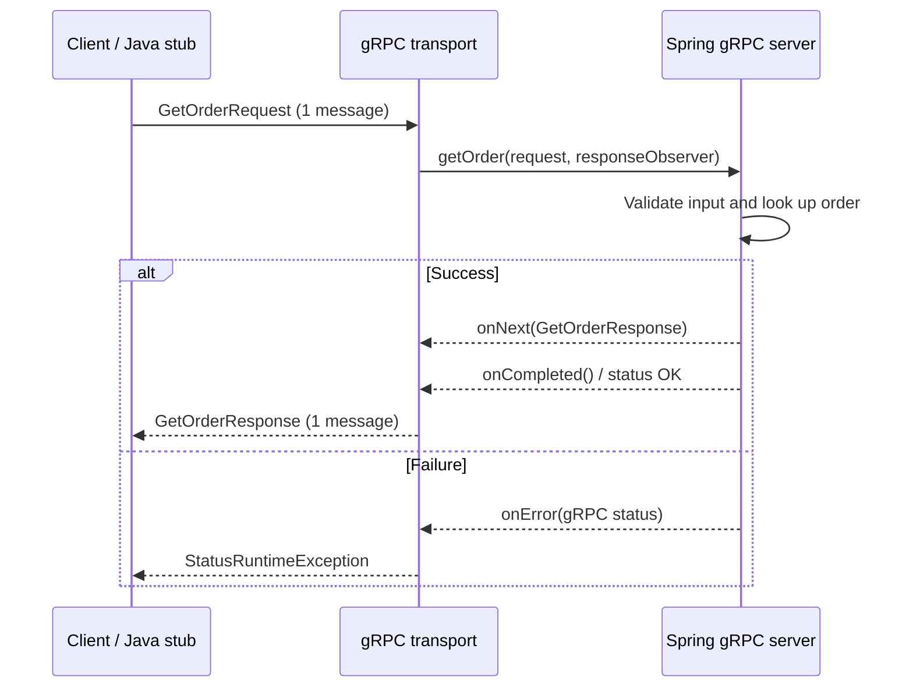

# One Request and One Response in a Unary Call

## 1. What is a Unary RPC?

In gRPC, a **unary RPC** is a call where the **client sends exactly one request message and receives at most one response message**. When processing succeeds, the server returns a single response along with a terminal status of `OK`. If it fails, the server ends the call with an **error gRPC status**, with no successful business response.

This exchange pattern fits operations such as viewing order details, looking up a user, checking a quota, or creating a record when each call has one input and one result. The contract is declared in **Protocol Buffers (`.proto`)**; the code generator creates message classes and Java stubs so the client and server can call each other without manually packing bytes or routing HTTP/2 frames.

Running example throughout this lesson: a Spring gRPC service that lets clients query orders by `order_id`:

| Component | Role in the example |
| --- | --- |
| `GetOrderRequest` | A request containing the order ID. |
| `OrderQueryService/GetOrder` | A unary method defined in `.proto`. |
| `GetOrderResponse` | A response containing the order ID, status, and total amount in the smallest currency unit. |
| `OrderQueryServiceGrpc` | The generated Java class containing the server base class and client stub types. |
| Spring gRPC | Integrates gRPC service deployment into a Spring application and manages channels/clients via configuration. |

### What counts as "one request, one response"?

This refers to the **message count at the application layer**, not a single network packet. gRPC typically runs over HTTP/2; establishing a connection, sending headers/metadata, transmitting the encoded body, and receiving trailers/status can involve multiple frames. The client does not need to interact with these frames directly.



Unary is defined by the **method declaration in `.proto`**, regardless of whether the client calls it with a blocking stub or an async stub. With a blocking stub, the calling thread on the client waits for the result; with an async stub, the result is reported via a callback, but the number of business requests and responses remains the same.

## 2. Declaring a Unary Contract with Protocol Buffers

Create `src/main/proto/order_query.proto`:

```proto
syntax = "proto3";

package checkout.v1;

option java_package = "com.example.checkout.grpc";
option java_multiple_files = true;
option java_outer_classname = "OrderQueryProto";

service OrderQueryService {
  rpc GetOrder (GetOrderRequest) returns (GetOrderResponse);
}

message GetOrderRequest {
  string order_id = 1;
}

message GetOrderResponse {
  string order_id = 1;
  string status = 2;
  int64 total_cents = 3;
}
```

The most important line is:

```proto
rpc GetOrder (GetOrderRequest) returns (GetOrderResponse);
```

Because there is no `stream` keyword on either side, this is a **unary RPC**. Adding `stream` to the request or response turns the contract into a different streaming RPC type.

A few things to understand before generating code:

- `package checkout.v1` identifies the protocol namespace of the service; the full method name is `checkout.v1.OrderQueryService/GetOrder` (on the wire it typically has a leading `/`).
- `java_package` sets the Java package for generated code; it is independent of the protocol package.
- The numbers `= 1`, `= 2`, `= 3` are **field numbers** used in the encoded wire data, not default values. When updating a schema already in use, do not arbitrarily change numbers or reuse numbers from deleted fields; use `reserved` when retiring old fields.
- In `proto3`, an unassigned `string` defaults to an empty string. Therefore, the server must still validate `order_id` rather than assuming the field always has data.
- `total_cents` uses an integer to avoid floating-point precision errors when representing monetary amounts. In a real system, you must standardize both the **currency** and the smallest unit of the amount.

Once the build is configured with `protoc` and the gRPC Java plugin, typical generated code includes `GetOrderRequest`, `GetOrderResponse`, and `OrderQueryServiceGrpc`. Do not edit generated classes directly: change the contract in `.proto`, then run the project's code generation step.

## 3. Building a Unary Server in Spring

The example below assumes the application already integrates **Spring gRPC**, has Java code generation from `.proto` configured, and registers gRPC services. With the Spring gRPC API using the `@GrpcService` annotation, the implementation class extends the generated base class:

```java
package com.example.checkout.server;

import com.example.checkout.grpc.GetOrderRequest;
import com.example.checkout.grpc.GetOrderResponse;
import com.example.checkout.grpc.OrderQueryServiceGrpc;
import io.grpc.Status;
import io.grpc.stub.StreamObserver;
import org.springframework.grpc.server.service.GrpcService;

import java.util.Optional;

@GrpcService
public class OrderQueryGrpcService
        extends OrderQueryServiceGrpc.OrderQueryServiceImplBase {

    private final OrderCatalog orderCatalog;

    public OrderQueryGrpcService(OrderCatalog orderCatalog) {
        this.orderCatalog = orderCatalog;
    }

    @Override
    public void getOrder(
            GetOrderRequest request,
            StreamObserver<GetOrderResponse> responseObserver) {

        String orderId = request.getOrderId().trim();
        if (orderId.isEmpty()) {
            responseObserver.onError(Status.INVALID_ARGUMENT
                    .withDescription("order_id must not be empty")
                    .asRuntimeException());
            return;
        }

        Optional<OrderRecord> found;
        try {
            found = orderCatalog.findById(orderId);
        } catch (RuntimeException exception) {
            // Log internal error here; avoid returning sensitive details to the client.
            responseObserver.onError(Status.INTERNAL
                    .withDescription("Unable to query order")
                    .asRuntimeException());
            return;
        }

        if (found.isEmpty()) {
            responseObserver.onError(Status.NOT_FOUND
                    .withDescription("Order not found")
                    .asRuntimeException());
            return;
        }

        OrderRecord order = found.get();
        GetOrderResponse response = GetOrderResponse.newBuilder()
                .setOrderId(order.id())
                .setStatus(order.status())
                .setTotalCents(order.totalCents())
                .build();

        responseObserver.onNext(response);       // One business response
        responseObserver.onCompleted();          // Successful completion
    }
}
```

`OrderCatalog` is a business component defined by the application itself, not a gRPC API. For example, you can place the following two declarations in their corresponding Java files:

```java
// OrderRecord.java
public record OrderRecord(String id, String status, long totalCents) {}

// OrderCatalog.java (same package as OrderRecord)
public interface OrderCatalog {
    java.util.Optional<OrderRecord> findById(String orderId);
}
```

In a real application, a Spring bean implementing `OrderCatalog` reads from a database or calls a business service. Separating this from the handler makes it possible to test request/response mapping without depending on a data store.

### Why does the server use `StreamObserver` even though this is unary?

The gRPC Java server API uses `StreamObserver<T>` to report results. For a unary call, the rules are:

| Case | Valid sequence of calls on `responseObserver` |
| --- | --- |
| Success | `onNext(response)` **once**, then `onCompleted()` **once**. |
| Invalid request | `onError(Status.INVALID_ARGUMENT...)` and finish. |
| Resource not found | `onError(Status.NOT_FOUND...)` and finish. |
| System error | `onError(Status.INTERNAL...)` or another appropriate status, then finish. |

`onCompleted()` and `onError()` are **mutually exclusive terminal signals**. Never call `onNext()` a second time in unary; never call `onCompleted()` after `onError()`; and always `return` after an error branch to avoid continuing down the success path. A business error is translated into a gRPC status, not a fake `GetOrderResponse` carrying an `"error"` string when the contract does not define that pattern.

## 4. Calling a Unary RPC from a Java Client

After generating code, the client uses the generated stub. In Spring, you can register a blocking stub as a bean and obtain the channel from Spring gRPC's `GrpcChannelFactory`:

```java
package com.example.checkout.client;

import com.example.checkout.grpc.OrderQueryServiceGrpc;
import org.springframework.context.annotation.Bean;
import org.springframework.context.annotation.Configuration;
import org.springframework.grpc.client.GrpcChannelFactory;

@Configuration
public class OrderGrpcClientConfig {

    @Bean
    OrderQueryServiceGrpc.OrderQueryServiceBlockingStub orderQueryStub(
            GrpcChannelFactory channelFactory) {
        return OrderQueryServiceGrpc.newBlockingStub(
                channelFactory.createChannel("orders"));
    }
}
```

Example configuration for a channel named `orders` in `application.properties`:

```properties
spring.grpc.client.channels.orders.address=static://localhost:9090
```

Port `9090` is only an illustrative value: it must match the actual server port. Channel security configuration must match the deployment environment; connecting to a server with TLS must use the corresponding TLS configuration instead of assuming plaintext by default.

Client business code calls the `getOrder(...)` method:

```java
package com.example.checkout.client;

import com.example.checkout.grpc.GetOrderRequest;
import com.example.checkout.grpc.GetOrderResponse;
import com.example.checkout.grpc.OrderQueryServiceGrpc;
import io.grpc.StatusRuntimeException;
import org.springframework.stereotype.Service;

import java.util.concurrent.TimeUnit;

@Service
public class OrderQueryClient {

    private final OrderQueryServiceGrpc.OrderQueryServiceBlockingStub stub;

    public OrderQueryClient(
            OrderQueryServiceGrpc.OrderQueryServiceBlockingStub stub) {
        this.stub = stub;
    }

    public GetOrderResponse findOrder(String orderId) {
        GetOrderRequest request = GetOrderRequest.newBuilder()
                .setOrderId(orderId)
                .build();

        try {
            return stub.withDeadlineAfter(1500, TimeUnit.MILLISECONDS)
                    .getOrder(request);
        } catch (StatusRuntimeException exception) {
            // The upper calling layer can translate the status into an appropriate business error.
            throw exception;
        }
    }
}
```

In this snippet, `getOrder(request)` is **a network call**, not a direct Java method invocation on the server. The blocking stub returns `GetOrderResponse` if it finishes with `OK`; for any status other than `OK`, it throws `StatusRuntimeException`.

`withDeadlineAfter(...)` creates **a new stub configured with a deadline**, without mutating the injected Spring bean stub. A 1,500 ms deadline is an example and should be adjusted to match the actual latency budget of the business flow. An async/future stub can be used for clients that do not want to block the thread; the unary contract remains unchanged.

## 5. Lifecycle of a Unary Call and Error Handling

Consider two execution paths when the client sends a request with `order_id = "A-100"`:

**Success path:** the client constructs `GetOrderRequest`, the stub encodes the message and sends it over the channel, the server invokes `getOrder`, finds the record, builds `GetOrderResponse`, and calls `onNext` then `onCompleted`. The client receives exactly one response and sees status `OK`.

**Not-found path:** the server validates that the order ID is well-formed, finds no matching record, and calls `onError(Status.NOT_FOUND...)`. The blocking client receives an exception with `Status.Code.NOT_FOUND`. No `GetOrderResponse` object is returned on this path.

Common statuses in unary RPCs:

| Status | When to use or expect |
| --- | --- |
| `OK` | Completed successfully with one valid response. |
| `INVALID_ARGUMENT` | Request violates validation rules, e.g., empty `order_id`. |
| `NOT_FOUND` | Order ID is valid but does not exist. |
| `PERMISSION_DENIED` | Client is authenticated but lacks permission for the resource. |
| `UNAUTHENTICATED` | Missing or invalid authentication credentials. |
| `DEADLINE_EXCEEDED` | The deadline set for the call expired. |
| `UNAVAILABLE` | Connection or service is temporarily unavailable. |
| `INTERNAL` | Unexpected server-side error. |
| `CANCELLED` | The call was cancelled, e.g., by the client cancelling the request. |

The client can branch on the **status code** rather than parsing error description strings:

```java
try {
    GetOrderResponse response = orderQueryClient.findOrder("A-100");
    System.out.println(response.getStatus());
} catch (io.grpc.StatusRuntimeException exception) {
    switch (exception.getStatus().getCode()) {
        case NOT_FOUND -> System.out.println("Order does not exist");
        case DEADLINE_EXCEEDED -> System.out.println("Query timed out");
        case UNAVAILABLE -> System.out.println("Service temporarily unavailable");
        default -> throw exception;
    }
}
```

In a real system, log with context and translate errors appropriately for the upper calling interface. Never return stack traces or database details to the client via `withDescription(...)`.

### Deadlines, cancellation, and retries

A deadline limits how long a call is allowed to run. When a deadline expires, the client may receive `DEADLINE_EXCEEDED`; **that does not prove the server work stopped automatically or that a transaction was rolled back**. For long-running operations, the server must pay attention to cancellation and be able to stop remaining work.

Unary also **does not imply idempotency**. An order lookup can usually be retried if policy allows, but unary `CreateOrder` or `ChargePayment` can produce side effects. Only retry automatically after evaluating the error code, idempotency, remaining deadline, and risk of duplicate processing; write operations typically require an idempotency key to retry safely.

## 6. Metadata, Security, and Call Observability

In addition to protobuf request/response payloads, gRPC also transmits **metadata** in headers/trailers. For example, metadata can carry a bearer token or a correlation ID. Metadata does not replace business data defined in `.proto`; the server should extract authentication information through a security mechanism or interceptor rather than mixing tokens into `GetOrderRequest` as an ordinary field.

In the Spring gRPC ecosystem, an interceptor is the right place for cross-cutting concerns across multiple methods such as checking metadata, attaching trace IDs, measuring latency, or mapping errors. The `getOrder` handler should primarily validate the business request and call `OrderCatalog`. In production deployments:

- Use **TLS** for connections crossing trust boundaries; enable mTLS when both client and server must authenticate each other.
- Record service/method names, status codes, latency, call counts, and errors using the application's observability stack; avoid putting order IDs or tokens into metric labels, which leaks data or causes high cardinality.
- Set intentional deadlines on the client, and also configure timeouts for database queries or downstream calls, because a gRPC deadline does not automatically bound all underlying resources.
- If the service blocks threads for database access, monitor busy thread counts, latency, and load to avoid saturating the executor as unary traffic grows.

## 7. Testing and Verifying Results

A test suite for the `GetOrder` handler should cover the following cases:

| Input / scenario | Expected outcome |
| --- | --- |
| `order_id = "A-100"` and present in catalog | One `GetOrderResponse` with matching fields, terminal status `OK`. |
| `order_id = ""` or whitespace only | No business response; `INVALID_ARGUMENT`. |
| `order_id = "UNKNOWN"` | No business response; `NOT_FOUND`. |
| Catalog throws an unexpected error | No internal details leaked; `INTERNAL`. |
| Server takes longer than a controlled deadline | Client receives appropriate deadline error; verify how the server handles cancellation. |

You can write integration tests using a gRPC in-process server/client or a server on a random port, combined with a fake `OrderCatalog` implementation. The goal is to verify **both the payload and the terminal status**, not just compare response strings.

When a server is running and you have the `.proto` file, you can invoke it manually with `grpcurl` without relying on server reflection:

```bash
grpcurl -plaintext \
  -import-path src/main/proto \
  -proto order_query.proto \
  -d '{"orderId":"A-100"}' \
  localhost:9090 \
  checkout.v1.OrderQueryService/GetOrder
```

The `-plaintext` flag is only suitable for local servers without TLS enabled; when the server uses TLS, omit this flag and configure the appropriate certificates/credentials. Illustrative output if `OrderCatalog` returns order `A-100` with status `PAID` and total amount 129,900 smallest units:

```json
{
  "orderId": "A-100",
  "status": "PAID",
  "totalCents": "129900"
}
```

Note that `int64` in standard Protocol Buffers JSON mapping is typically represented as a **decimal string** to preserve precision; in Java it is still accessed as a `long`. If the catalog has no matching record, the command displays the gRPC status `NOT_FOUND` instead of a JSON response like the one above.

## 8. Common Pitfalls

1. **Confusing unary with REST GET:** unary can query or mutate data; the unary definition only specifies **one request and one response**, not whether the business operation is safe or idempotent.
2. **Calling `onNext()` but forgetting `onCompleted()`:** the client may keep waiting until it times out because it never receives a successful completion signal.
3. **Returning an error response and completing with `OK`:** causes the client to treat the call as successful even though the operation failed. Use the appropriate gRPC status, or explicitly design a business-result envelope in the contract if truly needed.
4. **Treating default fields as valid input:** an absent `string order_id` reads as `""`; always validate the request and distinguish invalid input from a missing resource.
5. **Forgetting deadlines and cancellation handling:** a client waiting indefinitely can pile up calls when a downstream dependency is slow; deadlines must go hand in hand with server timeouts and resource management.
6. **Automatically retrying every unary call:** write operations can execute twice if the client does not know whether the server completed before the connection dropped.

## 9. Mini Practice Exercise

Add a unary method `GetOrderSummary(GetOrderRequest) returns (GetOrderSummaryResponse)` to `.proto`, where the response only contains `order_id` and `total_cents`. After regenerating the Java code, implement the handler with Spring gRPC and write three tests: a valid order ID, an empty order ID, and a non-existent order ID. Observe the number of `onNext` calls, the terminal operation, and the final status in each case.

**Self-check:** a successful unary call requires exactly **one protobuf request**, exactly **one protobuf response**, and **one successful completion signal**. On error, the call terminates with an error gRPC status; client code must handle that case without expecting a business response.
