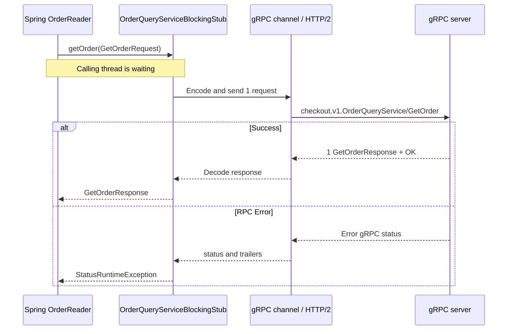

# Blocking Stub for Unary RPC

## 1. Goals and Use Cases

In **Spring gRPC**, clients typically do not construct HTTP/2 requests or decode Protocol Buffers manually. Instead, a client invokes a Java method on a **stub generated from the `.proto` contract**. For a **unary RPC** — one request and one response on success — a **blocking stub** is a straightforward choice when the calling flow needs to wait for the result before proceeding to the next step.

After this lesson, you will be able to:

- Identify `*BlockingStub` and distinguish it from async/future stubs.
- Create, configure, and reuse a blocking stub in a Spring application.
- Send a protobuf request, receive a response, or handle `StatusRuntimeException`.
- Set **per-call** deadlines, manage load, and recognize when you should not block a thread.
- Write integration tests proving both success and failure behaviors of a unary client.

**Running scenario:** A Spring component needs to look up order `A-100` from the `OrderQueryService` gRPC service. After receiving the result, it uses the order state to make a business decision.



The term **blocking** describes *how the client waits for the result*; it does not mean the server necessarily runs on the same thread or that gRPC stops operating asynchronously at the transport layer. While waiting, the thread calling `stub.getOrder(...)` is occupied. On success, the method returns **one** response; on failure, it typically throws an exception containing the gRPC status.

## 2. From Unary Contract to Java Blocking Stub

Example `src/main/proto/order_query.proto`:

```proto
syntax = "proto3";

package checkout.v1;

option java_package = "com.example.checkout.grpc";
option java_multiple_files = true;

service OrderQueryService {
  rpc GetOrder(GetOrderRequest) returns (GetOrderResponse);
}

message GetOrderRequest {
  string order_id = 1;
}

message GetOrderResponse {
  string order_id = 1;
  string state = 2;
  int64 total_cents = 3;
}
```

The `GetOrder` method is **unary** because neither the request nor the response has the `stream` keyword. With `protoc` and the gRPC Java code-generation plugin configured in the project, the notable generated classes include:

| Generated code | Purpose |
| --- | --- |
| `GetOrderRequest`, `GetOrderResponse` | Immutable protobuf message types; constructed using `newBuilder()`. |
| `OrderQueryServiceGrpc.OrderQueryServiceImplBase` | Server-side base class for implementing the RPC methods. |
| `OrderQueryServiceGrpc.OrderQueryServiceBlockingStub` | Client-side stub; calls `getOrder(request)` and **waits** for the result. |
| `OrderQueryServiceGrpc.OrderQueryServiceStub` | Asynchronous stub that receives results via a `StreamObserver`. |
| `OrderQueryServiceGrpc.OrderQueryServiceFutureStub` | Unary stub returning a `ListenableFuture`. |

Create a blocking stub with the generated factory method:

```java
OrderQueryServiceGrpc.OrderQueryServiceBlockingStub stub =
        OrderQueryServiceGrpc.newBlockingStub(channel);
```

`channel` is an `io.grpc.Channel` (usually provided by a `ManagedChannel`), representing the target endpoint and transport configuration. **A stub is not a new network connection per request**: multiple calls and multiple stubs can share the same channel. In a Spring application, manage the channel lifecycle centrally instead of creating and shutting down a channel inside every business method.

> Note: Choosing a stub type does not change the RPC type declared in `.proto`. A unary method still has one request and at most one response whether the client uses a blocking, async, or future stub.

## 3. Sample Server for Observing Calls

To see the results a blocking stub receives, consider the simple Spring gRPC server below. The example assumes the project already has Spring gRPC configured and Java code generated from `.proto`.

```java
package com.example.checkout.server;

import com.example.checkout.grpc.GetOrderRequest;
import com.example.checkout.grpc.GetOrderResponse;
import com.example.checkout.grpc.OrderQueryServiceGrpc;
import io.grpc.Status;
import io.grpc.stub.StreamObserver;
import org.springframework.grpc.server.service.GrpcService;

@GrpcService
public class DemoOrderGrpcService
        extends OrderQueryServiceGrpc.OrderQueryServiceImplBase {

    @Override
    public void getOrder(GetOrderRequest request,
                         StreamObserver<GetOrderResponse> observer) {
        String orderId = request.getOrderId().trim();

        if (orderId.isEmpty()) {
            observer.onError(Status.INVALID_ARGUMENT
                    .withDescription("order_id must not be empty")
                    .asRuntimeException());
            return;
        }

        if (!"A-100".equals(orderId)) {
            observer.onError(Status.NOT_FOUND
                    .withDescription("Order not found")
                    .asRuntimeException());
            return;
        }

        observer.onNext(GetOrderResponse.newBuilder()
                .setOrderId(orderId)
                .setState("PAID")
                .setTotalCents(129_900L)
                .build());
        observer.onCompleted();
    }
}
```

When the client sends `A-100`, the server calls `onNext` once and then `onCompleted`; the blocking stub receives `GetOrderResponse`. If `order_id` is empty or the order does not exist, the server calls `onError`, and the blocking stub throws `StatusRuntimeException` with code `INVALID_ARGUMENT` or `NOT_FOUND`, respectively. This is an illustrative server with hardcoded data; a production implementation would call a business layer or data store.

## 4. Registering a Blocking Stub as a Spring Bean

Spring gRPC provides `GrpcChannelFactory` to create channels from configuration. Suppose the service runs at `localhost:9090` and the client names the channel `orders`:

```properties
# Client application's application.properties
spring.grpc.client.channels.orders.address=static://localhost:9090
```

Register a bean so other components can inject it via constructor injection:

```java
package com.example.checkout.client;

import com.example.checkout.grpc.OrderQueryServiceGrpc;
import org.springframework.context.annotation.Bean;
import org.springframework.context.annotation.Configuration;
import org.springframework.grpc.client.GrpcChannelFactory;

@Configuration
public class GrpcClientConfig {

    @Bean
    OrderQueryServiceGrpc.OrderQueryServiceBlockingStub orderQueryBlockingStub(
            GrpcChannelFactory channelFactory) {
        return OrderQueryServiceGrpc.newBlockingStub(
                channelFactory.createChannel("orders"));
    }
}
```

Operational notes:

- The value `"orders"` in `createChannel("orders")` must match the configuration key `spring.grpc.client.channels.orders`.
- The channel's address and **TLS/credentials** settings must match the server. `localhost:9090` is a development address; production environments typically use a service name or a supported discovery mechanism.
- The proto/stub classes must be generated during the build. Declaring a `@Bean` does not replace the Protocol Buffers code-generation step.
- `GrpcChannelFactory` lets Spring manage and reuse channel infrastructure according to configuration; avoid manually shutting down a shared channel after each call.

`OrderQueryServiceBlockingStub` is an **immutable** configuration object: methods such as `withDeadlineAfter(...)`, `withInterceptors(...)`, and `withCallCredentials(...)` return a new stub. You can share a base stub bean across multiple calling threads and derive per-RPC configured stubs from it.

## 5. Making a Synchronous Unary Call

A Spring service using a blocking stub can be written as follows:

```java
package com.example.checkout.client;

import com.example.checkout.grpc.GetOrderRequest;
import com.example.checkout.grpc.GetOrderResponse;
import com.example.checkout.grpc.OrderQueryServiceGrpc;
import io.grpc.Status;
import io.grpc.StatusRuntimeException;
import org.springframework.stereotype.Service;

import java.util.NoSuchElementException;
import java.util.concurrent.TimeUnit;

@Service
public class OrderReader {

    private final OrderQueryServiceGrpc.OrderQueryServiceBlockingStub stub;

    public OrderReader(OrderQueryServiceGrpc.OrderQueryServiceBlockingStub stub) {
        this.stub = stub;
    }

    public GetOrderResponse findById(String orderId) {
        if (orderId == null || orderId.isBlank()) {
            throw new IllegalArgumentException("orderId must not be empty");
        }

        GetOrderRequest request = GetOrderRequest.newBuilder()
                .setOrderId(orderId)
                .build();

        try {
            // Create a fresh deadline for this call instead of attaching it to the singleton bean.
            return stub.withDeadlineAfter(1500, TimeUnit.MILLISECONDS)
                    .getOrder(request);
        } catch (StatusRuntimeException error) {
            Status.Code code = error.getStatus().getCode();

            if (code == Status.Code.NOT_FOUND) {
                throw new NoSuchElementException("Order not found: " + orderId);
            }
            if (code == Status.Code.DEADLINE_EXCEEDED
                    || code == Status.Code.UNAVAILABLE) {
                throw new IllegalStateException(
                        "Unable to retrieve order information at this time", error);
            }
            // Other statuses should be handled at the appropriate application boundary.
            throw error;
        }
    }
}
```

From `OrderReader`'s perspective, there are three phases:

1. **Before the call:** Validate the input and construct `GetOrderRequest` via its builder.
2. **During the call:** `getOrder(request)` blocks the current thread while waiting for gRPC to return a result or terminate with an error/deadline.
3. **After the call:** The client receives `GetOrderResponse` for further processing, or catches `StatusRuntimeException` and translates it into an appropriate business error.

Example usage at another call site:

```java
GetOrderResponse order = orderReader.findById("A-100");
boolean paid = "PAID".equals(order.getState());
long totalCents = order.getTotalCents();
```

You do not call `onNext` or `onCompleted` from a blocking client: those operations belong to the `StreamObserver` API of the server or async client. The blocking client only receives a result object or an exception.

### Deadlines must be created **per RPC**

`withDeadlineAfter(1500, TimeUnit.MILLISECONDS)` sets a 1.5-second limit starting from the moment the deadline is created. That is why the code places it **right before `getOrder`**. Never configure a fixed deadline when initializing the singleton bean:

```java
// Avoid: the deadline starts counting when the bean is created and may expire before any call is made.
@Bean
OrderQueryServiceGrpc.OrderQueryServiceBlockingStub shortLivedStub(
        GrpcChannelFactory factory) {
    return OrderQueryServiceGrpc.newBlockingStub(factory.createChannel("orders"))
            .withDeadlineAfter(1500, TimeUnit.MILLISECONDS);
}
```

**Why is this dangerous?** A Spring bean is long-lived, whereas a deadline is a specific point in time. Once that timestamp passes, subsequent calls can fail immediately. Keep a **base stub**, then derive one with `withDeadlineAfter` right where each call is issued. Actual deadlines should be based on the latency budget of the upstream API, downstream speed, and service-level objectives; 1.5 seconds here is illustrative only.

If a timeout occurs, the client may receive `DEADLINE_EXCEEDED`. That **does not guarantee** the server immediately stopped its in-flight work or rolled back earlier side effects. For write operations, design idempotency and retry controls separately.

## 6. Handling Statuses and What a Blocking Stub Does Not Guarantee

A blocking stub offers sequential syntax, but it does not eliminate network uncertainty. Several outcomes need to be distinguished:

| Status | Meaning at client | Suggested handling |
| --- | --- | --- |
| `OK` | Valid response received; `getOrder` returns the object. | Process business data. |
| `INVALID_ARGUMENT` | Input violates the server's contract. | Fix/validate request; normally do not retry the same request. |
| `NOT_FOUND` | The requested order does not exist. | Display or translate into a "not found" result. |
| `UNAUTHENTICATED` | Missing or invalid authentication credentials. | Check credentials or token refresh mechanism. |
| `PERMISSION_DENIED` | Not authorized for the operation. | Check permissions; do not retry blindly. |
| `DEADLINE_EXCEEDED` | The call exceeded its deadline. | Record the timeout and evaluate whether a retry is safe. |
| `UNAVAILABLE` | Service or network path is temporarily unavailable. | Consider bounded retries with backoff if the operation is idempotent. |
| `INTERNAL` | Unexpected system/server error. | Log with status code and correlation ID, and investigate root cause. |
| `CANCELLED` | The call was cancelled, e.g., the client task was cancelled. | Inspect cancellation context. |

Error codes should be read from `error.getStatus().getCode()`; `getDescription()` should only be used to aid diagnostics, not as a business branching contract, since its text can change or be omitted.

A few important misconceptions:

- **Blocking does not mean guaranteed success.** The server can return an error, the channel can drop, or the deadline can expire.
- **Unary is not idempotent by default.** `GetOrder` can be safely re-read, but `ChargeCard` or `CreateOrder` can also be unary and have side effects. Never automatically retry every unary RPC.
- **`withWaitForReady()` does not replace a deadline.** It can allow a call to wait for the channel to become ready rather than failing immediately in some transient connection states; without an appropriate deadline, the wait can become too long.
- **Application responses differ from gRPC statuses.** When the server returns `onError(Status.NOT_FOUND...)`, the blocking client receives an exception, not an "empty" protobuf response representing an error.

If you need to send an authentication token or correlation ID, use **metadata**, a client interceptor, or `CallCredentials` as appropriate; do not place sensitive credentials in business messages or logs. Interceptors can measure duration, attach trace context, and propagate metadata across multiple RPCs. The channel must configure TLS when connections require encryption and authentication; protecting data in transit is not the responsibility of an individual blocking stub.

## 7. Blocking, Async, and Future Stubs: Choosing the Right Context

| Client type | How unary results are received | When to use |
| --- | --- | --- |
| **Blocking stub** | `GetOrderResponse value = stub.getOrder(request);` | Synchronous flows needing the result immediately to continue; thread count/load is controlled. |
| **Async stub** | `stub.getOrder(request, responseObserver);` | Do not want to block the calling thread; need callbacks, async coordination, or streaming. |
| **Future stub** | `ListenableFuture<GetOrderResponse> future = stub.getOrder(request);` | Want to represent a deferred result as a future and compose multiple tasks. |

In a synchronous Spring MVC application, using a blocking stub from request-handling threads can be reasonable if timeouts and sufficient capacity are in place. In Spring WebFlux or code running on an event loop, **do not call a blocking stub directly on the event loop**: it holds threads serving multiple connections and stalls other requests. Use an async stub or offload blocking operations to a dedicated executor/scheduler with concurrency limits.

Illustrative example when the application **already uses Reactor**:

```java
// Run the blocking operation on boundedElastic without holding an event-loop thread.
Mono<GetOrderResponse> result = Mono
        .fromCallable(() -> orderReader.findById("A-100"))
        .subscribeOn(Schedulers.boundedElastic());
```

This snippet requires `reactor-core` and imports `reactor.core.publisher.Mono` and `reactor.core.scheduler.Schedulers`. Switching schedulers avoids blocking the event loop, but **does not make the RPC natively async**, nor does it eliminate the need for load limits and deadlines.

To visualize capacity: if there are 100 calls/second and each blocking call occupies a thread for 200 ms on average, steady-state load holds roughly `100 × 0.2 = 20` concurrent waiting calls. If latency increases fivefold, the number of occupied threads can grow proportionally. Monitor in-flight RPC counts, percentile latencies, and thread pool health when choosing a blocking stub.

## 8. Testing Blocking Unary Calls

Client tests must verify not only returned payloads, but also **gRPC statuses on error paths**. With gRPC Java, `InProcessServerBuilder` and `InProcessChannelBuilder` let you spin up an in-process server and client to test stubs without opening a TCP port. The JUnit 5 example below uses the `DemoOrderGrpcService` server from section 3:

```java
package com.example.checkout.client;

import com.example.checkout.grpc.GetOrderRequest;
import com.example.checkout.grpc.GetOrderResponse;
import com.example.checkout.grpc.OrderQueryServiceGrpc;
import com.example.checkout.server.DemoOrderGrpcService;
import io.grpc.ManagedChannel;
import io.grpc.Server;
import io.grpc.Status;
import io.grpc.StatusRuntimeException;
import io.grpc.inprocess.InProcessChannelBuilder;
import io.grpc.inprocess.InProcessServerBuilder;
import org.junit.jupiter.api.AfterEach;
import org.junit.jupiter.api.BeforeEach;
import org.junit.jupiter.api.Test;

import java.io.IOException;
import java.util.concurrent.TimeUnit;

import static org.junit.jupiter.api.Assertions.assertEquals;
import static org.junit.jupiter.api.Assertions.assertThrows;

class OrderBlockingStubTest {

    private Server server;
    private ManagedChannel channel;
    private OrderQueryServiceGrpc.OrderQueryServiceBlockingStub stub;

    @BeforeEach
    void setUp() throws IOException {
        String name = InProcessServerBuilder.generateName();
        server = InProcessServerBuilder.forName(name)
                .directExecutor()
                .addService(new DemoOrderGrpcService())
                .build()
                .start();
        channel = InProcessChannelBuilder.forName(name)
                .directExecutor()
                .build();
        stub = OrderQueryServiceGrpc.newBlockingStub(channel);
    }

    @AfterEach
    void tearDown() {
        channel.shutdownNow();
        server.shutdownNow();
    }

    @Test
    void returnsResponseForKnownOrder() {
        GetOrderResponse response = stub
                .withDeadlineAfter(1, TimeUnit.SECONDS)
                .getOrder(GetOrderRequest.newBuilder()
                        .setOrderId("A-100")
                        .build());

        assertEquals("A-100", response.getOrderId());
        assertEquals("PAID", response.getState());
        assertEquals(129_900L, response.getTotalCents());
    }

    @Test
    void returnsNotFoundStatusForUnknownOrder() {
        StatusRuntimeException error = assertThrows(
                StatusRuntimeException.class,
                () -> stub.withDeadlineAfter(1, TimeUnit.SECONDS)
                        .getOrder(GetOrderRequest.newBuilder()
                                .setOrderId("UNKNOWN")
                                .build()));

        assertEquals(Status.Code.NOT_FOUND, error.getStatus().getCode());
    }

    @Test
    void returnsInvalidArgumentForEmptyOrderId() {
        StatusRuntimeException error = assertThrows(
                StatusRuntimeException.class,
                () -> stub.withDeadlineAfter(1, TimeUnit.SECONDS)
                        .getOrder(GetOrderRequest.newBuilder().build()));

        assertEquals(Status.Code.INVALID_ARGUMENT, error.getStatus().getCode());
    }
}
```

This test requires the `grpc-inprocess` library (matching the version of the gRPC Java components) and JUnit Jupiter. It verifies stub/server behavior at the RPC level, but **does not test TLS, HTTP/2 over TCP, Spring channel factory configuration, or authentication systems**. For those aspects, add integration tests that start the application and server over a real transport using environment-appropriate certificates and configuration.

A practical test matrix should also include these scenarios:

| Test case | Expectation |
| --- | --- |
| Server slower than deadline | Blocking call ends with `DEADLINE_EXCEEDED`; does not hang indefinitely. |
| Server paused / unreachable | Client handles `UNAVAILABLE` or deadline outcome depending on connection state. |
| Missing authentication metadata | Receives the appropriate auth status from server/interceptor. |
| Concurrent calls on one stub bean | Independent results; requests or deadlines do not bleed across calls. |
| TLS enabled | Handshake succeeds with trusted certificates and fails on invalid configuration. |

## 9. Common Errors and Fixes

1. **Creating a new channel inside every `findById` call.** This wastes connections and resources. Use a Spring-managed channel and reuse the base stub.
2. **Setting `withDeadlineAfter(...)` when creating the singleton stub.** The deadline starts counting too early and may expire before a request is even sent. Derive the stub right near the call site.
3. **Calling a blocking RPC on an event loop or non-blocking thread.** Easily causes bottlenecks and lowers throughput; switch to an async stub or an appropriate executor.
4. **Catching every `StatusRuntimeException` and returning an empty response.** Hides connectivity errors and breaks business semantics. Distinguish statuses and translate errors intentionally.
5. **Omitting deadlines or using unbounded retries.** Easily leaves threads held for long periods and amplifies downstream error load. Enforce time budgets, bounded retries, and retry only when safe.
6. **Confusing blocking stubs with server streaming.** A blocking stub can expose an `Iterator` for server-streaming RPCs in some contracts, but `GetOrder` in this lesson is unary: call once, receive one object or one error status.

## 10. Practice Exercise

Using the contract and sample code in this lesson, implement `OrderReader` to return details for order `A-100` and add a method `isPaid(String orderId)`. This method must call the unary RPC using a blocking stub, return `true` if `state = "PAID"`, return `false` for other states, and **not conflate** `NOT_FOUND`, `DEADLINE_EXCEEDED`, or `UNAVAILABLE` with an unpaid state. Set a per-RPC deadline and log/capture the status code when errors occur.

Then execute multiple concurrent calls using the same `OrderQueryServiceBlockingStub` bean. Verify they receive independent responses and confirm that changing the deadline on a derived stub does not mutate the base stub.

**Key takeaway:** A blocking stub lets you invoke a unary RPC with sequential Java syntax: `response = stub.getOrder(request)`. To use it safely in Spring gRPC, **reuse channels and base stubs, set per-call deadlines, distinguish error statuses, and size thread pools for actual load**.
