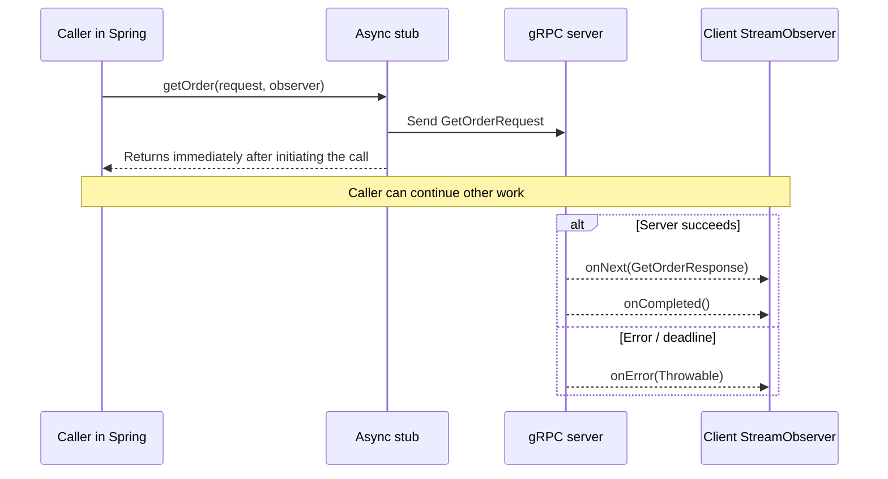

# Async Stub for Unary RPC

## 1. What Problem Does the Async Stub Solve?

In the **Spring gRPC** ecosystem, a **unary RPC** method sends exactly one request message and, on success, receives one response message. However, the client can choose **how to wait for the result**. With a blocking stub, the calling thread waits until the RPC finishes. With an **async stub**, the call initiates the RPC and immediately returns control to the caller; the result or error is delivered later through `StreamObserver` callbacks.

This is useful when a Spring service needs to call gRPC while continuing other work: an API gateway aggregating data from multiple services, an application with asynchronous execution flows, or a system with many I/O-bound calls in flight. An async stub avoids **tying up the calling thread solely to wait for a response**; it does not automatically make the server faster and does not eliminate the need for load management.

Lesson goals:

- Identify and create the asynchronous `*Stub` generated from a `.proto` file for a unary RPC.
- Understand the role and ordering of `StreamObserver` callbacks (`onNext`, `onError`, `onCompleted`).
- Integrate an async stub into Spring, build a `CompletableFuture` API, and handle gRPC statuses cleanly.
- Apply deadlines, cancellation, metadata, TLS, and principles for threading, resources, and retries.
- Test both success and failure outcomes of an asynchronous unary call.

**Illustrative scenario:** a Spring service receives order ID `A-100` and calls `OrderQueryService/GetOrder` to fetch its state and total amount. The lookup happens over the network, but the thread creating the request is not blocked waiting for the response.

## 2. Protocol Buffers Contract and Generated Code

Example `src/main/proto/order_query.proto`:

```proto
syntax = "proto3";

package checkout.v1;

option java_package = "com.example.checkout.grpc";
option java_multiple_files = true;

service OrderQueryService {
  rpc GetOrder(GetOrderRequest) returns (GetOrderResponse);
}

message GetOrderRequest {
  string order_id = 1;
}

message GetOrderResponse {
  string order_id = 1;
  string state = 2;
  int64 total_cents = 3;
}
```

There is no `stream` on either the parameter or the return type of `GetOrder`: this is a **unary RPC**. When the project configures `protoc` with the gRPC Java plugin, the build generates `GetOrderRequest`, `GetOrderResponse`, and `OrderQueryServiceGrpc`. Among these, two commonly used factories are:

```java
// channel has type io.grpc.Channel.
OrderQueryServiceGrpc.OrderQueryServiceBlockingStub blocking =
        OrderQueryServiceGrpc.newBlockingStub(channel);

OrderQueryServiceGrpc.OrderQueryServiceStub async =
        OrderQueryServiceGrpc.newStub(channel);
```

The core difference lies in the generated Java method signatures:

```java
// Blocking unary: returns a response or throws an exception.
GetOrderResponse result = blocking.getOrder(request);

// Async unary: returns void; results are pushed to the observer.
async.getOrder(request, responseObserver);
```

Do not edit generated classes directly, because the next build can overwrite your changes. Whenever you want to change data fields or the RPC style, update the `.proto` contract and regenerate the code.

## 3. Callback Lifecycle of a Unary Call

On the client side, `StreamObserver<GetOrderResponse>` receives three types of events:

| Callback | When it fires | Meaning for unary |
| --- | --- | --- |
| `onNext(GetOrderResponse value)` | A response message arrives. | At most one business response on a valid unary call. |
| `onCompleted()` | The stream ended **successfully**. | Indicates the RPC finished with a success status. |
| `onError(Throwable error)` | The RPC ended **with a failure**. | Contains the gRPC error; no `onCompleted()` follows. |

On a normally completed call, the order is `onNext(response)` followed by `onCompleted()`. If an error occurs before a response is produced, the observer may receive only `onError(error)`. The two terminal callbacks `onCompleted` and `onError` are **mutually exclusive**, and only one of them is invoked per RPC.



"Returns immediately" here means **it does not wait for the network response**. Setting up the call still takes a small amount of local work; with an in-process server or a very fast response, callbacks *may* fire before the caller's next line of code runs. Do not rely on any assumption that callbacks always execute after a fixed delay.

### Direct example with `StreamObserver`

```java
GetOrderRequest request = GetOrderRequest.newBuilder()
        .setOrderId("A-100")
        .build();

stub.withDeadlineAfter(2, TimeUnit.SECONDS)
        .getOrder(request, new StreamObserver<GetOrderResponse>() {
            @Override
            public void onNext(GetOrderResponse response) {
                System.out.println("Order: " + response.getOrderId());
                System.out.println("State: " + response.getState());
            }

            @Override
            public void onError(Throwable error) {
                Status status = Status.fromThrowable(error);
                System.err.println("RPC error: " + status.getCode());
            }

            @Override
            public void onCompleted() {
                System.out.println("RPC completed");
            }
        });

// Calling thread continues; there is no synchronous response to return here.
```

The corresponding imports include `io.grpc.Status`, `io.grpc.stub.StreamObserver`, and `java.util.concurrent.TimeUnit`. In application code, avoid performing long computations or blocking I/O inside callbacks, as doing so can tie up the threads dispatching callbacks. If heavy work or another downstream call is needed, offload it to an appropriate executor.

**Important note:** `onNext` only indicates that the client received the payload, not proof that the entire RPC ended with `OK`. If you are forwarding the result into a future or a downstream step that requires a **confirmed final result**, only complete the future successfully after receiving `onCompleted`.

## 4. Implementing a Sample Server to Test the Async Client

To have a consistent server for the examples below, assume the server application has Spring gRPC integration enabled and uses the `@GrpcService` annotation:

```java
package com.example.checkout.server;

import com.example.checkout.grpc.GetOrderRequest;
import com.example.checkout.grpc.GetOrderResponse;
import com.example.checkout.grpc.OrderQueryServiceGrpc;
import io.grpc.Status;
import io.grpc.stub.StreamObserver;
import org.springframework.grpc.server.service.GrpcService;

@GrpcService
public class DemoOrderGrpcService
        extends OrderQueryServiceGrpc.OrderQueryServiceImplBase {

    @Override
    public void getOrder(GetOrderRequest request,
                         StreamObserver<GetOrderResponse> observer) {
        String id = request.getOrderId().trim();

        if (id.isEmpty()) {
            observer.onError(Status.INVALID_ARGUMENT
                    .withDescription("order_id must not be empty")
                    .asRuntimeException());
            return;
        }

        if (!"A-100".equals(id)) {
            observer.onError(Status.NOT_FOUND
                    .withDescription("Order not found")
                    .asRuntimeException());
            return;
        }

        observer.onNext(GetOrderResponse.newBuilder()
                .setOrderId(id)
                .setState("PAID")
                .setTotalCents(129_900L)
                .build());
        observer.onCompleted();
    }
}
```

The sample server processes requests synchronously with hardcoded data for easy verification. **Using an async stub on the client does not force the server to be asynchronous**; both sides communicate over the same gRPC contract. In a real service, replace the hardcoded data with a business layer and appropriate error handling.

## 5. Creating and Configuring an Async Stub in Spring

The client example uses a channel named `orders`. In `application.properties`:

```properties
spring.grpc.client.channels.orders.address=static://localhost:9090
```

Port `9090` is an example only; it must match the server's port. For connections outside development environments, configure transport credentials/TLS, authentication, and endpoints per environment rather than relying on default plaintext settings.

Register `OrderQueryServiceStub` as a bean:

```java
package com.example.checkout.client;

import com.example.checkout.grpc.OrderQueryServiceGrpc;
import org.springframework.context.annotation.Bean;
import org.springframework.context.annotation.Configuration;
import org.springframework.grpc.client.GrpcChannelFactory;

@Configuration
public class OrderGrpcClientConfig {

    @Bean
    OrderQueryServiceGrpc.OrderQueryServiceStub orderAsyncStub(
            GrpcChannelFactory channelFactory) {
        return OrderQueryServiceGrpc.newStub(
                channelFactory.createChannel("orders"));
    }
}
```

A `Channel` is communication infrastructure shared across many RPCs; **creating an async stub does not mean opening a new connection for each call**. In Spring, use application-managed channels and avoid creating and closing a `ManagedChannel` on every request.

gRPC Java stubs store configuration immutably. Therefore:

```java
OrderQueryServiceGrpc.OrderQueryServiceStub perCallStub =
        stub.withDeadlineAfter(2, TimeUnit.SECONDS);
```

`perCallStub` is a new instance, while the original `stub` bean remains unchanged. This allows sharing the base stub across concurrent requests while setting independent deadlines per call.

## 6. Wrapping Callbacks in a `CompletableFuture`

In Java, `CompletableFuture` is more convenient than nested callbacks when coordinating multiple operations. You can wrap an async `getOrder` call to return a future **without blocking the calling thread**:

```java
package com.example.checkout.client;

import com.example.checkout.grpc.GetOrderRequest;
import com.example.checkout.grpc.GetOrderResponse;
import com.example.checkout.grpc.OrderQueryServiceGrpc;
import io.grpc.Status;
import io.grpc.stub.StreamObserver;
import org.springframework.stereotype.Service;

import java.util.concurrent.CompletableFuture;
import java.util.concurrent.TimeUnit;

@Service
public class OrderAsyncGateway {

    private final OrderQueryServiceGrpc.OrderQueryServiceStub stub;

    public OrderAsyncGateway(OrderQueryServiceGrpc.OrderQueryServiceStub stub) {
        this.stub = stub;
    }

    public CompletableFuture<GetOrderResponse> findById(String orderId) {
        if (orderId == null || orderId.isBlank()) {
            return CompletableFuture.failedFuture(
                    new IllegalArgumentException("orderId must not be empty"));
        }

        GetOrderRequest request = GetOrderRequest.newBuilder()
                .setOrderId(orderId)
                .build();
        CompletableFuture<GetOrderResponse> result = new CompletableFuture<>();

        try {
            stub.withDeadlineAfter(2, TimeUnit.SECONDS)
                    .getOrder(request, new StreamObserver<GetOrderResponse>() {
                        private GetOrderResponse response;

                        @Override
                        public void onNext(GetOrderResponse value) {
                            // Unary has only one response; not yet confirmed as successful.
                            response = value;
                        }

                        @Override
                        public void onError(Throwable error) {
                            result.completeExceptionally(error);
                        }

                        @Override
                        public void onCompleted() {
                            if (response == null) {
                                result.completeExceptionally(Status.INTERNAL
                                        .withDescription("Unary RPC returned no response")
                                        .asRuntimeException());
                            } else {
                                result.complete(response);
                            }
                        }
                    });
        } catch (RuntimeException startError) {
            // Also catch synchronous errors during RPC setup/initiation.
            result.completeExceptionally(startError);
        }

        return result;
    }
}
```

Here `findById` returns `CompletableFuture<GetOrderResponse>` almost immediately after initiating the RPC. If the server sends `onNext(response)` followed by `onCompleted()`, the future completes normally. If the server calls `onError`, the future completes exceptionally. For unary calls, gRPC Java already enforces the response count at the call layer; the code holds onto `response` until the terminal event arrives to make the completion point explicit.

Callers can chain further work onto the future:

```java
CompletableFuture<Boolean> isPaid = gateway.findById("A-100")
        .thenApply(order -> "PAID".equals(order.getState()));

isPaid.whenComplete((paid, error) -> {
    if (error != null) {
        System.err.println("Failed to read order: " + error);
    } else {
        System.out.println("Is paid? " + paid);
    }
});
```

Do not call `join()` or `get()` immediately after creating the future in paths that need to remain asynchronous: both methods block the thread. `join()`/`get()` are useful in tests, CLI programs, or boundary layers explicitly designed to wait for a result, with clear wait limits.

### Which thread runs callbacks and continuations?

An async stub **does not guarantee that callbacks run on a "UI thread" or a Spring request thread**. Callbacks may be dispatched by gRPC's executor. `CompletableFuture`'s `thenApply` and `whenComplete` may execute directly on the thread that completes the future; therefore, do not put heavy computation, blocking database access, or long-running tasks inside default continuations.

When you need to isolate computation from the callback thread, use an application-managed executor:

```java
Executor businessExecutor = /* Executor configured in Spring */;

CompletableFuture<Boolean> result = gateway.findById("A-100")
        .thenApplyAsync(
                order -> "PAID".equals(order.getState()),
                businessExecutor);
```

This snippet illustrates syntax; you must import `java.util.concurrent.Executor` and supply an actual executor bean. Offloading tasks to an executor controls where subsequent work runs; it **does not turn blocking business operations into non-blocking ones**, and still requires bounded queues and thread counts.

## 7. Handling gRPC Statuses in Asynchronous Flows

Inside the `onError(Throwable)` callback, the cause is usually a `StatusRuntimeException`, though general-purpose code should extract the status via `Status.fromThrowable(error)`. When wrapped in a `CompletableFuture`, the exception may appear inside a `CompletionException` or `ExecutionException` depending on the awaiting/combining API. Branch on the **status code**, not on description strings.

```java
gateway.findById("UNKNOWN").whenComplete((order, error) -> {
    if (error == null) {
        System.out.println(order.getState());
        return;
    }

    Throwable cause = error;
    if (cause instanceof java.util.concurrent.CompletionException
            && cause.getCause() != null) {
        cause = cause.getCause();
    }

    Status.Code code = Status.fromThrowable(cause).getCode();
    switch (code) {
        case NOT_FOUND -> System.out.println("Order does not exist");
        case DEADLINE_EXCEEDED -> System.out.println("Query timed out");
        case UNAVAILABLE -> System.out.println("Service temporarily unavailable");
        default -> System.err.println("RPC error: " + code);
    }
});
```

Key status codes to recognize:

| Status code | Common cause | Appropriate action |
| --- | --- | --- |
| `OK` | RPC completed with a response. | Use the received payload. |
| `INVALID_ARGUMENT` | Missing or invalid request data. | Fix input data; do not retry the same request. |
| `NOT_FOUND` | Requested resource does not exist. | Return a not-found state to the caller. |
| `UNAUTHENTICATED` | Missing or invalid authentication info. | Check metadata/credentials. |
| `PERMISSION_DENIED` | Insufficient permissions for the operation. | Check authorization rules. |
| `DEADLINE_EXCEEDED` | Time budget expired. | Record timeout; evaluate whether retry is safe. |
| `UNAVAILABLE` | Connection lost or service temporarily unavailable. | Consider backoff and bounded retries. |
| `INTERNAL` | Unexpected system error. | Log and investigate; avoid exposing internal details. |
| `CANCELLED` | Call was cancelled. | Stop related work if appropriate. |

For errors like `IllegalArgumentException` created locally in the gateway before starting the RPC, these are local Java exceptions: `Status.fromThrowable` may yield `UNKNOWN`. Callers should therefore distinguish input validation errors from gRPC errors when producing accurate business responses.

## 8. Deadlines, Cancellation, and Retries

### Deadlines are always bound to each call

`withDeadlineAfter(2, TimeUnit.SECONDS)` creates a stub whose deadline is measured from **the moment the configuration method is called**. Always create the derived stub right before `getOrder(...)` rather than setting a deadline on a singleton bean at application startup; otherwise, the deadline could expire long before the next RPC.

When a deadline expires, gRPC terminates the client-side call with a status such as `DEADLINE_EXCEEDED`, causing the observer to receive `onError`. This prevents the client from waiting indefinitely, but **does not prove** that server-side work stopped immediately or that all side effects were rolled back. The server and downstream calls must implement cancellation handling, timeouts, and resource limits accordingly.

### `CompletableFuture.cancel()` does not automatically cancel the RPC

In the gateway example above, `CompletableFuture` is an object we created ourselves to represent the result; it does **not** directly control gRPC's underlying `ClientCall`. Consequently:

```java
CompletableFuture<GetOrderResponse> result = gateway.findById("A-100");
result.cancel(true); // Only cancels the sample gateway's future.
```

This does not automatically send a cancellation signal to the in-flight RPC. If the system needs to abort requests when a user cancels, wire the cancellation signal to **gRPC's `Context.CancellableContext`** or use **`ClientResponseObserver` / `ClientCallStreamObserver`** to call `cancel(...)` on the underlying call. Cancellation wiring must handle cases where the future is cancelled before the call is established, and must only cancel resources belonging to **that specific RPC**. Deadlines should still be configured even when active cancellation is supported.

### Retries must be based on business semantics

A unary RPC is not idempotent by default: `GetOrder` can typically be retried, whereas unary `CreateOrder` or `ChargePayment` can cause side effects. When `UNAVAILABLE` or `DEADLINE_EXCEEDED` occurs, you cannot reliably infer whether the server processed the request. Only retry when the contract and business rules permit; use backoff, cap retry attempts, respect the overall deadline, and for retryable write operations design an appropriate **idempotency key**.

## 9. Spring WebFlux Integration, Metadata, and Observability

With Spring MVC, an async stub can be invoked from a controller returning `CompletableFuture` if the web stack's async support is configured properly. With Spring WebFlux, you can adapt the future to a `Mono` using Reactor without calling `block()`:

```java
// When the project uses Reactor and already has OrderAsyncGateway gateway:
Mono<GetOrderResponse> mono =
        Mono.fromFuture(gateway.findById("A-100"));
```

This requires importing `reactor.core.publisher.Mono`. However, because the sample gateway has not wired cancellation to the gRPC call, a subscriber cancelling the `Mono` or cancelling the future **does not guarantee** the underlying RPC is actually cancelled. When running reactive end-to-end, implement an explicit cancellation bridge.

In gRPC, header/trailer **metadata** is transmitted separately from protobuf messages. Clients can send authentication tokens and correlation IDs via credentials or client interceptors; servers inspect them via interceptors or corresponding security mechanisms. Never place access tokens inside `GetOrderRequest`, never log tokens, and never assume an async stub enables TLS automatically. Channels must encrypt and authenticate connections when deployed over untrusted networks; security must be configured at the transport and application layers.

Metrics to observe: in-flight RPC count, call counts by service/method and status, timeout rate, p95/p99 latency, executor saturation, `UNAVAILABLE` errors, and retry counts. Metadata like correlation IDs helps link logs and traces across services. Avoid putting order IDs or tokens into metric labels, as this creates high cardinality or leaks sensitive information.

**Do not store per-request state in shared fields of a singleton bean.** Each RPC should have its own observer/future; the `response` variable in the example is a field of a **newly created** observer instance per call. Reusing a base stub is appropriate, whereas sharing a stateful observer across multiple RPCs risks mixing up results.

## 10. Testing Async Unary RPCs Without Network Ports

You can test `OrderAsyncGateway` over gRPC **in-process**: still using real stubs, real protobufs, and real statuses, while bypassing the socket/TLS layer. The JUnit 5 example below uses `DemoOrderGrpcService` from section 4 and requires a `grpc-inprocess` library version compatible with gRPC Java:

```java
package com.example.checkout.client;

import com.example.checkout.grpc.GetOrderResponse;
import com.example.checkout.grpc.OrderQueryServiceGrpc;
import com.example.checkout.server.DemoOrderGrpcService;
import io.grpc.ManagedChannel;
import io.grpc.Server;
import io.grpc.Status;
import io.grpc.inprocess.InProcessChannelBuilder;
import io.grpc.inprocess.InProcessServerBuilder;
import org.junit.jupiter.api.AfterEach;
import org.junit.jupiter.api.BeforeEach;
import org.junit.jupiter.api.Test;

import java.io.IOException;
import java.util.concurrent.ExecutionException;
import java.util.concurrent.TimeUnit;

import static org.junit.jupiter.api.Assertions.assertEquals;
import static org.junit.jupiter.api.Assertions.assertThrows;

class OrderAsyncGatewayTest {

    private Server server;
    private ManagedChannel channel;
    private OrderAsyncGateway gateway;

    @BeforeEach
    void setUp() throws IOException {
        String name = InProcessServerBuilder.generateName();
        server = InProcessServerBuilder.forName(name)
                .directExecutor()
                .addService(new DemoOrderGrpcService())
                .build()
                .start();

        channel = InProcessChannelBuilder.forName(name)
                .directExecutor()
                .build();

        OrderQueryServiceGrpc.OrderQueryServiceStub stub =
                OrderQueryServiceGrpc.newStub(channel);
        gateway = new OrderAsyncGateway(stub);
    }

    @AfterEach
    void tearDown() {
        channel.shutdownNow();
        server.shutdownNow();
    }

    @Test
    void successfulUnaryCallCompletesFuture() throws Exception {
        GetOrderResponse response = gateway.findById("A-100")
                .get(3, TimeUnit.SECONDS);

        assertEquals("A-100", response.getOrderId());
        assertEquals("PAID", response.getState());
        assertEquals(129_900L, response.getTotalCents());
    }

    @Test
    void notFoundCompletesFutureExceptionally() {
        ExecutionException exception = assertThrows(
                ExecutionException.class,
                () -> gateway.findById("UNKNOWN").get(3, TimeUnit.SECONDS));

        assertEquals(Status.Code.NOT_FOUND,
                Status.fromThrowable(exception.getCause()).getCode());
    }

    @Test
    void emptyIdFailsLocallyBeforeCallingServer() {
        ExecutionException exception = assertThrows(
                ExecutionException.class,
                () -> gateway.findById(" ").get(3, TimeUnit.SECONDS));

        assertEquals(IllegalArgumentException.class,
                exception.getCause().getClass());
    }
}
```

`get(3, TimeUnit.SECONDS)` is used only at the **test assertion boundary** to wait with a bounded timeout. The `findById` API itself still initiates the RPC asynchronously. `directExecutor()` is reasonable for a simple fake server in unit tests; do not infer that heavy blocking operations can run on a direct executor in production.

Scenarios to expand when testing real services:

| Scenario | What to verify |
| --- | --- |
| Valid response returned | Correct payload; future completes normally only after RPC completion. |
| Server returns `INVALID_ARGUMENT`, `NOT_FOUND` | Future completes exceptionally with the matching status. |
| Deadline expires | Observer receives the appropriate error and no future hangs indefinitely. |
| Concurrent RPCs sharing one stub | Each callback/future is isolated per request; no data mixing. |
| Client cancels the task | If cancellation is wired, the underlying RPC is also cancelled. |
| TLS, credentials, interceptors | Integration tests over real connections verifying certificates and metadata. |

In-process tests do not validate Spring channel configuration, TLS, or HTTP/2 over the network. Write separate integration tests when you need to verify those layers.

## 11. Common Design Mistakes

1. **Calling `future.join()` right after invoking the async stub.** This blocks the thread again and defeats most of the benefit of the callback model.
2. **Marking success inside `onNext`.** `onNext` delivers the response, whereas `onCompleted` confirms successful completion; publishing the result before the terminal event can miss end-of-stream errors.
3. **Omitting `onError`.** The client loses error reporting or hangs waiting for a result with no way for callers to diagnose what happened.
4. **Setting a deadline on a singleton stub at startup.** The deadline is measured from stub creation time and can expire before subsequent RPCs; derive the stub at each call site.
5. **Performing blocking or CPU-heavy work inside callbacks.** This holds dispatch threads and increases latency across many calls; use a dedicated executor with bounded load.
6. **Sharing a stateful observer across multiple calls.** Easily mixes up responses and callbacks; create a new observer per RPC while sharing the channel and base stub where appropriate.
7. **Assuming cancelling `CompletableFuture` automatically cancels the call.** With a custom bridge, you must wire cancellation down to `ClientCall` or gRPC `Context`.
8. **Retrying every unary call.** Unary describes the request/response shape, not idempotency; retries can repeat side effects.

## 12. Practice Exercise

1. From the `OrderQueryService` contract, implement `findById` using `OrderQueryServiceStub` to return `CompletableFuture<GetOrderResponse>`. Create a separate observer per request and set a two-second deadline right before the call.
2. Write a method `isPaidAsync(String orderId)` returning `CompletableFuture<Boolean>` via `thenApply` without calling `get()` or `join()` in business logic.
3. Write tests for order `A-100`, a non-existent ID, an empty ID, and a server intentionally returning an error. Prove that the future succeeds only after the terminal callback, and errors take the exception branch.
4. Extend the experiment to invoke 20 concurrent RPCs through the same stub bean; observe in-flight RPC counts, completion times, and callback independence per call.

**Knowledge self-check:** `OrderQueryServiceGrpc.newStub(channel)` creates an **async stub**; `stub.getOrder(request, observer)` starts a unary RPC without waiting for the network response. On a successful call, the observer receives one response via `onNext` and a completion signal via `onCompleted`; on a failed call, it receives `onError`. When integrating with Spring, manage channels, per-RPC deadlines, callback threads, security, and cancellation so asynchronous calls operate reliably.
