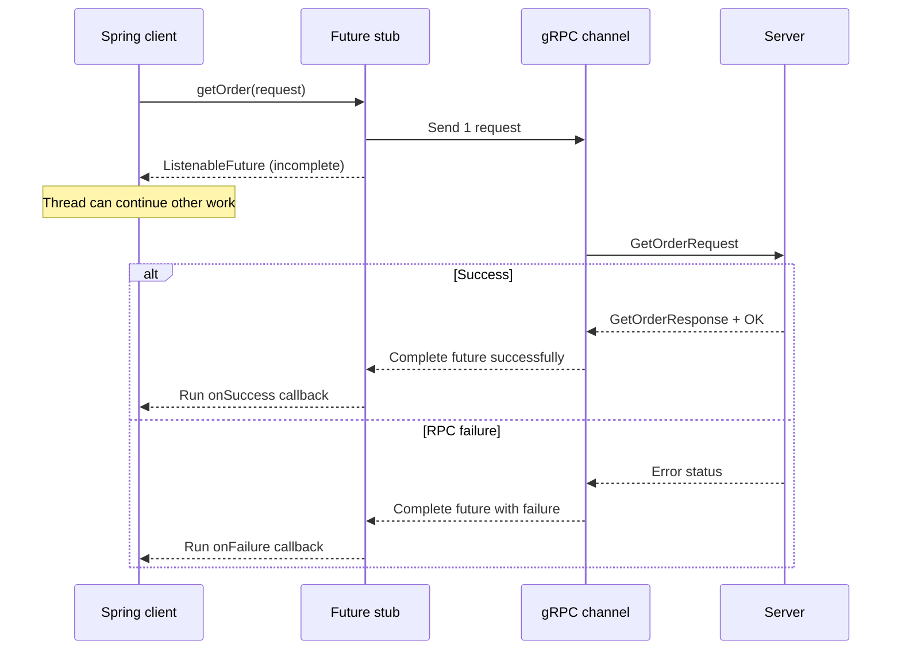

# Future Stub and Asynchronous Results

## 1. What Problem Does the Future Stub Solve?

In the **Spring gRPC** ecosystem, a **unary RPC** method takes exactly one request message and, if successful, returns one response message. When calling with a **blocking stub**, the client thread waits for the response before continuing. A **future stub** lets the client initiate the RPC and **immediately receive an object representing the result that will arrive in the future**; the calling thread can perform other work while the network and server process the request.

For example, a payment aggregation service needs to query a gRPC server for order details. Instead of tying up a thread waiting for `GetOrder`, the client can receive a `ListenableFuture<GetOrderResponse>`, register a callback to handle completion, or compose the future with other tasks. Future stubs are generated from the Protocol Buffers contract; you do not need to build the HTTP/2 layer manually.

By the end of this lesson, you will be able to:

- Recognize `OrderQueryServiceFutureStub` and methods returning `ListenableFuture`.
- Integrate a future stub into Spring using a centrally managed channel.
- Set individual deadlines per unary call and handle results with callbacks without calling `get()` on request-serving threads.
- Distinguish successful results, error gRPC statuses, call cancellation, and timeouts while awaiting a future.
- Compose asynchronous results, convert to `CompletableFuture` when needed, and test with an in-process gRPC server.

### Where is the asynchrony?

`futureStub.getOrder(request)` **returns a future quickly**; it does not wait for business data from the server. When the call finishes, the future completes:

| RPC outcome | Future state | What the client observes |
| --- | --- | --- |
| Server sends one response and ends with `OK` | Succeeded | Receives one `GetOrderResponse`. |
| Server returns `NOT_FOUND`, `INVALID_ARGUMENT`, or another error status | Failed | Future holds the gRPC failure cause, usually a `StatusRuntimeException`. |
| Client or task actively cancels | Cancelled | May observe `CancellationException`; cancellation is propagated down to the RPC where possible. |
| gRPC deadline expires | Failed | Typically receives `DEADLINE_EXCEEDED`. |

`ListenableFuture` does not make the **server** produce more than one response; the contract is still unary. It only changes how the **client** receives the result.



## 2. Protocol Buffers Contract and Generated Java Code

Suppose the project has `src/main/proto/order_query.proto`:

```proto
syntax = "proto3";

package checkout.v1;

option java_package = "com.example.checkout.grpc";
option java_multiple_files = true;

service OrderQueryService {
  rpc GetOrder (GetOrderRequest) returns (GetOrderResponse);
}

message GetOrderRequest {
  string order_id = 1;
}

message GetOrderResponse {
  string order_id = 1;
  string state = 2;
  int64 total_cents = 3;
}
```

Because there is no `stream` keyword in the declaration, `GetOrder` is a unary RPC. After configuring and running `protoc` with the gRPC Java plugin, the generated classes include:

| Class | Meaning |
| --- | --- |
| `GetOrderRequest`, `GetOrderResponse` | Java message types generated from protobuf. |
| `OrderQueryServiceGrpc.OrderQueryServiceImplBase` | Base class for the server to implement handlers. |
| `OrderQueryServiceGrpc.OrderQueryServiceBlockingStub` | Client that invokes unary calls and waits synchronously. |
| `OrderQueryServiceGrpc.OrderQueryServiceStub` | Client that receives results via `StreamObserver`. |
| `OrderQueryServiceGrpc.OrderQueryServiceFutureStub` | Unary client that receives results as a `ListenableFuture`. |

Create a future stub from a channel:

```java
OrderQueryServiceGrpc.OrderQueryServiceFutureStub futureStub =
        OrderQueryServiceGrpc.newFutureStub(channel);

ListenableFuture<GetOrderResponse> result =
        futureStub.getOrder(GetOrderRequest.newBuilder()
                .setOrderId("A-100")
                .build());
```

`ListenableFuture` belongs to **Guava** (`com.google.common.util.concurrent.ListenableFuture`), which is used in gRPC Java's future stub API. Unlike `java.util.concurrent.CompletableFuture`, it provides listener registration and is built directly into generated future stubs. You can use `Futures.addCallback(...)` to get notified upon completion.

> **Scope:** gRPC Java's future stub is for unary methods. For client streaming or bidirectional streaming, use the async stub and `StreamObserver`; do not treat future stubs as a replacement for all streaming styles.

## 3. Creating a Future Stub in a Spring Application

In Spring gRPC, `GrpcChannelFactory` supplies named channels from configuration. For example, a client calling a test server on port `9090`:

```properties
# Client application's application.properties
spring.grpc.client.channels.orders.address=static://localhost:9090
```

Create a singleton bean holding the **base stub**:

```java
package com.example.checkout.client;

import com.example.checkout.grpc.OrderQueryServiceGrpc;
import org.springframework.context.annotation.Bean;
import org.springframework.context.annotation.Configuration;
import org.springframework.grpc.client.GrpcChannelFactory;

@Configuration
public class OrderGrpcClientConfiguration {

    @Bean
    OrderQueryServiceGrpc.OrderQueryServiceFutureStub orderFutureStub(
            GrpcChannelFactory channelFactory) {
        return OrderQueryServiceGrpc.newFutureStub(
                channelFactory.createChannel("orders"));
    }
}
```

The example assumes the project declares compatible Spring gRPC, gRPC Java, and code-generation plugin dependencies. Spring gRPC integrates and manages channels according to the version in use; **a stub is just a configuration wrapper around a channel**, not a new TCP connection for each call.

Two important notes:

1. The name `"orders"` in `createChannel("orders")` must match the channel configuration. In real deployments, address, name resolution, and TLS security must be configured to match the server.
2. `AbstractStub` and generated stubs are **immutable** by design. Calls like `withDeadlineAfter(...)`, `withCallCredentials(...)`, or `withInterceptors(...)` return a **new stub**. You can share the base bean and derive per-RPC stubs without overwriting settings for other calls.

## 4. Making a Unary Call with a Future Stub

Create a Spring service returning `ListenableFuture` directly so the upper layer decides how to coordinate the result:

```java
package com.example.checkout.client;

import com.example.checkout.grpc.GetOrderRequest;
import com.example.checkout.grpc.GetOrderResponse;
import com.example.checkout.grpc.OrderQueryServiceGrpc;
import com.google.common.util.concurrent.ListenableFuture;
import org.springframework.stereotype.Service;

import java.util.concurrent.TimeUnit;

@Service
public class AsyncOrderReader {

    private final OrderQueryServiceGrpc.OrderQueryServiceFutureStub stub;

    public AsyncOrderReader(
            OrderQueryServiceGrpc.OrderQueryServiceFutureStub stub) {
        this.stub = stub;
    }

    public ListenableFuture<GetOrderResponse> findById(String orderId) {
        if (orderId == null || orderId.isBlank()) {
            throw new IllegalArgumentException("orderId must not be empty");
        }

        GetOrderRequest request = GetOrderRequest.newBuilder()
                .setOrderId(orderId)
                .build();

        // Deadline is set right before each RPC; the base stub bean stays unchanged.
        return stub.withDeadlineAfter(1500, TimeUnit.MILLISECONDS)
                .getOrder(request);
    }
}
```

Calling `findById("A-100")` returns a future **without waiting** for the business response. Nevertheless, building the request, selecting the channel, and initiating the call still happen synchronously in a very short window; do not interpret future stubs as a guarantee that every line of setup takes zero time.

### Receiving results via callback

Guava provides `Futures.addCallback`:

```java
import com.example.checkout.grpc.GetOrderResponse;
import com.google.common.util.concurrent.FutureCallback;
import com.google.common.util.concurrent.Futures;
import com.google.common.util.concurrent.ListenableFuture;
import io.grpc.Status;

import java.util.concurrent.Executor;

// asyncOrderReader: AsyncOrderReader bean from the example above.
// callbackExecutor: executor managed separately for handling results.
ListenableFuture<GetOrderResponse> pending =
        asyncOrderReader.findById("A-100");

Futures.addCallback(pending, new FutureCallback<GetOrderResponse>() {
    @Override
    public void onSuccess(GetOrderResponse response) {
        System.out.println("Order: " + response.getOrderId());
        System.out.println("State: " + response.getState());
    }

    @Override
    public void onFailure(Throwable failure) {
        Status status = Status.fromThrowable(failure);
        System.err.println("RPC failed: " + status.getCode());
    }
}, callbackExecutor);
```

The outcome is delivered to exactly **one** callback branch: `onSuccess` if the future completes normally, `onFailure` if it fails (which can include cancellation). `Status.fromThrowable(...)` extracts the gRPC status from the cause chain when present; if none exists, it returns the generic `UNKNOWN` code. For local cancellations, check the future's cancelled state before concluding it is a server error.

**The executor determines where callbacks run.** Guava does not automatically guarantee callbacks run on the caller's thread. If you use `MoreExecutors.directExecutor()`, the callback may run on the thread completing the RPC, or immediately if the future is already done at registration time. Only use a direct executor for very short, non-blocking operations. For complex logic, use a Spring-managed executor with bounded resources and an overload policy.

Never put database reads, synchronous HTTP calls, large file writes, or `future.get()` inside a callback running on an RPC completion thread. Such operations can stall processing for other calls.

## 5. Transforming Futures to Coordinate Business Logic

Not every caller needs to process the entire protobuf response directly. Guava's `Futures.transform` maps one future's result into another future's result:

```java
import com.google.common.util.concurrent.Futures;
import com.google.common.util.concurrent.ListenableFuture;
import com.google.common.util.concurrent.MoreExecutors;

public ListenableFuture<Boolean> isPaidAsync(String orderId) {
    return Futures.transform(
            asyncOrderReader.findById(orderId),
            response -> "PAID".equals(response.getState()),
            MoreExecutors.directExecutor()
    );
}
```

The mapping function here only performs a quick string comparison, so a direct executor is appropriate. If the source future fails with `NOT_FOUND` or `UNAVAILABLE`, the transformed future also fails; it does **not** silently turn an RPC error into `false`. This is an important property: "order unpaid" is different from "unable to query order".

To chain dependent RPCs asynchronously, use `Futures.transformAsync` and return another `ListenableFuture`. For example: fetch order details, then use `customer_id` to invoke a customer lookup unary RPC. When designing such chains, think about the overall deadline and cascading cancellation; do not grant a full fresh timeout to every step such that total time exceeds the parent request's budget.

### Coordinating two independent calls

Suppose you need to fetch orders `A-100` and `B-200` concurrently:

```java
ListenableFuture<GetOrderResponse> first =
        asyncOrderReader.findById("A-100");
ListenableFuture<GetOrderResponse> second =
        asyncOrderReader.findById("B-200");

ListenableFuture<java.util.List<GetOrderResponse>> both =
        Futures.allAsList(first, second);
```

Both RPCs are initiated independently; `both` succeeds when both succeed, and fails if either call fails. This is convenient for independent requests, but **does not replace concurrency management**: fanning out thousands of RPCs simultaneously still requires capping in-flight calls, connections, and load on the target service. Note that `allAsList` does not automatically cancel remaining RPCs just because one failed; manage cancellation according to your system policy.

## 6. Deadlines, Wait Timeouts, and Cancellation

Futures introduce two easily confused kinds of timeouts:

| Concept | Where it is set | What happens |
| --- | --- | --- |
| **gRPC call deadline** | `stub.withDeadlineAfter(1500, TimeUnit.MILLISECONDS)` | Limits RPC duration; on expiration, the call typically fails with `DEADLINE_EXCEEDED` and cancellation is triggered. |
| **Future wait timeout** | `future.get(2, TimeUnit.SECONDS)` | Only limits how long **the thread calling `get` may wait**; timing out on the wait does not automatically cancel the RPC. |

In asynchronous execution paths, prefer **RPC deadlines and callbacks** over calling `get` just to wait. In synchronous code at a boundary that must extract the result, you can use `get(timeout, unit)` and handle exceptions:

```java
ListenableFuture<GetOrderResponse> future =
        asyncOrderReader.findById("A-100");

try {
    GetOrderResponse response = future.get(2, TimeUnit.SECONDS);
    System.out.println(response.getState());
} catch (java.util.concurrent.TimeoutException timeout) {
    future.cancel(true); // Actively request cancellation of the still-pending RPC.
    throw new IllegalStateException("Timed out waiting for result", timeout);
} catch (InterruptedException interrupted) {
    future.cancel(true);
    Thread.currentThread().interrupt(); // Preserve interrupted status.
    throw new IllegalStateException("Thread interrupted", interrupted);
} catch (java.util.concurrent.ExecutionException failed) {
    io.grpc.Status status = io.grpc.Status.fromThrowable(failed.getCause());
    throw new IllegalStateException(
            "RPC failed: " + status.getCode(), failed.getCause());
}
```

The snippet above **blocks** at `get`, so it only illustrates a synchronous boundary or test code, not ideal usage on a Spring WebFlux event loop. `ExecutionException` is `Future#get()`'s wrapper; when using callbacks, the failure cause normally arrives directly via `onFailure(Throwable)`.

If the client calls `future.cancel(true)`, the future is marked cancelled when cancellation succeeds and gRPC Java attempts to cancel the corresponding RPC. The `true` argument is a hint to the `Future` mechanism; it **does not guarantee** the server thread is interrupted immediately, database work stops, or a transaction rolls back. Servers executing long-running operations must check the appropriate cancellation context and stop unnecessary work.

**Do not apply blind retries** merely because an RPC is unary. For operations like `CreateOrder` or payments, the server may have already persisted data even if the client receives `DEADLINE_EXCEEDED` or `UNAVAILABLE`. Safe retries require classifying status codes, bounding attempt counts/durations, and using idempotency keys whenever operations have side effects.

## 7. Converting to CompletableFuture When the System Needs JDK APIs

Many Java/Spring components use `CompletionStage` or `CompletableFuture`, whereas gRPC's future stub exposes Guava's `ListenableFuture`. You can bridge them with a callback:

```java
package com.example.checkout.client;

import com.google.common.util.concurrent.FutureCallback;
import com.google.common.util.concurrent.Futures;
import com.google.common.util.concurrent.ListenableFuture;

import java.util.concurrent.CancellationException;
import java.util.concurrent.CompletableFuture;
import java.util.concurrent.Executor;

public final class FutureAdapters {

    private FutureAdapters() {}

    public static <T> CompletableFuture<T> toCompletableFuture(
            ListenableFuture<T> source, Executor callbackExecutor) {

        CompletableFuture<T> target = new CompletableFuture<>();

        Futures.addCallback(source, new FutureCallback<T>() {
            @Override
            public void onSuccess(T value) {
                target.complete(value);
            }

            @Override
            public void onFailure(Throwable failure) {
                if (failure instanceof CancellationException) {
                    target.cancel(false);
                } else {
                    target.completeExceptionally(failure);
                }
            }
        }, callbackExecutor);

        // Cancelling the CompletableFuture also requests cancellation of the underlying RPC.
        target.whenComplete((value, failure) -> {
            if (target.isCancelled()) {
                source.cancel(true);
            }
        });

        return target;
    }
}
```

Usage:

```java
CompletableFuture<GetOrderResponse> response =
        FutureAdapters.toCompletableFuture(
                asyncOrderReader.findById("A-100"),
                callbackExecutor);

CompletableFuture<String> state =
        response.thenApply(GetOrderResponse::getState);
```

In this adapter, converting the result remains non-blocking. When `target` is cancelled, it requests cancellation on the source gRPC future. Whether cancellation propagates from other **derived** futures like `state` depends on how the `CompletableFuture` chain is structured; do not assume cancelling any arbitrary stage automatically cancels the RPC. Choose the executor according to the callback's nature to avoid running heavy business logic on a transport completion thread.

### Future stub and Spring WebFlux

Future stubs are especially helpful when an application needs to keep event-loop threads unblocked. However, to return a `Mono` in Reactor, **bridging and cancellation handling** must be explicit; never call `future.get()` inside a WebFlux controller. You can use the adapter above and then `Mono.fromFuture(...)` when the project includes Reactor and compatible API versions. Verify propagation of cancellation, trace context, and callback executors across conversion layers, especially when clients disconnect early.

## 8. Sample Server and Testing Asynchronous Behavior

To test end-to-end at the gRPC Java layer, use a simple server with success and error branches:

```java
package com.example.checkout.server;

import com.example.checkout.grpc.GetOrderRequest;
import com.example.checkout.grpc.GetOrderResponse;
import com.example.checkout.grpc.OrderQueryServiceGrpc;
import io.grpc.Status;
import io.grpc.stub.StreamObserver;

public class DemoOrderService
        extends OrderQueryServiceGrpc.OrderQueryServiceImplBase {

    @Override
    public void getOrder(GetOrderRequest request,
                         StreamObserver<GetOrderResponse> observer) {
        if (request.getOrderId().isBlank()) {
            observer.onError(Status.INVALID_ARGUMENT
                    .withDescription("Invalid order_id")
                    .asRuntimeException());
            return;
        }
        if (!"A-100".equals(request.getOrderId())) {
            observer.onError(Status.NOT_FOUND
                    .withDescription("Order not found")
                    .asRuntimeException());
            return;
        }

        observer.onNext(GetOrderResponse.newBuilder()
                .setOrderId("A-100")
                .setState("PAID")
                .setTotalCents(129_900L)
                .build());
        observer.onCompleted();
    }
}
```

Testing with `InProcessServerBuilder` and `InProcessChannelBuilder` avoids opening TCP ports. Inside **tests**, calling `get(timeout)` is appropriate to bound wait time and verify outcomes; main business flows should still use callbacks or composition when asynchrony is needed:

```java
package com.example.checkout.client;

import com.example.checkout.grpc.GetOrderRequest;
import com.example.checkout.grpc.GetOrderResponse;
import com.example.checkout.grpc.OrderQueryServiceGrpc;
import com.example.checkout.server.DemoOrderService;
import com.google.common.util.concurrent.ListenableFuture;
import io.grpc.ManagedChannel;
import io.grpc.Server;
import io.grpc.Status;
import io.grpc.StatusRuntimeException;
import io.grpc.inprocess.InProcessChannelBuilder;
import io.grpc.inprocess.InProcessServerBuilder;
import org.junit.jupiter.api.AfterEach;
import org.junit.jupiter.api.BeforeEach;
import org.junit.jupiter.api.Test;

import java.io.IOException;
import java.util.concurrent.ExecutionException;
import java.util.concurrent.TimeUnit;

import static org.junit.jupiter.api.Assertions.assertEquals;
import static org.junit.jupiter.api.Assertions.assertThrows;

class FutureUnaryRpcTest {

    private Server server;
    private ManagedChannel channel;
    private OrderQueryServiceGrpc.OrderQueryServiceFutureStub stub;

    @BeforeEach
    void setUp() throws IOException {
        String name = InProcessServerBuilder.generateName();
        server = InProcessServerBuilder.forName(name)
                .directExecutor()
                .addService(new DemoOrderService())
                .build()
                .start();
        channel = InProcessChannelBuilder.forName(name)
                .directExecutor()
                .build();
        stub = OrderQueryServiceGrpc.newFutureStub(channel);
    }

    @AfterEach
    void tearDown() {
        channel.shutdownNow();
        server.shutdownNow();
    }

    @Test
    void returnsOneResponseForKnownOrder() throws Exception {
        ListenableFuture<GetOrderResponse> future =
                stub.withDeadlineAfter(1, TimeUnit.SECONDS)
                        .getOrder(GetOrderRequest.newBuilder()
                                .setOrderId("A-100")
                                .build());

        GetOrderResponse response = future.get(2, TimeUnit.SECONDS);
        assertEquals("A-100", response.getOrderId());
        assertEquals("PAID", response.getState());
        assertEquals(129_900L, response.getTotalCents());
    }

    @Test
    void propagatesNotFoundStatus() {
        ListenableFuture<GetOrderResponse> future =
                stub.withDeadlineAfter(1, TimeUnit.SECONDS)
                        .getOrder(GetOrderRequest.newBuilder()
                                .setOrderId("UNKNOWN")
                                .build());

        ExecutionException failure = assertThrows(
                ExecutionException.class,
                () -> future.get(2, TimeUnit.SECONDS));

        assertEquals(Status.Code.NOT_FOUND,
                Status.fromThrowable(failure.getCause()).getCode());
    }

    @Test
    void propagatesInvalidArgumentStatus() {
        ListenableFuture<GetOrderResponse> future =
                stub.withDeadlineAfter(1, TimeUnit.SECONDS)
                        .getOrder(GetOrderRequest.newBuilder().build());

        ExecutionException failure = assertThrows(
                ExecutionException.class,
                () -> future.get(2, TimeUnit.SECONDS));

        assertEquals(Status.Code.INVALID_ARGUMENT,
                Status.fromThrowable(failure.getCause()).getCode());
    }
}
```

The example requires JUnit Jupiter and `grpc-inprocess` compatible with the project's gRPC Java version. Even though the test runs locally and fast, **do not assume the future is still incomplete immediately after the method returns**: the server may respond before the test checks `isDone()`. To reliably verify asynchrony or cancellation, use a fake server whose completion timing is controlled via synchronization primitives or a controllable scheduler, avoiding `Thread.sleep(...)` and arbitrary timings.

In-process testing verifies payloads, statuses, and future completion, but does not test TLS, TCP, real HTTP/2, or Spring's `GrpcChannelFactory` configuration. Those require integration tests starting the application and real gRPC transport.

### Additional scenarios to test

| Scenario | Expected outcome |
| --- | --- |
| Server responds after a controlled delay | `getOrder` returns the future immediately; callback runs only after completion. |
| Server returns `NOT_FOUND` | `onFailure` callback or `Future#get` receives the exact status code. |
| Deadline expires before server responds | Future fails with `DEADLINE_EXCEEDED`. |
| Client cancels future before server replies | Future enters cancelled state and RPC receives cancel request; server is not expected to roll back automatically. |
| Multiple RPCs on the same future stub bean | Requests, responses, deadlines, and callbacks do not interfere with each other. |
| Missing auth metadata or invalid TLS | Integration test produces appropriate status/handshake error without leaking sensitive tokens. |

## 9. Reliability, Security, and Observability

Using a future stub does not automatically solve operational challenges of distributed systems:

- **Metadata and credentials:** Send tokens, correlation IDs, or tenant context via metadata/`CallCredentials` or interceptors per system design. Avoid stuffing access tokens into business protobuf messages or printing tokens in logs.
- **TLS:** Configure the channel and certificates to match the server. A failed future can also result from a failure to establish a secure connection, not only `GetOrder` logic.
- **Deadlines and retries:** Set deadlines close to sending the RPC, account for the parent request's time budget, and retry transient errors only when operations are idempotent or protected against duplicates.
- **Concurrent load:** A future stub does not occupy an application thread per pending result, yet thousands of futures still place load on the channel, server, memory, and callback queues. Enforce in-flight RPC limits and backpressure at the orchestration layer.
- **Observability:** Record metrics for RPC counts, status codes, latency, in-flight calls, and timeouts; use tracing/interceptors to correlate request chains across services. Do not put order IDs or tokens into metric labels with excessive cardinality.
- **Callback executor:** Provision an executor with adequate capacity, monitor queue depth and task failures; avoid blocking transport threads, and avoid creating a new executor per RPC and forgetting to shut it down.

## 10. How Does Future Stub Differ from Blocking and Async Stubs?

| Criterion | Blocking stub | Future stub | Async stub |
| --- | --- | --- | --- |
| Calling unary | `GetOrderResponse r = stub.getOrder(req)` | `ListenableFuture<GetOrderResponse> f = stub.getOrder(req)` | `stub.getOrder(req, observer)` |
| Calling thread waits for result? | Yes, until completion/error. | No, unless explicitly calling `get()`. | No; received via observer. |
| How results are handled | Return/exception | Callbacks, listeners, future composition | `onNext`, `onError`, `onCompleted` |
| Suitable for bidirectional streaming? | No | No | Yes |
| Key concerns | Thread pools, wait timeouts | Executors, cancellation, future chains | Observer lifecycle, backpressure/flow control |

Future stubs are especially well suited for **unary RPCs** when results need to be composed asynchronously using callbacks or futures. If the execution flow is naturally synchronous and small, a blocking stub may be easier to maintain. If streaming is required, an async stub is the right choice.

## 11. Self-Check Exercise

Create a Spring service using `OrderQueryServiceFutureStub` with two methods:

1. `findById(String id)` returning `ListenableFuture<GetOrderResponse>`, setting a 1.5-second deadline right before each RPC.
2. `isPaidAsync(String id)` returning `ListenableFuture<Boolean>` via `Futures.transform`; on `NOT_FOUND` or `UNAVAILABLE`, preserve the failure branch so the caller can decide rather than returning `false` as if the order were unpaid.

Write tests for a valid request, an empty ID, a non-existent ID, and a mock server that intentionally finishes past the deadline. Then test `cancel` behavior as well as using a single stub bean across multiple concurrent calls. For each test, assert the **response contents or final status code**, without relying on arbitrary thread scheduling order.

**Takeaway:** `newFutureStub(channel)` creates a unary client returning `ListenableFuture`. Invoke the RPC, register callbacks or transform the future for downstream handling; use `get()` only at boundaries that genuinely require blocking. In Spring gRPC, reuse channels, set per-call deadlines, manage cancellation and callback resources, and keep RPC errors distinct from business outcomes.
