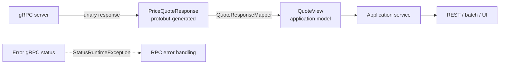

# Mapping Responses Back to Application Models

## 1. Goal: Return Domain Data Instead of Protobuf Messages

In **Spring gRPC**, a **unary RPC** sends one request and, on success, receives one response defined by Protocol Buffers. The generated Java stub returns a class such as `PriceQuoteResponse`; while suited for wire transmission, it is rarely ideal for direct use in the business layer.

For example, the server returns the total amount as `int64 total_minor_units` and the currency code as `string currency_code`. The Java application wants to work with those two values as a `Money` object holding a `Currency`, receive the quote expiration as an `Instant`, and treat the state as an internal enum. A **response mapper** performs this validated transformation at the client boundary.



The mapper only runs after the client receives a **successful** unary response. If gRPC returns an error status such as `NOT_FOUND`, `UNAVAILABLE`, or `DEADLINE_EXCEEDED`, the blocking stub throws `StatusRuntimeException`; that is a separate execution branch, not an "empty response to map".

After this lesson, you will be able to:

- Design an application model decoupled from generated protobuf classes.
- Convert `string` to `UUID`/`Currency`, `int64` to currency-aware monetary amounts, proto enums to domain enums, and `Timestamp` to `Instant`.
- Accurately preserve **presence** for `optional` fields, message fields, and `repeated` lists.
- Handle missing/invalid response data or unknown enum values with meaningful errors instead of substituting misleading defaults.
- Integrate a mapper into a Spring gRPC client, distinguish mapping errors from gRPC statuses, and test and monitor reliability.

**Core principle:** the application layer should receive strongly typed domain models; data off the wire must be interpreted and validated before entering the rest of the application.

## 2. Unary RPC Protobuf Contract

Suppose the quoting service defines its contract in `src/main/proto/pricing.proto`:

```proto
syntax = "proto3";

package pricing.v1;

option java_package = "com.example.pricing.grpc";
option java_multiple_files = true;

import "google/protobuf/timestamp.proto";

service PricingService {
  rpc GetQuote (PriceQuoteRequest) returns (PriceQuoteResponse);
}

message PriceQuoteRequest {
  string product_id = 1;
  int32 quantity = 2;
  string currency_code = 3;
}

enum QuoteStateProto {
  QUOTE_STATE_UNSPECIFIED = 0;
  QUOTE_STATE_AVAILABLE = 1;
  QUOTE_STATE_EXPIRED = 2;
}

message PriceQuoteLine {
  string sku = 1;
  int32 quantity = 2;
  int64 subtotal_minor_units = 3;
}

message PriceQuoteResponse {
  string quote_id = 1;
  string product_id = 2;
  int64 total_minor_units = 3;
  string currency_code = 4;
  QuoteStateProto state = 5;
  google.protobuf.Timestamp valid_until = 6;
  repeated PriceQuoteLine lines = 7;
  optional string notice = 8;
}
```

`GetQuote` is **unary** because neither side declares the `stream` keyword. After `protoc` and the gRPC Java plugin generate code, the client can invoke:

```java
PriceQuoteResponse response = blockingStub
        .getQuote(request);
```

In the generated Java code, the response exposes these characteristic methods:

| Protobuf field | How to read | Meaning when mapping to application model |
| --- | --- | --- |
| `quote_id`, `product_id` | `getQuoteId()`, `getProductId()` | Parse canonical string into `UUID`; fail if invalid. |
| `total_minor_units` | `getTotalMinorUnits()` | Returns `long`, preserving minor units alongside currency. |
| `currency_code` | `getCurrencyCode()` | Validate and convert code to `java.util.Currency`. |
| `state` | `getState()` / `getStateValue()` | Explicit enum mapping; handle `UNSPECIFIED` and unknown future values. |
| `valid_until` | `hasValidUntil()` / `getValidUntil()` | Timestamp may be present or absent; convert `Timestamp` to `Instant`. |
| `lines` | `getLinesList()` / `getLinesCount()` | Map each item and return an immutable list. |
| `notice` | `hasNotice()` / `getNotice()` | Preserve distinction between absent field and empty string. |

Protobuf allows messages that are **syntactically** valid while containing values invalid for the application, such as `quote_id = ""`, `state = QUOTE_STATE_UNSPECIFIED`, or `currency_code = "???"`. Therefore, **successfully parsing a message does not mean the business data is valid**.

## 3. Designing the Application Model for Mapped Data

In the application layer, we want:

- Identifiers typed as `UUID` so business code does not repeatedly parse strings.
- Monetary values paired with `Currency` to prevent unit confusion.
- State represented as a domain enum, independent of protobuf enums.
- Expiration time and notice allowed to be absent, represented using `Optional`.
- Detail lines stored in an immutable `List`.

Example Java types in package `com.example.pricing.application`:

```java
// QuoteState.java
package com.example.pricing.application;

public enum QuoteState {
    AVAILABLE,
    EXPIRED
}
```

```java
// Money.java
package com.example.pricing.application;

import java.util.Currency;
import java.util.Objects;

public record Money(long minorUnits, Currency currency) {
    public Money {
        Objects.requireNonNull(currency, "currency");
    }
}
```

```java
// QuoteLineView.java
package com.example.pricing.application;

public record QuoteLineView(
        String sku,
        int quantity,
        long subtotalMinorUnits
) {}
```

```java
// QuoteView.java
package com.example.pricing.application;

import java.time.Instant;
import java.util.List;
import java.util.Objects;
import java.util.Optional;
import java.util.UUID;

public record QuoteView(
        UUID quoteId,
        UUID productId,
        Money total,
        QuoteState state,
        Optional<Instant> validUntil,
        List<QuoteLineView> lines,
        Optional<String> notice
) {
    public QuoteView {
        Objects.requireNonNull(quoteId, "quoteId");
        Objects.requireNonNull(productId, "productId");
        Objects.requireNonNull(total, "total");
        Objects.requireNonNull(state, "state");
        Objects.requireNonNull(validUntil, "validUntil");
        Objects.requireNonNull(lines, "lines");
        Objects.requireNonNull(notice, "notice");
        lines = List.copyOf(lines);
    }
}
```

`Money` stores an **integer count of minor units**. For instance, under a convention with two decimal places, `1234` minor units represent `12.34` major currency units. Avoid converting prematurely to `double` for calculations or formatting: binary floating-point representation errors can corrupt monetary values. Handling decimal precision must follow the contract and currency rules; never assume every currency uses two decimal places.

We deliberately chose `Optional<String> notice`. `Optional.empty()` means the server **did not send the field**; `Optional.of("")` means the server **sent an empty string**. If business logic does not need to distinguish the two cases, normalize in the mapper, but document the rule explicitly to avoid accidental loss of semantics.

None of these records import `com.example.pricing.grpc.*`. As a result, changes to the wire transport have minimal impact on business logic and presentation layers.

## 4. Implementing the Response Mapper with Explicit Conversions

The mapper acts like a pure function: it takes `PriceQuoteResponse`, checks required invariants, and constructs `QuoteView`. If the returned data violates the application contract, it throws a dedicated exception to distinguish it from RPC errors.

Create `InvalidRemoteResponseException.java`:

```java
package com.example.pricing.client;

public class InvalidRemoteResponseException extends RuntimeException {
    public InvalidRemoteResponseException(String message) {
        super(message);
    }

    public InvalidRemoteResponseException(
            String message, Throwable cause) {
        super(message, cause);
    }
}
```

Create `QuoteResponseMapper.java`:

```java
package com.example.pricing.client;

import com.example.pricing.application.Money;
import com.example.pricing.application.QuoteLineView;
import com.example.pricing.application.QuoteState;
import com.example.pricing.application.QuoteView;
import com.example.pricing.grpc.PriceQuoteLine;
import com.example.pricing.grpc.PriceQuoteResponse;
import com.example.pricing.grpc.QuoteStateProto;
import com.google.protobuf.Timestamp;
import com.google.protobuf.util.Timestamps;
import org.springframework.stereotype.Component;

import java.time.Instant;
import java.util.ArrayList;
import java.util.Currency;
import java.util.List;
import java.util.Objects;
import java.util.Optional;
import java.util.UUID;

@Component
public class QuoteResponseMapper {

    private static final int MAX_LINES = 500;

    public QuoteView toApplication(PriceQuoteResponse response) {
        Objects.requireNonNull(response, "response");

        UUID quoteId = parseUuid(response.getQuoteId(), "quote_id");
        UUID productId = parseUuid(response.getProductId(), "product_id");

        Currency currency = parseCurrency(response.getCurrencyCode());
        long totalMinorUnits = response.getTotalMinorUnits();
        if (totalMinorUnits < 0) {
            throw new InvalidRemoteResponseException(
                    "total_minor_units must not be negative for a quote");
        }

        QuoteState state = mapState(response.getState());

        Optional<Instant> validUntil = response.hasValidUntil()
                ? Optional.of(mapTimestamp(response.getValidUntil()))
                : Optional.empty();

        if (response.getLinesCount() > MAX_LINES) {
            throw new InvalidRemoteResponseException(
                    "Response contains too many quote lines");
        }

        List<QuoteLineView> lines = new ArrayList<>(
                response.getLinesCount());
        for (PriceQuoteLine line : response.getLinesList()) {
            if (line.getSku().isBlank()) {
                throw new InvalidRemoteResponseException(
                        "lines.sku must not be empty");
            }
            if (line.getQuantity() <= 0) {
                throw new InvalidRemoteResponseException(
                        "lines.quantity must be greater than 0");
            }
            if (line.getSubtotalMinorUnits() < 0) {
                throw new InvalidRemoteResponseException(
                        "lines.subtotal_minor_units must not be negative");
            }

            lines.add(new QuoteLineView(
                    line.getSku(),
                    line.getQuantity(),
                    line.getSubtotalMinorUnits()));
        }

        Optional<String> notice = response.hasNotice()
                ? Optional.of(response.getNotice())
                : Optional.empty();

        return new QuoteView(
                quoteId,
                productId,
                new Money(totalMinorUnits, currency),
                state,
                validUntil,
                lines,
                notice);
    }

    private static UUID parseUuid(String value, String field) {
        try {
            return UUID.fromString(value);
        } catch (IllegalArgumentException exception) {
            throw new InvalidRemoteResponseException(
                    "Field " + field + " is not a valid UUID",
                    exception);
        }
    }

    private static Currency parseCurrency(String code) {
        try {
            return Currency.getInstance(code);
        } catch (IllegalArgumentException | NullPointerException exception) {
            throw new InvalidRemoteResponseException(
                    "Invalid currency_code", exception);
        }
    }

    private static QuoteState mapState(QuoteStateProto state) {
        return switch (state) {
            case QUOTE_STATE_AVAILABLE -> QuoteState.AVAILABLE;
            case QUOTE_STATE_EXPIRED -> QuoteState.EXPIRED;
            case QUOTE_STATE_UNSPECIFIED, UNRECOGNIZED ->
                    throw new InvalidRemoteResponseException(
                            "state is not supported by the application: " + state);
        };
    }

    private static Instant mapTimestamp(Timestamp timestamp) {
        try {
            Timestamps.checkValid(timestamp);
            return Instant.ofEpochSecond(
                    timestamp.getSeconds(), timestamp.getNanos());
        } catch (IllegalArgumentException exception) {
            throw new InvalidRemoteResponseException(
                    "valid_until is outside the valid Timestamp range",
                    exception);
        }
    }
}
```

The code uses `com.google.protobuf.util.Timestamps` from a `protobuf-java-util` dependency matching the project's protobuf version. `Timestamps.checkValid(...)` guarantees `seconds` and `nanos` lie within `google.protobuf.Timestamp`'s valid domain; converting to `Instant` preserves nanosecond precision. When the server does not send `valid_until`, the mapper returns `Optional.empty()` rather than using epoch `1970-01-01T00:00:00Z` to fake absence.

### Why map enums with a switch?

Generated protobuf enums have a default `QUOTE_STATE_UNSPECIFIED = 0` value, and the Java API can also return `UNRECOGNIZED` if the message carries a numeric value unknown to the current client version. To avoid misinterpreting state:

```java
private static QuoteState mapState(QuoteStateProto state) {
    return switch (state) {
        case QUOTE_STATE_AVAILABLE -> QuoteState.AVAILABLE;
        case QUOTE_STATE_EXPIRED -> QuoteState.EXPIRED;
        case QUOTE_STATE_UNSPECIFIED, UNRECOGNIZED ->
                throw new InvalidRemoteResponseException(
                        "Unsupported state: " + state);
    };
}
```

Never convert using `QuoteState.valueOf(response.getState().name())` or enum ordinals. For schema evolution compatibility, you could also design the application enum with an `UNKNOWN` constant; that is only valid when business logic permits displaying or forwarding an unrecognized state. For quotes that affect payment decisions, **rejecting unrecognized states** is the safer choice.

### Why not sum the lines and compare against total?

In the example contract, `total_minor_units` may already reflect discounts or taxes not captured in `subtotal_minor_units`. A mapper should only check **invariants guaranteed by the contract**, such as non-negative amounts and valid quantities. If the contract specifies `total = sum(lineSubtotal) - discount + tax`, model all those components explicitly and validate against the documented formula; do not invent formulas inside the mapper.

## 5. Tricky Cases When Mapping Responses

### 5.1. Default scalar values do not mean "absent"

In `proto3`, if the server omits `total_minor_units`, `getTotalMinorUnits()` still returns `0L`. For scalars not declared `optional`, the client normally cannot distinguish "unset" from "explicitly set to 0".

If **0 is a valid value**, such as a free quote, the mapper should not treat it as an error by default. However, if the total amount **must be present** even when equal to 0, the contract needs a presence mechanism such as `optional int64` or a wrapper/message field; client-side validation alone cannot recover lost presence.

### 5.2. Optional strings: absent differs from empty

Suppose the server returns `notice`:

| Wire state | Protobuf API | Application model |
| --- | --- | --- |
| Field omitted | `hasNotice() == false` | `Optional.empty()` |
| Empty string sent | `hasNotice() == true` and `getNotice().equals("")` | `Optional.of("")` |
| Text sent | `hasNotice() == true` | `Optional.of(text)` |

Calling `Optional.ofNullable(response.getNotice())` is **wrong with respect to presence**: the generated getter for `string` returns `""` when absent, never `null`. Always check `hasNotice()` as shown in the mapper.

### 5.3. Timestamps can be absent or invalid

A message field like `valid_until` provides `hasValidUntil()`. When populated, `google.protobuf.Timestamp` has specific range and nanosecond rules. The conversion:

```java
Instant value = Instant.ofEpochSecond(
        timestamp.getSeconds(),
        timestamp.getNanos());
```

should only run **after** validating with `Timestamps.checkValid(timestamp)`. If the timestamp lies in the past, that does not necessarily make the response invalid: an **expired quote** may need to be displayed. Determining whether a quote is still active belongs to business logic, not timestamp parsing.

### 5.4. New enum values, unknown numbers, and version skew

Older clients may receive new enum numbers from a newer server. The generated `getState()` can return `UNRECOGNIZED`, while `getStateValue()` exposes the raw wire number. Never call `getNumber()` on `UNRECOGNIZED`: protobuf's Java API can throw `IllegalArgumentException`.

If you need to observe unknown numbers, log **a bounded numeric value** from `getStateValue()` in diagnostics metrics or logs without fabricating a fake domain state. Keep contracts extensible with new fields, test against older versions, and apply per-feature fallback policies.

### 5.5. Repeated lists and immutability

`getLinesList()` is a view backed by the protobuf response. The application model should not depend on a generated message's internal collection. The mapper copies into an `ArrayList` and the record applies `List.copyOf(...)`, preventing downstream callers from mutating the result.

An **empty** list may be completely valid or indicate incomplete data depending on the contract. If a quote must contain at least one line, add a check for `response.getLinesCount() == 0`; this example intentionally allows an empty list to highlight that such rules must be decided by business requirements.

### 5.6. `oneof` fields must be mapped by active branch

Another response might allow only one kind of discount:

```proto
message DiscountInfo {
  oneof kind {
    string promotion_code = 1;
    int64 amount_minor_units = 2;
  }
}
```

The generated Java API exposes `getKindCase()` to inspect which branch was set. The mapper should explicitly map `PROMOTION_CODE`, `AMOUNT_MINOR_UNITS`, and `KIND_NOT_SET` to an application type such as a sealed interface `Discount`. Never read both getters blindly and fall back on default values: doing so could confuse an explicitly sent `amount_minor_units = 0` with an unset branch. This is an extended schema illustration, not a field of `PriceQuoteResponse` above.

## 6. Wiring the Mapper into a Spring gRPC Client

A Spring gRPC client can use `GrpcChannelFactory` to obtain a configured channel and build the generated stub. Suppose the quoting service runs at `localhost:9090` in development:

```properties
# Client's application.properties
spring.grpc.client.channels.pricing.address=static://localhost:9090
```

Register the bean:

```java
package com.example.pricing.client;

import com.example.pricing.grpc.PricingServiceGrpc;
import org.springframework.context.annotation.Bean;
import org.springframework.context.annotation.Configuration;
import org.springframework.grpc.client.GrpcChannelFactory;

@Configuration
public class PricingClientConfiguration {

    @Bean
    PricingServiceGrpc.PricingServiceBlockingStub pricingStub(
            GrpcChannelFactory channelFactory) {
        return PricingServiceGrpc.newBlockingStub(
                channelFactory.createChannel("pricing"));
    }
}
```

Use the mapper inside the client adapter so application services receive `QuoteView` instead of `PriceQuoteResponse`:

```java
package com.example.pricing.client;

import com.example.pricing.application.QuoteView;
import com.example.pricing.grpc.PriceQuoteRequest;
import com.example.pricing.grpc.PriceQuoteResponse;
import com.example.pricing.grpc.PricingServiceGrpc;
import org.springframework.stereotype.Service;

import java.util.Currency;
import java.util.UUID;
import java.util.concurrent.TimeUnit;

@Service
public class PricingClient {

    private final PricingServiceGrpc.PricingServiceBlockingStub stub;
    private final QuoteResponseMapper responseMapper;

    public PricingClient(
            PricingServiceGrpc.PricingServiceBlockingStub stub,
            QuoteResponseMapper responseMapper) {
        this.stub = stub;
        this.responseMapper = responseMapper;
    }

    public QuoteView getQuote(
            UUID productId, int quantity, Currency currency) {
        if (productId == null || currency == null || quantity <= 0) {
            throw new IllegalArgumentException(
                    "Invalid quote request");
        }

        PriceQuoteRequest request = PriceQuoteRequest.newBuilder()
                .setProductId(productId.toString())
                .setQuantity(quantity)
                .setCurrencyCode(currency.getCurrencyCode())
                .build();

        PriceQuoteResponse response =
                stub.withDeadlineAfter(1500, TimeUnit.MILLISECONDS)
                        .getQuote(request);

        return responseMapper.toApplication(response);
    }
}
```

In practice, building the request should live in a dedicated **request mapper** if the request is complex. Here the request is kept simple to keep the focus on the **response mapper**.

Execution flow:

1. The client validates parameters and builds `PriceQuoteRequest`.
2. The blocking stub sends a unary call with a deadline set **right before the call**.
3. If the gRPC status is `OK`, the stub returns `PriceQuoteResponse`; the mapper validates and constructs `QuoteView`.
4. If the RPC fails, the stub throws `StatusRuntimeException`; the mapper does not run.
5. If the response succeeds at the transport layer but its data violates the contract, the mapper throws `InvalidRemoteResponseException`.

Do not set a deadline when creating the singleton bean: `withDeadlineAfter(...)` returns a derived stub with a concrete expiration time, which could expire before a future call if created too early. Channels are managed by Spring and can be shared; do not create and close a separate channel per request.

### Using a future stub or async stub

This mapper works identically regardless of whether the client receives responses via a blocking, future, or async stub. With a future stub:

```java
// futureStub: PricingServiceGrpc.PricingServiceFutureStub.
ListenableFuture<PriceQuoteResponse> pending =
        futureStub.withDeadlineAfter(1500, TimeUnit.MILLISECONDS)
                .getQuote(request);

ListenableFuture<QuoteView> mapped =
        Futures.transform(
                pending,
                responseMapper::toApplication,
                MoreExecutors.directExecutor());
```

Required Guava imports: `com.google.common.util.concurrent.ListenableFuture`, `Futures`, and `MoreExecutors`. The mapping function in this example is CPU-bound and fast on small responses, so `directExecutor()` is only appropriate when payload sizes are bounded and mapping stays lightweight. If mapping is heavy, choose a dedicated managed executor so RPC completion threads are not delayed.

With an async stub, the mapper runs inside `onNext(PriceQuoteResponse response)`, while `onError(Throwable error)` handles gRPC statuses separately. A successful unary call emits one `onNext` followed by `onCompleted`; never turn a mapper failure into an "empty" domain response.

## 7. Distinguishing RPC Errors, Data Errors, and Business Errors

Three categories of outcomes belong at different layers:

| Situation | Where it surfaces | Example handling |
| --- | --- | --- |
| **gRPC transport/server error status** | Stub throws `StatusRuntimeException` | Classify `NOT_FOUND`, `INVALID_ARGUMENT`, `UNAVAILABLE`, `DEADLINE_EXCEEDED`. |
| **Unmappable response** | Mapper throws `InvalidRemoteResponseException` | Record contract or version-skew error; investigate server/schema and avoid blind retries. |
| **Valid data, unfavorable business outcome** | Application service processes `QuoteView` | `QuoteState.EXPIRED`: quote expired, display status or request a fresh quote. |

Example handling at a synchronous API boundary:

```java
try {
    QuoteView quote = pricingClient.getQuote(
            productId, quantity, currency);
    return quote;
} catch (io.grpc.StatusRuntimeException rpcFailure) {
    switch (rpcFailure.getStatus().getCode()) {
        case NOT_FOUND ->
                throw new IllegalArgumentException(
                        "Product not found", rpcFailure);
        case DEADLINE_EXCEEDED, UNAVAILABLE ->
                throw new IllegalStateException(
                        "Pricing service is temporarily unavailable", rpcFailure);
        default -> throw rpcFailure;
    }
} catch (InvalidRemoteResponseException invalidResponse) {
    // Transport response succeeded, but data violated the application contract.
    // Log/record metrics carefully and translate into an appropriate internal error.
    throw new IllegalStateException(
            "Invalid response from pricing service",
            invalidResponse);
}
```

The example above only illustrates classification; production applications typically define domain-specific exceptions and error handlers for REST, GraphQL, or message consumers. Avoid returning raw gRPC description strings, sensitive payloads, or internal stack traces to end users.

**Retries do not fix mapping errors.** If a server consistently returns an invalid currency or a new enum not yet supported by the client, retrying only increases load. For `UNAVAILABLE` or deadline errors, retries must still consider idempotency, attempt caps, backoff, and remaining time budget. Unary does not imply read-only; mutating RPCs require duplicate-prevention designs.

## 8. Testing the Response Mapper with JUnit 5

Because the mapper makes no network calls, it can be tested independently of any Spring context using generated protobuf builders. The tests below focus on **the semantics of each field**, not merely checking that the mapper avoids throwing exceptions.

```java
package com.example.pricing.client;

import com.example.pricing.application.QuoteState;
import com.example.pricing.application.QuoteView;
import com.example.pricing.grpc.PriceQuoteLine;
import com.example.pricing.grpc.PriceQuoteResponse;
import com.example.pricing.grpc.QuoteStateProto;
import com.google.protobuf.Timestamp;
import org.junit.jupiter.api.Test;

import java.time.Instant;
import java.util.List;

import static org.junit.jupiter.api.Assertions.*;

class QuoteResponseMapperTest {

    private final QuoteResponseMapper mapper = new QuoteResponseMapper();

    private PriceQuoteResponse.Builder validResponse() {
        return PriceQuoteResponse.newBuilder()
                .setQuoteId("d95043c0-965a-4ba7-8f72-c695f5ccb9ee")
                .setProductId("a14b04af-13b1-40a8-a76d-4c171e481b76")
                .setTotalMinorUnits(129_900L)
                .setCurrencyCode("USD")
                .setState(QuoteStateProto.QUOTE_STATE_AVAILABLE)
                .addLines(PriceQuoteLine.newBuilder()
                        .setSku("SKU-100")
                        .setQuantity(2)
                        .setSubtotalMinorUnits(129_900L)
                        .build())
                .setValidUntil(Timestamp.newBuilder()
                        .setSeconds(1_800_000_000L)
                        .setNanos(123_456_789)
                        .build());
    }

    @Test
    void mapsFieldsAndKeepsNanoseconds() {
        QuoteView quote = mapper.toApplication(
                validResponse().build());

        assertEquals("d95043c0-965a-4ba7-8f72-c695f5ccb9ee",
                quote.quoteId().toString());
        assertEquals("USD", quote.total().currency().getCurrencyCode());
        assertEquals(129_900L, quote.total().minorUnits());
        assertEquals(QuoteState.AVAILABLE, quote.state());
        assertEquals(
                Instant.ofEpochSecond(1_800_000_000L, 123_456_789),
                quote.validUntil().orElseThrow());
        assertEquals(List.of("SKU-100"),
                quote.lines().stream().map(line -> line.sku()).toList());
        assertTrue(quote.notice().isEmpty());
    }

    @Test
    void keepsExplicitlyEmptyNoticeDifferentFromAbsentNotice() {
        QuoteView absent = mapper.toApplication(
                validResponse().clearNotice().build());
        QuoteView empty = mapper.toApplication(
                validResponse().setNotice("").build());

        assertTrue(absent.notice().isEmpty());
        assertTrue(empty.notice().isPresent());
        assertEquals("", empty.notice().orElseThrow());
    }

    @Test
    void rejectsUnknownEnumValue() {
        PriceQuoteResponse invalid = validResponse()
                .setStateValue(999)
                .build();

        assertThrows(InvalidRemoteResponseException.class,
                () -> mapper.toApplication(invalid));
    }

    @Test
    void rejectsInvalidCurrency() {
        PriceQuoteResponse invalid = validResponse()
                .setCurrencyCode("???")
                .build();

        assertThrows(InvalidRemoteResponseException.class,
                () -> mapper.toApplication(invalid));
    }

    @Test
    void rejectsOutOfRangeTimestamp() {
        PriceQuoteResponse invalid = validResponse()
                .setValidUntil(Timestamp.newBuilder()
                        .setSeconds(253_402_300_800L)
                        .build())
                .build();

        assertThrows(InvalidRemoteResponseException.class,
                () -> mapper.toApplication(invalid));
    }

    @Test
    void rejectsInvalidLineQuantity() {
        PriceQuoteResponse invalid = validResponse()
                .clearLines()
                .addLines(PriceQuoteLine.newBuilder()
                        .setSku("SKU-100")
                        .setQuantity(0)
                        .setSubtotalMinorUnits(100L)
                        .build())
                .build();

        assertThrows(InvalidRemoteResponseException.class,
                () -> mapper.toApplication(invalid));
    }
}
```

Also test responses missing `quote_id`/`product_id`, negative `total_minor_units`, `UNSPECIFIED` enum values, lists exceeding limits, missing `valid_until`, and currencies disallowed by business rules. Write tests against the **actual contract**, since a field forbidden to be absent in service A may be optional in service B.

### Integration testing at the gRPC boundary

To test both the stub and mapper together, use gRPC Java's `InProcessServerBuilder` and `InProcessChannelBuilder` with a test service returning valid or intentionally malformed responses. Key scenarios:

| Scenario | What to verify |
| --- | --- |
| Server returns `OK` with a valid response | Client returns the expected `QuoteView`; currency code, UUIDs, lines, and timestamp retain exact meaning. |
| Server returns `NOT_FOUND` | Stub throws `StatusRuntimeException`; mapper does not execute. |
| Server returns `OK` with unsupported `state` | Mapper throws `InvalidRemoteResponseException`; client does not treat it as `QuoteState.AVAILABLE`. |
| Response omits `notice` | Application model receives `Optional.empty()`. |
| Server responds slower than deadline | Client receives `DEADLINE_EXCEEDED`; does not return a partial `QuoteView`. |
| Multiple requests on the same stub | Responses and deadlines never bleed across calls. |

In-process tests validate the contract and data handling, but do not thoroughly test TLS, HTTP/2 over TCP, or Spring channel configuration. For security and name resolution, run integration tests over a real transport with environment-appropriate certificates and interceptors.

## 9. Performance, Data Safety, and Version Compatibility

A unary response is typically small, yet mapping still incurs object allocation overhead. Under high throughput, consider:

- **Bound element counts and message sizes:** configure appropriate inbound message size limits on the gRPC channel/server, and validate collection sizes inside the mapper. Post-deserialization checks **do not replace** pre-deserialization byte-size limits.
- **Only convert types you need:** never convert through intermediate JSON or `Map` structures just to read protobuf fields; use generated getters and Java models directly.
- **Keep models immutable:** `QuoteView` uses records, `List.copyOf`, and value types; avoid returning mutable objects that could be altered unexpectedly across threads.
- **Coordinate schema evolution:** changing field numbers or reusing old fields can cause clients to misdecode payloads; mark retired field numbers `reserved` and test backward compatibility.
- **Track mapping failures separately:** a call's gRPC status can be `OK` even when the client mapper fails. Emit metrics and traces for contract errors so they are not masked by `OK` RPC rates.
- **Do not log sensitive data:** responses may carry customer details or pricing; log status codes, method names, and trace IDs rather than full protobuf payloads. Request/response data must travel over TLS-enabled channels whenever required by the environment.
- **Metadata and interceptors:** authentication, trace contexts, correlation IDs, and deadlines belong in call options, interceptors, and channels. The mapper handles business data only—it does not inspect tokens or configure TLS.
- **Avoid turning bad data into false success:** an unknown enum or missing currency should never be silently replaced with defaults like `AVAILABLE`/`USD` just to keep the UI moving.

For observability, measure end-to-end unary RPC latency, separate mapping latency if needed, error gRPC status rates, invalid response rates, and response sizes. Optimize the mapper based on measurements rather than prematurely stripping essential data validation.

## 10. Common Mistakes

1. **Returning generated `PriceQuoteResponse` directly to every application service.** Couples business logic to the wire schema and duplicates UUID, currency, and enum parsing. Place the mapper in the client adapter.
2. **Calling only the getter for an optional string and wrapping with `ofNullable`.** The getter returns an empty string when absent; check `hasNotice()`.
3. **Mapping enums by `name()` or `ordinal()`.** Newer versions may add enum values; use `switch` with a branch for `UNRECOGNIZED`.
4. **Assuming `0` always means "not sent".** For non-optional proto3 scalars, zero can be a legitimate value. Design presence into the schema when a distinction is needed.
5. **Casting `int64` monetary amounts to `double`.** Risks precision loss; keep `long` minor units paired with `Currency`, or use an explicit decimal contract.
6. **Ignoring `Timestamp` bounds.** `Instant` and protobuf `Timestamp` do not share identical value ranges; validate both range and nanos.
7. **Swallowing mapping errors and returning an empty model.** When the server changes its contract or emits corrupt data, failures are hidden and the application may make wrong decisions.
8. **Retrying every error.** `InvalidRemoteResponseException` usually signals a contract or data error where retrying does not help. Even for transient gRPC errors, evaluate idempotency and deadlines.
9. **Making network calls inside a mapper.** Hard to test, introduces side effects, and blurs responsibilities. Keep mappers as pure, validated data transformations.
10. **Confusing an expired quote state with a technical failure.** `QuoteState.EXPIRED` is a valid business outcome, whereas `Status.DEADLINE_EXCEEDED` is an RPC execution timeout.

## 11. Practice Exercise

Add an `optional string discount_label = 9;` field and a `TaxBreakdown` message containing a list of tax components to `PriceQuoteResponse`. Then:

1. Extend `QuoteView` to represent absence of `discount_label`, preserving the distinction between **field not sent** and **empty string sent**.
2. Implement mapping for the tax breakdown lines with consistent monetary units and currency; enforce a validation rule if total tax must match the overall total.
3. Write unit tests for a complete response, a response missing optional fields, an unknown enum, an invalid currency, and an out-of-range Timestamp.
4. Stand up an in-process gRPC server returning a `PriceQuoteResponse`, then verify the client receives a `QuoteView` with accurate data. Add a server branch returning `NOT_FOUND` to prove the mapper does not run when the RPC fails.
5. Measure the time from calling the unary stub to producing `QuoteView`, separating network/server latency from mapping cost if your system has metrics/tracing.

**Self-check:** A successful unary RPC yields **one protobuf response**. The response mapper reads its fields, validates the contract, and constructs a **strongly typed, immutable application model**. gRPC status errors and data-mapping errors are two distinct failure modes that must be managed separately so a Spring gRPC application stays accurate, observable, and maintainable.
