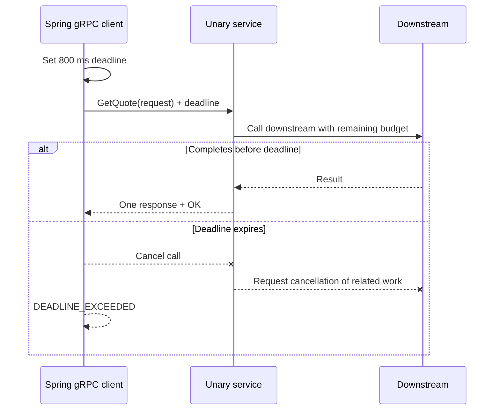
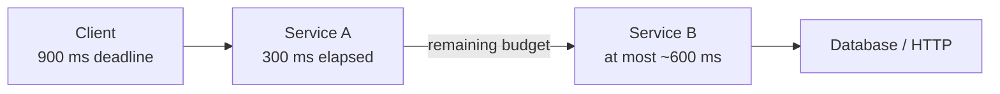

# Deadlines for Unary Calls

## 1. A Deadline Is the Time Limit of an RPC

A **unary RPC** sends one request and receives one response on success. In a distributed environment, a client cannot wait indefinitely: a server may be overloaded, a database query may be slow, the network may drop, or a downstream service may stop responding. A **deadline** specifies the latest point in time at which the client still accepts the call's result.

In gRPC, a deadline is an **absolute point in time** represented internally with a monotonic clock; when the call is issued, gRPC computes the remaining time and propagates that budget across hops. The client sets a deadline per RPC via the stub's call options. Upon expiration, the call terminates with `DEADLINE_EXCEEDED` on the client side, and gRPC signals cancellation for related work.

Deadlines matter because they:

- Bound how long a single request can hold resources on the client and server.
- Prevent calls from hanging indefinitely when a downstream dependency fails.
- Let services in a call chain see how much time remains.
- Provide a foundation for sizing database, HTTP client, and dependent task timeouts.
- Support measuring latency, timeout rates, and system reliability.



A deadline is not a business field in the protobuf request. It belongs to the **RPC execution context** and is managed by gRPC alongside call options, context, and internal metadata.

## 2. Distinguishing Deadlines, Timeouts, and Processing Time

These concepts are related, not synonymous:

| Concept | Meaning | Scope |
| --- | --- | --- |
| **Deadline** | The final instant until which a call is allowed to run. | One RPC, potentially propagated across multiple services. |
| **Timeout** | The maximum duration an operation is allowed to wait or run. | Can apply to an RPC, database, HTTP client, future, or thread. |
| **Latency** | Actual elapsed time from start until the result arrives. | Measured via metrics/tracing. |
| **Cancellation** | A signal requesting an in-flight call to stop. | Can be triggered by a deadline, explicit client cancel, or parent context cancellation. |

For example, the client sets an 800 ms deadline. The server takes 500 ms, downstream takes 250 ms, and the response needs 100 ms to return. Total time exceeds the budget; the client may receive `DEADLINE_EXCEEDED` even though the server had nearly finished.

A local wait timeout such as `future.get(800, MILLISECONDS)` only bounds **the thread waiting on the future**. It does not automatically become an RPC deadline, and the thread stopping its wait does not guarantee the RPC was cancelled. To bound the RPC, set a deadline on the stub; to stop an RPC when the caller no longer needs the result, explicitly cancel the corresponding future/call.

## 3. Setting a Deadline on a Blocking Stub in Spring gRPC

Suppose the client invokes the unary method `GetQuote` on `PricingService`. Spring gRPC supplies channels via `GrpcChannelFactory`. Configure the channel address in `application.properties`:

```properties
spring.grpc.client.channels.pricing.address=static://localhost:9090
```

Register the blocking stub as a shared bean:

```java
package com.example.pricing.client;

import com.example.pricing.grpc.PricingServiceGrpc;
import org.springframework.context.annotation.Bean;
import org.springframework.context.annotation.Configuration;
import org.springframework.grpc.client.GrpcChannelFactory;

@Configuration
public class PricingClientConfiguration {

    @Bean
    PricingServiceGrpc.PricingServiceBlockingStub pricingStub(
            GrpcChannelFactory channelFactory) {
        return PricingServiceGrpc.newBlockingStub(
                channelFactory.createChannel("pricing"));
    }
}
```

Set the deadline right where **each call** is issued:

```java
package com.example.pricing.client;

import com.example.pricing.grpc.PriceQuoteRequest;
import com.example.pricing.grpc.PriceQuoteResponse;
import com.example.pricing.grpc.PricingServiceGrpc;
import io.grpc.Status;
import io.grpc.StatusRuntimeException;
import org.springframework.stereotype.Service;

import java.util.concurrent.TimeUnit;

@Service
public class PricingClient {

    private final PricingServiceGrpc.PricingServiceBlockingStub stub;

    public PricingClient(
            PricingServiceGrpc.PricingServiceBlockingStub stub) {
        this.stub = stub;
    }

    public PriceQuoteResponse getQuote(PriceQuoteRequest request) {
        try {
            return stub.withDeadlineAfter(800, TimeUnit.MILLISECONDS)
                    .getQuote(request);
        } catch (StatusRuntimeException exception) {
            if (exception.getStatus().getCode()
                    == Status.Code.DEADLINE_EXCEEDED) {
                throw new QuoteServiceTimeoutException(
                        "Pricing service did not respond within the deadline",
                        exception);
            }
            throw exception;
        }
    }
}
```

`withDeadlineAfter(800, TimeUnit.MILLISECONDS)` returns a **new stub with its own deadline**; it does not modify the original stub bean. Stubs generated by gRPC Java are immutable configuration objects, so you can share a base stub and derive stubs with different deadlines for each RPC.

Do not call `withDeadlineAfter(...)` when initializing a singleton bean. A deadline is computed from the moment call options are created; for a long-lived bean, the deadline can expire before any actual request is sent. Also avoid using one identical timeout number for all operations: cache lookups, database reads, and quote calculations have different budgets.

`QuoteServiceTimeoutException` is an application exception defined by the project. Example:

```java
package com.example.pricing.client;

public class QuoteServiceTimeoutException extends RuntimeException {
    public QuoteServiceTimeoutException(String message, Throwable cause) {
        super(message, cause);
    }
}
```

### Handling status when a deadline expires

Several statuses relate to timing and availability:

| Status | Common interpretation | Handling direction |
| --- | --- | --- |
| `DEADLINE_EXCEEDED` | The RPC deadline expired before the client received a result. | Review budgets, latency, and downstream health. |
| `UNAVAILABLE` | Service or connection is temporarily unavailable. | May perform bounded retries if the operation is safe. |
| `CANCELLED` | Call was cancelled by the client or parent context. | Check why the caller cancelled. |
| `RESOURCE_EXHAUSTED` | Resources or quotas were exceeded. | Shed load or adjust quotas/backpressure. |
| `OK` | RPC completed successfully within budget. | Process business response. |

Clients should branch on `Status.Code`, not parse error description strings. `DEADLINE_EXCEEDED` also does not prove the server produced no side effects: the server may have persisted data before the response was delayed or lost in transit.

## 4. Designing Time Budgets for a Service Chain

Deadlines should be derived from the **upstream request's budget**, not picked arbitrarily per RPC. Suppose an API receives requests with a 1,200 ms budget:

| Stage | Illustrative budget |
| --- | ---: |
| Input parsing, authorization, and local work | 100 ms |
| Pricing gRPC call | 650 ms |
| Response mapping and business logic | 100 ms |
| HTTP response serialization and buffer | 200 ms |
| Jitter reserve | 150 ms |
| **Total** | **1,200 ms** |

These numbers merely illustrate how to allocate a budget. Use real latency data, percentiles such as p95/p99, SLO targets, and the cost of each downstream call to select appropriate values.

If one request calls three services sequentially, do not grant 1,200 ms to **each** RPC. Doing so allows total elapsed time to far exceed what the user tolerates. Each step must use the remaining time of the parent request or a shorter sub-budget.

For independent RPCs running in parallel, total duration is usually governed by the slowest call plus coordination overhead, yet concurrent calls still consume resources. The parent request's deadline should cover waiting, coordination, and result aggregation.

### Using the remaining deadline on the server

gRPC Java places the incoming call's deadline into the current `io.grpc.Context`. The server can inspect the deadline and remaining time:

```java
import io.grpc.Context;
import io.grpc.Deadline;

import java.util.concurrent.TimeUnit;

Context callContext = Context.current();
Deadline deadline = callContext.getDeadline();

if (deadline == null) {
    // Client did not set a deadline; apply service policy.
} else {
    long remainingNanos =
            deadline.timeRemaining(TimeUnit.NANOSECONDS);

    if (remainingNanos <= 0) {
        // Do not start further work that is already past deadline.
    }
}
```

`Deadline.timeRemaining(...)` returns the remaining time at the moment of inspection; the value can be zero or negative once expired. When calling another downstream dependency, preserve the overall budget and grant a sub-deadline no longer than the parent deadline. Never reset the full initial timeout at each hop.

When gRPC Java makes a downstream call inside the context of an incoming RPC, the current deadline can propagate through context. If the application offloads work to a separate executor or uses libraries that do not integrate with gRPC Context, ensure context is propagated properly or convert remaining time into the corresponding timeout for that operation.

## 5. Deadline Propagation and Downstream Timeouts

Consider service A receiving a unary request and calling service B for data. If the client sets a 900 ms deadline and A already spent 300 ms before calling B, B only has roughly 600 ms left, minus time needed for the response to return and further processing.



In gRPC Java, an outgoing call made inside an active context automatically inherits the context's deadline if one exists. Example of service A calling service B:

```java
package com.example.pricing.server;

import com.example.inventory.grpc.InventoryServiceGrpc;
import com.example.inventory.grpc.StockRequest;
import com.example.inventory.grpc.StockResponse;
import io.grpc.Deadline;
import io.grpc.Status;
import io.grpc.StatusRuntimeException;
import org.springframework.stereotype.Service;

import java.util.concurrent.TimeUnit;

@Service
public class InventoryLookup {

    private final InventoryServiceGrpc.InventoryServiceBlockingStub stub;

    public InventoryLookup(
            InventoryServiceGrpc.InventoryServiceBlockingStub stub) {
        this.stub = stub;
    }

    public StockResponse getStock(String productId) {
        Deadline parentDeadline = io.grpc.Context.current().getDeadline();

        if (parentDeadline != null
                && parentDeadline.timeRemaining(TimeUnit.MILLISECONDS) <= 0) {
            throw Status.DEADLINE_EXCEEDED
                    .withDescription("Deadline expired before calling Inventory")
                    .asRuntimeException();
        }

        // The active incoming RPC context carries the parent deadline.
        // If capping further, the child deadline must be shorter than the parent deadline.
        try {
            return stub.getStock(StockRequest.newBuilder()
                    .setProductId(productId)
                    .build());
        } catch (StatusRuntimeException exception) {
            throw exception;
        }
    }
}
```

This example assumes `InventoryServiceBlockingStub` was built from a Spring-managed channel and the call executes within the active gRPC context. Do not use `Context.ROOT` or intentionally detach from the context if you want to preserve the parent request's deadline and cancellation.

### Deadlines for databases and HTTP clients

A gRPC deadline **does not automatically configure timeouts for every underlying library**. If server A calls JDBC, an HTTP client, Redis, or an SDK that does not read gRPC Context, pass the remaining time explicitly to that component's timeout API.

Conceptual example:

```java
long remainingNanos = Context.current().getDeadline()
        .timeRemaining(TimeUnit.NANOSECONDS);

if (remainingNanos <= 0) {
    throw new IllegalStateException("Request deadline has expired");
}

// Application-defined repository API: timeout is passed explicitly.
Quote quote = quoteRepository.findQuote(
        productId, remainingNanos);
```

`quoteRepository.findQuote(productId, remainingNanos)` is an illustrative application API, not a built-in Spring or gRPC method. The repository must translate that budget into a real driver/database timeout. With JDBC, configure a query timeout or cancel the `Statement`; with an HTTP client, set an appropriate request/call timeout. Convert units and round conservatively so the downstream timeout is **never longer** than the parent request's remaining time.

If a blocking operation does not support cancellation, deadline expiration only stops the client from waiting; underlying work may continue holding threads or connections. Configure timeouts on drivers, pools, and SDKs themselves, and enforce concurrency limits.

## 6. Cancellation When a Deadline Expires

When a deadline expires, gRPC cancels the RPC and the server's `Context` transitions to cancelled. The server can check:

```java
Context context = Context.current();

if (context.isCancelled()) {
    // Request was cancelled or deadline expired.
}
```

To react when cancellation happens, register a listener:

```java
Context callContext = Context.current();

Context.CancellationListener listener = cancelledContext -> {
    // Callback must be short and non-blocking.
    // Request cancellation of downstream work if the application has a handle.
    queryHandle.cancel();
};

callContext.addListener(listener, cancellationExecutor);

try {
    // Execute or coordinate cancellable work.
} finally {
    callContext.removeListener(listener);
}
```

`queryHandle` and `cancellationExecutor` in this snippet are application-managed objects. The listener must be removed when the task completes to avoid retaining references longer than necessary. Cancellation callbacks should be fast; never run blocking queries or expensive work directly inside a listener.

Key principles:

- Check context before starting expensive work if the request may already have expired.
- Propagate cancellation signals to futures, HTTP calls, query handles, or background tasks when APIs support it.
- Stop subsequent steps once you know the request has been cancelled.
- Never assume cancellation equals transaction rollback.
- Do not send a successful response after the client has timed out and cancelled the call; there may no longer be a recipient.
- For work that cannot stop immediately, ensure resources are bounded and late results do not cause unintended side effects.

### A deadline does not guarantee the server stops immediately

The client may receive `DEADLINE_EXCEEDED` while the server continues executing for some time if code does not observe cancellation. For example, a running SQL statement might not abort just because gRPC Context was cancelled. You therefore need coordination across three layers:

1. **gRPC cancellation:** signals that the call's result is no longer needed.
2. **Downstream timeout/cancel:** asks the driver or client library to abort work.
3. **Business consistency:** uses transactions, idempotency keys, or reconciliation to handle side effects that occurred before cancellation arrived.

## 7. Retries and Wait-for-Ready Under a Deadline

Retries can help with transient failures, but **they do not add extra time beyond the original deadline**. Retry attempts, backoff delays, and channel-ready waits all consume the same budget. If very little deadline remains, retrying only adds load without leaving enough time to receive a response.

A retry policy must specify:

- Which statuses are retryable, such as certain `UNAVAILABLE` cases.
- Maximum attempt count and bounded backoff.
- Minimum remaining deadline required before starting a new attempt.
- Whether the RPC is idempotent or requires an idempotency key.
- Whether retries are configured at the client, service config, or application layer; avoid stacking multiple retry layers.

**Unary is not automatically safe to retry.** `GetQuote` may be a read operation, but `CreateOrder` or `ChargePayment` can also be unary and have side effects. When a client receives a timeout, it cannot conclude the server did not persist data. For write operations, the server must recognize idempotency keys or guard against duplicate processing.

`withWaitForReady()` allows a call to wait for the channel to become ready in certain connection states instead of failing immediately. It does not replace a deadline: if the channel never becomes ready, the deadline still terminates the call. Using wait-for-ready without a finite deadline can leave requests waiting too long.

## 8. Testing Deadlines for Unary RPCs

Deadline tests should verify at least three behaviors:

1. When the RPC completes before the deadline, the client receives the response.
2. When the RPC is slower than the deadline, the client receives `DEADLINE_EXCEEDED`.
3. The server observes cancellation and cancellable tasks are asked to stop.

You can use `InProcessServerBuilder` and `InProcessChannelBuilder` to test gRPC Java in-process. The example below uses a scheduler in the server to delay responses; the test waits at most a short bounded duration:

```java
package com.example.pricing.client;

import com.example.pricing.grpc.PriceQuoteRequest;
import com.example.pricing.grpc.PriceQuoteResponse;
import com.example.pricing.grpc.PricingServiceGrpc;
import com.example.pricing.server.DelayedPricingService;
import io.grpc.ManagedChannel;
import io.grpc.Server;
import io.grpc.Status;
import io.grpc.StatusRuntimeException;
import io.grpc.inprocess.InProcessChannelBuilder;
import io.grpc.inprocess.InProcessServerBuilder;
import org.junit.jupiter.api.AfterEach;
import org.junit.jupiter.api.BeforeEach;
import org.junit.jupiter.api.Test;

import java.io.IOException;
import java.util.concurrent.TimeUnit;

import static org.junit.jupiter.api.Assertions.assertEquals;
import static org.junit.jupiter.api.Assertions.assertThrows;

class UnaryDeadlineTest {

    private Server server;
    private ManagedChannel channel;
    private PricingServiceGrpc.PricingServiceBlockingStub stub;
    private DelayedPricingService service;

    @BeforeEach
    void setUp() throws IOException {
        String name = InProcessServerBuilder.generateName();
        service = new DelayedPricingService(250);

        server = InProcessServerBuilder.forName(name)
                .directExecutor()
                .addService(service)
                .build()
                .start();

        channel = InProcessChannelBuilder.forName(name)
                .directExecutor()
                .build();

        stub = PricingServiceGrpc.newBlockingStub(channel);
    }

    @AfterEach
    void tearDown() {
        channel.shutdownNow();
        server.shutdownNow();
        service.close();
    }

    @Test
    void returnsDeadlineExceededWhenServerIsTooSlow() {
        StatusRuntimeException error = assertThrows(
                StatusRuntimeException.class,
                () -> stub.withDeadlineAfter(30, TimeUnit.MILLISECONDS)
                        .getQuote(PriceQuoteRequest.newBuilder()
                                .setProductId("SKU-1")
                                .setQuantity(1)
                                .setCurrencyCode("USD")
                                .build()));

        assertEquals(Status.Code.DEADLINE_EXCEEDED,
                error.getStatus().getCode());
    }

    @Test
    void returnsResponseWhenDeadlineIsLongEnough() {
        PriceQuoteResponse response =
                stub.withDeadlineAfter(2, TimeUnit.SECONDS)
                        .getQuote(PriceQuoteRequest.newBuilder()
                                .setProductId("SKU-1")
                                .setQuantity(1)
                                .setCurrencyCode("USD")
                                .build());

        assertEquals("SKU-1", response.getProductId());
    }
}
```

`DelayedPricingService` is a test service defined by the project that uses a `ScheduledExecutorService` to send a response after 250 ms and shuts down the scheduler in `close()`. It is an intentional mock class, not a Spring gRPC API. When writing real tests, ensure schedulers are closed, avoid relying on `Thread.sleep` for synchronization, and use wide enough deadline margins to prevent flaky tests on heavily loaded machines.

### Checking cancellation on the server

Beyond asserting the client-side status, tests should use a `CountDownLatch` or synchronization signal in the mock service to confirm the cancellation listener fired. Avoid asserting that the server halted within an exact millisecond count; cancellation is a cooperative signal, and actual stopping depends on downstream APIs.

### Testing service chains

When service A calls service B, write a test where B is slowed down in a controlled way. Send a request to A with a short deadline and verify:

- A does not grant a new deadline longer than the parent deadline.
- B receives the remaining time or a corresponding sub-timeout.
- When the parent request is cancelled, A does not continue unnecessary steps.
- If B already produced side effects, idempotency/reconciliation logic keeps data consistent.

In-process tests are helpful for verifying gRPC semantics, but do not replace tests for TCP/HTTP/2, TLS, load balancing, service discovery, or real database/HTTP client timeouts.

## 9. Observing and Operating Deadlines

Deadlines are a critical signal of service quality. Monitor:

| Metric | What to watch |
| --- | --- |
| RPC latency p50/p95/p99 | Actual duration distribution relative to deadlines. |
| `DEADLINE_EXCEEDED` rate | Timeouts broken down by service/method and client. |
| `UNAVAILABLE` rate | Connectivity issues or unavailable services. |
| In-flight RPC count | Active concurrency and risk of work queuing up. |
| Downstream duration | Whether databases, HTTP calls, and dependencies consume the entire budget. |
| Observed cancellations | Rate at which tasks stop after client cancellation. |

Logs should include service, method, status code, deadline budget, and trace ID. Never log tokens, sensitive payloads, or unnecessary customer data. Metric labels should have low cardinality; avoid using individual request IDs, product IDs, or deadline timestamps as labels.

When timeout rates climb, inspect hop-by-hop traces to find where the budget is being spent. Mechanically increasing deadlines can hold threads, connections, and memory longer, worsening overload. Sometimes the right fix is bounding concurrency, optimizing queries, caching, backpressure, or reducing fan-out.

## 10. Common Mistakes

1. **Omitting RPC deadlines.** Calls can wait indefinitely when a service or network degrades. Set finite deadlines aligned with SLOs and business context.
2. **Setting a deadline on a singleton stub at application startup.** The deadline may expire before any RPC starts. Derive a stub right before each call.
3. **Granting a full timeout to each downstream call.** Total chain latency exceeds the parent request's budget. Use deadline propagation or sub-timeouts based on remaining time.
4. **Confusing `Future#get()` timeout with a gRPC deadline.** The thread stopping its wait does not cancel the RPC. Set a deadline on the stub and handle cancellation separately.
5. **Assuming `DEADLINE_EXCEEDED` means the server did nothing.** The server may have already executed side effects. Use idempotency and reconciliation for write operations.
6. **Assuming deadlines automatically abort JDBC or HTTP clients.** Only libraries aware of the deadline/cancellation will stop work. Pass remaining timeouts explicitly to downstream APIs.
7. **Retrying unboundedly after timeouts.** Retries consume extra resources and can repeat side effects. Limit attempts, use backoff, and retry only when safe.
8. **Using wait-for-ready without a deadline.** Calls can wait indefinitely for a channel. Always pair it with a finite deadline.
9. **Measuring only success latency.** Timeouts are part of user experience and SLOs too. Track status codes and latency percentiles together.

## 11. Practice Exercise

A quoting API has a 1,000 ms budget. It calls `PricingService.GetQuote`, then calls `InventoryService.GetStock` if the quote is valid. Design deadlines for both unary calls and implement:

- Set the first RPC's deadline using the budget remaining after subtracting local processing time.
- Ensure the second RPC uses the remaining time, and does not start if the budget is already exhausted.
- Configure timeouts on a repository or HTTP client called by the service so they never exceed the parent deadline.
- Add a cancellation listener requesting cancellation of a cancellable downstream query.
- Write tests covering: both RPCs succeeding, slow Pricing, slow Inventory, and explicit client cancellation.
- For a side-effecting RPC, describe how an idempotency key handles the case where the server finished after the client already received `DEADLINE_EXCEEDED`.

**Self-check:** A deadline bounds the duration of **an entire unary call**. Set deadlines at the client, propagate budgets across services, translate remaining time into database/HTTP client timeouts, react to cancellation, and retry only when safe. A client receiving `DEADLINE_EXCEEDED` may have timed out even while the server is finishing side effects; systems must be designed to handle that consistently.
