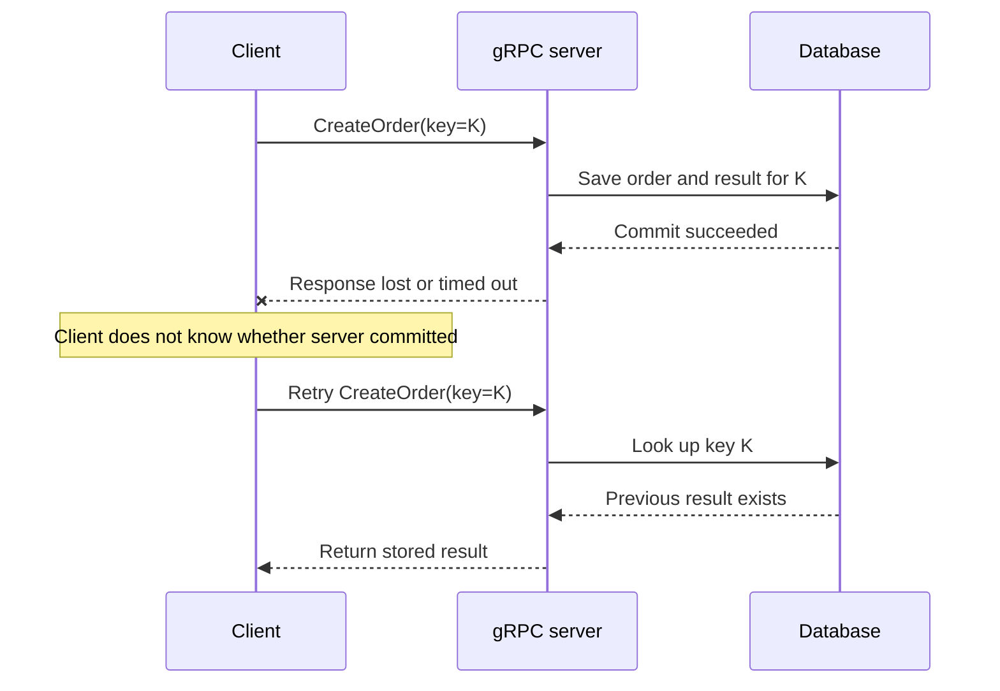
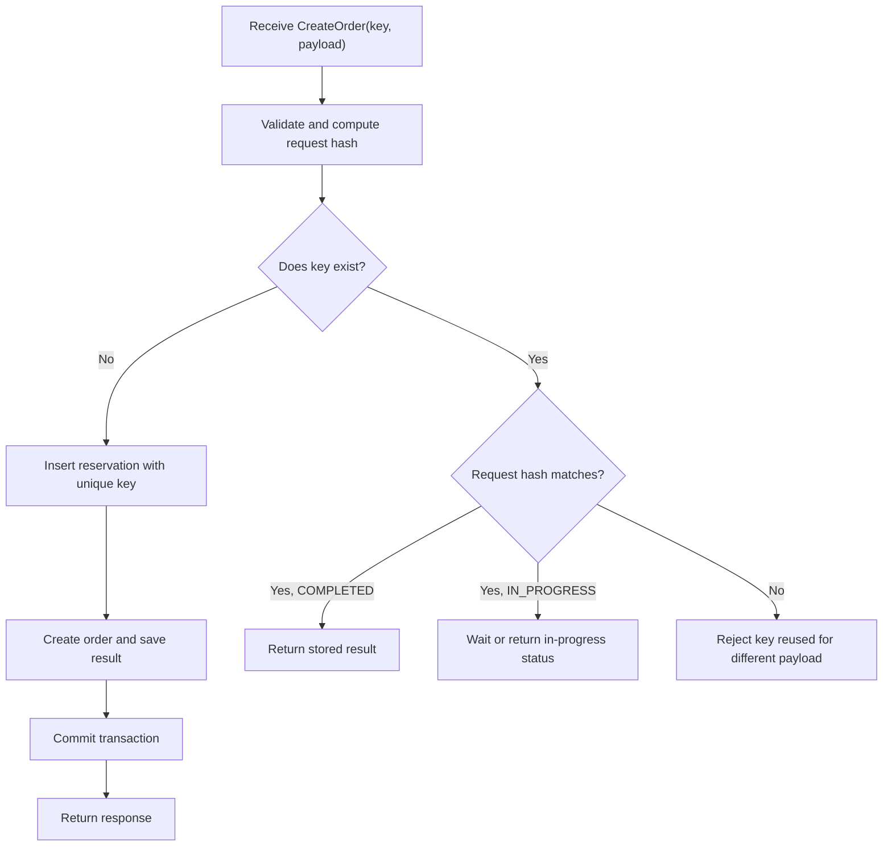

# Unary Call Retries and Idempotency

## 1. Why Must Retries Be Paired with Idempotency?

A **unary RPC** sends one request and receives one response on success. When a connection briefly drops or the server is temporarily unavailable, the client can try again. **Retries** help recover from short-lived failures, yet each retry may deliver the exact same request again.

This is dangerous for RPCs that produce side effects. For example, a client calls `CreateOrder`, the server persists the order, and the response is lost in transit. The client only sees a timeout or `UNAVAILABLE`. If it resends the request as a brand-new operation, the server could create a second order.

- A **retry policy** decides when, how many times, and how long to wait before trying again.
- **Idempotency** guarantees that receiving the same logical request multiple times does not produce unintended extra side effects.

Retries do not provide an exactly-once delivery guarantee. The network can still drop responses after the server commits. An idempotency key lets the server recognize retries of **the same business operation** and return the already recorded result.



## 2. Which Statuses Should Be Retried?

Not every gRPC status should be retried. Consider **the failure cause, the operation semantics, and the remaining deadline**.

| gRPC status | Typical policy | Rationale |
| --- | --- | --- |
| `UNAVAILABLE` | May retry within limits | Service or connection may be temporarily unavailable. |
| `RESOURCE_EXHAUSTED` | Retry only with appropriate backoff | Server may be overloaded or quota exhausted; immediate retries worsen load. |
| `ABORTED` | May retry the full transaction at business level | A sequence of operations may need to re-run after a conflict. |
| `DEADLINE_EXCEEDED` | Retry only if safe and budget remains | Server may have completed side effects even though the client timed out. |
| `CANCELLED` | Usually do not retry automatically | The caller may have explicitly cancelled. |
| `INVALID_ARGUMENT` | Do not retry | Request is invalid; resending the same data will still fail. |
| `PERMISSION_DENIED` / `UNAUTHENTICATED` | Do not retry blindly | Permissions or credentials must be fixed. |
| `NOT_FOUND` | Usually do not retry | Resource does not exist in current state. |
| `FAILED_PRECONDITION` | Do not retry until precondition is met | State must change first. |
| `INTERNAL` | Do not retry by default | Investigate the specific error; broad retries can amplify incidents. |

These are design guidelines, not rigid rules for every service. For instance, `NOT_FOUND` might be transient in an eventually consistent workflow, but retrying it must stem from confirmed business semantics.

Clients classify errors using `Status.Code`, not by inspecting `Status.getDescription()`:

```java
private boolean isRetryable(Status.Code code) {
    return code == Status.Code.UNAVAILABLE
            || code == Status.Code.RESOURCE_EXHAUSTED;
}
```

Descriptions are for diagnostics; status codes are the stable contract for branching.

## 3. What Does a Retry Policy Need?

At a minimum, a retry policy needs:

1. **Maximum attempts:** caps total transmissions, including the initial call.
2. **Retryable status codes:** explicitly lists which error codes may be retried.
3. **Backoff:** increases wait time between attempts to avoid piling onto load.
4. **Jitter:** adds randomness so multiple clients do not retry in lockstep.
5. **Overall deadline:** all attempts and backoff delays share a single time budget.
6. **Idempotency requirement:** never replay side-effecting operations without duplicate protection.

Illustrative policy parameters:

| Parameter | Value |
| --- | ---: |
| Max attempts | 3, including initial attempt |
| Initial backoff | 50 ms |
| Max backoff | 200 ms |
| Backoff multiplier | 2 |
| Jitter | Random between 0 and backoff cap |
| Total deadline | 1,500 ms |

Backoff grows exponentially: `delay = min(maxBackoff, initialBackoff × multiplier^(attempt - 1))`, followed by jitter. Never retry tightly in a loop, as that can cause a **retry storm** when a server is already overloaded.

### Application-layer retries with a blocking stub

The example below demonstrates bounded retries for an operation already protected by an idempotency key. A single absolute deadline applies across all attempts:

```java
@Service
public class OrderCommandClient {

    private static final int MAX_ATTEMPTS = 3;
    private static final long INITIAL_BACKOFF_MS = 50;
    private static final long MAX_BACKOFF_MS = 200;
    private static final long MIN_ATTEMPT_BUDGET_MS = 100;

    private final OrderCommandServiceGrpc.OrderCommandServiceBlockingStub stub;

    public OrderCommandClient(
            OrderCommandServiceGrpc.OrderCommandServiceBlockingStub stub) {
        this.stub = stub;
    }

    public CreateOrderResponse create(CreateOrderRequest request) {
        Deadline deadline = Deadline.after(1500, TimeUnit.MILLISECONDS);
        OrderCommandServiceGrpc.OrderCommandServiceBlockingStub callStub =
                stub.withDeadline(deadline);

        for (int attempt = 1; attempt <= MAX_ATTEMPTS; attempt++) {
            try {
                return callStub.createOrder(request);
            } catch (StatusRuntimeException failure) {
                if (!isRetryable(failure.getStatus().getCode())
                        || attempt == MAX_ATTEMPTS) {
                    throw failure;
                }

                long remainingMs =
                        deadline.timeRemaining(TimeUnit.MILLISECONDS);
                long backoffCap = Math.min(
                        MAX_BACKOFF_MS,
                        INITIAL_BACKOFF_MS * (1L << (attempt - 1)));
                long backoffMs =
                        ThreadLocalRandom.current().nextLong(backoffCap + 1);

                if (remainingMs <= backoffMs + MIN_ATTEMPT_BUDGET_MS) {
                    throw failure;
                }

                try {
                    TimeUnit.MILLISECONDS.sleep(backoffMs);
                } catch (InterruptedException interrupted) {
                    Thread.currentThread().interrupt();
                    throw new IllegalStateException(
                            "Retry interrupted", interrupted);
                }
            }
        }

        throw new IllegalStateException("Unable to complete CreateOrder");
    }

    private boolean isRetryable(Status.Code code) {
        return code == Status.Code.UNAVAILABLE
                || code == Status.Code.RESOURCE_EXHAUSTED;
    }
}
```

Key takeaways:

- `Deadline.after(...)` sets a deadline for the **entire logical operation**, rather than creating a fresh deadline after every failure.
- `stub.withDeadline(deadline)` creates a derived stub; all attempts share the same cutoff timestamp.
- Before retrying, the client checks that enough time remains for both the backoff sleep and another attempt.
- Jitter spreads retry timing across clients.
- `Thread.sleep` blocks the thread, so this pattern fits controlled blocking flows. For reactive applications or high concurrency, use asynchronous retries and an appropriate scheduler.
- The request is resent unmodified, including the **same idempotency key**. Never generate a new key inside the retry loop.

This is an application-layer retry. If the channel already enables gRPC's built-in retry policy, do not wrap it in a broad application retry loop without accounting for total attempts and deadlines. Stacked retry layers multiply request counts and can trigger unexpected load spikes.

## 4. gRPC Retries vs. Application Retries

gRPC Java can execute retries via service config when a channel is configured with a retry policy. Policies typically specify max attempts, initial/max backoff, backoff multiplier, and retryable status codes. Exact configuration depends on how your Spring gRPC app constructs channels and the library version.

| Approach | Characteristics | When appropriate |
| --- | --- | --- |
| **gRPC service-config retry** | Lives in the channel layer; gRPC manages attempts and backoff per policy. | Centralized transport/RPC retry policies. |
| **Application retry** | Business code decides statuses, conditions, backoff, and result handling. | When combining business conditions and idempotency logic. |
| **Multi-layer retries** | Each layer can independently resend requests. | Use only after calculating combined attempt counts, deadlines, and policy coordination. |

Do not blindly enable retry policies across all methods. Some read RPCs may be idempotent, while write RPCs require server-side idempotency support. Even when gRPC manages attempts internally, the server can still receive the same request multiple times.

## 5. What Is Idempotency?

An **idempotent** operation is one that, when executed multiple times with the same intent and payload, leaves the final business state unchanged after the first execution.

Examples:

- `GetOrder(orderId)` is normally idempotent because repeated reads do not create additional orders.
- `SetShippingAddress(orderId, address)` can be idempotent if re-writing the same address triggers no extra side effects.
- `CreateOrder(items)` is normally not idempotent if each call creates a new order.
- `ChargePayment(amount)` is unsafe to retry if each call deducts funds.

Idempotency does not mean the server receives the request only once. The server may receive multiple attempts, but must recognize them as belonging to **the same logical operation** and guarantee that business side effects occur only once.

## 6. Designing an Idempotency Key in Protobuf

The client generates a unique key per logical operation, such as a UUID, and sends it in the request:

```proto
syntax = "proto3";

package orders.v1;

option java_package = "com.example.orders.grpc";
option java_multiple_files = true;

service OrderCommandService {
  rpc CreateOrder(CreateOrderRequest) returns (CreateOrderResponse);
}

message CreateOrderRequest {
  string idempotency_key = 1;
  string customer_id = 2;
  repeated OrderItem items = 3;
}

message OrderItem {
  string product_id = 1;
  int32 quantity = 2;
}

message CreateOrderResponse {
  string order_id = 1;
  string state = 2;
}
```

The client generates the key **before the first attempt**:

```java
String operationKey = UUID.randomUUID().toString();

CreateOrderRequest request = CreateOrderRequest.newBuilder()
        .setIdempotencyKey(operationKey)
        .setCustomerId(customerId)
        .addAllItems(items)
        .build();

// Retries must resend the same request and the same operationKey.
CreateOrderResponse response = orderCommandClient.create(request);
```

If a user clicks "create order" twice for two distinct intents, each intent needs its own key. If one intent is retried due to a timeout, the client must keep the original key. Never mint a new key per attempt, or the server cannot recognize duplicate requests.

Keys should be scoped by tenant/customer and operation type. Never use an idempotency key as a credential; keys do not replace authentication or authorization.

## 7. Atomically Storing Keys and Results

The server must store the idempotency key alongside a fingerprint of the request and its processed result. A typical record contains:

| Field | Purpose |
| --- | --- |
| `scope` | Tenant/account and operation scope. |
| `idempotency_key` | Client-supplied key. |
| `request_hash` | Hash of the canonicalized business payload. |
| `state` | Status, such as `IN_PROGRESS` or `COMPLETED`. |
| `resource_id` | Created order ID or resource identifier. |
| `response_payload` | Stored response or data sufficient to reconstruct it. |
| `created_at`, `expires_at` | Creation timestamp and key retention expiration. |

Create a unique constraint over the combination of scope and idempotency key. When receiving a request:

1. Authenticate the caller and validate the request.
2. Canonicalize business fields and compute the request hash; exclude the idempotency key itself from the payload hash.
3. Look up the key within the current scope.
4. If the key is completed and the hash matches, return the stored result.
5. If the key exists with a different hash, reject because the same key was reused for different content.
6. If the key does not exist yet, record the key and execute side effects within one consistent transaction.
7. Persist the replayable result alongside business changes before committing.

### Server-side processing flow



Illustrative pseudo-code:

```java
@Transactional
public CreateOrderResponse create(CreateOrderRequest request) {
    validate(request);

    String scope = currentTenant() + ":CreateOrder";
    String key = request.getIdempotencyKey();
    String hash = canonicalRequestHash(request);

    IdempotencyRecord existing =
            repository.findByScopeAndKeyForUpdate(scope, key);

    if (existing != null) {
        if (!existing.requestHash().equals(hash)) {
            throw Status.ALREADY_EXISTS
                    .withDescription(
                            "Idempotency key already used with a different request")
                    .asRuntimeException();
        }

        if (existing.isCompleted()) {
            return existing.savedResponse();
        }

        throw Status.ABORTED
                .withDescription("Operation is already in progress")
                .asRuntimeException();
    }

    // Inside the transaction: create the order and store the result for the same key.
    Order order = orderRepository.insert(request);
    CreateOrderResponse response = toResponse(order);

    repository.insertCompleted(
            scope, key, hash, order.id(), response);

    return response;
}
```

`IdempotencyRecord`, `repository`, `Order`, and `canonicalRequestHash` are illustrative application components, not gRPC APIs. This pseudo-code conveys the principle; a production implementation must handle the race condition when two requests with the same key arrive simultaneously.

### Handling concurrent duplicate requests

Simply checking "look up key, if absent then insert" is vulnerable to races: two transactions can both see no key and create two orders. A database unique constraint is the final safeguard. When inserting the key hits a conflict, the losing transaction must re-read the record created by the winner and return either the stored result or an in-progress status.

Another pattern inserts an `IN_PROGRESS` reservation record first and processes afterward. That requires lease/timeout rules and recovery for abandoned reservations; otherwise, a crashed worker could leave a key stuck in `IN_PROGRESS` forever.

Side effects and the idempotency record should live in **the same transaction** when using the same database. If side effects occur in an external system (such as a payment provider), use an outbox, saga, or forward an idempotency key to that provider. A local key table alone does not guarantee exactly-once behavior in external systems.

## 8. Same Key, Different Payload

An idempotency key represents **a single intent**, so the same key must always map to the same canonical business payload.

Example:

- Initial call: key `K-123`, customer `C-10`, items `[SKU-A x 2]`.
- Retry: key `K-123`, same customer and items — returns the created order result.
- Invalid request: key `K-123`, customer `C-10`, items `[SKU-A x 5]` — rejected because the payload differs.

The hash should be computed from a canonical representation of the business fields. Decide explicitly whether repeated field order is significant, and normalize strings, quantity units, and defaults before hashing. Do not hash arbitrary JSON if key ordering or serialization formats might change across versions.

For same key with a different hash, the server can return `ALREADY_EXISTS` per contract. The client must treat this as a key-usage bug and not retry with the mismatched payload.

## 9. Deadlines and Uncertain Outcomes

Retries always consume time from the **overall deadline**. For example, if an operation has a 1,500 ms deadline and up to three attempts, the initial call, backoffs, and retries all fit inside those 1,500 ms.

The client should create the deadline once for the logical operation and reuse it across retries. Never reset a fresh 1,500 ms deadline after every error, as total elapsed time would scale with attempt count.

A critical scenario:

1. Client sends `CreateOrder` with key `K-123`.
2. Server persists the order and result; transaction commits.
3. Response is lost; client receives `DEADLINE_EXCEEDED`.
4. Client retries the same request with key `K-123`.
5. Server finds the completed record and returns the stored response.
6. Only one order is created.

If the client generated a new key at step 4, the server would treat it as a new operation and could create a second order.

### Not every timeout should be retried

- If the deadline has expired, there is no remaining budget for another attempt within the same operation.
- If the status is `INVALID_ARGUMENT`, fix the request before resending.
- If the status is `UNAUTHENTICATED`, resolve credentials first.
- If the status is `UNAVAILABLE`, retry if budget remains and the request is safe.
- If the status is `DEADLINE_EXCEEDED` on a write operation, reuse the same idempotency key so the server can look up any committed result.
- If the client cancelled because the user left the page, generally do not keep retrying in the background unless business rules require completion.

## 10. Testing Retries and Idempotency

Test suites must assert **the number of side effects**, not only the final response.

| Scenario | Expected outcome |
| --- | --- |
| First attempt succeeds | One order created; response has order ID. |
| First returns `UNAVAILABLE` before processing, next succeeds | Client retries within budget; one order created. |
| Server commits but response is lost, client retries same key | Server returns stored response; still only one order. |
| Same key, different payload | Server rejects; no second order created. |
| Two concurrent requests with same key and payload | One side effect; both receive the same result or one receives in-progress per contract. |
| Deadline expires before next attempt | No new attempt is started. |
| Key expires from storage | Behavior matches published retention policy. |

### Client test: preserving the key across retries

You can test with a fake stub or an in-process gRPC server. Use a test service that counts received calls and records idempotency keys:

```java
@Test
void retriesWithTheSameIdempotencyKey() {
    String key = UUID.randomUUID().toString();

    CreateOrderRequest request = CreateOrderRequest.newBuilder()
            .setIdempotencyKey(key)
            .setCustomerId("C-10")
            .addItems(OrderItem.newBuilder()
                    .setProductId("SKU-A")
                    .setQuantity(2)
                    .build())
            .build();

    CreateOrderResponse response = client.create(request);

    assertEquals("ORDER-1", response.getOrderId());
    assertEquals(List.of(key, key), service.receivedKeys());
    assertEquals(1, service.createdOrderCount());
}
```

`client` and `service` are test fixtures: the first call simulates a transient error or a dropped response after commit; the follow-up looks up the same key. The test verifies that the key was not regenerated between attempts.

### Server test: duplicate requests

With a real repository or test database:

- Send the same key and payload twice; verify the same order ID is returned.
- Send the same key with a different payload; verify the rejection status.
- Send multiple concurrent requests with the same key; verify the unique constraint and number of business records.
- Simulate a failure between creating a reservation and completing it; verify transaction/lease recovery does not leave keys stuck forever.
- Verify key retention exceeds the window during which clients can retry or replay the same intent.

Unit tests with a mock repository are useful for checking logic branches, but do not prove database atomicity. Race conditions require integration tests against a real database enforcing unique constraints.

## 11. Operating Retries and Idempotency

Track these metrics:

- Attempts per logical operation and percentage of requests requiring retries.
- Retries broken down by status code, service, and method.
- Total latency including backoff.
- Count of keys currently `IN_PROGRESS`, deduplicated duplicates, and payload-mismatch conflicts.
- Expired or recovered reservations.
- Side effects created relative to successful logical operations.

Logs should include method, status, attempt number, and correlation ID. Avoid logging full requests or sensitive data merely to trace retries. Avoid using idempotency keys as metric labels due to high cardinality.

Idempotency record retention must exceed the **retry window** plus any window in which clients can replay the same intent. Purging records too early can let late retries duplicate side effects. Retaining them too long increases storage footprint; define clear TTLs and cleanup jobs.

## 12. Common Mistakes

1. **Retrying every status.** Data, permission, or business-state errors will not resolve on their own. Explicitly choose retryable codes.
2. **Generating a new idempotency key per attempt.** The server cannot recognize retries as the same operation. Create one key before the first send and reuse it.
3. **Generating the key on the server after receiving the request.** Each retry would receive a different key. Keys must stay stable across client attempts.
4. **Storing the key and side effect in separate transactions.** Either the order can save without the key record or vice versa. Use a shared transaction or an outbox/saga pattern for external systems.
5. **Skipping request hash verification.** Same key with different payloads could return a misleading stored response. Compare canonicalized payloads.
6. **Ignoring concurrent duplicate requests.** Two transactions can both create resources. Enforce unique constraints and handle conflicts.
7. **Resetting the deadline on every retry.** Total duration exceeds the caller's budget. Share one overall deadline per logical operation.
8. **Stacking retries across layers without bounding total attempts.** Policies multiply requests and cause retry storms. Pick one primary retry layer or budget them together.
9. **Assuming idempotency keys make external systems exactly-once.** Downstream side effects need key forwarding or outbox/saga plus reconciliation.
10. **Purging keys too early.** Late retries can duplicate side effects. Size retention to match business replay windows.

## 13. Practice Exercise

Implement the `CreateOrder` unary method with an idempotency key:

- Generate a key on the client before the first call and preserve it across all retries.
- Retry only selected statuses, up to three attempts, with exponential backoff, jitter, and a single overall deadline.
- Persist scope, key, request hash, and result in the same transaction that creates the order.
- Same key and payload must return the same order ID; same key with a different payload must be rejected.
- Write integration tests for two concurrent requests with the same key, and for the scenario where the server commits, the client loses the response, and retries.
- Choose a key TTL longer than the retry window and describe how abandoned `IN_PROGRESS` reservations are recovered.

**Self-check:** Retries are the mechanism for resending on recoverable errors; idempotency protects side effects when requests arrive multiple times. For mutating unary RPCs, **preserve the idempotency key across all attempts, store keys and results atomically, bound retries with one overall deadline, and retry only appropriate statuses**.
