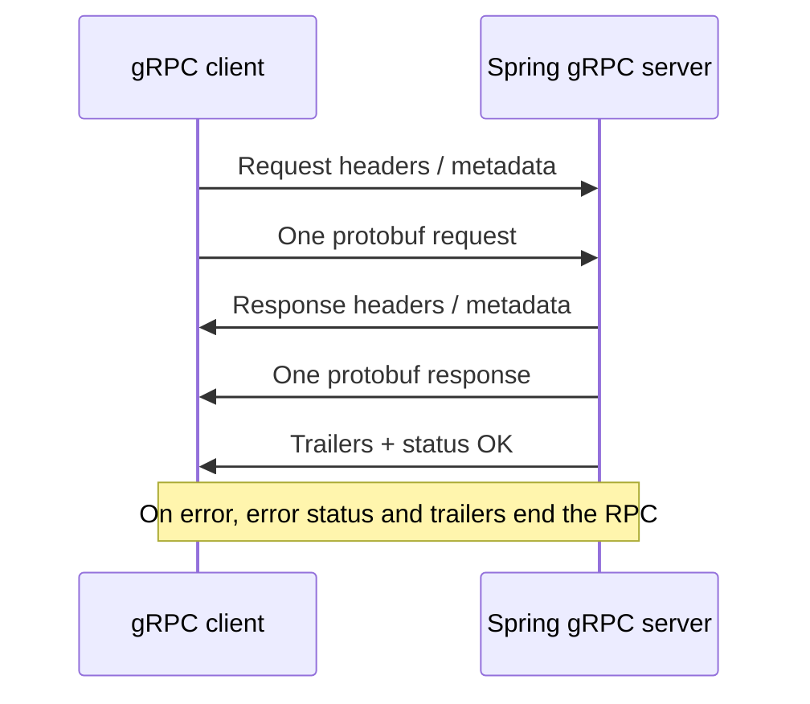

# Request and Response Metadata

## 1. Metadata Carries Control Information Alongside Protobuf Messages

In a **unary RPC**, the client sends one protobuf request and the server returns one protobuf response on success. Alongside these two messages, gRPC supports **metadata** for transmitting auxiliary information in HTTP/2 headers and trailers.

Metadata is commonly used for authentication, correlation IDs, trace context, client name, service info, and diagnostic error codes. Metadata does not replace protobuf: `product_id`, `quantity`, or `order_id` are business data and belong in messages; request IDs and trace contexts are better suited to metadata.



A unary call has three metadata points:

| Position | Direction | Timing | Purpose |
| --- | --- | --- | --- |
| Request metadata | Client → server | At RPC start | Credentials, correlation ID, trace context. |
| Response headers | Server → client | Before or alongside first response | Service name, version, or processing info. |
| Response trailers | Server → client | When RPC finishes | Status and additional diagnostic info. |

In gRPC Java, the primary class is `io.grpc.Metadata`. Metadata is transmitted separately from protobuf payloads and is typically handled at the transport or interceptor layer.

## 2. Creating Properly Typed Metadata Keys

Each key has a name and a marshaller defining how Java values convert to wire bytes. Key names must be lowercase. For text values, use `ASCII_STRING_MARSHALLER`; for binary data, key names must end with `-bin` and use `BINARY_BYTE_MARSHALLER`.

```java
import io.grpc.Metadata;

public final class RpcMetadata {

    private RpcMetadata() {}

    public static final Metadata.Key<String> REQUEST_ID =
            Metadata.Key.of(
                    "x-request-id",
                    Metadata.ASCII_STRING_MARSHALLER);

    public static final Metadata.Key<String> CLIENT_NAME =
            Metadata.Key.of(
                    "x-client-name",
                    Metadata.ASCII_STRING_MARSHALLER);

    public static final Metadata.Key<String> SERVER_COMPONENT =
            Metadata.Key.of(
                    "x-server-component",
                    Metadata.ASCII_STRING_MARSHALLER);

    public static final Metadata.Key<String> ERROR_ID =
            Metadata.Key.of(
                    "x-error-id",
                    Metadata.ASCII_STRING_MARSHALLER);

    public static final Metadata.Key<byte[]> SIGNATURE =
            Metadata.Key.of(
                    "x-payload-signature-bin",
                    Metadata.BINARY_BYTE_MARSHALLER);
}
```

Rules to remember:

- Key names must be lowercase ASCII; never collide with internal headers or use the protocol-reserved `grpc-` prefix.
- Text keys use `ASCII_STRING_MARSHALLER`; never assume arbitrary Unicode strings are valid in ASCII metadata.
- Binary keys end with `-bin`; pass `byte[]` directly without manually base64-encoding unless the contract requires it.
- Metadata can hold multiple values for the same key. If the contract allows only one value, specify how to handle multiple values.
- Never share a mutable `Metadata` instance across multiple RPCs. Create separate metadata per call to prevent leaking data between requests.
- Keep metadata small. Servers and proxies enforce header size limits; oversized metadata can cause RPCs to be rejected.

Example creating metadata for a call:

```java
Metadata metadata = new Metadata();
metadata.put(RpcMetadata.REQUEST_ID, UUID.randomUUID().toString());
metadata.put(RpcMetadata.CLIENT_NAME, "checkout-api");

byte[] signature = calculateSignature(payload);
metadata.put(RpcMetadata.SIGNATURE, signature);
```

Do not put large payloads into metadata. Business data belongs in protobuf messages; large binary data should be modeled in messages or stored in a dedicated system.

## 3. Sending Request Metadata from the Client

In gRPC Java, `ClientInterceptor` is the right place to attach metadata that applies across many RPCs. Example interceptor adding a request ID and application name:

```java
package com.example.checkout.grpc;

import io.grpc.CallOptions;
import io.grpc.Channel;
import io.grpc.ClientCall;
import io.grpc.ClientInterceptor;
import io.grpc.ForwardingClientCall;
import io.grpc.Metadata;
import io.grpc.MethodDescriptor;

import java.util.function.Supplier;

public final class RequestMetadataClientInterceptor
        implements ClientInterceptor {

    private final Supplier<String> requestIdSupplier;

    public RequestMetadataClientInterceptor(
            Supplier<String> requestIdSupplier) {
        this.requestIdSupplier = requestIdSupplier;
    }

    @Override
    public <ReqT, RespT> ClientCall<ReqT, RespT> interceptCall(
            MethodDescriptor<ReqT, RespT> method,
            CallOptions callOptions,
            Channel next) {

        ClientCall<ReqT, RespT> delegate =
                next.newCall(method, callOptions);

        return new ForwardingClientCall
                .SimpleForwardingClientCall<ReqT, RespT>(delegate) {

            @Override
            public void start(
                    Listener<RespT> responseListener,
                    Metadata headers) {

                if (headers.get(RpcMetadata.REQUEST_ID) == null) {
                    headers.put(
                            RpcMetadata.REQUEST_ID,
                            requestIdSupplier.get());
                }

                if (headers.get(RpcMetadata.CLIENT_NAME) == null) {
                    headers.put(RpcMetadata.CLIENT_NAME, "checkout-api");
                }

                super.start(responseListener, headers);
            }
        };
    }
}
```

`requestIdSupplier` should pull the ID from the current request context if the system already has a correlation ID; generate a new UUID only when absent. This lets multiple services log the same ID. Avoid using `ThreadLocal` carelessly in asynchronous flows without a reliable context propagation mechanism.

Attach the interceptor to a generated stub:

```java
PricingServiceGrpc.PricingServiceBlockingStub callStub =
        baseStub.withInterceptors(
                new RequestMetadataClientInterceptor(
                        requestContext::requestId));

PriceQuoteResponse response = callStub.getQuote(request);
```

`withInterceptors(...)` returns a derived stub; the base stub is not modified. When an interceptor should apply to the entire channel, register it via the global client interceptor mechanism of your Spring gRPC version. When metadata is only needed for selected methods, attaching the interceptor in the corresponding adapter scopes it more clearly.

Authentication should normally use `CallCredentials` or appropriate security integration to supply per-call credentials and support token refresh; never hardcode bearer tokens inside a singleton interceptor.

## 4. Reading Request Metadata on the Server

The server typically reads metadata inside a `ServerInterceptor` before the business handler executes. The interceptor can validate metadata structure, store the correlation ID in `io.grpc.Context`, and let the handler read it without adding fields to protobuf.

```java
package com.example.checkout.server;

import com.example.checkout.grpc.RpcMetadata;
import io.grpc.Context;
import io.grpc.Contexts;
import io.grpc.Metadata;
import io.grpc.ServerCall;
import io.grpc.ServerCallHandler;
import io.grpc.ServerInterceptor;
import io.grpc.Status;

public final class RequestMetadataServerInterceptor
        implements ServerInterceptor {

    public static final Context.Key<String> REQUEST_ID_CONTEXT =
            Context.key("request-id");

    @Override
    public <ReqT, RespT> ServerCall.Listener<ReqT> interceptCall(
            ServerCall<ReqT, RespT> call,
            Metadata requestHeaders,
            ServerCallHandler<ReqT, RespT> next) {

        String requestId =
                requestHeaders.get(RpcMetadata.REQUEST_ID);

        if (requestId != null && requestId.length() > 100) {
            call.close(
                    Status.INVALID_ARGUMENT
                            .withDescription("Invalid request ID"),
                    new Metadata());
            return new ServerCall.Listener<>() {};
        }

        Context context = Context.current();
        if (requestId != null) {
            context = context.withValue(REQUEST_ID_CONTEXT, requestId);
        }

        return Contexts.interceptCall(
                context, call, requestHeaders, next);
    }
}
```

`Contexts.interceptCall(...)` binds the context for the entire callback lifecycle of the server call. Inside the handler, you can read the request ID:

```java
String requestId =
        RequestMetadataServerInterceptor.REQUEST_ID_CONTEXT.get();

log.info("Handling GetQuote, requestId={}", requestId);
```

Never treat client-supplied metadata as trustworthy solely because it reached the server. A request ID can be used to correlate logs, but it does not replace authentication or authorization. If the client sends a tenant ID, role, or user ID, the server must still obtain the principal from a trusted authentication mechanism and verify permissions independently.

In Spring gRPC, register interceptors using the framework version's global or service-specific interceptor mechanism. Versions providing `@GrpcGlobalServerInterceptor` can place that annotation on interceptor beans. When configuring in Java, register the interceptor in the corresponding server configuration; do not assume every `ServerInterceptor` bean is automatically attached to all services.

## 5. Sending Response Headers and Trailers

The server can send metadata at two stages:

- **Initial headers:** sent before the first response message. Used for small info like component name or service version.
- **Trailers:** sent when the RPC finishes. Used for the status and terminal metadata, such as an error ID for log correlation.

In gRPC Java, `ServerCall` provides `sendHeaders(...)` and `close(status, trailers)`. A server interceptor can wrap `ServerCall` to attach metadata consistently:

```java
package com.example.checkout.server;

import com.example.checkout.grpc.RpcMetadata;
import io.grpc.ForwardingServerCall;
import io.grpc.Metadata;
import io.grpc.ServerCall;
import io.grpc.ServerCallHandler;
import io.grpc.ServerInterceptor;
import io.grpc.Status;

public final class ResponseMetadataServerInterceptor
        implements ServerInterceptor {

    @Override
    public <ReqT, RespT> ServerCall.Listener<ReqT> interceptCall(
            ServerCall<ReqT, RespT> call,
            Metadata requestHeaders,
            ServerCallHandler<ReqT, RespT> next) {

        String requestId =
                requestHeaders.get(RpcMetadata.REQUEST_ID);

        ServerCall<ReqT, RespT> decoratedCall =
                new ForwardingServerCall
                        .SimpleForwardingServerCall<ReqT, RespT>(call) {

            @Override
            public void sendHeaders(Metadata headers) {
                Metadata outgoing = new Metadata();
                outgoing.merge(headers);

                if (outgoing.get(RpcMetadata.SERVER_COMPONENT) == null) {
                    outgoing.put(
                            RpcMetadata.SERVER_COMPONENT, "pricing-service");
                }

                super.sendHeaders(outgoing);
            }

            @Override
            public void close(Status status, Metadata trailers) {
                Metadata outgoing = new Metadata();
                if (trailers != null) {
                    outgoing.merge(trailers);
                }

                if (requestId != null
                        && outgoing.get(RpcMetadata.REQUEST_ID) == null) {
                    outgoing.put(RpcMetadata.REQUEST_ID, requestId);
                }

                if (status.getCode() != Status.Code.OK
                        && outgoing.get(RpcMetadata.ERROR_ID) == null) {
                    outgoing.put(
                            RpcMetadata.ERROR_ID, "PRICING_RPC_ERROR");
                }

                super.close(status, outgoing);
            }
        };

        return next.startCall(decoratedCall, requestHeaders);
    }
}
```

The interceptor above appends metadata when sending headers and trailers. `sendHeaders(...)` runs when the server emits initial headers; if the service does not explicitly send headers, the runtime emits default headers when sending the first response. Trailers are delivered with the terminal status in `close(...)`.

If you need to send initial headers directly from service logic, do so in a layer with access to `ServerCall`; do not add fields to `PriceQuoteResponse` solely to substitute for metadata. On errors, `close(status, trailers)` keeps the status as the RPC terminal outcome while trailers carry supplementary data.

## 6. Reading Response Headers and Trailers on the Client

The client observes response metadata inside a `ClientInterceptor` via two callbacks:

- `ClientCall.Listener.onHeaders(...)` receives initial response headers.
- `ClientCall.Listener.onClose(status, trailers)` receives the final status and trailers.

Example extending `start(...)` in a client interceptor:

```java
ClientCall.Listener<RespT> wrappedListener =
        new ForwardingClientCallListener
                .SimpleForwardingClientCallListener<RespT>(
                        responseListener) {

    @Override
    public void onHeaders(Metadata responseHeaders) {
        String component =
                responseHeaders.get(RpcMetadata.SERVER_COMPONENT);

        if (component != null) {
            log.debug("gRPC response component={}", component);
        }

        super.onHeaders(responseHeaders);
    }

    @Override
    public void onClose(Status status, Metadata trailers) {
        String errorId = trailers == null
                ? null
                : trailers.get(RpcMetadata.ERROR_ID);

        if (errorId != null) {
            log.warn("gRPC call ended: status={}, errorId={}",
                    status.getCode(), errorId);
        }

        super.onClose(status, trailers);
    }
};
```

This snippet lives inside `ClientInterceptor.start(...)`; import `ForwardingClientCallListener`, `Status`, and `ClientCall`. Always call `super.onHeaders(...)` and `super.onClose(...)` so the stub's underlying listener continues receiving events.

With a blocking stub, the method normally returns only the protobuf response or throws `StatusRuntimeException`; it does not return a tuple containing response headers/trailers. An interceptor is the right place to observe metadata. If the application needs metadata in a business result, design a **per-call** holder or a context-aware adapter; never store response metadata in mutable fields of a singleton client because multiple RPCs can run concurrently.

When an RPC fails, the client can read trailers directly from `StatusRuntimeException`:

```java
try {
    return stub.getQuote(request);
} catch (StatusRuntimeException failure) {
    Metadata trailers = failure.getTrailers();

    String errorId = trailers == null
            ? null
            : trailers.get(RpcMetadata.ERROR_ID);

    log.warn("Pricing RPC failed: status={}, errorId={}",
            failure.getStatus().getCode(), errorId);

    throw failure;
}
```

Trailers can be null; always check before reading. Status codes remain the primary signal for classifying errors, whereas error IDs are only for locating logs or diagnostics.

## 7. Authentication, Tracing, and Sensitive Data

Metadata often carries sensitive information, so draw clear boundaries:

- **Authentication:** prefer `CallCredentials` or appropriate security integration to attach per-call credentials and support refresh. Never hardcode bearer tokens in a singleton interceptor.
- **Authorization:** the server validates the token and checks permissions against the trusted principal. Never trust user IDs, roles, or tenant IDs self-asserted by the client.
- **Tracing:** when using OpenTelemetry, prefer standard instrumentation/propagators to carry trace context. Do not invent custom headers that conflict with active trace standards.
- **TLS:** metadata travels over the same gRPC connection. Use TLS to protect data in transit; do not treat metadata as a place for long-lived secrets.
- **Logging:** log only request IDs, method names, statuses, and approved metadata. Never log authorization tokens, cookies, session IDs, or sensitive personal data.
- **Size:** metadata is sent with each corresponding RPC; keep it compact to avoid exceeding client, server, or proxy header limits.

Do not place large business payloads into metadata, and do not rely on metadata for data needing strict schema validation. Data requiring versioning and cross-language compatibility belongs in protobuf messages.

## 8. Testing Request Metadata, Response Headers, and Trailers

Tests should verify all three directions: request metadata reaching the server, response headers reaching the client, and trailers when the RPC finishes. Use `InProcessServerBuilder` and `InProcessChannelBuilder` to test without opening a TCP port.

| Scenario | Expected outcome |
| --- | --- |
| Client sends request ID | Server interceptor reads exact value and handler context contains that ID. |
| Client omits request ID | Server applies policy: generates a new ID or accepts absence. |
| Request ID exceeds limit | Server closes with `INVALID_ARGUMENT`; business handler does not run. |
| Server sends response headers | Client interceptor receives `SERVER_COMPONENT` in `onHeaders`. |
| Server terminates with error | Client receives error status and `ERROR_ID` in trailers. |
| Two RPCs run concurrently | Metadata from each call never leaks into the other. |
| Mismatched metadata key type | Test verifies marshaller and key conventions; do not coerce binary into string. |

Example interceptor test harness using in-process transport:

```java
String name = InProcessServerBuilder.generateName();

Server server = InProcessServerBuilder.forName(name)
        .directExecutor()
        .intercept(requestMetadataServerInterceptor)
        .intercept(responseMetadataServerInterceptor)
        .addService(testProductService)
        .build()
        .start();

ManagedChannel channel = InProcessChannelBuilder.forName(name)
        .directExecutor()
        .build();

try {
    ProductQueryServiceGrpc.ProductQueryServiceBlockingStub stub =
            ProductQueryServiceGrpc.newBlockingStub(channel)
                    .withInterceptors(clientMetadataInterceptor);

    // Invoke the RPC and assert response/status for each scenario.
} finally {
    channel.shutdownNow();
    server.shutdownNow();
}
```

`testProductService` and the interceptors are test fixtures. You need JUnit Jupiter and `grpc-inprocess` compatible with your project's gRPC Java version. For response headers/trailers, test via a client interceptor or `StatusRuntimeException.getTrailers()` rather than expecting a blocking stub to return metadata alongside the response.

In-process tests verify metadata behavior at the gRPC layer, but do not test TLS, HTTP/2 over TCP, proxy header limits, or full Spring deployment configuration. Those require integration tests over a real transport.

## 9. Common Mistakes

1. **Putting business fields into metadata.** Data needing schemas and validation belongs in protobuf requests/responses.
2. **Using uppercase key names or the `grpc-` prefix.** Violates metadata key rules and can collide with protocol headers.
3. **Using a string marshaller for binary data.** Use `-bin`-suffixed keys with `BINARY_BYTE_MARSHALLER`.
4. **Sharing one mutable `Metadata` across multiple RPCs.** Can leak request IDs or credentials between calls. Create metadata per call.
5. **Assuming blocking stubs return response headers/trailers directly.** Observe via a client interceptor; on errors, read trailers from `StatusRuntimeException`.
6. **Trusting client-sent request IDs or tenant IDs.** Metadata is not proof of identity. The server must authenticate and authorize independently.
7. **Sending tokens or large payloads in trailers.** Risks leaks and exceeding header limits. Send only small, non-sensitive diagnostic codes.
8. **Forgetting to invoke super callbacks in client interceptors.** Omitting `super.onHeaders` or `super.onClose` breaks the stub's callback lifecycle.
9. **Using mutable singleton fields to hold response metadata.** Concurrent RPCs can overwrite each other's data. Keep data scoped per call.

## 10. Practice Exercise

Extend the `ProductQueryService` client to send `x-request-id` and `x-client-name` via request metadata. On the server side:

- Read the request ID in an interceptor and bind it to `io.grpc.Context`.
- Return `x-server-component` in response headers.
- On errors, return `x-error-id` in trailers alongside the appropriate status.
- Validate missing or overly long request IDs per service policy.

Write in-process tests for a successful request, a request missing metadata, an invalid request ID, and a `NOT_FOUND` error. Run two concurrent RPCs with different request IDs to verify metadata is never shared across calls. Finally, document which metadata keys are safe to log and which must be masked or excluded.

**Self-check:** Request metadata is sent at RPC start; the server reads it via interceptors/context. Response headers arrive before or alongside the first response; trailers travel with the terminal status. Use metadata for context and small control info, keep business data in protobuf, validate all client-supplied values, and isolate metadata per call.
