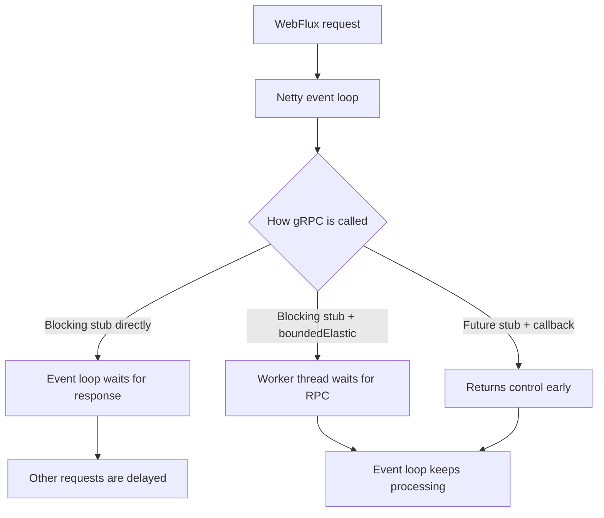

# Avoiding Accidental Event Loop Blocking

## 1. Why Must the Event Loop Stay Responsive?

In a Spring WebFlux application, Netty typically uses a small number of **event-loop threads** to accept connections, read/write data, and dispatch callbacks across many requests. One thread serves many connections. If a handler runs a blocking operation on that thread, the event loop cannot process other events while blocked.

With gRPC Java, calling a **blocking stub** waits for the response directly on the calling thread. If you call a blocking stub directly inside a WebFlux controller or service running on an event loop, a single slow RPC can stall many unrelated HTTP requests. Under load, latency spreads and queued requests pile up.

Operations that commonly block the event loop accidentally include:

- Calling `BlockingStub` and waiting for a unary response.
- Calling `Future.get()`, `CompletableFuture.join()`, or `CountDownLatch.await()`.
- Running JDBC/JPA, file I/O, `Thread.sleep()`, or blocking HTTP clients.
- Running heavy CPU work, long loops, or contended synchronized locks.
- Calling `Mono.block()` or `Flux.blockFirst()` inside reactive pipelines.

The rule is **never wait for a blocking result on an event-loop thread**. Use asynchronous APIs or explicitly offload the blocking part to a dedicated scheduler.



## 2. Identifying Thread Boundaries in Spring gRPC

An application can have several kinds of threads:

| Thread / execution context | Appropriate work | What to avoid |
| --- | --- | --- |
| WebFlux Netty event loop | Non-blocking I/O dispatch, short callbacks | Blocking stub, blocking JDBC, `block()` |
| gRPC transport/event loop | HTTP/2 transport and internal callbacks | Slow business logic or waiting on I/O |
| `boundedElastic` | Compatibility with bounded blocking APIs | Unbounded task creation or holding threads too long |
| Dedicated callback executor | Completing futures and lightweight forwarding | Blocking queries or prolonged heavy CPU work |
| `parallel` / CPU scheduler | Short, bounded CPU-bound transformations | Waiting on blocking I/O |

Returning `Mono<T>` from a controller does not automatically make every line inside asynchronous. Reactor schedules execution according to how sources and schedulers are configured.

## 3. The Simple Approach When You Must Use a Blocking Stub

If a project already uses a blocking stub and cannot switch clients yet, wrap the call in `Mono.fromCallable(...)` and move the source onto `Schedulers.boundedElastic()`:

```java
@Service
public class BlockingPricingAdapter {

    private final PricingServiceGrpc.PricingServiceBlockingStub stub;

    public BlockingPricingAdapter(
            PricingServiceGrpc.PricingServiceBlockingStub stub) {
        this.stub = stub;
    }

    public Mono<PriceQuoteResponse> getQuote(
            PriceQuoteRequest request) {

        return Mono.fromCallable(() ->
                stub.withDeadlineAfter(700, TimeUnit.MILLISECONDS)
                        .getQuote(request))
                .subscribeOn(Schedulers.boundedElastic());
    }
}
```

`Mono.fromCallable` defers invocation until subscription. `subscribeOn` shifts execution of the source and blocking call onto a worker thread from the bounded elastic scheduler. The event loop does not wait for the response.

**Why use `subscribeOn`, not just `publishOn`?**

- `subscribeOn` controls where the source begins executing; this fits when the gRPC call itself is blocking.
- `publishOn` switches downstream operators to another scheduler. Placing `publishOn` after a blocking source allows the call to run on the event loop before switching threads.

The example below is unsafe because `getQuote(...)` blocks right when called before returning the `Mono`:

```java
// Wrong: the blocking call executes before the Mono is created.
PriceQuoteResponse response = blockingStub.getQuote(request);
return Mono.just(response);
```

Also never call `block()` to extract a response inside a WebFlux controller. Return `Mono<PriceQuoteResponse>` for the framework to orchestrate.

### Deadlines are still required

Offloading to bounded elastic only protects the event loop; it does not make the RPC faster or bound wait times by itself. Always set a finite deadline based on the request budget. If queue wait time should count toward the budget, capture the deadline at the ingress boundary and compute remaining time right before the RPC rather than restarting the full budget once the worker thread starts.

`Schedulers.boundedElastic()` has thread and queue caps configured by Reactor. When a downstream dependency slows down, queued blocking tasks can accumulate. Monitor active workers, queue sizes, and wait times; never treat bounded elastic as infinite capacity.

## 4. Preferring Future Stubs for Unary RPCs

A future stub fits when you want to initiate a unary RPC without holding the calling thread to wait for the response. The generated gRPC Java stub returns `ListenableFuture<Response>`:

```java
OrderQueryServiceGrpc.OrderQueryServiceFutureStub futureStub =
        OrderQueryServiceGrpc.newFutureStub(channel);

ListenableFuture<GetOrderResponse> pending =
        futureStub.withDeadlineAfter(700, TimeUnit.MILLISECONDS)
                .getOrder(request);
```

Calling `getOrder(...)` returns a future; never call `pending.get()` on an event loop. Register a callback to receive the result when the RPC finishes. Guava provides `Futures.addCallback(...)`:

```java
Futures.addCallback(
        pending,
        new FutureCallback<GetOrderResponse>() {
            @Override
            public void onSuccess(GetOrderResponse response) {
                // Forward the result to the next layer.
            }

            @Override
            public void onFailure(Throwable failure) {
                // Classify the status or cancellation error.
            }
        },
        callbackExecutor);
```

`callbackExecutor` should be a managed executor with appropriate bounds. Never run blocking queries or long CPU tasks in callbacks. `MoreExecutors.directExecutor()` may run the callback on the RPC completion thread—or on the registering thread if the future already completed; use it only when the callback is genuinely brief and downstream execution threads are controlled.

## 5. Bridging ListenableFuture to Reactor with Cancellation Support

WebFlux typically wants to return `Mono<T>`. You can convert a `ListenableFuture` into a `Mono` using `Mono.create`, registering callbacks and wiring subscriber cancellation to RPC cancellation:

```java
@Service
public class ReactivePricingAdapter {

    private final PricingServiceGrpc.PricingServiceFutureStub stub;
    private final Executor callbackExecutor;

    public ReactivePricingAdapter(
            PricingServiceGrpc.PricingServiceFutureStub stub,
            @Qualifier("grpcCallbackExecutor") Executor callbackExecutor) {
        this.stub = stub;
        this.callbackExecutor = callbackExecutor;
    }

    public Mono<PriceQuoteResponse> getQuote(
            PriceQuoteRequest request) {

        return Mono.defer(() -> {
            ListenableFuture<PriceQuoteResponse> pending =
                    stub.withDeadlineAfter(700, TimeUnit.MILLISECONDS)
                            .getQuote(request);

            return Mono.<PriceQuoteResponse>create(sink -> {
                sink.onCancel(() -> pending.cancel(true));

                Futures.addCallback(
                        pending,
                        new FutureCallback<PriceQuoteResponse>() {
                            @Override
                            public void onSuccess(
                                    PriceQuoteResponse response) {
                                sink.success(response);
                            }

                            @Override
                            public void onFailure(Throwable failure) {
                                sink.error(failure);
                            }
                        },
                        callbackExecutor);
            });
        });
    }
}
```

Key details:

- `Mono.defer(...)` starts a new RPC per subscription; never share a single future across multiple subscribers.
- `ListenableFuture` lets the client receive results asynchronously without calling `get()`.
- `Futures.addCallback(...)` uses a dedicated executor so callbacks do not occupy event loops or transport threads while processing.
- `sink.onCancel(...)` cancels the future when the subscriber cancels the subscription. For futures created by gRPC Java, `cancel(true)` requests cancellation of the underlying call.
- `sink.success(...)` and `sink.error(...)` emit the result or error into Reactor. If the subscription was already cancelled, late signals are discarded.

Cancellation is cooperative: the server receives the cancel signal, though databases or external tasks may not stop immediately. Never assume cancelling a subscription guarantees a transaction rolled back or side effects did not happen.

`callbackExecutor` should be Spring-managed, with bounded threads and queue capacity, a suitable rejection policy, and proper lifecycle shutdown. Callbacks should only forward results/errors; if subsequent CPU work or blocking I/O is needed, place an explicit scheduler boundary.

### Avoiding heavy work on callback threads

Once `sink.success(response)` is called, downstream operators may run on the signaling thread. To move CPU-bound processing onto an appropriate scheduler, place `publishOn` at that boundary:

```java
return reactivePricingAdapter.getQuote(request)
        .publishOn(Schedulers.parallel())
        .map(this::calculateDisplayPrice);
```

If the next operator performs blocking I/O, use a blocking-oriented scheduler instead of `parallel`. `publishOn` only switches operators following it; it does not replace protecting a blocking source with `subscribeOn`.

## 6. Context, Metadata, and Tracing Across Thread Switches

In reactive systems, Reactor `Context`, `ThreadLocal`, and `io.grpc.Context` are distinct mechanisms. Switching threads does not automatically guarantee authentication, trace context, or correlation IDs propagate correctly.

- Use the application's configured context-propagation mechanism to preserve traces/MDC across scheduler switches.
- Pass request IDs or trace context into gRPC metadata via interceptors or instrumentation.
- Never read tenant or authorization info from a `ThreadLocal` that may be lost across thread hops.
- On the gRPC server, preserve `io.grpc.Context` across callbacks and downstream work using context-wrapping executors when needed.
- Never store request metadata in mutable fields of a singleton adapter; concurrent RPCs can run simultaneously.

The client adapter should accept requests and context explicitly, construct per-call metadata, and avoid depending on which thread executes it.

## 7. Limiting Concurrency and Isolating Blocking Work

Moving a blocking stub onto bounded elastic avoids stalling the event loop, yet receiving too many slow RPCs can still exhaust workers and connections. Control load by:

1. Setting a deadline on every RPC to bound wait time.
2. Capping concurrent calls based on the target service's capacity.
3. Using bulkheads or semaphores when one downstream dependency can cause cascading degradation.
4. Setting dedicated timeouts on JDBC/HTTP clients; gRPC deadlines do not configure other libraries' timeouts.
5. Never creating a new scheduler or executor per request.
6. Monitoring queues, active workers, in-flight RPC counts, and timeout rates.

Example concurrency cap at the reactive layer:

```java
return requests.flatMap(
        request -> reactivePricingAdapter.getQuote(request),
        32);
```

The argument `32` caps how many inner publishers are subscribed concurrently in this example. Choose the limit from load tests, connection pool sizes, and server capacity; this is not a universal default for every application.

If using Spring MVC with a servlet thread pool instead of WebFlux, blocking does not stall a Netty event loop, but it can still exhaust servlet threads. Thread pools and concurrency still need management there; the rule against unbounded waiting still applies.

## 8. Testing to Detect Blocking and Verify Cancellation

Tests should confirm three properties:

- The WebFlux pipeline never invokes a blocking stub directly on an event loop.
- The asynchronous RPC completes the `Mono` with the expected response or error status.
- When the subscriber cancels, the client requests cancellation of the future/RPC.

Use Reactor `StepVerifier` to assert outcomes:

```java
@Test
void emitsQuoteWithoutBlockingCaller() {
    StepVerifier.create(adapter.getQuote(validRequest))
            .assertNext(response ->
                    assertEquals("SKU-1", response.getProductId()))
            .verifyComplete();
}
```

To test cancellation, use an in-process service that observes `Context.current().isCancelled()` or registers a cancellation listener. Subscribe and cancel the subscription; verify the server received cancellation using a `CountDownLatch` rather than `Thread.sleep(...)` timing guesses.

You can integrate **BlockHound** in tests to catch blocking calls on threads marked non-blocking. BlockHound catches issues such as `Thread.sleep`, blocking I/O, or certain blocking waits on event loops. It does not replace architectural review: still verify any remaining blocking stub sits inside `fromCallable(...).subscribeOn(boundedElastic())`.

In-process tests validate gRPC and Reactor semantics, not real transport performance. Also test under load with Netty, connection pools, downstream timeouts, and production-like configuration.

## 9. Common Mistakes

1. **Calling a blocking stub directly in a WebFlux handler.** The event loop stalls waiting for the response. Move the source to bounded elastic or use future/async APIs.
2. **Using `publishOn` after a blocking source expecting it to offload the call.** The source may already have run on the event loop. Use `subscribeOn` at the blocking source.
3. **Calling `Future.get()`, `join()`, or `Mono.block()`.** Holds the current thread. Use callbacks and reactive composition.
4. **Assuming returning `Mono` automatically makes code non-blocking.** Code constructing the source may already block before returning `Mono`. Use `defer`/`fromCallable` properly.
5. **Using a direct executor for long callbacks.** Callbacks may run on the RPC completion thread. Use a managed, bounded executor.
6. **Failing to propagate cancellation to the future.** Clients disconnect while the RPC keeps running unnecessarily. Wire `sink.onCancel` to `future.cancel(true)`.
7. **Losing trace or security context across thread switches.** Use deliberate context propagation and metadata interceptors.
8. **Creating an executor or channel per request.** Adds overhead and complicates lifecycle cleanup. Reuse managed channels/stubs and executors.
9. **Leaving in-flight RPCs unbounded.** Bounded elastic or callback queues can still saturate. Enforce concurrency limits and monitor queues.

## 10. Practice Exercise

A WebFlux controller calls `PricingService.GetQuote` and returns `Mono<PriceQuoteResponse>`. Implement both approaches:

- Keep the blocking stub, offloading the call with `Mono.fromCallable(...).subscribeOn(Schedulers.boundedElastic())`.
- Use the future stub, bridging `ListenableFuture` with `Mono.create`, using a bounded callback executor and propagating cancellation to the future.

Set an appropriate deadline per RPC. Write `StepVerifier` tests for both success and error statuses; add a subscription-cancellation test proving the gRPC call receives cancellation. Use BlockHound or thread-name assertions to detect event-loop blocking. Finally, run concurrent load and monitor active workers, queues, in-flight RPCs, and latency.

**Self-check:** A blocking stub can be used in WebFlux if offloaded from the event loop via `subscribeOn(boundedElastic())`. With a future stub, never call `get()`; bridge completion to `Mono`, use a bounded callback executor, and propagate cancellation to the RPC. Keep event loops dedicated to I/O orchestration, and run blocking calls, heavy CPU work, and long callbacks on appropriate schedulers/executors.
