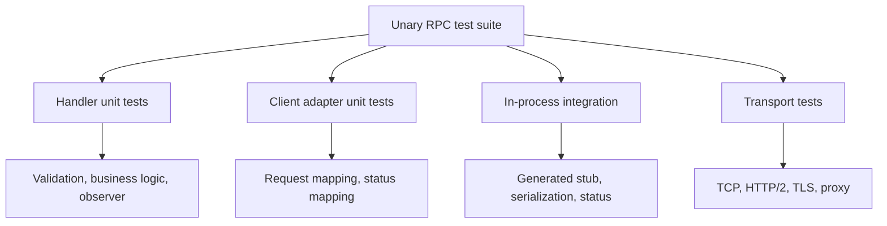

# Testing Unary Services and Clients

## 1. What Should Be Tested in a Unary RPC?

A unary RPC accepts one protobuf request and returns one protobuf response on success. On failure, the call ends with a non-`OK` gRPC status. Therefore, tests must verify both **data** and **how the call terminates**.

With Spring gRPC, test three boundaries:

1. **Handler/service:** requests are validated properly, business logic is invoked correctly, and the observer emits only one terminal result.
2. **Client adapter:** requests are built properly, the generated stub is invoked, and gRPC statuses are translated into appropriate application errors.
3. **gRPC integration:** requests flow through the generated stub, the server receives the exact message, and responses/statuses return to the client per contract.

Not every test needs to boot a Spring `ApplicationContext` or open a TCP port. Handler unit tests are fast and isolated; in-process integration tests verify real gRPC communication within the same process; real-transport tests cover TLS, HTTP/2, proxies, and deployment configuration.



## 2. Contract and Service Used in the Example

Suppose a product lookup service has one unary method:

```proto
syntax = "proto3";

package catalog.v1;

option java_package = "com.example.catalog.grpc";
option java_multiple_files = true;

service ProductQueryService {
  rpc GetProduct(GetProductRequest) returns (GetProductResponse);
}

message GetProductRequest {
  string product_id = 1;
}

message GetProductResponse {
  string product_id = 1;
  string name = 2;
}
```

Generated Java code provides `ProductQueryServiceGrpc`, `GetProductRequest`, and `GetProductResponse`. The Spring service can extend the generated base class:

```java
@GrpcService
public class ProductQueryGrpcService
        extends ProductQueryServiceGrpc.ProductQueryServiceImplBase {

    private final ProductCatalog catalog;

    public ProductQueryGrpcService(ProductCatalog catalog) {
        this.catalog = catalog;
    }

    @Override
    public void getProduct(
            GetProductRequest request,
            StreamObserver<GetProductResponse> observer) {

        String productId = request.getProductId().trim();

        if (productId.isEmpty()) {
            observer.onError(Status.INVALID_ARGUMENT
                    .withDescription("product_id must not be empty")
                    .asRuntimeException());
            return;
        }

        try {
            Product product = catalog.findById(productId)
                    .orElseThrow(() -> Status.NOT_FOUND
                            .withDescription("Product not found")
                            .asRuntimeException());

            observer.onNext(GetProductResponse.newBuilder()
                    .setProductId(product.id())
                    .setName(product.name())
                    .build());
            observer.onCompleted();

        } catch (StatusRuntimeException expected) {
            observer.onError(expected);

        } catch (RuntimeException unexpected) {
            observer.onError(Status.INTERNAL
                    .withDescription("Unable to process request")
                    .asRuntimeException());
        }
    }
}
```

`ProductCatalog` and `Product` are illustrative application types. In production code, distinguish known business exceptions from unexpected errors; the example above simply highlights the `INVALID_ARGUMENT`, `NOT_FOUND`, and `INTERNAL` branches.

The `StreamObserver` lifecycle is a critical part of the contract:

- Success: call `onNext(response)` once, then `onCompleted()`.
- Failure: call `onError(error)` and return.
- Never send a response after `onError`, and never emit multiple terminal signals.
- Never assume business errors will arrive as a response with an `error` field; the gRPC status is the terminal outcome of the RPC.

## 3. Unit Testing the Handler Without a Server

Unit tests invoke the service method directly and observe the `StreamObserver`. This checks handler logic without channels, transport, or a Spring context.

Create an observer that records emitted signals:

```java
final class RecordingObserver<T> implements StreamObserver<T> {

    private final List<T> values = new ArrayList<>();
    private Throwable error;
    private boolean completed;

    @Override
    public void onNext(T value) {
        values.add(value);
    }

    @Override
    public void onError(Throwable failure) {
        error = failure;
    }

    @Override
    public void onCompleted() {
        completed = true;
    }

    List<T> values() {
        return values;
    }

    Throwable error() {
        return error;
    }

    boolean completed() {
        return completed;
    }
}
```

Use a fake catalog with deterministic data:

```java
class ProductQueryGrpcServiceTest {

    private ProductQueryGrpcService service;

    @BeforeEach
    void setUp() {
        ProductCatalog catalog = id -> {
            if (id.equals("P-100")) {
                return Optional.of(new Product("P-100", "Keyboard"));
            }
            return Optional.empty();
        };

        service = new ProductQueryGrpcService(catalog);
    }

    @Test
    void emitsOneResponseAndCompletes() {
        RecordingObserver<GetProductResponse> observer =
                new RecordingObserver<>();

        service.getProduct(
                GetProductRequest.newBuilder()
                        .setProductId("P-100")
                        .build(),
                observer);

        assertEquals(1, observer.values().size());
        assertEquals("P-100", observer.values().get(0).getProductId());
        assertEquals("Keyboard", observer.values().get(0).getName());
        assertTrue(observer.completed());
        assertNull(observer.error());
    }

    @Test
    void rejectsBlankProductId() {
        RecordingObserver<GetProductResponse> observer =
                new RecordingObserver<>();

        service.getProduct(
                GetProductRequest.newBuilder()
                        .setProductId("   ")
                        .build(),
                observer);

        assertTrue(observer.values().isEmpty());
        assertFalse(observer.completed());
        assertEquals(
                Status.Code.INVALID_ARGUMENT,
                Status.fromThrowable(observer.error()).getCode());
    }

    @Test
    void returnsNotFoundForUnknownProduct() {
        RecordingObserver<GetProductResponse> observer =
                new RecordingObserver<>();

        service.getProduct(
                GetProductRequest.newBuilder()
                        .setProductId("missing")
                        .build(),
                observer);

        assertTrue(observer.values().isEmpty());
        assertFalse(observer.completed());
        assertEquals(
                Status.Code.NOT_FOUND,
                Status.fromThrowable(observer.error()).getCode());
    }
}
```

These tests do not cover protobuf serialization over transport, interceptors, or Spring bean registration. In return, they run fast and pinpoint which handler branch failed. You can also add a test where the catalog throws an exception to verify unexpected errors map to `INTERNAL` without leaking internal details.

## 4. In-Process Integration Tests for Generated Stubs

Handler unit tests do not prove client and server communicate properly over gRPC. `InProcessServerBuilder` and `InProcessChannelBuilder` provide in-process transport well suited for testing generated stubs, requests/responses, and statuses without opening TCP ports.

Example JUnit 5 fixture:

```java
class ProductQueryGrpcIntegrationTest {

    private Server server;
    private ManagedChannel channel;
    private ProductQueryServiceGrpc.ProductQueryServiceBlockingStub stub;

    @BeforeEach
    void startServer() throws IOException {
        ProductCatalog catalog = id -> id.equals("P-100")
                ? Optional.of(new Product("P-100", "Keyboard"))
                : Optional.empty();

        ProductQueryGrpcService service =
                new ProductQueryGrpcService(catalog);

        String serverName = InProcessServerBuilder.generateName();

        server = InProcessServerBuilder.forName(serverName)
                .directExecutor()
                .addService(service)
                .build()
                .start();

        channel = InProcessChannelBuilder.forName(serverName)
                .directExecutor()
                .build();

        stub = ProductQueryServiceGrpc.newBlockingStub(channel);
    }

    @AfterEach
    void stopServer() {
        if (channel != null) {
            channel.shutdownNow();
        }
        if (server != null) {
            server.shutdownNow();
        }
    }

    @Test
    void clientReceivesProductResponse() {
        GetProductResponse response = stub.getProduct(
                GetProductRequest.newBuilder()
                        .setProductId("P-100")
                        .build());

        assertEquals("P-100", response.getProductId());
        assertEquals("Keyboard", response.getName());
    }

    @Test
    void clientReceivesNotFoundStatus() {
        StatusRuntimeException error = assertThrows(
                StatusRuntimeException.class,
                () -> stub.getProduct(GetProductRequest.newBuilder()
                        .setProductId("missing")
                        .build()));

        assertEquals(
                Status.Code.NOT_FOUND,
                error.getStatus().getCode());
    }
}
```

`ProductCatalog`, `Product`, `ProductQueryGrpcService`, and generated classes are example project components. The test requires JUnit Jupiter and a `grpc-inprocess` dependency compatible with the active gRPC Java version.

`directExecutor()` is useful for small, deterministic tests, but does not model scheduling or contention in production transport. When services depend on executors, asynchronous callbacks, or cancellation, use a real executor and synchronize tests with latches/futures rather than assuming every callback runs immediately.

## 5. Testing Client Adapters and Status Mapping

In real applications, the application layer generally should not depend directly on `StatusRuntimeException`. The client adapter calls the stub and translates statuses into application exceptions or results.

Example adapter:

```java
@Service
public class ProductQueryClient {

    private final ProductQueryServiceGrpc.ProductQueryServiceBlockingStub stub;

    public ProductQueryClient(
            ProductQueryServiceGrpc.ProductQueryServiceBlockingStub stub) {
        this.stub = stub;
    }

    public ProductView getProduct(String productId) {
        try {
            GetProductResponse response = stub.getProduct(
                    GetProductRequest.newBuilder()
                            .setProductId(productId)
                            .build());

            return new ProductView(
                    response.getProductId(), response.getName());

        } catch (StatusRuntimeException failure) {
            if (failure.getStatus().getCode() == Status.Code.NOT_FOUND) {
                throw new ProductNotFoundException(productId, failure);
            }
            throw failure;
        }
    }
}
```

`ProductView` and `ProductNotFoundException` are project-defined application types. You can test the adapter using an in-process server as in the previous section, then inject the stub into the adapter and invoke `getProduct(...)`. When the product does not exist, the test verifies the adapter throws `ProductNotFoundException`; on success, it verifies the data was mapped properly.

A thorough client test should verify:

- The request builder receives the expected ID and required fields.
- The response maps into the expected application type.
- `NOT_FOUND`, `INVALID_ARGUMENT`, `UNAVAILABLE`, and `DEADLINE_EXCEEDED` are handled per contract.
- Unrecognized errors are preserved or translated into appropriate internal errors—never returning a dummy default object as if it succeeded.
- Retries, if present, are tested separately against the method's retry policy and idempotency semantics.

## 6. Testing Deadlines and Cancellation Without `sleep`

Deadlines are part of unary client behavior. To verify the client does not wait indefinitely, build a test service that responds slowly via a scheduler or future, then set a deadline shorter than the completion time.

Never use `Thread.sleep(...)` in tests to guess how far the server has progressed. Use `CountDownLatch`, `CompletableFuture`, or synchronization signals to confirm:

1. The server received the request.
2. The client received `DEADLINE_EXCEEDED`.
3. The server observed cancellation when the handler or downstream supports it.
4. The task was requested to stop and did not emit a late response.

Cancellation is cooperative. A running database query or already-committed side effect might not stop just because the client cancelled the RPC. Tests must verify what the system actually guarantees: the cancel signal propagates, resources are released where supported by APIs, and business state remains consistent.

For side-effecting RPCs, a timeout does not prove the server did not execute the operation. Retry tests must preserve the same idempotency key and verify no duplicate records are created.

## 7. Testing Metadata and Interceptors When Part of the Contract

When a service uses request metadata, response headers, or trailers, integration tests should verify them through interceptors—not only checking that the handler received the protobuf request.

A useful test matrix:

| Component | What to verify |
| --- | --- |
| Client interceptor | Request ID or trace metadata is attached to the right call. |
| Server interceptor | Metadata is read and bound to the handler's context. |
| Response headers | Client interceptor receives the expected headers. |
| Trailers | Client reads the error ID alongside the terminal status. |
| Concurrent calls | Metadata across two concurrent RPCs never mixes. |

Never use real sensitive metadata in tests. Use dummy tokens or test credentials, and verify logs never print secret values.

## 8. When Do You Need Real Transport Tests?

In-process tests bypass TCP sockets, TLS handshakes, the HTTP/2 network stack, and proxies. Add tests running a real server and channel when verification targets include:

- TLS certificates, trust chains, hostname verification, and mutual TLS.
- HTTP/2, load balancers, name resolvers, or service discovery.
- Header size limits and reverse proxy behavior.
- Spring configuration, interceptor registration, and real channel lifecycle.
- Timeouts/cancellation of external databases or HTTP clients.

You do not need all of these checks inside every unit test. Place them in appropriate integration/system suites so fast tests remain focused on unary service/client logic.

## 9. Principles for Reliable Tests

- **Deterministic data:** fake catalogs or database fixtures with explicit state; never depend on external services in unit tests.
- **No shared mutable state across tests:** each test creates its own service, channel, and observer or cleanly resets fixtures.
- **Clean up resources:** shut down channels/servers and close test-created schedulers/executors.
- **Do not assert non-contract implementation details:** focus on responses, statuses, side effects, and observer lifecycles.
- **Explicit synchronization:** use latches/futures or `StepVerifier`; avoid `sleep` and razor-thin timeouts.
- **Assert status codes:** do not assert free-form description text unless descriptions are part of the contract.
- **Separate test layers:** unit tests for logic; in-process for gRPC contracts; transport tests for networking and security.

## 10. Practice Exercise

Create a unary method `GetProduct` and implement tests across three layers:

1. Handler unit tests for a valid request, empty ID, product not found, and repository failure.
2. In-process integration tests invoking the generated blocking stub, asserting responses and status codes.
3. Client adapter tests verifying response mapping and translating `NOT_FOUND` into an application exception.

Add a deadline test with a slow-responding service and use synchronization signals to verify cancellation. If the method uses metadata, assert the request ID in the server interceptor and the error ID in trailers. Run tests repeatedly in isolation to catch ordering dependencies or shared state.

**Self-check:** Unit tests prove the handler behaves properly; in-process integration tests prove generated clients and servers obey the unary contract; client adapter tests prove statuses and responses translate accurately into the application layer. Keep separate transport tests for TLS, HTTP/2, and proxies. Every test suite should cover both successful responses and error paths while shutting down channels, servers, and executors afterward.
