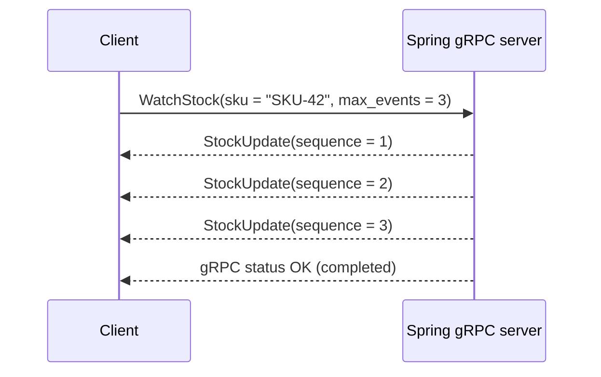

# Server streaming returning multiple responses

## 1. The problem and the role of server streaming

In the **SPRING_GRPC** module, we develop gRPC services in the Spring ecosystem: defining contracts with Protocol Buffers, generating Java code, implementing clients/servers, and handling metadata, deadlines, statuses, interceptors, TLS, testing, and operational monitoring. The **Server streaming** chapter focuses on one specific capability: **the client sends a single request, and the server returns multiple responses over the same RPC**.

For example: an inventory management screen requests to watch item SKU `SKU-42`. Instead of calling a unary RPC every second to ask for the stock quantity, the client opens a single `WatchStock` RPC. The server sends updates one by one while the watch session remains active; the client receives and displays each update immediately.

Core characteristics:

- **One input request:** the client sends only a single request message to start the RPC.
- **Multiple output responses:** the server calls `onNext(...)` multiple times, in the exact sending order within the **same RPC**.
- **Defined termination:** the server completes with `onCompleted()` or terminates with an error via `onError(...)`; the client can also cancel the RPC. These two terminal signals must not be sent together.
- **Incremental reading:** the client can process each response without waiting for the server to produce the entire list.

| RPC type | Request from client | Response from server | Example |
|---|---|---|---|
| Unary | One | One | Look up a single product |
| **Server streaming** | **One** | **Many** | Watch inventory updates |
| Client streaming | Many | One | Send multiple measurement samples for aggregation |
| Bidirectional streaming | Many | Many | Exchange bidirectional events |

Typical exchange flow:



The transport is HTTP/2 with gRPC's framing and flow control mechanisms. Each `StockUpdate` remains a separate Protocol Buffers message. **Server streaming is not synonymous with returning a `repeated` field in a unary response:** `repeated` only creates a single message containing a list, whereas streaming gradually transmits multiple messages over the lifetime of a single RPC.

## 2. Declaring the Protocol Buffers contract

Suppose the application uses the file `src/main/proto/inventory.proto`:

```proto
syntax = "proto3";

package inventory.v1;

option java_multiple_files = true;
option java_package = "com.example.inventory.rpc";
option java_outer_classname = "InventoryProto";

service InventoryService {
  // The client sends one WatchStockRequest; the server emits multiple StockUpdate messages.
  rpc WatchStock(WatchStockRequest) returns (stream StockUpdate);
}

message WatchStockRequest {
  string sku = 1;
  int32 max_events = 2; // Limits the number of events in this finite example.
}

message StockUpdate {
  string sku = 1;
  int64 quantity = 2;
  int64 sequence = 3;
  int64 observed_at_epoch_ms = 4;
}
```

The **`stream` keyword before the response type** is the deciding factor. If `stream` is omitted, the method becomes unary. `max_events` helps the exercise terminate deterministically; in a real system, a watch session may be long-lived and stop when the client cancels, the deadline expires, or the server closes the stream.

The build process uses `protoc`, the protobuf Java generator, and the `protoc-gen-grpc-java` plugin compatible with the project's gRPC Java version. Generated classes typically include:

- `WatchStockRequest` and `StockUpdate`: immutable messages with `newBuilder()` to construct values.
- `InventoryServiceGrpc.InventoryServiceImplBase`: base class for implementing the server-side service.
- `InventoryServiceGrpc.newBlockingStub(channel)` and `newStub(channel)`: two ways to consume the stream on the client side.

The Java code below assumes the Spring Boot project has integrated **Spring gRPC server**, enabled code generation from `.proto`, and registered Spring beans implementing gRPC services. How the build plugin, starter, and port configuration are declared depends on the Spring gRPC version used in the project; there is no need to hand-write classes already generated from the contract.

## 3. Implementing a server stream in Spring

With gRPC Java, the server receives a `StreamObserver<StockUpdate>`. Each call to `onNext(event)` sends a new response; `onCompleted()` signals successful completion. The following example generates up to 100 simulated updates, one update per second, using a scheduler to avoid blocking the RPC handling thread while waiting.

```java
package com.example.inventory;

import com.example.inventory.rpc.InventoryServiceGrpc;
import com.example.inventory.rpc.StockUpdate;
import com.example.inventory.rpc.WatchStockRequest;
import io.grpc.Status;
import io.grpc.stub.ServerCallStreamObserver;
import io.grpc.stub.StreamObserver;
import jakarta.annotation.PreDestroy;
import org.springframework.stereotype.Service;

import java.util.concurrent.Executors;
import java.util.concurrent.ScheduledExecutorService;
import java.util.concurrent.ScheduledFuture;
import java.util.concurrent.TimeUnit;
import java.util.concurrent.atomic.AtomicBoolean;
import java.util.concurrent.atomic.AtomicInteger;
import java.util.concurrent.atomic.AtomicReference;

@Service
public class InventoryStreamingService
        extends InventoryServiceGrpc.InventoryServiceImplBase {

    // Shared executor for demo; do not create a new thread per RPC.
    private final ScheduledExecutorService scheduler =
            Executors.newScheduledThreadPool(4);

    @Override
    public void watchStock(WatchStockRequest request,
                           StreamObserver<StockUpdate> responseObserver) {
        String sku = request.getSku().trim();
        int maxEvents = request.getMaxEvents();

        if (sku.isEmpty() || maxEvents < 1 || maxEvents > 100) {
            responseObserver.onError(Status.INVALID_ARGUMENT
                    .withDescription("sku must be non-empty; max_events must be 1..100")
                    .asRuntimeException());
            return;
        }

        ServerCallStreamObserver<StockUpdate> out =
                (ServerCallStreamObserver<StockUpdate>) responseObserver;
        AtomicBoolean stopped = new AtomicBoolean(false);
        AtomicInteger sent = new AtomicInteger(0);
        AtomicReference<ScheduledFuture<?>> task = new AtomicReference<>();

        // When client cancels or deadline expires: stop background work for this RPC.
        out.setOnCancelHandler(() -> {
            stopped.set(true);
            cancel(task.get());
        });

        Runnable emit = () -> {
            if (stopped.get() || out.isCancelled()) {
                stopped.set(true);
                cancel(task.get());
                return;
            }

            // For a simulated producer, we can skip a tick when the client is not ready.
            if (!out.isReady()) {
                return;
            }

            try {
                int sequence = sent.incrementAndGet();
                StockUpdate update = StockUpdate.newBuilder()
                        .setSku(sku)
                        .setQuantity(100 - sequence) // Demo data, not real inventory.
                        .setSequence(sequence)
                        .setObservedAtEpochMs(System.currentTimeMillis())
                        .build();

                out.onNext(update);

                if (sequence == maxEvents && stopped.compareAndSet(false, true)) {
                    out.onCompleted();
                    cancel(task.get());
                }
            } catch (RuntimeException ex) {
                if (stopped.compareAndSet(false, true)) {
                    out.onError(Status.INTERNAL
                            .withDescription("Cannot produce stock update")
                            .asRuntimeException());
                }
                cancel(task.get());
            }
        };

        ScheduledFuture<?> future = scheduler.scheduleAtFixedRate(
                emit, 0, 1, TimeUnit.SECONDS);
        task.set(future);
        // Handle the case where the RPC is cancelled right before storing the future.
        if (stopped.get()) {
            future.cancel(false);
        }
    }

    private static void cancel(ScheduledFuture<?> future) {
        if (future != null) {
            future.cancel(false);
        }
    }

    @PreDestroy
    public void stop() {
        scheduler.shutdownNow();
    }
}
```

In a Spring gRPC application with a mechanism to auto-register `BindableService` beans from the Spring context, `@Service` allows the implementation class to be managed by Spring and exposed on the gRPC server. If the project uses another Spring gRPC integration library, follow that integration's service registration rules. The `StreamObserver` logic and `.proto` contract remain unchanged.

Key points to read carefully:

1. **Validate before emitting data.** Invalid requests are terminated with `Status.INVALID_ARGUMENT`, without proceeding to `onNext` or `onCompleted`.
2. **A single sequential write path.** Calls to `onNext`, `onCompleted`, and `onError` all go through a single scheduler task per RPC. Do not call `onNext` concurrently on the same observer from multiple workers without serializing writes yourself; `StreamObserver` is not thread-safe for concurrent write calls by default.
3. **Only one terminal signal.** `AtomicBoolean stopped` guards the termination path when a cancellation event and a periodic task occur simultaneously.
4. **Lifecycle management.** `setOnCancelHandler` stops the task when the client cancels; `@PreDestroy` releases the shared executor when the Spring application shuts down.
5. **Respect receiver readiness.** `isReady()` is a useful flow control signal, but it is not a durable queuing solution. The example skips an emission tick when not ready because the data is simulated. With real events, you must choose a buffering, coalescing, replay, or stream-termination policy so required events are not silently dropped.

The sample code is intentionally limited to a finite stream and a simulated data source. When reading updates from a database, Kafka, or an event bus, you should have a subscribe/unsubscribe mechanism tied to the RPC lifecycle, a shared executor or publisher, a limit on the number of watch sessions, and a clear backpressure policy.

## 4. Java client receiving individual responses

### 4.1. Blocking stub: consuming with `Iterator`

Suitable for synchronous tasks or demo snippets where the calling thread can accept waiting for the next update:

```java
import com.example.inventory.rpc.InventoryServiceGrpc;
import com.example.inventory.rpc.StockUpdate;
import com.example.inventory.rpc.WatchStockRequest;
import io.grpc.ManagedChannel;
import io.grpc.ManagedChannelBuilder;
import io.grpc.StatusRuntimeException;

import java.util.Iterator;
import java.util.concurrent.TimeUnit;

public class InventoryBlockingClient {
    public static void main(String[] args) {
        // Use plaintext only in trusted development environments.
        ManagedChannel channel = ManagedChannelBuilder
                .forAddress("localhost", 9090)
                .usePlaintext()
                .build();

        try {
            WatchStockRequest request = WatchStockRequest.newBuilder()
                    .setSku("SKU-42")
                    .setMaxEvents(3)
                    .build();

            Iterator<StockUpdate> updates = InventoryServiceGrpc
                    .newBlockingStub(channel)
                    .withDeadlineAfter(10, TimeUnit.SECONDS)
                    .watchStock(request);

            while (updates.hasNext()) { // May block while waiting for a new message.
                StockUpdate update = updates.next();
                System.out.printf("#%d %s: %d%n",
                        update.getSequence(), update.getSku(), update.getQuantity());
            }
            System.out.println("Stream completed successfully");
        } catch (StatusRuntimeException ex) {
            System.err.println("RPC failed: " + ex.getStatus());
        } finally {
            channel.shutdownNow();
        }
    }
}
```

Sample output (when the stream completes before the deadline):

```text
#1 SKU-42: 99
#2 SKU-42: 98
#3 SKU-42: 97
Stream completed successfully
```

In a blocking client, `hasNext()` or `next()` can throw `StatusRuntimeException` if the stream fails or the deadline expires. The fact that the `Iterator` has already returned a few events does not prove the entire RPC succeeded; only when iteration finishes normally is the stream considered successful.

The snippet above uses port `9090` **as an example**. Point to the actual port of your Spring gRPC server. In a Spring system, reuse an application-managed channel instead of creating a new channel for every request.

### 4.2. Async stub: callback-based handling

For event-handling tasks that should not block the calling thread, use the asynchronous stub and receive each message via `StreamObserver`:

```java
WatchStockRequest request = WatchStockRequest.newBuilder()
        .setSku("SKU-42")
        .setMaxEvents(3)
        .build();

InventoryServiceGrpc.newStub(channel)
        .withDeadlineAfter(10, TimeUnit.SECONDS)
        .watchStock(request, new StreamObserver<StockUpdate>() {
            @Override
            public void onNext(StockUpdate update) {
                System.out.println("Received sequence " + update.getSequence());
            }

            @Override
            public void onError(Throwable error) {
                System.err.println("Stream failed: " +
                        Status.fromThrowable(error));
            }

            @Override
            public void onCompleted() {
                System.out.println("Stream completed");
            }
        });
```

The async snippet assumes `channel`, `StreamObserver`, `StockUpdate`, `WatchStockRequest`, `InventoryServiceGrpc`, `TimeUnit`, and `Status` are already imported. Calling `watchStock(...)` returns immediately; therefore, the application must keep the channel and processing resources alive until `onCompleted` or `onError`. In a Spring service, this is typically handled via a bean whose lifecycle is managed by Spring.

## 5. RPC lifecycle: completion, error, deadline, and cancellation

| Scenario | Server side | Client side |
|---|---|---|
| All responses sent | `onCompleted()` once | `Iterator` exhausted or `onCompleted()` callback |
| Invalid request | `onError(Status.INVALID_ARGUMENT...)` | Receives `INVALID_ARGUMENT` status |
| Internal error while emitting | `onError(Status.INTERNAL...)` | May have received some events, then `onError` |
| Client cancels | Task receives cancel signal, stops emitting, and releases resources | Receives cancellation termination, usually `CANCELLED` |
| Deadline expires | Runtime cancels RPC; server should detect and stop work | Usually receives `DEADLINE_EXCEEDED` |
| Connection lost | Cannot guarantee final responses reached the client | Usually receives `UNAVAILABLE` or corresponding connection error |

**The deadline applies to the entire RPC**, not refreshed automatically after each message. For example, `withDeadlineAfter(10, SECONDS)` limits the total time from the start of the call until completion; if you want a stream to run for hours, you must design appropriate timeouts, reconnection, and checkpointing. Do not keep infinite streams open without a lifecycle strategy.

**Cancellation is a stop condition, not a business update.** When the client cancels or the deadline expires, the server must stop the associated listener/subscription/timer. Do not attempt to call `onCompleted()` after the client has cancelled. On an async client, you can cancel the RPC through `ClientCallStreamObserver` or the gRPC `Context`/cancellation API appropriate for how the call was initiated.

**No automatic replay.** If the stream disconnects after `sequence = 7`, a client wishing to resume exactly from 8 needs a contract supporting a cursor/offset, persisted state, or a snapshot + delta mechanism. gRPC does not automatically recover lost business messages.

## 6. Metadata, security, and operability

Server streaming uses the same gRPC metadata mechanism: request headers sent by the client, response headers that can be sent before the first message, and trailers and status at the end of the RPC. Metadata is suitable for access tokens, correlation IDs, or control information; continuously changing business data should belong in `StockUpdate`, not placed into headers for individual events.

In a Spring gRPC application, **server/client interceptors** are commonly used for authentication, recording trace IDs, logging RPC open/close times, and recording termination status codes. Interceptors should recognize that this is a long-lived RPC: stream duration, message count, errors, and cancellations must be tracked separately for easier diagnostics. Avoid logging tokens, PII, or sensitive payloads.

Regarding connections, `.usePlaintext()` in the example is only reasonable for trusted internal dev environments. In production deployments, configure **TLS** for the server and client channel, verifying certificates/hostnames; if mutual authentication is needed, mTLS can be used. Use client authentication credentials in metadata according to system policy, and enforce authorization on `sku` before opening the data stream.

Signals to monitor for a server streaming service:

| Metric | Meaning |
|---|---|
| Number of open RPCs | Predict load, enforce concurrent stream limits |
| RPC duration and termination status | Detect deadlines, cancellations, system errors |
| Responses and bytes sent per RPC | Track traffic, identify overly slow clients |
| Latency from source event to emission | Evaluate real-time performance of the stream |
| Buffer depth or count of `!isReady()` occurrences | Detect backpressure and risk of memory exhaustion |
| Remaining tasks/listeners after client leaves | Detect resource leaks |

Systems with many clients watching the same topic should share the emission source and manage subscriptions, rather than opening one database poll and one thread per connection. Set limits on concurrent streams, emission rates, message sizes, and buffers according to infrastructure capacity.

## 7. Testing server streaming

You can test the exact gRPC contract without opening a network port using gRPC Java's **in-process transport**. The JUnit 5 example below uses the service from section 3, stubs generated from `.proto`, and the in-process gRPC modules compatible with the project's gRPC Java version:

```java
import com.example.inventory.InventoryStreamingService;
import com.example.inventory.rpc.InventoryServiceGrpc;
import com.example.inventory.rpc.StockUpdate;
import com.example.inventory.rpc.WatchStockRequest;
import io.grpc.ManagedChannel;
import io.grpc.Server;
import io.grpc.inprocess.InProcessChannelBuilder;
import io.grpc.inprocess.InProcessServerBuilder;
import org.junit.jupiter.api.Test;

import java.util.ArrayList;
import java.util.List;
import java.util.concurrent.TimeUnit;

import static org.junit.jupiter.api.Assertions.assertEquals;

class InventoryStreamingServiceTest {
    @Test
    void emitsOrderedUpdatesAndCompletes() throws Exception {
        String name = InProcessServerBuilder.generateName();
        InventoryStreamingService service = new InventoryStreamingService();
        Server server = InProcessServerBuilder.forName(name)
                .directExecutor()
                .addService(service)
                .build()
                .start();
        ManagedChannel channel = InProcessChannelBuilder.forName(name)
                .directExecutor()
                .build();

        try {
            WatchStockRequest request = WatchStockRequest.newBuilder()
                    .setSku("SKU-42")
                    .setMaxEvents(3)
                    .build();

            List<StockUpdate> received = new ArrayList<>();
            InventoryServiceGrpc.newBlockingStub(channel)
                    .withDeadlineAfter(5, TimeUnit.SECONDS)
                    .watchStock(request)
                    .forEachRemaining(received::add);

            assertEquals(3, received.size());
            assertEquals(List.of(1L, 2L, 3L),
                    received.stream().map(StockUpdate::getSequence).toList());
            assertEquals("SKU-42", received.get(0).getSku());
        } finally {
            channel.shutdownNow();
            server.shutdownNow();
            service.stop();
        }
    }
}
```

This is an **integration test at the gRPC transport layer**: it uses real proto, stubs, serialization, and statuses, without starting the entire Spring Boot context. You should add `@SpringBootTest` tests in a real project to verify Spring's registration of `BindableService`, interceptors, TLS, and port configuration according to the starter in use.

Additional essential test cases:

1. Send an empty `sku` or `max_events = 0`; verify status `INVALID_ARGUMENT` and that no valid events are received.
2. Use a deadline shorter than the stream duration; verify the client sees `DEADLINE_EXCEEDED` and the emission task is stopped.
3. Cancel after the first event; verify no active subscription/timer remains for the cancelled RPC.
4. Make the client read slowly; measure memory/buffers and verify the backpressure policy.
5. Inject an error after a few events; verify the client does not treat the stream as successful and there is no `onCompleted` signal after `onError`.

## 8. Common pitfalls and when to choose server streaming

| Pitfall | Consequence | How to handle |
|---|---|---|
| Declaring `returns (StockUpdate)` instead of `returns (stream StockUpdate)` | RPC is generated as unary | Put `stream` on the response in proto |
| Collecting all data into `repeated` and returning once | Client must wait for the entire dataset | Use multiple `onNext` calls when incremental updates are needed |
| Calling `onNext` from multiple threads on the same observer | Ordering/races not guaranteed | Serialize writes per RPC |
| Calling both `onError` and `onCompleted` | Invalid termination protocol | Only one terminal signal |
| Ignoring cancel/deadline | Worker, listener, or connection leaks | Remove subscription, cancel tasks immediately when RPC closes |
| Emitting continuously despite slow client | Buffers grow, latency and RAM increase | Monitor readiness and apply backpressure |
| Automatically retrying without sequence/cursor | Missing or duplicate data | Design resume and deduplication |

**Choose server streaming** when a single request can produce multiple results sequentially over time or when a large result can be processed incrementally: tracking processing progress, order status updates, streaming log chunks, or continuous pagination from the server. If only a single result is needed and there is no benefit from incremental reception, unary is simpler. If the client also needs to send multiple messages within the same RPC, consider client streaming or bidirectional streaming.

### Knowledge self-check

- In proto, what distinguishes `returns (stream StockUpdate)` from `returns (StockUpdate)`?
- Why might a client have received three messages yet the RPC still ends in an error?
- When the client cancels mid-stream, what resources must the server release?
- Why is `isReady()` only part of a backpressure strategy?
- To resume from the 8th event after a network drop, what needs to be added to the contract?

**Key takeaway:** A server streaming RPC has one request, multiple ordered responses, and exactly one outcome. A solid implementation in Spring gRPC must manage both the **emitted data** and the **stream lifecycle**: validation, flow control, cancellation, deadlines, status, security, testing, and monitoring.
