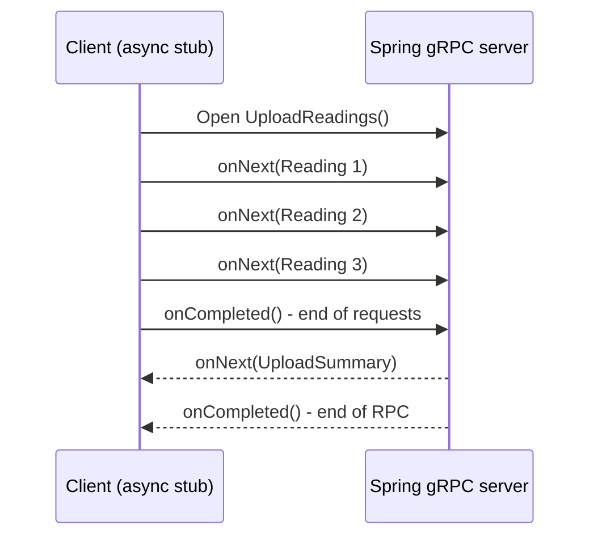

# Client streaming receives multiple requests

**Chapter:** Client streaming  
**Context:** Spring gRPC lets you build Java services based on Protocol Buffers contracts, using generated code to exchange data between client and server. This lesson focuses on the case where **the client sends multiple requests in a single RPC**, and the server aggregates the result and returns **a single response**.

## 1. Learning objectives

After this lesson, you will be able to:

- Distinguish client streaming from unary, server streaming, and bidirectional streaming.
- Define an RPC that accepts a stream of requests using the `stream` syntax in `.proto`.
- Implement a Spring gRPC server that receives each message via `StreamObserver.onNext()`, handling stream completion and errors.
- Use an **asynchronous stub** to send multiple requests over the same RPC and receive a single final result.
- Explain the impact of deadlines, status, flow control, RPC cancellation, and mid-stream errors; write in-process gRPC tests.

## 2. One RPC, multiple requests, one response

In a **client streaming RPC**, the client opens a call, pushes **0..N** messages of the same type one by one to the server, and then signals that it has finished sending. The server receives the messages in stream order, can update its aggregated state after each message, and emits **only one** success response when receiving finishes. If an error occurs, the RPC ends with a gRPC status instead of a success response.

| RPC Type | Request | Response | Example |
| --- | --- | --- | --- |
| Unary | One message | One message | Look up order details |
| Server streaming | One message | Multiple messages | Monitor events |
| **Client streaming** | **Multiple messages** | **One message** | Send a batch of sensor readings |
| Bidirectional streaming | Multiple messages | Multiple messages | Two-way chat |

Example: a device collects three temperature readings `21.5`, `22.0`, `20.8`. Instead of calling a unary RPC three times, the client opens `UploadReadings` once and sends three `Reading` messages. The server counts the records, computes the sum, and returns `UploadSummary(accepted_count = 3, sum_values = 64.3)`.



gRPC messages travel over HTTP/2 on the same stream. **Message ordering within a stream is preserved**, but the total number of requests does not have to be known upfront in protobuf. Calling `onCompleted()` on the sender side only means **no more requests will be sent**; it does not automatically mean the client has already received the response.

## 3. Defining the Protocol Buffers contract

Create the file `src/main/proto/telemetry.proto`:

```proto
syntax = "proto3";

package telemetry.v1;
option java_package = "com.example.telemetry.grpc";
option java_multiple_files = true;

service TelemetryService {
  // Client sends multiple Readings; server returns a single UploadSummary.
  rpc UploadReadings(stream Reading) returns (UploadSummary);
}

message Reading {
  string sensor_id = 1;
  int64 recorded_at_epoch_ms = 2;
  double value = 3;
}

message UploadSummary {
  int32 accepted_count = 1;
  double sum_values = 2;
}
```

The key point is `stream Reading` **on the parameter side** of the RPC. `returns (UploadSummary)` does not have `stream`, because the server returns only one success response. If you change it to `returns (stream UploadSummary)`, that becomes **bidirectional streaming**, which is a different contract.

When the Protocol Buffers plugin and `protoc-gen-grpc-java` are configured in the project, the build generates `Reading`, `UploadSummary`, and `TelemetryServiceGrpc` into the generated sources directory. You **do not write these classes by hand**. The generated server method has the form:

```java
StreamObserver<Reading> uploadReadings(
    StreamObserver<UploadSummary> responseObserver);
```

Here, `responseObserver` is the channel for the **server to send the result back to the client**; the returned `StreamObserver<Reading>` is the channel for the **server to receive each request**. The two observers serve different roles, even though both use the `StreamObserver` interface.

## 4. Handling the stream on the Spring gRPC server

The example below uses `@GrpcService` so Spring registers the implementation with the gRPC server. Whenever a `UploadReadings` call starts, the method creates an observer **dedicated to that call**. The `count` and `sum` variables are not shared across clients.

```java
package com.example.telemetry.server;

import com.example.telemetry.grpc.Reading;
import com.example.telemetry.grpc.TelemetryServiceGrpc;
import com.example.telemetry.grpc.UploadSummary;
import io.grpc.Status;
import io.grpc.stub.StreamObserver;
import org.springframework.grpc.server.service.GrpcService;

@GrpcService
public class TelemetryGrpcService
        extends TelemetryServiceGrpc.TelemetryServiceImplBase {

    private static final int MAX_READINGS = 10_000;

    @Override
    public StreamObserver<Reading> uploadReadings(
            StreamObserver<UploadSummary> responseObserver) {

        return new StreamObserver<>() {
            private int count;
            private double sum;
            private boolean closed;

            @Override
            public void onNext(Reading reading) {
                if (closed) {
                    return;
                }

                if (reading.getSensorId().isBlank()
                        || reading.getRecordedAtEpochMs() <= 0
                        || !Double.isFinite(reading.getValue())) {
                    fail(Status.INVALID_ARGUMENT, "Invalid Reading");
                    return;
                }

                if (count >= MAX_READINGS) {
                    fail(Status.RESOURCE_EXHAUSTED,
                            "Stream exceeded the limit of 10,000 records");
                    return;
                }

                count++;
                sum += reading.getValue();
            }

            @Override
            public void onError(Throwable error) {
                // Client cancelled or transport failed:
                // stop processing state and do not send a success response.
                closed = true;
            }

            @Override
            public void onCompleted() {
                if (closed) {
                    return;
                }

                closed = true;
                UploadSummary summary = UploadSummary.newBuilder()
                        .setAcceptedCount(count)
                        .setSumValues(sum)
                        .build();
                responseObserver.onNext(summary);
                responseObserver.onCompleted();
            }

            private void fail(Status status, String description) {
                closed = true;
                responseObserver.onError(
                        status.withDescription(description).asRuntimeException());
            }
        };
    }
}
```

The processing flow has three important callbacks:

| Callback on the server's request observer | Meaning | Typical action |
| --- | --- | --- |
| `onNext(reading)` | Received another request | Validate data, update count/sum |
| `onCompleted()` | Client has finished sending requests | Emit exactly one `UploadSummary`, then complete the response |
| `onError(error)` | Client cancelled or input stream encountered an error | Stop processing, release resources, log appropriately |

If the data is invalid, the server calls `responseObserver.onError(Status.INVALID_ARGUMENT...)`; this **terminates the RPC with an error**, so do not call `responseObserver.onNext()` or `onCompleted()` afterward. Once an observer has terminated with `onCompleted` or `onError`, do not send any further events to that observer.

The 10,000-record limit example illustrates an important principle: even when the server only keeps `count` and `sum` in constant memory, **the processing time and resources of a stream must still be bounded**. If the business logic needs to buffer the whole batch in RAM, you must set a total size limit, not just a per-message size limit.

## 5. Configuring the client and sending multiple requests

In a Spring gRPC application that already has the starter and Java code generated from protobuf, you can configure a channel named `telemetry` pointing to a locally running server:

```yaml
# Client application.yml (development environment example)
spring:
  grpc:
    client:
      channels:
        telemetry:
          address: static://localhost:9090
```

Create an **asynchronous stub** from the channel. Client streaming in gRPC Java uses the async stub because the call needs to return an observer so the client can send requests sequentially.

```java
package com.example.telemetry.client;

import com.example.telemetry.grpc.TelemetryServiceGrpc;
import org.springframework.context.annotation.Bean;
import org.springframework.context.annotation.Configuration;
import org.springframework.grpc.client.GrpcChannelFactory;

@Configuration(proxyBeanMethods = false)
public class TelemetryClientConfig {

    @Bean
    TelemetryServiceGrpc.TelemetryServiceStub telemetryStub(
            GrpcChannelFactory channelFactory) {
        return TelemetryServiceGrpc.newStub(
                channelFactory.createChannel("telemetry"));
    }
}
```

To retrieve the response when the server finishes, the client wraps the callbacks in a `CompletableFuture`. This example takes a small, finite list; **flow control for large data sources** is covered in section 7.

```java
package com.example.telemetry.client;

import com.example.telemetry.grpc.Reading;
import com.example.telemetry.grpc.TelemetryServiceGrpc;
import com.example.telemetry.grpc.UploadSummary;
import io.grpc.stub.StreamObserver;
import java.util.List;
import java.util.Objects;
import java.util.concurrent.CompletableFuture;
import java.util.concurrent.TimeUnit;
import org.springframework.stereotype.Service;

@Service
public class TelemetryUploadClient {

    private final TelemetryServiceGrpc.TelemetryServiceStub stub;

    public TelemetryUploadClient(
            TelemetryServiceGrpc.TelemetryServiceStub stub) {
        this.stub = stub;
    }

    public CompletableFuture<UploadSummary> upload(List<Reading> readings) {
        Objects.requireNonNull(readings, "readings");
        CompletableFuture<UploadSummary> result = new CompletableFuture<>();

        StreamObserver<UploadSummary> responseObserver =
                new StreamObserver<>() {
                    private UploadSummary summary;
                    private int responseCount;

                    @Override
                    public void onNext(UploadSummary value) {
                        summary = value;
                        responseCount++;
                    }

                    @Override
                    public void onError(Throwable error) {
                        result.completeExceptionally(error);
                    }

                    @Override
                    public void onCompleted() {
                        if (responseCount != 1) {
                            result.completeExceptionally(
                                    new IllegalStateException(
                                            "Expected exactly one UploadSummary"));
                        } else {
                            result.complete(summary);
                        }
                    }
                };

        // Deadline applies to the entire RPC, including sending time.
        StreamObserver<Reading> requestObserver = stub
                .withDeadlineAfter(5, TimeUnit.SECONDS)
                .uploadReadings(responseObserver);

        try {
            for (Reading reading : readings) {
                requestObserver.onNext(reading);
            }
            // No more Readings; server can finalize the calculation.
            requestObserver.onCompleted();
        } catch (RuntimeException sendError) {
            result.completeExceptionally(sendError);
            try {
                requestObserver.onError(sendError);
            } catch (RuntimeException ignored) {
                // Stream may have already ended due to server/deadline.
            }
        }

        return result;
    }
}
```

Using the client with three readings:

```java
List<Reading> batch = List.of(
        Reading.newBuilder()
                .setSensorId("sensor-01")
                .setRecordedAtEpochMs(1_700_000_000_000L)
                .setValue(21.5)
                .build(),
        Reading.newBuilder()
                .setSensorId("sensor-01")
                .setRecordedAtEpochMs(1_700_000_001_000L)
                .setValue(22.0)
                .build(),
        Reading.newBuilder()
                .setSensorId("sensor-01")
                .setRecordedAtEpochMs(1_700_000_002_000L)
                .setValue(20.8)
                .build()
);

UploadSummary summary = client.upload(batch)
        .get(6, TimeUnit.SECONDS); // Block only for demo/testing.

System.out.println(summary.getAcceptedCount()); // 3
System.out.println(summary.getSumValues());      // approximately 64.3
```

`client.upload(batch)` creates **a single** RPC. Each `requestObserver.onNext(reading)` sends another message **on that RPC**. `requestObserver.onCompleted()` is very easy to forget: if the client keeps the stream open forever, the server in this example has no signal to return a success result.

In an asynchronous application, chain with `thenApply`, `thenAccept`, or map the future to the web layer's return type; `get()` is only suitable in demos/tests or at boundaries where you intentionally block a thread. When `responseObserver.onError()` occurs, the future completes exceptionally; you can use `Status.fromThrowable(cause)` after unwrapping `CompletionException`/`ExecutionException` to classify the gRPC status.

## 6. Lifecycle, errors, and the meaning of stream completion

| Scenario | What client/server observes | Outcome |
| --- | --- | --- |
| Send 3 requests then client `onCompleted()` | Server receives 3 `onNext`, then `onCompleted` | Server returns one `UploadSummary` |
| Send 0 requests then client `onCompleted()` | Server receives no `onNext`, still receives `onCompleted` | Example returns `accepted_count = 0` |
| Request invalid per business rules | Server returns `INVALID_ARGUMENT` via `onError` | Client receives no success summary |
| Record limit exceeded | Server returns `RESOURCE_EXHAUSTED` | RPC is terminated |
| Deadline expires before completion | Client typically observes `DEADLINE_EXCEEDED` | Must not assume a result was produced |
| Client cancels or connection drops | Server sees call cancellation/error when notified | Clean up resources, do not return success |

Rules to remember:

1. **Request `onCompleted` and response `onCompleted` are distinct.** The client closes the send half so the server knows there is no more data; the server only closes the response half after emitting the summary.
2. **`onError` is a terminal event.** Do not continue sending data or treat the batch as successfully acknowledged.
3. **A mid-stream error can leave side effects.** If the server writes to the database immediately inside `onNext`, a portion of the records may already be saved before the client times out. Proactively design transactions, staging writes, idempotency keys, or partial-processing results according to business requirements.
4. **Retries are not safe by default.** For write operations, a timeout does not prove the server did not process the data. Use a unique batch identifier and deduplication mechanisms if you want to retry.
5. **Deadlines cover the entire RPC stream.** A 5-second deadline on the stub does not mean each `onNext` gets an extra 5 seconds; sending, processing, and receiving the result all share that budget.

## 7. Operating with large data sources

The `List<Reading>` example above suits small batches already in memory. When streaming data from large files, devices, or queues, pay attention to:

- **Flow control / backpressure:** Do not push millions of `onNext` calls back-to-back without checking sending capacity. In gRPC Java, the client can use `ClientResponseObserver` to obtain a `ClientCallStreamObserver`, check `isReady()`, and register `setOnReadyHandler(...)` to emit more data when the transport is ready. `isReady()` is a buffering/sending capacity signal, **not a business ACK**.
- **Sender-side synchronization:** `StreamObserver` is not guaranteed to be thread-safe when multiple threads call `onNext` concurrently. If multiple threads produce data, serialize write calls to the same request observer or use a queue with a single emitter task.
- **Resource limits:** Bound the number of requests, total bytes, RPC duration, and accumulated memory. Configure per-message size limits separately from total stream limits; streaming does not automatically eliminate overload risks.
- **Security:** Use TLS to protect data on production networks. Pass identity/authentication via gRPC `Metadata` and interceptors where appropriate, instead of stuffing tokens into every `Reading`. Do not log tokens or full sensitive payloads.
- **Observability:** Track active streams, records per batch, batch size, RPC duration, gRPC status, and deadline/cancellation rates. Interceptors and Spring's metrics/tracing systems can provide per-RPC-method observability.

If the business logic requires the server to report a result after **each** request immediately as it is received, client streaming **does not fit** because there is only one success response. In that case, consider **bidirectional streaming** or splitting into multiple RPCs.

## 8. In-process gRPC testing

The test below runs a gRPC server and channel in the same process, calling the implementation directly while still going through generated stubs and gRPC's streaming mechanics. The test scope requires `grpc-inprocess` and JUnit 5 alongside the project's gRPC/protobuf dependencies.

```java
package com.example.telemetry;

import com.example.telemetry.client.TelemetryUploadClient;
import com.example.telemetry.grpc.Reading;
import com.example.telemetry.grpc.TelemetryServiceGrpc;
import com.example.telemetry.grpc.UploadSummary;
import com.example.telemetry.server.TelemetryGrpcService;
import io.grpc.ManagedChannel;
import io.grpc.Server;
import io.grpc.inprocess.InProcessChannelBuilder;
import io.grpc.inprocess.InProcessServerBuilder;
import java.util.List;
import java.util.concurrent.TimeUnit;
import org.junit.jupiter.api.Test;

import static org.junit.jupiter.api.Assertions.assertEquals;

class TelemetryStreamingTest {

    @Test
    void sendThreeRequestsReceiveOneSummary() throws Exception {
        String name = InProcessServerBuilder.generateName();
        Server server = InProcessServerBuilder.forName(name)
                .directExecutor()
                .addService(new TelemetryGrpcService())
                .build()
                .start();
        ManagedChannel channel = InProcessChannelBuilder.forName(name)
                .directExecutor()
                .build();

        try {
            TelemetryUploadClient client = new TelemetryUploadClient(
                    TelemetryServiceGrpc.newStub(channel));

            UploadSummary result = client.upload(List.of(
                    reading(21.5), reading(22.0), reading(20.8)))
                    .get(3, TimeUnit.SECONDS);

            assertEquals(3, result.getAcceptedCount());
            assertEquals(64.3, result.getSumValues(), 1e-9);
        } finally {
            channel.shutdownNow();
            server.shutdownNow();
        }
    }

    private static Reading reading(double value) {
        return Reading.newBuilder()
                .setSensorId("sensor-01")
                .setRecordedAtEpochMs(1_700_000_000_000L)
                .setValue(value)
                .build();
    }
}
```

You should add the following test cases to verify **stream semantics**, not just addition:

| Test case | Expected behavior |
| --- | --- |
| Empty stream, client still calls `onCompleted()` | One response with count 0 |
| Blank `sensor_id` or invalid timestamp | Status `INVALID_ARGUMENT` |
| More than 10,000 records in one stream | Status `RESOURCE_EXHAUSTED` |
| Client cancels before `onCompleted()` | Does not report success; server releases resources |
| Deadline expires while sending | Client receives deadline error and handles uncertain outcome |
| Two clients call concurrently | Each call maintains count and sum **independently** |

In-process testing verifies the gRPC transport path and callbacks; to verify Spring configuration, TLS, interceptors, ports, load balancing, or real-world operation, add integration tests with a **Spring context and a server running over real transport**.

## 9. Common pitfalls

| Symptom | Possible cause | Solution |
| --- | --- | --- |
| Server never returns summary | Client forgot `requestObserver.onCompleted()` | Close the send half when all requests are sent |
| Stream method missing on blocking stub | Client streaming is designed for gRPC Java's async stub | Use `TelemetryServiceGrpc.newStub(channel)` |
| Sending more messages throws an error | RPC was already closed/cancelled or `onCompleted` was called | Stop the producer and monitor `onError` |
| Large data increases memory usage | Sending too fast or holding all data in RAM | Use flow control and resource limits |
| Retries duplicate records | Server already wrote part or all of the batch before timeout | Design idempotency/transactions |
| Results from two clients mix together | Aggregation fields stored on the singleton service | Create per-RPC state inside each call's observer |

## 10. Self-practice

1. Add an `average_value` field to `UploadSummary`. For an empty batch, decide and document the convention for the average value (for example `0` along with `accepted_count = 0`), then update the server and tests.
2. Replace the fixed list with a large data stream. Design an emitter that respects `isReady()`, limits the record count, and cancels the RPC when the source fails to read.
3. Simulate an invalid request mid-batch; observe the returned status and explain what happens if the server has already written earlier records to the database.

**Remember:** In client streaming, **one RPC call** carries **multiple requests**, ends the send stream with `onCompleted()`, and the server returns **one success response or one gRPC error status**. Success of the entire batch must be determined from the final response, not inferred from the client having called `onNext()`.
