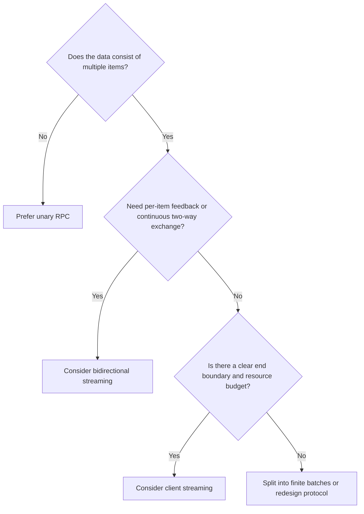

# When client streaming is appropriate

**Chapter:** Client streaming  
**Scope:** Spring gRPC (`SPRING_GRPC`) — developing Java services from Protocol Buffers contracts, generated code, and gRPC RPC types.

## 1. The problem to solve

Imagine an application sending 5,000 sensor readings to a Spring service. Each reading is a small message; the server must validate and aggregate the entire batch before reporting the accepted count. If you send 5,000 unary RPCs, the client creates 5,000 separate calls, each with its own metadata, result, and lifecycle. If you pack all 5,000 items into **one** unary request, the client must build a potentially huge message in memory.

**Client streaming** is the middle ground worth considering: the client opens **one RPC**, sends multiple request messages sequentially, signals that sending is done, and receives **one** result response from the server. This model fits especially well when data is produced incrementally, belongs to a single finite unit of work, and the caller only needs the final outcome.

```text
Client                                              Spring gRPC Server
  |--- open RPC UploadMetrics ------------------------>|
  |--- MetricPoint #1 -------------------------------->|
  |--- MetricPoint #2 -------------------------------->|
  |--- MetricPoint #3 -------------------------------->|
  |                ...                                 |
  |--- onCompleted() (end of requests) ---------------->|
  |<-------------------------------- BatchReceipt -----|
  |<-------------------- RPC completes successfully ---|
```

Two common misconceptions:

- **Multiple requests** here means multiple *messages* inside **a single RPC call**, not multiple separate RPCs.
- `onNext(request)` on the client **does not confirm that the server has persisted** that request. Only the final response and RPC status report the outcome declared by the protocol/application.

## 2. Decision criteria: when should you use it?

Client streaming usually makes sense when most of the following criteria hold:

| Criterion | Fitting signal | Question to ask |
| --- | --- | --- |
| **Multi-item input** | Readings, logs, data chunks, or record rows arriving sequentially | Does the data form a shared batch/unit of work? |
| **Only one aggregated result needed** | Server returns record count, checksum, import status, or report | Do you need an ACK or response data **after each item**? |
| **Data source can emit incrementally** | Reading a file, queue, or time-based source | Do you want to avoid building one huge unary request in RAM? |
| **Clear completion boundary** | N records reached, end of file, end of time window | When does the client call `onCompleted()` to obtain the result? |
| **Shared single-RPC lifecycle is acceptable** | One deadline, one terminal status, one job-level retry | If one item fails, can the whole stream be handled under the chosen policy? |

**The most important decision question:** *Does the client need the server to return business information while it is still sending?* If so, client streaming's single-response model may not suffice; consider **bidirectional streaming** or smaller unary calls.



The diagram is a **decision guide**, not a rigid rule. When data is already available, has few items, and fits within size limits, a **unary RPC containing a repeated field** can be simpler than client streaming.

## 3. Comparing all four RPC types before choosing

The Protocol Buffers contract expresses the difference right at the `stream` keyword:

```proto
syntax = "proto3";

package telemetry.v1;

service TelemetryService {
  rpc CheckMetric(MetricPoint) returns (MetricResult);                  // unary
  rpc WatchMetrics(WatchRequest) returns (stream MetricResult);        // server streaming
  rpc UploadMetrics(stream MetricPoint) returns (BatchReceipt);        // client streaming
  rpc ExchangeMetrics(stream MetricPoint) returns (stream MetricResult);// bidirectional
}

message MetricPoint {
  string batch_id = 1;
  string event_id = 2;
  int64 occurred_at_epoch_ms = 3;
  double value = 4;
}

message MetricResult {
  bool accepted = 1;
}

message BatchReceipt {
  string batch_id = 1;
  int64 accepted_count = 2;
}

message WatchRequest {}
```

| Application need | Better-fitting type | Why |
| --- | --- | --- |
| Send one record and receive confirmation for that record | **Unary** | Concise contract, result ties directly to one request |
| Send 10,000 events in a batch and only need a final receipt | **Client streaming** | Stream messages incrementally, aggregate one result |
| Request to watch changing data from the server | **Server streaming** | Client sends one request; server keeps pushing updates |
| Send data and receive per-item or real-time results simultaneously | **Bidirectional streaming** | Both sides have independent message streams |
| Send a small pre-existing list of 5 items and get one result | **Unary with `repeated`** | Fewer async mechanics, easier to implement and test |

**No RPC type is universally faster.** Client streaming can reduce the number of RPC openings compared to many unary calls and avoid packing an entire batch into one message. In return, it raises requirements around stream lifecycle, deadlines, send-rate control, and handling errors after partial transmission.

## 4. Fitting real-world scenarios

### 4.1. Uploading a batch of IoT readings or observability data

Many measurement points are generated consecutively, and the server only needs to return a receipt with the processed count. The client can read from a queue or buffer and send each `MetricPoint`.

**Design note:** split data into **finite windows** (for example, a time interval or a maximum record count). If a device sends continuously for days without `onCompleted()`, a long-lived single client-streaming RPC will never receive the final receipt under the contract above. Close each window and start a new RPC.

### 4.2. Importing data from files or other systems

An application reads CSV rows one by one, converts them into protobuf messages, and sends them to the server for validation, aggregation, or staging an import transaction.

**Design note:** decide the error-handling policy upfront. If row 8,000 is invalid, will you reject **the entire batch**, skip invalid rows and report the count, or return a list of errors in one receipt? A single final response cannot implicitly convey per-row details; design sufficiently clear result fields or split into smaller batches.

### 4.3. Uploading files in multiple chunks

A file can be split into small `FileChunk` messages; the server reassembles them in order and returns a checksum or file identifier once all chunks are received.

**Design note:** define chunk size, maximum total size, checksum, temporary storage location, and cleanup after cancellation/timeout. **Streaming does not bypass all gRPC limits**: each message is still subject to size limits, and the entire job still consumes bandwidth, buffers, and disk. For very large files, compare against direct upload to object storage via a scoped-access URL.

### 4.4. Aggregating metrics in a single batch

The client sends many `MetricPoint` samples; the server updates `count`, `sum`, `min`, `max` and returns statistics once. If storing every sample is unnecessary, the server can keep only **per-RPC** accumulator state with low memory complexity.

**Design note:** avoid storing aggregation variables in shared fields of a singleton `@GrpcService`, because concurrent clients can mix results. Initialize a fresh accumulator each time the RPC method is invoked.

## 5. Cases where client streaming should be avoided

1. **Per-item confirmation is required:** A payment system needs to know the status of each transaction right as it is sent. Use unary per transaction, or bidirectional streaming if a two-way stream is genuinely needed.
2. **The server proactively pushes data:** The client requests price updates or notifications. Use server streaming.
3. **Continuous two-way exchange:** The client streams audio and the server returns partial transcripts while the client keeps sending. Use bidirectional streaming.
4. **Small, already-available input:** A unary request containing a `repeated` list is usually easier to maintain; creating observers and tracking stream completion can be unnecessary complexity.
5. **A send session cannot be bounded:** A continuous source with no batch boundary or limit policy. Design windowing/batching first or use a protocol better suited for long-lived streams.
6. **Wanting durable confirmation per item right on `onNext`:** gRPC does not define `onNext` as a database-write ACK. Contracts and durable storage semantics must be designed explicitly.

A common design mistake is switching from multiple unary RPCs to one client streaming RPC solely to "speed things up." Define **result semantics**, **acceptable error behavior**, **resource limits**, and **retry behavior** before optimizing call count.

## 6. Designing a data batch with Spring gRPC

Suppose an application collects readings under a `batch_id`, using `TelemetryService.UploadMetrics` from section 3. The Java classes `MetricPoint`, `BatchReceipt`, and `TelemetryServiceGrpc` are generated from `.proto` via the protobuf compiler and gRPC Java plugin.

The server method receives a `responseObserver` to send the **final receipt**, and returns a `StreamObserver<MetricPoint>` so gRPC delivers each message into `onNext`. The following example **only aggregates in memory** and does not model durable storage or deduplication:

```java
package com.example.telemetry.server;

import com.example.telemetry.grpc.BatchReceipt;
import com.example.telemetry.grpc.MetricPoint;
import com.example.telemetry.grpc.TelemetryServiceGrpc;
import io.grpc.Status;
import io.grpc.stub.StreamObserver;
import org.springframework.grpc.server.service.GrpcService;

@GrpcService
public class TelemetryServiceImpl
        extends TelemetryServiceGrpc.TelemetryServiceImplBase {

    private static final long MAX_POINTS = 10_000;

    @Override
    public StreamObserver<MetricPoint> uploadMetrics(
            StreamObserver<BatchReceipt> responseObserver) {

        return new StreamObserver<>() {
            private String batchId;
            private long count;
            private boolean ended;

            @Override
            public void onNext(MetricPoint point) {
                if (ended) return;

                if (point.getBatchId().isBlank()
                        || point.getEventId().isBlank()
                        || point.getOccurredAtEpochMs() <= 0
                        || !Double.isFinite(point.getValue())) {
                    fail(Status.INVALID_ARGUMENT, "Invalid MetricPoint");
                    return;
                }

                if (batchId != null && !batchId.equals(point.getBatchId())) {
                    fail(Status.INVALID_ARGUMENT, "Do not mix batch_ids");
                    return;
                }
                if (count >= MAX_POINTS) {
                    fail(Status.RESOURCE_EXHAUSTED, "Batch limit exceeded");
                    return;
                }

                batchId = point.getBatchId();
                count++;
            }

            @Override
            public void onError(Throwable error) {
                // Request stream failed/cancelled: clean up resources if any.
                ended = true;
            }

            @Override
            public void onCompleted() {
                if (ended) return;
                ended = true;
                BatchReceipt receipt = BatchReceipt.newBuilder()
                        .setBatchId(batchId == null ? "" : batchId)
                        .setAcceptedCount(count)
                        .build();
                responseObserver.onNext(receipt);
                responseObserver.onCompleted();
            }

            private void fail(Status status, String description) {
                ended = true;
                responseObserver.onError(
                        status.withDescription(description).asRuntimeException());
            }
        };
    }
}
```

This server intentionally **accepts an empty stream** and returns a receipt with count 0 and an empty `batch_id`. In a real product, depending on the contract, an empty batch may be treated as `INVALID_ARGUMENT`; what matters is **being consistent with the rule and writing tests**.

On the client side, use the **asynchronous stub** (not the blocking stub) and keep the request observer to send items:

```java
// channel: ManagedChannel/Channel configured by the application.
TelemetryServiceGrpc.TelemetryServiceStub asyncStub =
        TelemetryServiceGrpc.newStub(channel);

StreamObserver<BatchReceipt> responseObserver = new StreamObserver<>() {
    @Override
    public void onNext(BatchReceipt receipt) {
        System.out.println("Received: " + receipt.getAcceptedCount());
    }

    @Override
    public void onError(Throwable error) {
        System.err.println("RPC error: " + io.grpc.Status.fromThrowable(error));
    }

    @Override
    public void onCompleted() {
        System.out.println("RPC completed");
    }
};

StreamObserver<MetricPoint> requests = asyncStub
        .withDeadlineAfter(15, java.util.concurrent.TimeUnit.SECONDS)
        .uploadMetrics(responseObserver);

for (MetricPoint point : finiteBatch) {
    requests.onNext(point);
}
requests.onCompleted(); // Signal that the server can finalize and return the receipt.
```

The client snippet assumes `channel` and `finiteBatch` are already prepared, the batch is small enough, and the producer does not fail. In Spring gRPC, the channel can be created via `GrpcChannelFactory`; configure the channel name, address, and TLS per deployment environment. When emitting large volumes of data, do not run an unbounded send loop like above: integrate **flow control** and cancellation handling.

Contract note: `BatchReceipt.accepted_count` in the example is only the count of **messages validated in memory**. It **does not prove durable persistence**. If the API must guarantee successful storage, only return the receipt after the server has completed the corresponding commit step.

## 7. Architectural decisions that must be made explicit

### 7.1. Batch boundaries and resource limits

Client streaming does not fix the number of requests in the `.proto` declaration. Therefore, the system should agree on:

- Maximum item count and maximum total bytes per RPC; not just the byte limit of **a single** protobuf message.
- Maximum duration for the entire call and batch-closing rules (N records reached, end of file, end of time window).
- How data is stored/held on the server: accumulated in RAM, staged to disk, or pushed to a data store.
- How the receipt is returned: total succeeded, rejected count, batch ID, checksum, and/or transaction identifier.

An overly large batch makes retries expensive and extends wait times for the result. **Splitting into finite RPCs** usually keeps recovery costs under control on flaky networks.

### 7.2. Backpressure and producers

HTTP/2/gRPC has **flow control**, but that does not mean calling `requestObserver.onNext()` continuously won't put pressure on buffers. In gRPC Java, when you need to throttle emission, you can use `ClientResponseObserver` to obtain a `ClientCallStreamObserver`, inspect `isReady()`, and register `setOnReadyHandler(...)`. This is a transport write-readiness signal, **not a business receipt**.

Write methods on a `StreamObserver` are not guaranteed to be safe when multiple threads send concurrently. If data comes from multiple producers, use a queue or serialize `onNext` calls. When the server returns an error, the producer must stop sending and release the input source.

### 7.3. Deadlines, cancellation, status, and retries

A client streaming RPC has **one deadline for the entire call**. The deadline covers opening the stream, sending messages, processing, and receiving the final response. For example, a 15-second deadline is not automatically refreshed after each `onNext`.

| Event | Typical gRPC status/lifecycle | What to handle |
| --- | --- | --- |
| All sent, client `onCompleted`, server finishes | `OK` with one `BatchReceipt` | Verify receipt numbers before marking the batch done |
| Message violates rules | `INVALID_ARGUMENT` | Stop sending, fix data/contract |
| Quota exceeded or batch too large | `RESOURCE_EXHAUSTED` | Shrink batch, throttle rate, review quota policy |
| Server times out or caller exceeds deadline | Client typically observes `DEADLINE_EXCEEDED` | Processing outcome may be unknown; do not retry blindly |
| Client actively cancels | Typically observes `CANCELLED` | Clean up resources, identify potential remaining side effects |
| Connection lost | May see `UNAVAILABLE` or related status | Review retry/idempotency and transport health |

There is no automatic "exactly once" mechanism for business data. If the server saves 500 records and then loses the connection before returning the receipt, the client cannot tell from status alone whether those 500 records were saved. You can use:

1. **A stable `batch_id`** across retry attempts.
2. **A stable `event_id`** per item, with the server deduplicating by the specified key.
3. **Staging + commit** if "all or nothing" semantics are required.
4. A batch-status lookup API to resolve cases where the client missed the receipt even though the server finished.

Do not automatically retry a client stream carrying write data without establishing idempotency and result semantics.

### 7.4. Metadata, security, and observability

gRPC metadata (such as bearer tokens or correlation IDs) is sent **per RPC**, making it suitable for information shared across the whole batch. It is not a channel for per-`MetricPoint` metadata: per-event attributes still belong inside the protobuf message. The server can use **interceptors** to authenticate, attach tracing context, and record metrics consistently.

When deploying over a network, use **TLS** and enforce authorization checks rather than assuming a long-lived stream is a trusted channel. Avoid logging tokens or sensitive record payloads. Metrics to observe include active open RPCs, duration from first message to final receipt, items/batch, bytes/batch, rates of `OK`, `INVALID_ARGUMENT`, `RESOURCE_EXHAUSTED`, `DEADLINE_EXCEEDED`, `CANCELLED`, and processing throughput.

## 8. Decision example: a telemetry ingestion service

**Requirement:** A device generates readings continuously, may lose connectivity, and needs confirmation that readings were persisted. The server does not need to send control commands mid-stream. There are two options:

**Option A — one stream kept open for hours:** the device calls `onNext` indefinitely and only receives a receipt after closing the stream. If the network drops, the device does not know for sure which data was saved and must consider retrying everything emitted so far.

**Option B — finite batches with identifiers:** the device groups data into windows (for instance, at most 1,000 samples or 30 seconds — illustrative values only), opens one RPC per batch, sends the samples, calls `onCompleted`, and waits for `BatchReceipt` after the server commits. On failure, the device can look up status or resend the same `batch_id` and `event_id` under the deduplication policy.

Given the requirements, **Option B makes more sense**: finite client streaming lets data be sent incrementally while the final receipt reports the outcome of a clear unit of work. In exchange, the application must manage per-batch state.

If the requirement changes to *"the server must warn about invalid readings immediately while continuing to receive subsequent readings"*, you must re-evaluate **bidirectional streaming**, because a single final `BatchReceipt` cannot deliver immediate feedback.

## 9. What should tests prove?

In Spring gRPC, you can use an **in-process** server/channel to test observers and RPCs, then add integration tests with a Spring context and real transport to verify TLS, interceptors, channel configuration, and timeouts.

| Test case | Pass criteria |
| --- | --- |
| Batch of 3 valid messages | Server receives all 3, returns **one** `BatchReceipt`, RPC succeeds |
| Client finishes sending but forgets `onCompleted()` | Do not assume a final receipt will arrive; test actively cancels or sets a deadline |
| Empty batch | Verifies the declared 0-item receipt or error policy |
| Two different `batch_id` values in one stream | Server returns `INVALID_ARGUMENT`, does not return a success receipt |
| Item limit exceeded | Server returns `RESOURCE_EXHAUSTED` |
| Client cancels or times out mid-stream | Producer stops, server releases resources, no false success confirmation |
| Two clients send concurrently | Counters and aggregated data do not leak between the two RPCs |
| Retry same `batch_id` after lost receipt | Does not create duplicate data if the app declares idempotency guarantees |

The last test is only meaningful when the server **actually has a persistence and deduplication layer**; the in-memory counting example in section 6 does not implement that yet.

## 10. Self-check questions

1. A CSV file has 100,000 rows, and the server only needs to report how many rows were imported at the end of the batch. Why might client streaming fit better than one large unary request? How would you bound the batch?
2. An application streams conversation audio and must receive partial transcripts while continuing to send audio. Why does client streaming not fit the contract?
3. A client finishes sending 800 messages and then hits the deadline before receiving `BatchReceipt`. Can you assert that the server saved no data? What design enables safe retries?
4. When the client calls `onNext()`, what is guaranteed and what is **not** guaranteed regarding data being committed?
5. Which metrics help distinguish overload, invalid input, and unstable networking while receiving multiple requests?

**Remember:** Choose **client streaming** when **multiple pieces of data belong to one unit of work**, **the client can declare the end of the stream**, and **only one final response is needed**. In Spring gRPC, how well this choice works depends on the Protocol Buffers contract, batch boundaries, flow control, deadlines, status handling, metadata, TLS, and recovery strategies when an RPC ends with an unknown outcome.
