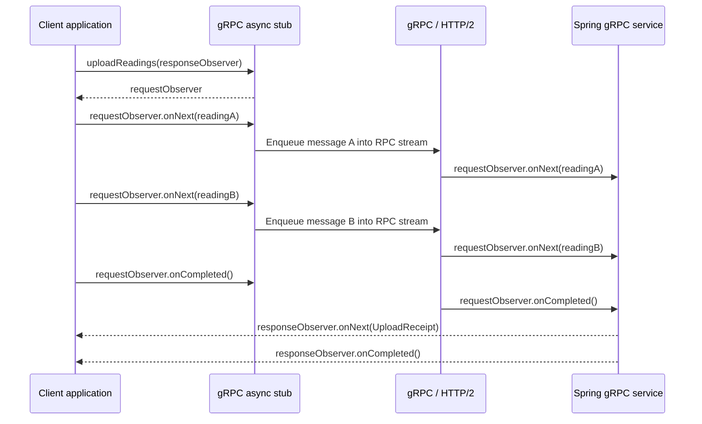

# onNext from client to server

**Chapter:** Client streaming  
**Scope:** Spring gRPC (`SPRING_GRPC`) with Protocol Buffers contracts, generated Java code, and gRPC Java's `StreamObserver` model.

## 1. Learning objectives

In a **client streaming RPC**, the client sends **multiple request messages** over **one RPC**, the server receives those messages sequentially, and returns **one success response** after the request stream ends. The `StreamObserver` interface is the programming bridge between those messages and Java code.

After this lesson, you will be able to:

- Explain what happens when the client calls `requestObserver.onNext(request)`.
- Correctly identify the server-side request observer and the client-side response observer.
- Distinguish between **called `onNext`**, **server received `onNext`**, and **business transaction committed**.
- Implement a client streaming method in Spring gRPC that receives multiple requests and sends one response.
- Send multiple requests using an **asynchronous stub**, finish with `onCompleted()`, and handle `onError()`.
- Apply rules for ordering, thread safety, flow control, deadlines, RPC cancellation, and testing.

## 2. How does `onNext` flow across both ends of the RPC?

Suppose a temperature monitoring application needs to upload three readings to the server. The contract looks like this:

```proto
rpc UploadReadings(stream Reading) returns (UploadReceipt);
```

The `stream` keyword on the **input** means one `UploadReadings` call carries multiple `Reading` messages. The output `UploadReceipt` has no `stream`: the server sends only one response if the RPC succeeds.



The diagram shows the **logical order**; network writes, server reception, and callback invocation occur asynchronously. More precisely:

1. The client receives a `StreamObserver<Reading>` from calling the **async stub**. This is the **request observer** used to send data.
2. Each time the client calls `requestObserver.onNext(reading)`, gRPC Java accepts another message to transmit on the current RPC.
3. The gRPC transport delivers messages in order on the same stream. When the server receives and decodes a message, gRPC invokes `onNext(reading)` on **the observer returned by the server method**.
4. The client calls `requestObserver.onCompleted()` when all data has been sent. The server receives the corresponding `onCompleted()` callback if the receive side ends normally.
5. The server sends one `UploadReceipt` through the **response observer** and closes the response with `onCompleted()`. The response callback runs on the client side.

**Key takeaway:** The return of `requestObserver.onNext()` on the client **is not confirmation that the message reached the server, passed validation, or was durably saved**. The message may still be sitting in the send buffer. Even after `onNext()` runs on the server, the business logic might still not have written to the database.

## 3. Two `StreamObserver` instances and data direction

The method name `onNext` is the same, but its meaning depends on **which observer is being called**:

| Component | Where does it live? | What is `onNext` used for? |
| --- | --- | --- |
| `StreamObserver<Reading> requestObserver` | **Client**, returned by the async stub | Client **sends another request** |
| `StreamObserver<Reading>` returned by `uploadReadings(...)` | **Server** | gRPC **delivers a received request** to server code |
| `StreamObserver<UploadReceipt> responseObserver` | **Server**, method parameter | Server **sends the final response** |
| `StreamObserver<UploadReceipt> responseObserver` | **Client**, passed into the stub call | gRPC **delivers the server's response** to the client |

The client does not directly invoke `onNext()` on the observer object living on the server. The client calls a **local** observer provided by the stub; gRPC transmits over HTTP/2 and invokes the server-side callback when data arrives.

In client streaming, the server must not send multiple success `UploadReceipt` messages: the contract declares **one** response. If you need continuous feedback while the client is still sending, choose **bidirectional streaming**.

## 4. Complete protobuf contract

Create `src/main/proto/readings.proto`:

```proto
syntax = "proto3";

package readings.v1;

option java_package = "com.example.readings.grpc";
option java_multiple_files = true;

service ReadingService {
  // N Reading requests -> 1 UploadReceipt.
  rpc UploadReadings(stream Reading) returns (UploadReceipt);
}

message Reading {
  string batch_id = 1;
  string sensor_id = 2;
  int64 captured_at_epoch_ms = 3;
  double temperature = 4;
}

message UploadReceipt {
  string batch_id = 1;
  int32 received_count = 2;
  double temperature_sum = 3;
}
```

Once the protobuf compiler and gRPC Java code generation are configured in the project, `Reading`, `UploadReceipt`, and `ReadingServiceGrpc` are generated automatically. On the server side, you override the method signature:

```java
@Override
public StreamObserver<Reading> uploadReadings(
        StreamObserver<UploadReceipt> responseObserver);
```

Read the signature in terms of **two data directions**: the method **takes `responseObserver` to send the result out**, and **returns `StreamObserver<Reading>` to receive requests in**. This is the characteristic pattern of client streaming in gRPC Java.

## 5. Spring gRPC server: handling each `onNext`

This example implements a service that counts readings and sums temperatures. Each RPC has its own independent counter and sum; therefore, two clients sending concurrently do not share state.

```java
package com.example.readings.server;

import com.example.readings.grpc.Reading;
import com.example.readings.grpc.ReadingServiceGrpc;
import com.example.readings.grpc.UploadReceipt;
import io.grpc.Status;
import io.grpc.stub.StreamObserver;
import org.springframework.grpc.server.service.GrpcService;

@GrpcService
public class ReadingGrpcService
        extends ReadingServiceGrpc.ReadingServiceImplBase {

    private static final int MAX_READINGS = 10_000;

    @Override
    public StreamObserver<Reading> uploadReadings(
            StreamObserver<UploadReceipt> responseObserver) {

        return new StreamObserver<>() {
            private String batchId;
            private int count;
            private double sum;
            private boolean finished;

            @Override
            public void onNext(Reading reading) {
                if (finished) {
                    return;
                }

                if (reading.getBatchId().isBlank()
                        || reading.getSensorId().isBlank()
                        || reading.getCapturedAtEpochMs() <= 0
                        || !Double.isFinite(reading.getTemperature())) {
                    fail(Status.INVALID_ARGUMENT, "Invalid Reading");
                    return;
                }

                if (batchId != null
                        && !batchId.equals(reading.getBatchId())) {
                    fail(Status.INVALID_ARGUMENT,
                            "Readings must share the same batch_id");
                    return;
                }

                if (count >= MAX_READINGS) {
                    fail(Status.RESOURCE_EXHAUSTED,
                            "Exceeded Reading limit in a single RPC");
                    return;
                }

                batchId = reading.getBatchId();
                count++;
                sum += reading.getTemperature();
            }

            @Override
            public void onError(Throwable error) {
                // Client cancelled or inbound stream failed.
                // If any file/buffer/transaction is open, release it here.
                finished = true;
            }

            @Override
            public void onCompleted() {
                if (finished) {
                    return;
                }

                finished = true;
                UploadReceipt receipt = UploadReceipt.newBuilder()
                        .setBatchId(batchId == null ? "" : batchId)
                        .setReceivedCount(count)
                        .setTemperatureSum(sum)
                        .build();

                responseObserver.onNext(receipt);
                responseObserver.onCompleted();
            }

            private void fail(Status status, String message) {
                finished = true;
                responseObserver.onError(
                        status.withDescription(message).asRuntimeException());
            }
        };
    }
}
```

**Explanation of each server callback:**

- `onNext(Reading)` is called **each time gRPC delivers another request message**. Validate the data and update the in-flight RPC's state. In this example, `onNext` sends no response.
- `onCompleted()` marks that **the server has been notified that all requests are sent**. This is when the example emits the single receipt via `responseObserver.onNext(receipt)` and closes the response stream with `responseObserver.onCompleted()`.
- `onError(Throwable)` reports that **the inbound stream did not finish normally**, for example due to cancellation or a transport error. Stop processing and clean up resources; do not emit a success receipt on your own.

When the server emits `responseObserver.onError(...)` due to invalid data, that is a **terminal RPC state**. Do not call `responseObserver.onNext` or `onCompleted` afterward. The client may observe the error before it finishes sending all messages; the producer must stop sending once the call is terminated.

In this example, `received_count` is **the number of valid messages processed in memory**, not proof that they were committed to storage. If business logic requires guaranteed persistence, emit the corresponding receipt only after committing.

## 6. Java client: multiple `onNext` calls on the same RPC

In Spring gRPC, the client can create a channel using `GrpcChannelFactory` and build an async stub from that channel. The snippet below uses an initialized `ReadingServiceGrpc.ReadingServiceStub` injected into a service; each `upload` call uses a fresh request observer.

```java
package com.example.readings.client;

import com.example.readings.grpc.Reading;
import com.example.readings.grpc.ReadingServiceGrpc;
import com.example.readings.grpc.UploadReceipt;
import io.grpc.stub.StreamObserver;
import java.util.List;
import java.util.Objects;
import java.util.concurrent.CompletableFuture;
import java.util.concurrent.TimeUnit;
import org.springframework.stereotype.Service;

@Service
public class ReadingUploadClient {

    private final ReadingServiceGrpc.ReadingServiceStub asyncStub;

    public ReadingUploadClient(
            ReadingServiceGrpc.ReadingServiceStub asyncStub) {
        this.asyncStub = asyncStub;
    }

    public CompletableFuture<UploadReceipt> upload(List<Reading> readings) {
        Objects.requireNonNull(readings, "readings");
        CompletableFuture<UploadReceipt> result = new CompletableFuture<>();

        StreamObserver<UploadReceipt> responseObserver =
                new StreamObserver<>() {
                    private UploadReceipt receipt;
                    private int responseCount;

                    @Override
                    public void onNext(UploadReceipt value) {
                        receipt = value;
                        responseCount++;
                    }

                    @Override
                    public void onError(Throwable error) {
                        result.completeExceptionally(error);
                    }

                    @Override
                    public void onCompleted() {
                        if (responseCount == 1) {
                            result.complete(receipt);
                        } else {
                            result.completeExceptionally(
                                    new IllegalStateException(
                                            "Expected exactly one UploadReceipt"));
                        }
                    }
                };

        StreamObserver<Reading> requests = asyncStub
                .withDeadlineAfter(10, TimeUnit.SECONDS)
                .uploadReadings(responseObserver);

        try {
            for (Reading reading : readings) {
                requests.onNext(reading);
            }
            requests.onCompleted(); // Signal end of requests.
        } catch (RuntimeException writeFailure) {
            result.completeExceptionally(writeFailure);
            try {
                requests.onError(writeFailure); // Cancel send stream if still open.
            } catch (RuntimeException ignored) {
                // RPC may have already ended.
            }
        }

        return result;
    }
}
```

To expose the async stub as a Spring bean, you can configure:

```java
import com.example.readings.grpc.ReadingServiceGrpc;
import org.springframework.context.annotation.Bean;
import org.springframework.context.annotation.Configuration;
import org.springframework.grpc.client.GrpcChannelFactory;

@Configuration(proxyBeanMethods = false)
class ReadingClientConfiguration {
    @Bean
    ReadingServiceGrpc.ReadingServiceStub readingStub(
            GrpcChannelFactory channels) {
        return ReadingServiceGrpc.newStub(
                channels.createChannel("readings"));
    }
}
```

The `readings` channel must be configured to point to the appropriate service address; when running over a real network, configure TLS/authentication accordingly. Example invocation:

```java
List<Reading> batch = List.of(
    Reading.newBuilder()
        .setBatchId("batch-42")
        .setSensorId("sensor-a")
        .setCapturedAtEpochMs(1_700_000_001_000L)
        .setTemperature(20.5)
        .build(),
    Reading.newBuilder()
        .setBatchId("batch-42")
        .setSensorId("sensor-a")
        .setCapturedAtEpochMs(1_700_000_002_000L)
        .setTemperature(21.0)
        .build()
);

client.upload(batch)
    .thenAccept(receipt -> System.out.printf(
        "batch=%s, count=%d, sum=%.1f%n",
        receipt.getBatchId(),
        receipt.getReceivedCount(),
        receipt.getTemperatureSum()
    ))
    .exceptionally(error -> {
        System.err.println("Upload failed: " + error);
        return null;
    });
```

With valid data and a successful RPC, the receipt has `received_count = 2` and `temperature_sum = 41.5`. `CompletableFuture` completes normally **only after the response `onCompleted()` callback**, not after `requests.onNext()`.

This is an example for a **small batch already in a `List`**. It is not a pattern for emitting millions of messages: large batches need send-rate throttling according to transport readiness.

## 7. Message ordering, execution threads, and flow control

### 7.1. Send order and receive order

Within **the same gRPC stream**, messages are received in the order they were successfully sent. If the client calls `onNext(A)`, `onNext(B)`, `onNext(C)` sequentially from a single emitter, the server will not receive `C` before `A` under normal stream operation.

However, **the client call does not guarantee the server has finished processing** the previous message: `onNext(B)` can run before the server's `onNext(A)` callback finishes. The gRPC server dispatches callbacks according to its execution model; do not assume network callbacks behave like cross-machine synchronous function calls.

### 7.2. Do not call `onNext` concurrently on one request observer

`StreamObserver` **is not guaranteed to be thread-safe for concurrent writes**. The following example risks having multiple tasks write to the same observer simultaneously:

```java
// Avoid: tasks may call the same requestObserver.onNext
// at the same time and make send order non-deterministic.
executor.submit(() -> requests.onNext(readingA));
executor.submit(() -> requests.onNext(readingB));
```

With multiple producers, put messages into a bounded queue and use **a single emitter thread** to call `onNext()` sequentially; or synchronize all write calls, including `onCompleted()` and `onError()`. Never call `onCompleted()` while another producer is still calling `onNext()`.

### 7.3. `onNext()` does not mean downstream is ready

gRPC over HTTP/2 has **flow control**, yet calling `onNext` continuously can still cause data to accumulate in buffers. `ClientCallStreamObserver.isReady()` indicates whether the transport has enough capacity to accept more data without exceeding buffering pressure under the current mechanism; it **does not confirm the server has committed**.

For client streaming with a large producer, gRPC Java supports `ClientResponseObserver<RequestT, ResponseT>` and the `beforeStart(ClientCallStreamObserver<RequestT>)` callback. Inside `beforeStart`, the client can register `setOnReadyHandler(...)` and drive emission logic from `isReady()`. The logic should ensure **a single writer producer**, call `onCompleted()` **once**, stop if the RPC errors/cancels, and avoid busy-looping when `isReady() == false`.

The typical flow looks like:

```text
Reading source (file/queue)
     |
     v
Sequential producer ---- check readiness ----> requestObserver.onNext()
     |                                             |
     |                                     gRPC transport/HTTP2
     |                                             |
     +---- end of source --> requestObserver.onCompleted()
                                                   |
                                        server StreamObserver.onNext()
```

On the **server** side, if processing a message is very slow or requires external resources, you may need to decouple message reading from processing via a bounded queue and appropriate **inbound flow control**. Avoid accidentally buffering all requests in RAM just because the API is streaming.

## 8. `onNext`, `onCompleted`, and `onError`: which states are legal?

| State | What can the client do? | What does the server observe or do? |
| --- | --- | --- |
| RPC just opened | Can send the first `onNext` or `onCompleted` if the stream is empty | Waits for messages |
| Sending | Sends `onNext` calls **sequentially** | Receives corresponding `onNext`; validates/processes |
| Client calls `onCompleted()` | **Send no new requests** on that observer | Once all messages are received, server calls `onCompleted()` |
| Client calls `onError(error)` | Terminates/cancels send side; no further writes | RPC typically ends with error/cancellation |
| Server calls `responseObserver.onError(...)` | Stop producer, receive error status via response callback | Do not send a success receipt after an error |
| Response `onNext(receipt)` then `onCompleted()` | Process receipt and finish RPC | Server completed the response normally |

Once an observer has terminated with `onCompleted` or `onError`, **it must not receive any further `onNext`**. The client must **not** call `onCompleted` after calling `onError`, and the server must not return both an error and a success response.

**Deadlines** apply to the entire RPC: opening the stream, sending multiple messages, processing, and receiving the receipt. A 10-second deadline is not refreshed on every `onNext` call. If the RPC expires mid-batch, the client typically receives `DEADLINE_EXCEEDED`; some messages may already have arrived and been processed by the server.

## 9. Handling mid-stream errors without falsely assuming success

| Scenario | What happens | How to handle |
| --- | --- | --- |
| `Reading` missing `sensor_id` | Server reports `INVALID_ARGUMENT` | Stop sending, fix data, and start a new RPC |
| More than 10,000 messages sent | Server reports `RESOURCE_EXHAUSTED` | Split into smaller batches and enforce quotas |
| Client forgets `onCompleted()` | Server may keep waiting for messages and never emit a receipt | Send completion signal at end of source |
| Network drops mid-batch | Client may observe `UNAVAILABLE` | Determine how much of the batch was processed before retrying |
| Deadline expires mid-batch | Client typically observes `DEADLINE_EXCEEDED` | Do not infer that the server saved zero records |
| Client actively cancels | RPC terminates/cancels; server must clean up resources | Stop producer and release input source |
| Client calls multiple `onNext` concurrently | May break expected ordering or violate thread safety | Serialize message emission |

**Relationship between messages and business transactions:** in the counting example above, the counter lives only in memory for one call. But if the server calls the database inside `onNext`, some records may already be committed before the RPC is cancelled. Therefore, `onNext` **cannot be used as a "persisted" receipt**.

To support controlled retries for write operations, add a fixed `batch_id` per batch and `event_id` per record, maintain server-side **idempotency**, or stage and commit the entire batch atomically. Only mark a batch complete when the final receipt confirms the declared semantics. The example's `received_count` field does not yet solve durable persistence or deduplication.

Metadata, authentication, and tracing should also be viewed at **RPC scope**: tokens and correlation IDs can be handled via gRPC `Metadata` and interceptors; data specific to each `Reading` belongs in the protobuf message. When running over a network, configure TLS and appropriate resource limits; do not log sensitive data just to trace `onNext`.

## 10. Testing an actual `onNext` sequence

In-process testing runs the gRPC transport and stubs inside the same process. It verifies message delivery between client and server without opening network ports. The example uses JUnit 5 and `grpc-inprocess` in test dependencies:

```java
package com.example.readings;

import com.example.readings.client.ReadingUploadClient;
import com.example.readings.grpc.Reading;
import com.example.readings.grpc.ReadingServiceGrpc;
import com.example.readings.grpc.UploadReceipt;
import com.example.readings.server.ReadingGrpcService;
import io.grpc.ManagedChannel;
import io.grpc.Server;
import io.grpc.inprocess.InProcessChannelBuilder;
import io.grpc.inprocess.InProcessServerBuilder;
import java.util.List;
import java.util.concurrent.TimeUnit;
import org.junit.jupiter.api.Test;

import static org.junit.jupiter.api.Assertions.assertEquals;

class ReadingStreamingTest {

    @Test
    void twoClientOnNextCallsProduceOneReceipt() throws Exception {
        String name = InProcessServerBuilder.generateName();
        Server server = InProcessServerBuilder.forName(name)
                .directExecutor()
                .addService(new ReadingGrpcService())
                .build()
                .start();

        ManagedChannel channel = InProcessChannelBuilder.forName(name)
                .directExecutor()
                .build();
        try {
            ReadingUploadClient client = new ReadingUploadClient(
                    ReadingServiceGrpc.newStub(channel));

            UploadReceipt receipt = client.upload(List.of(
                    reading(20.5), reading(21.0)))
                    .get(3, TimeUnit.SECONDS);

            assertEquals("batch-42", receipt.getBatchId());
            assertEquals(2, receipt.getReceivedCount());
            assertEquals(41.5, receipt.getTemperatureSum(), 1e-9);
        } finally {
            channel.shutdownNow();
            server.shutdownNow();
        }
    }

    private static Reading reading(double temperature) {
        return Reading.newBuilder()
                .setBatchId("batch-42")
                .setSensorId("sensor-a")
                .setCapturedAtEpochMs(1_700_000_001_000L)
                .setTemperature(temperature)
                .build();
    }
}
```

Other important test cases:

1. **Three `onNext` calls, one `onCompleted`:** server counts exactly three messages and returns the response exactly once.
2. **No `onNext` calls:** client calls `onCompleted` immediately; verify the defined empty-batch policy (`received_count = 0` in the example).
3. **Invalid data mid-stream:** server returns `INVALID_ARGUMENT`; client receives `onError`, not a success receipt.
4. **Different `batch_id` on the second request:** server rejects the entire RPC per contract.
5. **At/just past the 10,000-item limit:** the 10,001st item triggers `RESOURCE_EXHAUSTED`.
6. **Two concurrent RPCs:** each RPC keeps its own `count` and `sum` without mixing results.
7. **Client cancels or deadline expires:** producer stops sending, server cleans up resources, and does not claim zero side effects if earlier `onNext` calls wrote data.

In-process testing does not verify Spring context configuration, TLS, interceptors, real networks, or load capacity. Those characteristics require separate integration tests and performance benchmarks.

## 11. Common errors and how to reason about them

| Symptom | Explanation | Fix |
| --- | --- | --- |
| Called `onNext` but no receipt arrives | Client has not called `onCompleted`, RPC errored, or processing isn't done | Ensure request stream completes and observe response `onError/onCompleted` |
| Client `onNext` runs fast but server receives slowly | Client calls may only be queueing into buffers; server is bounded by network/CPU | Throttle with flow control, set batch size limits |
| Response errors before client finishes sending | Server can reject a message mid-stream | Stop sending, handle status |
| Server counts multiple clients' data together | Aggregation fields placed on singleton service instead of per RPC | Initialize state inside the observer returned per call |
| Retries create duplicate records | Client does not know the side effects of `onNext` before timeout | Design idempotency and batch state |
| `uploadReadings` won't compile with blocking stub | gRPC Java request streaming uses the async stub | Use `ReadingServiceGrpc.newStub(channel)` |

## 12. Self-practice

1. Redraw both `StreamObserver` directions and indicate **which observer** receives `onNext` on the client and which observer receives `onNext` on the server.
2. Modify the server to also compute `min_temperature` and `max_temperature`. Pick a clear convention for an empty stream and add tests.
3. Send three `Reading` messages where the second request has an empty `sensor_id`. Predict the callbacks on both ends and the status before running the test.
4. With a data source emitting concurrently from three threads, design a queue and sequential producer to preserve `onNext` call ordering.
5. If the client hits the deadline after calling `onNext` for 500 records, do you know how many records the server committed? Propose a way to confirm without creating duplicate data.

**Remember:** In client streaming, `requestObserver.onNext()` on the client **emits another request message** into the current RPC; `onNext()` on the server **receives** that message; the client's `onCompleted()` **marks the end of requests**; and the final response determines the RPC outcome. **Calling `onNext` is not a business ACK**, so always design stream termination, error handling, rate throttling, and retry rules explicitly.
