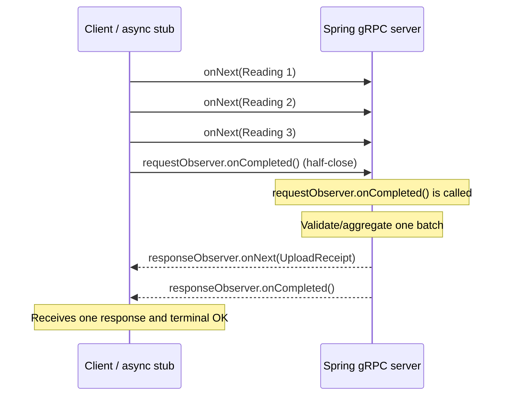
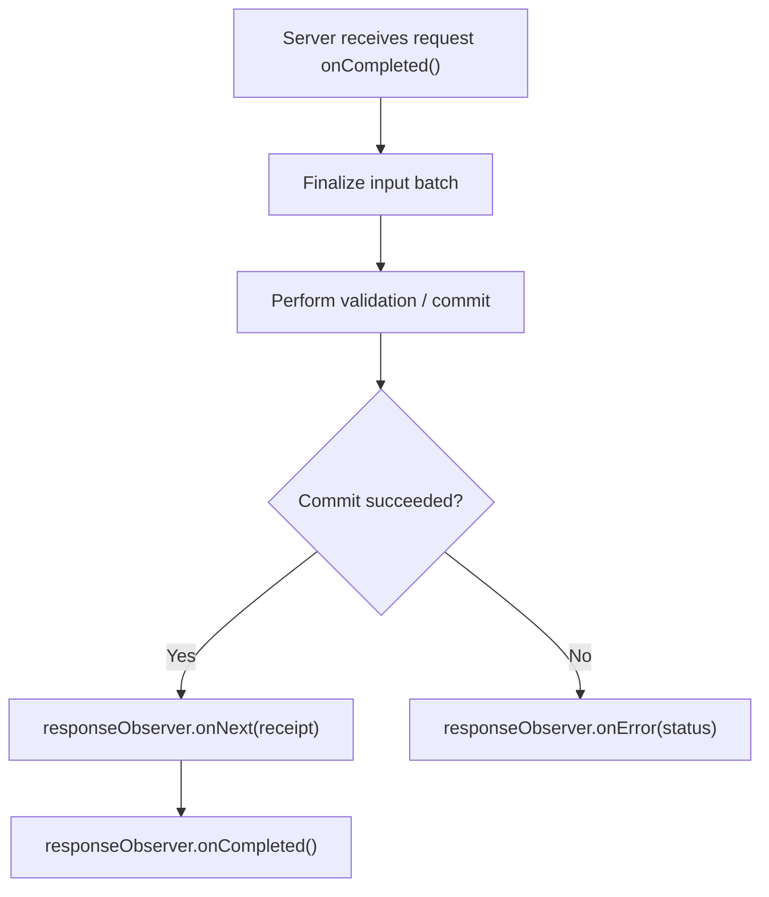

# Server completes with onCompleted

**Chapter:** Client streaming  
**Context:** In Spring gRPC (`SPRING_GRPC`), services are defined with Protocol Buffers, Java code is generated for client/server, and communication happens over unary or streaming RPC types. This lesson focuses on **how the server finishes a client streaming RPC successfully**: receiving the end-of-requests signal, producing exactly one response, and calling `responseObserver.onCompleted()`.

## 1. Learning objectives

After this lesson, you will be able to:

- Distinguish `onCompleted()` on the **server's request-receiving observer** from `onCompleted()` on the **server's response-sending observer**.
- Explain why client streaming requires a send-stream completion signal so the server can aggregate the final result.
- Implement a Spring gRPC server that returns **one success response** and closes the RPC in the proper order.
- Handle empty streams, invalid requests, deadlines, RPC cancellation, and processing errors before responding.
- Avoid calling `onNext()` or terminal callbacks multiple times; design asynchronous processing cases and test the RPC lifecycle.

## 2. Two `onCompleted()` calls with different meanings

With client streaming, a typical contract is:

```proto
rpc UploadReadings(stream Reading) returns (UploadReceipt);
```

The client sends multiple `Reading` messages over the same RPC; the server returns **only one** `UploadReceipt` on success. In gRPC Java, there are two `StreamObserver` instances on the server side:

| Observer | Where does the server get it? | Role of `onCompleted()` |
| --- | --- | --- |
| `StreamObserver<Reading>` **receiving requests** | The object **returned** by `uploadReadings(...)` | **Callback invoked by gRPC** when the client has closed its send stream normally; the server knows no more requests will arrive on that stream |
| `StreamObserver<UploadReceipt>` **sending the response** | The `responseObserver` parameter passed **into** `uploadReadings(...)` | **Method called by the server** after sending the final response, signaling no more responses will follow and closing its send side normally |

Those two moments are related, but **they are not the same call**. The client calls `requestObserver.onCompleted()` to half-close the request-sending direction. After gRPC delivers all preceding messages, the server receives the `onCompleted()` callback on the request observer. The server can finalize the batch, call `responseObserver.onNext(receipt)`, and then call `responseObserver.onCompleted()` to complete the response.



The diagram illustrates the **example success flow**. The request `onCompleted()` is an **end-of-data signal**, not confirmation that a transaction committed. The response `onCompleted()` is **normal termination**, not a substitute for sending the result message. For a contract returning a single `UploadReceipt`, the server sends **exactly one** `onNext(receipt)` before calling `onCompleted()`.

> **Distinction:** The `onCompleted()` that the server **receives** is the request stream callback. The `onCompleted()` that the server **calls** is the action that completes the response stream. Never call `onCompleted()` on the request observer that the server returned: that observer's role is receiving data.

## 3. Lifecycle of a client streaming RPC

In normal processing:

1. **Open the call:** The client creates a `responseObserver` and calls the method through the async stub. The stub returns a `requestObserver` to the client.
2. **Receive each message:** Each `requestObserver.onNext(reading)` on the client leads to `onNext(reading)` on the server's request observer as the message arrives.
3. **Client finishes sending:** The client calls `requestObserver.onCompleted()` **once**. After that, it sends no more `onNext()` calls.
4. **Server knows input has ended:** gRPC calls `onCompleted()` on the request-receiving observer. The server performs aggregation or commits according to business requirements.
5. **Server responds:** The server calls `responseObserver.onNext(receipt)` **once**, then `responseObserver.onCompleted()` **once**.
6. **Client finishes:** The client's `responseObserver` receives `onNext(receipt)`, then `onCompleted()`; the RPC ends successfully with gRPC status `OK`.

An RPC can also terminate with an error at several points: validation failure in `onNext`, client cancellation before finishing, deadline expiration, or commit failure after receiving `onCompleted`. Once terminated with `onError`, **do not call `onCompleted`** on the same response observer.

### Client half-close does not mean the RPC has ended

HTTP/2 supports independent transmission in both directions on the same stream. When the client calls `requestObserver.onCompleted()`, that is a **half-close of the request-sending direction**; the client still waits for the response/status from the server. If the server needs extra time to persist or verify the batch, the RPC can remain open after the client has finished sending.

The reverse is also worth remembering: the server **can terminate early with an error status** when encountering invalid data or resource limits, even while the client still intends to send more requests. The client must watch response `onError` and stop the producer; never assume the server always waits for `onCompleted`.

## 4. Protocol Buffers contract for the example

Suppose a device sends readings to a Spring gRPC server. File `src/main/proto/reading.proto`:

```proto
syntax = "proto3";

package telemetry.v1;
option java_package = "com.example.telemetry.grpc";
option java_multiple_files = true;

service ReadingService {
  // N Reading requests -> 1 UploadReceipt response.
  rpc UploadReadings(stream Reading) returns (UploadReceipt);
}

message Reading {
  string batch_id = 1;
  string sensor_id = 2;
  int64 captured_at_epoch_ms = 3;
  double value = 4;
}

message UploadReceipt {
  string batch_id = 1;
  int32 accepted_count = 2;
  double sum_values = 3;
}
```

From `.proto`, the protobuf and gRPC Java plugins generate `Reading`, `UploadReceipt`, and `ReadingServiceGrpc`. Method signature to override in the implementation:

```java
@Override
public StreamObserver<Reading> uploadReadings(
        StreamObserver<UploadReceipt> responseObserver);
```

This signature often causes confusion: the **parameter** `responseObserver` is the outbound path from server to client; the **return value** `StreamObserver<Reading>` is the inbound path from client to server. Inside the returned object, `onCompleted()` can trigger creation of the final receipt.

## 5. Implementing a Spring gRPC server and completing exactly once

The example below limits each RPC to at most 10,000 messages, validates data, and computes the sum in memory. It **does not persist to a database yet**, so the receipt only proves the example's calculation result.

```java
package com.example.telemetry.server;

import com.example.telemetry.grpc.Reading;
import com.example.telemetry.grpc.ReadingServiceGrpc;
import com.example.telemetry.grpc.UploadReceipt;
import io.grpc.Status;
import io.grpc.stub.StreamObserver;
import org.springframework.grpc.server.service.GrpcService;

@GrpcService
public class ReadingGrpcService
        extends ReadingServiceGrpc.ReadingServiceImplBase {

    private static final int MAX_READINGS = 10_000;

    @Override
    public StreamObserver<Reading> uploadReadings(
            StreamObserver<UploadReceipt> responseObserver) {

        // A fresh object for EACH RPC: do not mix client state.
        return new StreamObserver<>() {
            private String batchId;
            private int count;
            private double sum;
            private boolean terminated;

            @Override
            public void onNext(Reading reading) {
                if (terminated) return;

                if (reading.getBatchId().isBlank()
                        || reading.getSensorId().isBlank()
                        || reading.getCapturedAtEpochMs() <= 0
                        || !Double.isFinite(reading.getValue())) {
                    reject(Status.INVALID_ARGUMENT, "Invalid Reading");
                    return;
                }

                if (batchId != null
                        && !batchId.equals(reading.getBatchId())) {
                    reject(Status.INVALID_ARGUMENT,
                            "Do not mix batch_ids");
                    return;
                }

                if (count >= MAX_READINGS) {
                    reject(Status.RESOURCE_EXHAUSTED, "Batch exceeded limit");
                    return;
                }

                batchId = reading.getBatchId();
                count++;
                sum += reading.getValue();
            }

            @Override
            public void onError(Throwable error) {
                // Input cancelled/failed: stop and clean up resources if any.
                terminated = true;
                // Do not emit a success receipt from here.
            }

            @Override
            public void onCompleted() {
                if (terminated) return;

                // This example's contract defines an empty batch as invalid.
                if (count == 0) {
                    reject(Status.INVALID_ARGUMENT, "Batch has no Readings");
                    return;
                }

                UploadReceipt receipt = UploadReceipt.newBuilder()
                        .setBatchId(batchId)
                        .setAcceptedCount(count)
                        .setSumValues(sum)
                        .build();

                // Complete normally only after producing the final result.
                terminated = true;
                responseObserver.onNext(receipt);
                responseObserver.onCompleted();
            }

            private void reject(Status status, String message) {
                if (terminated) return;

                terminated = true;
                responseObserver.onError(
                        status.withDescription(message).asRuntimeException());
            }
        };
    }
}
```

### Why does ordering inside `onCompleted()` matter?

```java
// Success: send one response then close the response stream.
responseObserver.onNext(receipt);
responseObserver.onCompleted();
```

If the server calls `onCompleted()` **before** `onNext(receipt)`, the response observer has already terminated and no more messages may be sent. With gRPC client streaming, the client expects one response. Calling `onCompleted()` without sending a response violates the contract and can cause an error on the stub side.

The `terminated` field in this example is a **per-RPC** state latch to prevent emitting a success response after already returning an error. Request callbacks for a single stream are normally serialized by gRPC; if you later add asynchronous tasks running on another thread, a plain `boolean` is **not sufficient** to coordinate competing response callbacks. You must use proper synchronization/coordination so only one branch is allowed to terminate the response.

### Empty batches must be specified explicitly

Because `stream Reading` allows a client to call `onCompleted()` without sending any `onNext()`, the server must define a policy:

- **Reject:** This example returns `INVALID_ARGUMENT` if `count == 0`.
- **Accept:** If business rules allow, the server can return an `UploadReceipt` with count 0 and then call `onCompleted()`.

Both choices can be valid; **the API contract, implementation, and tests** must agree.

## 6. Client finishes sending and waits for server completion

In Spring gRPC, the async stub can be created from a channel provided by `GrpcChannelFactory` or from an already-configured `Channel`. The example below assumes `ReadingServiceGrpc.ReadingServiceStub asyncStub` is ready:

```java
import com.example.telemetry.grpc.Reading;
import com.example.telemetry.grpc.ReadingServiceGrpc;
import com.example.telemetry.grpc.UploadReceipt;
import io.grpc.stub.StreamObserver;
import java.util.List;
import java.util.concurrent.CompletableFuture;
import java.util.concurrent.TimeUnit;

public class UploadClient {
    private final ReadingServiceGrpc.ReadingServiceStub asyncStub;

    public UploadClient(ReadingServiceGrpc.ReadingServiceStub asyncStub) {
        this.asyncStub = asyncStub;
    }

    public CompletableFuture<UploadReceipt> send(List<Reading> readings) {
        CompletableFuture<UploadReceipt> done = new CompletableFuture<>();

        StreamObserver<UploadReceipt> responseObserver =
                new StreamObserver<>() {
                    private UploadReceipt last;
                    private int responseCount;

                    @Override
                    public void onNext(UploadReceipt receipt) {
                        last = receipt;
                        responseCount++;
                    }

                    @Override
                    public void onError(Throwable error) {
                        done.completeExceptionally(error);
                    }

                    @Override
                    public void onCompleted() {
                        if (responseCount == 1) {
                            done.complete(last);
                        } else {
                            done.completeExceptionally(
                                    new IllegalStateException(
                                            "Expected exactly one UploadReceipt"));
                        }
                    }
                };

        StreamObserver<Reading> requestObserver = asyncStub
                .withDeadlineAfter(10, TimeUnit.SECONDS)
                .uploadReadings(responseObserver);

        try {
            for (Reading reading : readings) {
                requestObserver.onNext(reading);
            }
            // Close send direction. Does NOT mean a receipt has arrived.
            requestObserver.onCompleted();
        } catch (RuntimeException failure) {
            done.completeExceptionally(failure);
            // If the RPC is still alive, terminate send direction with error/cancel.
            try {
                requestObserver.onError(failure);
            } catch (RuntimeException ignored) {
                // RPC may already be closed.
            }
        }

        return done;
    }
}
```

Usage example:

```java
List<Reading> readings = List.of(
    Reading.newBuilder()
        .setBatchId("batch-24")
        .setSensorId("sensor-a")
        .setCapturedAtEpochMs(1_700_000_001_000L)
        .setValue(21.5)
        .build(),
    Reading.newBuilder()
        .setBatchId("batch-24")
        .setSensorId("sensor-a")
        .setCapturedAtEpochMs(1_700_000_002_000L)
        .setValue(22.0)
        .build()
);

client.send(readings)
    .thenAccept(receipt -> System.out.printf(
        "Received receipt: batch=%s, count=%d, sum=%.1f%n",
        receipt.getBatchId(),
        receipt.getAcceptedCount(),
        receipt.getSumValues()))
    .exceptionally(error -> {
        System.err.println("RPC failed: " + error);
        return null;
    });
```

If the stream is valid, the result is `batch-24`, `accepted_count = 2`, `sum_values = 43.5`. `CompletableFuture` completes normally **only when the client receives the response `onCompleted()` callback**, not immediately after `requestObserver.onCompleted()`.

**Note:** The `for`-loop pattern suits small finite batches; for large sources, you must handle flow control and server stop signals. Calling `CompletableFuture.cancel()` alone does not necessarily cancel the underlying gRPC RPC; when designing a cancellation API, propagate cancellation to the appropriate call/observer.

## 7. Server completing after asynchronous processing

Sometimes after receiving all messages, you still need to **write to a database**, call another service, or confirm a commit. In that case, do not call `responseObserver.onCompleted()` immediately when the request observer receives `onCompleted()` if the business work is not finished yet.



If processing asynchronously with `CompletableFuture`, the conceptual sequence is:

```java
// Inside inbound onCompleted() callback:
// 1) Accept no more requests; snapshot the batch state to commit.
// 2) Start a Future/async task to persist the data.
// 3) When the Future succeeds (and the call is still valid):
//      responseObserver.onNext(receipt);
//      responseObserver.onCompleted();
// 4) When the Future fails (and the call is still valid):
//      responseObserver.onError(mappedStatusException);
// 5) If deadline/cancellation has occurred: stop/cancel remaining work if possible,
//    do not send another terminal callback on an already-ended call.
```

This requires a **thread-safe** mechanism to track terminal state. You must ensure only one branch wins among "commit succeeded", "commit failed", and "RPC cancelled"; sending on the same `responseObserver` must also be serialized. Cancelling the call **does not automatically roll back** already-committed data; if atomicity is required, design database transactions or staging/batch commits at the business layer.

Do not perform long-running blocking work directly inside a gRPC callback if it starves the server's executor threads. If you offload to an async task, keep deadlines, cancellation state, and memory buffers under control.

## 8. When is `onCompleted()` NOT called?

On the server side, there are **two mutually exclusive paths** to terminate the response:

```text
SUCCESS
responseObserver.onNext(receipt)
responseObserver.onCompleted()    // Terminate OK

FAILURE
responseObserver.onError(statusException) // Terminate with error status
```

Never send `onCompleted()` after `onError()`, or `onError()` after `onCompleted()`. Completion callbacks are **terminal events**. If the server already returned `INVALID_ARGUMENT` inside `onNext()`, a subsequent inbound `onCompleted()` callback (if any) must not send a success response.

| Case | Server behavior | Client outcome |
| --- | --- | --- |
| All valid messages received and aggregated successfully | One `onNext(receipt)`, followed by `onCompleted()` | Receives receipt, terminates `OK` |
| Client sends an empty batch under the example contract | `onError(INVALID_ARGUMENT)` | No success receipt |
| Message has mismatched `batch_id` or missing fields | `onError(INVALID_ARGUMENT)` | Receives error status |
| Maximum request count exceeded | `onError(RESOURCE_EXHAUSTED)` | Receives error status |
| Server commit fails | Maps error to appropriate gRPC `Status` then `onError()` | Does not mark batch complete |
| Client cancels or deadline expires | Stops cancellable work, cleans up resources | Typically observes `CANCELLED` or `DEADLINE_EXCEEDED` depending on perspective |
| Client forgets to close send direction | Server keeps waiting under this contract | May wait until deadline, receives no receipt |

Statuses are RPC-level observational signals; they are **not sufficient to conclude** whether business operations were persisted. For instance, if the client sees `DEADLINE_EXCEEDED` after the server committed but before the receipt arrived, blindly resending the whole batch can create duplicate records.

## 9. Metadata, deadlines, TLS, and resilience

In the Spring gRPC ecosystem, components outside the message body also affect completion:

- **Deadline:** A single deadline covers the **entire** stream, including the client sending requests, server processing, and sending the response. It is not extended after each `onNext()`. To avoid hanging RPCs when a client fails to call `onCompleted()`, configure an appropriate deadline.
- **RPC cancellation:** When the client cancels, the server should monitor cancellation signals in context/callbacks, stop remaining work when possible, and release resources. Cancelling a call is not proof that a rollback succeeded.
- **Metadata and interceptors:** Authentication info, correlation IDs, and tracing usually apply to the **whole RPC**. Interceptors can check authorization and record terminal status, RPC duration, and metrics consistently. Do not repeat tokens inside every `Reading`.
- **TLS:** Protect credentials and data over real networks with TLS, and configure server/client identities per operational requirements.
- **Idempotency:** If the RPC writes data, use a stable `batch_id`, event IDs, or staging/commit mechanisms so retries do not create duplicates. You can add a unary RPC to look up batch status when the client misses the final receipt.
- **Monitoring:** Track active RPCs, time from first message to receipt, requests/batch, bytes/batch, and rates of `OK`, `INVALID_ARGUMENT`, `RESOURCE_EXHAUSTED`, `CANCELLED`, `DEADLINE_EXCEEDED`. A stream closing early due to an error differs semantically from a stream completing successfully.

Receiving `onNext()` messages, receiving the inbound `onCompleted()` signal, and emitting the outbound `onCompleted()` are **three distinct milestones** that should be measured and analyzed separately when tuning performance and reliability.

## 10. Testing the exact timing of completion

In-process testing runs a gRPC server and channel in the same process, letting you verify message delivery and callbacks without opening TCP ports. The snippet below uses JUnit 5 and `grpc-inprocess` in test dependencies:

```java
package com.example.telemetry;

import com.example.telemetry.grpc.Reading;
import com.example.telemetry.grpc.ReadingServiceGrpc;
import com.example.telemetry.grpc.UploadReceipt;
import com.example.telemetry.server.ReadingGrpcService;
import io.grpc.ManagedChannel;
import io.grpc.Server;
import io.grpc.inprocess.InProcessChannelBuilder;
import io.grpc.inprocess.InProcessServerBuilder;
import io.grpc.stub.StreamObserver;
import java.util.concurrent.CompletableFuture;
import java.util.concurrent.TimeUnit;
import java.util.concurrent.atomic.AtomicInteger;
import org.junit.jupiter.api.Test;

import static org.junit.jupiter.api.Assertions.assertEquals;

class ReadingCompletionTest {

    @Test
    void receiptArrivesAfterClientCompletesRequestStream() throws Exception {
        String name = InProcessServerBuilder.generateName();
        Server server = InProcessServerBuilder.forName(name)
                .directExecutor()
                .addService(new ReadingGrpcService())
                .build()
                .start();
        ManagedChannel channel = InProcessChannelBuilder.forName(name)
                .directExecutor()
                .build();

        try {
            CompletableFuture<UploadReceipt> completed =
                    new CompletableFuture<>();
            AtomicInteger responseMessages = new AtomicInteger();
            AtomicInteger responseCompletions = new AtomicInteger();

            StreamObserver<UploadReceipt> responseObserver =
                    new StreamObserver<>() {
                        private UploadReceipt receipt;

                        @Override
                        public void onNext(UploadReceipt value) {
                            responseMessages.incrementAndGet();
                            receipt = value;
                        }

                        @Override
                        public void onError(Throwable error) {
                            completed.completeExceptionally(error);
                        }

                        @Override
                        public void onCompleted() {
                            responseCompletions.incrementAndGet();
                            completed.complete(receipt);
                        }
                    };

            StreamObserver<Reading> requests =
                    ReadingServiceGrpc.newStub(channel)
                            .uploadReadings(responseObserver);

            requests.onNext(reading(21.5));
            requests.onNext(reading(22.0));
            requests.onCompleted();

            UploadReceipt receipt = completed.get(3, TimeUnit.SECONDS);
            assertEquals("batch-24", receipt.getBatchId());
            assertEquals(2, receipt.getAcceptedCount());
            assertEquals(43.5, receipt.getSumValues(), 1e-9);
            assertEquals(1, responseMessages.get());
            assertEquals(1, responseCompletions.get());
        } finally {
            channel.shutdownNow();
            server.shutdownNow();
        }
    }

    private static Reading reading(double value) {
        return Reading.newBuilder()
                .setBatchId("batch-24")
                .setSensorId("sensor-a")
                .setCapturedAtEpochMs(1_700_000_001_000L)
                .setValue(value)
                .build();
    }
}
```

The test above verifies **exactly one response message and one successful completion callback** for a valid batch. It does not yet test timing before the client half-closes. To verify that, keep the stream open using synchronization with a short timeout, assert that no receipt has arrived before the client calls `onCompleted()`, and then assert the final callback. Never rely on arbitrary `Thread.sleep` calls as the sole proof of asynchronous correctness.

You should add the following cases:

| Test case | Expected behavior |
| --- | --- |
| One valid batch, multiple `onNext`, one client `onCompleted` | One receipt, one server response `onCompleted`, status `OK` |
| Client half-closes immediately without sending requests | `INVALID_ARGUMENT` per this example's policy |
| Second message has a different `batch_id` | `INVALID_ARGUMENT`, no success receipt returned |
| 10,001 valid messages | `RESOURCE_EXHAUSTED`, no success `onCompleted` called |
| Server commit fails after inbound `onCompleted` | `onError` with appropriate status, never also completes `OK` |
| Client cancels or deadline expires during processing | No extra response sent on ended call, resources released |
| Two concurrent clients | Each RPC has isolated state and receipt, no mixed data |

In-process testing primarily validates streaming semantics. To test Spring channels, interceptors, TLS, networking, databases, and real timeout behavior, full integration tests are required.

## 11. Common pitfalls

| Symptom | Cause | Fix |
| --- | --- | --- |
| Server never returns a receipt | Client forgot `requestObserver.onCompleted()` | Half-close the send side when data ends; use deadlines |
| Client assumes success right after `onCompleted()` | Confusing send-direction completion with RPC completion | Confirm success only after the response and `OK` status |
| Server calls `responseObserver.onCompleted()` without sending a message | Missing mandatory receipt | Send exactly one `onNext(receipt)` before completing |
| Server calls both `onError` and `onCompleted` | Multiple execution branches terminating the call | Latch terminal state and synchronize async branches |
| Calling `onNext()` fails after `onCompleted()` | Observer already terminated | Never reuse an observer from a previous RPC |
| Response reports success despite commit failure | Closing response before durable write completes | Respond only after business work finishes |
| Timeout followed by retry duplicates data | No batch idempotency key | Attach stable IDs and support batch status checks |

## 12. Self-practice

1. Clearly diagram **three** locations: client `requestObserver.onCompleted()`, server inbound `onCompleted()`, and server outbound `responseObserver.onCompleted()`. Which signals end of requests, and which signals end of response?
2. If the client sends two `Reading` messages and then keeps the stream open forever, when does the server in the example return a receipt? How do deadlines affect this?
3. Change the policy so an empty batch is accepted. Ensure the server still sends **one** `UploadReceipt` before `onCompleted()`.
4. Simulate a database commit using a failing `CompletableFuture` after inbound `onCompleted()`. Which branch must call `responseObserver.onError()`, and how do you prevent two terminal callbacks?
5. Client finishes sending, server commits, but the response is lost over the network. Why can't you infer that the server did not save the data? What idempotency/batch-status lookup design makes retries safe?

**Remember:** With client streaming, **the client ends the requests** with `requestObserver.onCompleted()`; **the server receives that signal** in the request observer's `onCompleted()` callback; after processing succeeds, **the server sends exactly one response** via `responseObserver.onNext(receipt)` and then **completes the RPC normally** via `responseObserver.onCompleted()`. On failure, terminate with `responseObserver.onError(status)`, and never emit both termination types.
