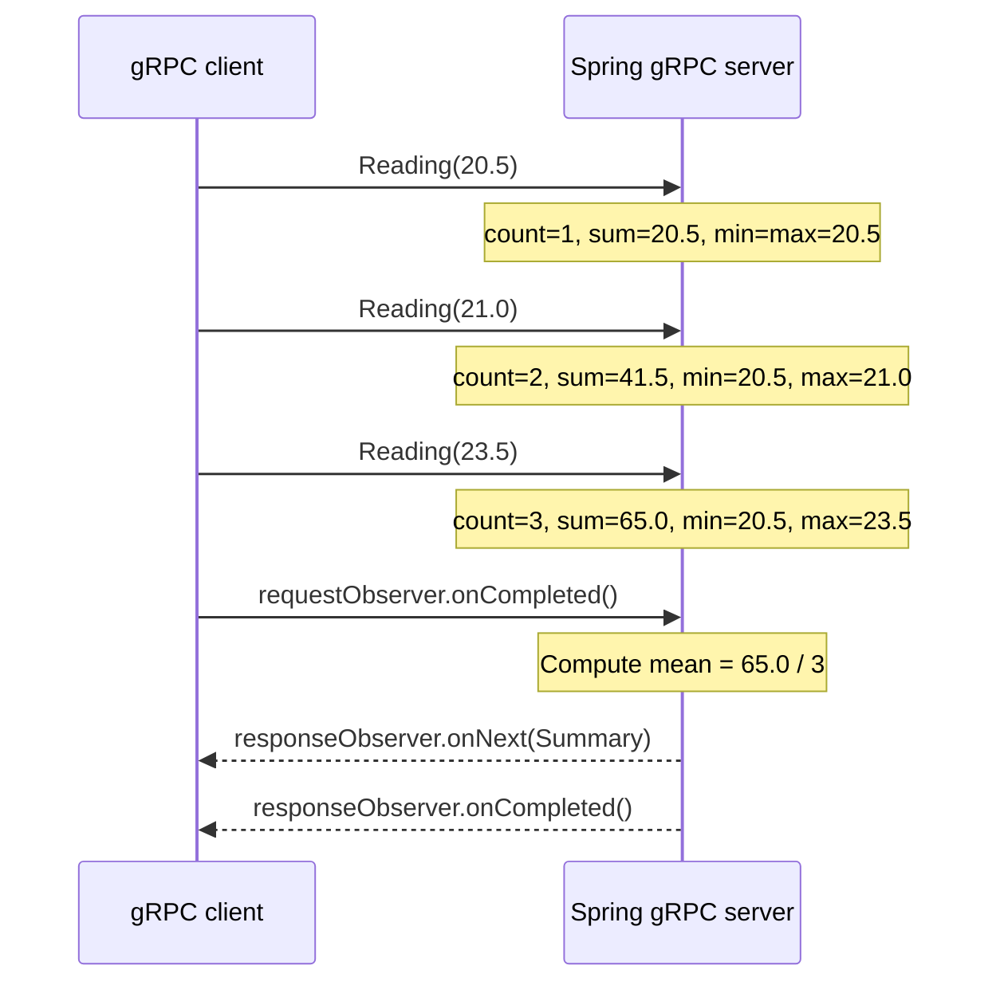

# Aggregating a request stream into one result

**Chapter:** Client streaming  
**Scope:** Spring gRPC (`SPRING_GRPC`) — building RPCs from Protocol Buffers contracts and generated Java code, processing request streams with gRPC Java `StreamObserver`, combining deadlines, status, security, and integration testing.

## 1. The problem: many records, but only one result needed

A telemetry system receives temperature values `20.5`, `21.0`, and `23.5` from a device. The client wants to send each value sequentially, while the server only needs to return **a single summary** containing count, sum, mean, minimum, and maximum.

A **client streaming RPC** matches this model: multiple request messages in the same RPC, one response message on success. On the server, each `onNext(reading)` updates the aggregated state; when `onCompleted()` arrives on the request stream, the server builds one `Summary`, calls `responseObserver.onNext(summary)`, and then calls `responseObserver.onCompleted()`.



The result for this example is:

| Field | Value |
| --- | ---: |
| `accepted_count` | `3` |
| `total` | `65.0` |
| `mean` | `21.666666...` |
| `minimum` | `20.5` |
| `maximum` | `23.5` |

This is **one** `Summarize` RPC, not three unary RPCs. The server does not need to buffer the entire list in memory to compute these quantities.

## 2. Learning objectives

After completing this lesson, you will be able to:

1. Design a protobuf contract for **a stream of multiple requests and one aggregated response**.
2. Build an *accumulator* that updates after each `onNext()`, with state isolated per RPC.
3. Know when aggregation can use **O(1) memory** and when additional data must be stored.
4. Define policies for empty streams, invalid data, arithmetic errors, and item count limits.
5. Return the result at the right time via `responseObserver.onNext()` and `onCompleted()`; return error statuses via `onError()`.
6. Stream from an async client and test with an in-process gRPC server/channel.

## 3. Accumulator mindset: update incrementally, do not buffer the whole batch

An aggregation suited for streaming can update state after each request:

```text
Initial state:
  count = 0
  sum   = 0
  min/max undefined

onNext(20.5) -> count=1, sum=20.5, min=20.5, max=20.5
onNext(21.0) -> count=2, sum=41.5, min=20.5, max=21.0
onNext(23.5) -> count=3, sum=65.0, min=20.5, max=23.5

onCompleted() -> mean=sum/count -> one Summary -> terminate OK
```

For each valid value \(x\):

\[
\begin{aligned}
n_{\text{new}} &= n_{\text{old}} + 1 \\
S_{\text{new}} &= S_{\text{old}} + x \\
\min_{\text{new}} &= \min(\min_{\text{old}}, x) \\
\max_{\text{new}} &= \max(\max_{\text{old}}, x) \\
\overline{x} &= S / n \quad (n > 0)
\end{aligned}
\]

For this problem, the state consists of only a few fields, so accumulator memory is **O(1)** in the number of requests; total processing time is **O(n)**. Data still passes through gRPC buffers and network/transport resources, so you cannot conclude the entire system uses strictly constant memory in all situations.

| Aggregation | State to maintain | Characteristics |
| --- | --- | --- |
| Count, sum | `count`, `sum` | Simple updates, constant memory |
| Mean | `count` and `sum`, or running mean | Avoid dividing by 0 on an empty batch |
| Min, max | Min/max values and a sample-seen flag | Do not default min/max to 0 |
| Variance / standard deviation | `count`, running mean, `M2` (Welford) | Computable online; avoids sum-of-squares precision loss |
| Count per group | Map `key -> accumulator` | Memory grows with group count; must bound group count |
| Exact median | Distribution info or stored samples | Typically requires more than O(1) memory; use approximate algorithms if error bounds are acceptable |
| List of per-record errors | Error positions/details | Memory or response may grow with error count; paginate/cap or store separately |

**Choose the accumulator based on business semantics.** If you need monetary totals, `double` is not suitable for decimal exactness. Use integers in the smallest currency unit (when value range allows) or `BigDecimal` in Java with a matching protobuf representation convention. This lesson's example uses `double` for **sensor readings**, where floating-point tolerance is acceptable within defined bounds.

## 4. Protocol Buffers contract

Create `src/main/proto/sensor_aggregation.proto`:

```proto
syntax = "proto3";

package sensors.v1;

option java_package = "com.example.sensors.grpc";
option java_multiple_files = true;

service SensorAggregationService {
  // N readings of a batch -> 1 final Summary.
  rpc Summarize(stream SensorReading) returns (SensorSummary);
}

message SensorReading {
  string batch_id = 1;
  string sensor_id = 2;
  int64 measured_at_epoch_ms = 3;
  double value = 4;
}

message SensorSummary {
  string batch_id = 1;
  int64 accepted_count = 2;
  double total = 3;
  double mean = 4;
  double minimum = 5;
  double maximum = 6;
}
```

`stream SensorReading` declares **multiple request messages**; `returns (SensorSummary)` has no `stream` keyword because the server returns **only one success response**. Through the `protoc-gen-grpc-java` plugin and protobuf compiler, the project generates `SensorReading`, `SensorSummary`, and `SensorAggregationServiceGrpc`. In Spring gRPC, the server extends the generated base class:

```java
public StreamObserver<SensorReading> summarize(
        StreamObserver<SensorSummary> responseObserver);
```

The return value is the **observer receiving requests** on the server; the `responseObserver` parameter is the **observer sending the result** from the server. Do not place `accepted_count`, `total`, or `mean` inside each request if those values are supposed to be calculated by the server across the whole stream.

## 5. Implementing the accumulator in the Spring gRPC server

The code below creates a new accumulator whenever a `Summarize` RPC begins. The `batchId`, `count`, `sum`, `min`, and `max` fields belong to **a single call**, preventing concurrent clients from mixing numbers.

```java
package com.example.sensors.server;

import com.example.sensors.grpc.SensorAggregationServiceGrpc;
import com.example.sensors.grpc.SensorReading;
import com.example.sensors.grpc.SensorSummary;
import io.grpc.Status;
import io.grpc.stub.StreamObserver;
import org.springframework.grpc.server.service.GrpcService;

@GrpcService
public class SensorAggregationGrpcService
        extends SensorAggregationServiceGrpc.SensorAggregationServiceImplBase {

    private static final long MAX_READINGS = 100_000L;

    @Override
    public StreamObserver<SensorReading> summarize(
            StreamObserver<SensorSummary> responseObserver) {

        return new StreamObserver<>() {
            private String batchId;
            private long count;
            private double sum;
            private double min;
            private double max;
            private boolean terminated;

            @Override
            public void onNext(SensorReading reading) {
                if (terminated) {
                    return;
                }

                // Validate each message before updating state.
                if (reading.getBatchId().isBlank()
                        || reading.getSensorId().isBlank()
                        || reading.getMeasuredAtEpochMs() <= 0L
                        || !Double.isFinite(reading.getValue())) {
                    fail(Status.INVALID_ARGUMENT, "Invalid reading");
                    return;
                }

                if (batchId != null
                        && !batchId.equals(reading.getBatchId())) {
                    fail(Status.INVALID_ARGUMENT,
                            "All messages must share the same batch_id");
                    return;
                }

                if (count >= MAX_READINGS) {
                    fail(Status.RESOURCE_EXHAUSTED, "Batch too large");
                    return;
                }

                double value = reading.getValue();
                double nextSum = sum + value;
                if (!Double.isFinite(nextSum)) {
                    fail(Status.OUT_OF_RANGE, "Sum of readings out of range");
                    return;
                }

                // Initialize min/max with the FIRST sample, not 0.
                if (count == 0) {
                    batchId = reading.getBatchId();
                    min = value;
                    max = value;
                } else {
                    min = Math.min(min, value);
                    max = Math.max(max, value);
                }

                sum = nextSum;
                count++;
            }

            @Override
            public void onError(Throwable cause) {
                // Request stream cancelled/failed: stop and release resources.
                terminated = true;
            }

            @Override
            public void onCompleted() {
                if (terminated) {
                    return;
                }
                if (count == 0) {
                    fail(Status.INVALID_ARGUMENT, "Batch has no readings");
                    return;
                }

                SensorSummary result = SensorSummary.newBuilder()
                        .setBatchId(batchId)
                        .setAcceptedCount(count)
                        .setTotal(sum)
                        .setMean(sum / count)
                        .setMinimum(min)
                        .setMaximum(max)
                        .build();

                // One response followed by one successful terminal callback.
                terminated = true;
                responseObserver.onNext(result);
                responseObserver.onCompleted();
            }

            private void fail(Status status, String reason) {
                if (terminated) {
                    return;
                }
                terminated = true;
                responseObserver.onError(
                        status.withDescription(reason).asRuntimeException());
            }
        };
    }
}
```

### Walkthrough of the stream lifecycle

1. `summarize(...)` is called by gRPC when the RPC starts. It returns a new `StreamObserver<SensorReading>` with `count = 0`.
2. For each `onNext(reading)`, the server validates the message, enforces the request limit, and updates `sum`, `min`, `max`, and `count`. **It does not send `SensorSummary` here.**
3. When the client calls `requestObserver.onCompleted()`, the server receives the request observer's `onCompleted()` callback after all messages have arrived normally. The server computes `mean` and closes the response with `responseObserver.onNext(result)` followed by `responseObserver.onCompleted()`.
4. If validation fails, the limit is exceeded, or arithmetic overflows, the server **returns an error status** via `responseObserver.onError(...)` and does not send a success response.
5. If the client cancels or the request stream fails, `onError(Throwable)` on the inbound observer is used to stop work, release resources, and **avoid emitting a success summary**.

`terminated` illustrates preventing two terminal callbacks during sequential single-RPC processing. If you introduce parallel processing tasks, you need proper synchronization and must serialize calls to `responseObserver`; a plain `boolean` is not enough across competing threads.

### Rule for empty batches

The `stream` contract allows a client to close the request stream without sending any message. This example chooses to **reject empty batches** with `INVALID_ARGUMENT` because min/max/mean are undefined. Another API might accept an empty batch, returning `accepted_count = 0` alongside a `has_data = false` flag. Document how undefined fields should be interpreted and test both client and server.

### Distinguishing received requests from durably persisted ones

`accepted_count` here means **the number of valid messages that entered the in-memory accumulator**. If you need to guarantee "durably written to database," the server must persist/commit before returning the receipt, or rename and document the API accurately. Calling `onNext()` is not confirmation of durable persistence.

## 6. Client using the async stub to send multiple items

In a Spring gRPC application, `SensorAggregationServiceGrpc.SensorAggregationServiceStub` can be created from a channel provided by `GrpcChannelFactory`. Example bean configuration:

```java
package com.example.sensors.client;

import com.example.sensors.grpc.SensorAggregationServiceGrpc;
import org.springframework.context.annotation.Bean;
import org.springframework.context.annotation.Configuration;
import org.springframework.grpc.client.GrpcChannelFactory;

@Configuration(proxyBeanMethods = false)
public class SensorClientConfiguration {

    @Bean
    SensorAggregationServiceGrpc.SensorAggregationServiceStub summaryStub(
            GrpcChannelFactory channelFactory) {
        return SensorAggregationServiceGrpc.newStub(
                channelFactory.createChannel("sensor-aggregation"));
    }
}
```

The `sensor-aggregation` channel must be configured to point to the server, with TLS and credentials appropriate for the environment. The client code below demonstrates **a small batch already in a `List`**; very large batches must be emitted incrementally and throttled with flow control.

```java
package com.example.sensors.client;

import com.example.sensors.grpc.SensorAggregationServiceGrpc;
import com.example.sensors.grpc.SensorReading;
import com.example.sensors.grpc.SensorSummary;
import io.grpc.stub.StreamObserver;
import java.util.List;
import java.util.Objects;
import java.util.concurrent.CompletableFuture;
import java.util.concurrent.TimeUnit;
import org.springframework.stereotype.Service;

@Service
public class SensorSummaryClient {

    private final SensorAggregationServiceGrpc.SensorAggregationServiceStub stub;

    public SensorSummaryClient(
            SensorAggregationServiceGrpc.SensorAggregationServiceStub stub) {
        this.stub = stub;
    }

    public CompletableFuture<SensorSummary> summarize(
            List<SensorReading> batch) {
        Objects.requireNonNull(batch, "batch");
        CompletableFuture<SensorSummary> future = new CompletableFuture<>();

        StreamObserver<SensorSummary> responses = new StreamObserver<>() {
            private SensorSummary summary;
            private int received;

            @Override
            public void onNext(SensorSummary value) {
                summary = value;
                received++;
            }

            @Override
            public void onError(Throwable error) {
                future.completeExceptionally(error);
            }

            @Override
            public void onCompleted() {
                if (received == 1) {
                    future.complete(summary);
                } else {
                    future.completeExceptionally(
                            new IllegalStateException(
                                    "Expected exactly one SensorSummary"));
                }
            }
        };

        StreamObserver<SensorReading> requests = stub
                .withDeadlineAfter(10, TimeUnit.SECONDS)
                .summarize(responses);

        try {
            for (SensorReading reading : batch) {
                requests.onNext(reading);
            }
            // Signal end of requests so the server emits the aggregated result.
            requests.onCompleted();
        } catch (RuntimeException sendFailure) {
            future.completeExceptionally(sendFailure);
            try {
                requests.onError(sendFailure);
            } catch (RuntimeException ignored) {
                // RPC may have already completed or been cancelled.
            }
        }
        return future;
    }
}
```

Test invocation:

```java
List<SensorReading> data = List.of(
    SensorReading.newBuilder()
        .setBatchId("batch-7")
        .setSensorId("sensor-a")
        .setMeasuredAtEpochMs(1_700_000_001_000L)
        .setValue(20.5).build(),
    SensorReading.newBuilder()
        .setBatchId("batch-7")
        .setSensorId("sensor-a")
        .setMeasuredAtEpochMs(1_700_000_002_000L)
        .setValue(21.0).build(),
    SensorReading.newBuilder()
        .setBatchId("batch-7")
        .setSensorId("sensor-a")
        .setMeasuredAtEpochMs(1_700_000_003_000L)
        .setValue(23.5).build()
);

client.summarize(data)
    .thenAccept(summary -> System.out.printf(
        "count=%d, total=%.1f, mean=%.3f, min=%.1f, max=%.1f%n",
        summary.getAcceptedCount(),
        summary.getTotal(),
        summary.getMean(),
        summary.getMinimum(),
        summary.getMaximum()))
    .exceptionally(error -> {
        System.err.println("RPC failed: " + error);
        return null;
    });
```

On the client, `requests.onCompleted()` only **closes the request-sending direction**. The result can only be considered successful when the response observer receives `onNext(summary)` and normal `onCompleted()`. If the server calls `onError()`, `future` completes exceptionally.

## 7. Frequently overlooked numerical issues

### 7.1. Floating-point numbers and precision

In computers, `double` stores floating-point numbers in binary, so sums like `0.1 + 0.2` may not equal `0.3` exactly. For sensor data, set a **tolerance** when comparing, such as `assertEquals(expected, actual, 1e-9)` in tests. For money, never use `double` just because protobuf supports it natively.

If a batch contains many values spanning wide orders of magnitude, ordinary `double` addition can accumulate rounding error. Consider **Kahan summation** (adding a compensation variable), a running-mean algorithm, or an algorithm suited to the data domain. Such changes do not alter the client streaming contract: you still update the accumulator in `onNext` and emit one result at completion.

### 7.2. Overflow and non-finite inputs

`Double.NaN`, `Double.POSITIVE_INFINITY`, and `Double.NEGATIVE_INFINITY` are not ordinary measurement values. `Double.isFinite(value)` rejects them. Adding two very large finite numbers can still produce infinity, so the example also checks `nextSum` before writing into the accumulator.

If you change `count` to `int` and allow huge request counts, `count++` risks integer overflow. Here we use `long` together with `MAX_READINGS`, and protobuf uses `int64 accepted_count`.

### 7.3. Min/max must be initialized properly

Do not write:

```java
double min = 0;
double max = 0;
```

If all values are positive, `min` will be wrong because it stays 0; if all values are negative, `max` will be wrong as well. Use the first valid sample to initialize `min` and `max`, or track a `hasData` flag.

### 7.4. Online mean and anomalous values

If you only need the mean, you can update:

\[
\mu_n = \mu_{n-1} + \frac{x_n - \mu_{n-1}}{n}
\]

The running-mean formula helps when `sum` might grow too large, though you should still check stability and accuracy for your dataset. To compute **variance** online, use Welford's algorithm with states `n`, `mean`, and `M2`, avoiding subtracting the squared mean from the mean of squares on large-magnitude data.

For more complex aggregations (median, percentiles, distinct counts), decide early whether you need **exact results** or can accept **approximations with measurable error**. A streaming RPC does not turn a data-heavy computation into O(1) memory.

## 8. Batch boundaries, errors, and result reliability

| Scenario | Server response in the example | Meaning for the result |
| --- | --- | --- |
| 3 valid messages, client finishes | One `SensorSummary` then `onCompleted()` | Result has `count = 3`, `total = 65.0` |
| Empty stream | `INVALID_ARGUMENT` | No valid min/max/mean |
| One message has a different `batch_id` | `INVALID_ARGUMENT` | Does not emit a fake summary as if the batch were valid |
| `NaN` or non-finite value | `INVALID_ARGUMENT` | Prevents corrupting the accumulator |
| Floating-point sum overflows range | `OUT_OF_RANGE` | Does not return infinity as a valid sum |
| Exceeds 100,000 messages | `RESOURCE_EXHAUSTED` | Forces client to split batches within quota |
| Client exceeds deadline or cancels | Typically sees `DEADLINE_EXCEEDED` or `CANCELLED` depending on side | Cannot infer whether business work committed |

There is no per-`SensorReading` success confirmation in this contract. If you need to know whether each message was accepted immediately as it is sent, use small unary RPCs or redesign as bidirectional streaming.

### Capacity and rate limits

Keeping only a few variables in the accumulator does **not** mean the client may send unbounded traffic:

- Set limits on **message count**, **total bytes**, **per-message size**, and **RPC duration**. The message limit in the example is a sample policy and should be tuned to server capacity.
- For large sources, use gRPC Java flow control: `ClientResponseObserver` and `ClientCallStreamObserver` support `isReady()` and `setOnReadyHandler(...)`. `isReady()` reflects transport write capacity, **not a commit ACK**.
- Calls to `onNext` on the same request observer must be **serialized** if data comes from multiple producers/threads; `StreamObserver` is not thread-safe for concurrent writes.
- A stream running too long may never produce a final result before its deadline. Split continuous sources into **finite batches** and use stable batch identifiers.

### When the server must persist data instead of only summing

If `onNext()` also writes each record to a database, the outcome after an error can be **a partially committed batch**. A deadline or network drop does not prove the entire batch failed. Define upfront:

1. **All-or-nothing** batch: stage data and commit only when input finishes and passes validation.
2. **Partial-acceptance** batch: receipt reports saved/rejected counts per an explicit contract; cap the size of error details.
3. Safe retries: stable `batch_id` and `event_id`, server-side deduplication, or a batch-status query API to resolve the **"committed but receipt lost"** case.

Only send an `OK` response once the business success condition is genuinely met. If persistence runs asynchronously after inbound `onCompleted()`, the server must wait for the commit before calling `responseObserver.onNext(result)` and `onCompleted()`; if commit fails, call `onError(status)`. Keep a single terminal path even when async callbacks and RPC cancellation happen close together.

### Metadata, TLS, and monitoring

In Spring gRPC, **metadata** and interceptors can carry authentication, correlation IDs, and tracing for the **entire RPC**; per-reading fields belong in the protobuf message. Use **TLS** for network transport per system policy. Monitor open RPCs, processing time, messages/batch, validation errors, `RESOURCE_EXHAUSTED`, `DEADLINE_EXCEEDED`, `CANCELLED`, and `OK` to understand service health.

Do not log tokens or full sensitive sensor payloads; prefer aggregated metrics, trace identifiers, and controlled statuses.

## 9. In-process gRPC integration testing

We can test the actual contract using a gRPC server and channel running in the same process through stubs generated from protobuf. The test below assumes the project includes JUnit 5, `grpc-inprocess`, and matching gRPC/protobuf dependencies.

```java
package com.example.sensors;

import com.example.sensors.client.SensorSummaryClient;
import com.example.sensors.grpc.SensorAggregationServiceGrpc;
import com.example.sensors.grpc.SensorReading;
import com.example.sensors.grpc.SensorSummary;
import com.example.sensors.server.SensorAggregationGrpcService;
import io.grpc.ManagedChannel;
import io.grpc.Server;
import io.grpc.Status;
import io.grpc.inprocess.InProcessChannelBuilder;
import io.grpc.inprocess.InProcessServerBuilder;
import java.util.List;
import java.util.concurrent.ExecutionException;
import java.util.concurrent.TimeUnit;
import org.junit.jupiter.api.AfterEach;
import org.junit.jupiter.api.BeforeEach;
import org.junit.jupiter.api.Test;

import static org.junit.jupiter.api.Assertions.assertEquals;
import static org.junit.jupiter.api.Assertions.assertThrows;

class SensorAggregationTest {

    private Server server;
    private ManagedChannel channel;
    private SensorSummaryClient client;

    @BeforeEach
    void startServer() throws Exception {
        String name = InProcessServerBuilder.generateName();
        server = InProcessServerBuilder.forName(name)
                .directExecutor()
                .addService(new SensorAggregationGrpcService())
                .build()
                .start();
        channel = InProcessChannelBuilder.forName(name)
                .directExecutor()
                .build();
        client = new SensorSummaryClient(
                SensorAggregationServiceGrpc.newStub(channel));
    }

    @AfterEach
    void stopServer() {
        channel.shutdownNow();
        server.shutdownNow();
    }

    @Test
    void aggregatesThreeMessagesIntoOneSummary() throws Exception {
        SensorSummary result = client.summarize(List.of(
                reading(20.5), reading(21.0), reading(23.5)))
                .get(3, TimeUnit.SECONDS);

        assertEquals("batch-7", result.getBatchId());
        assertEquals(3L, result.getAcceptedCount());
        assertEquals(65.0, result.getTotal(), 1e-9);
        assertEquals(65.0 / 3.0, result.getMean(), 1e-9);
        assertEquals(20.5, result.getMinimum(), 1e-9);
        assertEquals(23.5, result.getMaximum(), 1e-9);
    }

    @Test
    void rejectsEmptyStream() {
        ExecutionException error = assertThrows(
                ExecutionException.class,
                () -> client.summarize(List.of())
                        .get(3, TimeUnit.SECONDS));
        assertEquals(
                Status.Code.INVALID_ARGUMENT,
                Status.fromThrowable(error.getCause()).getCode());
    }

    private static SensorReading reading(double value) {
        return SensorReading.newBuilder()
                .setBatchId("batch-7")
                .setSensorId("sensor-a")
                .setMeasuredAtEpochMs(1_700_000_001_000L)
                .setValue(value)
                .build();
    }
}
```

These two tests verify **multiple messages -> one summary** and the empty-stream policy. Cases to add:

| Test case | Expected behavior |
| --- | --- |
| All positive or all negative values | Accurate min/max, unaffected by an initial 0 value |
| Two `batch_id` values in the same stream | `INVALID_ARGUMENT` |
| Request with `NaN` or `Infinity` | `INVALID_ARGUMENT` |
| Exceeds maximum item count | `RESOURCE_EXHAUSTED` |
| Sum overflows `double` range | `OUT_OF_RANGE` |
| Client streams incrementally without `onCompleted()` | No final summary yet under the example contract |
| Two RPCs running concurrently | Each RPC has its own accumulator |
| Client cancels or deadline expires mid-stream | Do not treat batch as succeeded; no state/resource leak |
| Retry after lost receipt in a DB-backed implementation | No duplicate writes if the API guarantees idempotency |

In-process testing verifies streaming logic and gRPC statuses. To verify Spring context configuration, interceptors, TLS, networked channels, and database durability, add integration tests at the corresponding layers.

## 10. Practice exercises

1. **Count and mean:** Extend the protobuf and server to also compute the mean of squared values. Assess the risk of floating-point overflow when input values are large.
2. **Negative dataset:** Send `-5.0`, `-2.0`, `-8.0`. Calculate `min`, `max`, and `mean` beforehand, then write a test that catches initializing min/max to 0.
3. **Multiple groups:** To return counts and means grouped by `sensor_id`, design a response message containing `repeated SensorGroupSummary` and an accumulator map. How would you bound the number of groups and response size?
4. **Invalid stream:** Send three messages where the second has a different `batch_id`. Predict the status and explain why the server must not emit a success `SensorSummary`.
5. **Reliability:** Design an ingestion API with durable storage. Distinguish `accepted_count` (validated) from `committed_count` (persisted), and propose a safe recovery strategy if the client loses connection before receiving the summary.

**Remember:** In client streaming, the server can **aggregate each request right inside `onNext()`** using a per-RPC accumulator, and then **return exactly one result** when receiving inbound `onCompleted()`. Accuracy and reliability depend on value validation, resource limits, empty-batch handling, error policies, commit timing, and only acknowledging success after the RPC response/status completes.
