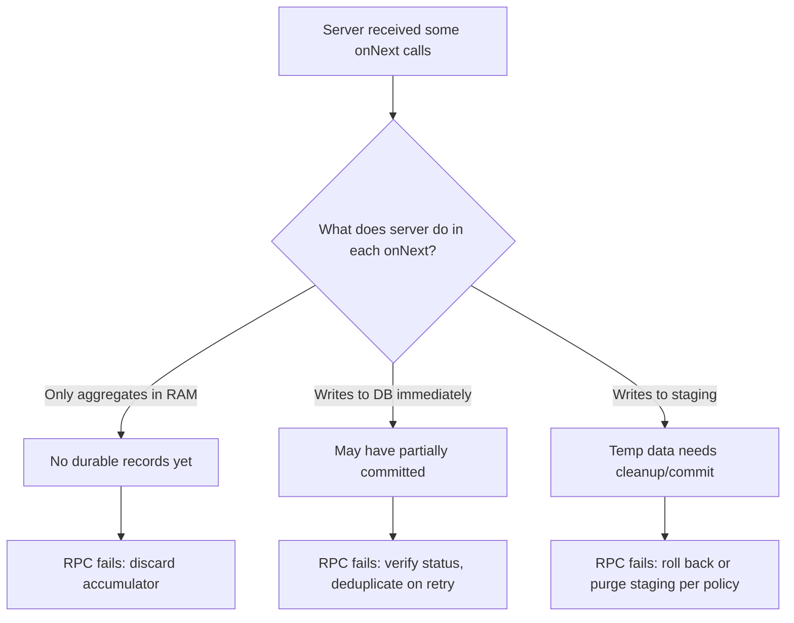

# Errors when a stream has not completed

**Chapter:** Client streaming  
**Context:** In Spring gRPC (`SPRING_GRPC`), client and server exchange messages following a Protocol Buffers contract; Java code generated from `.proto` provides stubs and `StreamObserver`. This lesson focuses on **errors occurring while the client is sending multiple requests before ending the stream**, along with handling status, cancellation, deadlines, and server-side effects.

## 1. The problem: partial transmission followed by RPC failure

Suppose a client intends to send 1,000 measurement samples in a client streaming RPC. After the server receives 400 samples, the connection drops, the client cancels, the deadline expires, or the server detects an invalid sample. **No final response was received**, so the client cannot assume the whole batch succeeded. If the server writes data inside every `onNext()`, part of the data may even have been persisted already.

This is a key difference between client streaming and a simple unary call: multiple messages share **a single RPC with a shared terminal status**. When an RPC fails mid-stream, gRPC reports that *the call did not complete successfully*, but it does not automatically define how business transactions should roll back.

```mermaid
sequenceDiagram
    participant C as Client
    participant S as Spring gRPC server
    C->>S: onNext(request 1)
    C->>S: onNext(request 2)
    C->>S: onNext(invalid request 3)
    S-->>C: onError(INVALID_ARGUMENT)
    Note over C,S: RPC terminates with error; no success response
    Note over C: Stop sending remaining requests
```

In another branch, if the client actively cancels or loses network connectivity after the second request, the server must stop processing when notified of cancellation and release resources. Never assume every callback reaches the peer after a transport failure.

### Objectives

After this lesson, you will be able to:

1. Distinguish `onError()`, `onCompleted()`, deadlines, and cancellation in client streaming.
2. Know when the server should return `INVALID_ARGUMENT`, `RESOURCE_EXHAUSTED`, `INTERNAL`, or another appropriate status.
3. Implement a Spring gRPC server that handles errors between `onNext()` calls without sending a success response after an error.
4. Write a client that stops sending, receives errors asynchronously, bounds duration, and does not mark a batch complete prematurely.
5. Address partially processed data, retries, and idempotency; test errors **before** the client calls `onCompleted()`.

## 2. How can a client streaming RPC end?

A protobuf contract of the form:

```proto
rpc UploadSamples(stream Sample) returns (UploadReceipt);
```

The client can call `requestObserver.onNext(sample)` multiple times. The server returns **one** `UploadReceipt` if the RPC succeeds. Typical lifecycle:

```text
Client                               Server
  | -- onNext(Sample A) -------------> |  onNext(A)
  | -- onNext(Sample B) -------------> |  onNext(B)
  | -- requestObserver.onCompleted() ->|  onCompleted()
  | <- onNext(UploadReceipt) --------- |  responseObserver.onNext()
  | <- onCompleted() ----------------- |  responseObserver.onCompleted()
                 OK
```

When an error happens mid-stream, one of several branches can occur:

| Event | Detecting / originating side | Outcome |
| --- | --- | --- |
| Client finishes sending normally | Client calls `requestObserver.onCompleted()` | **Half-close request direction**; RPC still awaits server result |
| Server detects invalid request | Server calls `responseObserver.onError(statusException)` | RPC ends with an **error status**, no success receipt |
| Client's data source fails | Client aborts send stream, typically via `requestObserver.onError(cause)` | RPC does not finish normally; client response callback receives error on termination |
| Client actively cancels | Client cancels call/request stream | Typically observes `CANCELLED` on the observing side |
| Deadline expires | gRPC enforces call deadline automatically | Client typically observes `DEADLINE_EXCEEDED` |
| Connection drops or server unavailable | Transport | Client may observe `UNAVAILABLE` |

**Two core rules:** `requestObserver.onCompleted()` on the client *does not mean* the RPC succeeded; and `onError()`/`onCompleted()` on **the same observer** are mutually exclusive termination types. After a terminal callback, do not call `onNext()` again.

### Do not conflate three states

1. **Client called `onNext()`:** gRPC accepted the message send request in the client process, but the message may still be buffered.
2. **Server executed `onNext()`:** a message was delivered to server code. Validation, processing, and durable persistence depend on the implementation.
3. **Application committed:** data has reached the storage guarantees declared by the application. Only the business layer can confirm this.

You cannot infer the third state from the first two, or from the client having called `onCompleted()`.

## 3. Defining the Protocol Buffers contract

Suppose a batch of samples is sent from a device to a Spring gRPC server. Create `src/main/proto/sample_ingest.proto`:

```proto
syntax = "proto3";

package ingest.v1;
option java_package = "com.example.ingest.grpc";
option java_multiple_files = true;

service SampleIngestService {
  // Client sends multiple Samples; server returns only one UploadReceipt.
  rpc UploadSamples(stream Sample) returns (UploadReceipt);
}

message Sample {
  string batch_id = 1;
  string event_id = 2;
  int64 recorded_at_epoch_ms = 3;
  double value = 4;
}

message UploadReceipt {
  string batch_id = 1;
  int64 accepted_count = 2;
}
```

The `stream` keyword on `Sample` allows multiple requests. `returns (UploadReceipt)` has only one success response. When configuring the protobuf compiler and gRPC Java plugin, the project generates `Sample`, `UploadReceipt`, and `SampleIngestServiceGrpc`; these classes are **never hand-written**.

`batch_id` identifies a batch upload attempt, and `event_id` identifies an item. They do not automatically prevent duplicate writes; for safe retries, the server must persist and enforce idempotency using these identifiers.

## 4. Spring gRPC server rejecting invalid data mid-stream

A server receives multiple requests via `StreamObserver<Sample>`; if it sees an invalid message or exceeded quota, the server terminates the RPC **immediately** via `responseObserver.onError()`. It does not wait for the client to finish the whole batch to report the error.

```java
package com.example.ingest.server;

import com.example.ingest.grpc.Sample;
import com.example.ingest.grpc.SampleIngestServiceGrpc;
import com.example.ingest.grpc.UploadReceipt;
import io.grpc.Status;
import io.grpc.stub.StreamObserver;
import org.springframework.grpc.server.service.GrpcService;

@GrpcService
public class SampleIngestGrpcService
        extends SampleIngestServiceGrpc.SampleIngestServiceImplBase {

    private static final long MAX_SAMPLES = 10_000L;

    @Override
    public StreamObserver<Sample> uploadSamples(
            StreamObserver<UploadReceipt> responseObserver) {

        // State isolated to ONE RPC.
        return new StreamObserver<>() {
            private String batchId;
            private long count;
            private boolean terminated;

            @Override
            public void onNext(Sample sample) {
                if (terminated) return;

                if (sample.getBatchId().isBlank()
                        || sample.getEventId().isBlank()
                        || sample.getRecordedAtEpochMs() <= 0
                        || !Double.isFinite(sample.getValue())) {
                    fail(Status.INVALID_ARGUMENT, "Invalid Sample");
                    return;
                }

                if (batchId != null
                        && !batchId.equals(sample.getBatchId())) {
                    fail(Status.INVALID_ARGUMENT, "Inconsistent batch_id");
                    return;
                }

                if (count >= MAX_SAMPLES) {
                    fail(Status.RESOURCE_EXHAUSTED, "Batch exceeded quota");
                    return;
                }

                batchId = sample.getBatchId();
                count++;
                // Counting in RAM only; not persisted to database yet.
            }

            @Override
            public void onError(Throwable error) {
                // Client cancelled or inbound stream failed:
                // clean up temp files, buffers, transactions, etc. if any.
                terminated = true;
                // Do not send a success UploadReceipt.
            }

            @Override
            public void onCompleted() {
                if (terminated) return;
                if (count == 0) {
                    fail(Status.INVALID_ARGUMENT, "Empty batch");
                    return;
                }

                UploadReceipt receipt = UploadReceipt.newBuilder()
                        .setBatchId(batchId)
                        .setAcceptedCount(count)
                        .build();

                terminated = true;
                responseObserver.onNext(receipt);
                responseObserver.onCompleted();
            }

            private void fail(Status status, String description) {
                if (terminated) return;
                terminated = true;
                responseObserver.onError(
                        status.withDescription(description).asRuntimeException());
            }
        };
    }
}
```

In this example, `onNext()` only increments a counter, so when the stream fails before `onCompleted()`, **no records are committed**. That is a property of the illustrative implementation, **not a built-in guarantee** of client streaming.

Key points to remember:

- The server **receives** `onError(Throwable)` on the request observer when input errors/cancels and can clean up resources there. Do not assume the server always receives this callback instantly when the peer loses connectivity; detection depends on the transport.
- The server **calls** `responseObserver.onError(statusException)` when proactively rejecting a message. That is how a gRPC error status is returned to the client; do not subsequently call `responseObserver.onNext()` or `onCompleted()`.
- The server calls `responseObserver.onNext(receipt)` then `responseObserver.onCompleted()` only when the client has half-closed normally and business rules allow success.
- `terminated` prevents two terminal callbacks during sequential processing. If running async work across threads or registering a cancellation callback concurrently, protect terminal state with proper synchronization.
- Each call creates its own observer and counter. Never store `count` in a shared mutable field of the singleton Spring service, because multiple clients may call concurrently.

### Do not use raw Java exceptions as an ad-hoc error protocol

Instead of letting `IllegalArgumentException` or infrastructure exceptions escape `onNext()` unchecked, map errors to meaningful gRPC `Status` values. Never include stack traces, SQL queries, tokens, or internal details in the error description returned to the client.

For example, `INVALID_ARGUMENT` fits invalid client data; `RESOURCE_EXHAUSTED` fits quota-exceeded batches; unexpected database errors generally should be logged internally and mapped to `INTERNAL` or another contextually appropriate status, rather than defaulting to `INVALID_ARGUMENT`.

## 5. Client receiving an error before finishing sending

Client streaming in gRPC Java uses an **asynchronous stub**. On the client, monitor both directions: `requestObserver` for sending and `responseObserver` for receiving status/receipt. The response callback can fire as soon as the server rejects a request, **before** the producer has a chance to call `onCompleted()`.

The client snippet below targets a small, finite batch; the project can create the async stub from Spring gRPC's `GrpcChannelFactory`:

```java
package com.example.ingest.client;

import com.example.ingest.grpc.Sample;
import com.example.ingest.grpc.SampleIngestServiceGrpc;
import com.example.ingest.grpc.UploadReceipt;
import io.grpc.stub.StreamObserver;
import java.util.List;
import java.util.Objects;
import java.util.concurrent.CompletableFuture;
import java.util.concurrent.TimeUnit;
import java.util.concurrent.atomic.AtomicBoolean;

public class SampleUploadClient {

    private final SampleIngestServiceGrpc.SampleIngestServiceStub stub;

    public SampleUploadClient(
            SampleIngestServiceGrpc.SampleIngestServiceStub stub) {
        this.stub = stub;
    }

    public CompletableFuture<UploadReceipt> upload(List<Sample> samples) {
        Objects.requireNonNull(samples, "samples");
        CompletableFuture<UploadReceipt> result = new CompletableFuture<>();
        AtomicBoolean responseEnded = new AtomicBoolean();

        StreamObserver<UploadReceipt> responses = new StreamObserver<>() {
            private int responseCount;
            private UploadReceipt receipt;

            @Override
            public void onNext(UploadReceipt value) {
                receipt = value;
                responseCount++;
            }

            @Override
            public void onError(Throwable error) {
                responseEnded.set(true);
                result.completeExceptionally(error);
            }

            @Override
            public void onCompleted() {
                responseEnded.set(true);
                if (responseCount == 1) {
                    result.complete(receipt);
                } else {
                    result.completeExceptionally(
                            new IllegalStateException(
                                    "Expected exactly one UploadReceipt"));
                }
            }
        };

        StreamObserver<Sample> requests = stub
                .withDeadlineAfter(5, TimeUnit.SECONDS)
                .uploadSamples(responses);

        try {
            for (Sample sample : samples) {
                // Once response has terminated, stop emitting.
                if (responseEnded.get()) break;
                requests.onNext(sample);
            }
            if (!responseEnded.get()) {
                requests.onCompleted();
            }
        } catch (RuntimeException failure) {
            result.completeExceptionally(failure);
            if (!responseEnded.get()) {
                try {
                    requests.onError(failure); // Cancel stream if still open.
                } catch (RuntimeException ignored) {
                    // RPC may have already been closed by an earlier error.
                }
            }
        }

        return result;
    }
}
```

The example above illustrates how to **stop a sequential producer once a response error is observed**. `responseEnded` is only an application-layer coordination signal: a status can arrive between checks and async sending can still raise errors. For large batches or multi-threaded producers, use a single coordinator for `onNext/onCompleted/onError`, a bounded queue, flow control handling, and an explicit call-cancellation mechanism.

Do not use `result.isDone()` or the return of `onNext()` to infer that the server finished persisting data. Success is determined only after the client receives **one valid receipt** and the response callback completes normally.

### Local data source fails mid-send

Suppose a client reads a file and sends each `Sample`. Reading the file may throw `IOException` before reaching EOF. In this case, **do not call `requestObserver.onCompleted()`**, because doing so can make the server treat it as a complete batch and return success.

Conceptually:

```java
// requests is the request observer of the open RPC.
try {
    // Read and send multiple valid Samples...
    // If source finishes normally:
    requests.onCompleted();
} catch (java.io.IOException sourceFailure) {
    // Mark upload failed and cancel RPC instead of a normal half-close.
    requests.onError(sourceFailure);
}
```

Note: this illustrates the termination branch of a **single producer**; in production, ensure the observer has not already terminated and no other task is writing concurrently. On the client side, `requests.onError(...)` normally cancels the call; it is **not** a way to send an arbitrary business status to the server over HTTP/2.

### Proactive RPC cancellation

When a user aborts an upload or the data source becomes invalid, you must cancel the call and stop the producer. With gRPC Java, you can manage a `ClientCallStreamObserver` and call `cancel(reason, cause)`, or signal error through the request observer when appropriate. Calling `CompletableFuture.cancel()` on the wrapper layer **does not automatically guarantee** the underlying gRPC call is cancelled; you must wire cancellation between both layers.

## 6. Common gRPC statuses

| Status | Common scenario | How to react |
| --- | --- | --- |
| `INVALID_ARGUMENT` | Message has invalid field or violates batch contract | Fix data, do not retry verbatim |
| `RESOURCE_EXHAUSTED` | Exceeded message count, byte, or resource quota | Split into smaller batches, throttle, obey quota |
| `DEADLINE_EXCEEDED` | Entire RPC did not finish within deadline | Treat outcome as potentially unknown; verify before retry |
| `CANCELLED` | Call cancelled by caller or RPC context cancelled | Stop producer, clean up resources |
| `UNAVAILABLE` | Transport/server temporarily unavailable | Controlled retry with idempotency |
| `INTERNAL` | Unexpected internal error | Log internal trace, investigate, do not expose sensitive info |

You cannot assume a status **always** surfaces identically on both ends. For instance, a client-side deadline may surface as `DEADLINE_EXCEEDED` while the server observes RPC cancellation. When connectivity drops abruptly, error callbacks can also be delayed.

Mapping the cause to a status code:

```java
import io.grpc.Status;

void report(Throwable error) {
    Status status = Status.fromThrowable(error);
    switch (status.getCode()) {
        case INVALID_ARGUMENT ->
            System.out.println("Invalid data");
        case RESOURCE_EXHAUSTED ->
            System.out.println("Reduce batch size or upload rate");
        case DEADLINE_EXCEEDED, UNAVAILABLE ->
            System.out.println("Verify batch status before retrying");
        default ->
            System.out.println("RPC failed: " + status.getCode());
    }
}
```

In `CompletableFuture` callbacks, `error` may be wrapped in `CompletionException` or `ExecutionException`; unwrap the appropriate `cause` before calling `Status.fromThrowable` if accurate classification is needed.

## 7. Side effects when a stream fails mid-way

This is what decides reliability: **gRPC does not provide a database transaction spanning the entire stream**.



### Three common strategies

| Strategy | What happens if client disconnects after 400/1,000 messages | Trade-off |
| --- | --- | --- |
| **Aggregate in RAM then return one receipt** | Discards in-progress computation, no durable records | Fits statistics; server still needs resource limits |
| **Write each message** | May have persisted a partial subset even though RPC failed | Requires status verification and per-message idempotency |
| **Write to staging then commit whole batch** | Temp data must be rolled back/deleted on error; announce success only after commit | More complex, but can achieve all-or-nothing |

Never interpret `DEADLINE_EXCEEDED` or `UNAVAILABLE` as "the server did nothing." The server might have committed successfully right before the client lost the response.

### Retry design pattern to avoid duplicate writes

1. Client generates a fixed `batch_id` and assigns a stable `event_id` to each item, **keeping them identical on retries**.
2. Server stores batch state (`RECEIVING`, `COMMITTED`, `FAILED`, etc.) and enforces uniqueness/deduplication on the chosen IDs. State is only meaningful when durably persisted.
3. Server emits `UploadReceipt` only after achieving the business success condition (for example, committing the transaction).
4. If the client misses the receipt, it queries batch status via a unary RPC or equivalent mechanism before re-sending. If re-sending is necessary, the server deduplicates according to the idempotency policy.
5. For very long batches, split into multiple finite batches to bound recovery cost and receipt wait time.

Business-level *exactly-once* semantics do not emerge automatically from streaming; they must be designed into storage, business keys, and commit rules.

## 8. Cleanup, cancellation, and asynchronous races

If the server holds temporary files, DB connections, buffers, or background tasks per RPC, release them upon **normal completion, explicit error, cancellation, or deadline expiration**. `onError(Throwable)` on the request-receiving observer handles inbound errors, but when async tasks or cancellation are involved, relying on a single callback may not be enough.

In gRPC Java, `ServerCallStreamObserver` provides cancellation info/callbacks:

```java
import io.grpc.stub.ServerCallStreamObserver;
import io.grpc.stub.StreamObserver;
import java.util.concurrent.atomic.AtomicBoolean;

// Inside server method, with responseObserver passed by gRPC:
ServerCallStreamObserver<UploadReceipt> serverCall =
        (ServerCallStreamObserver<UploadReceipt>) responseObserver;
AtomicBoolean cancelled = new AtomicBoolean();
serverCall.setOnCancelHandler(() -> {
    cancelled.set(true);
    // Signal background tasks to stop; cleanup must be idempotent/thread-safe.
});
```

This is only a **supplementary illustration** and is unnecessary if the server holds no resources or background tasks to cancel. With standard gRPC Java servers, `responseObserver` is a `ServerCallStreamObserver`; when writing custom adapters/mocks, examine that cast assumption. `setOnCancelHandler` should be registered at RPC initialization; the cancellation callback may execute on a different thread, so never invoke `onNext/onCompleted/onError` concurrently without coordination.

A safe pattern is to treat terminal state as a **once-only** state transition: `ACTIVE -> SUCCESS`, `ACTIVE -> ERROR`, or `ACTIVE -> CANCELLED`. The winning transition governs sending the response; other paths only clean up resources. With multi-threaded processing, use synchronization/atomics and ensure the outbound observer is called sequentially.

Deadlines must cover the **entire** RPC: from opening the stream, sending each message, and server processing to receiving the receipt. Avoid leaving streams open indefinitely when a client forgets `onCompleted()`; at the same time, do not set deadlines too short for the batch size and transfer rate.

## 9. Testing errors before the client half-closes

To test that the server rejects an invalid request **before the client calls `onCompleted()`**, you can use in-process gRPC. The test below needs no network ports while still exercising the real async stub and gRPC callbacks. The project needs JUnit 5, `grpc-inprocess`, and protobuf/gRPC dependencies.

```java
package com.example.ingest;

import com.example.ingest.grpc.Sample;
import com.example.ingest.grpc.SampleIngestServiceGrpc;
import com.example.ingest.grpc.UploadReceipt;
import com.example.ingest.server.SampleIngestGrpcService;
import io.grpc.ManagedChannel;
import io.grpc.Server;
import io.grpc.Status;
import io.grpc.inprocess.InProcessChannelBuilder;
import io.grpc.inprocess.InProcessServerBuilder;
import io.grpc.stub.StreamObserver;
import java.util.concurrent.CompletableFuture;
import java.util.concurrent.TimeUnit;
import org.junit.jupiter.api.Test;

import static org.junit.jupiter.api.Assertions.assertEquals;

class SampleErrorStreamingTest {

    @Test
    void invalidMessageTerminatesRpcBeforeClientHalfClose()
            throws Exception {
        String name = InProcessServerBuilder.generateName();
        Server server = InProcessServerBuilder.forName(name)
                .directExecutor()
                .addService(new SampleIngestGrpcService())
                .build()
                .start();
        ManagedChannel channel = InProcessChannelBuilder.forName(name)
                .directExecutor()
                .build();

        try {
            CompletableFuture<Status.Code> finished =
                    new CompletableFuture<>();

            StreamObserver<UploadReceipt> responseObserver =
                    new StreamObserver<>() {
                        @Override
                        public void onNext(UploadReceipt value) {
                            finished.completeExceptionally(
                                    new AssertionError(
                                            "Must not receive success receipt"));
                        }

                        @Override
                        public void onError(Throwable error) {
                            finished.complete(
                                    Status.fromThrowable(error).getCode());
                        }

                        @Override
                        public void onCompleted() {
                            finished.completeExceptionally(
                                    new AssertionError(
                                            "Must not complete OK"));
                        }
                    };

            StreamObserver<Sample> requests =
                    SampleIngestServiceGrpc.newStub(channel)
                            .uploadSamples(responseObserver);

            requests.onNext(sample("event-1", 20.0));
            // Second sample has invalid event_id: server must reject early.
            requests.onNext(sample("", 21.0));

            // INTENTIONALLY do not call requests.onCompleted().
            assertEquals(Status.Code.INVALID_ARGUMENT,
                    finished.get(3, TimeUnit.SECONDS));
        } finally {
            channel.shutdownNow();
            server.shutdownNow();
        }
    }

    private static Sample sample(String eventId, double value) {
        return Sample.newBuilder()
                .setBatchId("batch-1")
                .setEventId(eventId)
                .setRecordedAtEpochMs(1_700_000_000_000L)
                .setValue(value)
                .build();
    }
}
```

The test proves the server can emit an error status **before** receiving the end-of-requests signal. When adding a database layer, verify side effects before/after errors using storage fixtures, rather than inferring from status alone.

Other test cases:

| Case | Expected behavior |
| --- | --- |
| Client sends valid messages then calls `onCompleted()` | Receives exactly one `UploadReceipt`, response `onCompleted()`, status `OK` |
| Client cancels after a few messages | No success receipt; server cleans up resources and stops remaining work |
| Client does not half-close | Deadline terminates RPC, no false success |
| Exceeds 10,000-message limit | `RESOURCE_EXHAUSTED` before server returns a receipt |
| Sends two different `batch_id` values | `INVALID_ARGUMENT` |
| Connection drops after partial persistence | Storage state matches transaction policy; retry does not duplicate writes |
| Async task finishes at the same time as cancellation | Only **one** terminal result/cleanup; no observer calls after close |

In-process testing does not verify TLS configuration, interceptors, network latency, or capacity of a real Spring context. Add integration tests over real transport plus performance/reliability tests.

## 10. Common implementation mistakes

| Symptom | Frequent cause | Resolution |
| --- | --- | --- |
| Client keeps sending after server reported an error | Producer does not monitor `onError` callback | Stop producer, abort input source, coordinate stream state |
| Server returns receipt even though client file failed mid-read | Client called `onCompleted()` after input source error | Abort RPC with `onError`/cancel instead of a normal half-close |
| Client times out and retries create duplicates | Server already committed part or all of the batch | Add idempotency and status lookup by `batch_id` |
| Server calls both `onError()` and `onCompleted()` | Error branch and async success race against each other | Use atomic/synchronized terminal state; single termination path |
| Server leaks temp files after client cancels | Missing cleanup on abort branches | Release resources in termination/cancellation paths |
| Server reports `OK` despite DB commit failure | Emitting receipt before commit finishes | Wait for the actual business success condition |
| Large streams cause memory growth | Client pushes too fast or server buffers everything | Bound resources and use flow control/backpressure |

## 11. Practice and self-check questions

1. A client plans to send 500 messages, and after sending 120 the source file hits `IOException`. Would you call `onCompleted()` or `onError()` on the request observer, and why?
2. The server detects that the 8th request is missing `event_id` before the client sends all 20 requests. Diagram the subsequent callbacks on the client and explain why a success receipt must not be emitted.
3. The client gets `DEADLINE_EXCEEDED` after the server wrote 400/500 records. What `batch_id`, `event_id`, and status lookup endpoint design enables safe retries?
4. Add a simulated temporary resource to the server and prove via tests that it is released across `OK`, validation error, and cancellation branches.
5. A commit task finishes right as the client cancels the RPC. Design a state machine that prevents two terminal callbacks and describe how to handle a completed commit when the client never received the response.

**Remember:** An error while client streaming **has not completed** causes the RPC to end with a gRPC status, typically **with no success response**. Stop the producer, clean up resources, distinguish received messages from committed data, apply appropriate deadlines and flow control, and design idempotency to handle uncertain outcomes on disconnect.
