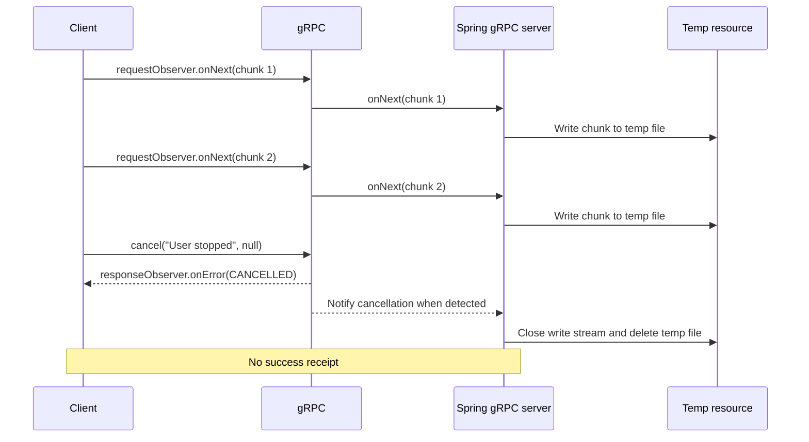

# Cancelling a client stream and releasing resources

**Chapter:** Client streaming  
**Context:** In Spring gRPC (`SPRING_GRPC`), Protocol Buffers contracts define the RPCs, Java code-generation tools produce stubs and server base classes, and gRPC Java manages message delivery, deadlines, statuses, and stream lifecycles. This lesson focuses on **cancelling an in-flight client streaming RPC** and **releasing resources** when a stream finishes normally, fails, or is cancelled.

## 1. Why must stream cancellation be designed proactively?

A device uploads a file to the server chunk by chunk. During the upload, the server may open a temporary file, hold buffers, reserve disk space, or start a persistence task. If the user clicks **Stop upload** at chunk 40/100, the system must stop sending, report a final **non-success** outcome, halt unnecessary work, and clean up the temporary file according to policy.

gRPC cancellation does not automatically undo every business operation. For example, if 40 chunks were already committed to a database before cancellation, cancelling the RPC **does not roll back** those 40 chunks. Therefore, you must distinguish **transport cancellation**, **work cancellation**, and **reverting side effects**.



The diagram shows a typical cancellation flow; the exact ordering between callbacks on both ends depends on scheduling and network conditions. When connectivity drops, the server may learn of the cancellation later than the client.

### Learning objectives

After this lesson, you will be able to:

1. Distinguish `requestObserver.onCompleted()`, `requestObserver.onError()`, and `ClientCallStreamObserver.cancel()`.
2. Distinguish `CANCELLED`, `DEADLINE_EXCEEDED`, data errors, and `OK` completion in a client streaming RPC.
3. Use `ServerCallStreamObserver.setOnCancelHandler()` and `isCancelled()` to know when the server should stop continuing work.
4. Design a cleanup function that runs **exactly once** even when multiple termination paths occur together.
5. Release temp files, buffers, transactions, and background tasks consistently with data semantics.
6. Write a client capable of cancelling even after sending all requests while still waiting for the response.
7. Test cancellation before half-close, cancellation after half-close, and races between cancellation and completion.

## 2. Distinguishing three client-side termination actions

In client streaming, one RPC carries **multiple request messages** and the server returns **one success response**. The client uses the `StreamObserver<Request>` returned by the async stub to send requests.

| Action | Meaning | What server/client observes |
| --- | --- | --- |
| `requestObserver.onNext(chunk)` | Asks gRPC to send another message | Server receives `onNext(chunk)` when the message arrives; not durable confirmation |
| `requestObserver.onCompleted()` | **Half-closes** send direction: client finished sending requests normally | Server may receive inbound `onCompleted()`, process, and return result; client still waits for response |
| `requestObserver.onError(cause)` | Terminates send direction with an error; gRPC Java typically uses this to cancel the client-side RPC | RPC no longer completes normally; not a channel for arbitrary business statuses to the server |
| `ClientCallStreamObserver.cancel(message, cause)` | **Actively cancels the call** from the client | Client typically receives `CANCELLED`, server receives cancel signal when gRPC detects it; producer must stop |

Never call `onNext()` after you have already called `onCompleted()` or `onError()` on the same observer. **Half-close is not cancel**: after `onCompleted()`, the client may still need to cancel an RPC waiting on server processing/commit. That is why the client should track **finished-sending state** and **RPC-terminated state** separately.

### Cases requiring cancellation

- The user stops a file upload or navigates away, making the task obsolete.
- The file/device reader encounters an error mid-batch; calling `onCompleted()` would mislead the server into treating the batch as complete.
- A deadline or resource limit no longer allows continuing.
- The application detects an unrecoverable business condition in the current batch.
- The client already half-closed, but must stop waiting for the result because the user changed their request.

Never cancel an RPC simply because `onNext()` did not return a result: client streaming has only **one final response**, so there is no receipt per send.

## 3. Protocol Buffers contract for the chunked upload example

Create `src/main/proto/chunk_upload.proto`:

```proto
syntax = "proto3";

package upload.v1;
option java_package = "com.example.upload.grpc";
option java_multiple_files = true;

service ChunkUploadService {
  // Client sends multiple chunks, server returns one receipt on success.
  rpc Upload(stream UploadChunk) returns (UploadReceipt);
}

message UploadChunk {
  string upload_id = 1;
  int32 sequence = 2; // Starts at 0, increments by 1 per chunk.
  bytes data = 3;
}

message UploadReceipt {
  string upload_id = 1;
  int64 received_bytes = 2;
}
```

After protobuf and gRPC Java code generation, the project has `UploadChunk`, `UploadReceipt`, and `ChunkUploadServiceGrpc`. Server method signature:

```java
@Override
public StreamObserver<UploadChunk> upload(
        StreamObserver<UploadReceipt> responseObserver);
```

The `StreamObserver<UploadChunk>` **returned by the server** receives each request. The `responseObserver` **passed to the server as a parameter** sends the final result or error status. When the client actively cancels, the server must **not** fabricate a fake `UploadReceipt` claiming success.

The example in this lesson writes chunks to a **temp file**, then deletes the temp file on both success and failure. The receipt only reports the valid byte count processed in the demo; **there is no durable file-storage step yet**. In a real system, add a commit/move step into permanent storage before sending a success receipt.

## 4. Resources that must be managed across the RPC lifecycle

| Resource | On stream open | On success | On error/cancel |
| --- | --- | --- | --- |
| Temp file / file descriptor | Create file and open write stream | Close and handle file per contract (commit/delete) | Close and delete temp file if uncommitted |
| In-RAM buffers | Allocate bounded capacity | Release | Clear temp data and release |
| Write/transform tasks | Launch as needed | Wait for completion or stop cleanly | Signal cancellation and reclaim task if possible |
| Database transaction | Start according to write strategy | Commit before reporting success | Roll back if uncommitted; verify state if commit may have run |
| Per-batch capacity/quota | Reserve quota when receiving | Release quota after completion | Release quota on cancel/error |
| Metadata/tracing | Attach RPC-wide context | End span and record status | Record cancel/error status, avoid leaking tokens |

A good cleanup API has three properties:

1. **Idempotent:** calling it multiple times still releases the same resource only once.
2. **Does not destroy committed results:** deleting an incomplete staging file is different from deleting an already-committed document.
3. **Observable:** file deletion failures, open stream counts, and unreleased resources must emit appropriate logs/metrics.

In gRPC Java, data callbacks run sequentially, but the **cancellation handler** and async tasks can execute from other threads. If `onNext()`, `onCompleted()`, `onError()`, and `setOnCancelHandler()` can all trigger cleanup, coordinate them to avoid closing a file while writing or sending two terminal callbacks.

## 5. Spring gRPC server: cancelling and cleaning up temp files exactly once

The example below demonstrates a server using `@GrpcService`, `ServerCallStreamObserver`, a per-RPC coordination lock, and an `AtomicBoolean` flag. The server writes each chunk to a temp file, enforces per-chunk byte and chunk count limits, and cleans up resources on success, error, or cancellation.

```java
package com.example.upload.server;

import com.example.upload.grpc.ChunkUploadServiceGrpc;
import com.example.upload.grpc.UploadChunk;
import com.example.upload.grpc.UploadReceipt;
import com.google.protobuf.ByteString;
import io.grpc.Status;
import io.grpc.stub.ServerCallStreamObserver;
import io.grpc.stub.StreamObserver;
import java.io.IOException;
import java.io.OutputStream;
import java.nio.file.Files;
import java.nio.file.Path;
import java.util.concurrent.atomic.AtomicBoolean;
import org.slf4j.Logger;
import org.slf4j.LoggerFactory;
import org.springframework.grpc.server.service.GrpcService;

@GrpcService
public final class ChunkUploadGrpcService
        extends ChunkUploadServiceGrpc.ChunkUploadServiceImplBase {

    private static final Logger log =
            LoggerFactory.getLogger(ChunkUploadGrpcService.class);
    private static final int MAX_CHUNKS = 10_000;
    private static final int MAX_CHUNK_BYTES = 256 * 1024;
    private static final long MAX_TOTAL_BYTES = 16L * 1024 * 1024;

    @Override
    public StreamObserver<UploadChunk> upload(
            StreamObserver<UploadReceipt> responseObserver) {

        // In grpc-java server RPCs, the passed observer supports
        // monitoring cancellation and cancel status.
        ServerCallStreamObserver<UploadReceipt> call =
                (ServerCallStreamObserver<UploadReceipt>) responseObserver;

        final TempSink sink;
        try {
            sink = new TempSink();
        } catch (IOException openError) {
            log.warn("Failed to create temp file", openError);
            responseObserver.onError(Status.INTERNAL
                    .withDescription("Unable to prepare upload area")
                    .asRuntimeException());
            // RPC already terminated with error; ignore subsequent data callbacks.
            return new StreamObserver<>() {
                @Override public void onNext(UploadChunk ignored) {}
                @Override public void onError(Throwable ignored) {}
                @Override public void onCompleted() {}
            };
        }

        Object guard = new Object(); // Per-RPC lock.
        AtomicBoolean ended = new AtomicBoolean();
        AtomicBoolean cleaned = new AtomicBoolean();

        Runnable cleanup = () -> {
            if (cleaned.compareAndSet(false, true)) {
                try {
                    sink.close(); // Close output and delete temp file.
                } catch (IOException cleanupError) {
                    // Track so orphaned files can be cleaned up after failures.
                    log.warn("Failed to clean up temp file", cleanupError);
                }
            }
        };

        // Register right after preparing RPC state.
        call.setOnCancelHandler(() -> {
            synchronized (guard) {
                ended.set(true);
                cleanup.run();
            }
        });

        return new StreamObserver<>() {
            private String uploadId;
            private int nextSequence;
            private long totalBytes;

            @Override
            public void onNext(UploadChunk chunk) {
                synchronized (guard) {
                    if (ended.get()) return;
                    if (call.isCancelled()) {
                        ended.set(true);
                        cleanup.run();
                        return;
                    }

                    if (chunk.getUploadId().isBlank()
                            || chunk.getData().isEmpty()
                            || chunk.getSequence() != nextSequence) {
                        fail(Status.INVALID_ARGUMENT, "Invalid chunk");
                        return;
                    }
                    if (uploadId != null
                            && !uploadId.equals(chunk.getUploadId())) {
                        fail(Status.INVALID_ARGUMENT,
                                "Inconsistent upload_id");
                        return;
                    }

                    int size = chunk.getData().size();
                    if (nextSequence >= MAX_CHUNKS
                            || size > MAX_CHUNK_BYTES
                            || size > MAX_TOTAL_BYTES - totalBytes) {
                        fail(Status.RESOURCE_EXHAUSTED, "Upload limit exceeded");
                        return;
                    }

                    try {
                        sink.write(chunk.getData());
                    } catch (IOException ioError) {
                        log.warn("Failed to write chunk", ioError);
                        fail(Status.INTERNAL, "Unable to write data");
                        return;
                    }

                    uploadId = chunk.getUploadId();
                    nextSequence++;
                    totalBytes += size;
                }
            }

            @Override
            public void onError(Throwable error) {
                // Inbound stream failed or was cancelled.
                // Repeated cleanup remains safe thanks to cleaned.
                synchronized (guard) {
                    ended.set(true);
                    cleanup.run();
                }
            }

            @Override
            public void onCompleted() {
                synchronized (guard) {
                    if (ended.get()) return;
                    if (call.isCancelled()) {
                        ended.set(true);
                        cleanup.run();
                        return;
                    }
                    if (nextSequence == 0) {
                        fail(Status.INVALID_ARGUMENT, "Empty batch");
                        return;
                    }

                    // DEMO: only counts bytes read, no durable commit.
                    UploadReceipt receipt = UploadReceipt.newBuilder()
                            .setUploadId(uploadId)
                            .setReceivedBytes(totalBytes)
                            .build();

                    ended.set(true);
                    cleanup.run(); // Clean up temp file before responding.
                    if (call.isCancelled()) return;

                    responseObserver.onNext(receipt);
                    responseObserver.onCompleted();
                }
            }

            private void fail(Status status, String message) {
                if (!ended.compareAndSet(false, true)) return;
                cleanup.run();
                if (!call.isCancelled()) {
                    responseObserver.onError(status
                            .withDescription(message)
                            .asRuntimeException());
                }
            }
        };
    }

    /**
     * Illustrative resource. Each RPC uses an independent temp file.
     * Do not use the client's upload_id as a file path.
     */
    private static final class TempSink implements AutoCloseable {
        private final Path path;
        private final OutputStream output;

        TempSink() throws IOException {
            Path created = Files.createTempFile("grpc-upload-", ".part");
            try {
                output = Files.newOutputStream(created);
            } catch (IOException error) {
                Files.deleteIfExists(created);
                throw error;
            }
            path = created;
        }

        void write(ByteString bytes) throws IOException {
            bytes.writeTo(output);
        }

        @Override
        public void close() throws IOException {
            try {
                output.close();
            } finally {
                Files.deleteIfExists(path);
            }
        }
    }
}
```

### Why does the example have both `setOnCancelHandler` and `onError`?

- `setOnCancelHandler` provides a clear signal when the call is cancelled. The callback may run on a different thread from the request callbacks, so the example uses the same `guard` to prevent closing the file while writing.
- `onError(Throwable)` handles errors on the request stream when gRPC delivers that callback. **Do not rely on only one callback** to clean up call-scoped resources.
- `cleaned.compareAndSet(false, true)` guarantees `sink.close()` runs only once, even if multiple termination paths request cleanup.
- `call.isCancelled()` avoids continuing to receive/write or trying to send a response once the call is known to be cancelled.
- `responseObserver.onError(...)` handles **server-initiated errors** such as `INVALID_ARGUMENT` and `RESOURCE_EXHAUSTED`; the server does not send a success receipt after an error status.

The lock in the example clearly explains **the relationship between writing and closing resources**; in production, avoid holding a gRPC thread during slow I/O. For high-latency storage, offload I/O to a bounded executor, push data into a bounded queue, and perform coordinated cleanup. A cancellation handler must not let large file deletion or waiting on background tasks tie up transport threads for long.

**Important limitation:** The example deletes the temp file on success and returns the accepted byte count; it **does not implement durable upload**. For real uploads, the completion step must close and verify the file, commit/rename it to its permanent storage location, and only then respond with success. On cancellation, delete only uncommitted staging data; never delete already-confirmed data.

## 6. Java client: sending, half-closing, and cancelling even while waiting for the response

To actively cancel a client streaming RPC, gRPC Java provides `ClientCallStreamObserver.cancel(reason, cause)`. With an **async stub**, `ClientResponseObserver` provides `beforeStart(ClientCallStreamObserver<Request>)` to capture the call and configure flow control.

The code below wraps the request observer in `UploadSession`. The `send`, `finish`, and `cancel` methods share a lock so multiple threads cannot write or terminate the stream concurrently.

```java
package com.example.upload.client;

import com.example.upload.grpc.ChunkUploadServiceGrpc;
import com.example.upload.grpc.UploadChunk;
import com.example.upload.grpc.UploadReceipt;
import io.grpc.stub.ClientCallStreamObserver;
import io.grpc.stub.ClientResponseObserver;
import java.util.Objects;
import java.util.concurrent.CompletableFuture;
import java.util.concurrent.TimeUnit;
import java.util.concurrent.atomic.AtomicReference;

public final class ChunkUploadClient {

    private final ChunkUploadServiceGrpc.ChunkUploadServiceStub stub;

    public ChunkUploadClient(
            ChunkUploadServiceGrpc.ChunkUploadServiceStub stub) {
        this.stub = stub;
    }

    public UploadSession begin() {
        CompletableFuture<UploadReceipt> result = new CompletableFuture<>();
        AtomicReference<ClientCallStreamObserver<UploadChunk>> requestRef =
                new AtomicReference<>();

        ClientResponseObserver<UploadChunk, UploadReceipt> responses =
                new ClientResponseObserver<>() {
                    private UploadReceipt receipt;
                    private int responseCount;

                    @Override
                    public void beforeStart(
                            ClientCallStreamObserver<UploadChunk> request) {
                        requestRef.set(request);
                    }

                    @Override
                    public void onNext(UploadReceipt value) {
                        receipt = value;
                        responseCount++;
                    }

                    @Override
                    public void onError(Throwable error) {
                        result.completeExceptionally(error);
                    }

                    @Override
                    public void onCompleted() {
                        if (responseCount == 1) {
                            result.complete(receipt);
                        } else {
                            result.completeExceptionally(
                                    new IllegalStateException(
                                            "Expected exactly one UploadReceipt"));
                        }
                    }
                };

        stub.withDeadlineAfter(20, TimeUnit.SECONDS).upload(responses);
        return new UploadSession(
                Objects.requireNonNull(requestRef.get()), result);
    }

    public static final class UploadSession {
        private final ClientCallStreamObserver<UploadChunk> request;
        private final CompletableFuture<UploadReceipt> result;
        private final Object guard = new Object();
        private boolean halfClosed;
        private boolean cancelled;

        UploadSession(ClientCallStreamObserver<UploadChunk> request,
                CompletableFuture<UploadReceipt> result) {
            this.request = request;
            this.result = result;
        }

        public void send(UploadChunk chunk) {
            synchronized (guard) {
                if (halfClosed || cancelled || result.isDone()) {
                    throw new IllegalStateException("Upload has stopped");
                }
                request.onNext(chunk);
            }
        }

        public void finish() {
            synchronized (guard) {
                if (!halfClosed && !cancelled && !result.isDone()) {
                    halfClosed = true;
                    request.onCompleted(); // All requests sent.
                }
            }
        }

        public void cancel() {
            synchronized (guard) {
                // Still allow cancel AFTER half-close,
                // if the server has not yet returned a completed response.
                if (!cancelled && !result.isDone()) {
                    cancelled = true;
                    request.cancel("User stopped upload", null);
                }
            }
        }

        public CompletableFuture<UploadReceipt> result() {
            return result;
        }
    }
}
```

Application-layer usage example:

```java
ChunkUploadClient.UploadSession session = client.begin();

session.send(UploadChunk.newBuilder()
        .setUploadId("upload-42")
        .setSequence(0)
        .setData(com.google.protobuf.ByteString.copyFromUtf8("abc"))
        .build());

// User chooses Stop upload before sending the whole batch:
session.cancel();

session.result().whenComplete((receipt, error) -> {
    if (error != null) {
        System.out.println("Upload did not complete: " + error);
    } else {
        System.out.println("Bytes received: " + receipt.getReceivedBytes());
    }
});
```

When the user **does not cancel**, the client calls `session.finish()` after sending all chunks, then waits for `session.result()` to complete normally. `finish()` only closes the send direction; it does not mark the task successful on its own.

The snippet above illustrates a small batch and a single producer. For large files, add producer stop signals, read data in bounded chunk sizes, and use `isReady()/setOnReadyHandler()`. `isReady()` is a transport buffer signal, **not confirmation that the server persisted data**. If the reader hits an error, close the reader and call `cancel()` instead of `finish()`.

### Does cancelling a CompletableFuture automatically cancel gRPC?

**There is no automatic guarantee.** If the application only calls `session.result().cancel(true)`, the Java future changes state while the underlying RPC keeps running. With this wrapper, use **`session.cancel()`** to cancel the call. If you want cancellation via the future, explicitly bridge future cancellation to `ClientCallStreamObserver.cancel()`.

### Concurrency notes

`StreamObserver` is not guaranteed by gRPC Java to be thread-safe for concurrent writes. The lock in `UploadSession` prevents `send`, `finish`, and `cancel` from colliding on the caller side. However, response callbacks run asynchronously, so an error/cancel result can arrive right after checking `result.isDone()`. Producers must be ready to stop if gRPC reports the RPC closed, and never treat a client-side send call as a business ACK.

## 7. Cancellation, deadlines, and error statuses

| Scenario | Typical client-side status | How to handle |
| --- | --- | --- |
| User calls `cancel()` while stream is sending | `CANCELLED` | Stop reading source, clean up files/buffers, update UI |
| Cancelled after `requestObserver.onCompleted()` but before final response | `CANCELLED` if cancellation wins the race against completion | Do not assume success; verify side effects |
| Deadline expires before stream completes | `DEADLINE_EXCEEDED` | Stop producer, check batch status before retrying |
| Server rejects data | `INVALID_ARGUMENT` | Fix message/contract, do not retry verbatim |
| Exceeded quota or total size | `RESOURCE_EXHAUSTED` | Split batch, limit rate or size |
| Network lost or endpoint temporarily unavailable | `UNAVAILABLE` | Conditional retry with idempotency |
| Server finishes processing, sends receipt, and closes | `OK` | Verify receipt, confirm task completed |

**Status does not reflect all business side effects.** If the server committed the file before receiving the cancel signal, the client can still observe `CANCELLED` and receive no receipt. That does not mean the file was definitely not saved.

One deadline applies to the **entire RPC**, from opening the stream across multiple `onNext()` calls to the final response; it is not automatically refreshed on each chunk. Set the deadline according to batch size and realistic time budgets, avoiding infinitely long streams.

### Classifying errors from client callbacks

```java
import io.grpc.Status;

void handleFailure(Throwable cause) {
    Status status = Status.fromThrowable(cause);
    switch (status.getCode()) {
        case CANCELLED ->
            System.out.println("Cancelled by user or system");
        case DEADLINE_EXCEEDED ->
            System.out.println("Timed out; verify status");
        case RESOURCE_EXHAUSTED ->
            System.out.println("Limit exceeded; reduce batch size");
        case INVALID_ARGUMENT ->
            System.out.println("Invalid request");
        default ->
            System.out.println("RPC failed: " + status.getCode());
    }
}
```

If handling exceptions from `CompletableFuture`, you may need to unwrap `CompletionException` or `ExecutionException` before calling `Status.fromThrowable()`. Logs and tracing should preserve the original gRPC code for observability.

## 8. When the server already committed partially: cleanup and rollback differ

With a 100-chunk batch, suppose the server receives 40 chunks before being cancelled:

| Server handling approach | What remains after cancellation | What needs to be done? |
| --- | --- | --- |
| In-RAM accumulation only | Temporary buffers | Free RAM, release quota |
| Writing to staging file | Unpublished file | Close file, delete staging or queue for cleanup |
| Writing each chunk to durable storage | Potentially partially committed data | Design status checks and deduplication on retry |
| Using transaction/staging then committing whole batch | May be uncommitted or already committed | Roll back before commit; if already committed, determine exact status |
| Enqueuing work onto a job queue | Job may still be running | Cancel/tombstone task if possible, reconcile races with completed jobs |

To support safe retries, a real upload API typically needs:

- **A stable `upload_id`** per batch and stable identifier/sequence per chunk.
- Durable states such as `RECEIVING`, `COMMITTED`, `ABORTED` managed at the business layer.
- Deduplication constraints when receiving the same upload/chunk multiple times.
- A unary RPC or batch-status lookup API when the client loses the final result.
- A garbage-collection process for orphaned staging resources after crashes, even when cleanup callbacks did not run because the process died.

**There is no automatic business-level exactly-once guarantee** from client streaming. Transport-layer cancellation does not replace commit rules and rollback policies.

## 9. Testing cancellation and cleanup behavior

**In-process** gRPC testing verifies `CANCELLED` callbacks without opening TCP ports. The example below uses JUnit 5, `grpc-inprocess`, and the service from section 5. Here `ClientResponseObserver` captures `ClientCallStreamObserver`, sends one chunk, and then cancels **before** calling `onCompleted()`.

```java
package com.example.upload;

import com.example.upload.grpc.ChunkUploadServiceGrpc;
import com.example.upload.grpc.UploadChunk;
import com.example.upload.grpc.UploadReceipt;
import com.example.upload.server.ChunkUploadGrpcService;
import com.google.protobuf.ByteString;
import io.grpc.ManagedChannel;
import io.grpc.Server;
import io.grpc.Status;
import io.grpc.inprocess.InProcessChannelBuilder;
import io.grpc.inprocess.InProcessServerBuilder;
import io.grpc.stub.ClientCallStreamObserver;
import io.grpc.stub.ClientResponseObserver;
import java.util.concurrent.CompletableFuture;
import java.util.concurrent.TimeUnit;
import java.util.concurrent.atomic.AtomicReference;
import org.junit.jupiter.api.Test;

import static org.junit.jupiter.api.Assertions.assertEquals;

class ChunkUploadCancellationTest {

    @Test
    void cancelBeforeHalfCloseEndsRpcWithoutSuccess() throws Exception {
        String name = InProcessServerBuilder.generateName();
        Server server = InProcessServerBuilder.forName(name)
                .directExecutor()
                .addService(new ChunkUploadGrpcService())
                .build()
                .start();
        ManagedChannel channel = InProcessChannelBuilder.forName(name)
                .directExecutor()
                .build();

        try {
            CompletableFuture<Status.Code> finished =
                    new CompletableFuture<>();
            AtomicReference<ClientCallStreamObserver<UploadChunk>> request =
                    new AtomicReference<>();

            ClientResponseObserver<UploadChunk, UploadReceipt> response =
                    new ClientResponseObserver<>() {
                        @Override
                        public void beforeStart(
                                ClientCallStreamObserver<UploadChunk> stream) {
                            request.set(stream);
                        }

                        @Override
                        public void onNext(UploadReceipt receipt) {
                            finished.completeExceptionally(
                                    new AssertionError(
                                            "Must not receive success receipt"));
                        }

                        @Override
                        public void onError(Throwable error) {
                            finished.complete(
                                    Status.fromThrowable(error).getCode());
                        }

                        @Override
                        public void onCompleted() {
                            finished.completeExceptionally(
                                    new AssertionError(
                                            "Must not complete OK"));
                        }
                    };

            ChunkUploadServiceGrpc.newStub(channel).upload(response);
            ClientCallStreamObserver<UploadChunk> outgoing = request.get();
            outgoing.onNext(UploadChunk.newBuilder()
                    .setUploadId("upload-42")
                    .setSequence(0)
                    .setData(ByteString.copyFromUtf8("abc"))
                    .build());

            // Do not half-close, actively cancel the call.
            outgoing.cancel("User cancelled test upload", null);

            assertEquals(Status.Code.CANCELLED,
                    finished.get(3, TimeUnit.SECONDS));
        } finally {
            channel.shutdownNow();
            server.shutdownNow();
        }
    }
}
```

This test proves **the client terminates with `CANCELLED`**, not yet directly that the temp file was deleted. To verify actual cleanup, inject a dedicated temp directory and an observable `TempSink` factory in the service test: await the cancellation/cleanup signal with a `CountDownLatch`, assert the staging file no longer exists, and assert `close()` ran exactly once. Avoid verifying with arbitrary `Thread.sleep`.

### Test matrix to add

| Test case | What to verify |
| --- | --- |
| Client sends all chunks then `onCompleted()` | One `UploadReceipt`, one response `onCompleted()`, cleanup once |
| Client cancels before half-close | Client receives `CANCELLED`; server stops writing and deletes staging |
| Client cancels after half-close while waiting on commit | Does not mark success without a receipt; task cancelled if still possible |
| Server rejects out-of-sequence chunk | `INVALID_ARGUMENT`; cleanup runs; no success receipt |
| Server receives data exceeding quota | `RESOURCE_EXHAUSTED`; resources reclaimed |
| Deadline expires mid-send | Client receives `DEADLINE_EXCEEDED`; reader stops; server cleans up |
| Cancellation races with commit/completion | Only one terminal path wins, resource not closed twice |
| Two concurrent RPCs | Isolated temp file and state per RPC; cancelling one does not affect the other |
| Server process terminates abnormally | Orphaned staging file cleanup runs on startup/schedule |

In-process tests do not verify TLS, interceptors, real network transport, latency, or storage durability. Integration tests with a Spring context, storage layer, and monitoring are required to validate guarantees in the deployment environment.

## 10. Common pitfalls and fixes

| Symptom | Cause | Fix |
| --- | --- | --- |
| User clicks stop, but server keeps processing | Only cancelled future/UI, did not cancel RPC | Wire stop action to `ClientCallStreamObserver.cancel()`, stop producer |
| Client sends `onCompleted()` when file read fails | Confused normal completion with cancellation | Cancel call or terminate with `onError()`; do not send bogus receipt |
| Temp file left behind after cancellation | Missing cleanup in cancel branch, or server crash | Use `setOnCancelHandler`, idempotent cleanup, and staging GC job |
| File closed while another thread is writing | Cancellation handler and `onNext` lack coordination | Synchronize resource access, coordinate async tasks |
| Server calls both `onError()` and `onCompleted()` | Two branches terminating together | Once-only terminal state, no callbacks after termination |
| Cancelled, yet committed data still exists | Transport cancellation does not roll back business logic | Design transactions, upload state, and idempotency |
| Large stream increases memory | Producer emits continuously or buffers all chunks in RAM | Flow control, bounded queues, quotas, deadlines |
| Cancellation logs lack context | No correlation ID/metrics per RPC | Use metadata/interceptors and controlled status metrics |

## 11. Self-practice

1. A client has sent all 500 chunks and called `onCompleted()`, while the server is verifying the checksum. If the user clicks stop now, should you call `cancel()` or ignore it? Why is it important to distinguish half-close from RPC completion?
2. A gRPC server is writing a temp file when the cancellation handler fires on another thread. Describe how to synchronize so the file is not closed mid-write, and why `cleanup` must be idempotent.
3. If the server committed before the client received `CANCELLED`, can you assert the file does not exist? Propose an `upload_id`, status lookup endpoint, and retry strategy.
4. Design tests verifying staging file deletion on success, validation error, client cancel, and deadline branches. How do you assert without relying on `sleep`?
5. A file conversion job runs on an executor, but the client cancels. Design the stop signal, quota release, and handling for the case where the job committed right before receiving the signal.

**Remember:** Cancelling client streaming means **terminating an RPC before receiving a success result**; stop the producer, signal cancellation via gRPC, monitor `setOnCancelHandler()`/status on the server, and **release resources exactly once**. For already-committed data, cancellation does not roll back automatically: establish staging/commit boundaries, idempotency, deadlines, TLS, and proper monitoring to prevent resource leaks and inconsistency.
