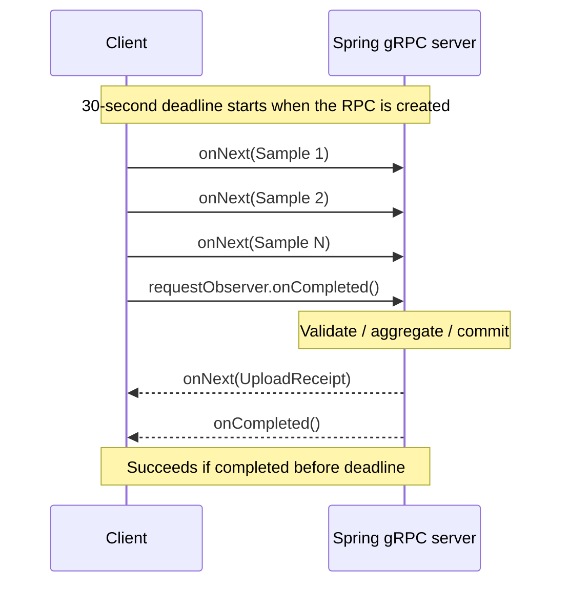

# Deadline for the entire stream

**Chapter:** Client streaming  
**Scope:** Spring gRPC (`SPRING_GRPC`) for RPCs that receive multiple requests and return one response. This lesson focuses on the time budget of **an entire client streaming call**: from opening the RPC, sending messages, and server-side processing to receiving the final result on the client.

## 1. What does the deadline apply to?

With the contract:

```proto
rpc UploadSamples(stream Sample) returns (UploadReceipt);
```

the client can send hundreds of messages via multiple `requestObserver.onNext(sample)` calls. **A single deadline** applies to that entire RPC call. It is not reset after each message.



The time budget covers:

- Time to send request messages over the network and wait for transport readiness.
- Time for the server to receive, decode, validate, and process each message.
- Time waiting for the client to half-close via `requestObserver.onCompleted()`.
- Time to aggregate or commit data on the server.
- Time to send the final response and deliver the result back to the client.

If the deadline expires before the RPC completes, gRPC terminates the call. The client typically receives `DEADLINE_EXCEEDED`; the server is notified that the call was cancelled once cancellation is detected. The server must stop any cancellable work and release resources.

**Deadlines differ from per-message timeouts.** For example, a 30-second deadline does not mean each `onNext()` gets its own 30 seconds. If 20 seconds are spent sending data, only about 10 seconds remain for the server to process and return the response.

## 2. Setting a deadline on the client

gRPC Java lets you create a deadline-bounded stub using `withDeadlineAfter`. Set the deadline **before opening the stream**:

```java
import com.example.upload.grpc.Sample;
import com.example.upload.grpc.SampleIngestServiceGrpc;
import com.example.upload.grpc.UploadReceipt;
import io.grpc.stub.StreamObserver;
import java.util.concurrent.TimeUnit;

SampleIngestServiceGrpc.SampleIngestServiceStub boundedStub =
        asyncStub.withDeadlineAfter(30, TimeUnit.SECONDS);

StreamObserver<UploadReceipt> responses = new StreamObserver<>() {
    @Override
    public void onNext(UploadReceipt receipt) {
        // Handle the single final receipt.
    }

    @Override
    public void onError(Throwable error) {
        // Classify DEADLINE_EXCEEDED, CANCELLED, UNAVAILABLE...
    }

    @Override
    public void onCompleted() {
        // Response stream completed normally.
    }
};

StreamObserver<Sample> requests =
        boundedStub.uploadSamples(responses);

for (Sample sample : finiteBatch) {
    requests.onNext(sample);
}
requests.onCompleted();
```

`withDeadlineAfter(30, SECONDS)` creates a stub for **a single call with a 30-second budget**. The deadline starts when the RPC is created via `uploadSamples(...)`, not earlier when the client built the list of data. If the application must include file reading or payload preparation time, start measuring the budget at the application layer and subtract elapsed time before opening the RPC.

After calling `requests.onCompleted()`, the client still has to wait for the response callback. The deadline keeps ticking while the server aggregates/commits and sends the receipt. Half-closing does not pause the deadline clock.

Without a configured deadline, an RPC can wait indefinitely if a client fails to half-close or the server never responds. With client streaming, set an explicit deadline for each finite batch.

## 3. Choosing an appropriate budget for a batch

Do not pick a deadline based only on average processing time. A large batch can spend most of its time in transit before the server even begins finalizing.

You can estimate the budget as:

\[
T_{\text{RPC}} \geq
T_{\text{upload}} +
T_{\text{server}} +
T_{\text{response}} +
T_{\text{margin}}
\]

Where:

- \(T_{\text{upload}}\): time to transmit all messages, affected by total bytes, bandwidth, and flow control.
- \(T_{\text{server}}\): decoding, validation, aggregation, and commit.
- \(T_{\text{response}}\): building and sending the final response.
- \(T_{\text{margin}}\): headroom for network jitter, system load, and scheduling.

For example, consider a 4 MiB batch at 1 MiB/s effective throughput, expected processing and commit of 2 seconds, and response under 1 second. Theoretical time is already around 7 seconds; an 8-second deadline can be too tight when network or server load fluctuates. Use real measurements under expected load and tune thresholds to service latency targets.

| Batch characteristics | How to pick the deadline |
| --- | --- |
| Few messages, small payload, fast processing | Short budget, but still include margin |
| Many messages or large payload | Account for upload and processing time across the whole batch |
| Server must persist durably | Reserve time for commit and confirmation |
| Source has no clear ending point | Split into finite batches; do not keep one unbounded RPC |
| Multiple downstream service tiers | Allocate budgets per step and keep the total under the inbound deadline |

A deadline that is too short causes valid calls to be cancelled even when the server could have finished; a deadline that is too long holds connections, state, and resources longer than needed. Monitor latency percentiles (such as p95/p99), batch size, and timeout rates to adjust.

## 4. Server observing remaining deadline

In gRPC Java, the server can inspect the current `Context` and the RPC's deadline. A deadline is an absolute point on gRPC's monotonic clock; use `timeRemaining(...)` to check remaining budget rather than computing against wall-clock time yourself.

```java
import io.grpc.Context;
import io.grpc.Deadline;
import java.util.concurrent.TimeUnit;

Context rpcContext = Context.current();
Deadline deadline = rpcContext.getDeadline();

if (deadline != null) {
    long remainingNanos = deadline.timeRemaining(TimeUnit.NANOSECONDS);
    if (remainingNanos <= 0) {
        // Do not start further work for an already-expired RPC.
        return;
    }
}
```

`deadline == null` means the call carries no deadline; the server should not treat null as "infinite time and safe." Require clients to set deadlines or enforce server-side processing caps on endpoints that need resource protection.

### Propagating remaining time to downstream calls

Suppose inbound `onCompleted()` triggers a database write or calls another service. Never give a downstream call a fresh timeout longer than the inbound RPC's remaining time. If the RPC has 700 ms left, setting a 5-second database timeout can leave work running after the client has already received `DEADLINE_EXCEEDED`.

Principles:

1. Read `deadline.timeRemaining(...)` right before starting the downstream step.
2. Subtract a small margin for cleanup and sending the response.
3. Cap database/HTTP/gRPC downstream timeouts by both the remaining budget and that step's own limit.
4. If the budget is already exhausted, stop before initiating more work.

If calling another gRPC service, propagate the remaining deadline to the downstream stub; if calling JDBC or an HTTP client, convert the remaining time into that client's timeout. Never assume non-gRPC libraries automatically understand `io.grpc.Context`.

## 5. Stopping server work when the deadline expires

When a call's deadline expires, gRPC cancels the RPC. For a streaming service, use `ServerCallStreamObserver` to observe cancellation:

```java
import io.grpc.Context;
import io.grpc.Deadline;
import io.grpc.stub.ServerCallStreamObserver;
import io.grpc.stub.StreamObserver;
import java.util.concurrent.atomic.AtomicBoolean;

Context rpcContext = Context.current();
Deadline deadline = rpcContext.getDeadline();
ServerCallStreamObserver<UploadReceipt> call =
        (ServerCallStreamObserver<UploadReceipt>) responseObserver;

AtomicBoolean stopped = new AtomicBoolean();

Runnable stopWork = () -> {
    if (stopped.compareAndSet(false, true)) {
        // Signal producer/worker to stop, close temp file,
        // release quota, and free buffers per policy.
    }
};

call.setOnCancelHandler(stopWork);

// Inside each onNext callback or before starting commit:
if (stopped.get() || call.isCancelled()
        || (deadline != null && deadline.isExpired())) {
    stopWork.run();
    return;
}
```

`setOnCancelHandler` is registered at the start of the RPC so the server receives cancellation signals. The cancellation handler can run on a different thread from request callbacks; cleanup must be thread-safe and idempotent. For async work, keep a handle to the task/future and signal cancellation/interruption if supported.

**Do not check the deadline only once at the start of the stream.** An RPC may still be within deadline on the first message and expire while the client sends message 500 or while the server is committing. Check status at expensive work boundaries and listen for cancellation to stop early.

### Do not send a response after the call is cancelled

Once the server knows the call is cancelled or the deadline has expired, do not attempt to call `responseObserver.onNext(receipt)` or invoke a second terminal callback. gRPC will terminate the call due to deadline/cancellation. Focus on stopping work and cleaning up resources.

If the deadline expires right as the commit succeeds, data may already be saved while the client receives no receipt. Checking `isCancelled()` before sending the response cannot undo a commit that already happened.

## 6. Deadlines and retries: the outcome may be ambiguous

`DEADLINE_EXCEEDED` means the client did not receive a result within its time budget; it **does not prove the server has not processed the request**.

Example:

1. Client sends 100 messages and half-closes.
2. Server writes data and commits successfully at second 9.
3. Client's deadline is 10 seconds, but the response is delayed/lost and the client ends the call with `DEADLINE_EXCEEDED`.
4. Client retries the whole batch without idempotency.
5. Server may write duplicate copies of the 100 messages.

For batches with side effects:

- Use a stable `batch_id` for the same batch and a stable `event_id` per message.
- Persist queryable batch status (`RECEIVING`, `COMMITTED`, `FAILED`) at the business layer.
- Return the receipt only after the commit condition has been satisfied.
- If the client misses the receipt, look up status before retrying; handle duplicate messages using idempotency keys.
- Set a fresh deadline on the retry based on the new call's budget without changing the business IDs.

If the server only aggregates in RAM with no durable side effects, retries can be simpler; even then, the client must never treat an expired call as having produced a valid result.

## 7. Common misconceptions

| Misconception | Reality |
| --- | --- |
| Each `onNext()` gets its own deadline | All messages share the RPC's single deadline |
| Calling `onCompleted()` on the client stops the deadline | That is only a half-close; the client still waits for the server response |
| Server starts processing only after client finishes sending | Server typically processes each message in `onNext()`; the deadline runs throughout |
| Deadline only measures server handler execution | It includes send time, processing, and receiving the response |
| Client receiving `DEADLINE_EXCEEDED` means server did not commit | Server may have committed before the response reached the client |
| Increasing deadline mid-stream extends the open call | Deadlines bind to the created RPC; a new budget requires a new RPC |
| Cancelling the call automatically rolls back the database | Cancellation does not replace transactions or idempotency |

## 8. Testing deadlines across the entire stream

Test across different points in time, not just with one generic timeout test:

| Test case | Setup | Expected behavior |
| --- | --- | --- |
| Stream completes within budget | Send all messages, process quickly, receive receipt before deadline | Client receives one response and `OK` |
| Slow request sending | Producer emits slowly until deadline expires before half-close | Client receives `DEADLINE_EXCEEDED`, producer stops |
| Slow server processing after half-close | Client finishes sending quickly, server delays processing/commit | Deadline keeps ticking; no success receipt after call expires |
| Server cancelled mid-processing | Deadline expires while server runs background task | Cancellation handler fires, task is told to stop, cleanup runs once |
| Commit finishes but response arrives late | Commit completes near deadline | Client may see timeout; batch lookup determines status |
| No deadline set | Intentionally omit deadline in a test with a safety timeout | Verify the app does not let RPCs hang indefinitely in production |

With in-process gRPC, you can build a test service with controlled delays and set a very short deadline on the stub. Use `CountDownLatch`, futures, or barriers to synchronize steps; avoid relying solely on arbitrary `Thread.sleep()` calls. Integration tests over real transport confirm Spring configuration, interceptors, networking, and cancellation behavior in a production-like environment.

## 9. Observing deadlines in production

Record per-RPC metrics:

- Configured deadline and remaining time when starting the commit step.
- Upload duration from first message to inbound `onCompleted()`.
- Server processing time after half-close and response send duration.
- Message/byte counts in the batch when the call ends.
- Rates of `OK`, `DEADLINE_EXCEEDED`, `CANCELLED`, `RESOURCE_EXHAUSTED`, and `UNAVAILABLE`.
- Tasks requested to cancel, remaining staging files/buffers, and batches requiring status lookup after timeout.

Metadata/correlation IDs and interceptors help correlate client and server logs for the same RPC. Do not log tokens or sensitive payloads. If many timeouts happen during upload, review batch size, send rate, and flow control; if timeouts cluster after half-close, investigate server processing/commit latency.

## 10. Self-practice

1. A client sets a 20-second deadline and takes 12 seconds to send the batch. How much maximum time remains for server processing and response, before subtracting margin?
2. Why doesn't `requestObserver.onCompleted()` stop the deadline? What happens if the server needs 15 seconds to commit while the client only has 5 seconds left?
3. Design how to propagate remaining budget to a downstream gRPC service and a JDBC query. Why shouldn't each layer be granted a fresh full timeout?
4. The client receives `DEADLINE_EXCEEDED` while the server already committed. Which identifiers and lookup API do you need for safe retries?
5. Design a test where the deadline expires after inbound half-close but before the server returns the receipt; verify the producer/task stops and no success response is emitted.

**Remember:** A client streaming deadline is **a time budget for the entire RPC**, not per message. It runs continuously across sending, processing, and waiting for the response; upon expiration, the client typically receives `DEADLINE_EXCEEDED`, and the server must stop cancellable work and clean up. For batches with side effects, a timeout does not prove data was not committed: use idempotency and status lookups before retrying.
