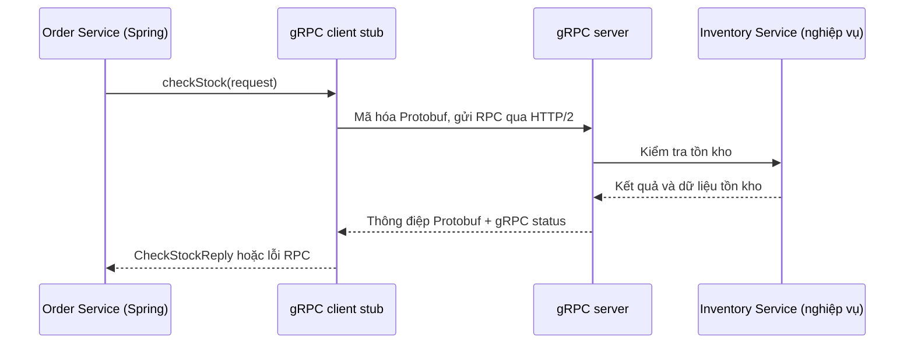

# gRPC là gì và giải quyết bài toán giao tiếp nào?

Trong một ứng dụng Spring chỉ có một tiến trình, các thành phần Java có thể gọi phương thức của nhau trực tiếp. Khi hệ thống tách thành nhiều dịch vụ chạy ở các máy hoặc container khác nhau, lời gọi đó phải đi qua mạng: ứng dụng cần thống nhất định dạng dữ liệu, cách gửi yêu cầu, cách trả lỗi, thời hạn chờ và cách xác thực. **gRPC** cung cấp một mô hình gọi thủ tục từ xa (Remote Procedure Call – RPC) để giải quyết nhóm vấn đề này.

Bài học thuộc chương **Nhập môn** của **SPRING_GRPC**. Đây là nền tảng để tiếp tục học cách thiết kế hợp đồng bằng Protocol Buffers, sinh mã Java, xây dựng gRPC client/server trong Spring, xử lý unary và streaming RPC, metadata, deadline, status, interceptor, TLS, kiểm thử tích hợp và giám sát hiệu năng, độ tin cậy.

## 1. Từ lời gọi trong một ứng dụng đến giao tiếp giữa các dịch vụ

Giả sử một hệ thống bán hàng có ba dịch vụ:

- **Order Service** tiếp nhận đơn mua.
- **Inventory Service** kiểm tra số lượng hàng còn trong kho.
- **Payment Service** xử lý thanh toán.

Khi người dùng đặt hàng, Order Service cần hỏi Inventory Service: “Mặt hàng `SKU-123` có đủ 2 sản phẩm không?”. Nếu hai dịch vụ nằm trong cùng một ứng dụng Java, lập trình viên có thể gọi `inventoryService.checkStock("SKU-123", 2)`. Khi chúng chạy độc lập, lời gọi này trở thành một giao tiếp qua mạng.

Việc chuyển một lời gọi Java thành yêu cầu mạng tạo ra nhiều câu hỏi:

1. Client và server thống nhất **đường dẫn hoặc tên phương thức**, kiểu dữ liệu và phiên bản API bằng cách nào?
2. Làm thế nào chuyển một đối tượng Java thành dữ liệu truyền qua mạng, rồi khôi phục ở phía nhận?
3. Nếu Inventory Service phản hồi chậm, mất kết nối hoặc trả lỗi nghiệp vụ thì Order Service nhận biết ra sao?
4. Nếu cần liên tục nhận cập nhật tồn kho, có cần gửi hàng trăm yêu cầu lặp lại không?
5. Khi có nhiều nhóm dùng Java, Go hoặc Python, làm thế nào tránh viết mã tích hợp thủ công cho từng cặp công nghệ?

Một REST API dùng HTTP và JSON có thể giải quyết nhiều câu hỏi trên. gRPC là một lựa chọn khác, đặc biệt phù hợp khi các dịch vụ cần **hợp đồng kiểu dữ liệu rõ ràng, mã client/server được sinh tự động, giao tiếp hiệu quả và hỗ trợ streaming**.

## 2. gRPC là gì?

**gRPC là một framework RPC mã nguồn mở**, cho phép một chương trình gọi phương thức do chương trình khác cung cấp qua mạng. Người phát triển mô tả dịch vụ và các thông điệp trong một hợp đồng, sau đó dùng công cụ sinh ra phần mã cần thiết để client và server giao tiếp.

Trong cách dùng phổ biến với Java và Spring, gRPC kết hợp bốn thành phần:

| Thành phần | Vai trò |
| --- | --- |
| **Protocol Buffers (Protobuf)** | Ngôn ngữ mô tả hợp đồng `.proto` và định dạng tuần tự hóa nhị phân mặc định cho thông điệp |
| **Trình sinh mã (`protoc` và plugin)** | Tạo các lớp Java biểu diễn thông điệp và bộ khung client/server từ `.proto` |
| **gRPC runtime** | Thực hiện lời gọi từ xa, truyền thông điệp, quản lý luồng dữ liệu, trạng thái và vòng đời RPC |
| **HTTP/2** | Giao thức truyền tải thường dùng, hỗ trợ nhiều luồng trên một kết nối và luồng dữ liệu hai chiều |

Hai thuật ngữ dễ nhầm lẫn:

- **RPC** là mô hình giao tiếp: client gọi một thao tác mà server thực thi ở nơi khác.
- **gRPC** là framework hiện thực hóa mô hình đó, bổ sung quy ước, thư viện, công cụ và giao thức truyền thông cụ thể.

Protobuf là lựa chọn mặc định phổ biến của gRPC, nhưng khái niệm gRPC không đồng nghĩa với Protobuf. Tương tự, HTTP/2 giúp gRPC vận chuyển dữ liệu, nhưng không tự nó định nghĩa hợp đồng phương thức hay sinh Java stub.

### “Gọi như phương thức” không có nghĩa là “giống hệt lời gọi cục bộ”

Ví dụ, client có thể viết một lời gọi có dạng `stub.checkStock(request)`. Cú pháp này giống gọi phương thức Java, nhưng thực tế vẫn có **độ trễ mạng, lỗi kết nối, giới hạn tài nguyên, khả năng gửi trùng yêu cầu và sự độc lập giữa hai tiến trình**. Một thiết kế đúng phải coi mọi RPC là lời gọi có thể chậm hoặc thất bại.

## 3. Hợp đồng Protobuf: hai phía thống nhất điều gì?

Xét hợp đồng `inventory.proto` sau:

```protobuf
syntax = "proto3";

package inventory.v1;

option java_package = "com.example.inventory.grpc";
option java_multiple_files = true;

service InventoryService {
  rpc CheckStock(CheckStockRequest) returns (CheckStockReply);
  rpc WatchStock(WatchStockRequest) returns (stream StockUpdate);
}

message CheckStockRequest {
  string sku = 1;
  int32 requested_quantity = 2;
}

message CheckStockReply {
  bool available = 1;
  int32 remaining_quantity = 2;
}

message WatchStockRequest {
  string sku = 1;
}

message StockUpdate {
  string sku = 1;
  int32 remaining_quantity = 2;
}
```

Đọc hợp đồng theo thứ tự:

- `service InventoryService` công bố các thao tác mà server phục vụ.
- `CheckStock` nhận một `CheckStockRequest` và trả một `CheckStockReply`: đây là RPC kiểu **unary**.
- `WatchStock` nhận một yêu cầu nhưng trả `stream StockUpdate`: đây là RPC kiểu **server streaming**.
- `string`, `int32` và `bool` mô tả kiểu trường dữ liệu; các số `= 1`, `= 2` là **mã số trường trên wire format**, không phải số thứ tự trình bày tùy ý.
- `package inventory.v1` đặt tên không gian hợp đồng; `java_package` xác định package cho mã Java được sinh. Cả hai phục vụ mục đích khác nhau.

Sau khi chạy trình sinh mã, phía Java có thể sử dụng các kiểu như `CheckStockRequest`, `CheckStockReply`, `InventoryServiceGrpc`. Client nhận một **stub**: đại diện cho dịch vụ từ xa, chứa những phương thức có kiểu tham số và kết quả theo hợp đồng. Server nhận một **lớp cơ sở/khung triển khai** để viết xử lý nghiệp vụ.

### Vì sao hợp đồng quan trọng?

Không có hợp đồng kiểu dữ liệu dùng chung, các nhóm phải thỏa thuận bằng tài liệu và tự duy trì mã chuyển đổi dữ liệu. Sai tên trường hoặc nhầm kiểu dữ liệu thường chỉ lộ ra khi chạy tích hợp. Khi dùng `.proto`, trình sinh mã và bộ biên dịch phát hiện sớm nhiều sai lệch giữa mã nguồn với định nghĩa API.

Tuy nhiên, hợp đồng vẫn cần quản trị phiên bản. Khi mở rộng Protobuf, thông thường nên **thêm trường mới với số chưa sử dụng**, tránh đổi ý nghĩa hoặc tái sử dụng số trường cũ; khi bỏ trường có thể khai báo `reserved` để phòng tái sử dụng. Đây là một phần của tương thích ngược, không phải lời bảo đảm rằng mọi thay đổi đều an toàn.

## 4. Một lời gọi gRPC thực sự diễn ra như thế nào?



Trình tự cốt lõi:

1. Client tạo một request bằng lớp Java sinh từ Protobuf.
2. Stub chuyển lời gọi phương thức thành RPC, gRPC runtime mã hóa thông điệp và gửi qua kết nối mạng.
3. Server định tuyến yêu cầu đến phương thức triển khai tương ứng.
4. Mã nghiệp vụ xử lý dữ liệu, ví dụ tra cứu lượng hàng còn.
5. Server trả dữ liệu và trạng thái RPC; với streaming, các thông điệp có thể đến nhiều lần theo thời gian.
6. Stub giải mã dữ liệu để client xử lý bằng kiểu Java tương ứng hoặc nhận lỗi/trạng thái phù hợp.

**Điểm mấu chốt:** sinh mã làm giảm phần việc lập trình viên phải tự viết để chuyển yêu cầu và kết quả giữa hai phía. Nó không thay thế thiết kế nghiệp vụ, kiểm soát quyền truy cập, xử lý lỗi hay quản lý dữ liệu.

## 5. Bốn kiểu giao tiếp mà gRPC hỗ trợ

| Kiểu RPC | Hình dạng giao tiếp | Ví dụ trong hệ thống |
| --- | --- | --- |
| **Unary** | Một request → một response | Kiểm tra tồn kho trước khi tạo đơn |
| **Server streaming** | Một request → nhiều response từ server | Theo dõi các thay đổi tồn kho sau khi đăng ký |
| **Client streaming** | Nhiều request từ client → một response từ server | Đẩy một loạt sự kiện cảm biến, nhận kết quả tổng hợp cuối cùng |
| **Bidirectional streaming** | Hai phía đều gửi một dòng thông điệp | Đồng bộ sự kiện tương tác hai chiều trong phiên làm việc |

Ví dụ cách Protobuf mô tả cả bốn kiểu:

```protobuf
service ExampleService {
  rpc GetOne(OneRequest) returns (OneReply);
  rpc Watch(WatchRequest) returns (stream Event);
  rpc Upload(stream Event) returns (UploadSummary);
  rpc Exchange(stream ClientEvent) returns (stream ServerEvent);
}
```

Đoạn trên nhằm minh họa cú pháp; các kiểu thông điệp sẽ cần được định nghĩa đầy đủ trong một file `.proto` thực tế.

Với **unary**, client thường chờ một kết quả và xử lý theo luồng đồng bộ hoặc bất đồng bộ. Với **streaming**, một RPC có thể tồn tại lâu hơn và truyền nhiều thông điệp mà không cần khởi tạo một RPC độc lập cho từng thông điệp.

Streaming giúp giải quyết bài toán truyền cập nhật liên tục, nhưng tạo thêm trách nhiệm: quản lý **backpressure/flow control**, bộ nhớ đệm, kết thúc luồng, hủy phiên, thời gian sống kết nối và tình huống hai phía gửi/nhận chậm khác nhau. Không nên chọn streaming chỉ vì gRPC có hỗ trợ; một unary RPC đơn giản thường dễ vận hành hơn khi mỗi tác vụ chỉ cần một câu trả lời.

## 6. gRPC giải quyết những bài toán giao tiếp nào?

### 6.1. Thống nhất API giữa nhiều ngôn ngữ

Một dịch vụ Java Spring có thể cung cấp hợp đồng `.proto` cho client viết bằng Go, Python hoặc ngôn ngữ được gRPC hỗ trợ. Mỗi phía sinh mã theo cùng định nghĩa, từ đó giảm sai lệch về tên phương thức, cấu trúc request/response và kiểu dữ liệu. Các nhóm vẫn phải thống nhất ngữ nghĩa nghiệp vụ: “còn hàng” được tính tại thời điểm nào, kiểm tra tồn kho có giữ chỗ hay không, lỗi nào được phép thử lại.

### 6.2. Giảm công sức viết mã giao tiếp

Thay vì mỗi dự án tự xây mã HTTP client, tự chuyển JSON sang lớp Java và tự ánh xạ lỗi, lập trình viên gọi phương thức từ stub đã sinh. Mã nghiệp vụ vì thế dễ tập trung vào thao tác cần thực hiện. Phần cấu hình kết nối, deadline, interceptor và kiểm thử vẫn phải được thiết kế.

### 6.3. Hỗ trợ giao tiếp thường xuyên giữa dịch vụ

Protobuf là định dạng nhị phân gọn trong nhiều kịch bản; HTTP/2 có cơ chế multiplexing giúp nhiều RPC chia sẻ kết nối. Nhờ vậy, gRPC có thể phù hợp với những hệ thống có số lượng lời gọi nội bộ lớn hoặc cần truyền dữ liệu có cấu trúc với tần suất cao.

Không nên mặc định “gRPC luôn nhanh hơn REST”. Kết quả thực tế phụ thuộc kích thước payload, số lượng kết nối, cách tái sử dụng channel, cấu hình máy chủ, proxy, TLS, nén, thao tác nghiệp vụ và môi trường mạng. Cần đo độ trễ và thông lượng với tải thật trước khi kết luận.

### 6.4. Xây dựng giao tiếp theo dòng dữ liệu

Khi client cần xem cập nhật từ server hoặc hai phía cần trao đổi liên tục, streaming hạn chế việc phải lặp lại các request ngắn. Nó hữu ích cho tiến độ xử lý, dữ liệu quan sát trực tiếp, truyền sự kiện phiên và đồng bộ. Nhưng stream không phải hàng đợi thông điệp bền vững: khi kết nối đứt, ứng dụng phải xác định cách tiếp tục hoặc phát lại dữ liệu.

### 6.5. Đặt quy tắc rõ ràng cho lời gọi từ xa

gRPC có cơ chế deadline, cancellation, metadata, mã trạng thái và interceptor để các dịch vụ có cách trao đổi chung về:

- **Deadline:** client giới hạn khoảng thời gian RPC được phép kéo dài.
- **Cancellation:** client hoặc server có thể hủy một RPC không còn cần thiết.
- **Status:** kết thúc RPC kèm mã chuẩn như `OK`, `INVALID_ARGUMENT`, `NOT_FOUND`, `UNAVAILABLE` hoặc `DEADLINE_EXCEEDED`.
- **Metadata:** mang dữ liệu điều khiển như token xác thực, correlation ID hoặc thông tin truy vết; không thay thế các trường dữ liệu nghiệp vụ trong request.
- **Interceptor:** đặt logic dùng chung tại biên gRPC, ví dụ kiểm tra xác thực, ghi log, đo metric hoặc gắn trace.

Các cơ chế này cung cấp công cụ để xử lý lỗi nhất quán; **chúng không tự động làm hệ thống chịu lỗi** nếu ứng dụng chưa định nghĩa timeout, retry, giới hạn tải và chính sách nghiệp vụ thích hợp.

## 7. gRPC đứng ở đâu trong ứng dụng Spring?

Trong một ứng dụng Spring, gRPC thường đảm nhận **lớp giao tiếp tại biên dịch vụ**. Dữ liệu đi từ client stub qua mạng đến gRPC server adapter, sau đó được chuyển cho service nghiệp vụ do Spring quản lý. Repository và cơ sở dữ liệu nằm ở lớp phía sau.

```text
Ứng dụng gọi (Spring)                    Ứng dụng cung cấp (Spring)
----------------------                  --------------------------
Business Service                        gRPC Server Adapter
       |                                         |
  gRPC Client Stub  ---- HTTP/2 + Protobuf --->  |
                                                 v
                                         Application Service
                                                 |
                                            Repository/DB
```

Đối với module **SPRING_GRPC**, quy trình phát triển thường đi theo các bước:

1. Thiết kế `.proto` thể hiện ranh giới và ngữ nghĩa API giữa dịch vụ.
2. Cấu hình build để sinh lớp Java và stub từ hợp đồng.
3. Viết phương thức gRPC server, kết nối với các Spring bean chứa nghiệp vụ.
4. Cấu hình gRPC client, quản lý channel/stub và gọi phương thức với deadline phù hợp.
5. Tích hợp authentication, TLS, interceptor, mapping lỗi, logging và tracing.
6. Kiểm thử tích hợp trên đường truyền gRPC thật và theo dõi độ trễ, lỗi, thông lượng.

Cơ chế đăng ký một server adapter hoặc tiêm client stub vào Spring phụ thuộc thư viện/starter và phiên bản đang sử dụng. **Đừng suy luận rằng chỉ thêm `@Service` là mọi gRPC server đều tự xuất bản phương thức**; cần kiểm tra cách thư viện tích hợp đăng ký các lớp hiện thực `BindableService` và quản lý vòng đời channel.

### Ví dụ triển khai unary RPC bằng Java

Từ hợp đồng `InventoryService` ở phần 3, một lớp phía server có thể viết như sau:

```java
import com.example.inventory.grpc.CheckStockReply;
import com.example.inventory.grpc.CheckStockRequest;
import com.example.inventory.grpc.InventoryServiceGrpc;
import io.grpc.Status;
import io.grpc.stub.StreamObserver;

public final class InventoryGrpcAdapter
        extends InventoryServiceGrpc.InventoryServiceImplBase {

    private final StockQuery stockQuery;

    public InventoryGrpcAdapter(StockQuery stockQuery) {
        this.stockQuery = stockQuery;
    }

    @Override
    public void checkStock(
            CheckStockRequest request,
            StreamObserver<CheckStockReply> responseObserver) {

        if (request.getSku().isBlank()
                || request.getRequestedQuantity() <= 0) {
            responseObserver.onError(
                Status.INVALID_ARGUMENT
                    .withDescription("SKU hoặc số lượng không hợp lệ")
                    .asRuntimeException());
            return;
        }

        try {
            int remaining = stockQuery.remainingQuantity(request.getSku());
            CheckStockReply reply = CheckStockReply.newBuilder()
                .setAvailable(remaining >= request.getRequestedQuantity())
                .setRemainingQuantity(remaining)
                .build();

            responseObserver.onNext(reply);
            responseObserver.onCompleted();
        } catch (RuntimeException ex) {
            responseObserver.onError(
                Status.INTERNAL
                    .withDescription("Không thể truy vấn tồn kho")
                    .asRuntimeException());
        }
    }
}
```

`StockQuery` trong ví dụ đại diện cho một interface nghiệp vụ do ứng dụng tự cung cấp, chẳng hạn `int remainingQuantity(String sku)`. Adapter chịu trách nhiệm **đọc request, kiểm tra dữ liệu đầu vào, gọi nghiệp vụ, tạo response và trả gRPC status**. Cơ chế đăng ký adapter vào gRPC server và cấu hình Spring được lược bỏ để tập trung vào vai trò giao tiếp.

Một lời gọi client tương ứng:

```java
import com.example.inventory.grpc.CheckStockReply;
import com.example.inventory.grpc.CheckStockRequest;
import com.example.inventory.grpc.InventoryServiceGrpc;
import io.grpc.ManagedChannel;
import io.grpc.ManagedChannelBuilder;
import io.grpc.StatusRuntimeException;
import java.util.concurrent.TimeUnit;

ManagedChannel channel = ManagedChannelBuilder
    .forAddress("localhost", 9090)
    .usePlaintext() // Chỉ để thử nghiệm cục bộ
    .build();

try {
    var stub = InventoryServiceGrpc.newBlockingStub(channel)
        .withDeadlineAfter(500, TimeUnit.MILLISECONDS);

    CheckStockReply reply = stub.checkStock(
        CheckStockRequest.newBuilder()
            .setSku("SKU-123")
            .setRequestedQuantity(2)
            .build());

    System.out.println("Có hàng: " + reply.getAvailable());
} catch (StatusRuntimeException ex) {
    System.err.println("gRPC status: " + ex.getStatus().getCode());
} finally {
    channel.shutdown();
}
```

Đây là ví dụ tối giản để hình dung API do gRPC Java sinh ra. Trong ứng dụng Spring thực tế, nên quản lý `ManagedChannel` và stub như thành phần có vòng đời phù hợp để **tái sử dụng kết nối**, đưa địa chỉ và cấu hình bảo mật ra cấu hình ứng dụng, tránh tạo channel mới cho từng request. Giá trị deadline `500 ms` chỉ mang tính minh họa, phải chọn theo độ trễ và yêu cầu nghiệp vụ thực tế. Blocking stub cũng không phù hợp nếu dùng trực tiếp trên luồng xử lý yêu cầu có tính chất non-blocking.

## 8. So sánh gRPC với REST và nhắn tin bất đồng bộ

Ba cách giao tiếp này giải quyết những nhu cầu có phần giao nhau, nhưng có điểm mạnh khác nhau:

| Tiêu chí | gRPC | REST/HTTP API | Hàng đợi / event messaging |
| --- | --- | --- | --- |
| Mô hình thường gặp | Gọi phương thức từ xa | Giao tiếp với tài nguyên qua HTTP | Gửi và tiêu thụ message/event |
| Hợp đồng | Thường dùng `.proto` và stub sinh mã | Thường JSON, có thể dùng OpenAPI để định nghĩa hợp đồng | Schema thông điệp và quy ước topic/queue |
| Giao tiếp | Unary và streaming | Request-response phổ biến; streaming tùy kỹ thuật bổ sung | Bất đồng bộ theo message/event |
| Client trình duyệt | Thường cần gRPC-Web hoặc lớp gateway tương thích | Tích hợp trực tiếp rất thuận tiện | Thường qua backend/gateway |
| Liên kết giữa hai bên | Thường cần server sẵn sàng trong thời gian RPC | Thường cần server sẵn sàng trong thời gian request | Có thể tách thời điểm sản xuất và tiêu thụ |
| Trường hợp điển hình | API nội bộ có kiểu dữ liệu chặt và nhiều lời gọi | API công khai, tích hợp web và hệ sinh thái HTTP | Xử lý nền, phát sự kiện, tích hợp không đồng bộ |

**Không có lựa chọn luôn tốt nhất.** Một hệ thống có thể dùng REST cho ứng dụng web → backend, gRPC cho backend → backend và message broker cho tác vụ xử lý nền. Nếu mục tiêu là “đặt đơn và chờ kết quả kiểm tra tồn kho ngay”, unary gRPC là ứng viên phù hợp. Nếu mục tiêu là “thông báo đơn đã tạo đến nhiều dịch vụ độc lập và có thể xử lý sau”, event messaging thường mô tả nhu cầu tốt hơn.

### Khi nào gRPC không phải lựa chọn thuận tiện?

- API được người dùng thử trực tiếp bằng trình duyệt hoặc công cụ HTTP phổ thông, trong khi hệ thống chưa có gateway phù hợp.
- Hệ thống nhỏ, rất ít lời gọi nội bộ và việc thêm schema/code generation làm tăng chi phí vận hành mà chưa tạo lợi ích rõ ràng.
- Yêu cầu chính là giao hàng bất đồng bộ, lưu bền sự kiện, phát lại sau nhiều giờ hoặc giao tiếp khi consumer ngoại tuyến.
- Cơ sở hạ tầng proxy, load balancer, service mesh hay công cụ quan sát chưa hỗ trợ/được cấu hình tốt cho HTTP/2 và gRPC.

## 9. Những khía cạnh vận hành cần hiểu ngay từ đầu

Một API gRPC đúng hợp đồng vẫn có thể thất bại khi triển khai phân tán. Các khái niệm sau sẽ được học sâu hơn ở các bài tiếp theo, nhưng cần hiểu vai trò của chúng từ bài nhập môn.

### Deadline, hủy yêu cầu và retry

Giả sử Order Service có tối đa 800 ms để phản hồi khách hàng. Nếu lời gọi kiểm tra tồn kho chiếm toàn bộ ngân sách thời gian, những bước phía sau sẽ không còn thời gian. Client cần đặt **deadline** hợp lý cho RPC, và server cần nhận biết hủy/deadline để tránh tiếp tục công việc không còn cần thiết.

Khi gặp `UNAVAILABLE`, ứng dụng có thể cân nhắc retry; nhưng retry không phải thao tác vô điều kiện. Một RPC **đọc tồn kho** có thể thử lại theo chính sách phù hợp, còn một RPC **trừ tồn kho hoặc tạo thanh toán** có thể tạo tác dụng phụ nếu gửi lặp. Với các lệnh ghi, cần thiết kế tính idempotent, mã yêu cầu duy nhất hoặc cơ chế chống xử lý trùng trước khi bật retry.

### Status và mapping lỗi

Mã `OK` nói rằng RPC hoàn tất thành công ở mức giao thức. `INVALID_ARGUMENT` dùng cho đầu vào không hợp lệ, `NOT_FOUND` cho tài nguyên không tồn tại khi phù hợp, `DEADLINE_EXCEEDED` cho RPC quá hạn, `UNAVAILABLE` cho tình huống dịch vụ tạm thời không sẵn sàng. Không nên trả `INTERNAL` cho mọi lỗi, vì client sẽ mất khả năng phân biệt hành động cần thực hiện.

**Lỗi nghiệp vụ** và **lỗi hạ tầng** cũng cần tách biệt. “Không đủ hàng” trong ví dụ có thể là một response hợp lệ với `available = false`, không nhất thiết là một RPC thất bại. Còn mất kết nối đến dịch vụ tồn kho là lỗi hạ tầng và cần cơ chế xử lý khác.

### Metadata, interceptor và bảo mật

Metadata hỗ trợ gửi các thông tin như authorization token hoặc trace context cùng RPC. Interceptor cho phép áp dụng kiểm tra/xử lý dùng chung mà không lặp trong từng phương thức nghiệp vụ. **TLS** bảo vệ dữ liệu khi truyền và giúp xác thực máy chủ; một số môi trường dùng **mTLS** để xác thực cả hai phía. Không nên dùng `usePlaintext()` qua mạng sản xuất hoặc ghi token nhạy cảm vào log.

### Kiểm thử và quan sát

Một bài kiểm thử chỉ gọi trực tiếp phương thức Java của adapter chưa thể khẳng định rằng giao tiếp gRPC hoạt động. Kiểm thử tích hợp nên dựng server/client trong môi trường kiểm soát, gửi Protobuf request thật và kiểm tra response, status, deadline và tình huống bị hủy. Khi vận hành, cần theo dõi **số lượng RPC, tỷ lệ lỗi theo status, phân vị độ trễ (p50/p95/p99), độ dài stream, kết nối và tải tài nguyên**. Trace liên dịch vụ giúp nhận ra RPC nào làm chậm toàn bộ luồng đặt hàng.

## 10. Chọn gRPC cho bài toán nào trong thực tế?

Áp dụng một tình huống cụ thể để ra quyết định:

**Bài toán A – Order Service hỏi Inventory Service:** Hai dịch vụ do cùng tổ chức phát triển, cần kiểm tra tồn kho nhanh, sử dụng Java/Spring, có thể thống nhất `.proto` và kiểm soát môi trường triển khai. **Unary gRPC** là một lựa chọn hợp lý vì hợp đồng rõ, stub Java có kiểu dữ liệu tường minh và có deadline/status nhất quán. Cần đo lường hiệu năng thay vì xem ưu thế tốc độ là điều hiển nhiên.

**Bài toán B – Bảng điều khiển muốn xem tồn kho cập nhật:** Backend cần gửi các thay đổi liên tục. **Server-streaming gRPC** có thể phù hợp giữa những dịch vụ có khả năng dùng gRPC, trong khi trình duyệt có thể cần gateway hoặc phương án web như SSE/WebSocket tùy kiến trúc. Cần tính đến reconnect và khả năng bỏ lỡ sự kiện.

**Bài toán C – Gửi thông báo sau khi đơn hàng thành công:** Người nhận không cần trả kết quả ngay và có thể tạm ngoại tuyến. **Message broker** thường phù hợp hơn, vì RPC trực tiếp không tự cung cấp hàng đợi bền vững hoặc cơ chế phát lại lâu dài.

Trước khi chọn gRPC, hãy trả lời bốn câu hỏi: **Ai là client?**; **có cần phản hồi đồng bộ không?**; **có cần streaming không?**; và **đội ngũ có kiểm soát được schema, công cụ build và hạ tầng HTTP/2 không?**. Đó là cách xác định gRPC đang giải quyết nhu cầu thật hay chỉ thêm công nghệ.

## 11. Các hiểu lầm thường gặp

| Hiểu lầm | Cách hiểu đúng |
| --- | --- |
| “gRPC biến lời gọi mạng thành lời gọi cục bộ an toàn.” | Cú pháp giống phương thức Java, nhưng độ trễ, timeout, kết nối và lỗi phân tán vẫn tồn tại. |
| “Dùng gRPC là API tự động được mã hóa.” | Cần cấu hình TLS/mTLS và xác thực phù hợp với môi trường. |
| “Protobuf giúp mọi thay đổi schema tương thích.” | Tính tương thích phụ thuộc cách thêm, đổi, xóa trường và phiên bản hợp đồng. |
| “Streaming luôn nhanh hơn unary.” | Streaming có chi phí quản lý vòng đời, flow control và khôi phục kết nối; chỉ hữu ích khi bài toán cần dòng dữ liệu. |
| “Retry sẽ làm mọi RPC đáng tin cậy hơn.” | Retry không kiểm soát có thể tăng tải và nhân đôi tác dụng phụ. |
| “gRPC thay thế REST và message broker.” | Mỗi công cụ có thế mạnh khác nhau; nhiều kiến trúc dùng chúng phối hợp. |

## 12. Ghi nhớ sau bài học

gRPC cung cấp cách **gọi phương thức giữa các tiến trình/dịch vụ** dựa trên hợp đồng API, thông điệp có cấu trúc và stub sinh mã. Trong môi trường Spring, nó thường nằm tại lớp giao tiếp giữa các service, trong khi bean nghiệp vụ vẫn chịu trách nhiệm cho quy tắc và dữ liệu của ứng dụng.

Ba ý cần nắm chắc trước khi học tiếp:

1. **`.proto` là điểm thỏa thuận giữa client và server**: mô tả service, method và message; trình sinh mã biến hợp đồng thành API Java có kiểu.
2. **gRPC hỗ trợ unary và ba hình thức streaming**: chọn hình thức theo luồng trao đổi thực tế, không theo mức độ “hiện đại” của công nghệ.
3. **RPC là giao tiếp mạng và phải được thiết kế như giao tiếp mạng**: cần deadline, status, bảo mật, retry thận trọng, kiểm thử tích hợp và quan sát.

Khi hiểu được gRPC giải quyết vấn đề gì và giới hạn của nó, người học có thể đi tiếp đến thiết kế hợp đồng Protobuf, cấu hình sinh mã và xây dựng client/server Spring gRPC một cách có chủ đích.

### Tài liệu tham khảo

- [gRPC – Introduction](https://grpc.io/docs/what-is-grpc/introduction/)
- [gRPC – Core concepts, architecture and lifecycle](https://grpc.io/docs/what-is-grpc/core-concepts/)
- [Protocol Buffers – Language Guide (proto3)](https://protobuf.dev/programming-guides/proto3/)
- [gRPC – Deadlines](https://grpc.io/docs/guides/deadlines/)
