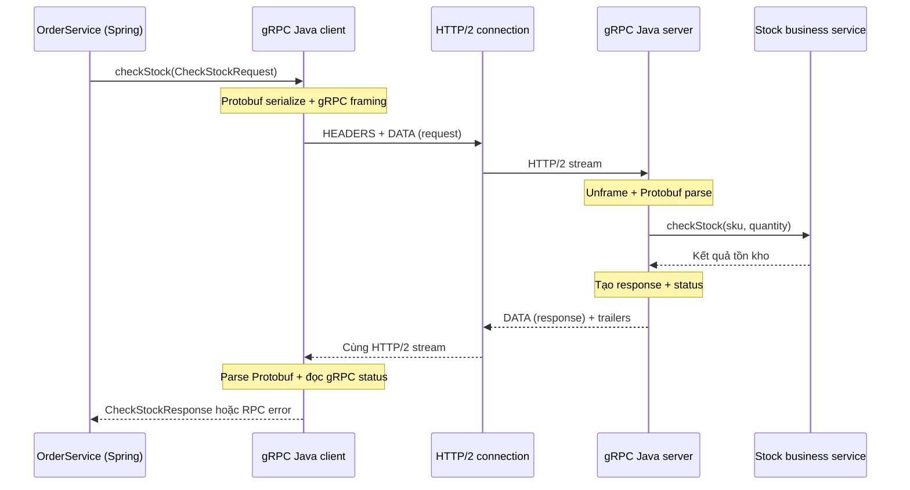

# Quan hệ giữa gRPC, HTTP/2, Protocol Buffers và RPC

Khi mới học **SPRING_GRPC**, người học thường gặp bốn khái niệm đi cùng nhau: **RPC**, **gRPC**, **Protocol Buffers** và **HTTP/2**. Chúng liên quan chặt chẽ nhưng không đồng nghĩa. Hiểu rõ trách nhiệm của từng lớp giúp bạn giải thích được vì sao một phương thức Java trên Spring có thể được gọi từ ứng dụng khác qua mạng, dữ liệu được mã hóa ra sao, và điều gì xảy ra khi mạng chậm hoặc một lời gọi thất bại.

Bài học nằm trong chương **Nhập môn**. Đây là nền tảng cho lộ trình phát triển dịch vụ gRPC trong hệ sinh thái Spring: thiết kế hợp đồng Protobuf, sinh mã Java, triển khai unary và streaming client/server, rồi xử lý metadata, deadline, status, interceptor, TLS, kiểm thử tích hợp và giám sát hiệu năng, độ tin cậy.

## 1. Bốn khái niệm, bốn trách nhiệm khác nhau

Hãy tưởng tượng **Order Service** cần hỏi **Inventory Service** còn bao nhiêu hàng. Hai ứng dụng Spring chạy trong hai tiến trình riêng và cần giao tiếp qua mạng.

| Khái niệm | Nó là gì? | Câu hỏi nó giải quyết |
| --- | --- | --- |
| **RPC (Remote Procedure Call)** | Mô hình gọi một thủ tục hoặc phương thức thực thi ở tiến trình khác | “Ứng dụng A yêu cầu ứng dụng B thực hiện thao tác bằng cách nào?” |
| **gRPC** | Framework cung cấp cơ chế thực thi RPC và hệ sinh thái client/server | “Ai định tuyến lời gọi, quản lý stub, luồng dữ liệu, metadata, deadline và trạng thái?” |
| **Protocol Buffers (Protobuf)** | Hệ thống mô tả lược đồ dữ liệu, dịch vụ và định dạng mã hóa nhị phân | “Hai phía thống nhất cấu trúc thông điệp và mã hóa/giải mã như thế nào?” |
| **HTTP/2** | Giao thức truyền tải ở tầng ứng dụng của HTTP, có stream, frame và multiplexing | “Thông điệp và thông tin điều khiển đi qua kết nối mạng bằng cách nào?” |

Có thể hình dung các lớp như sau:

```text
Ý định nghiệp vụ: "Kiểm tra tồn kho SKU-123, số lượng 2"
                     |
                     v
RPC:             gọi thủ tục từ xa
                     |
                     v
gRPC:            stub / server handler / RPC lifecycle
                     |
          +----------+----------+
          |                     |
          v                     v
Protobuf: hợp đồng .proto    HTTP/2: truyền tải bằng
          + mã hóa thông điệp          streams và frames
          |                     |
          +----------+----------+
                     |
                     v
             gRPC qua kết nối mạng
                     |
                     v
            Inventory Service (Spring)
```

Sơ đồ này thể hiện **quan hệ trách nhiệm**, không phải thứ tự byte trên đường truyền. Trên thực tế, gRPC dùng thông điệp Protobuf đã mã hóa, đóng khung thông điệp theo quy tắc gRPC, rồi chuyển các byte ấy trong HTTP/2 DATA frame; thông tin về RPC được mang bằng HTTP/2 header/trailer.

Một câu dễ nhớ: **RPC là ý tưởng; gRPC hiện thực ý tưởng đó; Protobuf diễn tả và mã hóa thông điệp; HTTP/2 vận chuyển RPC qua mạng.**

## 2. RPC: mô hình giao tiếp giữa hai tiến trình

**Remote Procedure Call** cho phép client yêu cầu một server thực hiện thao tác thông qua giao diện giống lời gọi hàm. Thay vì xây dựng thủ công request HTTP, mã phía client có thể nhìn như sau:

```java
StockResponse response = stockClient.checkStock(request);
```

Về mặt ý nghĩa, `checkStock` là phép gọi đến một thao tác ở xa. Tuy nhiên, giữa lúc gọi và lúc nhận kết quả có nhiều bước: chuyển đổi dữ liệu, gửi qua mạng, định tuyến ở server, thực thi nghiệp vụ, rồi truyền dữ liệu trả về.

Khái niệm **RPC rộng hơn gRPC**. Trước và ngoài gRPC đã có nhiều giải pháp RPC, với cách mô tả hợp đồng và giao thức truyền tải khác nhau. Không phải mọi RPC đều dùng HTTP/2, cũng không phải mọi lời gọi HTTP đều là RPC.

### Vì sao RPC không giống lời gọi Java cục bộ?

| Lời gọi trong cùng tiến trình | Lời gọi RPC qua mạng |
| --- | --- |
| Thường truy cập trực tiếp đối tượng trong bộ nhớ | Phải tuần tự hóa và chuyển thông điệp giữa các tiến trình |
| Lỗi chủ yếu từ mã chương trình và tài nguyên cục bộ | Thêm lỗi DNS, kết nối, proxy, server quá tải và timeout |
| Độ trễ thường rất nhỏ, không phải thiết kế cho mạng | Độ trễ phụ thuộc mạng và dịch vụ đích |
| Caller và callee thường có chung vòng đời | Server có thể khởi động lại độc lập với client |
| Biết khá rõ phương thức đã chạy hay chưa khi nhận lỗi | Khi mất kết nối, có thể không biết server đã xử lý tác vụ ghi hay chưa |

Ví dụ: client gửi yêu cầu “trừ 2 sản phẩm khỏi kho”, server hoàn thành thay đổi nhưng kết nối đứt trước khi phản hồi đến client. Nếu client gửi lại vô điều kiện, tồn kho có nguy cơ bị trừ hai lần. Hình thức gọi giống phương thức Java **không xóa bỏ** tính không chắc chắn của mạng. Với thao tác ghi, cần cân nhắc mã yêu cầu duy nhất, tính idempotent và chính sách retry.

## 3. Protobuf: hợp đồng kiểu dữ liệu và mã hóa thông điệp

Protocol Buffers cung cấp hai khả năng thường đi cùng nhau trong gRPC:

1. **Định nghĩa hợp đồng** bằng file `.proto`: những message, field và service nào tồn tại.
2. **Sinh mã và mã hóa dữ liệu**: tạo kiểu dữ liệu Java cùng các phương thức serialize/parse theo định dạng nhị phân Protobuf.

Trong gRPC Java, bộ sinh mã cho service còn tạo **stub phía client** và **API/khung triển khai phía server**. Đây là kết quả kết hợp giữa compiler Protobuf và plugin sinh mã dành cho gRPC.

### 3.1. Một hợp đồng `.proto` hoàn chỉnh

```protobuf
syntax = "proto3";

package inventory.v1;

option java_package = "vn.example.inventory.v1";
option java_multiple_files = true;

service StockService {
  rpc CheckStock(CheckStockRequest) returns (CheckStockResponse);
  rpc WatchStock(WatchStockRequest) returns (stream StockEvent);
}

message CheckStockRequest {
  string sku = 1;
  int32 quantity = 2;
}

message CheckStockResponse {
  bool available = 1;
  int32 remaining_quantity = 2;
}

message WatchStockRequest {
  string sku = 1;
}

message StockEvent {
  string sku = 1;
  int32 remaining_quantity = 2;
}
```

Các phần có vai trò khác nhau:

- `service StockService` định nghĩa giao diện RPC; nó không chứa logic truy vấn cơ sở dữ liệu.
- `rpc CheckStock(...) returns (...)` mô tả một lời gọi nhận một request và trả một response (**unary**).
- Từ khóa `stream` trong `WatchStock` nói rằng server có thể trả **nhiều** `StockEvent` trên cùng một RPC.
- `message` định nghĩa cấu trúc của thông điệp. Các số `1` và `2` là **field number** được dùng trong mã hóa Protobuf, không phải số dòng hoặc vị trí phần tử trong JSON.
- `package inventory.v1` là package của hợp đồng Protobuf và góp phần tạo tên đầy đủ của gRPC service; `java_package` xác định package của các lớp Java được sinh.

Khi cấu hình build và chạy sinh mã, dự án Java nhận được những lớp như `CheckStockRequest`, `CheckStockResponse` và `StockServiceGrpc`. Client và server có thể dùng cùng một hợp đồng dù triển khai bằng những ngôn ngữ khác nhau, miễn thư viện gRPC và Protobuf tương ứng hỗ trợ.

### 3.2. Protobuf mã hóa những gì?

Ví dụ client tạo thông điệp:

```java
CheckStockRequest request = CheckStockRequest.newBuilder()
    .setSku("SKU-123")
    .setQuantity(2)
    .build();
```

Nếu dùng binary wire format mặc định của Protobuf, payload cho đúng giá trị này có thể được biểu diễn bằng hệ thập lục phân:

```text
0A 07 53 4B 55 2D 31 32 33 10 02
|  |  \___________________/ |  |
|  |        SKU-123         |  +-- quantity = 2
|  +-- length = 7           +----- field 2, wire type varint
+-- field 1, wire type length-delimited
```

Trong ví dụ này, payload Protobuf dài **11 byte**. Mỗi trường được xác định bằng mã trường cùng kiểu wire; phần nội dung được biểu diễn theo kiểu tương ứng. Đây không phải chuỗi JSON với các khóa `"sku"` và `"quantity"` truyền nguyên văn.

Điều cần lưu ý:

- Protobuf **không phải** một cơ chế mã hóa bảo mật; người có quyền đọc payload và biết schema có thể giải mã dữ liệu. Bảo mật đường truyền do TLS và cơ chế bảo vệ hệ thống đảm nhận.
- Protobuf **không bắt buộc** phải đi qua gRPC. Có thể dùng Protobuf để lưu file, lưu thông điệp hoặc gửi qua cơ chế truyền tải khác.
- gRPC thường dùng Protobuf và mô hình `.proto`, nhưng framework có thể hỗ trợ cơ chế serialization tùy biến; vì thế không nên định nghĩa gRPC đơn thuần là “Protobuf trên mạng”.

### 3.3. Hợp đồng không đồng nghĩa với logic nghiệp vụ

`.proto` nói rằng request có trường `quantity` kiểu `int32`; nó không tự ràng buộc `quantity > 0`, không kiểm tra SKU có tồn tại và không quyết định có giữ hàng hay không. Các quy tắc đó phải do lớp validation và nghiệp vụ thực thi.

Khi chỉnh sửa schema, số field là một phần quan trọng của tương thích: nên thêm field với số mới, không tái sử dụng số của trường đã xóa, và cân nhắc `reserved` cho các số/tên không còn dùng. **Sinh mã thành công không tự bảo đảm mọi thay đổi hợp đồng đều tương thích với client cũ.**

## 4. HTTP/2: giao thức chở các lời gọi qua mạng

gRPC chuẩn thường dùng **HTTP/2** làm giao thức truyền tải. HTTP/2 tổ chức dữ liệu thành các **frame**, gom frame thuộc cùng một **stream**, rồi cho phép nhiều stream chia sẻ một **connection**.

Ba khái niệm này khác nhau:

| Khái niệm HTTP/2 | Ý nghĩa khi dùng gRPC |
| --- | --- |
| **Connection** | Một kết nối vận chuyển có thể phục vụ nhiều RPC cùng lúc |
| **Stream** | Một luồng HTTP/2 độc lập về mặt logic, thường tương ứng với một lời gọi gRPC |
| **Frame** | Đơn vị đóng gói trên HTTP/2, ví dụ `HEADERS`, `DATA`; một thông điệp gRPC có thể bị chia thành nhiều frame hoặc cùng frame với dữ liệu khác |

Một gRPC stream là **vòng đời của một lời gọi RPC**. Một HTTP/2 stream là **luồng truyền tải** được dùng cho RPC ấy. Một **Protobuf message** là **đơn vị dữ liệu nghiệp vụ** trong RPC. Với unary, thông thường có một request message và một response message. Với streaming, nhiều message có thể đi trong một HTTP/2 stream, nhưng không vì vậy mà có nhiều RPC độc lập.

### HTTP/2 mang lại các đặc tính gì?

**Multiplexing:** nhiều HTTP/2 stream có thể chia sẻ một kết nối TCP. gRPC runtime có thể thực hiện nhiều RPC đồng thời mà không cần mở một TCP connection mới cho mỗi lời gọi.

**Framing và thứ tự:** dữ liệu được chia thành frame; trong mỗi stream, HTTP/2 bảo toàn thứ tự byte để bên nhận tái tạo thông điệp.

**Flow control:** HTTP/2 có cơ chế điều tiết số byte đang truyền ở cấp connection và stream. Điều này hữu ích cho streaming, nhưng ứng dụng vẫn phải quan tâm đến việc producer gửi quá nhanh, consumer xử lý quá chậm và dung lượng bộ đệm.

**Nén header:** HTTP/2 dùng HPACK để biểu diễn header hiệu quả hơn. Điều này khác với nén **payload Protobuf**, vốn là cơ chế tùy chọn riêng.

**Trailers:** HTTP/2 có thể gửi một nhóm header ở cuối stream. gRPC dùng phần này để truyền **trạng thái kết thúc RPC**.

HTTP/2 không bảo đảm tất cả RPC đều nhanh hơn trong mọi tình huống. Nhiều stream vẫn chia sẻ tài nguyên và kết nối TCP; mất gói ở tầng TCP có thể ảnh hưởng các stream trên cùng kết nối. Thông lượng và độ trễ thực tế còn phụ thuộc máy chủ, tải ứng dụng, TLS, proxy và cách quản lý connection.

### HTTP/2 không tự cung cấp gì?

HTTP/2 không biết phương thức `CheckStock` có nghĩa gì, không quy định `sku` phải là chuỗi, không tạo stub Java và không quyết định mã lỗi `INVALID_ARGUMENT`. Đó là trách nhiệm của hợp đồng, runtime gRPC và ứng dụng.

Tương tự, **REST API cũng có thể chạy qua HTTP/2**; vì vậy so sánh “gRPC = HTTP/2, REST = HTTP/1.1” là sai. REST mô tả phong cách thiết kế API, còn HTTP/2 là một phiên bản giao thức vận chuyển HTTP.

## 5. gRPC kết hợp mô hình RPC, Protobuf và HTTP/2 như thế nào?

gRPC nối các thành phần thành một quy trình thực thi thống nhất:

1. Người phát triển viết hợp đồng `.proto` định nghĩa service và message.
2. Công cụ sinh mã tạo các kiểu dữ liệu và mã giao tiếp cho client/server.
3. Client tạo một message Protobuf rồi gọi stub gRPC theo phương thức trong hợp đồng.
4. Runtime gRPC gói message thành **gRPC length-prefixed message**, kèm HTTP/2 headers và gửi qua HTTP/2 stream.
5. Runtime phía server đọc các byte, giải mã message và chuyển tới phương thức xử lý đã đăng ký.
6. Server trả message và mã trạng thái; client đọc response hoặc nhận lỗi RPC.



Với Spring, mã nghiệp vụ có thể là một Spring bean dùng repository hoặc dịch vụ khác. gRPC adapter đóng vai trò **biên giao tiếp**: nhận protobuf request và chuyển thành thao tác nghiệp vụ. Việc tự động đăng ký adapter hay inject stub phụ thuộc vào thư viện tích hợp gRPC/Spring được chọn; hợp đồng Protobuf không tự khởi động server.

## 6. Theo dấu một unary RPC ở mức byte và giao thức

Xét lời gọi `CheckStock`:

```text
Request:
  sku = "SKU-123"
  quantity = 2

Response (ví dụ):
  available = true
  remaining_quantity = 8
```

### 6.1. gRPC đóng khung Protobuf message

Trong gRPC qua HTTP/2, mỗi message được truyền với tiền tố **5 byte** trước payload:

```text
+----------------------+------------------------+---------------------+
| Compressed-Flag      | Message-Length         | Message             |
| 1 byte               | 4 byte (big-endian)    | N byte              |
+----------------------+------------------------+---------------------+
```

- **Compressed-Flag** bằng `0` khi message không nén, bằng `1` khi đã nén theo encoding được thỏa thuận.
- **Message-Length** là chiều dài tính bằng byte của nội dung message theo gRPC framing, không tính 5 byte tiền tố.
- **Message** là payload đã serialize, trong trường hợp mặc định là các byte Protobuf.

Với request Protobuf 11 byte ở phần 3.2 và không bật nén, message đã đóng khung là:

```text
00 | 00 00 00 0B | 0A 07 53 4B 55 2D 31 32 33 10 02
|    |             \_______________________________/
|    |                       Protobuf (11 byte)
|    +-- Độ dài 11 byte (số nguyên big-endian 4 byte)
+-- Không nén
```

Tổng cộng **16 byte** cho một gRPC-framed message trong ví dụ này, **chưa tính HTTP/2 frame overhead, HTTP/2 headers, TLS hay TCP/IP**. Đây chỉ là phép đếm để hiểu cấu trúc, không phải benchmark về kích thước giữa gRPC và JSON.

Đặc biệt, **một gRPC message không đồng nghĩa với một HTTP/2 DATA frame**. HTTP/2 có thể chia các byte của một message thành nhiều DATA frame, hoặc ghép byte của nhiều message trong các frame liên tiếp. gRPC runtime tái tạo message nhờ tiền tố độ dài và thứ tự byte trong stream.

### 6.2. Các HTTP/2 headers nhận diện phương thức từ xa

Một unary request điển hình được biểu diễn ở mức logic như sau:

```http
:method: POST
:scheme: https
:authority: inventory.internal:8443
:path: /inventory.v1.StockService/CheckStock
content-type: application/grpc
te: trailers
grpc-timeout: 1000m
```

Đây là **minh họa các header ở dạng dễ đọc**, không phải bản dump byte HTTP/2. Trong HTTP/2, các trường bắt đầu bằng `:` là *pseudo-headers*; dữ liệu được mã hóa thành HEADERS frame. `grpc-timeout: 1000m` diễn đạt deadline phía client dưới dạng timeout tương đối khoảng **1000 mili giây**.

Quan sát `:path`:

```text
/inventory.v1.StockService/CheckStock
 \_______________________/ \________/
        Service               Method
```

Tên này lấy từ **package + service + rpc method** trong `.proto`; nó không phải URL route được đặt tự do theo controller REST. Runtime gRPC dùng tên đó để định tuyến đến phương thức phục vụ tương ứng.

Sau headers, client gửi DATA chứa message đã đóng khung, rồi đánh dấu đã gửi xong request bằng cơ chế kết thúc luồng gửi (*half-close*) của HTTP/2. Gọi là half-close vì server vẫn được phép gửi response trên cùng stream.

### 6.3. Response và gRPC trailers

Một response thành công có thể có dạng logic:

```http
:status: 200
content-type: application/grpc

[DATA: gRPC-framed CheckStockResponse]

grpc-status: 0
```

Ở đây `grpc-status: 0` là **OK**. Trạng thái gRPC thường được gửi trong **HTTP/2 trailers**, tức HEADERS frame ở cuối stream, chứ không phải bắt buộc nằm trong nội dung Protobuf response.

Nếu SKU không hợp lệ, server có thể kết thúc RPC bằng:

```text
HTTP/2 :status = 200
gRPC grpc-status = 3 (INVALID_ARGUMENT)
```

Điều này **không mâu thuẫn**: HTTP status và gRPC status ở hai lớp khác nhau. HTTP `200` có thể cho biết giao tiếp ở lớp HTTP đã diễn ra, trong khi `grpc-status = 3` cho biết *RPC* kết thúc với lỗi đầu vào. Một lỗi transport thực sự có thể dẫn tới HTTP status khác `200`, stream reset hoặc mất kết nối; khi đó client gRPC sẽ xử lý lỗi tương ứng.

### 6.4. Phân biệt bốn loại dữ liệu trên một lời gọi

| Dữ liệu | Ví dụ | Được mang ở đâu? |
| --- | --- | --- |
| Định danh thủ tục | `/inventory.v1.StockService/CheckStock` | HTTP/2 `:path` |
| Metadata điều khiển | `authorization`, `grpc-timeout`, trace context | HTTP/2 headers; có thể có trailers |
| Dữ liệu nghiệp vụ | SKU và quantity | Protobuf message bên trong gRPC DATA |
| Kết quả/trạng thái RPC | `grpc-status: 0` hoặc `3` | gRPC trailers (hoặc trailers-only response) |

Không nên đặt toàn bộ thông tin vào một nơi. Chẳng hạn, deadline là chính sách của một lần gọi và thường đi qua cơ chế deadline/metadata, còn số lượng yêu cầu là dữ liệu nghiệp vụ thuộc request message.

## 7. gRPC streaming liên quan thế nào đến HTTP/2 streams?

Trong gRPC có bốn hình thức lời gọi, tất cả đều dùng chung các cơ chế hợp đồng, đóng khung message và truyền tải:

| Kiểu | Request messages | Response messages | Ví dụ |
| --- | ---: | ---: | --- |
| Unary | 1 | 1 | Kiểm tra tồn kho |
| Server streaming | 1 | N | Theo dõi cập nhật tồn kho |
| Client streaming | N | 1 | Gửi nhiều mẫu dữ liệu để tổng hợp |
| Bidirectional streaming | N | M | Hai phía trao đổi cập nhật liên tục |

N và M biểu thị số message tùy thuộc ứng dụng; một stream có thể kết thúc với ít message hơn dự kiến nếu có lỗi hoặc bị hủy.

Trong HTTP/2, mỗi RPC dùng một HTTP/2 stream về mặt logic, dù bên trong có một hay nhiều message. Với server streaming, server lần lượt gửi các gRPC-framed message lên **cùng** HTTP/2 stream; với bidirectional streaming, client và server có thể cùng gửi message theo hai chiều trong thời gian RPC còn mở.

```text
HTTP/2 connection (được nhiều RPC chia sẻ)
|
+-- HTTP/2 stream A: unary CheckStock
|     Client: [request 1] -------->
|     Server:            <-------- [response 1] + status
|
+-- HTTP/2 stream B: server-streaming WatchStock
|     Client: [subscribe] -------->
|     Server:            <-------- [event 1][event 2][event 3] ... + status
|
+-- HTTP/2 stream C: bidirectional RPC
      Client: [msg 1][msg 2] ------>
      Server:       <------ [msg A][msg B][msg C] ... + status
```

Đừng nhầm **HTTP/2 multiplexing** với **gRPC streaming**:

- Multiplexing là khả năng **nhiều HTTP/2 stream/RPC hoạt động đồng thời** trên một connection.
- gRPC streaming là khả năng **nhiều message xuất hiện trong cùng một RPC** theo một hoặc hai chiều.

Ví dụ, 200 unary RPC đồng thời có thể dùng HTTP/2 multiplexing mà không có RPC streaming nào. Ngược lại, một server-streaming RPC có thể gửi hàng nghìn event trên chỉ một HTTP/2 stream.

Streaming cũng cần quản lý thời điểm yêu cầu kết thúc, deadline, cancellation, flow control, giới hạn message và hành vi khi client nhận chậm. HTTP/2 flow control hỗ trợ điều tiết byte, nhưng không tự xác định cách ứng dụng bỏ bớt sự kiện, phát lại sự kiện hay khôi phục sau khi mất kết nối.

## 8. gRPC đảm nhiệm phần nào mà HTTP/2 và Protobuf không tự làm?

Một số công việc mang tính **runtime RPC**, không thuộc riêng Protobuf hay HTTP/2:

**Định tuyến và gọi phương thức.** Runtime nhận tên gRPC service/method từ request, giải mã message, gọi handler được đăng ký và mã hóa response. Protobuf giúp biết cấu trúc message; HTTP/2 giúp vận chuyển byte.

**Quản lý vòng đời lời gọi.** Runtime tạo và đóng RPC, xử lý client/server streaming, completion, cancellation và các trạng thái kết thúc.

**Deadline.** Client có thể giới hạn thời gian sống của một lời gọi. Khi deadline hết, runtime báo `DEADLINE_EXCEEDED` ở phía client và có thể phát tín hiệu hủy tới server; ứng dụng server vẫn cần chủ động dừng công việc khi phù hợp.

**Metadata và interceptor.** Metadata thường được ánh xạ vào HTTP/2 headers/trailers. Interceptor gRPC cung cấp điểm móc để thêm token, kiểm tra quyền, đo độ trễ, ghi trace hoặc chuyển đổi lỗi. Metadata là cơ chế truyền dữ liệu điều khiển; **interceptor** là mã xử lý dữ liệu ấy.

**Status.** gRPC định nghĩa tập mã kết quả, ví dụ:

| gRPC code | Giá trị số | Tình huống minh họa |
| --- | ---: | --- |
| `OK` | 0 | RPC hoàn tất thành công |
| `INVALID_ARGUMENT` | 3 | Request không hợp lệ |
| `DEADLINE_EXCEEDED` | 4 | Vượt quá thời gian cho phép |
| `NOT_FOUND` | 5 | Không tìm thấy tài nguyên được yêu cầu |
| `UNAUTHENTICATED` | 16 | Thiếu hoặc sai thông tin xác thực |
| `PERMISSION_DENIED` | 7 | Đã xác thực nhưng không được phép |
| `UNAVAILABLE` | 14 | Dịch vụ tạm thời không sẵn sàng |
| `INTERNAL` | 13 | Lỗi nội bộ ngoài dự kiến |

Không đủ hàng **không nhất thiết** là một lỗi RPC. Với hợp đồng `CheckStock`, server có thể trả `available = false` kèm `OK`: yêu cầu kiểm tra thực hiện thành công nhưng kết quả nghiệp vụ là không có hàng. Ngược lại, kết nối bị đứt là sự cố kỹ thuật và có thể dẫn đến `UNAVAILABLE`.

**Kết nối, bảo mật và độ tin cậy.** gRPC Java có cơ chế channel, stub, cấu hình credentials, streaming và xử lý lỗi. TLS bảo vệ kết nối mạng, không do Protobuf thực hiện. Retry, load balancing và các chính sách vận hành cần cấu hình theo môi trường và tính chất idempotent của RPC; không nên mặc định retry cho thao tác có tác dụng phụ.

## 9. Liên hệ cụ thể với Java và Spring

Trong **SPRING_GRPC**, các lớp được ghép lại như sau:

```text
Ứng dụng gọi: Order Service (Spring)
  Spring Bean / Application Service
       |
       v
  StockServiceGrpc.StockServiceBlockingStub  <-- sinh từ .proto
       |
  gRPC Java runtime
       |
       +-- Protobuf serializer / marshaller
       +-- Metadata / deadline / interceptors
       +-- HTTP/2 transport (channel)
                    ||
                  Network
                    ||
  gRPC server (HTTP/2)
       |
  Gỡ khung gRPC, parse Protobuf, dispatch tới method
       |
  StockServiceImplBase (server adapter)        <-- khung từ .proto
       |
  Spring Service / Domain logic
       |
  Repository / Database
Ứng dụng cung cấp: Inventory Service (Spring)
```

### 9.1. Sinh mã: hai nhóm chức năng khác nhau

Từ file `stock.proto`, quá trình build của Java thường sử dụng:

- `protoc` để sinh các lớp message như `CheckStockRequest` và `CheckStockResponse`.
- Plugin gRPC cho Java (thường gọi là `protoc-gen-grpc-java`) để sinh lớp `StockServiceGrpc` chứa các stub và giao diện/khung server.

Cấu hình cụ thể thuộc Maven/Gradle plugin và thư viện gRPC/Spring được sử dụng. **Sinh lớp Java không tự chạy một gRPC server**: ứng dụng còn cần cấu hình runtime, đăng ký handler và lắng nghe trên cổng.

### 9.2. Stub phía client

Đoạn mã sau minh họa lời gọi bằng gRPC Java; các lớp dữ liệu và stub được sinh từ hợp đồng trong phần 3:

```java
import io.grpc.ManagedChannel;
import io.grpc.ManagedChannelBuilder;
import io.grpc.StatusRuntimeException;
import java.util.concurrent.TimeUnit;
import vn.example.inventory.v1.CheckStockRequest;
import vn.example.inventory.v1.CheckStockResponse;
import vn.example.inventory.v1.StockServiceGrpc;

ManagedChannel channel = ManagedChannelBuilder
    .forAddress("localhost", 9090)
    .usePlaintext() // Chỉ minh họa thử nghiệm trên máy cục bộ
    .build();

try {
    var stub = StockServiceGrpc.newBlockingStub(channel)
        .withDeadlineAfter(1, TimeUnit.SECONDS);

    CheckStockRequest request = CheckStockRequest.newBuilder()
        .setSku("SKU-123")
        .setQuantity(2)
        .build();

    CheckStockResponse response = stub.checkStock(request);
    System.out.println(response.getAvailable());
} catch (StatusRuntimeException ex) {
    System.err.println("RPC status: " + ex.getStatus().getCode());
} finally {
    channel.shutdown();
}
```

Điều đang xảy ra bên dưới `stub.checkStock(request)`:

1. **Protobuf** cung cấp kiểu `CheckStockRequest` và bộ mã hóa của request.
2. **gRPC** biết phải gọi `StockService/CheckStock`, quản lý deadline và chuyển kết quả thành response hoặc `StatusRuntimeException`.
3. **HTTP/2** chuyển headers, dữ liệu đã đóng khung và trailers qua kết nối.
4. Phía server làm ngược lại và gọi logic xử lý tồn kho.

Trong Spring thực tế, channel và stub thường do cấu hình và lifecycle của ứng dụng quản lý để tái sử dụng; không tạo một channel mới cho từng request như đoạn ví dụ độc lập. Khi triển khai qua mạng sản xuất, cần cấu hình **TLS**, xác thực và địa chỉ dịch vụ phù hợp. Cách khai báo bean, annotation xuất bản gRPC service hoặc starter phụ thuộc giải pháp tích hợp đã chọn; không có một annotation mặc định chung cho mọi bản phân phối gRPC/Spring.

### 9.3. Adapter phía server

Server adapter điển hình kế thừa lớp cơ sở do gRPC Java sinh:

```java
import io.grpc.stub.StreamObserver;
import vn.example.inventory.v1.CheckStockRequest;
import vn.example.inventory.v1.CheckStockResponse;
import vn.example.inventory.v1.StockServiceGrpc;

public final class StockGrpcAdapter
        extends StockServiceGrpc.StockServiceImplBase {

    private final StockQueryService stockQueryService;

    public StockGrpcAdapter(StockQueryService stockQueryService) {
        this.stockQueryService = stockQueryService;
    }

    @Override
    public void checkStock(
            CheckStockRequest request,
            StreamObserver<CheckStockResponse> observer) {
        int remaining = stockQueryService.remaining(request.getSku());
        CheckStockResponse response = CheckStockResponse.newBuilder()
            .setAvailable(remaining >= request.getQuantity())
            .setRemainingQuantity(remaining)
            .build();
        observer.onNext(response);
        observer.onCompleted();
    }
}
```

`StockQueryService` là interface nghiệp vụ giả định do ứng dụng định nghĩa, ví dụ có phương thức `int remaining(String sku)`. Đoạn mã chỉ minh họa ranh giới adapter; trước khi dùng thực tế cần thêm validation, chuyển đổi lỗi sang gRPC status, kiểm soát hủy yêu cầu và đăng ký handler đúng với Spring integration. **Adapter thực thi RPC; Spring service thực thi quy tắc nghiệp vụ; Protobuf mô tả dữ liệu; HTTP/2 truyền tải byte.**

## 10. Những nhầm lẫn hay gặp khi học bốn khái niệm

| Nhận định | Phân tích |
| --- | --- |
| “Protobuf chính là gRPC.” | Protobuf là schema và hệ thống serialization; gRPC là framework thực thi RPC. Chúng có thể được dùng riêng. |
| “gRPC chỉ là HTTP/2.” | HTTP/2 vận chuyển các stream và frame, không định nghĩa service/method, không sinh stub và không tạo gRPC status. |
| “Mỗi message Protobuf cần một TCP connection.” | Nhiều message và nhiều RPC có thể dùng cùng một HTTP/2 connection qua các stream. |
| “Mỗi message Protobuf bằng một HTTP/2 frame.” | Message gRPC có tiền tố độ dài; các byte có thể trải qua nhiều DATA frame. |
| “HTTP status 200 nghĩa là RPC thành công.” | Cần kiểm tra `grpc-status`; `200` có thể đi cùng một mã lỗi gRPC. |
| “Streaming là vì HTTP/2 multiplexing.” | Multiplexing cho nhiều RPC đồng thời; streaming cho nhiều message trong một RPC. Hai khái niệm có liên quan nhưng khác nhau. |
| “Protobuf tự mã hóa bảo mật dữ liệu.” | Binary encoding không phải encryption; TLS và các cơ chế kiểm soát truy cập mới bảo vệ giao tiếp. |
| “gRPC chỉ dùng được với Java/Spring.” | Hợp đồng `.proto` hỗ trợ sinh client/server cho nhiều ngôn ngữ; Spring là một môi trường triển khai cụ thể. |
| “Cứ có HTTP/2 là trình duyệt gọi gRPC chuẩn trực tiếp được.” | Khả năng truy cập HTTP/2 ở browser không đồng nghĩa hỗ trợ đầy đủ gRPC wire protocol/trailers; web client thường dùng gRPC-Web hoặc gateway tương thích. |
| “REST không thể sử dụng Protobuf hoặc HTTP/2.” | REST là phong cách API, hoàn toàn có thể dùng HTTP/2 và một định dạng payload khác JSON. |

## 11. Tự phân tích một sự cố theo đúng lớp

Xét hệ thống Spring dùng gRPC để kiểm tra tồn kho. Nhóm phát triển ghi nhận bốn hiện tượng:

**Tình huống A:** Server nhận request nhưng không tìm thấy phương thức `/inventory.v1.StockService/CheckStock`. Hãy kiểm tra tên service/method trong `.proto`, quá trình sinh mã, package, đăng ký handler và cấu hình route/proxy gRPC. Đây chủ yếu là vấn đề **hợp đồng và định tuyến gRPC**, không phải định dạng lưu SKU trong Protobuf.

**Tình huống B:** Client nhận `DEADLINE_EXCEEDED` sau 1 giây. Hãy xem deadline được đặt ở client, thời gian xếp hàng, mạng, thời gian server xử lý và tình trạng quá tải. Đây chủ yếu là vấn đề **vòng đời RPC và độ trễ**, không có nghĩa cứ tăng kích thước HTTP/2 window là hết.

**Tình huống C:** Một API được thêm field mới nhưng phiên bản client cũ không hiểu ý nghĩa nghiệp vụ mới. Hãy kiểm tra quy tắc **tiến hóa schema Protobuf**, khả năng tương thích và điều kiện triển khai từng phiên bản. HTTP/2 không quyết định cách hiểu một field.

**Tình huống D:** Nhiều luồng streaming cùng tồn tại nhưng ứng dụng dùng ngày càng nhiều bộ nhớ. Hãy xem số stream, tốc độ producer/consumer, lượng message đang đệm, flow control, khả năng hủy và thiết kế client/server. Đây là sự phối hợp giữa **gRPC streaming**, **HTTP/2 flow control** và **logic ứng dụng**.

Việc phân chia đúng lớp giúp khoanh vùng lỗi nhanh hơn. Kiểm thử cũng nên bao phủ các tầng tương ứng: test serialization Protobuf, test gRPC handler/client, kiểm thử tích hợp qua transport, và đo lường deadline, lỗi, throughput, latency trong môi trường thực tế.

## 12. Liên hệ với bảo mật, kiểm thử và quan sát

Vì bốn lớp cùng tạo thành một lời gọi từ xa, khi phát triển dịch vụ Spring gRPC cần theo dõi trách nhiệm ở từng lớp:

| Mục tiêu | Công cụ hoặc điểm quan sát phù hợp |
| --- | --- |
| Hợp đồng rõ ràng | Review `.proto`, kiểm tra sinh mã, thử tương thích schema |
| Dữ liệu chính xác | Unit test mapping và validation, thử serialize/parse Protobuf |
| Phương thức gRPC đúng | Kiểm thử client/server thật, kiểm tra status, metadata và interceptor |
| Không bị treo vô hạn | Deadline, cancellation, quản lý streaming lifecycle |
| Giao tiếp bảo mật | TLS/mTLS, xác thực và phân quyền ở tầng ứng dụng |
| Hiệu năng phù hợp | Latency p50/p95/p99, kích thước message, throughput, concurrent RPC |
| Điều tra lỗi phân tán | Trace ID qua metadata, log có ngữ cảnh, metric lỗi theo gRPC status |
| Hạ tầng ổn định | Theo dõi HTTP/2 connections/streams, proxy, giới hạn tài nguyên và tải |

Thông tin quan sát không tự xuất hiện chỉ vì chọn Protobuf hoặc HTTP/2. Ứng dụng cần cấu hình instrumentation, interceptor, tracing và hệ thống thu thập metric/log phù hợp. Khi nói về hiệu năng, hãy đo **thao tác nghiệp vụ thực** thay vì kết luận “Protobuf nhị phân thì RPC luôn nhanh hơn REST/JSON”.

## 13. Bản đồ tư duy và điều cần ghi nhớ

Khi đứng trước một dòng code Java như:

```java
CheckStockResponse response = stub.checkStock(request);
```

Hãy tự diễn giải theo từng lớp:

1. **RPC** là cách thể hiện mong muốn gọi một thao tác từ xa.
2. **`.proto` và Protobuf** xác định method, kiểu request/response, tạo các lớp Java và chuyển dữ liệu thành byte.
3. **gRPC** dùng stub để gửi request, điều khiển vòng đời lời gọi, định tuyến server, đọc response/status và cung cấp deadline/interceptor/metadata.
4. **HTTP/2** cung cấp connection, stream, frame và đường vận chuyển cho headers, DATA và trailers.
5. **Spring** cung cấp cấu trúc ứng dụng, quản lý các thành phần nghiệp vụ và tích hợp gRPC runtime theo thư viện được chọn.

Hai phân biệt quan trọng nhất là **RPC khác HTTP/2** (mô hình tương tác so với giao thức truyền tải) và **Protobuf khác gRPC** (hợp đồng/mã hóa dữ liệu so với framework vận hành lời gọi). Nắm được hai ranh giới này giúp bạn đọc đúng các lỗi protocol, cấu hình sinh mã Java, thiết kế unary/streaming RPC, và quyết định nên sửa lỗi ở client, hợp đồng, server hay hạ tầng.

### Tài liệu tham khảo

- [gRPC – Introduction](https://grpc.io/docs/what-is-grpc/introduction/)
- [gRPC – Core concepts, architecture and lifecycle](https://grpc.io/docs/what-is-grpc/core-concepts/)
- [gRPC – Protocol HTTP/2](https://github.com/grpc/grpc/blob/master/doc/PROTOCOL-HTTP2.md)
- [Protocol Buffers – Overview](https://protobuf.dev/overview/)
- [Protocol Buffers – Encoding](https://protobuf.dev/programming-guides/encoding/)
- [HTTP/2 – RFC 9113](https://www.rfc-editor.org/rfc/rfc9113)
