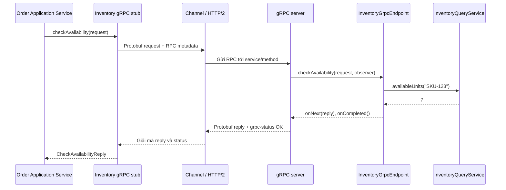
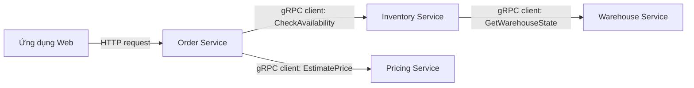

# Client, server, service và method trong một cuộc gọi

Trong một ứng dụng Java chạy đơn lẻ, bạn có thể gọi `inventoryService.checkAvailability(...)` như một phương thức thông thường. Khi phần đặt hàng và phần kiểm tra tồn kho được triển khai thành **hai ứng dụng Spring độc lập**, một lời gọi như vậy phải đi qua mạng. gRPC giúp hai ứng dụng làm việc với nhau bằng hợp đồng API có kiểu dữ liệu rõ ràng và mã giao tiếp được sinh từ Protocol Buffers.

Để đọc và thiết kế một cuộc gọi gRPC, trước hết cần phân biệt bốn khái niệm: **client**, **server**, **service** và **method**. Chúng không cùng cấp độ: client/server là **vai trò của các bên tham gia giao tiếp**; service/method là **giao diện và thao tác được công bố**.

Bài học này nằm trong chương **Nhập môn** của module **SPRING_GRPC**, nền tảng để xây dựng gRPC client/server trong Spring bằng hợp đồng Protocol Buffers và Java code generation. Những ví dụ dưới đây cũng dẫn đến các chủ đề tiếp theo: unary/streaming RPC, metadata, deadline, status, interceptor, TLS, kiểm thử tích hợp và giám sát độ tin cậy.

## 1. Xác định đúng bốn thành phần

Xét hệ thống bán hàng:

- **Order Service** nhận yêu cầu tạo đơn.
- **Inventory Service** quản lý tồn kho và trả lời có đủ hàng hay không.
- Trước khi tạo đơn, Order Service cần hỏi Inventory Service về mã hàng `SKU-123` và số lượng `2`.

Trong cuộc gọi đó:

| Thuật ngữ | Vai trò trong ví dụ | Trách nhiệm chính |
| --- | --- | --- |
| **Client** | Order Service khi gọi tồn kho | Tạo request, chọn server đích, gọi phương thức qua stub, nhận response hoặc lỗi |
| **Server** | Tiến trình Inventory Service tiếp nhận kết nối gRPC | Lắng nghe cổng, tiếp nhận RPC, tìm handler đã đăng ký, chuyển request đến phương thức xử lý |
| **Service** | `InventoryService` trong hợp đồng `.proto` | Gom nhóm các phương thức RPC có cùng mục đích nghiệp vụ; đặt tên cho API từ xa |
| **Method** | `CheckAvailability` | Định nghĩa một thao tác RPC cụ thể cùng kiểu request và response |

Điểm khác biệt quan trọng:

- Client/server là vai trò **theo từng cuộc gọi**, không nhất thiết là phân loại cố định cho cả một ứng dụng. Một tiến trình có thể vừa phục vụ RPC từ ứng dụng khác vừa gọi tiếp RPC đến dịch vụ thứ ba.
- gRPC service là **hợp đồng phương thức từ xa**; Spring `@Service` là **cách đánh dấu thành phần nghiệp vụ được Spring quản lý**. Hai cách dùng từ “service” không tự động đồng nghĩa.
- gRPC method là **thao tác trong hợp đồng mạng**. Phía Java có một phương thức được sinh với chữ thường đầu, nhưng hệ thống gRPC nhận diện lời gọi bằng tên đầy đủ của service và method trong `.proto`.

## 2. Hợp đồng `.proto` định nghĩa service và method

Giữa client và server cần một nguồn mô tả chung. Với gRPC, nguồn đó thường là tệp **Protocol Buffers** `.proto`.

Ví dụ `inventory.proto`:

```protobuf
syntax = "proto3";

package warehouse.v1;

option java_package = "com.example.warehouse.grpc";
option java_multiple_files = true;

service InventoryService {
  rpc CheckAvailability(CheckAvailabilityRequest)
      returns (CheckAvailabilityReply);

  rpc WatchAvailability(WatchAvailabilityRequest)
      returns (stream AvailabilityUpdate);
}

message CheckAvailabilityRequest {
  string sku = 1;
  int32 requested_units = 2;
}

message CheckAvailabilityReply {
  bool available = 1;
  int32 units_in_stock = 2;
}

message WatchAvailabilityRequest {
  string sku = 1;
}

message AvailabilityUpdate {
  string sku = 1;
  int32 units_in_stock = 2;
}
```

Đọc lần lượt:

1. `package warehouse.v1` xác định **namespace Protobuf**. Cùng với tên service, nó tạo tên service đầy đủ là `warehouse.v1.InventoryService`.
2. `service InventoryService` khai báo **một nhóm các method có thể gọi từ xa**. Đây là hợp đồng; nó không chứa SQL, logic nghiệp vụ hoặc địa chỉ mạng.
3. `rpc CheckAvailability(...) returns (...)` khai báo **unary RPC**: một request và một response.
4. `rpc WatchAvailability(...) returns (stream AvailabilityUpdate)` khai báo **server-streaming RPC**: client gửi một request, server có thể gửi nhiều update trong cùng RPC.
5. `message` định nghĩa cấu trúc dữ liệu của request/response. `sku` và `requested_units` là các trường của thông điệp, không phải tên tham số Java được truyền qua mạng dưới dạng tùy ý.
6. `java_package` quyết định package chứa mã Java sinh ra; nó không thay thế `package` trong tên đầy đủ của gRPC service.

Nếu cần thêm một thao tác nghiệp vụ, ví dụ `ReserveItems`, hợp đồng thường được mở rộng bằng **một method mới** với request/response riêng. Nếu cần thay đổi kiểu hoặc ý nghĩa của trường hiện có, phải xem xét tương thích schema với client cũ trước khi triển khai.

### Tên service và method xuất hiện trên đường truyền

Lời gọi `CheckAvailability` được gRPC định danh bằng đường dẫn phương thức:

```text
/warehouse.v1.InventoryService/CheckAvailability
 \___________________________/ \_______________/
       service đầy đủ              method
```

Đường dẫn này được sử dụng trong trường `:path` của HTTP/2 request khi dùng gRPC transport thông thường. Đây là **định danh RPC**, không phải tên REST controller tùy ý và cũng không phải địa chỉ của server.

Cần phân biệt:

| Thông tin | Ví dụ | Dùng để làm gì? |
| --- | --- | --- |
| Địa chỉ server | `inventory.internal:9090` | Cho client biết kết nối đến đâu |
| Tên service đầy đủ | `warehouse.v1.InventoryService` | Xác định nhóm API mà server cung cấp |
| Tên method | `CheckAvailability` | Xác định thao tác trong service |
| Đường dẫn method | `/warehouse.v1.InventoryService/CheckAvailability` | Cho gRPC server định tuyến lời gọi |
| Message request | `CheckAvailabilityRequest` | Mang dữ liệu nghiệp vụ của lần gọi |

Một host có thể phục vụ **nhiều gRPC service**, và một gRPC service có thể có **nhiều method**. Việc các service/method nằm ở cùng địa chỉ mạng không làm chúng trở thành cùng một thao tác.

## 3. Client thực sự gồm những gì?

Trong gRPC Java, “client” không chỉ là một dòng code gọi hàm. Thông thường nó kết hợp **logic ứng dụng**, **channel** và **stub**:

```text
Order Service (Spring)
  |
  +-- Application Service: tạo yêu cầu kiểm tra hàng
  |
  +-- gRPC client stub: gọi checkAvailability(request)
           |
           +-- ManagedChannel: kênh giao tiếp tới Inventory Server
                    |
                    +-- gRPC runtime + HTTP/2 transport
                             |
                           Network
```

**Client stub** là đối tượng đại diện cho API từ xa. Stub cung cấp các phương thức có kiểu dữ liệu đúng theo hợp đồng, ví dụ `checkAvailability(CheckAvailabilityRequest)`.

**ManagedChannel** là đối tượng gRPC Java dùng để quản lý các tài nguyên giao tiếp đến một endpoint hoặc tập endpoint đã được phân giải, bao gồm kết nối và trạng thái hoạt động. Một channel có thể được sử dụng bởi nhiều stub và nhiều RPC. Channel thường nên được **tái sử dụng** thay vì tạo mới cho mỗi request.

**Application Service** của Order Service quyết định *khi nào* phải hỏi tồn kho và *phải làm gì* với kết quả. Nó không cần tự mã hóa Protobuf hay dựng HTTP/2 headers bằng tay.

### Các dạng stub thông dụng trong gRPC Java

Từ `InventoryService`, plugin gRPC Java thường sinh lớp `InventoryServiceGrpc` với những cách tạo stub:

| Cách tạo stub | Phong cách | Phù hợp khi nào? |
| --- | --- | --- |
| `InventoryServiceGrpc.newBlockingStub(channel)` | Gọi unary/server-streaming theo kiểu chặn luồng gọi | Ứng dụng đồng bộ, đơn giản, kiểm soát được số luồng |
| `InventoryServiceGrpc.newStub(channel)` | Bất đồng bộ, dùng callback/`StreamObserver` | Streaming hoặc ứng dụng cần không chặn luồng |
| `InventoryServiceGrpc.newFutureStub(channel)` | Unary trả về `ListenableFuture` | Cần kết hợp các thao tác bất đồng bộ unary |

Blocking stub không hỗ trợ mọi mẫu streaming theo kiểu đồng bộ; đối với client-streaming và bidirectional streaming, cần dùng API bất đồng bộ hoặc cách tiếp cận tương ứng của thư viện. Stub bản thân thường là đối tượng nhẹ, có thể tạo các biến thể với deadline, credentials hoặc interceptor. Kết nối thật được quản lý bởi channel.

## 4. Server, service handler và nghiệp vụ Spring

Ở phía Inventory Service, cần phân biệt ba thành phần:

1. **gRPC server** là runtime lắng nghe và nhận RPC qua mạng.
2. **gRPC service implementation/handler** là mã được đăng ký với server để thực hiện các method trong `.proto`.
3. **Spring business service** chứa quy tắc nghiệp vụ và gọi repository/cơ sở dữ liệu nếu cần.

```text
                  Inventory Service (Spring application)

               +------------------------------------+
HTTP/2 request | gRPC server runtime                |
-------------->|  tìm warehouse.v1.InventoryService|
               |    -> CheckAvailability            |
               +------------------+-----------------+
                                  |
                                  v
               +------------------------------------+
               | InventoryGrpcEndpoint              |
               | (gRPC handler / adapter)           |
               +------------------+-----------------+
                                  |
                                  v
               +------------------------------------+
               | InventoryQueryService              |
               | (Spring @Service / nghiệp vụ)     |
               +------------------+-----------------+
                                  |
                                  v
                             Repository/DB
```

Tên gRPC service và tên lớp Spring business service có thể gần giống nhau vì cùng lĩnh vực nghiệp vụ, nhưng trách nhiệm khác nhau. Lớp adapter có nhiệm vụ chuyển **Protobuf request ↔ dữ liệu nghiệp vụ**, xử lý lỗi RPC và trả response; lớp nghiệp vụ quyết định **có đủ hàng hay không**.

Một lớp gắn `@Component` hoặc `@Service` của Spring **không tự động biến thành gRPC endpoint** trong mọi thư viện. gRPC runtime phải **đăng ký handler**. Với các Spring gRPC starter, cơ chế quét hoặc annotation cần tuân theo tài liệu của starter và phiên bản sử dụng; với gRPC Java thuần, thường gọi `addService(...)` khi khởi tạo server.

## 5. Một unary RPC đi từ client đến server như thế nào?

Giả sử Order Service cần kiểm tra xem kho có đủ hai sản phẩm `SKU-123` hay không:



Đằng sau sơ đồ là một chuỗi bước có ý nghĩa:

1. **Chuẩn bị hợp đồng:** hai phía dùng cùng định nghĩa `InventoryService/CheckAvailability` và message tương thích. Mã Java có thể được sinh và đóng gói vào thư viện chung, hoặc sinh độc lập từ phiên bản `.proto` tương thích.
2. **Tạo request:** client đặt `sku` và `requested_units` trong `CheckAvailabilityRequest`.
3. **Gọi stub:** ứng dụng gọi `stub.checkAvailability(request)`; stub biết descriptor của method, kiểu message và các tùy chọn RPC.
4. **Đưa request lên mạng:** gRPC serialize message theo Protobuf, thêm framing, gửi headers và data qua một HTTP/2 stream trên channel.
5. **Định tuyến:** server đọc tên service/method, tìm handler đã đăng ký và parse request về kiểu Java tương ứng.
6. **Xử lý nghiệp vụ:** handler xác thực dữ liệu cần thiết, gọi Spring business service truy vấn số lượng còn trong kho.
7. **Trả kết quả:** handler tạo `CheckAvailabilityReply`; gRPC gửi response và mã trạng thái kết thúc RPC.
8. **Nhận kết quả:** client giải mã response; nếu RPC thất bại, stub báo lỗi theo API phù hợp, chẳng hạn `StatusRuntimeException` ở blocking stub.

Với **unary RPC thành công**, phía server cần phát **một** response và kết thúc bình thường. Trong API `StreamObserver`, cặp thao tác thường thấy là `onNext(response)` rồi `onCompleted()`. Khi thất bại, handler gọi `onError(...)` để kết thúc RPC bằng lỗi và **không gọi tiếp** `onCompleted()`.

### HTTP status và gRPC status thuộc hai lớp

Trong gRPC qua HTTP/2, một RPC có thể dùng HTTP status `200` nhưng trả gRPC status `INVALID_ARGUMENT`. Trạng thái **RPC** được thể hiện bằng gRPC status, thường nằm trong HTTP/2 trailers. Client phải kiểm tra kết quả theo cơ chế gRPC, không chỉ nhìn HTTP `200`.

Ví dụ lỗi đầu vào:

```text
Client yêu cầu:
  sku = ""
  requested_units = -2

Server trả:
  gRPC status = INVALID_ARGUMENT
  message     = "sku và requested_units phải hợp lệ"
```

Ngược lại, “SKU hợp lệ nhưng kho không đủ hàng” có thể là response nghiệp vụ bình thường:

```text
CheckAvailabilityReply:
  available = false
  units_in_stock = 1

gRPC status = OK
```

Phân biệt **kết quả nghiệp vụ** với **sự cố giao tiếp** giúp client đưa ra hành động đúng và tránh retry không cần thiết.

## 6. Ví dụ server: từ method gRPC đến Spring bean

Ví dụ dưới dùng hai lớp có nhiệm vụ riêng. Đầu tiên, một Spring service rất đơn giản mô phỏng truy vấn tồn kho:

```java
package com.example.warehouse.application;

import java.util.Map;
import org.springframework.stereotype.Service;

@Service
public class InventoryQueryService {
    private final Map<String, Integer> quantities = Map.of(
        "SKU-123", 7,
        "SKU-456", 0
    );

    public int availableUnits(String sku) {
        return quantities.getOrDefault(sku, 0);
    }
}
```

Đây là dữ liệu mẫu trong bộ nhớ để tập trung vào luồng RPC. Trong ứng dụng thực tế, Spring service có thể truy vấn repository/database và cần phân biệt SKU không tồn tại với SKU có tồn kho bằng 0 theo chính sách nghiệp vụ.

Lớp handler gRPC dùng các kiểu Java được sinh từ `inventory.proto`:

```java
package com.example.warehouse.transport.grpc;

import com.example.warehouse.application.InventoryQueryService;
import com.example.warehouse.grpc.CheckAvailabilityReply;
import com.example.warehouse.grpc.CheckAvailabilityRequest;
import com.example.warehouse.grpc.InventoryServiceGrpc;
import io.grpc.Status;
import io.grpc.stub.StreamObserver;
import org.springframework.stereotype.Component;

@Component
public class InventoryGrpcEndpoint
        extends InventoryServiceGrpc.InventoryServiceImplBase {

    private final InventoryQueryService inventoryQuery;

    public InventoryGrpcEndpoint(InventoryQueryService inventoryQuery) {
        this.inventoryQuery = inventoryQuery;
    }

    @Override
    public void checkAvailability(
            CheckAvailabilityRequest request,
            StreamObserver<CheckAvailabilityReply> responseObserver) {

        if (request.getSku().isBlank()
                || request.getRequestedUnits() <= 0) {
            responseObserver.onError(
                Status.INVALID_ARGUMENT
                    .withDescription("sku và requested_units phải hợp lệ")
                    .asRuntimeException());
            return;
        }

        final int remaining;
        try {
            remaining = inventoryQuery.availableUnits(request.getSku());
        } catch (RuntimeException ex) {
            responseObserver.onError(
                Status.INTERNAL
                    .withDescription("Không thể truy vấn tồn kho")
                    .asRuntimeException());
            return;
        }

        CheckAvailabilityReply response = CheckAvailabilityReply.newBuilder()
            .setAvailable(remaining >= request.getRequestedUnits())
            .setUnitsInStock(remaining)
            .build();

        responseObserver.onNext(response);
        responseObserver.onCompleted();
    }
}
```

Lưu ý các tên do trình sinh mã tạo ra:

- `InventoryServiceGrpc.InventoryServiceImplBase` là lớp cơ sở cho server handler.
- `checkAvailability` là phương thức Java tương ứng với RPC `CheckAvailability` trong `.proto`.
- `CheckAvailabilityRequest` và `CheckAvailabilityReply` là lớp Protobuf, có getter/builder được sinh tương ứng với field định nghĩa.
- `StreamObserver<CheckAvailabilityReply>` đại diện cho **kênh trả kết quả của RPC**. Với unary, handler gửi một response; với streaming, có thể gửi nhiều response trước khi kết thúc.

`@Component` cho phép Spring quản lý instance và tiêm `InventoryQueryService`. **Nó không thay thế bước đăng ký gRPC service implementation** với gRPC server. Nếu không dùng starter tự động đăng ký, mã tạo server gRPC Java thuần có thể gồm:

```java
import io.grpc.Server;
import io.grpc.ServerBuilder;

// endpoint là instance InventoryGrpcEndpoint do Spring cung cấp.
Server server = ServerBuilder.forPort(9090)
    .addService(endpoint)
    .build()
    .start();
```

Đây là **đoạn minh họa bước đăng ký**, không phải cấu hình Spring Boot đầy đủ. Trong ứng dụng hoàn chỉnh, server cần được khởi tạo/đóng theo vòng đời Spring, có cấu hình cổng, TLS, interceptor, khả năng kiểm tra readiness và xử lý shutdown. Một Spring gRPC starter có thể thay phần đăng ký thủ công này; cách làm cụ thể tùy thư viện.

### Vì sao không đưa toàn bộ nghiệp vụ vào handler?

Nếu đặt logic tính tồn kho và truy cập database ngay trong `checkAvailability`, mã giao tiếp sẽ khó kiểm thử độc lập và khó tái sử dụng cho REST API hoặc quy trình xử lý nền. Việc tách adapter khỏi `InventoryQueryService` giúp:

- Kiểm thử thuật toán tồn kho mà không cần mở kết nối gRPC.
- Kiểm thử lớp gRPC theo contract: validation, mapping response và status.
- Dễ thay đổi cơ chế vận chuyển mà không viết lại nghiệp vụ.

## 7. Ví dụ client: tạo stub và gọi đúng method

Đoạn sau minh họa một client Java chạy độc lập để bạn nhìn rõ vai trò của channel và stub. Trong dự án Spring thực tế, chúng thường được quản lý và tái sử dụng qua cấu hình ứng dụng.

```java
import com.example.warehouse.grpc.CheckAvailabilityReply;
import com.example.warehouse.grpc.CheckAvailabilityRequest;
import com.example.warehouse.grpc.InventoryServiceGrpc;
import io.grpc.ManagedChannel;
import io.grpc.ManagedChannelBuilder;
import io.grpc.StatusRuntimeException;
import java.util.concurrent.TimeUnit;

ManagedChannel channel = ManagedChannelBuilder
    .forAddress("localhost", 9090)
    .usePlaintext() // Chỉ sử dụng trong ví dụ thử nghiệm cục bộ
    .build();

try {
    InventoryServiceGrpc.InventoryServiceBlockingStub stub =
        InventoryServiceGrpc.newBlockingStub(channel)
            .withDeadlineAfter(800, TimeUnit.MILLISECONDS);

    CheckAvailabilityRequest request = CheckAvailabilityRequest.newBuilder()
        .setSku("SKU-123")
        .setRequestedUnits(2)
        .build();

    CheckAvailabilityReply response = stub.checkAvailability(request);

    if (response.getAvailable()) {
        System.out.println("Đủ hàng: " + response.getUnitsInStock());
    } else {
        System.out.println("Không đủ hàng");
    }
} catch (StatusRuntimeException ex) {
    System.err.println("RPC lỗi: " + ex.getStatus().getCode());
} finally {
    channel.shutdown();
}
```

Mối quan hệ giữa các đối tượng trong đoạn code:

| Đối tượng / lời gọi | Vai trò |
| --- | --- |
| `ManagedChannel` | Quản lý đường giao tiếp đến server |
| `InventoryServiceBlockingStub` | Client đại diện cho `InventoryService` từ xa |
| `CheckAvailabilityRequest` | Dữ liệu đầu vào được sinh từ Protobuf schema |
| `stub.checkAvailability(request)` | Thực hiện method RPC với kiểu dữ liệu được bảo đảm ở mức Java |
| `CheckAvailabilityReply` | Dữ liệu trả về sau khi giải mã |
| `StatusRuntimeException` | Biểu diễn lỗi RPC cho blocking stub |
| `withDeadlineAfter(...)` | Giới hạn thời gian chờ cho lời gọi thực tế sử dụng stub đó |

Giá trị deadline `800 ms` chỉ để minh họa. Thời hạn phù hợp phụ thuộc yêu cầu nghiệp vụ, độ trễ mạng, tải hệ thống và thời gian cần cho bước xử lý tiếp theo. `usePlaintext()` chỉ dành cho môi trường thử nghiệm kiểm soát; môi trường sản xuất cần cấu hình TLS và xác thực thích hợp.

### Một client có thể gọi nhiều method không?

Có. Một stub của `InventoryService` có thể cung cấp `checkAvailability(...)` và `watchAvailability(...)`. Nhưng API gọi streaming không nhất thiết trông giống unary: server-streaming có thể trả một chuỗi kết quả, còn client-streaming hoặc bidirectional streaming cần cơ chế gửi và nhận nhiều message. Hợp đồng quyết định mẫu lời gọi, và thư viện sinh API phù hợp.

## 8. Client và server có thể đổi vai trong cùng một hệ thống

Một ứng dụng Spring không phải mãi mãi chỉ là client hoặc chỉ là server:



Trong sơ đồ:

- **Order Service** đóng vai trò server đối với yêu cầu HTTP từ ứng dụng web; đồng thời là **gRPC client** khi gọi Inventory hoặc Pricing.
- **Inventory Service** là **gRPC server** của lời gọi `CheckAvailability`, nhưng có thể trở thành **gRPC client** khi hỏi Warehouse Service.
- **Warehouse Service** là gRPC server của lời gọi `GetWarehouseState`.

Vì vậy, câu “Inventory là server” chỉ đúng trong ngữ cảnh lời gọi hiện tại. Hãy luôn chỉ rõ **ai gọi ai** và **service/method nào đang được gọi**. Khi phân tích một chuỗi RPC liên tiếp, mỗi hop có deadline, status, metadata và tài nguyên riêng; ứng dụng trung gian cần quản lý cách chuyển tiếp hoặc giới hạn các thông tin này.

## 9. Một service có nhiều method; một method có những thuộc tính nào?

Xem lại hợp đồng:

```protobuf
service InventoryService {
  rpc CheckAvailability(CheckAvailabilityRequest)
      returns (CheckAvailabilityReply);
  rpc WatchAvailability(WatchAvailabilityRequest)
      returns (stream AvailabilityUpdate);
}
```

Hai method thuộc cùng service nhưng có **kiểu giao tiếp khác nhau**. Một method gRPC được định nghĩa bởi:

1. **Tên** của method trong service, ví dụ `CheckAvailability`.
2. **Kiểu request** mà client được phép gửi, ví dụ `CheckAvailabilityRequest`.
3. **Kiểu response** mà server gửi lại, ví dụ `CheckAvailabilityReply`.
4. **Cardinality** — mỗi chiều có một hay nhiều message (unary, server streaming, client streaming hoặc bidirectional streaming).
5. **Ngữ nghĩa nghiệp vụ** mà hai phía phải thống nhất dù không thể biểu diễn toàn bộ bằng cú pháp Protobuf: dữ liệu đầu vào hợp lệ, trạng thái nghiệp vụ, side effect và tính idempotent.

Ví dụ đầy đủ bốn hình thức:

```protobuf
service RpcShapes {
  rpc Unary(In) returns (Out);
  rpc ServerStream(In) returns (stream Out);
  rpc ClientStream(stream In) returns (Out);
  rpc BidiStream(stream In) returns (stream Out);
}

message In {
  string value = 1;
}

message Out {
  string value = 1;
}
```

| Kiểu method | Client gửi | Server gửi | Trách nhiệm xử lý |
| --- | --- | --- | --- |
| Unary | Một message | Một message | Server trả kết quả và đóng lời gọi |
| Server streaming | Một message | Nhiều message | Server quản lý phát dữ liệu cho đến khi xong hoặc bị hủy |
| Client streaming | Nhiều message | Một message | Server nhận và tổng hợp cả dòng request |
| Bidirectional streaming | Nhiều message | Nhiều message | Hai phía gửi/nhận độc lập trong cùng RPC |

Với streaming, method vẫn là **một method và một RPC** trong suốt phiên trao đổi; không phải một RPC mới cho mỗi message. Người học cần phân biệt lifetime của RPC, số lượng message và số lượng kết nối HTTP/2.

## 10. Các yếu tố điều khiển đi theo cuộc gọi

Client, server, service và method xác định ai gọi thao tác nào. Để lời gọi hoạt động ổn định trong môi trường thật, cần thêm quy tắc điều khiển.

### 10.1. Metadata: thông tin ngoài message nghiệp vụ

Client có thể gửi **metadata** như authorization token, correlation ID hoặc trace context. Metadata được gRPC ánh xạ sang HTTP/2 headers; server thường xử lý qua interceptor hoặc API metadata.

Không nên để token bảo mật xuất hiện trong `CheckAvailabilityRequest` chỉ vì request là chỗ dễ thêm trường. Token thuộc thông tin điều khiển/xác thực, còn SKU và số lượng thuộc **message nghiệp vụ**.

### 10.2. Deadline: thời điểm phải kết thúc chờ đợi

Không phải lúc nào client cũng có thể đợi đến khi server trả lời. Deadline giúp giới hạn thời gian cho một RPC, thường đặt trên stub/call options. Khi hết thời gian, client có thể nhận `DEADLINE_EXCEEDED` và yêu cầu bị hủy ở tầng gRPC; server cần tôn trọng cancellation để dừng công việc không còn giá trị.

Trong chuỗi Order → Inventory → Warehouse, nếu các hop sử dụng timeout quá dài và không phối hợp, tổng thời gian sẽ vượt ngân sách phản hồi của Order Service. Cần thiết kế deadline theo đường đi thực tế và theo chính sách của ứng dụng.

### 10.3. Status: thành công, lỗi dữ liệu hay lỗi hạ tầng?

Một số mã gRPC:

| Status | Ý nghĩa tiêu biểu | Ví dụ với `CheckAvailability` |
| --- | --- | --- |
| `OK` | RPC thực hiện thành công | Đã kiểm tra xong, dù hàng có thể hết |
| `INVALID_ARGUMENT` | Dữ liệu gửi lên không hợp lệ | `sku` rỗng hoặc số lượng không dương |
| `NOT_FOUND` | Không tìm thấy tài nguyên theo hợp đồng | SKU không tồn tại nếu API chọn biểu diễn bằng lỗi |
| `DEADLINE_EXCEEDED` | Lời gọi vượt thời hạn | Inventory xử lý chậm hơn deadline |
| `UNAVAILABLE` | Dịch vụ tạm thời không thể phục vụ | Mất kết nối hoặc endpoint tạm không sẵn sàng |
| `UNIMPLEMENTED` | Method không được triển khai/không hỗ trợ | Client gọi method không có handler đúng trên server |
| `INTERNAL` | Lỗi xử lý nội bộ ngoài dự kiến | Adapter gặp lỗi không thể hoàn tất |

Không tự động retry chỉ vì gặp lỗi RPC. Với method có tác dụng phụ như “trừ tồn kho”, một lỗi mạng có thể xảy ra **sau khi server đã xử lý xong**; thử lại mà không có idempotency có thể gây kết quả sai.

### 10.4. Interceptor, TLS và quyền truy cập

**Interceptor** là nơi phù hợp để thêm logic xuyên suốt nhiều method: kiểm tra token, ghi log, tracing hoặc đo metric. **TLS** mã hóa và bảo vệ kết nối giữa hai đầu; **mTLS** có thể dùng khi cần xác thực cả client và server. Quyền truy cập vẫn phải được đánh giá theo người dùng/dịch vụ, service và method cụ thể.

### 10.5. Đo lường bằng service và method

Trong vận hành, các metric thường cần phân tách theo tên service/method và status: số RPC, tỷ lệ lỗi, độ trễ p50/p95/p99, số streaming RPC đang hoạt động, dữ liệu truyền và mức tiêu thụ tài nguyên. Thay vì chỉ thấy “Inventory Server chậm”, bạn có thể xác định **`warehouse.v1.InventoryService/CheckAvailability`** mới là method có p99 tăng bất thường.

## 11. Các lỗi cấu hình và hiểu nhầm thường gặp

| Hiện tượng hoặc nhận định | Nguyên nhân/cách hiểu cần kiểm tra |
| --- | --- |
| “Thêm `@Service` vào Spring là client tự gọi được.” | Spring bean nghiệp vụ chưa chắc là gRPC handler đã đăng ký với server. |
| “Cài Protobuf là server sẽ tự mở cổng.” | Protobuf chỉ mô tả và mã hóa dữ liệu; gRPC runtime cần được khởi tạo, cấu hình và đăng ký service. |
| Client báo `UNIMPLEMENTED` | Có thể sai tên service/method, khác phiên bản contract hoặc handler chưa đăng ký/override đúng. |
| Client báo `UNAVAILABLE` | Kiểm tra endpoint, DNS, port, TLS, proxy, network và tình trạng server. Không kết luận ngay rằng method không tồn tại. |
| Client không giải mã được response | Kiểm tra contract và kiểu message tương thích, plugin/code generation và framing dữ liệu. |
| “Mỗi method cần một server riêng.” | Một gRPC server có thể cung cấp nhiều service và nhiều method, trên một cổng. |
| “Mỗi lần gọi phải tạo channel mới.” | Channel thường được tái sử dụng, còn deadline/metadata có thể cấu hình cho từng lời gọi/stub. |
| “Một microservice chỉ có một vai trò.” | Ứng dụng có thể vừa nhận RPC vừa gọi RPC khác. |
| “Không đủ hàng là lỗi mạng.” | Đây có thể là kết quả nghiệp vụ hợp lệ với `OK`, tùy contract. |
| “Gọi stub là giống hệt gọi method nội bộ.” | Lời gọi gRPC vẫn có thể chậm, bị hủy, thất bại hoặc không rõ server đã xử lý tác vụ ghi hay chưa. |

### Ví dụ tìm lỗi với `UNIMPLEMENTED`

Giả sử client sinh từ contract mới có `WatchAvailability`, nhưng server đang chạy phiên bản chưa triển khai method này. Khi gọi, client có thể nhận `UNIMPLEMENTED`. Cách phân tích hợp lý:

1. Kiểm tra client thực sự gọi endpoint nào.
2. Kiểm tra tên package/service/method được sinh từ `.proto`.
3. Kiểm tra service handler nào đã được đăng ký trên server.
4. Kiểm tra phiên bản triển khai server có override method tương ứng không.

Với gRPC Java, lớp cơ sở của service có thể có phần triển khai mặc định trả `UNIMPLEMENTED` cho method chưa override. Một service đã được đăng ký không bảo đảm **mọi method** đều đã được viết logic xử lý.

## 12. Tự kiểm tra mức hiểu

**Tình huống 1:** Order Service dùng `InventoryServiceGrpc.newBlockingStub(channel)` và gọi `checkAvailability(...)`. Đâu là client, server, service và method?

**Trả lời:** Order Service là client của RPC này; Inventory Service là server; `warehouse.v1.InventoryService` là gRPC service; `CheckAvailability` là gRPC method. Stub và channel là thành phần thực hiện giao tiếp phía client.

**Tình huống 2:** Inventory Service tiếp nhận `CheckAvailability` rồi gọi Pricing Service để tính giá. Inventory Service đang là client hay server?

**Trả lời:** Nó là **server** với RPC nhận từ Order Service, đồng thời là **client** với RPC gọi sang Pricing Service. Vai trò tùy từng hop.

**Tình huống 3:** Server có bean Spring `InventoryQueryService` nhưng chưa đăng ký `InventoryGrpcEndpoint`. Client có gọi được method không?

**Trả lời:** Không thể suy ra có. Business bean tồn tại trong Spring container không đồng nghĩa gRPC runtime đã công bố handler tương ứng. Cần đăng ký service implementation theo cơ chế của thư viện gRPC/Spring đang dùng.

**Tình huống 4:** `CheckAvailability` trả `available = false`. Client nên hiểu đây là kết nối thất bại?

**Trả lời:** Không. Nếu RPC có status `OK`, đây là kết quả nghiệp vụ “không đủ hàng”. Chỉ khi nhận gRPC status lỗi hoặc mất kết nối mới xử lý theo luồng sự cố RPC.

**Tình huống 5:** `WatchAvailability` trả hàng trăm cập nhật. Có phải server đang thực hiện hàng trăm gRPC method khác nhau?

**Trả lời:** Không. Một server-streaming RPC có thể gửi nhiều message response thông qua cùng một method và một RPC đang mở. Method là `WatchAvailability`; mỗi `AvailabilityUpdate` chỉ là một message trong luồng.

## 13. Ghi nhớ để chuyển sang các bài thực hành

Hãy luôn trả lời bốn câu hỏi trước khi viết hoặc debug một RPC:

1. **Client là ai?** Ứng dụng nào tạo lời gọi, stub và request?
2. **Server là ai?** Tiến trình nào đang lắng nghe và đăng ký handler?
3. **Service nào được công bố?** Tên đầy đủ trong `.proto` là gì?
4. **Method nào được gọi?** Nó nhận request gì, trả response gì, theo unary hay streaming?

Trong hệ sinh thái **SPRING_GRPC**, Protobuf xác lập hợp đồng, công cụ sinh mã tạo message/stub/server base cho Java, gRPC runtime điều phối lời gọi qua HTTP/2, còn Spring tổ chức các bean nghiệp vụ và vòng đời ứng dụng. Client gọi method thông qua stub; server chuyển lời gọi đến handler đã đăng ký; handler sử dụng Spring service để xử lý và kết thúc RPC bằng response hoặc status lỗi.

Khi nắm chắc các vai trò và ranh giới trên, bạn sẽ dễ hiểu các bước tiếp theo: thiết kế method trong `.proto`, sinh mã Java, triển khai client/server cho unary và streaming, sử dụng metadata, đặt deadline, mapping status, thêm interceptor và TLS, viết kiểm thử tích hợp và theo dõi độ trễ cũng như độ tin cậy của từng method.

### Tài liệu tham khảo

- [gRPC – Introduction](https://grpc.io/docs/what-is-grpc/introduction/)
- [gRPC – Core concepts, architecture and lifecycle](https://grpc.io/docs/what-is-grpc/core-concepts/)
- [gRPC – Java basics](https://grpc.io/docs/languages/java/basics/)
- [gRPC – Status codes](https://grpc.io/docs/guides/status-codes/)
- [Protocol Buffers – Proto3 language guide](https://protobuf.dev/programming-guides/proto3/)
