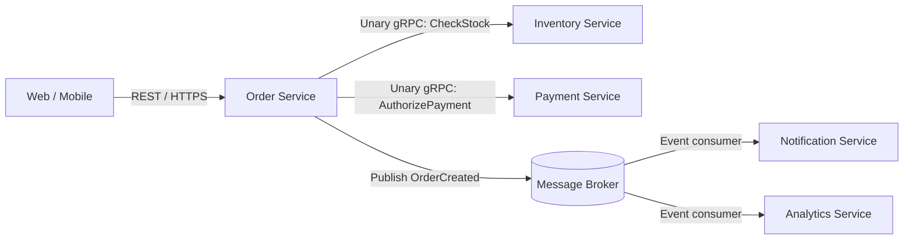
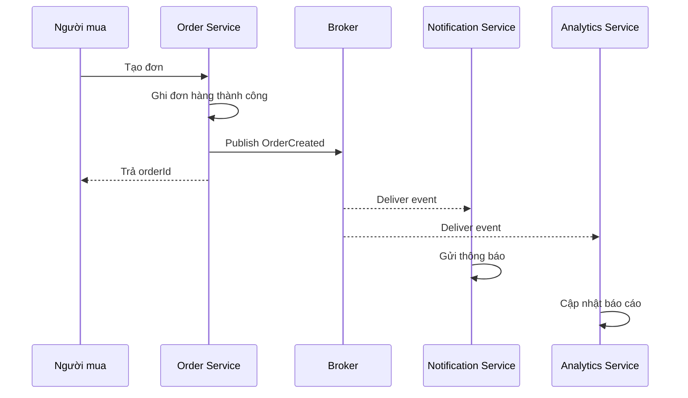
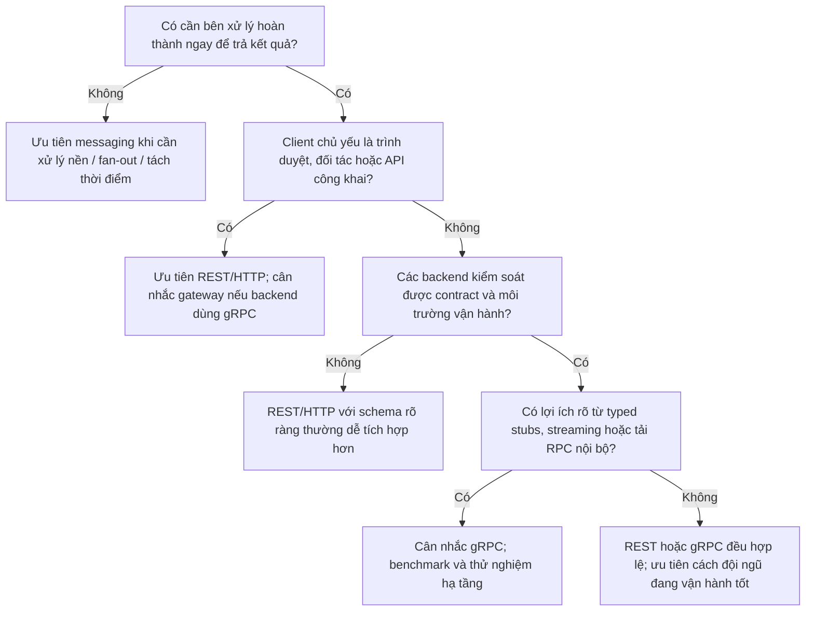

# Khi nào gRPC phù hợp hơn REST hoặc messaging?

Khi tách một ứng dụng Spring thành nhiều dịch vụ, câu hỏi “dùng gRPC, REST hay messaging?” thường xuất hiện ngay ở bước thiết kế giao tiếp. Cả ba có thể chuyển dữ liệu giữa các tiến trình, nhưng chúng phục vụ **những kiểu tương tác khác nhau**. Lựa chọn đúng phụ thuộc vào việc bên gọi có cần kết quả ngay không, ai tiêu thụ dữ liệu, các bên có phải cùng hoạt động tại một thời điểm không, và hệ thống sẽ xử lý lỗi như thế nào.

Bài thuộc chương **Nhập môn** của **SPRING_GRPC**, module phát triển dịch vụ gRPC trong hệ sinh thái Spring: mô tả API bằng Protocol Buffers, sinh mã Java và xây dựng client/server cho unary hoặc streaming RPC; sau đó áp dụng metadata, deadline, status, interceptor, TLS, kiểm thử tích hợp và giám sát hiệu năng, độ tin cậy. Nội dung dưới đây tập trung vào **quyết định kiến trúc** trước khi bắt tay vào cấu hình những thành phần đó.

## 1. Một bài toán, ba nhu cầu giao tiếp

Giả sử một nền tảng thương mại điện tử có các thành phần:

- **Web/Mobile App** hiển thị sản phẩm và cho khách hàng đặt hàng.
- **Order Service** tiếp nhận yêu cầu tạo đơn.
- **Inventory Service** kiểm tra số lượng tồn kho.
- **Payment Service** xử lý thanh toán.
- **Notification Service** gửi thông báo sau khi đơn được xác nhận.
- **Analytics Service** ghi nhận sự kiện phục vụ báo cáo.

Ba câu hỏi xuất hiện:

1. Order Service phải biết **ngay bây giờ** sản phẩm còn đủ hàng không để quyết định bước tiếp theo. Đây là tương tác **yêu cầu–phản hồi**; unary gRPC hoặc REST đều có thể giải quyết.
2. Ứng dụng web cần gọi API sản phẩm và đơn hàng, dễ dùng từ trình duyệt và tích hợp với bên ngoài. **REST/HTTP** thường là lựa chọn thuận tiện.
3. Khi đơn đã tạo, Notification và Analytics cần biết **“OrderCreated”** nhưng không nhất thiết phải chạy đúng thời điểm Order Service đang xử lý request. **Messaging/event** là lựa chọn tự nhiên hơn nếu cần tách thời điểm xử lý.



Sơ đồ minh họa một kiến trúc khả dĩ, không phải quy tắc bắt buộc. Một hệ thống có thể dùng REST giữa Order và Inventory nếu phù hợp, hoặc dùng gRPC-Web/gateway cho một số client trình duyệt. Điều quan trọng là **chọn công nghệ theo ngữ nghĩa giao tiếp**, thay vì áp dụng một kiểu cho mọi liên kết.

## 2. Phân biệt bản chất của gRPC, REST và messaging

### 2.1. gRPC: lời gọi thủ tục từ xa theo hợp đồng

gRPC là framework **Remote Procedure Call (RPC)**. Client gọi một method đã định nghĩa trong hợp đồng `.proto`; gRPC runtime xử lý giao tiếp qua mạng, tuần tự hóa thông điệp (thường bằng Protobuf), deadline, status, metadata và các kiểu streaming. Với Java, công cụ sinh mã tạo message class và stub để client gọi method có kiểu dữ liệu rõ ràng.

Ví dụ:

```java
CheckStockReply reply = stockStub.checkStock(
    CheckStockRequest.newBuilder()
        .setSku("SKU-123")
        .setQuantity(2)
        .build()
);
```

Client cần biết **service/method đích**, đồng thời phải chuẩn bị cho việc lời gọi bị chậm, vượt deadline hoặc thất bại. **Streaming** có thể làm một RPC truyền nhiều message, nhưng không biến RPC thành một hàng đợi lưu bền.

### 2.2. REST: API định hướng tài nguyên qua HTTP

REST là một **phong cách kiến trúc**. API REST thường biểu diễn tài nguyên bằng URI, sử dụng các HTTP method như `GET`, `POST`, `PUT`, `DELETE`, trả HTTP status và thường mang payload JSON.

Ví dụ:

```http
GET /api/products/SKU-123
Accept: application/json
```

```json
{
  "sku": "SKU-123",
  "name": "Bàn phím cơ",
  "availableUnits": 7
}
```

REST **không bắt buộc dùng JSON**, và API REST cũng có thể chạy trên **HTTP/2**. So sánh “gRPC dùng HTTP/2 còn REST chỉ dùng HTTP/1.1” là không chính xác. Với Spring, REST thường dễ xây bằng Spring MVC hoặc WebFlux, thuận tiện cho trình duyệt, API công khai, proxy, cache HTTP và công cụ kiểm tra API phổ biến.

### 2.3. Messaging: gửi thông điệp qua trung gian

Trong messaging, một producer gửi message vào **queue**, **topic** hoặc một dịch vụ trung gian; consumer nhận và xử lý theo cơ chế của hệ thống messaging. Producer có thể không biết chi tiết triển khai của consumer, và trong nhiều kiến trúc hai bên không phải hoạt động đồng thời.

Ví dụ một event:

```json
{
  "eventId": "evt-8f2a",
  "eventType": "OrderCreated",
  "orderId": "ORD-1001",
  "occurredAt": "2026-11-19T01:00:00Z"
}
```

Broker như RabbitMQ hoặc Kafka hỗ trợ các mô hình tiêu thụ và lưu giữ thông điệp khác nhau. **Độ bền, số lần giao hàng, thứ tự và khả năng phát lại** phụ thuộc sản phẩm, cách cấu hình và thiết kế consumer; không phải cứ dùng broker là tự động không mất dữ liệu hay xử lý chính xác một lần.

Messaging còn có **command message** hoặc mẫu request/reply; vì thế không nên đồng nhất tất cả messaging với event pub/sub. Trong bài này, “messaging” chủ yếu nói tới **giao tiếp bất đồng bộ có trung gian**, vì đó là phương án thường cần cân nhắc khi so với lời gọi RPC trực tiếp.

## 3. Bảng so sánh để ra quyết định

| Tiêu chí | gRPC | REST/HTTP API | Messaging qua broker |
| --- | --- | --- | --- |
| Mô hình chủ đạo | Gọi method từ xa | Yêu cầu–phản hồi với tài nguyên HTTP | Gửi/nhận message, thường bất đồng bộ |
| Bên gọi có chờ kết quả? | Thường cần kết quả hoặc luồng phản hồi của RPC; API client có thể non-blocking | Thường cần HTTP response; API client có thể non-blocking | Thường không cần consumer xử lý xong trước khi producer tiếp tục |
| Contract | `.proto`, thông điệp có kiểu, Java stub sinh mã | HTTP semantics; có thể dùng OpenAPI/JSON Schema | Event/command schema, quy ước queue/topic và version |
| Định dạng thường thấy | Protobuf nhị phân | JSON, hoặc định dạng khác | JSON, Protobuf, Avro, v.v. |
| Hỗ trợ luồng dữ liệu | Unary, client/server/bidirectional streaming | Có thể streaming qua SSE, WebSocket hoặc HTTP streaming tùy API | Dòng sự kiện qua topic/queue; không đồng nghĩa một RPC stream |
| Client trình duyệt phổ biến | gRPC chuẩn thường cần gRPC-Web hoặc gateway tương thích | Trực tiếp bằng `fetch`, SDK HTTP | Thường thông qua backend hoặc gateway |
| Ghép nối về thời gian | Thường cần server đích sẵn sàng trong lúc RPC đang diễn ra | Thường cần server đáp ứng HTTP request | Có thể tách thời điểm sản xuất và xử lý nếu broker lưu/giữ thông điệp |
| Phát cho nhiều bên | Phải gọi nhiều đích hoặc có tầng phân phối riêng | Tương tự, nếu không bổ sung cơ chế khác | Phù hợp fan-out/pub-sub tùy thiết kế topic/subscription |
| Lưu bền và phát lại | Không phải tính năng mặc định của RPC | Không phải tính năng mặc định của HTTP request | Có thể hỗ trợ tùy broker, retention, ack và cấu hình |
| Quan sát lỗi | gRPC status, deadline, interceptor, metrics per method | HTTP status, middleware, tracing, metrics per route | Retry/DLQ, consumer lag, ack, lỗi xử lý, tracing xuyên message |
| Thế mạnh thường gặp | Lời gọi service-to-service có hợp đồng chặt; streaming giữa backend | API web/public, hệ sinh thái HTTP, tích hợp đa dạng | Xử lý nền, tách thời điểm, nhiều subscriber, event-driven workflows |

Đây là bảng về **kịch bản sử dụng phổ biến**, không phải giới hạn tuyệt đối của công nghệ. Ví dụ REST hoàn toàn có thể dùng schema chặt, gRPC có thể triển khai bất đồng bộ ở phía client, và messaging có thể dùng request/reply nhưng phải tự thiết kế correlation, timeout và xử lý phản hồi.

## 4. Khi nào nên ưu tiên gRPC?

### 4.1. Các dịch vụ backend cần phản hồi có kiểu dữ liệu rõ ràng

Giả sử Order Service cần nhận câu trả lời về tồn kho trước khi tiếp tục. Đây là một yêu cầu:

- Có **method cụ thể**: `CheckStock`.
- Có **request/response rõ kiểu**: `sku`, `quantity`, `available`, `remaining`.
- Có **thời gian chờ giới hạn** vì người dùng đang đợi.
- Hai phía do các nhóm có thể thống nhất version của `.proto`.

Trong trường hợp này, unary gRPC phù hợp vì framework sinh stub Java, chuẩn hóa cách truyền message, deadline và trạng thái RPC.

Hợp đồng `inventory.proto` tối giản:

```protobuf
syntax = "proto3";

package commerce.inventory.v1;

option java_package = "com.example.inventory.grpc";
option java_multiple_files = true;

service InventoryService {
  rpc CheckStock(CheckStockRequest) returns (CheckStockReply);
}

message CheckStockRequest {
  string sku = 1;
  int32 quantity = 2;
}

message CheckStockReply {
  bool available = 1;
  int32 remaining = 2;
}
```

Từ hợp đồng này, client Java có thể dùng `InventoryServiceGrpc.newBlockingStub(channel)` hoặc các stub bất đồng bộ do gRPC sinh ra. Server triển khai method tương ứng, ví dụ trong lớp kế thừa `InventoryServiceGrpc.InventoryServiceImplBase`, và chuyển request đến Spring bean xử lý nghiệp vụ.

Điểm có giá trị ở đây là **hợp đồng và trải nghiệm tích hợp giữa các dịch vụ**; không nên khẳng định gRPC luôn nhanh hơn mọi API REST chỉ dựa vào định dạng Protobuf.

### 4.2. Mạng nội bộ có mật độ lời gọi lớn và yêu cầu độ trễ ổn định

gRPC mặc định thường mã hóa Protobuf nhị phân, sử dụng HTTP/2 và hỗ trợ multiplexing nhiều RPC trên cùng một kết nối. Điều này **có thể** giúp tiết kiệm chi phí tuần tự hóa, giảm payload và tận dụng kết nối trong một số tải service-to-service.

Tuy nhiên, kết quả còn phụ thuộc:

- Kích thước và hình dạng payload; dữ liệu nhỏ có thể bị chi phối bởi chi phí mạng và business logic.
- Cách tái sử dụng channel/HTTP connection.
- TLS, proxy, load balancer, service mesh và cấu hình thread/event loop.
- Mức độ đồng thời, kích thước message, nén và backpressure.
- Hệ quả của database hoặc dịch vụ downstream khi tạo response.

**Quyết định bằng benchmark thực tế**, chẳng hạn đo p50/p95/p99, throughput, CPU, bộ nhớ, lỗi timeout và chi phí vận hành ở các phương án đã cấu hình đúng. Không lấy kích thước một payload mẫu để kết luận toàn bộ hệ thống sẽ nhanh hơn.

### 4.3. Cần truyền dòng dữ liệu trong một phiên RPC

Ví dụ Inventory Service muốn gửi cập nhật tồn kho liên tục cho một backend khác:

```protobuf
service StockStreamService {
  rpc WatchStock(WatchRequest) returns (stream StockUpdate);
}

message WatchRequest {
  string sku = 1;
}

message StockUpdate {
  string sku = 1;
  int32 remaining = 2;
  int64 sequence = 3;
}
```

**Server streaming** cho phép client gửi một yêu cầu rồi nhận nhiều update trong cùng một RPC. Nếu hai chiều đều cần gửi liên tục, gRPC còn có bidirectional streaming. So với lặp lại hàng trăm lần gọi unary, kiểu này có thể đơn giản hóa giao thức cập nhật trong một phiên đã mở.

Nhưng có ba giới hạn cần hiểu:

1. Một gRPC stream **không tự lưu bền sự kiện** khi client mất kết nối.
2. HTTP/2 flow control hỗ trợ điều tiết byte, nhưng ứng dụng vẫn phải xử lý consumer chậm, bộ đệm và hủy luồng.
3. Nếu cần consumer nhận lại event sau nhiều giờ ngoại tuyến, broker có retention/replay thích hợp thường phù hợp hơn streaming thuần.

Trong web browser, có thể cân nhắc SSE/WebSocket hoặc gRPC-Web/gateway theo loại stream và khả năng hỗ trợ của client. **gRPC-Web không mặc nhiên cung cấp đầy đủ các kiểu streaming như gRPC chuẩn.**

### 4.4. Nhiều ngôn ngữ cùng dùng một hợp đồng

Một hệ thống có backend Spring/Java, bộ xử lý Go và dịch vụ Python có thể cùng sinh client/server từ phiên bản Protobuf contract tương thích. Việc code generation giúp phát hiện nhiều lỗi sai kiểu và tên phương thức sớm hơn so với mã JSON tự viết.

Dù vậy, REST với OpenAPI sinh SDK cũng giải quyết được phần nào bài toán contract. gRPC thích hợp khi nhóm muốn **RPC semantics và stub sinh mã làm giao diện chính**; REST vẫn rất hợp lý nếu các bên đã có chuẩn HTTP, công cụ kiểm thử và quản trị API tốt.

## 5. Khi nào REST thuận tiện hơn?

### 5.1. API cho trình duyệt và đối tác bên ngoài

Khi client chủ yếu là web app, mobile SDK bên thứ ba hoặc đối tác dùng các công cụ HTTP phổ biến, REST thường có ít rào cản hơn:

- Trình duyệt dùng `fetch` trực tiếp với HTTP endpoints.
- Các bên dễ quan sát request bằng công cụ HTTP thông dụng.
- Caching, CDN, HTTP status và các chuẩn xác thực/gateway thường đã có trong hạ tầng.
- API tài nguyên như `/orders/{id}`, `/products/{sku}` có thể tự nhiên hơn tên RPC method.

Ví dụ trong Spring MVC:

```java
@RestController
@RequestMapping("/api/products")
public class ProductController {
    private final ProductQueryService products;

    public ProductController(ProductQueryService products) {
        this.products = products;
    }

    @GetMapping("/{sku}")
    public ProductView getProduct(@PathVariable String sku) {
        return products.findBySku(sku);
    }
}
```

`ProductQueryService` và `ProductView` ở đây là các kiểu nghiệp vụ giả định của ứng dụng. Controller minh họa cách REST công bố tài nguyên; mã chưa xử lý lỗi không tìm thấy hoặc bảo mật. Không cần đưa lớp gRPC stub vào trình duyệt chỉ để đọc thông tin sản phẩm.

### 5.2. Cần tận dụng HTTP semantics và cache

Một tài nguyên được truy vấn lặp lại, ít thay đổi có thể khai thác `GET`, `Cache-Control`, `ETag` và các thành phần cache phù hợp. REST API có lợi thế hệ sinh thái cho kịch bản này.

gRPC vẫn có thể cache ở tầng ứng dụng hay gateway, nhưng không hưởng trọn các cơ chế cache HTTP dành cho `GET` theo cùng cách như REST. Không phải mọi REST endpoint đều cache được, nhất là dữ liệu nhạy cảm hoặc kết quả tùy người dùng; cache cần được thiết kế đúng.

### 5.3. Bài toán đơn giản, đội ngũ đã vận hành REST tốt

Nếu hai ứng dụng chỉ trao đổi vài request/response mỗi phút, việc thêm pipeline sinh mã, tương thích HTTP/2, gRPC-specific observability và tooling có thể chưa mang lại lợi ích tương xứng. Spring REST cùng hợp đồng OpenAPI rõ ràng có thể đủ.

**REST không đồng nghĩa với yếu kiểu.** OpenAPI, schema validation, typed SDK và contract tests giúp REST có mức quản trị API tốt. Vấn đề cần so sánh là **chi phí thay đổi và vận hành cho nhóm**, không phải khẩu hiệu “RPC hiện đại hơn HTTP”.

## 6. Khi nào messaging phù hợp hơn cả gRPC và REST trực tiếp?

### 6.1. Bên gửi không cần chờ bên nhận xử lý xong

Sau khi đơn hàng được tạo, việc gửi email và ghi analytics không nên kéo dài thời gian trả lời khách hàng nếu chúng có thể xử lý nền. Order Service có thể công bố `OrderCreated` rồi hoàn thành request; các consumer xử lý sau.



Trong thực tế, publish message và ghi database cần **chiến lược nhất quán**. Chẳng hạn transactional outbox giúp tránh tình huống ghi đơn thành công nhưng mất event khi ứng dụng dừng trước khi publish. Sơ đồ đã giản lược bước này để làm rõ vai trò giao tiếp.

### 6.2. Muốn giảm phụ thuộc thời điểm giữa các dịch vụ

Nếu Notification Service tạm dừng để bảo trì, Order Service vẫn có thể tạo đơn khi broker và chính sách lưu/giữ message hoạt động đúng. Event có thể được consumer nhận sau.

Với gRPC/REST trực tiếp, nếu bên gọi **bắt buộc** lấy kết quả từ Notification Service ngay lập tức, việc Notification tắt sẽ trở thành lỗi của luồng gọi. Broker có thể làm giảm **temporal coupling**, nhưng không tự xóa bỏ phụ thuộc về schema, hạ tầng hay tính nhất quán nghiệp vụ.

### 6.3. Một sự kiện cần đến nhiều hệ thống

`OrderCreated` có thể được tiêu thụ bởi Notification, Analytics, Loyalty hoặc Fraud Detection mà Order Service không cần gọi từng service trực tiếp. Với topic/subscription phù hợp, mỗi consumer có thể có quy tắc xử lý và lịch triển khai riêng.

Với gRPC, Order Service vẫn có thể fan-out bằng cách gọi nhiều service, nhưng khi số consumer tăng, cách đó đẩy logic phân phối và xử lý lỗi về producer. Messaging thường phù hợp hơn nếu yêu cầu chính là **phát sự kiện cho nhiều bên**.

### 6.4. Cần retry, lưu giữ hoặc phát lại theo chính sách

Một số broker hỗ trợ ack, lưu giữ, retry, dead-letter queue (DLQ), consumer group hoặc replay. Những khả năng này hữu ích khi xử lý nền có thể kéo dài hoặc consumer tạm ngừng hoạt động.

Tuy nhiên, cần thiết kế rõ:

- **Delivery semantics:** at-most-once, at-least-once hoặc các bảo đảm riêng của nền tảng; không mặc định toàn bộ nghiệp vụ là exactly-once.
- **Idempotency:** cùng một event có thể bị xử lý lại; consumer nên chống trùng theo `eventId` hoặc khóa nghiệp vụ.
- **Ordering:** thứ tự event có thể chỉ được bảo đảm trong phạm vi partition/queue nhất định, nếu được cấu hình.
- **Retention/replay:** broker giữ message bao lâu, consumer khôi phục từ đâu, và có giới hạn gì?
- **Poison message:** message lỗi liên tục cần chính sách retry/backoff, cách ly và cảnh báo.
- **Schema evolution:** consumer phiên bản cũ phải hiểu được message mới hoặc có chiến lược chuyển phiên bản.

Giao tiếp bất đồng bộ mang lại độ linh hoạt nhưng cũng khiến hệ thống phải chấp nhận **eventual consistency** và xử lý các trạng thái “đang chờ”, “đã gửi nhưng chưa xử lý”, “xử lý lại”.

## 7. Messaging không phù hợp khi cần câu trả lời tức thời

Giả sử Order Service chỉ có một khoảng thời gian ngắn để quyết định có cho khách đặt hàng hay không. Nếu dùng topic để gửi `CheckStockRequested` rồi chờ event `CheckStockResult`, bạn phải tự bổ sung:

1. Mã correlation giữa request và kết quả.
2. Timeout khi không nhận được response.
3. Nơi lưu trạng thái những yêu cầu đang chờ.
4. Xử lý kết quả đến muộn hoặc đến trùng.
5. Quy tắc retry và việc yêu cầu đã được xử lý hay chưa.

Messaging **vẫn có thể** làm request/reply; một số broker hỗ trợ pattern đó. Nhưng nếu bài toán chỉ cần đồng bộ “gửi một request, nhận một response”, unary gRPC hoặc REST thường đơn giản hơn.

Ngược lại, nếu nghiệp vụ cho phép trả mã theo dõi `202 Accepted` rồi xử lý sau, kết hợp REST để tiếp nhận yêu cầu với messaging để xử lý nền lại là phương án tốt.

## 8. Quy tắc chọn nhanh theo yêu cầu nghiệp vụ

Sử dụng các câu hỏi theo thứ tự:



Đây là **quy trình lọc ứng viên**, không phải bộ luật loại trừ tuyệt đối. Có những trường hợp vừa cần stream tức thời vừa cần lưu giữ: bạn có thể dùng broker làm nguồn sự kiện và gRPC server-streaming để phát dữ liệu đến một backend khác. Từng đoạn giao tiếp có thể chọn cơ chế phù hợp.

### Ma trận tình huống thực tế

| Tình huống | Lựa chọn nên xem xét trước | Lý do |
| --- | --- | --- |
| Order → Inventory: kiểm tra tồn kho trước khi xác nhận | **Unary gRPC** hoặc REST | Cần phản hồi ngay, có timeout, request/response rõ |
| Order → Payment: yêu cầu ủy quyền thanh toán | **Unary gRPC** hoặc REST, với idempotency | Đồng bộ nhưng thao tác có tác dụng phụ, retry phải kiểm soát |
| Browser → Catalog: xem sản phẩm | **REST** | Hợp với trình duyệt, công cụ HTTP, cache tài nguyên |
| Backend → Backend: theo dõi tiến độ xử lý trực tiếp | **Server-streaming gRPC** | Nhiều cập nhật trong một phiên RPC |
| Order → Notification sau khi đơn đã lưu | **Messaging** | Không cần người dùng đợi gửi thông báo |
| OrderCreated → nhiều consumer | **Messaging/pub-sub** | Producer không phải biết mọi consumer |
| Nhập dữ liệu theo lô, mỗi bản ghi cần phản hồi từng bước ngay | **Client/bidirectional gRPC streaming** hoặc batch API | Tùy nhịp gửi–nhận và khả năng quản lý luồng |
| Job chạy lâu, cần nhận kết quả sau nhiều giờ | **REST để nộp job + messaging xử lý + truy vấn trạng thái** | Tách thời điểm, theo dõi tiến độ, hỗ trợ phục hồi |
| Đồng bộ event để xử lý lại sau khi consumer offline | **Messaging có retention/replay** | Một gRPC stream không tự bảo đảm phát lại |
| API nhỏ, nhiều công cụ/đối tác chỉ biết HTTP/JSON | **REST** | Giảm chi phí tích hợp và vận hành |

## 9. Ví dụ kết hợp ba công nghệ trong Spring

Giả sử hệ thống chọn REST cho API công khai, gRPC để Order hỏi kho và messaging cho sự kiện sau khi đơn được tạo.

### 9.1. REST vào hệ thống

```http
POST /api/orders
Content-Type: application/json

{
  "sku": "SKU-123",
  "quantity": 2
}
```

Order Controller kiểm tra request HTTP, gọi Spring application service và trả mã đơn. Đây là **biên tiếp nhận** thuận tiện cho client web.

### 9.2. Unary gRPC giữa các dịch vụ

Từ `inventory.proto` ở phần 4, mã Java do gRPC sinh ra cho phép:

```java
import com.example.inventory.grpc.CheckStockReply;
import com.example.inventory.grpc.CheckStockRequest;
import com.example.inventory.grpc.InventoryServiceGrpc;
import io.grpc.StatusRuntimeException;
import java.util.concurrent.TimeUnit;

public final class InventoryGateway {
    private final InventoryServiceGrpc.InventoryServiceBlockingStub stub;

    public InventoryGateway(
            InventoryServiceGrpc.InventoryServiceBlockingStub stub) {
        this.stub = stub;
    }

    public boolean hasEnoughStock(String sku, int quantity) {
        CheckStockRequest request = CheckStockRequest.newBuilder()
            .setSku(sku)
            .setQuantity(quantity)
            .build();

        try {
            CheckStockReply reply = stub
                .withDeadlineAfter(300, TimeUnit.MILLISECONDS)
                .checkStock(request);
            return reply.getAvailable();
        } catch (StatusRuntimeException ex) {
            // Caller cần quyết định fail/abort/retry theo mã status.
            throw ex;
        }
    }
}
```

`InventoryGateway` là lớp adapter phía client; stub được truyền vào qua constructor. Ứng dụng Spring phải cấu hình channel/stub, credentials, endpoint và vòng đời tài nguyên tương ứng; đoạn code không giả định một starter hoặc annotation cụ thể. Deadline `300 ms` chỉ mang tính ví dụ, cần chọn theo ngân sách thời gian thực tế.

Đặc biệt, method `CheckStock` **chỉ kiểm tra thông tin tại một thời điểm**. Nếu nghiệp vụ yêu cầu ngăn bán quá số lượng, cần một thao tác giữ/trừ hàng có bảo đảm cạnh tranh giao dịch phù hợp. Việc nhận `available = true` không có nghĩa sản phẩm sẽ còn hàng tại thời điểm thanh toán.

### 9.3. Messaging sau khi ghi đơn

Khi Order Service lưu đơn thành công, ứng dụng tạo `OrderCreated` với ID duy nhất rồi công bố theo cơ chế nhất quán đã chọn. Notification Service tiêu thụ sự kiện và gửi email, còn Analytics Service cập nhật báo cáo.

Ví dụ payload:

```json
{
  "eventId": "evt-8f2a",
  "schemaVersion": 1,
  "eventType": "OrderCreated",
  "orderId": "ORD-1001",
  "occurredAt": "2026-11-19T01:00:00Z"
}
```

Consumer cần chống xử lý trùng; producer cần giải quyết vấn đề “database commit thành công nhưng publish event thất bại”, ví dụ bằng **transactional outbox**. Broker được chọn phải có chính sách ack, retention và xử lý lỗi phù hợp. Không nên coi `publish` thành công đồng nghĩa email chắc chắn đã gửi xong.

### 9.4. Vì sao kết hợp này hợp lý?

Các bước có **thời gian chờ và yêu cầu nhất quán khác nhau**:

- Browser muốn có giao diện HTTP/JSON phổ biến.
- Order cần một kết quả kiểm tra tồn kho ngay, với deadline ngắn.
- Notification và Analytics được phép xử lý sau, độc lập với request của khách.

Thay vì áp dụng một transport cho toàn hệ thống, mỗi biên giao tiếp dùng một cơ chế giúp đơn giản hóa trách nhiệm của nó.

## 10. Độ trễ, thông lượng và tài nguyên: đo đúng điều gì?

### Độ trễ một RPC

Với một lời gọi gRPC đồng bộ, thời gian mà client quan sát có thể bao gồm:

```text
Tổng độ trễ ≈ xếp hàng phía client
             + truyền request qua mạng
             + xếp hàng và xử lý ở server
             + truyền response qua mạng
             + chi phí mã hóa/giải mã và xử lý runtime
```

Protobuf và tái sử dụng kết nối có thể giảm một số thành phần; chúng không xử lý được truy vấn SQL chậm, downstream quá tải hoặc retry bão hòa. Hãy đo **end-to-end latency** và tách số liệu theo method, payload, phiên bản client/server, độ đồng thời và tỷ lệ lỗi.

### Deadline và ngân sách thời gian

Ví dụ API đặt hàng được phân bổ tối đa `800 ms` cho các bước đồng bộ. Nếu Order gọi Inventory rồi Payment theo chuỗi, mỗi lời gọi phải có **ngân sách hợp lý**, để lại thời gian cho xác thực, nghiệp vụ và trả HTTP response. Đặt deadline 800 ms cho từng downstream call có thể khiến cả luồng vượt mục tiêu.

Một timeout hoặc deadline cần được thử với tải thật. Giá trị ngắn quá gây timeout giả; giá trị dài quá giữ tài nguyên và làm chậm phát hiện sự cố.

### Thông lượng và streaming

Đối với gRPC streaming, đo số stream đồng thời, message/giây, kích thước message, mức sử dụng bộ nhớ, sự chậm của consumer và thời gian giữ stream. Với broker, đo độ trễ từ publish đến consume, queue depth, consumer lag, số message retry/DLQ và mức độ trễ của event. Hai nhóm số liệu phản ánh những đặc tính khác nhau; so sánh duy nhất “requests/second” thường thiếu ý nghĩa.

## 11. Độ tin cậy: gRPC/REST và messaging thất bại khác nhau ra sao?

### Gọi trực tiếp không biết chắc server đã xử lý hay chưa

Client gửi yêu cầu `ReserveStock`, server giữ hàng và commit vào database, nhưng kết nối bị cắt trước khi response tới client. Client có thể nhận lỗi `UNAVAILABLE` hoặc lỗi transport khác mà **không xác định được kết quả nghiệp vụ** chỉ từ status.

Retry tự động có thể giữ hàng lần nữa. Giải pháp gồm mã yêu cầu idempotent, transaction/locking đúng hoặc endpoint tra cứu trạng thái xử lý; không chỉ là tăng số lần retry.

Với một method **đọc** như `CheckStock`, retry theo chính sách có thể hợp lý hơn, nhưng vẫn cần backoff, giới hạn số lần và quan sát mức tải.

### Messaging có thể giao message nhiều lần

Consumer cập nhật báo cáo xong nhưng chưa xác nhận ack thì bị dừng. Broker có thể giao lại cùng message. Nếu consumer không idempotent, báo cáo có thể cộng đơn hàng hai lần.

Một số chiến lược gồm dedup theo `eventId`, lưu ID đã xử lý trong cùng transaction với cập nhật nghiệp vụ, hoặc thiết kế phép cập nhật có thể thực thi lại an toàn. **“At-least-once delivery” không có nghĩa “exactly-once business effect”.**

### Hệ thống phối hợp nhiều bước

Khi tạo đơn, giữ kho và thanh toán ở các dịch vụ khác nhau, gRPC giúp gọi nhau nhanh và có hợp đồng; broker giúp phát sự kiện và xử lý việc có thể trễ. Nhưng **không công nghệ nào tự giải quyết distributed transaction**.

Những workflow kéo dài có thể cần saga, orchestration/choreography, trạng thái trung gian và nghiệp vụ bù trừ. Chọn transport chỉ là một phần của thiết kế tính nhất quán.

## 12. Bảo mật và vận hành khi dùng gRPC trong Spring

Với mọi phương án, xác thực, phân quyền và quan sát không thể bỏ qua; nhưng điểm đặt cơ chế khác nhau:

| Nhu cầu | gRPC | REST | Messaging |
| --- | --- | --- | --- |
| Bảo vệ dữ liệu khi truyền | TLS/mTLS; cấu hình channel/server credentials | HTTPS/TLS; gateway và HTTP security | TLS đến broker, ACL và chính sách client/broker |
| Xác thực và phân quyền | Metadata, interceptor, xác thực theo method | Header/token, Spring Security, authorization theo endpoint | Credential/ACL trên topic/queue; kiểm tra quyền và dữ liệu event |
| Timeout / hủy | Deadline, cancellation trên RPC | HTTP timeout, client cancellation | Retention, TTL, retry/DLQ, timeout tác vụ và consumer |
| Xử lý lỗi | gRPC status code và mapping nghiệp vụ | HTTP status và error body | Ack/nack, retry/backoff, DLQ và trạng thái xử lý |
| Theo dõi | Metrics và tracing theo service/method/status | Metrics và tracing theo endpoint/status | Producer publish outcome, consumer lag, processing latency, DLQ |
| Kiểm thử | Unit contract/mapping + gRPC integration test | Controller/API/contract tests | Producer-consumer contract, test retry/duplicate/out-of-order |

Khi dùng gRPC trong Spring, nên kiểm thử với **server và client gRPC thật** trong môi trường phù hợp thay vì chỉ gọi trực tiếp Java handler. Các kiểm thử quan trọng có thể gồm: kết nối, deadline, mapping status, metadata/interceptor, TLS, hủy streaming và response khi server tạm không sẵn sàng. Đối với messaging, cần kiểm thử consumer xử lý trùng và trạng thái broker/consumer lỗi. Với REST, tập trung vào HTTP contract, auth, caching, validation và mã trạng thái.

Thư viện/starter tích hợp gRPC và Spring khác nhau về cấu hình và cách đăng ký service bean. Cần dựa trên phiên bản đang triển khai, tái sử dụng `ManagedChannel` phù hợp và không dùng `usePlaintext()` trên đường mạng sản xuất.

## 13. Những kết luận sai thường gặp

| Nhận định | Điều nên hiểu |
| --- | --- |
| “gRPC luôn nhanh hơn REST.” | Hiệu năng phụ thuộc workload, payload, mã hóa, kết nối, runtime và logic nghiệp vụ. Hãy benchmark. |
| “REST chỉ có JSON và HTTP/1.1.” | REST có thể dùng HTTP/2 và payload khác JSON. |
| “gRPC có streaming nên thay được Kafka/RabbitMQ.” | gRPC stream phục vụ phiên truyền dữ liệu; nó không tự lưu bền và phát lại như broker được cấu hình phù hợp. |
| “Messaging là luôn không mất event.” | Độ bền và khả năng nhận lại phụ thuộc broker, ack, transaction, retention và consumer. |
| “Bất đồng bộ nghĩa là nhanh hơn.” | Producer có thể trả về sớm, nhưng end-to-end completion của nghiệp vụ có thể chậm hơn và eventual consistency phức tạp hơn. |
| “Cứ retry gRPC là đáng tin cậy.” | Retry lệnh ghi không idempotent có thể tạo side effect trùng lặp. |
| “Mọi client web đều gọi gRPC chuẩn trực tiếp.” | Browser thường cần gRPC-Web/gateway hoặc API HTTP phù hợp. |
| “REST không có contract mạnh.” | OpenAPI và typed SDK giúp REST có contract được quản lý. |
| “Dùng broker giúp các dịch vụ độc lập hoàn toàn.” | Vẫn có phụ thuộc về schema, hạ tầng, lịch sử dữ liệu và ngữ nghĩa sự kiện. |
| “Chỉ cần gRPC cho tất cả liên kết nội bộ.” | Một số luồng nội bộ là xử lý nền hoặc fan-out, phù hợp messaging hơn. |

## 14. Bài tập tư duy: chọn cơ chế cho một hệ thống Spring

Cho hệ thống có các yêu cầu:

1. Một frontend gọi endpoint để lấy chi tiết đơn hàng; dữ liệu có thể được đọc nhiều lần.
2. Order Service phải xác thực số dư trước khi chấp nhận thao tác thanh toán.
3. Sau khi hoàn tất thanh toán, ba dịch vụ độc lập cần cập nhật thông tin.
4. Một backend giám sát cần xem tiến độ theo thời gian thực của tác vụ đang chạy.
5. Một consumer có thể offline hàng giờ nhưng khi khởi động lại phải xử lý các event đã bỏ lỡ.

Một phương án hợp lý:

- **(1) REST:** tài nguyên đơn hàng, công cụ web và HTTP caching nếu chính sách dữ liệu cho phép.
- **(2) Unary gRPC hoặc REST:** nhận kết quả đồng bộ có deadline và idempotency cho các thao tác có tác dụng phụ; gRPC phù hợp nếu đây là giao tiếp backend nội bộ có Protobuf contract.
- **(3) Messaging/pub-sub:** công bố event thanh toán thành công, nhiều subscriber xử lý độc lập; bảo đảm publish nhất quán với kết quả nghiệp vụ.
- **(4) gRPC server-streaming:** hợp lý giữa các backend khi mỗi phiên cần nhiều cập nhật. Cần heartbeat/cancellation/reconnect tùy yêu cầu.
- **(5) Messaging với retention/replay thích hợp:** một gRPC stream thông thường không đủ để phát lại dữ liệu trong thời gian consumer offline.

Không có “đáp án duy nhất” nếu chưa biết ràng buộc vận hành. Ví dụ, frontend có thể cần SSE thay REST polling, còn độ tin cậy ở bước (2) phụ thuộc transaction và thiết kế idempotency nhiều hơn vào lựa chọn gRPC hay REST.

## 15. Ghi nhớ trước khi thiết kế dịch vụ

Để quyết định gRPC có thực sự phù hợp hơn REST hoặc messaging cho một đoạn giao tiếp, hãy trả lời:

1. **Có cần kết quả ngay?** Nếu không, cân nhắc messaging để tách thời điểm và xử lý nền.
2. **Ai là client?** Browser/đối tác thường dễ tích hợp REST; backend nội bộ có thể tận dụng typed stub gRPC.
3. **Giao tiếp một lần hay một dòng message?** Unary phù hợp request/response đơn lẻ; gRPC streaming hợp với phiên cập nhật liên tục; broker hợp với event được lưu/đọc lại.
4. **Có nhiều consumer độc lập không?** Fan-out và phản ứng với event thường dễ quản lý bằng messaging.
5. **Lỗi xảy ra thì sao?** Tính idempotent, deadline, retry, ack, retention và trạng thái trung gian quan trọng hơn tên giao thức.
6. **Hạ tầng và nhóm phát triển đã sẵn sàng chưa?** Contract/code generation, HTTP/2 proxy, TLS, tracing, schema governance và kiểm thử tích hợp đều có chi phí.
7. **Có dữ liệu đo lường không?** Benchmark trên tải thực tế trước khi chọn gRPC vì mong chờ lợi thế hiệu năng.

**gRPC phù hợp khi cần giao tiếp client/server trực tiếp giữa các dịch vụ, với contract rõ, API có kiểu, deadline/status chuẩn và có thể cần streaming. REST thuận tiện cho API tài nguyên của web, đối tác và hệ sinh thái HTTP. Messaging phù hợp khi cần xử lý không đồng bộ, nhiều subscriber, tách thời điểm hoặc lưu/đọc lại message.** Trong ứng dụng Spring thực tế, kết hợp cả ba theo từng ranh giới nghiệp vụ thường là một thiết kế hợp lý.

### Tài liệu tham khảo

- [gRPC – Introduction](https://grpc.io/docs/what-is-grpc/introduction/)
- [gRPC – Core concepts, architecture and lifecycle](https://grpc.io/docs/what-is-grpc/core-concepts/)
- [gRPC – Performance best practices](https://grpc.io/docs/guides/performance/)
- [gRPC – Deadlines](https://grpc.io/docs/guides/deadlines/)
- [Spring – Building a RESTful Web Service](https://spring.io/guides/gs/rest-service/)
- [Apache Kafka – Documentation](https://kafka.apache.org/documentation/)
- [RabbitMQ – Tutorials](https://www.rabbitmq.com/tutorials)
