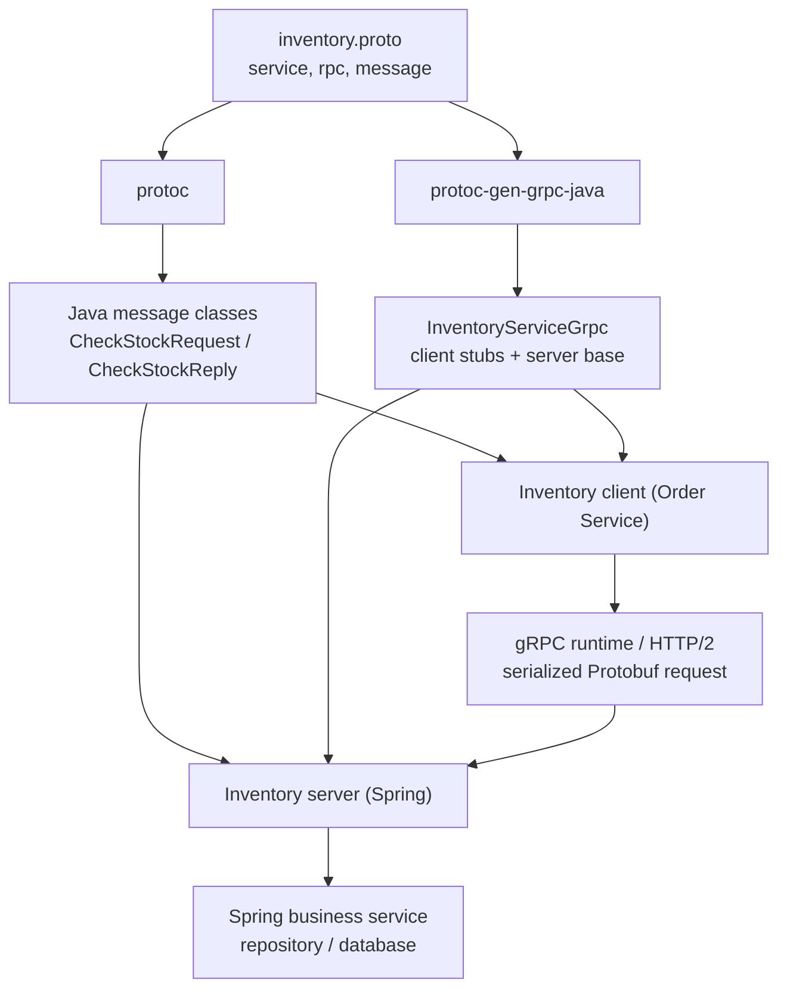
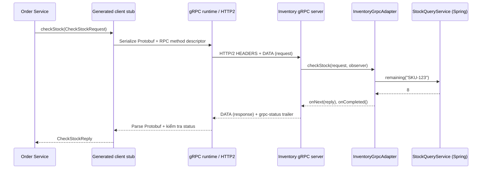

# Luồng từ file proto đến mã client và server

Khi xây dựng một hệ thống **SPRING_GRPC**, bạn không cần tự viết phần lớn mã chuyển request Java thành dữ liệu mạng, định tuyến đến phương thức phía server rồi giải mã response. Thay vào đó, bạn mô tả giao diện trong một file **Protocol Buffers** (`.proto`), dùng công cụ sinh mã Java và triển khai phần nghiệp vụ dựa trên API đã sinh. Đây là điểm khởi đầu của cách phát triển gRPC theo hợp đồng.

Bài nằm trong chương **Nhập môn** và giải thích **toàn bộ luồng từ file `.proto` đến mã client và server** trong hệ sinh thái Spring. Sau khi hiểu luồng này, người học có thể tiếp tục với unary/streaming RPC, metadata, deadline, status, interceptor, TLS, kiểm thử tích hợp và giám sát độ tin cậy. Ví dụ dùng một Order Service gọi Inventory Service để kiểm tra tồn kho; tên package và đường dẫn dự án chỉ có tính minh họa.

## 1. Bức tranh tổng thể: từ hợp đồng đến một RPC chạy được

Giả sử **Order Service** cần hỏi **Inventory Service**: “Mã hàng `SKU-123` còn ít nhất hai sản phẩm không?”. Hai ứng dụng Spring chạy riêng, cần thống nhất cách đặt tên method và kiểu dữ liệu request/response.

Luồng triển khai thường là:



Sơ đồ có hai đầu ra quan trọng:

1. **Mã message** từ Protobuf compiler (`protoc`): tạo các lớp biểu diễn cấu trúc dữ liệu và cung cấp chức năng serialize/parse.
2. **Mã RPC** từ plugin sinh mã gRPC Java (`protoc-gen-grpc-java`): tạo lớp mô tả gRPC service, client stub và lớp cơ sở để server triển khai method.

Khi hai nhóm dùng chung contract tương thích, client và server có thể sinh mã độc lập. Sinh mã giúp đảm bảo giao diện **đúng về tên và kiểu ở mức biên dịch**, nhưng không tự đảm bảo server đang chạy, kết nối mạng hoạt động hoặc quy tắc nghiệp vụ được triển khai đúng.

## 2. Bước 1 — Viết file `.proto` làm nguồn hợp đồng

Trong một dự án Java, vị trí quen thuộc của file proto là:

```text
inventory-service/
  src/
    main/
      proto/
        inventory/
          v1/
            inventory.proto
```

Bạn có thể dùng một module riêng để quản lý contract và phát hành cho cả server lẫn client. Vị trí cụ thể do cấu hình build quyết định; các plugin thông dụng thường mặc định quét `src/main/proto`.

Nội dung `inventory.proto`:

```protobuf
syntax = "proto3";

package commerce.inventory.v1;

option java_package = "com.example.inventory.grpc";
option java_multiple_files = true;

service InventoryService {
  rpc CheckStock(CheckStockRequest) returns (CheckStockReply);

  rpc WatchStock(WatchStockRequest) returns (stream StockUpdate);
}

message CheckStockRequest {
  string sku = 1;
  int32 requested_quantity = 2;
}

message CheckStockReply {
  bool available = 1;
  int32 remaining_quantity = 2;
}

message WatchStockRequest {
  string sku = 1;
}

message StockUpdate {
  string sku = 1;
  int32 remaining_quantity = 2;
}
```

### Đọc từng phần của hợp đồng

| Thành phần | Ý nghĩa | Tác động đến mã được sinh |
| --- | --- | --- |
| `syntax = "proto3"` | Chọn cú pháp Protobuf phiên bản proto3 | Compiler hiểu quy tắc khai báo trường, message và service |
| `package commerce.inventory.v1` | Namespace của contract, phân biệt service giữa các API | Tên đầy đủ của service là `commerce.inventory.v1.InventoryService` |
| `java_package` | Package Java cho mã Protobuf/gRPC được sinh | Các class Java ở `com.example.inventory.grpc` |
| `java_multiple_files = true` | Cho phép tạo các class Java top-level riêng cho message | Có các class như `CheckStockRequest` và `CheckStockReply` |
| `service InventoryService` | Gom các RPC method có liên quan | Plugin gRPC Java sinh lớp `InventoryServiceGrpc` |
| `rpc CheckStock(...) returns (...)` | Một request, một response | API unary RPC |
| `returns (stream StockUpdate)` | Server trả nhiều message cho một request | API server-streaming RPC |
| `string sku = 1` | Trường với kiểu và **số field** trên wire | Getter/setter trong builder và logic serialize/parse |

**Lưu ý về package:** tên service dùng ở lớp gRPC dựa trên **Protobuf package** và tên service; `java_package` chỉ điều khiển package của mã Java. Đổi `java_package` không đồng nghĩa đổi service path trên mạng.

Với ví dụ này, đường dẫn method unary trên gRPC/HTTP2 là:

```text
/commerce.inventory.v1.InventoryService/CheckStock
 \__________________________________/ \________/
              service                 method
```

Đường dẫn này không phải endpoint REST được đặt tùy ý. Client stub và server handler do cùng contract sinh ra sẽ thống nhất tên method tương ứng.

### Schema định nghĩa cấu trúc, không định nghĩa toàn bộ nghiệp vụ

`CheckStockRequest` nói rằng `sku` là chuỗi và `requested_quantity` là số nguyên 32-bit. Nó **không tự bắt buộc** SKU tồn tại hay số lượng phải dương. Server còn phải validate dữ liệu và quyết định “không đủ hàng” nên được trả như một response hợp lệ hay một lỗi theo hợp đồng.

Số field như `1` và `2` là thành phần của wire format. Khi sửa API, không đổi ý nghĩa hoặc tái sử dụng số trường cũ tùy tiện; thường cần dành lại số của field đã xóa bằng `reserved` và kiểm tra tính tương thích với các phiên bản client đang hoạt động.

## 3. Bước 2 — Công cụ `protoc` và plugin gRPC Java làm việc gì?

Một file `.proto` được đưa qua **hai hướng sinh mã** trong hệ sinh thái gRPC Java:

```text
inventory.proto
    |
    +--> protoc --java_out=...
    |       |
    |       +--> CheckStockRequest.java
    |       +--> CheckStockReply.java
    |       +--> WatchStockRequest.java
    |       +--> StockUpdate.java
    |       +--> các descriptor/outer class khác
    |
    +--> protoc + protoc-gen-grpc-java
            |
            +--> InventoryServiceGrpc.java
                    +--> method descriptors
                    +--> client stub types
                    +--> server implementation base
```

**`protoc`** là compiler của Protocol Buffers. Nó phân tích hợp đồng và sinh Java message class khi được yêu cầu bằng `--java_out`. Công cụ này cũng có thể tạo mã cho ngôn ngữ khác bằng plugin/output tương ứng.

**`protoc-gen-grpc-java`** là plugin sinh mã riêng của gRPC Java. Nó nhận thông tin service/method trong file proto qua cơ chế plugin của protoc và sinh mã phục vụ việc thực thi RPC. Tên flag thường gặp là `--grpc-java_out`.

### Vì sao cần cả hai?

Chỉ sinh Protobuf message class thì bạn có thể tạo và parse `CheckStockRequest`, nhưng chưa có `InventoryServiceGrpc` và các stub để gọi method từ xa.

Chỉ có lớp mô tả RPC mà thiếu message class/runtime phụ thuộc thì mã Java không thể biên dịch hoặc vận hành đầy đủ. **Mã dữ liệu và mã RPC là hai phần bổ sung cho nhau.**

### Một lệnh sinh mã minh họa

Khi `protoc` và executable `protoc-gen-grpc-java` đã được cài, có thể chạy các công cụ trên hợp đồng bằng lệnh khái niệm sau:

```bash
protoc \
  -I=src/main/proto \
  --java_out=build/generated/source/proto/main/java \
  --grpc-java_out=build/generated/source/proto/main/grpc \
  src/main/proto/inventory/v1/inventory.proto
```

Đây là ví dụ để **hiểu đầu vào/đầu ra**. Các thư mục output phải tồn tại hoặc do hệ thống build tạo, plugin `protoc-gen-grpc-java` phải nằm trên PATH hoặc được chỉ rõ bằng `--plugin`. Trên Windows, cách xuống dòng và đường dẫn executable khác với shell Unix; thực tế nên để Maven/Gradle chạy code generation để thống nhất môi trường.

Không nên tự sửa những file `.java` trong thư mục generated: lần build tiếp theo có thể sinh lại và xóa toàn bộ sửa đổi. Muốn đổi method hoặc message, hãy **sửa `.proto` rồi sinh mã lại**.

## 4. Bước 3 — Kết nối code generation với quá trình build

Trong dự án Spring dùng Gradle hoặc Maven, luồng sinh mã cần chạy trước biên dịch Java:

```text
Đọc .proto
   |
   v
Resolve protoc + grpc-java plugin
   |
   v
Generate Java sources
   |
   v
Đưa generated folders vào Java source set
   |
   v
Compile Java (cùng grpc/protobuf dependencies)
   |
   v
Package ứng dụng / thư viện client contract
```

Các dependency liên quan thuộc ba nhóm khác nhau:

| Nhóm | Ví dụ artifact | Vai trò |
| --- | --- | --- |
| Compiler | `com.google.protobuf:protoc` | Sinh Java message từ `.proto` |
| Codegen plugin | `io.grpc:protoc-gen-grpc-java` | Sinh `*Grpc.java` cho service/stub |
| Runtime | `com.google.protobuf:protobuf-java`, `io.grpc:grpc-protobuf`, `io.grpc:grpc-stub`, transport như `grpc-netty-shaded` | Chạy mã sinh, trao đổi RPC qua mạng |

Trong một số môi trường, các artifact quản lý bởi BOM hoặc dependency management; hãy chọn phiên bản tương thích theo hướng dẫn của stack đang dùng. **Version của compiler, plugin và runtime cần được quản lý có chủ đích**, tránh lấy phiên bản mới nhất của từng thành phần một cách độc lập rồi giả định chúng luôn tương thích.

### 4.1. Ví dụ cấu hình Gradle Groovy DSL

Đoạn sau minh họa trách nhiệm của plugin và các dependency. Các chỗ `<...>` là **giá trị cần điền theo phiên bản dự án**, không phải mã sẵn sàng chạy nguyên văn:

```groovy
plugins {
    id 'java'
    id 'com.google.protobuf' version '<protobuf-gradle-plugin-version>'
}

dependencies {
    implementation 'com.google.protobuf:protobuf-java:<protobuf-version>'
    implementation 'io.grpc:grpc-protobuf:<grpc-version>'
    implementation 'io.grpc:grpc-stub:<grpc-version>'
    implementation 'io.grpc:grpc-netty-shaded:<grpc-version>'
}

protobuf {
    protoc {
        artifact = 'com.google.protobuf:protoc:<protobuf-version>'
    }
    plugins {
        grpc {
            artifact = 'io.grpc:protoc-gen-grpc-java:<grpc-version>'
        }
    }
    generateProtoTasks {
        all().configureEach { task ->
            task.plugins {
                grpc {}
            }
        }
    }
}
```

Với cấu hình Gradle Protobuf plugin phù hợp, task tạo message và gRPC Java source sẽ được tích hợp vào chu trình Java build. Một cấu trúc output thường thấy:

```text
build/generated/source/proto/main/
  java/
    com/example/inventory/grpc/
      CheckStockRequest.java
      CheckStockReply.java
      WatchStockRequest.java
      StockUpdate.java
      ...
  grpc/
    com/example/inventory/grpc/
      InventoryServiceGrpc.java
```

Tên và đường dẫn output có thể khác khi dùng plugin/build tool khác. Quan trọng là **Java compiler nhận được cả thư mục message classes và thư mục gRPC service classes**.

### 4.2. Với Maven, bản chất cũng tương tự

Trong Maven, một plugin sinh Protobuf Java cần gọi `protoc`, plugin gRPC Java cần chạy đầu ra service, và cả hai phần source generated phải được đưa vào bước `compile`. Nhiều dự án sử dụng `protobuf-maven-plugin` hoặc công cụ tương đương. Dù dùng cách nào, quy tắc bất biến là:

1. Build tìm được `.proto` và các import phụ thuộc.
2. Chạy `protoc` với compiler/plugin version phù hợp.
3. Sinh message classes và gRPC service classes.
4. Compile mã sinh cùng gRPC/Protobuf runtime dependency.
5. Package server hoặc client sử dụng các kiểu có cùng contract.

Đừng coi thư mục generated là nguồn hợp đồng: **`.proto` mới là nguồn cần review và quản lý phiên bản**.

## 5. Bước 4 — Nhận diện chính xác mã Java đã sinh

Khi code generation thành công, bạn thường thấy các kiểu sau:

| Kiểu sinh ra | Dùng ở phía nào? | Vai trò |
| --- | --- | --- |
| `CheckStockRequest` | Cả client và server | Chứa request, có `newBuilder()`, getter và serialize/parse |
| `CheckStockReply` | Cả hai | Chứa response, có builder/getter và serialize/parse |
| `WatchStockRequest` / `StockUpdate` | Cả hai | Chứa message cho server-streaming |
| `InventoryServiceGrpc` | Cả hai | Chứa tên service, method descriptor, stub factory, server base |
| `InventoryServiceGrpc.InventoryServiceBlockingStub` | Client | API gọi unary chặn luồng; một số dạng server-streaming có iterator |
| `InventoryServiceGrpc.InventoryServiceStub` | Client | API bất đồng bộ, cần thiết với streaming |
| `InventoryServiceGrpc.InventoryServiceFutureStub` | Client | API future cho unary |
| `InventoryServiceGrpc.InventoryServiceImplBase` | Server | Lớp cơ sở để hiện thực method khi dùng API gRPC Java sinh mã kiểu quen thuộc |

Tên một số API có thể thay đổi giữa các thế hệ gRPC Java; ví dụ cách bind handler server hoặc tên lớp base có thể phụ thuộc phiên bản generator. Khi gặp khác biệt, kiểm tra **mã vừa sinh từ dự án hiện tại** thay vì sao chép tên class từ một tutorial phiên bản cũ.

### 5.1. Message Java là lớp dữ liệu được sinh

Ví dụ client tạo request:

```java
CheckStockRequest request = CheckStockRequest.newBuilder()
    .setSku("SKU-123")
    .setRequestedQuantity(2)
    .build();
```

Server đọc dữ liệu:

```java
String sku = request.getSku();
int quantity = request.getRequestedQuantity();
```

Với message dùng Protobuf Java, object kết quả là dạng **immutable**; builder chịu trách nhiệm xây dựng giá trị. Setter trên builder có kiểu Java tương ứng với field trong proto. Ví dụ `int32` sinh giá trị kiểu `int`, còn `string` sinh `String`.

### 5.2. Method Java và tên method trên mạng

Hợp đồng khai báo:

```protobuf
rpc CheckStock(CheckStockRequest) returns (CheckStockReply);
```

Phía client Java thông thường gọi:

```java
CheckStockReply reply = stub.checkStock(request);
```

Tên method trong `.proto` là `CheckStock`, còn tên Java là `checkStock` theo quy ước code generation. Trên đường truyền, method được định danh là:

```text
/commerce.inventory.v1.InventoryService/CheckStock
```

Nhờ vậy, client không cần tự ghép URL, đặt HTTP method hay parse HTTP/2 trailers để định tuyến. gRPC runtime làm việc này bằng các descriptor đã sinh.

### 5.3. Những gì generator không tạo sẵn

Codegen **không tạo** một hệ thống bán hàng hoàn chỉnh. Bạn vẫn phải viết:

- Logic kiểm tra tồn kho, transaction và truy cập database.
- Validation đầu vào, mapping lỗi nghiệp vụ sang gRPC status.
- Cấu hình server endpoint, TLS/credentials và các chính sách truy cập.
- Client lifecycle, deadline, retry có kiểm soát, quan sát và shutdown.
- Kiểm thử hợp đồng, kiểm thử tích hợp và quản lý tương thích phiên bản.

Generator chỉ đảm bảo bộ khung giao tiếp theo hợp đồng được tạo thống nhất.

## 6. Bước 5 — Triển khai server handler từ lớp sinh ra

Inventory Service là **server** của cuộc gọi `CheckStock`. Với Java, handler thường override phương thức từ `InventoryServiceImplBase`, rồi gọi một Spring service xử lý nghiệp vụ.

Ví dụ service truy vấn tồn kho:

```java
package com.example.inventory.application;

import java.util.Map;
import org.springframework.stereotype.Service;

@Service
public class StockQueryService {
    private final Map<String, Integer> stock = Map.of(
        "SKU-123", 8,
        "SKU-456", 0
    );

    public int remaining(String sku) {
        return stock.getOrDefault(sku, 0);
    }
}
```

Đây là dữ liệu trong bộ nhớ để tập trung vào gRPC. Trong hệ thống thật, lớp nghiệp vụ thường gọi repository/database; cần phân biệt SKU không tồn tại với số lượng bằng 0 nếu hợp đồng yêu cầu.

Server adapter:

```java
package com.example.inventory.transport;

import com.example.inventory.application.StockQueryService;
import com.example.inventory.grpc.CheckStockReply;
import com.example.inventory.grpc.CheckStockRequest;
import com.example.inventory.grpc.InventoryServiceGrpc;
import io.grpc.Status;
import io.grpc.stub.StreamObserver;
import org.springframework.stereotype.Component;

@Component
public class InventoryGrpcAdapter
        extends InventoryServiceGrpc.InventoryServiceImplBase {

    private final StockQueryService stockQuery;

    public InventoryGrpcAdapter(StockQueryService stockQuery) {
        this.stockQuery = stockQuery;
    }

    @Override
    public void checkStock(
            CheckStockRequest request,
            StreamObserver<CheckStockReply> observer) {

        if (request.getSku().isBlank()
                || request.getRequestedQuantity() <= 0) {
            observer.onError(
                Status.INVALID_ARGUMENT
                    .withDescription("SKU và số lượng phải hợp lệ")
                    .asRuntimeException());
            return;
        }

        final int remaining;
        try {
            remaining = stockQuery.remaining(request.getSku());
        } catch (RuntimeException ex) {
            observer.onError(
                Status.INTERNAL
                    .withDescription("Không thể truy vấn tồn kho")
                    .asRuntimeException());
            return;
        }

        CheckStockReply response = CheckStockReply.newBuilder()
            .setAvailable(remaining >= request.getRequestedQuantity())
            .setRemainingQuantity(remaining)
            .build();

        observer.onNext(response);
        observer.onCompleted();
    }
}
```

### Vì sao phương thức server nhận `StreamObserver`?

Phía server gRPC Java sử dụng `StreamObserver<CheckStockReply>` để **phát response và tín hiệu kết thúc**. Với unary thành công:

1. `observer.onNext(response)` gửi một response.
2. `observer.onCompleted()` báo đã hoàn tất RPC.

Với lỗi:

1. `observer.onError(status.asRuntimeException())` báo kết thúc RPC bằng lỗi.
2. Sau `onError(...)` **không** được tiếp tục gọi `onNext(...)` hoặc `onCompleted()` cho cùng RPC.

Ví dụ trả `available = false` khi hàng không đủ vẫn có thể là một RPC **thành công** với status `OK`. Ngược lại, đầu vào không hợp lệ có thể trả `INVALID_ARGUMENT`.

**Phân biệt vai trò:** `InventoryGrpcAdapter` là gRPC server handler; `StockQueryService` là Spring bean nghiệp vụ. Việc được gắn `@Component` chỉ giúp Spring tạo và inject adapter, **chưa đủ bảo đảm gRPC runtime đã đăng ký adapter đó**.

### Đăng ký server bằng API gRPC Java thuần

Một cách minh họa việc xuất bản handler là:

```java
import io.grpc.Server;
import io.grpc.ServerBuilder;

// adapter là một InventoryGrpcAdapter đã được khởi tạo.
Server server = ServerBuilder.forPort(9090)
    .addService(adapter)
    .build()
    .start();
```

Lời gọi `addService(adapter)` đăng ký phương thức gRPC của handler vào server. Trong ứng dụng Spring Boot thực tế, hãy quản lý server theo lifecycle Spring hoặc dùng gRPC starter phù hợp. Khi dùng starter, cách khai báo handler, cổng và security có thể khác giữa các thư viện/phiên bản; đừng gắn ngẫu nhiên một annotation không thuộc stack đang dùng.

Trong môi trường production còn cần xử lý graceful shutdown, TLS và giới hạn tài nguyên. Server gRPC ở đây **không phải** Spring MVC `@RestController`; cùng một Spring application có thể phục vụ cả HTTP REST và gRPC nếu được cấu hình.

## 7. Bước 6 — Tạo client stub và gọi server

Order Service là **client** của Inventory Service. Nó cần channel kết nối và một stub được sinh từ contract.

Đoạn Java độc lập để minh họa cơ chế gọi:

```java
import com.example.inventory.grpc.CheckStockReply;
import com.example.inventory.grpc.CheckStockRequest;
import com.example.inventory.grpc.InventoryServiceGrpc;
import io.grpc.ManagedChannel;
import io.grpc.ManagedChannelBuilder;
import io.grpc.StatusRuntimeException;
import java.util.concurrent.TimeUnit;

ManagedChannel channel = ManagedChannelBuilder
    .forAddress("localhost", 9090)
    .usePlaintext() // Chỉ dùng trong thử nghiệm cục bộ có kiểm soát
    .build();

try {
    var stub = InventoryServiceGrpc.newBlockingStub(channel)
        .withDeadlineAfter(700, TimeUnit.MILLISECONDS);

    CheckStockRequest request = CheckStockRequest.newBuilder()
        .setSku("SKU-123")
        .setRequestedQuantity(2)
        .build();

    CheckStockReply response = stub.checkStock(request);

    System.out.println("Đủ hàng: " + response.getAvailable());
    System.out.println("Còn trong kho: " + response.getRemainingQuantity());
} catch (StatusRuntimeException ex) {
    System.err.println("gRPC status: " + ex.getStatus().getCode());
} finally {
    channel.shutdown();
}
```

Các dòng quan trọng:

| Mã | Trách nhiệm |
| --- | --- |
| `ManagedChannelBuilder.forAddress(...)` | Cho runtime biết địa chỉ dịch vụ cần kết nối |
| `InventoryServiceGrpc.newBlockingStub(channel)` | Tạo client stub từ lớp gRPC service được sinh |
| `CheckStockRequest.newBuilder()` | Tạo message đúng schema Protobuf |
| `withDeadlineAfter(...)` | Giới hạn thời gian lời gọi được sử dụng với stub |
| `stub.checkStock(request)` | Thực thi method từ xa qua gRPC runtime |
| `StatusRuntimeException` | Cách blocking stub Java thể hiện lỗi RPC |
| `channel.shutdown()` | Yêu cầu đóng channel và giải phóng tài nguyên theo lifecycle phù hợp |

Lưu ý `700 ms` chỉ là minh họa; deadline cần xuất phát từ ngân sách độ trễ của toàn luồng nghiệp vụ. `usePlaintext()` không phù hợp cho mạng production; khi triển khai cần TLS và chính sách xác thực/phân quyền.

### Channel và stub khác nhau như thế nào?

**Channel** quản lý đường giao tiếp và tài nguyên kết nối. **Stub** là giao diện client cho một service, sử dụng channel để gửi lời gọi. Bạn có thể tạo nhiều stub cho các service và dùng chung một channel phù hợp, hoặc tạo biến thể stub với deadline/credentials khác nhau.

Trong Spring, nên quản lý channel bằng bean/lifecycle để **tái sử dụng**; việc khởi tạo channel rồi shutdown cho mỗi HTTP request là không hiệu quả. Ví dụ độc lập trên chỉ nhằm cho thấy cấu trúc của một lời gọi đầy đủ.

### Một client Spring có thể được tổ chức ra sao?

Ở tầng ứng dụng, có thể tạo một gateway bọc stub:

```java
package com.example.order.integration;

import com.example.inventory.grpc.CheckStockReply;
import com.example.inventory.grpc.CheckStockRequest;
import com.example.inventory.grpc.InventoryServiceGrpc;
import java.util.concurrent.TimeUnit;
import org.springframework.stereotype.Component;

@Component
public class InventoryGateway {
    private final InventoryServiceGrpc.InventoryServiceBlockingStub stub;

    public InventoryGateway(
            InventoryServiceGrpc.InventoryServiceBlockingStub stub) {
        this.stub = stub;
    }

    public boolean hasEnoughStock(String sku, int units) {
        CheckStockReply reply = stub
            .withDeadlineAfter(700, TimeUnit.MILLISECONDS)
            .checkStock(CheckStockRequest.newBuilder()
                .setSku(sku)
                .setRequestedQuantity(units)
                .build());
        return reply.getAvailable();
    }
}
```

Đoạn code giả định bạn đã cấu hình một **Spring bean cho stub** (thông qua starter hoặc `@Configuration` tự viết). `InventoryGateway` tập trung vào chuyển dữ liệu giữa Order Service và gRPC contract. Nó không nên tự tạo channel trên mỗi lần gọi. Ở tầng cao hơn, ứng dụng sẽ phân biệt `false` (hàng không đủ) với lỗi gRPC khiến việc kiểm tra chưa hoàn tất.

## 8. Bước 7 — Từ method Java đến dữ liệu trên mạng

Khi client gọi `stub.checkStock(request)`, luồng vận hành thực tế:



Ba lớp cùng hoạt động:

- **Protobuf** mô tả kiểu message và mã hóa nội dung request/response thành byte.
- **gRPC** biết service/method, đóng khung message, gọi handler và xử lý metadata/deadline/status.
- **HTTP/2** truyền headers, DATA và trailers qua stream trên connection.

Lời gọi từ xa vẫn có độ trễ và có thể thất bại. Việc có generated stub **không làm lời gọi mạng trở thành lời gọi cục bộ an toàn tuyệt đối**.

### Những thứ được truyền qua mạng và những thứ không được truyền

Được truyền:

1. Tên service/method để server định tuyến.
2. Message Protobuf đã serialize.
3. Metadata của RPC, ví dụ token hoặc trace context.
4. Status, thông điệp trả về và thông tin kết thúc stream.

Không được truyền:

- Đối tượng Java `ManagedChannel` hoặc `StreamObserver` như những object có thể dùng trực tiếp ở tiến trình khác.
- Spring bean `StockQueryService` hoặc logic SQL trong class của nó.
- Toàn bộ file `.proto` vào mỗi request. Client/server đã dùng schema và generated code để biết cách xử lý message.

Đây là lý do cả client lẫn server phải có **code và contract tương thích** trước khi giao tiếp, thay vì mong server tự hiểu bất kỳ Java object nào đi qua mạng.

## 9. Unary và streaming ảnh hưởng thế nào đến mã được sinh?

Những chữ ký method trong `.proto` quyết định **hình dạng API** ở phía Java.

```protobuf
service ExampleService {
  rpc GetOne(In) returns (Out);
  rpc Subscribe(In) returns (stream Out);
  rpc Upload(stream In) returns (Out);
  rpc Exchange(stream In) returns (stream Out);
}

message In {
  string value = 1;
}

message Out {
  string value = 1;
}
```

| Kiểu RPC | Client gửi | Server gửi | Mã Java sinh ra cần hỗ trợ |
| --- | --- | --- | --- |
| Unary (`GetOne`) | Một request | Một response | Blocking/async/future stub; server handler trả một response |
| Server streaming (`Subscribe`) | Một request | Nhiều response | Client nhận chuỗi/callback; server gửi nhiều lần qua response observer |
| Client streaming (`Upload`) | Nhiều request | Một response | Client có request observer để gửi nhiều message; server nhận stream |
| Bidirectional streaming (`Exchange`) | Nhiều request | Nhiều response | Hai phía chủ động gửi/nhận trong cùng RPC |

Với plugin gRPC Java thường dùng:

- Unary server handler có chữ ký tương tự `void getOne(In request, StreamObserver<Out> observer)`.
- Server-streaming handler cũng có `StreamObserver<Out>` nhưng có thể gọi `onNext` nhiều lần.
- Client-streaming/bidirectional-streaming server handler thường trả về `StreamObserver<In>` để nhận lần lượt request, đồng thời nhận một `StreamObserver<Out>` dùng gửi response.
- Async stub cho phép sử dụng `StreamObserver`; blocking stub chỉ cung cấp các phương thức đồng bộ phù hợp với unary và server streaming.

### Ví dụ server-streaming trong contract của bài

Method `WatchStock` ở phần 2 được tạo để client đăng ký nhận cập nhật tồn kho:

```java
// Ví dụ xử lý phía server khi có chuỗi cập nhật hữu hạn.
@Override
public void watchStock(
        WatchStockRequest request,
        StreamObserver<StockUpdate> observer) {
    observer.onNext(StockUpdate.newBuilder()
        .setSku(request.getSku())
        .setRemainingQuantity(8)
        .build());
    observer.onNext(StockUpdate.newBuilder()
        .setSku(request.getSku())
        .setRemainingQuantity(7)
        .build());
    observer.onCompleted();
}
```

Đây là dữ liệu giả lập để minh họa **một RPC trả hai message**. Trong thực tế cần nguồn sự kiện, kiểm soát cancellation, flow control, an toàn đồng thời, giới hạn tuổi thọ stream và xử lý lỗi. Khi chạy streaming, một RPC có thể tồn tại lâu nhưng không tự đảm bảo lưu bền hoặc phát lại event.

## 10. Tổ chức contract khi có nhiều ứng dụng Spring

Trong hệ thống nhiều service, contract thường cần được quản lý độc lập với business implementation:

```text
repo/
  inventory-contract/
    src/main/proto/inventory/v1/inventory.proto
  inventory-server/
    src/main/java/.../InventoryGrpcAdapter.java
    src/main/java/.../StockQueryService.java
  order-service/
    src/main/java/.../InventoryGateway.java
```

Có hai cách phân phối phổ biến:

**Cách A — Đóng gói mã sinh dùng chung:** module contract sinh message + gRPC classes và publish thành Java library. Server và client Java cùng phụ thuộc version đó. Đây là hướng tiện khi các ứng dụng cùng dùng JVM và cùng quy trình phát hành artifact.

**Cách B — Phân phối file `.proto`/descriptor:** mỗi ngôn ngữ hoặc dự án sinh mã từ contract đã được version hóa. Thích hợp với nhiều ngôn ngữ, miễn các phiên bản hợp đồng tương thích.

Điểm cần quản trị ở cả hai cách:

1. **Nguồn sự thật:** xác định repo/package nào sở hữu file `.proto`.
2. **Version:** phân biệt thay đổi bổ sung tương thích và thay đổi làm hỏng client cũ.
3. **CI:** build phải chạy codegen và kiểm tra mã sinh biên dịch thành công; có thể thêm kiểm tra tương thích schema.
4. **Release:** server và client có thể triển khai ở thời điểm khác nhau; tránh chỉ làm API chạy được khi cả hai nâng cấp đồng thời.
5. **Review:** thay đổi field number, method signature hoặc ý nghĩa nghiệp vụ cần được đánh giá như thay đổi API.

Không nên copy thủ công các file `*Grpc.java` rồi chỉnh sửa riêng trên mỗi dự án: chúng sẽ nhanh chóng lệch khỏi contract và khó nâng cấp.

## 11. Khi đổi `.proto`, điều gì xảy ra với client và server?

Giả sử bạn thêm một trường vào request:

```protobuf
message CheckStockRequest {
  string sku = 1;
  int32 requested_quantity = 2;
  string warehouse_id = 3;
}
```

Sau khi chạy lại code generation:

- Java request builder có thêm `setWarehouseId(...)` và getter tương ứng.
- Client mới có thể gửi `warehouse_id`.
- Server mới có thể đọc field đó để chọn kho.
- Client cũ thường không biết trường mới; server phải cân nhắc hành vi khi trường vắng mặt hoặc nhận giá trị mặc định.

Việc **thêm trường mới với số mới** thường an toàn hơn thay đổi kiểu/số hoặc xóa field đã được dùng; tuy nhiên, tính tương thích **ngữ nghĩa** vẫn phải được xem xét. Nếu server mới bắt buộc `warehouse_id` cho mọi request trong khi client cũ không gửi trường này, dù Protobuf parse thành công, nghiệp vụ vẫn có thể hỏng.

### Những sửa đổi cần đặc biệt thận trọng

| Thay đổi | Tác động tiềm ẩn |
| --- | --- |
| Thêm field với số mới | Thường có thể duy trì tương thích wire, cần kiểm tra default và nghiệp vụ |
| Tái sử dụng số field đã xóa | Client cũ có thể hiểu dữ liệu mới theo ý nghĩa cũ; cần tránh |
| Đổi tên `service` hoặc `rpc method` | Làm thay đổi định danh RPC trên mạng, có thể gây `UNIMPLEMENTED` |
| Đổi `package` của Protobuf service | Đổi tên đầy đủ của service/method, ảnh hưởng định tuyến |
| Đổi `java_package` | Đổi vị trí class Java trong source; có thể gây lỗi biên dịch dù wire service vẫn như cũ |
| Đổi kiểu request/response của method | Cần đánh giá kỹ tương thích cả client/server và serialization |
| Thêm method | Client mới phải biết server nào đã triển khai method trước khi gọi |

Vì thế pipeline code generation cần kết hợp quy tắc **schema evolution**, kế hoạch rollout và kiểm thử client cũ/server mới khi phù hợp.

## 12. Những lỗi thường gặp trong pipeline và cách khoanh vùng

### Lỗi 1 — Không tìm thấy `CheckStockRequest` khi compile

Khả năng:

- Task generate Java Protobuf chưa chạy.
- `src/main/proto` chưa được quét hoặc file `.proto` không ở đường dẫn build mong đợi.
- Generated folder chưa được thêm vào Java source set.
- Source code import sai package sau khi sửa `java_package`.

**Cách kiểm tra:** xác minh output Java message từ compiler và đối chiếu package đã cấu hình. Nếu chỉ có `InventoryServiceGrpc.java` mà thiếu message class, kiểm tra cả hai bước codegen.

### Lỗi 2 — Có message class nhưng không có `InventoryServiceGrpc`

Khả năng: cấu hình mới chạy `protoc --java_out` mà **chưa bật plugin gRPC Java**. Protobuf compiler sinh message, nhưng không tự sinh service stub gRPC Java nếu thiếu plugin phù hợp.

**Cách kiểm tra:** xác nhận artifact `protoc-gen-grpc-java`, task `generateProto` và đầu ra `grpc` đã được cấu hình.

### Lỗi 3 — Không tìm thấy package `io.grpc` hoặc `com.google.protobuf`

Mã sinh tồn tại nhưng Java compile thiếu runtime dependency hoặc có phiên bản xung đột. Kiểm tra `grpc-stub`, `grpc-protobuf`, `protobuf-java` và transport runtime phù hợp. Lưu ý runtime dependency **khác** compiler/plugin codegen dependency.

### Lỗi 4 — Client gặp `UNIMPLEMENTED`

Ví dụ client gọi `/commerce.inventory.v1.InventoryService/CheckStock` nhưng server không đăng ký handler, triển khai từ contract khác hoặc chưa override method. Trong gRPC Java, một method ở lớp base chưa triển khai có thể trả `UNIMPLEMENTED`.

**Cách kiểm tra:** tên package/service/method, generated stub version, server registration, handler implementation và endpoint client thật sự kết nối.

### Lỗi 5 — Client gặp `UNAVAILABLE` hoặc lỗi kết nối/TLS

Đây thường là vấn đề **vận chuyển/kết nối**: server chưa chạy, sai host/port, DNS/proxy, khác cấu hình plaintext/TLS hoặc service đích không sẵn sàng. Không nên sửa `.proto` ngay khi chưa xác minh đường mạng.

### Lỗi 6 — Server chạy nhưng trả `INVALID_ARGUMENT`

Contract đúng và kết nối hoạt động, nhưng request vi phạm validation nghiệp vụ, ví dụ `requested_quantity = 0`. Đây là **lỗi dữ liệu/logic xử lý** chứ không phải bằng chứng codegen sai.

### Lỗi 7 — Stream không kết thúc hoặc client chờ mãi

Server có thể quên `onCompleted()`/`onError()`, hoặc streaming RPC được thiết kế để sống lâu nhưng client dùng sai API/chưa đặt deadline và cancellation. Kiểm tra vòng đời method, xử lý lỗi, flow control, client observer và cancellation.

### Bảng nhận diện theo giai đoạn

| Dấu hiệu | Nên xem phần nào trước? |
| --- | --- |
| `.proto` không parse được | Cú pháp, import và option Protobuf |
| Mã Java message không xuất hiện | `protoc`, task generate và output dir |
| Không có `*Grpc.java` | Plugin `protoc-gen-grpc-java` |
| Compile báo lỗi class/package | Dependencies, generated source set, `java_package` |
| gRPC server chưa nghe cổng | Server lifecycle, bind port, runtime config |
| `UNIMPLEMENTED` | Service/method name và đăng ký handler |
| `UNAVAILABLE` | Endpoint, kết nối, DNS, TLS, proxy |
| `DEADLINE_EXCEEDED` | Timeout budget, mạng, tải server/downstream |
| `INVALID_ARGUMENT` | Validation request và ngữ nghĩa API |

Chia vấn đề thành **schema → code generation → compile → server registration → transport → business logic** giúp tìm nguyên nhân chính xác và tránh sửa ngẫu nhiên nhiều lớp.

## 13. Kiểm thử luồng sinh mã và client/server

Một hệ thống có codegen thành công vẫn cần chứng minh client và server có thể giao tiếp. Có thể chia kiểm thử thành các lớp:

### 13.1. Kiểm tra contract và code generation

- File `.proto` biên dịch được.
- Cả Java message classes và `*Grpc.java` đều được sinh.
- Mã sinh được Java compiler biên dịch cùng runtime dependencies.
- Thay đổi schema được đánh giá tương thích với các phiên bản đang sử dụng.

### 13.2. Kiểm tra server handler

- Request hợp lệ sinh response với đúng field và gRPC status `OK`.
- Request không hợp lệ trả `INVALID_ARGUMENT` theo contract.
- Nghiệp vụ “hết hàng” có cách biểu diễn nhất quán, ví dụ `available = false`.
- Lỗi xử lý được ánh xạ sang status hợp lý; không lộ chi tiết nhạy cảm của hệ thống.

### 13.3. Kiểm thử tích hợp qua gRPC

Dựng server và client bằng những thư viện gRPC tương ứng rồi gọi `CheckStock` bằng request Protobuf thật, kiểm tra response và status. Với gRPC Java, test **in-process** có thể giúp thử luồng handler và stub mà không mở socket, nhưng **không xác nhận hành vi HTTP/2/TLS/proxy thực tế**.

Trước production nên có kiểm thử qua transport gRPC thật, bao gồm:

- Host/port, HTTP/2 và TLS/mTLS nếu được sử dụng.
- Metadata và interceptor, kiểm tra auth và trace propagation.
- Deadline, cancellation và trường hợp server chậm/không sẵn sàng.
- Streaming, flow control và shutdown của client/server.
- Đo latency, throughput và tỷ lệ lỗi với tải đại diện.

Kết quả độ trễ nên được quan sát theo **service/method**, mã gRPC status và phần trăm vị `p50/p95/p99`. Chỉ đo thời gian của Java business service mà không đo thời gian toàn RPC sẽ bỏ sót network và serialization overhead.

## 14. Checklist làm việc thực tế

Khi tạo một gRPC API mới trong Spring, thực hiện theo thứ tự:

1. **Thiết kế `.proto`:** package, java options, service/method, request/response, field number và streaming cardinality.
2. **Cấu hình compiler và plugin:** `protoc` tạo message classes, `protoc-gen-grpc-java` tạo `*Grpc.java`.
3. **Kết nối build:** Gradle/Maven compile cả generated source folders với đúng runtime dependencies.
4. **Triển khai server handler:** override method được sinh, validate request, gọi Spring business service, trả response/status và kết thúc RPC.
5. **Đăng ký gRPC server:** lắng nghe endpoint, thêm service implementation, cấu hình lifecycle và security.
6. **Tạo client:** quản lý channel, stub, deadline, metadata và mapping lỗi.
7. **Kiểm thử tích hợp:** gọi server thật từ client sinh mã, xác nhận success, invalid request, timeout, unavailable và streaming nếu có.
8. **Phát hành contract và giám sát:** version schema, kiểm tra tương thích, theo dõi latency/status, đảm bảo nâng cấp client/server có thể diễn ra an toàn.

Để tự kiểm tra mức hiểu, hãy thử trả lời:

**Câu 1:** Đã có `CheckStockRequest.java` nhưng không có `InventoryServiceGrpc.java`. Thiếu khâu nào?  
**Gợi ý:** kiểm tra plugin `protoc-gen-grpc-java` và output gRPC.

**Câu 2:** Bạn sửa field `requested_quantity` thành một ý nghĩa mới nhưng giữ nguyên số `2`. Compile vẫn thành công; như vậy đã an toàn chưa?  
**Gợi ý:** codegen không tự kiểm chứng tương thích **ngữ nghĩa** với client cũ.

**Câu 3:** Server có bean `StockQueryService` và class `InventoryGrpcAdapter` nhưng client nhận `UNIMPLEMENTED`. Kiểm tra gì?  
**Gợi ý:** server registration, service/method identity và override method của handler.

**Câu 4:** Khi nào dùng blocking stub, khi nào dùng async stub?  
**Gợi ý:** blocking phù hợp với một số lời gọi unary/server-streaming theo phong cách chặn luồng, còn client/bidirectional streaming thường cần async API. Trong hệ thống reactive phải cân nhắc không chặn event-loop.

## 15. Ghi nhớ

Chuỗi cốt lõi của một dự án **SPRING_GRPC** là:

```text
.proto (contract)
   |
   +--> protoc ------------------> Java message classes
   |
   +--> protoc-gen-grpc-java ---> Java gRPC stubs + server base
                                     |
                            +--------+--------+
                            |                 |
                       Client stub       Server handler
                            |                 |
                       ManagedChannel      Spring service
                            |                 |
                            +---- gRPC / HTTP2+
```

- **File `.proto`** là hợp đồng: định nghĩa **service, method và message**.
- **`protoc`** sinh các lớp biểu diễn/mã hóa message; **plugin gRPC Java** sinh stub, method descriptor và server base.
- **Client** sử dụng stub trên channel để gọi method; **server** đăng ký handler và triển khai nghiệp vụ qua Spring service.
- **gRPC runtime** làm phần truyền thông giữa hai phía; sinh mã không loại bỏ lỗi mạng, deadline, trạng thái hoặc bảo mật.
- **Build và kiểm thử** phải xác minh cả contract, mã sinh, đăng ký handler và đường truyền thực tế.

Nắm rõ luồng này giúp bạn biết phải chỉnh **`.proto`**, cấu hình build, client stub, server handler hay nghiệp vụ Spring khi phát triển hoặc sửa lỗi. Đây cũng là nền tảng để học sâu cách thiết kế Protocol Buffers, viết unary/streaming RPC và vận hành dịch vụ gRPC đáng tin cậy.

### Tài liệu tham khảo

- [gRPC – Introduction](https://grpc.io/docs/what-is-grpc/introduction/)
- [gRPC – Java basics](https://grpc.io/docs/languages/java/basics/)
- [gRPC – Core concepts, architecture and lifecycle](https://grpc.io/docs/what-is-grpc/core-concepts/)
- [Protocol Buffers – Java tutorial](https://protobuf.dev/getting-started/javatutorial/)
- [Protocol Buffers – Proto3 guide](https://protobuf.dev/programming-guides/proto3/)
- [Protocol Buffers Gradle Plugin](https://github.com/google/protobuf-gradle-plugin)
