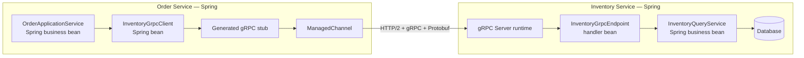
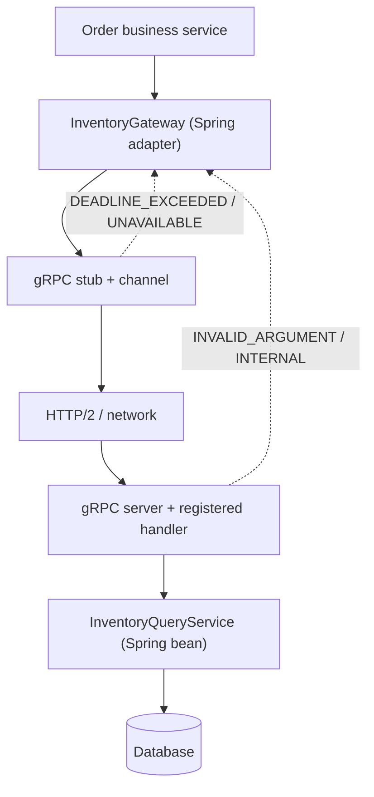

# Spring hỗ trợ quản lý gRPC service ở lớp nào?

Khi xây dựng một dịch vụ gRPC bằng Spring, người học dễ nhầm **gRPC service**, **Spring `@Service`** và **gRPC server** là cùng một đối tượng. Thực tế, chúng thuộc các lớp trách nhiệm khác nhau. **Spring hỗ trợ chủ yếu ở lớp tích hợp và quản lý ứng dụng**: tạo bean, tiêm phụ thuộc, nạp cấu hình, quản lý vòng đời và gắn những thành phần dùng chung như bảo mật, quan sát, kiểm thử. **gRPC runtime** đảm nhiệm lời gọi RPC, định tuyến method, trao đổi message, status và transport. **Protocol Buffers** xác định hợp đồng và mã message được sinh.

Bài thuộc chương **Nhập môn** của module **SPRING_GRPC**. Mục tiêu của module là phát triển client/server gRPC trong hệ sinh thái Spring từ hợp đồng Protocol Buffers, sinh mã Java, phục vụ unary và streaming RPC, rồi xử lý metadata, deadline, status, interceptor, TLS, kiểm thử tích hợp và giám sát hiệu năng, độ tin cậy. Để làm được điều đó, trước tiên cần hiểu Spring giúp quản lý *phần nào* và vẫn cần gRPC cung cấp *phần nào*.

## 1. Câu trả lời trực tiếp: Spring quản lý lớp ứng dụng và tích hợp gRPC

Một ứng dụng Spring Boot có thể chạy gRPC server và gRPC client. Tuy vậy, Spring không thay thế bản thân giao thức gRPC hay công cụ sinh mã Protobuf. Có thể tách thành năm lớp:

| Lớp | Thành phần tiêu biểu | Trách nhiệm chính | Ai đảm nhiệm? |
| --- | --- | --- | --- |
| **Hợp đồng** | `.proto`, `service`, `rpc`, `message` | Định nghĩa method và cấu trúc dữ liệu giữa hai phía | Protocol Buffers và người thiết kế API |
| **Mã sinh** | `*Request`, `*Reply`, `*Grpc`, client stub, server base | Cung cấp kiểu Java và API gọi/triển khai RPC | `protoc` và plugin gRPC Java |
| **Giao tiếp RPC** | `Server`, `ManagedChannel`, `StreamObserver`, method descriptor | Định tuyến, thực thi, truyền message, status, deadline, streaming | gRPC Java runtime |
| **Tích hợp ứng dụng** | Bean, `@Configuration`, DI, lifecycle, application properties | Khởi tạo, cấu hình và kết nối handler/client với nghiệp vụ | Spring / Spring Boot / thư viện tích hợp Spring gRPC |
| **Nghiệp vụ và dữ liệu** | `@Service`, repository, transaction | Kiểm tra tồn kho, thanh toán, áp dụng luật nghiệp vụ | Mã ứng dụng Spring |

Điều cần nhớ: **gRPC service được khai báo trong `.proto`; implementation của service là một handler Java; Spring có thể quản lý handler ấy như một bean.** Khi runtime gRPC đã được cấu hình và đăng ký handler, các method mới thực sự nhận được cuộc gọi từ xa.

## 2. Nhìn toàn cảnh một lời gọi giữa hai ứng dụng Spring

Giả sử Order Service cần hỏi Inventory Service xem còn đủ hàng để đặt đơn không.



Trong kiến trúc này:

1. Spring tạo và tiêm `OrderApplicationService`, `InventoryGrpcClient` và các thành phần nghiệp vụ ở phía gọi.
2. Một client stub được sinh từ `.proto` sử dụng `ManagedChannel` để gọi method gRPC.
3. gRPC runtime nhận request, đọc định danh service/method và chuyển đến handler đã đăng ký.
4. Handler được Spring quản lý có thể inject `InventoryQueryService` để thực hiện nghiệp vụ.
5. Runtime gRPC trả response hoặc status lỗi qua mạng. Spring hỗ trợ lifecycle/configuration của các thành phần, còn serialization và transport thuộc gRPC/Protobuf.

Sơ đồ giúp xác định ranh giới: **Spring quản lý các đối tượng ứng dụng chạy trên gRPC; bản thân gRPC runtime chịu trách nhiệm cho giao thức và vòng đời một RPC cụ thể.**

## 3. Phân biệt ba chữ “service” thường xuất hiện

### 3.1. `service` trong Protobuf là hợp đồng API

Xét `inventory.proto`:

```protobuf
syntax = "proto3";

package commerce.inventory.v1;

option java_package = "com.example.inventory.grpc";
option java_multiple_files = true;

service InventoryService {
  rpc CheckStock(CheckStockRequest) returns (CheckStockReply);
  rpc WatchStock(WatchStockRequest) returns (stream StockUpdate);
}

message CheckStockRequest {
  string sku = 1;
  int32 quantity = 2;
}

message CheckStockReply {
  bool available = 1;
  int32 remaining = 2;
}

message WatchStockRequest {
  string sku = 1;
}

message StockUpdate {
  string sku = 1;
  int32 remaining = 2;
}
```

`InventoryService` định nghĩa một **gRPC service** có hai method. Hợp đồng không chứa logic kho hàng, không khai báo Spring bean và không tự mở socket. Trong quá trình build:

- `protoc` sinh các lớp message như `CheckStockRequest` và `CheckStockReply`.
- Plugin gRPC Java sinh `InventoryServiceGrpc`, các client stub và server implementation base.
- Mã sinh được đưa vào source set để compiler Java biên dịch cùng gRPC runtime dependencies.

Định danh RPC trên mạng cho method `CheckStock` là:

```text
/commerce.inventory.v1.InventoryService/CheckStock
```

Tên trên dựa vào **Protobuf package + tên service + tên method**, không dựa vào `@Service` hoặc tên Spring bean.

### 3.2. `@Service` của Spring đánh dấu một bean nghiệp vụ

Ví dụ Spring bean truy vấn tồn kho:

```java
package com.example.inventory.application;

import java.util.Map;
import org.springframework.stereotype.Service;

@Service
public class InventoryQueryService {
    private final Map<String, Integer> quantities = Map.of(
        "SKU-123", 8,
        "SKU-456", 0
    );

    public int remainingQuantity(String sku) {
        return quantities.getOrDefault(sku, 0);
    }
}
```

Spring tạo instance, quản lý injection và cho phép lớp khác dùng bean `InventoryQueryService`. Annotation `@Service` ở đây **không tự công bố một RPC method**. Nếu không có gRPC server handler đã đăng ký, client không thể gọi `CheckStock` chỉ nhờ bean nghiệp vụ này.

Đây là dữ liệu giả lập trong bộ nhớ; hệ thống thật có thể thay bằng repository/database và phải quyết định phân biệt SKU không tồn tại với SKU có số lượng bằng 0.

### 3.3. gRPC server handler là lớp adapter giao tiếp

Sau khi sinh mã từ file proto, một server adapter có thể kế thừa `InventoryServiceGrpc.InventoryServiceImplBase` và override method `checkStock`. Handler nhận message Protobuf, gọi bean nghiệp vụ, tạo reply rồi thông báo kết thúc RPC.

Đây là cầu nối giữa hai thế giới:

```text
Client gRPC --> gRPC runtime --> Generated service base / handler
                                         |
                                Spring-managed bean
                                         |
                                Spring business service
                                         |
                                       Data
```

Handler có thể được Spring quản lý bằng `@Component` hoặc cơ chế khai báo `@Bean`. Một số thư viện tích hợp còn cung cấp annotation hoặc cơ chế tự đăng ký riêng. **Cách trở thành Spring bean và cách được gRPC server công bố là hai bước logic cần kiểm tra độc lập**, dù starter có thể tự động thực hiện cả hai.

## 4. Spring giúp gì cho vòng đời một gRPC service?

Spring cung cấp **IoC container** và, khi dùng Spring Boot, cơ chế **auto-configuration** tùy dependency đang có. Từ đó có thể giải quyết các việc sau:

| Nhu cầu | Spring có thể hỗ trợ | Điều cần phối hợp với gRPC |
| --- | --- | --- |
| Tạo handler | Phát hiện `@Component`, khai báo `@Bean` | Runtime phải nhận `BindableService`/`ServerServiceDefinition` tương ứng |
| Tiêm nghiệp vụ | Constructor injection của service/repository | Handler gọi logic nghiệp vụ, không cần tự tạo service bằng `new` |
| Khởi động server | Lifecycle bean, cấu hình hoặc starter | gRPC `Server` phải bind port và đăng ký method |
| Đóng server | Destroy callback, lifecycle quản lý shutdown | Chờ RPC phù hợp hoàn tất hoặc hủy theo chính sách |
| Tạo client | `@Configuration`, bean stub/channel hoặc starter | Cấu hình target, resolver, credentials, deadline |
| Cấu hình môi trường | `application.yml`, properties, profiles, biến môi trường | Ánh xạ thành cấu hình server/channel/transport thực |
| Cross-cutting concerns | Beans cho auth, metric, trace và policy | Gắn đúng gRPC server/client interceptor, TLS credentials |
| Kiểm thử | Spring Test context, test configuration, mock nghiệp vụ | Dùng gRPC test server/client để kiểm chứng contract và status |

Một ứng dụng được Spring khởi tạo không có nghĩa server gRPC tự động lắng nghe. **Việc bật server, port, service registration và interceptors phụ thuộc thư viện tích hợp và cấu hình đã chọn.**

## 5. Ví dụ server: handler được Spring inject nghiệp vụ

Từ hợp đồng `InventoryService` ở phần 3, một handler có thể được viết như sau:

```java
package com.example.inventory.transport.grpc;

import com.example.inventory.application.InventoryQueryService;
import com.example.inventory.grpc.CheckStockReply;
import com.example.inventory.grpc.CheckStockRequest;
import com.example.inventory.grpc.InventoryServiceGrpc;
import io.grpc.Status;
import io.grpc.stub.StreamObserver;
import org.springframework.stereotype.Component;

@Component
public class InventoryGrpcEndpoint
        extends InventoryServiceGrpc.InventoryServiceImplBase {

    private final InventoryQueryService inventoryQuery;

    public InventoryGrpcEndpoint(InventoryQueryService inventoryQuery) {
        this.inventoryQuery = inventoryQuery;
    }

    @Override
    public void checkStock(
            CheckStockRequest request,
            StreamObserver<CheckStockReply> observer) {

        if (request.getSku().isBlank() || request.getQuantity() <= 0) {
            observer.onError(Status.INVALID_ARGUMENT
                .withDescription("SKU và số lượng phải hợp lệ")
                .asRuntimeException());
            return;
        }

        final int remaining;
        try {
            remaining = inventoryQuery.remainingQuantity(request.getSku());
        } catch (RuntimeException ex) {
            observer.onError(Status.INTERNAL
                .withDescription("Không thể kiểm tra tồn kho")
                .asRuntimeException());
            return;
        }

        CheckStockReply response = CheckStockReply.newBuilder()
            .setAvailable(remaining >= request.getQuantity())
            .setRemaining(remaining)
            .build();

        observer.onNext(response);
        observer.onCompleted();
    }
}
```

Trong ví dụ:

- `@Component` yêu cầu Spring tạo bean `InventoryGrpcEndpoint`.
- Constructor injection đưa `InventoryQueryService` vào handler.
- `checkStock` là **method gRPC Java được override**, nhận request và `StreamObserver` theo API sinh từ Protobuf.
- `onNext` và `onCompleted` lần lượt gửi response và kết thúc một unary RPC thành công.
- `onError` kết thúc RPC bằng lỗi; sau khi gọi `onError` không tiếp tục gửi `onNext`/`onCompleted`.

Khi kho không đủ hàng, handler có thể trả `available = false` cùng status `OK` vì kiểm tra tồn kho đã thực hiện thành công. Nếu dữ liệu đầu vào không hợp lệ, `INVALID_ARGUMENT` mới phù hợp. Thiết kế này tách **kết quả nghiệp vụ** khỏi **sự cố gọi RPC**.

### Vì sao handler không nên chứa mọi logic?

Nếu handler tự viết truy vấn SQL, xử lý giao dịch và quy tắc tồn kho, lớp giao tiếp sẽ khó tái sử dụng. Tách handler khỏi Spring business service giúp:

1. Unit test nghiệp vụ độc lập với gRPC.
2. Test mapping request/response và gRPC status riêng.
3. Tái sử dụng business service cho REST, batch hoặc message consumer khác nếu cần.
4. Giữ quyết định versioning ở lớp `.proto` và quyết định xử lý dữ liệu ở lớp ứng dụng.

Đây là một **nguyên tắc tổ chức mã**, không phải yêu cầu của wire protocol. Trong ứng dụng rất nhỏ, bạn vẫn có thể viết nghiệp vụ trực tiếp trong handler, nhưng kiến trúc phân lớp thường dễ bảo trì hơn.

## 6. Đăng ký gRPC service với server: nơi Spring integration thực sự tham gia

Sau khi Spring tạo `InventoryGrpcEndpoint`, runtime cần biết handler đó phục vụ method nào. Có hai con đường phổ biến.

### 6.1. Dùng gRPC Java thuần và để Spring quản lý server

Một ví dụ cấu hình tối giản cho **ứng dụng Inventory Service**:

```java
package com.example.inventory.config;

import com.example.inventory.transport.grpc.InventoryGrpcEndpoint;
import io.grpc.Server;
import io.grpc.ServerBuilder;
import org.springframework.context.annotation.Bean;
import org.springframework.context.annotation.Configuration;

@Configuration
public class GrpcServerConfiguration {

    @Bean(initMethod = "start", destroyMethod = "shutdown")
    public Server grpcServer(InventoryGrpcEndpoint endpoint) {
        return ServerBuilder.forPort(9090)
            .addService(endpoint)
            .build();
    }
}
```

Ý nghĩa:

- Spring inject bean `endpoint` vào method `@Bean`.
- `ServerBuilder.addService(endpoint)` **đăng ký gRPC service handler**.
- Spring gọi `start()` khi khởi tạo bean và `shutdown()` khi hủy bean theo khai báo `initMethod`/`destroyMethod`.
- gRPC Java runtime mới là thành phần mở cổng và thực hiện transport.

Đây là mẫu học thuật để thấy chỗ nối hai framework, **không phải cấu hình production hoàn chỉnh**. Tùy yêu cầu, ứng dụng còn cần TLS, interceptor, readiness, xử lý exception khởi động, graceful shutdown và chờ đóng những RPC đang hoạt động; riêng `shutdown()` của gRPC server khởi động quá trình đóng, không có nghĩa mọi RPC đã kết thúc ngay. Khi dùng một starter có auto-config server, **không tạo thêm server thủ công như trên**, vì dễ phát sinh hai server cùng bind cổng.

### 6.2. Dùng thư viện tích hợp Spring gRPC/starter

Một starter có thể tự cấu hình gRPC server, lấy port từ application properties và đăng ký các bean tương thích như `BindableService`. Khi đó người phát triển thường chỉ tập trung vào:

- Cấu hình dependency và properties của starter.
- Tạo handler phù hợp với cơ chế quét/đăng ký của starter.
- Inject Spring business service vào handler.
- Thêm interceptor, TLS và health/observability theo API tích hợp.

Tuy nhiên, **không có một annotation áp dụng giống nhau cho mọi thư viện gRPC–Spring**. Tên như `@GrpcService`, tên property và cơ chế tự đăng ký phụ thuộc thư viện và phiên bản. Một số giải pháp dùng Spring `@Service`/`@Component` cho bean triển khai `BindableService`; một số khác cung cấp annotation đặc thù. Khi áp dụng vào dự án, cần xem hướng dẫn của đúng starter thay vì suy đoán theo ví dụ của thư viện khác.

### Khi nào chọn cách nào?

| Cách | Lợi ích | Trách nhiệm đi kèm |
| --- | --- | --- |
| **gRPC Java thuần + Spring bean** | Hiểu rõ điểm kết nối, chủ động quản lý Server/Channel | Tự cấu hình đăng ký service, lifecycle, TLS, interceptors, readiness |
| **Spring gRPC integration/starter** | Giảm mã cấu hình và tận dụng auto-configuration | Tuân theo API, version, lifecycle và quy tắc scan/registration của starter |

Lựa chọn nào cũng cần có **handler do application triển khai** và **gRPC runtime để phục vụ RPC**. Starter hỗ trợ nối hai phần đó; nó không sinh ra logic nghiệp vụ từ `.proto`.

## 7. Spring quản lý gRPC client ở lớp nào?

Phía **Order Service**, Spring có thể cung cấp channel và stub thành các bean để các lớp ứng dụng inject. Đây là vai trò quản lý tài nguyên và phụ thuộc, không phải Spring tự thực hiện lời gọi mạng.

### 7.1. Tạo channel/stub bằng `@Configuration`

Ví dụ cho môi trường **chạy cục bộ**:

```java
package com.example.order.config;

import com.example.inventory.grpc.InventoryServiceGrpc;
import io.grpc.ManagedChannel;
import io.grpc.ManagedChannelBuilder;
import org.springframework.beans.factory.annotation.Value;
import org.springframework.context.annotation.Bean;
import org.springframework.context.annotation.Configuration;

@Configuration
public class InventoryGrpcClientConfiguration {

    @Bean(destroyMethod = "shutdown")
    public ManagedChannel inventoryChannel(
            @Value("${inventory.grpc.host}") String host,
            @Value("${inventory.grpc.port}") int port) {
        return ManagedChannelBuilder.forAddress(host, port)
            .usePlaintext() // Chỉ dùng trong local development
            .build();
    }

    @Bean
    public InventoryServiceGrpc.InventoryServiceBlockingStub inventoryStub(
            ManagedChannel inventoryChannel) {
        return InventoryServiceGrpc.newBlockingStub(inventoryChannel);
    }
}
```

Properties tương ứng:

```yaml
inventory:
  grpc:
    host: localhost
    port: 9090
```

Trong một ứng dụng thật, hãy sử dụng **TLS và thông tin đích phù hợp**, cấu hình credentials, discovery/load balancing nếu cần, cùng chính sách shutdown có chờ thích hợp. `usePlaintext()` chỉ minh họa local. Đừng kết hợp cấu hình thủ công với cơ chế auto-client của starter mà không xác định rõ bean nào được tạo, để tránh cấu hình hoặc resource trùng lặp.

### 7.2. Inject stub vào client adapter

Một gateway thuộc lớp tích hợp phía Order Service:

```java
package com.example.order.integration;

import com.example.inventory.grpc.CheckStockReply;
import com.example.inventory.grpc.CheckStockRequest;
import com.example.inventory.grpc.InventoryServiceGrpc;
import java.util.concurrent.TimeUnit;
import org.springframework.stereotype.Component;

@Component
public class InventoryGateway {

    private final InventoryServiceGrpc.InventoryServiceBlockingStub stub;

    public InventoryGateway(
            InventoryServiceGrpc.InventoryServiceBlockingStub stub) {
        this.stub = stub;
    }

    public boolean hasStock(String sku, int quantity) {
        CheckStockRequest request = CheckStockRequest.newBuilder()
            .setSku(sku)
            .setQuantity(quantity)
            .build();

        CheckStockReply reply = stub
            .withDeadlineAfter(500, TimeUnit.MILLISECONDS)
            .checkStock(request);

        return reply.getAvailable();
    }
}
```

Spring quản lý `InventoryGateway` và inject stub đã có. **gRPC stub** thực thi call qua `ManagedChannel`, mã hóa Protobuf và trả response hoặc lỗi. `withDeadlineAfter` tạo cấu hình lời gọi trên một **stub dẫn xuất**; không cần thay đổi cấu hình global của bean stub.

Giá trị `500 ms` chỉ để minh họa. Client thực tế cần xử lý `StatusRuntimeException` ở ranh giới phù hợp, chọn timeout theo ngân sách độ trễ và có fallback/retry thận trọng. Nếu ứng dụng Spring đang sử dụng xử lý không chặn luồng, không gọi blocking stub trực tiếp trên event-loop.

### Channel nên sống bao lâu?

| Cách quản lý | Hệ quả |
| --- | --- |
| Tạo channel cho mỗi request | Tốn thời gian thiết lập, tăng tài nguyên và nguy cơ rò rỉ nếu không đóng |
| Bean channel dùng lại trong ứng dụng | Tái sử dụng connection/transport, dễ quản lý lifecycle và metrics |
| Nhiều channel theo đích hoặc chính sách riêng | Có thể cần khi mỗi endpoint, credential hoặc tải yêu cầu cấu hình khác nhau |

ManagedChannel là đối tượng có tài nguyên; Spring có thể quản lý thời điểm tạo/hủy, nhưng quy tắc truyền tải và kết nối vẫn do gRPC thực hiện. **Không tự chia sẻ một channel sai đích hoặc sai thông tin bảo mật** chỉ để tiết kiệm kết nối.

## 8. Phân tầng và trách nhiệm xử lý lỗi

Khi Order Service gọi `InventoryGateway.hasStock(...)` mà thất bại, cần biết lỗi ở đâu:



| Lỗi hoặc kết quả | Lớp liên quan | Hành động chẩn đoán |
| --- | --- | --- |
| Không tìm thấy Spring bean | Spring IoC/configuration | Kiểm tra component scan, `@Bean`, constructor injection, profile |
| `BeanCreationException` lúc mở cổng | Spring lifecycle + gRPC server | Kiểm tra port, server configuration và lỗi bind |
| `UNIMPLEMENTED` | gRPC service registration/method | Kiểm tra tên service/method trong `.proto` và handler đã đăng ký |
| `UNAVAILABLE` | Network/channel/transport | Kiểm tra host/port, DNS, TLS, proxy, trạng thái server |
| `INVALID_ARGUMENT` | Validation trong gRPC handler | Kiểm tra dữ liệu request và quy tắc hợp đồng |
| `DEADLINE_EXCEEDED` | Deadline/độ trễ RPC | Kiểm tra timeout budget, network, queue và thời gian xử lý |
| `INTERNAL` | Lỗi server không mong đợi | Kiểm tra log server, mapping lỗi, trace và lỗi nghiệp vụ/hạ tầng |
| `available = false`, status `OK` | Kết quả nghiệp vụ | Xử lý như “không đủ hàng”, không retry do lỗi mạng |

### Spring exception không tự trở thành gRPC status có ý nghĩa

Một exception từ Spring service có thể đi qua handler. Nếu không được chuyển đổi có chủ đích, client có thể nhận một lỗi gRPC chung và mất khả năng xác định nguyên nhân. Người phát triển cần chọn quy ước mapping rõ ràng, chẳng hạn:

- Request không hợp lệ → `INVALID_ARGUMENT`.
- Không tìm thấy SKU, nếu contract quy định đó là lỗi → `NOT_FOUND`.
- Người gọi không được quyền → `PERMISSION_DENIED` hoặc `UNAUTHENTICATED` theo tình huống.
- Sự cố nội bộ không mong đợi → `INTERNAL`; không gửi stack trace nhạy cảm cho client.

Đừng đánh đồng **HTTP status** với **gRPC status**. gRPC có thể trả HTTP/2 `:status 200` nhưng trailers cho biết `grpc-status` khác `OK`. Client stub hiểu status theo cơ chế gRPC.

## 9. Metadata và interceptor: Spring cung cấp bean, gRPC gắn vào RPC

Metadata gồm những thông tin đi cùng một RPC nhưng không thuộc dữ liệu nghiệp vụ như `sku` hay `quantity`: authorization token, correlation ID, trace context hoặc deadline. Trong gRPC, metadata thường được ánh xạ vào HTTP/2 headers/trailers.

**Interceptor** là thành phần gRPC cho logic cắt ngang nhiều method. Spring có thể tạo interceptor như bean, inject các dependency cần thiết và cấu hình theo profile. Nhưng để interceptor thực sự chạy, **gRPC server/client runtime phải gắn nó vào chuỗi xử lý**.

Minh họa gRPC Java khi đăng ký server thủ công:

```java
import io.grpc.Server;
import io.grpc.ServerBuilder;
import io.grpc.ServerInterceptor;
import io.grpc.ServerInterceptors;

// endpoint: bean InventoryGrpcEndpoint
// authenticationInterceptor: bean triển khai ServerInterceptor
Server server = ServerBuilder.forPort(9090)
    .addService(ServerInterceptors.intercept(
        endpoint, authenticationInterceptor))
    .build();
```

Chỉ định nghĩa `@Component class AuthenticationInterceptor implements ServerInterceptor` không bảo đảm interceptor tự động được áp vào mọi RPC. Khi dùng starter, cần xem cơ chế đăng ký global/per-service interceptor của đúng thư viện, kể cả thứ tự áp dụng.

### Nên đặt logic ở đâu?

| Loại logic | Vị trí thường phù hợp |
| --- | --- |
| Chuyển request Protobuf thành tham số nghiệp vụ | gRPC handler/adapter |
| Quy tắc kiểm tra có đủ hàng | Spring business service |
| Xác thực token áp dụng cho nhiều method | gRPC server interceptor + dịch vụ xác thực được inject |
| Phân quyền theo SKU hoặc chủ sở hữu đơn | Handler/business service theo ngữ cảnh người dùng |
| Trace ID/correlation ID | gRPC metadata + interceptor/tracing instrumentation |
| TLS/mTLS | gRPC server/channel transport credentials và hạ tầng |
| Ghi log nghiệp vụ | Lớp nghiệp vụ với ngữ cảnh phù hợp; tránh ghi token |

Spring Security có thể cung cấp authentication/authorization infrastructure, nhưng **filter chain HTTP Servlet/WebFlux không tự động bảo vệ mọi gRPC method**. Muốn bảo vệ gRPC phải sử dụng cơ chế tích hợp security cho gRPC runtime hoặc tự gắn interceptor và policy phù hợp.

## 10. Deadline, cancellation, streaming: Spring quản lý bean, gRPC quản lý cuộc gọi

Một **Spring singleton bean** có thể tồn tại suốt vòng đời ứng dụng, còn mỗi RPC chỉ tồn tại từ lúc bắt đầu đến khi response/status kết thúc. Điều này đặc biệt quan trọng với streaming.

### 10.1. Deadline và cancellation thuộc từng RPC

Client có thể đặt deadline:

```java
CheckStockReply reply = stub
    .withDeadlineAfter(500, TimeUnit.MILLISECONDS)
    .checkStock(request);
```

Khi deadline hết, phía client thường nhận `DEADLINE_EXCEEDED`. gRPC có thể gửi tín hiệu hủy cho server; code nghiệp vụ phải kiểm tra hoặc tôn trọng trạng thái hủy để tránh tiếp tục xử lý tốn kém.

**Spring bean scope không đặt deadline** và `@Transactional` không tự đặt thời hạn gRPC. Các cấu hình timeout của database, HTTP request hoặc transaction có thể có ý nghĩa riêng; cần phối hợp ngân sách thời gian nhưng không giả định chúng là cùng một cơ chế.

### 10.2. Handler singleton và dữ liệu theo từng RPC

Một gRPC handler có thể là Spring singleton và phục vụ nhiều lời gọi đồng thời. Không nên giữ dữ liệu request mutable trong field của bean:

```java
// KHÔNG NÊN: field singleton dùng chung giữa nhiều RPC.
private String currentSku;
```

Nếu nhiều client cùng gọi, chúng có thể ghi đè `currentSku` và làm lộ/sai dữ liệu giữa các RPC. Thay vào đó, sử dụng biến cục bộ, dữ liệu bất biến, đối tượng theo cuộc gọi hoặc cơ chế context được hỗ trợ bởi runtime.

Tương tự, **Spring request scope của HTTP MVC** không tự động tương ứng với “scope của gRPC request”. Muốn đưa ngữ cảnh authentication/tracing vào handler phải dùng cơ chế gRPC context, metadata hoặc integration đã được kiểm chứng; không tùy tiện đọc `HttpServletRequest` như trong REST controller.

### 10.3. Streaming kéo dài không đồng nghĩa bean tồn tại lâu hơn

`WatchStock` là server-streaming RPC:

```protobuf
rpc WatchStock(WatchStockRequest) returns (stream StockUpdate);
```

Server có thể phát nhiều `StockUpdate` trong một RPC. Spring có thể inject một nguồn cập nhật hoặc repository vào handler, còn gRPC quản lý stream, `StreamObserver` và kết thúc/hủy.

Ví dụ đơn giản:

```java
@Override
public void watchStock(
        WatchStockRequest request,
        StreamObserver<StockUpdate> observer) {
    observer.onNext(StockUpdate.newBuilder()
        .setSku(request.getSku())
        .setRemaining(8)
        .build());
    observer.onNext(StockUpdate.newBuilder()
        .setSku(request.getSku())
        .setRemaining(7)
        .build());
    observer.onCompleted();
}
```

Đoạn code chỉ minh họa hai message trên một stream hữu hạn. Trong hệ thống thật, cần quản lý event source, backpressure/flow control, cancellation, bộ nhớ đệm và thread safety. Không để một streaming RPC giữ thread hoặc tài nguyên vô hạn vì quên cơ chế kết thúc.

## 11. Kết nối Spring transaction và gRPC có giới hạn gì?

Một Spring `@Transactional` có thể quản lý giao dịch database quanh phương thức nghiệp vụ khi ứng dụng cấu hình đúng transaction manager. Nhưng **gRPC không tham gia vào database transaction theo cách tự động**.

Ví dụ:

1. Order Service gọi `ReserveStock` qua gRPC.
2. Inventory Service mở transaction và trừ kho.
3. Database commit thành công.
4. Kết nối đứt trước khi response đến Order Service.

Client không thể chắc chắn chỉ từ lỗi kết nối rằng server chưa trừ kho. Nếu retry tự động, hàng có thể bị trừ lần thứ hai. Cần thiết kế **idempotency key**, truy vấn trạng thái hoặc cơ chế xử lý trùng để bảo vệ thao tác ghi.

`@Transactional` trên Order Service **không tự mở một distributed transaction bao trùm Inventory Service**. Các workflow nhiều dịch vụ có thể cần saga, outbox, compensation hoặc mô hình nhất quán khác. Spring giúp xây nghiệp vụ và giao dịch trong phạm vi phù hợp; bản thân gRPC là lớp giao tiếp giữa các dịch vụ.

## 12. TLS, security và cấu hình môi trường do ai sở hữu?

Spring Boot thuận tiện cho quản lý properties, profile và cấu hình chung, nhưng transport bảo mật vẫn phải được cấu hình trong gRPC hoặc starter tương ứng.

| Thành phần | Spring thường hỗ trợ | Runtime cần thực hiện |
| --- | --- | --- |
| Port và địa chỉ server | Lấy từ properties/profile | gRPC bind địa chỉ/cổng |
| Chứng chỉ TLS | Nạp đường dẫn/secret/config vào bean | gRPC transport thực hiện TLS handshake và mã hóa |
| Xác thực peer bằng mTLS | Wiring credential provider | Transport kiểm tra danh tính máy khách/máy chủ |
| Access token cho RPC | Bean cung cấp token/credential, policy | gRPC client metadata; server interceptor/xác thực |
| Quyền gọi method | Authentication service, business authorization | Chặn/từ chối RPC hoặc trả `PERMISSION_DENIED` đúng ngữ nghĩa |
| Log và trace | Instrumentation configuration, logging/metrics | Trích/gắn metadata, đo thông tin của từng RPC |

Một lỗi dễ mắc là nghĩ `server.port` của Spring Boot luôn cũng là cổng gRPC. **HTTP web server của Spring Boot và gRPC server có thể có các cổng riêng**, tùy thư viện và cấu hình. Tương tự, HTTPS trên REST endpoint chưa đảm bảo gRPC endpoint đã bật TLS.

Khi dùng proxy/service mesh, cần xác nhận đường kết nối thực sự hỗ trợ HTTP/2 và chính sách TLS end-to-end hoặc TLS termination như mong muốn.

## 13. Spring giúp kiểm thử gRPC service ở những lớp nào?

Phát triển theo phân lớp cho phép kiểm thử từng loại rủi ro.

### 13.1. Unit test bean nghiệp vụ

Kiểm tra `InventoryQueryService.remainingQuantity(...)` hoặc logic nghiệp vụ khác như một lớp Java. Không cần mở gRPC server để xác minh phép tính tồn kho.

### 13.2. Test handler và chuyển đổi status

Kiểm tra:

- Request hợp lệ được chuyển thành response đúng.
- `sku` rỗng hoặc `quantity ≤ 0` trả `INVALID_ARGUMENT`.
- Hết hàng tạo response `available = false` cùng RPC thành công.
- Exception từ nghiệp vụ được ánh xạ thành status phù hợp.

Nếu chỉ gọi trực tiếp `checkStock` như Java method thì mới chứng minh phần handler/mapping, chưa chứng minh endpoint thật phục vụ được.

### 13.3. gRPC integration test

Dựng gRPC server có handler được đăng ký và client stub dùng cùng contract. Gửi `CheckStockRequest` thực và kiểm tra response, status, deadline và metadata.

Trong gRPC Java có thể dùng **in-process transport** để kiểm thử service/stub mà không mở socket. Tuy vậy, kiểm thử kiểu này chưa xác nhận hành vi HTTP/2 thực, TLS, proxy hoặc các điều kiện vận hành cụ thể. Trước production nên có test qua transport thực tế nếu các vấn đề đó quan trọng.

### 13.4. Spring integration test

Nạp Spring application context hoặc test configuration để xác nhận:

- Handler và nghiệp vụ được inject thành công.
- Runtime/starter đăng ký đúng gRPC service.
- Properties, profiles và lifecycle khởi động/đóng hợp lệ.
- Client stub/channel thực hiện được RPC đến test server.
- Interceptor, TLS và các dependency cấu hình theo môi trường.

Không nhất thiết khởi tạo toàn bộ database và hệ thống ngoài cho mọi test. Chọn mức tích hợp theo mục tiêu; nhưng ít nhất cần một bài kiểm thử chứng minh **Spring wiring và gRPC method có thể phối hợp end-to-end**.

## 14. Quan sát hệ thống: Spring hỗ trợ instrumentation, gRPC cung cấp sự kiện RPC

Trong vận hành, không chỉ cần biết bean đã được tạo mà còn phải biết mỗi method hoạt động ra sao.

| Câu hỏi vận hành | Số liệu hoặc tín hiệu nên quan sát |
| --- | --- |
| Client gọi `CheckStock` bao nhiêu lần? | Tổng số RPC theo service/method |
| Method nào bị chậm? | Latency histogram, p50/p95/p99 theo method |
| Lỗi nào tăng bất thường? | Tỷ lệ `UNAVAILABLE`, `DEADLINE_EXCEEDED`, `INTERNAL`, v.v. |
| Có quá nhiều stream tồn tại lâu? | Số concurrent/active streams, tuổi thọ stream, bộ đệm |
| Server bị quá tải? | CPU, bộ nhớ, request concurrency, thread pool, queue, DB latency |
| Vì sao Order Service chậm? | Distributed tracing từ Order → Inventory → database |
| Client mất kết nối? | Channel state, connection failures, TLS/proxy logs |

Spring Boot có hệ sinh thái Actuator/Micrometer và các tích hợp tracing, nhưng **metric gRPC không tự xuất hiện chỉ vì có Spring bean**. Cần cấu hình instrumentation cho gRPC server/client và kiểm tra chất lượng tag, nhất là service, method, status; tránh đưa SKU, token hoặc ID người dùng có cardinality cao vào metric tags.

Một bộ log/trace hợp lý cần giúp xác định lỗi ở **Spring bean lifecycle**, **gRPC runtime/transport**, hay **business service**. Đó là ích lợi trực tiếp của việc phân chia đúng các lớp.

## 15. Những ngộ nhận thường gặp

| Nhận định | Điều đúng cần hiểu |
| --- | --- |
| “`@Service` là đủ để xuất bản một gRPC API.” | `@Service` đánh dấu bean Spring; gRPC server cần handler được đăng ký. Starter có thể tự đăng ký theo quy tắc riêng. |
| “`service` trong `.proto` là Spring bean.” | Nó là hợp đồng RPC, được dùng để sinh lớp Java và định danh service trên mạng. |
| “Spring sinh toàn bộ mã client/server từ `.proto`.” | `protoc` và plugin gRPC Java sinh mã. Spring tích hợp mã đó vào ứng dụng. |
| “Spring Boot web server luôn là gRPC server.” | Thường là các runtime/cổng khác nhau, phụ thuộc starter và hạ tầng. |
| “Có bean `ManagedChannel` là server đã chạy.” | Channel là tài nguyên phía client; server phải được khởi động và đăng ký service riêng. |
| “Spring Security HTTP filter bảo vệ mọi RPC.” | gRPC cần chuỗi xác thực/authorization tương thích với gRPC, thường qua interceptor hoặc integration phù hợp. |
| “Spring singleton nên mọi RPC dùng chung dữ liệu request được.” | Singleton bean có thể phục vụ nhiều RPC đồng thời; state mutable theo request không được giữ chung tùy tiện. |
| “`@Transactional` quản lý toàn bộ chuỗi RPC giữa microservices.” | Transaction cục bộ không tự mở rộng qua các tiến trình và dịch vụ từ xa. |
| “gRPC method trả lỗi thì Spring tự biết status nào.” | Cần mapping exception/status theo contract. |
| “Spring quản lý shutdown nên không cần kiểm tra stream đang mở.” | Runtime có streaming/cancellation riêng; graceful shutdown cần chính sách phù hợp. |
| “Starter nào cũng có `@GrpcService` và cùng tên property.” | Annotation và config key phụ thuộc chính xác vào thư viện/phiên bản. |

## 16. Bài tập phân tích một ứng dụng Spring gRPC

Giả sử một dự án có:

```text
com.example.inventory
  ├── application
  │     └── InventoryQueryService.java
  ├── transport.grpc
  │     └── InventoryGrpcEndpoint.java
  ├── config
  │     └── GrpcServerConfiguration.java
  └── generated
        ├── CheckStockRequest.java
        ├── CheckStockReply.java
        └── InventoryServiceGrpc.java
```

Đây chỉ là sơ đồ vai trò; thư mục generated thực tế thường nằm dưới `build/generated` hoặc target của Maven.

**Tình huống 1:** Spring context khởi động thành công và có bean `InventoryQueryService`, nhưng client nhận `UNIMPLEMENTED`. Nên xem đâu?

**Gợi ý:** kiểm tra `InventoryGrpcEndpoint` đã được đăng ký vào gRPC server chưa, tên service/method của contract có khớp không, và method có override đúng không.

**Tình huống 2:** Client gọi gRPC được khi chạy local nhưng thất bại khi deploy, dù REST endpoint vẫn hoạt động. Nên xem đâu?

**Gợi ý:** kiểm tra địa chỉ/cổng riêng của gRPC, HTTP/2 proxy/load balancer, TLS credentials, network policy và server readiness, không chỉ nhìn `server.port` của web app.

**Tình huống 3:** Hai RPC đồng thời gửi hai SKU khác nhau và đôi lúc kết quả bị lẫn. Nên xem đâu?

**Gợi ý:** tìm mutable field lưu dữ liệu theo request trong singleton handler/service, rồi chuyển sang dữ liệu cục bộ hoặc context an toàn.

**Tình huống 4:** Đã thêm bean `ServerInterceptor` nhưng không thấy trace/log của RPC. Nên xem đâu?

**Gợi ý:** xác minh interceptor đã được gRPC runtime gắn vào server/client theo cơ chế manual registration hoặc starter thực tế.

**Tình huống 5:** `@Transactional` ở Order Service đã rollback nhưng Inventory Service vẫn trừ kho. Điều này có thể xảy ra không?

**Gợi ý:** có. Giao dịch của hai service khác nhau không tự hợp nhất; cần thiết kế idempotency/compensation/saga hoặc chiến lược nhất quán phù hợp.

## 17. Checklist khi triển khai gRPC service trong Spring

Để tránh nhầm trách nhiệm, hãy đi theo thứ tự:

1. **Định nghĩa hợp đồng:** viết `.proto` với package, service/method, message và quy tắc tương thích.
2. **Sinh mã Java:** cấu hình `protoc` và `protoc-gen-grpc-java`, kiểm tra message classes và `*Grpc` đã được tạo.
3. **Xây business bean:** đặt xử lý nghiệp vụ trong các Spring service có validation và transaction phù hợp.
4. **Viết gRPC handler:** dựa trên server base được sinh, ánh xạ request/response và status.
5. **Đăng ký server handler:** quyết định dùng starter hay cấu hình thủ công, kiểm tra handler đã được runtime phục vụ.
6. **Quản lý client:** inject stub/channel được cấu hình, tái sử dụng channel, đặt deadline và xử lý lỗi theo ngữ cảnh.
7. **Cấu hình bảo mật và cross-cutting concerns:** TLS/mTLS, metadata, auth, interceptor, logging và tracing cho gRPC.
8. **Quản lý lifecycle:** startup/shutdown, readiness và các stream đang hoạt động.
9. **Kiểm thử end-to-end:** xác nhận Spring wiring, server registration, RPC thật, status, deadline, streaming và các kịch bản lỗi.
10. **Giám sát:** đo latency, status, throughput, active streams và tài nguyên theo service/method.

Khi đi đến bước 5, luôn trả lời câu hỏi **“Bean này đã được gRPC runtime đăng ký chưa?”**. Khi đến bước 6, trả lời **“Channel và stub này được quản lý sống trong bao lâu và đến đúng đích không?”**. Đây là hai chỗ thường gây nhầm lẫn giữa cấu hình Spring và cấu hình gRPC.

## 18. Ghi nhớ

**Spring hỗ trợ quản lý gRPC ở lớp ứng dụng và tích hợp:** Spring IoC tạo handler, gateway và business service; Spring Boot có thể tự cấu hình runtime theo starter; các bean và properties giúp quản lý connection, startup/shutdown, bảo mật và quan sát. **gRPC vẫn là framework thực thi RPC:** nó quản lý channel, server, method dispatch, metadata, status, deadline và streaming trên HTTP/2. **Protobuf vẫn là hợp đồng và định dạng message**, được compiler/plugin sử dụng để sinh các class Java.

Nếu bạn thấy một method Java có `@Service`, hãy hỏi **nó là nghiệp vụ hay gRPC endpoint?**; nếu nhìn thấy `InventoryService` trong `.proto`, hãy hỏi **handler nào hiện thực và server nào đăng ký nó?**. Việc trả lời rõ hai câu hỏi này giúp bạn tổ chức đúng các lớp trong hệ sinh thái **SPRING_GRPC** và xử lý những vấn đề phức tạp hơn về metadata, deadline, status, interceptor, TLS, kiểm thử tích hợp và giám sát độ tin cậy.

### Tài liệu tham khảo

- [gRPC – Introduction](https://grpc.io/docs/what-is-grpc/introduction/)
- [gRPC – Java basics](https://grpc.io/docs/languages/java/basics/)
- [gRPC – Core concepts, architecture and lifecycle](https://grpc.io/docs/what-is-grpc/core-concepts/)
- [Spring Framework – IoC Container](https://docs.spring.io/spring-framework/reference/core/beans.html)
- [Spring Boot – Developing with Spring Boot](https://docs.spring.io/spring-boot/reference/using/index.html)
- [Spring gRPC – Reference documentation](https://docs.spring.io/spring-grpc/reference/)
- [gRPC – Deadlines](https://grpc.io/docs/guides/deadlines/)
- [gRPC – Status codes](https://grpc.io/docs/guides/status-codes/)
