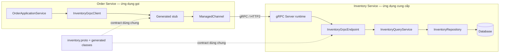
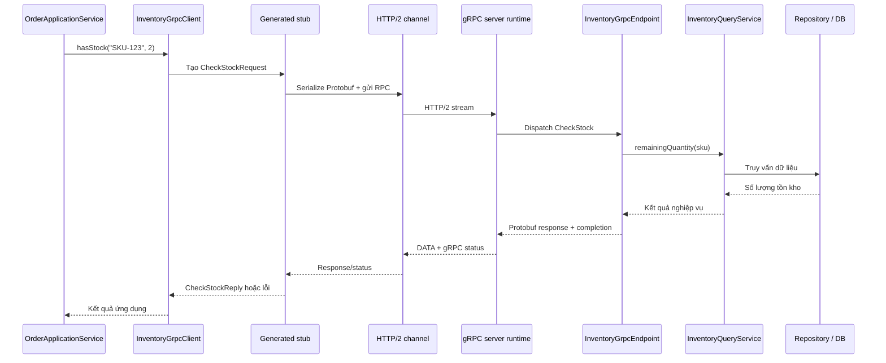

# Các thành phần sẽ gặp trong một ứng dụng Spring gRPC

Một ứng dụng **Spring gRPC** không chỉ gồm một file `.proto` và một class có method xử lý request. Để một lời gọi từ xa hoạt động, ứng dụng cần các thành phần mô tả hợp đồng, mã Java được sinh, gRPC server hoặc client runtime, adapter xử lý RPC, bean nghiệp vụ, cấu hình và những thành phần hỗ trợ như bảo mật, quan sát và kiểm thử.

Bài thuộc chương **Nhập môn** của module **SPRING_GRPC**. Module tập trung phát triển client/server gRPC trong hệ sinh thái Spring bằng Protocol Buffers và Java code generation, hỗ trợ unary/streaming RPC, metadata, deadline, status, interceptor, TLS, kiểm thử tích hợp và giám sát hiệu năng, độ tin cậy. Bài này lập bản đồ các thành phần bạn sẽ gặp và chỉ rõ thành phần nào tham gia vào đường đi của một lời gọi.

## 1. Bản đồ thành phần của một ứng dụng

Xét ví dụ Order Service cần kiểm tra hàng trong Inventory Service. Hai ứng dụng có thể cùng dùng Spring Boot, nhưng một ứng dụng đóng vai trò client, ứng dụng kia đóng vai trò server trong lời gọi này.



Các thành phần được nhóm thành sáu khu vực:

1. **Contract và code generation:** file `.proto`, Protobuf message classes, service descriptor và stub.
2. **Server side:** gRPC server runtime, service implementation/handler và cơ chế đăng ký handler.
3. **Client side:** target/endpoint, `ManagedChannel`, stub và cấu hình cho từng RPC.
4. **Spring application:** IoC container, cấu hình, bean nghiệp vụ, repository và transaction.
5. **Cross-cutting:** interceptor, metadata, credentials, TLS, deadline, health, metrics và tracing.
6. **Kiểm thử và vận hành:** test server/client, cấu hình môi trường, lifecycle và graceful shutdown.

Không phải dự án nào cũng có một class riêng cho mọi ô trong sơ đồ. Một starter có thể tự tạo một số bean hoặc gom nhiều trách nhiệm cấu hình vào một thành phần. Điều cần nắm là **vai trò và mối quan hệ**, không phải số lượng file.

## 2. Contract và mã được sinh: nền tảng để hai phía hiểu nhau

### 2.1. File `.proto`

File proto là nguồn hợp đồng: khai báo package, service, method và message. Ví dụ:

```protobuf
syntax = "proto3";

package commerce.inventory.v1;

option java_package = "com.example.inventory.grpc";
option java_multiple_files = true;

service InventoryService {
  rpc CheckStock(CheckStockRequest) returns (CheckStockReply);
}

message CheckStockRequest {
  string sku = 1;
  int32 quantity = 2;
}

message CheckStockReply {
  bool available = 1;
  int32 remaining = 2;
}
```

Hợp đồng này trả lời ba câu hỏi:

- **Gọi service nào?** `commerce.inventory.v1.InventoryService`.
- **Gọi method nào?** `CheckStock`.
- **Gửi và nhận dữ liệu gì?** `CheckStockRequest` và `CheckStockReply`.

`.proto` không chứa Spring bean, SQL hay cấu hình cổng. Nó mô tả giao diện trao đổi, nên cần được review và version như một API công khai giữa các ứng dụng.

### 2.2. Mã Java được sinh

`protoc` và plugin gRPC Java thường tạo hai nhóm mã:

| Mã sinh | Ví dụ | Vai trò |
| --- | --- | --- |
| Protobuf message classes | `CheckStockRequest`, `CheckStockReply` | Builder, getter, serialize và parse dữ liệu |
| gRPC service classes | `InventoryServiceGrpc` | Method descriptor, client stub và server implementation base |

Phía client dùng stub để gọi method có kiểu dữ liệu; phía server kế thừa lớp cơ sở hoặc triển khai kiểu service được sinh để cung cấp method. Các file này là **generated source**, không phải nơi đặt logic nghiệp vụ. Khi contract thay đổi, cập nhật `.proto` rồi chạy code generation.

### 2.3. Contract có thể được chia sẻ theo cách nào?

Hai ứng dụng Java thường dùng một module contract phát hành thành thư viện, hoặc mỗi ứng dụng sinh mã từ cùng phiên bản proto được quản lý. Nếu client và server triển khai bằng nhiều ngôn ngữ, từng phía có thể sinh mã từ cùng schema tương thích.

Điều quan trọng là quản lý phiên bản, field number và thay đổi method. Một thay đổi có thể biên dịch thành công nhưng vẫn phá vỡ ngữ nghĩa hoặc tương thích với ứng dụng chưa nâng cấp.

## 3. Các thành phần phía server

Server side gồm runtime tiếp nhận RPC, handler triển khai service và các bean phía sau xử lý nghiệp vụ.

### 3.1. gRPC server runtime

gRPC server runtime:

- Lắng nghe trên địa chỉ/cổng đã cấu hình.
- Nhận kết nối và HTTP/2 stream.
- Nhận diện service/method trong RPC.
- Chuyển request đã giải mã đến handler đã đăng ký.
- Gửi response, trailers và gRPC status về client.
- Quản lý transport, cancellation và streaming.

Trong gRPC Java, server thường được xây trên một transport implementation như Netty. Ứng dụng Spring có thể tạo server trực tiếp hoặc để starter tích hợp cấu hình và quản lý server. Dù theo cách nào, **server runtime vẫn là thành phần thực hiện giao tiếp gRPC**.

Server gRPC có thể dùng cổng riêng với web server của Spring Boot. Ví dụ REST chạy ở cổng 8080 còn gRPC chạy ở cổng 9090. Con số chỉ là minh họa; cần xem cấu hình thực tế của thư viện tích hợp và môi trường triển khai.

### 3.2. Service implementation hoặc handler

Handler là adapter hiện thực các method trong contract. Với API gRPC Java được sinh phổ biến, lớp server có thể kế thừa `InventoryServiceGrpc.InventoryServiceImplBase`:

```java
@Component
public class InventoryGrpcEndpoint
        extends InventoryServiceGrpc.InventoryServiceImplBase {

    private final InventoryQueryService inventoryQuery;

    public InventoryGrpcEndpoint(InventoryQueryService inventoryQuery) {
        this.inventoryQuery = inventoryQuery;
    }

    @Override
    public void checkStock(
            CheckStockRequest request,
            StreamObserver<CheckStockReply> observer) {
        int remaining = inventoryQuery.remaining(request.getSku());

        CheckStockReply reply = CheckStockReply.newBuilder()
            .setAvailable(remaining >= request.getQuantity())
            .setRemaining(remaining)
            .build();

        observer.onNext(reply);
        observer.onCompleted();
    }
}
```

Đây là skeleton minh họa, giả định các kiểu generated và `InventoryQueryService` đã tồn tại. Handler chuyển request Protobuf thành lời gọi nghiệp vụ, chuyển kết quả thành response và hoàn tất RPC. Trong code thật cần validation, mapping lỗi, xử lý cancellation và các quy tắc bảo mật phù hợp.

`@Component` giúp Spring tạo bean và inject constructor dependency. Nó **không tự động có nghĩa** method đã được công bố trên gRPC server trong mọi stack.

### 3.3. Cơ chế đăng ký service

Server phải biết handler nào phục vụ service/method. Với gRPC Java thuần, điểm đăng ký thường là `ServerBuilder.addService(...)`. Với Spring integration/starter, thư viện có thể quét bean triển khai service và tự đăng ký, hoặc cung cấp annotation/cấu hình riêng.

Tên annotation, property và quy tắc scan phụ thuộc starter/phiên bản. Vì vậy, khi đọc một dự án, hãy tìm câu trả lời cho câu hỏi: **handler bean được đăng ký vào server runtime ở đâu?**

Không nên đồng thời bật auto-registration của starter và tạo một server thủ công khác mà chưa hiểu rõ lifecycle; việc này có thể dẫn đến hai server hoặc xung đột cổng.

### 3.4. Bean nghiệp vụ

Handler không nên phải biết chi tiết database hoặc thực hiện mọi quy tắc nghiệp vụ. Một lớp như `InventoryQueryService` có thể:

- Kiểm tra SKU và số lượng.
- Truy vấn tồn kho qua repository.
- Áp dụng quy tắc nghiệp vụ.
- Thực hiện transaction khi cần.
- Trả kết quả miền nghiệp vụ để handler ánh xạ thành Protobuf response.

Bean nghiệp vụ có thể được dùng bởi REST controller, gRPC handler, message consumer hoặc batch job. Điều này giúp logic không phụ thuộc vào một giao thức duy nhất.

### 3.5. Repository và hệ thống dữ liệu

Repository là thành phần truy cập database hoặc hệ thống lưu trữ. Nó thường được Spring quản lý, nhưng không phải thành phần gRPC. Một lời gọi RPC có thể kết thúc ở handler mà không truy cập database, hoặc handler có thể gọi nhiều bean/repository trước khi trả response.

Khi đo độ trễ, cần phân biệt thời gian gRPC runtime, handler, business service và database. Chỉ đo method repository sẽ không thể hiện đầy đủ thời gian client thực sự chờ.

## 4. Các thành phần phía client

Client side cũng có nhiều phần hơn một lệnh gọi stub.

### 4.1. Target hoặc địa chỉ dịch vụ

Client cần biết cách tìm server: host/port cố định trong môi trường local, DNS/service discovery, resolver hoặc cấu hình load balancing. Địa chỉ là thông tin định tuyến mạng, khác với tên service/method trong contract.

Ví dụ:

```text
Endpoint: inventory.internal:9090
Service:  commerce.inventory.v1.InventoryService
Method:   CheckStock
Path:     /commerce.inventory.v1.InventoryService/CheckStock
```

Endpoint cho biết kết nối đến đâu; service/method cho biết yêu cầu thao tác nào.

### 4.2. ManagedChannel

`ManagedChannel` là abstraction phía client của gRPC Java để quản lý giao tiếp tới target. Nó bao gồm trạng thái kết nối, transport và các cơ chế liên quan đến resolver/load balancing tùy cấu hình.

Channel thường là tài nguyên sống lâu và được tái sử dụng bởi nhiều lời gọi. Không nên tạo channel mới cho từng request HTTP hoặc từng lần gọi nghiệp vụ. Trong Spring, channel có thể được tạo thành bean và đóng theo lifecycle của ứng dụng.

### 4.3. Stub

Stub là client API được sinh từ gRPC service:

| Stub phổ biến | Kiểu gọi | Ghi chú |
| --- | --- | --- |
| `newBlockingStub(channel)` | Đồng bộ, chặn luồng gọi | Thích hợp với unary và một số server-streaming API |
| `newStub(channel)` | Bất đồng bộ qua observer | Dùng cho streaming và callback |
| `newFutureStub(channel)` | Future | Chủ yếu cho unary RPC |

Stub không phải server và cũng không phải kết nối riêng. Nó dùng channel để thực hiện lời gọi. Có thể tạo stub dẫn xuất với deadline, credentials hoặc cấu hình call options phù hợp.

### 4.4. Client adapter/gateway

Một bean `InventoryGrpcClient` hoặc `InventoryGateway` có thể che chi tiết generated stub khỏi lớp nghiệp vụ. Nó chịu trách nhiệm:

- Tạo Protobuf request từ dữ liệu ứng dụng.
- Gọi method stub tương ứng.
- Đặt deadline và metadata theo chính sách.
- Chuyển Protobuf response thành kiểu dữ liệu của ứng dụng.
- Ánh xạ gRPC status thành lỗi mà lớp gọi hiểu được.

Ví dụ ngắn:

```java
@Component
public class InventoryGrpcClient {
    private final InventoryServiceGrpc.InventoryServiceBlockingStub stub;

    public InventoryGrpcClient(
            InventoryServiceGrpc.InventoryServiceBlockingStub stub) {
        this.stub = stub;
    }

    public boolean hasStock(String sku, int quantity) {
        CheckStockReply reply = stub
            .withDeadlineAfter(400, TimeUnit.MILLISECONDS)
            .checkStock(CheckStockRequest.newBuilder()
                .setSku(sku)
                .setQuantity(quantity)
                .build());
        return reply.getAvailable();
    }
}
```

Đoạn code giả định channel/stub đã được cấu hình và inject. Deadline 400 ms chỉ là ví dụ, cần điều chỉnh theo ngân sách thời gian của luồng nghiệp vụ. Nếu dùng blocking stub, không gọi trực tiếp trên event-loop của ứng dụng reactive.

## 5. Spring quản lý và kết nối các thành phần ra sao?

Spring IoC container tạo bean, inject dependency và áp dụng cấu hình. Spring Boot có thể cung cấp auto-configuration; thư viện tích hợp gRPC có thể bổ sung server/client bean, properties và cơ chế đăng ký handler.

Các trách nhiệm thường thấy:

| Thành phần Spring | Việc nó hỗ trợ |
| --- | --- |
| Application context | Tạo và quản lý bean, dependency injection |
| `@Configuration` / `@Bean` | Khai báo server, channel, stub hoặc interceptor nếu tự cấu hình |
| Properties / profiles | Đưa host, port, TLS material và policy ra cấu hình môi trường |
| Lifecycle callbacks | Khởi động/đóng tài nguyên theo vòng đời ứng dụng |
| Business service / repository | Tổ chức logic và dữ liệu |
| Starter / auto-configuration | Tích hợp gRPC server/client theo API của thư viện |
| Spring Test | Nạp context và kiểm tra wiring, cấu hình, bean |

Một điểm cần kiểm tra trong dự án là **thành phần nào tạo server/channel và ai đóng chúng**. Nếu starter đã quản lý server, tránh khai báo thêm server thủ công. Nếu tự tạo channel, hãy bảo đảm channel được shutdown khi ứng dụng dừng.

### Ví dụ cấu hình client do Spring quản lý

Đây là mẫu dùng gRPC Java trực tiếp trong Spring configuration để thể hiện vai trò bean:

```java
@Configuration
public class InventoryGrpcConfiguration {

    @Bean(destroyMethod = "shutdown")
    ManagedChannel inventoryChannel(
            @Value("${inventory.grpc.host}") String host,
            @Value("${inventory.grpc.port}") int port) {
        return ManagedChannelBuilder.forAddress(host, port)
            .useTransportSecurity()
            .build();
    }

    @Bean
    InventoryServiceGrpc.InventoryServiceBlockingStub inventoryStub(
            ManagedChannel inventoryChannel) {
        return InventoryServiceGrpc.newBlockingStub(inventoryChannel);
    }
}
```

Mẫu trên minh họa việc Spring tạo và hủy channel cùng stub. `useTransportSecurity()` giả định target có TLS được cấu hình hợp lệ; môi trường cần CA/trust material hoặc mTLS có thể cần credentials setup cụ thể hơn. Không dùng nguyên mẫu này thay cho hướng dẫn của starter đang chọn nếu starter đã tự quản lý client.

## 6. Thành phần dùng chung cho nhiều RPC

Ngoài client/server và business bean, một ứng dụng gRPC thực tế thường có các thành phần cắt ngang.

### 6.1. Interceptor

Client interceptor và server interceptor cho phép xử lý logic chung quanh nhiều RPC, chẳng hạn:

- Xác thực hoặc gắn token.
- Đọc/ghi correlation ID và trace context.
- Ghi log method, thời lượng và kết quả.
- Đo metrics.
- Áp dụng policy chung.

Spring có thể tạo interceptor bean và inject các dịch vụ hỗ trợ. Tuy nhiên, interceptor chỉ chạy nếu được gắn vào gRPC channel/server hoặc được starter đăng ký theo cơ chế của nó.

### 6.2. Metadata và credentials

Metadata mang thông tin điều khiển cùng RPC, ví dụ authorization token hoặc trace context. Credentials mô tả cách client chứng minh danh tính hoặc thiết lập bảo mật. Không nên nhét token vào message nghiệp vụ chỉ vì message dễ truy cập.

Phân biệt:

- **TLS/mTLS:** bảo vệ kênh truyền và xác thực peer ở tầng transport.
- **Call credentials/authorization metadata:** mang thông tin xác thực theo cuộc gọi.
- **Server interceptor/authorization:** kiểm tra danh tính và quyền gọi method.

Ba cơ chế bổ sung nhau; bật TLS không tự động có nghĩa mọi người gọi đều được phép truy cập mọi method.

### 6.3. Deadline, cancellation và status

Deadline thường được đặt cho từng RPC ở phía client. Cancellation cho phép kết thúc một lời gọi không còn cần thiết. Status mô tả kết quả giao tiếp ở cấp gRPC, ví dụ `OK`, `INVALID_ARGUMENT`, `NOT_FOUND`, `UNAVAILABLE` hoặc `DEADLINE_EXCEEDED`.

Các thành phần này không phải một Spring bean riêng bắt buộc cho mỗi ứng dụng. Chúng là khái niệm/API của gRPC runtime; Spring có thể giúp cấu hình policy hoặc cung cấp các bean cần thiết.

### 6.4. Health, reflection và quan sát

Một số ứng dụng còn triển khai:

- **gRPC health service:** cho phép hệ thống kiểm tra tình trạng phục vụ theo service.
- **Server reflection:** công bố descriptor để công cụ tương thích có thể khám phá service/method; cần cân nhắc bật ở môi trường nào.
- **Metrics:** số RPC, độ trễ, status, stream đang hoạt động.
- **Tracing:** theo dõi đường đi từ Order qua Inventory đến database/downstream.
- **Logging:** ghi thông tin đủ để chẩn đoán, tránh token và dữ liệu nhạy cảm.

Health/reflection không tự xuất hiện chỉ vì có file proto nghiệp vụ; chúng thường cần service hoặc cấu hình bổ sung. Spring Boot Actuator có thể hỗ trợ health/metrics của ứng dụng, nhưng việc tích hợp health của gRPC runtime tùy starter.

## 7. Một lời gọi đi qua những thành phần nào?

Với unary RPC `CheckStock`, đường đi rút gọn:



Trong luồng này, mỗi thành phần có một câu hỏi riêng:

| Thành phần | Câu hỏi nó trả lời |
| --- | --- |
| `.proto` | Client và server thống nhất method/message nào? |
| Generated stub | Client gọi API từ xa bằng kiểu Java nào? |
| ManagedChannel | Gửi lời gọi đến đâu và quản lý kết nối ra sao? |
| gRPC server runtime | RPC thuộc service/method nào, handler nào xử lý? |
| Handler | Chuyển request/response và gRPC status thế nào? |
| Spring business service | Quy tắc nghiệp vụ cần thực hiện là gì? |
| Repository | Dữ liệu được đọc/ghi ở đâu? |
| Interceptor/credentials | Xác thực, trace và policy chung được áp dụng ra sao? |

Nếu lỗi xảy ra, hãy xác định thành phần đầu tiên không thực hiện đúng trách nhiệm của nó thay vì sửa mọi lớp cùng lúc.

## 8. Thành phần nào thay đổi theo kiểu RPC?

Contract và runtime giống nhau ở mức nền tảng, nhưng API handler/stub phụ thuộc cardinality của method.

| Kiểu RPC | Hình dạng contract | Thành phần phía client | Thành phần phía server |
| --- | --- | --- | --- |
| Unary | Một request → một response | Blocking/async/future stub | Một response rồi completion |
| Server streaming | Một request → nhiều response | Nhận nhiều message từ một RPC | Phát nhiều message qua response observer |
| Client streaming | Nhiều request → một response | Gửi chuỗi message qua request observer | Nhận stream và trả một response cuối |
| Bidirectional streaming | Hai phía gửi nhiều message | Vừa gửi vừa nhận trong cùng RPC | Vừa nhận vừa gửi trong cùng RPC |

Với streaming, cần quan tâm thêm cancellation, flow control, buffer, đồng thời và kết thúc stream. Một Spring singleton handler có thể phục vụ nhiều RPC; không giữ dữ liệu riêng của một request trong field mutable dùng chung giữa các cuộc gọi.

## 9. Vòng đời tài nguyên: server, channel và bean không giống nhau

Một số thành phần có vòng đời khác nhau:

| Thành phần | Thường tồn tại trong khoảng thời gian | Cách kết thúc |
| --- | --- | --- |
| Spring application context | Vòng đời ứng dụng | Đóng context |
| gRPC server | Vòng đời server process hoặc bean quản lý server | Graceful shutdown/force shutdown theo chính sách |
| ManagedChannel | Vòng đời client process hoặc bean quản lý channel | Shutdown và chờ đóng khi cần |
| Stub | Thường là object nhẹ dùng trong ứng dụng | Không quản lý transport độc lập; channel mới sở hữu tài nguyên kết nối |
| Một unary RPC | Từ lúc bắt đầu đến response/status | Completion, error hoặc cancellation |
| Một streaming RPC | Từ lúc mở stream đến khi hoàn tất/hủy | Completion, error, deadline hoặc cancellation |
| Spring business bean | Theo bean scope, thường singleton | Spring container quản lý |

Đừng suy ra một Spring bean singleton đồng nghĩa chỉ có một RPC tại một thời điểm. Handler có thể được gọi đồng thời; code cần an toàn luồng. Tương tự, đóng channel không đồng nghĩa một RPC đang chạy chắc chắn hoàn tất thành công. Graceful shutdown cần chính sách thời gian chờ và xử lý stream đang mở.

## 10. Các thành phần kiểm thử và chẩn đoán

Không cần mọi test đều khởi động toàn bộ hệ thống. Hãy chọn mức kiểm thử theo thành phần:

| Mục tiêu | Thành phần kiểm thử | Ví dụ xác minh |
| --- | --- | --- |
| Quy tắc nghiệp vụ | Spring business service | SKU, số lượng, kết quả tồn kho |
| Mapping RPC | Handler/endpoint | Request → response/status |
| Spring wiring | Application context | Handler và dependency được inject |
| Đăng ký server | gRPC server runtime | Client gọi được method đã công bố |
| Client adapter | Stub/channel + gateway | Deadline, mapping response và status |
| Bảo mật | Credentials/interceptor/TLS | Token, quyền truy cập, handshake |
| Streaming | Stub/observer và server handler | Nhiều message, cancellation, completion |
| Vận hành | Metrics/tracing/logging | Latency, status, active streams, trace liên dịch vụ |

In-process gRPC test hữu ích cho kiểm tra handler và stub, nhưng không thay thế kiểm thử TLS, HTTP/2 proxy hoặc network deployment thực tế. Với lỗi cụ thể:

- `UNIMPLEMENTED`: kiểm tra contract, method name và đăng ký handler.
- `UNAVAILABLE`: kiểm tra target, port, DNS, TLS, proxy và server readiness.
- `INVALID_ARGUMENT`: kiểm tra validation của request.
- `DEADLINE_EXCEEDED`: kiểm tra ngân sách deadline và độ trễ các lớp downstream.
- `INTERNAL`: xem log/trace server và mapping exception.

## 11. Các thành phần có thể tùy chọn theo ứng dụng

Không phải dự án nào cũng cần cùng một bộ thành phần. Hãy thêm khi yêu cầu kiến trúc cần đến:

| Thành phần tùy chọn | Khi hữu ích |
| --- | --- |
| Spring gRPC starter | Muốn auto-configuration, server/client integration và lifecycle theo thư viện |
| Client-side load balancing/resolver | Có nhiều endpoint hoặc cần service discovery |
| Health service | Orchestrator hoặc load balancer cần kiểm tra trạng thái gRPC |
| Reflection | Muốn công cụ tương thích khám phá service/method trong môi trường cho phép |
| Client/server interceptors | Có auth, logging, metrics hoặc tracing dùng chung |
| TLS/mTLS credentials | Giao tiếp cần mã hóa và/hoặc xác thực hai phía |
| Retry policy | Một số RPC có thể retry an toàn và cần chính sách có giới hạn |
| Streaming event source | Method cần gửi dữ liệu liên tục thay vì một response |
| Gateway gRPC-Web/HTTP | Client trình duyệt hoặc hệ thống chỉ nói HTTP cần truy cập API |

Đặc biệt, **starter không phải một phần bắt buộc của gRPC protocol**. Có thể tích hợp gRPC Java trực tiếp với Spring bean. Khi dùng starter, tên annotation, property, cách scan handler và client configuration phụ thuộc thư viện/phiên bản. Tránh trộn cấu hình của nhiều starter hoặc đồng thời tự quản lý và auto-config cùng một server/channel.

## 12. Checklist nhận diện thành phần trong một codebase

Khi mở một ứng dụng Spring gRPC có sẵn, lần lượt tìm:

1. **Contract:** file `.proto` nào định nghĩa service và method?
2. **Generated code:** message classes và `*Grpc` được sinh ở đâu, version nào?
3. **Server registration:** bean handler nào được đưa vào gRPC server và ai khởi động server?
4. **Business layer:** handler inject service/repository nào để xử lý?
5. **Client configuration:** target, channel và stub được tạo ở đâu?
6. **Client adapter:** lớp nào chuyển dữ liệu ứng dụng thành Protobuf request và ánh xạ response/status?
7. **Cross-cutting:** interceptor, metadata, credentials, TLS và tracing được gắn ở đâu?
8. **Lifecycle:** ai đóng server/channel, xử lý shutdown và stream còn hoạt động?
9. **Testing:** test nào xác nhận Spring wiring, service registration và transport thực?
10. **Operations:** metric/log/trace nào phân biệt lỗi từng method và lớp hạ tầng?

Một codebase tốt không nhất thiết có tên class giống ví dụ. Hãy tìm theo **trách nhiệm**, sau đó đối chiếu cách đặt tên của dự án.

## 13. Ghi nhớ

Trong một ứng dụng **Spring gRPC**, các thành phần quan trọng nhất là:

- **Contract và generated code:** định nghĩa service/method/message, cung cấp kiểu Java và stub.
- **gRPC server handler/runtime:** đăng ký và thực thi RPC ở phía cung cấp.
- **ManagedChannel và client stub:** gửi lời gọi từ phía sử dụng.
- **Spring container/configuration:** tạo bean, inject nghiệp vụ, quản lý server/channel và cấu hình tích hợp.
- **Business service/repository:** thực hiện quy tắc nghiệp vụ và truy cập dữ liệu.
- **Interceptor, credentials, TLS, metadata và deadline:** hỗ trợ bảo mật, policy và điều khiển RPC.
- **Health, metrics, tracing và test infrastructure:** giúp kiểm chứng và vận hành dịch vụ.

Khi đọc một class hoặc cấu hình, hãy hỏi nó thuộc **contract, runtime, integration, business hay operations**. Phân loại đúng giúp bạn tìm được điểm đăng ký handler, nơi tạo channel, nơi đặt deadline và nơi cần quan sát lỗi. Đó là nền tảng để triển khai client/server unary hoặc streaming trong Spring một cách rõ ràng và đáng tin cậy.

### Tài liệu tham khảo

- [gRPC – Java basics](https://grpc.io/docs/languages/java/basics/)
- [gRPC – Core concepts, architecture and lifecycle](https://grpc.io/docs/what-is-grpc/core-concepts/)
- [gRPC – Interceptors](https://grpc.io/docs/guides/interceptors/)
- [gRPC – Health checking](https://grpc.io/docs/guides/health-checking/)
- [Spring Framework – IoC Container](https://docs.spring.io/spring-framework/reference/core/beans.html)
- [Spring Boot – Auto-configuration](https://docs.spring.io/spring-boot/reference/using/auto-configuration.html)
- [Spring gRPC – Reference documentation](https://docs.spring.io/spring-grpc/reference/)
