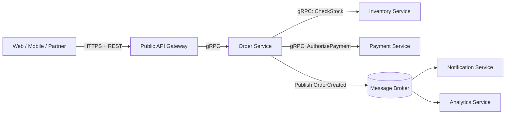

# Giao tiếp nội bộ và giao tiếp public khác nhau thế nào?

Khi thiết kế API cho một hệ thống Spring gRPC, một câu hỏi quan trọng xuất hiện trước khi chọn gRPC hay REST: **API này phục vụ ai và nằm ở ranh giới tin cậy nào?** Giao tiếp giữa hai dịch vụ do cùng tổ chức vận hành thường có mục tiêu, quyền kiểm soát và nhịp thay đổi khác với API cung cấp cho ứng dụng khách hàng hoặc đối tác bên ngoài. Những khác biệt đó ảnh hưởng đến hợp đồng, bảo mật, versioning, khả năng tương thích, mạng và vận hành.

Trong module **SPRING_GRPC**, người học xây dựng client/server từ hợp đồng Protocol Buffers, sinh mã Java và triển khai unary hoặc streaming RPC trong hệ sinh thái Spring; đồng thời xử lý metadata, deadline, status, interceptor, TLS, kiểm thử tích hợp và giám sát độ tin cậy. Bài này đặt các kỹ thuật ấy vào bối cảnh **giao tiếp nội bộ (internal)** và **giao tiếp public (external/public-facing)**.

## 1. Phân biệt theo đối tượng sử dụng và ranh giới tin cậy

Giả sử một nền tảng thương mại điện tử có Order Service, Inventory Service, Payment Service và một ứng dụng web cho khách hàng.

- **Giao tiếp nội bộ:** Order Service gọi Inventory Service để kiểm tra tồn kho; các dịch vụ do tổ chức quản lý, triển khai và giám sát.
- **Giao tiếp public:** ứng dụng của khách hàng hoặc hệ thống đối tác gọi API của nền tảng để xem sản phẩm, tạo đơn hoặc theo dõi đơn hàng.

| Khía cạnh | Internal API | Public-facing API |
| --- | --- | --- |
| Người gọi | Dịch vụ, job hoặc workload thuộc hệ thống | Người dùng, ứng dụng khách hàng, đối tác hoặc nhà phát triển bên ngoài |
| Quyền kiểm soát | Tổ chức thường kiểm soát cả client và server | Tổ chức kiểm soát server; không kiểm soát hoàn toàn client |
| Ranh giới tin cậy | Giữa workload hoặc miền bảo mật nội bộ | Ranh giới với mạng, thiết bị và danh tính bên ngoài |
| Mục tiêu chính | Tích hợp dịch vụ, thực thi nghiệp vụ, độ trễ và độ tin cậy giữa các thành phần | Dễ tích hợp, ổn định, tài liệu rõ, bảo mật và trải nghiệm developer |
| Thay đổi hợp đồng | Có thể phối hợp rollout, nhưng vẫn cần tương thích giữa các phiên bản đang chạy | Phải tính đến client cũ, SDK đã phát hành và đối tác nâng cấp chậm |
| Truy cập mạng | Thường qua mạng riêng, service discovery, mesh hoặc internal gateway | Thường qua API gateway, load balancer hoặc endpoint công khai |
| Quản trị | Theo domain/team, policy nội bộ và vòng đời dịch vụ | Có thể cần onboarding, quota, rate limit, SLA, support và quy trình công bố |

**Internal không có nghĩa là đáng tin tuyệt đối.** Một dịch vụ nội bộ vẫn có thể bị xâm nhập, cấu hình sai hoặc gọi nhầm quyền. Ngược lại, public API không nhất thiết phải mở cho tất cả mọi người; nó có thể là API dành riêng cho các đối tác đã xác thực.

## 2. Sự khác nhau không chỉ nằm ở giao thức

Một hiểu lầm phổ biến là “internal thì dùng gRPC, public thì dùng REST”. Đây là **xu hướng thường gặp**, không phải quy tắc kỹ thuật bắt buộc.

- gRPC có thể dùng cho backend-to-backend và cả đối tác bên ngoài nếu đối tác có client/tooling phù hợp, contract được công bố và hạ tầng hỗ trợ.
- REST có thể dùng cho internal API, nhất là khi tổ chức đã có HTTP gateway, OpenAPI, cache hoặc quy ước tích hợp thống nhất.
- Messaging thường phục vụ event/command bất đồng bộ, cả trong nội bộ lẫn giữa các tổ chức nếu có broker hoặc nền tảng tích hợp phù hợp.

Điều cần quyết định trước là **ngữ nghĩa giao tiếp, người tiêu thụ và ranh giới bảo mật**. Sau đó mới chọn transport và định dạng phù hợp.

| Nhu cầu | Lựa chọn thường đáng cân nhắc | Vì sao |
| --- | --- | --- |
| Order gọi Inventory và cần kết quả ngay | Unary gRPC hoặc REST | Request/response trực tiếp, có deadline và status |
| Backend cần nhận nhiều cập nhật trong một phiên | gRPC streaming, SSE hoặc WebSocket tùy client | Truyền nhiều message liên tục |
| Browser cần đọc tài nguyên sản phẩm | REST/HTTP thường thuận tiện | Browser và công cụ HTTP hỗ trợ rộng |
| Nhiều dịch vụ nhận sự kiện đơn hàng | Messaging/pub-sub | Tách producer khỏi consumer và fan-out |
| Đối tác cần API có SDK và tài liệu HTTP phổ biến | REST/OpenAPI thường thuận tiện | Giảm rào cản tích hợp |
| Đối tác backend có Protobuf và gRPC tooling | gRPC public có thể phù hợp | Contract có kiểu và stub đa ngôn ngữ |

## 3. Vì sao internal API thường phù hợp với gRPC?

Khi hai đầu là các dịch vụ backend do cùng tổ chức quản lý, gRPC có thể mang lại một số lợi ích cụ thể:

**Hợp đồng có kiểu và sinh mã.** File `.proto` định nghĩa service, method và message. Client Java dùng stub có kiểu dữ liệu; server triển khai handler tương ứng. Thay đổi contract có thể được review và kiểm tra tương thích trong pipeline của các nhóm.

**RPC semantics rõ ràng.** Unary phù hợp với lời gọi cần một kết quả; server/client/bidirectional streaming phù hợp với các luồng dữ liệu liên tục. Deadline, cancellation và status giúp các dịch vụ thống nhất cách xử lý cuộc gọi từ xa.

**Tối ưu giao tiếp backend khi có lợi ích đo được.** Protobuf nhị phân và HTTP/2 multiplexing có thể giảm overhead hoặc tận dụng kết nối hiệu quả trong một số workload. Hiệu năng thực tế vẫn cần benchmark theo payload, concurrency, proxy, TLS và xử lý nghiệp vụ.

**Tích hợp nhiều ngôn ngữ.** Một hợp đồng Protobuf có thể sinh client cho Java, Go, Python và các ngôn ngữ được hỗ trợ. Internal API không nhất thiết có cùng ngôn ngữ ở hai đầu.

Ví dụ contract nội bộ:

```protobuf
syntax = "proto3";

package commerce.inventory.v1;

option java_package = "com.example.inventory.grpc";
option java_multiple_files = true;

service InventoryService {
  rpc CheckStock(CheckStockRequest) returns (CheckStockReply);
}

message CheckStockRequest {
  string sku = 1;
  int32 quantity = 2;
}

message CheckStockReply {
  bool available = 1;
  int32 remaining = 2;
}
```

Order Service gọi `CheckStock` với request đã sinh từ Protobuf. Inventory Service xử lý request, truy vấn dữ liệu và trả response. Client và server có thể phát hành độc lập nếu contract duy trì tương thích với các phiên bản đang hoạt động.

### Nhưng internal gRPC vẫn cần các biện pháp bảo vệ

- Xác thực workload và phân quyền theo service/method.
- TLS hoặc mTLS khi cần bảo vệ và xác thực kết nối.
- Deadline hợp lý để không giữ tài nguyên vô hạn.
- Giới hạn kích thước message, concurrency và tài nguyên.
- Retry có giới hạn, chỉ áp dụng khi ngữ nghĩa thao tác cho phép.
- Metrics, logs và distributed tracing để theo dõi từng RPC.

Không nên bỏ authentication chỉ vì request đi qua mạng riêng hoặc service mesh. Network segmentation có thể là một lớp bảo vệ, nhưng không thay thế xác thực và authorization ở cấp dịch vụ.

## 4. Vì sao public API cần chú trọng khả năng tương thích và trải nghiệm tích hợp?

Với public-facing API, server không thể yêu cầu mọi client nâng cấp cùng lúc. Một ứng dụng mobile cũ có thể tiếp tục gọi API trong nhiều tháng; đối tác có lịch phát hành riêng; SDK đã được tích hợp vào hệ thống khác có thể không dễ cập nhật.

Vì vậy, public API thường cần:

1. **Contract được công bố:** mô tả rõ endpoint/method, dữ liệu, lỗi, xác thực, giới hạn và ví dụ.
2. **Versioning có chiến lược:** thay đổi tương thích được ưu tiên; breaking change cần kế hoạch chuyển đổi và thời gian hỗ trợ.
3. **Authentication và authorization:** xác minh client, người dùng hoặc tổ chức; chỉ cấp đúng quyền cần thiết.
4. **Rate limiting và quota:** bảo vệ tài nguyên, kiểm soát lạm dụng và phân bổ công bằng.
5. **Error model ổn định:** client có thể phân biệt lỗi đầu vào, quyền truy cập, giới hạn, sự cố tạm thời và lỗi hệ thống.
6. **Observability và support:** theo dõi theo client/application ID, API version và request correlation mà không làm lộ bí mật.
7. **Tài liệu và onboarding:** hướng dẫn lấy credentials, SDK, sandbox, migration và cách xử lý lỗi.

REST/HTTP thường thuận tiện cho trình duyệt, công cụ phổ biến, API gateway, cache và OpenAPI. Nhưng nếu đối tác là backend có gRPC tooling, public gRPC vẫn có thể là lựa chọn hợp lý. Khi đó cần công bố file proto/descriptor, quy định versioning, TLS, authentication, quota và hỗ trợ client rõ ràng.

## 5. Ví dụ kiến trúc: public gateway và internal gRPC

Một cách tổ chức thường gặp là cung cấp API HTTP ở biên hệ thống, sau đó dùng gRPC cho lời gọi giữa các dịch vụ backend.



Gateway có thể xử lý xác thực bên ngoài, quota, request validation, logging và chuyển đổi HTTP request thành lời gọi nội bộ. Order Service dùng gRPC để phối hợp các thao tác đồng bộ cần kết quả; sau khi đơn được ghi nhận, nó phát event để Notification và Analytics xử lý độc lập.

Đây là một lựa chọn kiến trúc, không phải yêu cầu phải có gateway. Một hệ thống nhỏ có thể cho phép public REST controller gọi trực tiếp application service trong cùng tiến trình; một đối tác có thể gọi gRPC endpoint trực tiếp nếu yêu cầu và hạ tầng cho phép.

### Ranh giới public nên kết thúc ở đâu?

Thông thường, không nên phơi bày mọi internal service endpoint trực tiếp ra Internet. Thay vào đó, xác định **API boundary** riêng:

- Public contract chỉ công bố những thao tác và dữ liệu mà khách hàng/đối tác được phép sử dụng.
- Internal contract phục vụ giao tiếp giữa các dịch vụ và có thể phản ánh mô hình triển khai nội bộ.
- Gateway hoặc adapter chuyển đổi giữa hai contract, kiểm tra quyền và giới hạn dữ liệu.

Điều này tránh buộc public client phụ thuộc vào cấu trúc nội bộ như tên service, schema database hoặc cách chia microservice. Nó cũng cho phép nhóm tái cấu trúc backend mà không thay đổi public API nếu ngữ nghĩa bên ngoài vẫn giữ nguyên.

## 6. Versioning: internal có thể phối hợp, public phải hỗ trợ client cũ lâu hơn

### Internal contract

Các nhóm có thể phối hợp thời điểm phát hành và triển khai rolling update. Tuy nhiên, trong lúc rollout, client phiên bản mới có thể gọi server phiên bản cũ và ngược lại. Do đó, vẫn nên ưu tiên thay đổi tương thích:

- Thêm field mới với số field chưa sử dụng; xử lý giá trị mặc định khi client cũ không gửi.
- Không tái sử dụng field number đã xóa; dùng `reserved` khi thích hợp.
- Thêm method mới thường dễ quản lý hơn đổi ý nghĩa method hiện có.
- Tránh đổi package/service/method nếu chưa có kế hoạch chuyển đổi client.
- Tách thay đổi wire-compatible khỏi thay đổi ngữ nghĩa nghiệp vụ.

### Public contract

Client public có thể tồn tại lâu hơn vòng đời một phiên bản server. Vì vậy, cần cân nhắc:

- Phiên bản API rõ ràng, chẳng hạn `/v1` trong REST hoặc package/version trong Protobuf.
- Chính sách deprecation và sunset được công bố.
- Thời gian hỗ trợ phiên bản cũ và quy trình nâng cấp.
- Contract test với SDK/client đại diện.
- Không thay đổi ý nghĩa field/response mà client đang dựa vào.

Version trong tên package Protobuf như `commerce.inventory.v1` giúp định danh contract. Tuy nhiên, thêm `v2` không tự giải quyết việc migration: server phải quyết định phục vụ cả hai phiên bản trong bao lâu, dữ liệu có chuyển đổi được không và client sẽ nâng cấp như thế nào.

## 7. Bảo mật: public và internal có chính sách khác nhau

Public API phải giả định traffic đến từ môi trường không kiểm soát. Internal API cũng phải xác minh danh tính và quyền vì mạng nội bộ không phải ranh giới tin cậy tuyệt đối.

| Kiểm soát | Internal service-to-service | Public-facing API |
| --- | --- | --- |
| Xác thực | Workload identity, mTLS, service credentials hoặc token nội bộ | OAuth2/OIDC, API key hoặc cơ chế phù hợp với loại client; tránh xem API key là danh tính người dùng |
| Phân quyền | Theo service, method, tenant hoặc dữ liệu nghiệp vụ | Theo user, organization, scope, resource ownership và tenant |
| Mã hóa | TLS/mTLS theo threat model và hạ tầng | HTTPS/TLS bắt buộc cho endpoint công khai; gRPC public cũng cần TLS |
| Rate limiting | Bảo vệ service và downstream, giới hạn concurrency | Quota theo client/user/tenant, chống abuse và bảo vệ chi phí |
| Dữ liệu nhạy cảm | Giới hạn quyền giữa workload, không log secret | Kiểm soát trường trả về, PII, consent và phân quyền tài nguyên |
| Network | Private network, policy, mesh có thể bổ sung bảo vệ | Public ingress, WAF/gateway, firewall và DDoS protection tùy rủi ro |

### Metadata không phải nơi chứa bí mật một cách tùy tiện

Trong gRPC, metadata thường mang authorization token, trace context hoặc correlation ID. Token cần được truyền qua kênh TLS, có thời hạn và phạm vi phù hợp; không ghi vào log hoặc metric. Server interceptor có thể trích metadata để xác thực, nhưng **authorization phải được thực hiện theo danh tính và quyền thực tế**, không chỉ vì request có một header.

Với REST, thông tin xác thực thường đi qua HTTP headers. Dù transport khác nhau, nguyên tắc quản lý credential, rotation, scope và audit vẫn tương tự.

## 8. Deadline, retry và lỗi: mục tiêu khác nhau theo loại client

Internal service thường có thể phối hợp deadline giữa các hop. Ví dụ Order Service có ngân sách 800 ms cho một request; nó không nên đặt 800 ms cho từng lời gọi Inventory và Payment nối tiếp nhau rồi kỳ vọng tổng thời gian vẫn dưới 800 ms.

Public API cần quy định timeout và error response đủ ổn định để client bên ngoài biết nên thử lại hay hiển thị lỗi. Tránh trả thông tin nội bộ nhạy cảm trong error body hoặc gRPC status description.

### Không phải lỗi nào cũng nên retry

- `INVALID_ARGUMENT`: request sai; client cần sửa dữ liệu.
- `UNAUTHENTICATED` hoặc `PERMISSION_DENIED`: xử lý credentials/quyền, không retry liên tục.
- `DEADLINE_EXCEEDED`: kiểm tra ngân sách thời gian; với thao tác ghi, kết quả có thể chưa rõ.
- `UNAVAILABLE`: có thể tạm thời; chỉ retry theo backoff, giới hạn và tính idempotent.
- `INTERNAL`: cần điều tra; không mặc định gửi lại vô hạn.

Một lời gọi `ReserveStock` có thể đã commit ở server nhưng response bị mất. Client retry mà không có idempotency key có thể giữ hàng hai lần. Vấn đề này tồn tại cả internal và public; public API thường cần đặc biệt rõ ràng về idempotency để client/đối tác có thể tích hợp an toàn.

## 9. Quan sát và hỗ trợ vận hành

Internal API và public API cần số liệu khác nhau dù có thể dùng chung nền tảng telemetry.

| Mục tiêu | Internal | Public |
| --- | --- | --- |
| Độ trễ | Theo service/method và từng hop trong distributed trace | Theo API version, route/method, client class và region |
| Lỗi | gRPC status, downstream failures, saturation | HTTP/gRPC error class, auth failures, quota rejection, client-visible errors |
| Lưu lượng | RPC concurrency, throughput, active streams | Requests theo client/tenant, quota usage, traffic spikes |
| Sức khỏe | Readiness, dependency health, channel/server state | Availability/SLA, ingress/gateway health và lỗi theo khu vực |
| Điều tra | Trace giữa các service, logs theo correlation ID | Request ID, client/app ID đã được bảo vệ, audit và support context |

Không đưa token, email, SKU hoặc ID có cardinality cao vào metric label. Public API cần audit truy cập và theo dõi lạm dụng; internal API cần phát hiện service bất thường, dependency chậm và lỗi lan truyền.

Với gRPC, interceptor/instrumentation có thể thu thập số RPC, status và latency theo service/method. Với REST, middleware/metrics có thể theo dõi route và HTTP status. Cần thống nhất trace context khi request đi qua gateway và các internal services.

## 10. Kiểm thử khác nhau ở đâu?

Internal service thường có thể chạy contract/integration tests giữa các phiên bản client-server được triển khai trong tổ chức:

- Kiểm tra Protobuf schema và code generation.
- Gọi handler qua gRPC test server hoặc in-process transport.
- Kiểm tra deadline, status, metadata và interceptor.
- Kiểm thử TLS, proxy, readiness và graceful shutdown trong môi trường gần production.
- Thử client cũ với server mới và ngược lại khi rollout cần hỗ trợ nhiều phiên bản.

Public API cần thêm:

- Contract tests với SDK hoặc client mẫu đã phát hành.
- Kiểm thử authentication, authorization, tenant isolation và quota.
- Kiểm tra tài liệu, ví dụ, error model và version/deprecation.
- Kiểm thử compatibility với client cũ và các hệ thống đối tác đại diện.
- Kiểm thử abuse/rate-limit và giới hạn payload.

Một test gọi trực tiếp Java handler không đủ để chứng minh public endpoint an toàn hoặc internal service có thể giao tiếp qua TLS/HTTP2 thực tế. Mức kiểm thử cần phù hợp ranh giới triển khai.

## 11. Quyết định public/internal trong một dự án Spring

Khi thiết kế một method mới, hãy trả lời theo thứ tự:

1. **Ai sẽ gọi?** Workload nội bộ, ứng dụng khách hàng, đối tác hay developer bất kỳ?
2. **Ai kiểm soát client?** Có thể phối hợp rollout hay phải hỗ trợ client cũ trong thời gian dài?
3. **Dữ liệu nào được phép lộ ra?** Có cần một public DTO/contract tách khỏi mô hình nội bộ không?
4. **Cần kiểu tương tác nào?** Request/response, streaming hay event bất đồng bộ?
5. **Ranh giới xác thực nằm ở đâu?** Workload identity, user identity, organization, scope và resource ownership?
6. **Versioning và hỗ trợ ra sao?** Có deprecation, migration, SDK và SLA không?
7. **Vận hành thế nào?** Deadline, retry, quota, metrics, tracing, audit và support?

### Ma trận ví dụ

| Luồng | Phân loại | Thiết kế thường phù hợp |
| --- | --- | --- |
| Order Service → Inventory Service | Internal | Unary gRPC với contract Protobuf, deadline, service identity và metrics theo method |
| Order Service → Payment Service | Internal | gRPC hoặc REST; authorization, idempotency và kiểm soát retry |
| Browser → Product API | Public-facing | REST/HTTPS, public DTO, auth phù hợp, quota/cache nếu cần |
| Partner backend → Order API | Public/partner | REST/OpenAPI hoặc gRPC nếu partner hỗ trợ Protobuf và quy trình contract |
| Order Service → Notification Service sau khi tạo đơn | Internal asynchronous | Event messaging với outbox, idempotent consumer và retry/DLQ |
| Public partner cần nhận cập nhật dài hạn | Public-facing streaming/event | Cân nhắc webhook, SSE, WebSocket, gRPC streaming hoặc broker gateway theo khả năng client và yêu cầu lưu giữ |

## 12. Ghi nhớ

**Internal và public mô tả đối tượng sử dụng, ranh giới tin cậy và cách quản trị API; chúng không phải tên khác của gRPC và REST.** Internal API thường được tối ưu cho phối hợp backend, contract giữa nhóm và quan sát theo service/method. Public API cần đặc biệt chú trọng tài liệu, khả năng tương thích client cũ, authentication, authorization, quota, support và versioning.

gRPC có thể phục vụ cả hai loại nếu contract, client tooling, transport và vận hành phù hợp. REST thường thuận tiện ở biên web/đối tác; messaging phù hợp khi cần tách thời điểm hoặc phát sự kiện cho nhiều consumer. Trong một hệ thống Spring, có thể dùng public REST/gRPC gateway ở ngoài, internal gRPC giữa backend và messaging cho workflow bất đồng bộ.

Trước khi tạo một gRPC service hoặc công bố API ra bên ngoài, hãy xác định **ai được gọi, được gọi method nào, được xem dữ liệu gì, contract sẽ sống bao lâu và lỗi sẽ được xử lý ra sao**. Những quyết định đó định hình kiến trúc đáng tin cậy hơn việc chỉ chọn một giao thức theo thói quen.

### Tài liệu tham khảo

- [gRPC – Introduction](https://grpc.io/docs/what-is-grpc/introduction/)
- [gRPC – Core concepts, architecture and lifecycle](https://grpc.io/docs/what-is-grpc/core-concepts/)
- [gRPC – Authentication](https://grpc.io/docs/guides/auth/)
- [gRPC – Deadlines](https://grpc.io/docs/guides/deadlines/)
- [Protocol Buffers – Proto3 language guide](https://protobuf.dev/programming-guides/proto3/)
- [OpenAPI Specification](https://spec.openapis.org/oas/latest.html)
