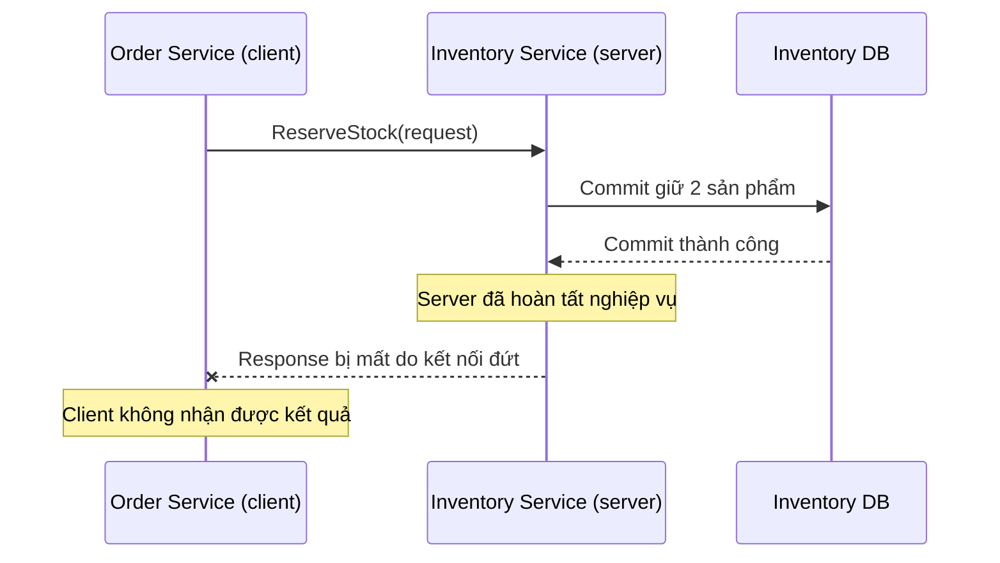

# Giới hạn của việc coi RPC như gọi hàm cục bộ

Một lời gọi gRPC trong Java có thể trông giống lời gọi phương thức thông thường:

```java
CheckStockReply reply = inventoryStub.checkStock(request);
```

Nhưng `checkStock` không chạy trong cùng tiến trình. Client phải mã hóa request, gửi qua mạng, chờ server nhận và xử lý, rồi giải mã response. Kết nối có thể chậm hoặc đứt; server có thể đã thực hiện nghiệp vụ nhưng response bị mất; dữ liệu truyền đi phải tuân theo hợp đồng có phiên bản. **Cú pháp giống gọi hàm cục bộ không làm mất đi các đặc tính của hệ thống phân tán.**

Đây là điều quan trọng khi phát triển **SPRING_GRPC**: hợp đồng Protocol Buffers và mã Java sinh giúp hai phía thống nhất giao diện; gRPC runtime cung cấp RPC qua HTTP/2; Spring tổ chức bean và nghiệp vụ. Tuy nhiên, người thiết kế vẫn phải chủ động xử lý latency, partial failure, deadline, cancellation, retry, idempotency, bảo mật, đồng thời và quan sát.

## 1. Gọi hàm cục bộ và RPC khác nhau ở đâu?

Giả sử Order Service cần hỏi Inventory Service xem còn đủ hai sản phẩm `SKU-123` không.

| Đặc tính | Gọi hàm trong cùng tiến trình | RPC qua gRPC |
| --- | --- | --- |
| Thực thi | Gọi trực tiếp mã trong tiến trình | Gửi request đến tiến trình khác qua mạng |
| Độ trễ | Thường thấp và tương đối ổn định | Phụ thuộc mạng, tải, queue, server và downstream |
| Thất bại | Exception hoặc lỗi cục bộ | Có thêm DNS, kết nối, timeout, proxy, server crash và mất response |
| Dữ liệu | Truyền tham chiếu/đối tượng trong bộ nhớ | Serialize, truyền byte, parse thành message ở phía nhận |
| Vòng đời | Thường cùng vòng đời tiến trình | Client và server khởi động/dừng độc lập |
| Đồng thời | Chịu ảnh hưởng thread và lock cục bộ | Thêm giới hạn kết nối, stream, queue, backpressure và tải từ xa |
| Kết quả khi lỗi | Thường xác định được hàm đã chạy đến đâu trong tiến trình | Có thể không biết server đã commit nghiệp vụ hay chưa |
| Hợp đồng | Compiler kiểm tra interface trong cùng codebase | Hai phía phải tương thích schema và ngữ nghĩa API qua các lần phát hành |

RPC là một **lời gọi có ranh giới mạng**. Mọi thiết kế cần tính đến việc một trong hai phía có thể không nhận được thông tin về kết quả của phía còn lại.

## 2. Độ trễ mạng không giống thời gian gọi hàm

Một lời gọi cục bộ thường không phải chờ DNS, thiết lập kết nối hoặc truyền dữ liệu qua nhiều thiết bị mạng. Một RPC có thể bao gồm:

```text
Tổng thời gian client quan sát
  = xếp hàng ở client
  + serialize request
  + truyền request
  + xếp hàng ở server
  + xử lý handler và nghiệp vụ
  + truy cập database/downstream
  + serialize response
  + truyền response
  + parse response ở client
```

Đây là mô hình khái quát; một số bước có thể chồng lấp hoặc được tối ưu. Điểm quan trọng là **thời gian xử lý trong method nghiệp vụ chỉ là một phần của latency mà client nhìn thấy**.

Ví dụ, `InventoryQueryService` truy vấn database mất 15 ms nhưng RPC mất 180 ms. Phần chênh lệch có thể đến từ network, queue, TLS, proxy, serialization hoặc tải phía client/server. Chỉ tối ưu câu SQL sẽ không chắc giải quyết được p95 của RPC.

### 2.1. Đặt deadline theo ngân sách của cả luồng

Client không nên chờ vô hạn. gRPC cho phép đặt deadline cho từng RPC:

```java
CheckStockReply reply = inventoryStub
    .withDeadlineAfter(300, TimeUnit.MILLISECONDS)
    .checkStock(request);
```

Giá trị 300 ms chỉ là ví dụ. Nếu request HTTP của Order Service có ngân sách 800 ms và phải gọi Inventory rồi Payment theo chuỗi, mỗi downstream call cần một phần ngân sách, để lại thời gian cho các bước còn lại và trả response.

Đặt 800 ms cho từng RPC nối tiếp có thể khiến toàn luồng vượt quá 800 ms. Ngược lại, deadline quá ngắn có thể gây timeout dù server vẫn xử lý bình thường. Hãy chọn deadline theo SLA, phân vị latency thực tế và số hop trong request.

### 2.2. Timeout không chứng minh server chưa làm gì

Khi client nhận `DEADLINE_EXCEEDED`, điều đó có nghĩa client không nhận được kết quả trước hạn. Nó **không chứng minh** server chưa nhận request hoặc chưa thực hiện nghiệp vụ.

Server có thể:

- Chưa nhận request vì kết nối chậm.
- Đang xếp hàng hoặc đang xử lý.
- Đã hoàn thành nhưng response chưa về client.
- Đã commit database, nhưng kết nối bị đứt trước khi client nhận response.

Vì vậy, không nên diễn giải timeout thành “lệnh chắc chắn chưa chạy”.

## 3. Partial failure: một phía có thể hỏng trong khi phía kia vẫn chạy

Trong hệ thống phân tán, client và server không cùng chia sẻ một trạng thái bộ nhớ. Một bên có thể khởi động lại trong lúc bên kia vẫn hoạt động; proxy có thể lỗi; mạng có thể phân vùng; database downstream có thể quá tải.

Ví dụ:



Order Service nhìn thấy lỗi transport hoặc `UNAVAILABLE`, nhưng Inventory Service có thể đã giữ hàng thành công. Đây là **kết quả không xác định đối với client**, không nhất thiết là kết quả thất bại đối với server.

Partial failure khiến những giả định sau trở nên nguy hiểm:

- “Nếu client báo lỗi thì server chưa xử lý.”
- “Nếu kết nối còn mở thì server luôn sẵn sàng.”
- “Nếu retry thì chắc chắn sẽ nhận được kết quả đúng một lần.”
- “Một server khỏe mạnh đồng nghĩa toàn bộ request sẽ thành công.”

Thiết kế RPC cần phân biệt lỗi trước khi server thực thi, lỗi trong quá trình thực thi và lỗi sau khi nghiệp vụ đã commit.

## 4. Kết quả không rõ ràng và nguy cơ thực hiện nghiệp vụ hai lần

Hãy so sánh hai thao tác:

- `CheckStock` chỉ đọc số lượng tồn kho tại một thời điểm.
- `ReserveStock` hoặc `ChargePayment` tạo tác dụng phụ.

Nếu một lời gọi đọc bị timeout, client có thể cân nhắc thử lại để lấy trạng thái mới. Nhưng nếu một lệnh ghi đã được server thực hiện mà response bị mất, gửi lại có thể tạo tác dụng phụ lần thứ hai.

### 4.1. Idempotency giúp retry an toàn hơn

Một thao tác là **idempotent** nếu thực hiện nhiều lần với cùng định danh yêu cầu vẫn tạo ra hiệu ứng nghiệp vụ tương đương một lần thực hiện.

Ví dụ client gửi:

```text
ReserveStock
  request_id = "req-8f2a"
  sku        = "SKU-123"
  quantity   = 2
```

Server có thể lưu `request_id` cùng kết quả đã xử lý. Nếu client gửi lại đúng `request_id`, server trả kết quả đã lưu thay vì giữ hàng thêm lần nữa. Cách triển khai phải bảo đảm kiểm tra request ID và cập nhật nghiệp vụ có tính nguyên tử phù hợp với database.

Một proto có thể thể hiện khóa yêu cầu:

```protobuf
message ReserveStockRequest {
  string request_id = 1;
  string sku = 2;
  int32 quantity = 3;
}
```

Chỉ thêm field `request_id` chưa tự tạo ra idempotency. Server phải thực thi quy tắc chống trùng, xác định thời gian lưu khóa, xử lý hai request cùng đến đồng thời và trả lại kết quả phù hợp.

### 4.2. Retry cần chính sách, không phải vòng lặp vô hạn

Một retry policy cần xác định:

- Những status nào có thể thử lại.
- Số lần thử tối đa và thời gian backoff.
- Có jitter để tránh nhiều client retry cùng lúc không.
- Deadline còn đủ thời gian cho lần thử tiếp theo không.
- Method có idempotent hoặc có cơ chế chống trùng không.
- Server có đang quá tải hay retry sẽ làm tình hình tệ hơn.

| Tình huống | Cách xử lý thường phù hợp |
| --- | --- |
| `INVALID_ARGUMENT` | Không retry; sửa request |
| `UNAUTHENTICATED` | Làm mới hoặc sửa credentials theo policy |
| `PERMISSION_DENIED` | Kiểm tra quyền; không retry mù quáng |
| `DEADLINE_EXCEEDED` | Đánh giá kết quả có thể đã được thực hiện; tra trạng thái hoặc retry an toàn |
| `UNAVAILABLE` | Có thể retry có giới hạn nếu method và trạng thái cho phép |
| `INTERNAL` | Điều tra nguyên nhân; không mặc định retry mọi lỗi |

Không phải mọi lỗi đều có cùng ý nghĩa ở mọi method. Cần kết hợp status với ngữ nghĩa nghiệp vụ và chính sách retry đã định nghĩa.

## 5. Serialization và contract: không truyền đối tượng Java trực tiếp

Khi gọi một hàm cục bộ, Java có thể truyền tham chiếu đến object. Với gRPC, client serialize message thành byte theo schema Protobuf; server parse byte thành message Java ở tiến trình của nó.

Ví dụ contract:

```protobuf
syntax = "proto3";

package commerce.inventory.v1;

service InventoryService {
  rpc CheckStock(CheckStockRequest) returns (CheckStockReply);
}

message CheckStockRequest {
  string sku = 1;
  int32 quantity = 2;
}

message CheckStockReply {
  bool available = 1;
  int32 remaining = 2;
}
```

Hai phía không chia sẻ cùng một object trong heap. Chúng chỉ thống nhất **wire contract**. Điều này có một số hệ quả:

1. Không thể truyền một Spring bean, JDBC connection hoặc Java object tùy ý như một tham chiếu có thể dùng trực tiếp ở server.
2. Dữ liệu phải được biểu diễn bằng các kiểu message mà hai phía hiểu.
3. Hai phía có thể dùng ngôn ngữ khác nhau nếu cùng tuân thủ contract và gRPC protocol.
4. Thay đổi schema cần được quản lý tương thích, nhất là khi client/server nâng cấp lệch thời điểm.

### 5.1. Tương thích wire không đồng nghĩa tương thích nghiệp vụ

Thêm field mới với số chưa dùng thường có thể giữ tương thích wire, nhưng nếu server mới yêu cầu field đó bắt buộc có giá trị, client cũ không gửi field vẫn có thể gây lỗi nghiệp vụ. Tương tự, đổi ý nghĩa của field mà giữ nguyên number có thể khiến hai phiên bản hiểu cùng byte theo cách khác nhau.

Khi tiến hóa schema:

- Không tái sử dụng field number đã xóa.
- Dùng `reserved` khi cần ngăn tái sử dụng number/name.
- Ưu tiên thêm field có default hợp lý.
- Đánh giá cả tương thích kỹ thuật và ngữ nghĩa.
- Kiểm thử client cũ với server mới và ngược lại trong chiến lược rollout.

Generated stub giúp phát hiện sai lệch kiểu ở thời điểm compile, nhưng không tự bảo đảm các phiên bản đang chạy hiểu nghiệp vụ giống nhau.

## 6. Đồng thời và tài nguyên: RPC có chi phí vận hành

Một method Java cục bộ có thể chạy trong thread hiện tại. Một RPC còn sử dụng channel, HTTP/2 stream, buffer, executor/event loop và tài nguyên phía server. Khi số lượng lời gọi tăng, những tài nguyên này có giới hạn.

### 6.1. Không tạo channel cho mỗi request

`ManagedChannel` thường là tài nguyên sống lâu và nên được tái sử dụng. Tạo channel mới cho từng lần gọi làm tăng chi phí khởi tạo, kết nối và nguy cơ rò rỉ tài nguyên. Trong Spring, channel có thể được quản lý như bean và đóng theo lifecycle ứng dụng.

Stub thường là object nhẹ dùng channel. Có thể tạo stub dẫn xuất với deadline hoặc call options cho từng RPC mà không cần mở channel mới.

### 6.2. Handler Spring singleton có thể nhận nhiều RPC đồng thời

Một handler được Spring quản lý mặc định có thể là singleton. Nhiều RPC có thể gọi cùng instance gần như đồng thời. Không lưu dữ liệu riêng của request trong field mutable dùng chung:

```java
// Không an toàn nếu handler singleton phục vụ nhiều RPC:
private String currentSku;
```

Thay vào đó, giữ dữ liệu request trong biến cục bộ hoặc context riêng cho lần gọi. Các service, repository và cache được chia sẻ cũng phải có tính an toàn luồng và giới hạn tài nguyên phù hợp.

### 6.3. Streaming cần quản lý vòng đời và flow control

Một streaming RPC có thể tồn tại lâu và giữ tài nguyên trong suốt thời gian stream. HTTP/2 flow control điều tiết byte truyền tải, nhưng ứng dụng vẫn phải xử lý producer nhanh hơn consumer, buffer tăng, cancellation, deadline và reconnect.

Không nên dùng một stream vô hạn như thể nó miễn phí. Cần xác định ai đóng stream, khi nào dừng, giới hạn message/buffer ra sao và có cần resume/replay sau khi kết nối đứt không. Nếu yêu cầu là lưu bền và phát lại sự kiện khi consumer offline, message broker thường phù hợp hơn một gRPC stream thuần.

## 7. Cancellation không phải rollback

Client có thể hủy RPC khi không còn cần kết quả hoặc deadline đã hết. gRPC runtime truyền tín hiệu cancellation đến server khi có thể. Server và business code cần hợp tác để dừng công việc không còn giá trị.

Tuy nhiên:

- Cancellation có thể đến sau khi server đã thực hiện một phần nghiệp vụ.
- Một truy vấn database đang chạy không nhất thiết tự dừng ngay chỉ vì client hủy RPC.
- Nếu transaction đã commit, cancellation không tự rollback transaction đó.
- Với streaming, server cần dừng nguồn phát và giải phóng tài nguyên khi stream bị hủy.

Vì vậy, hãy thiết kế cancellation cùng với ranh giới transaction và khả năng idempotency. Đừng coi nó là nút “undo” cho thao tác đã thực hiện.

## 8. Bảo mật: cùng mạng không có nghĩa cùng quyền

Lời gọi gRPC là giao tiếp giữa các tiến trình. Client cần xác thực với server và server cần xác định client có quyền gọi method nào. Mạng nội bộ không loại bỏ nguy cơ credential bị lộ, workload bị xâm nhập hoặc cấu hình routing sai.

Các lớp bảo vệ thường gặp:

- **TLS/mTLS:** mã hóa đường truyền và có thể xác thực cả hai đầu.
- **Authentication:** xác định danh tính workload hoặc người dùng.
- **Authorization:** quyết định danh tính đó được gọi service/method và truy cập tài nguyên nào.
- **Metadata:** mang token, trace context hoặc correlation ID; không thay thế việc kiểm tra quyền.
- **Interceptor:** áp dụng logic xác thực, logging hoặc tracing dùng chung cho RPC.

Không ghi token vào log; không trả stack trace hoặc thông tin nội bộ nhạy cảm qua status description. Spring Security có thể cung cấp thành phần xác thực/phân quyền, nhưng HTTP filter chain không tự động bảo vệ gRPC method nếu chưa có tích hợp phù hợp với gRPC runtime.

## 9. Quan sát RPC theo góc nhìn hệ thống phân tán

Một lời gọi cục bộ thường dễ lần theo stack trace trong cùng tiến trình. Với RPC, cần liên kết thông tin ở client, server và các downstream.

Các số liệu hữu ích:

| Chỉ số | Câu hỏi cần trả lời |
| --- | --- |
| RPC count theo service/method | Method nào được gọi nhiều? |
| Latency p50/p95/p99 | Client thực sự phải chờ bao lâu? |
| Status code distribution | Lỗi đầu vào, timeout hay service unavailable tăng? |
| Active RPC/stream | Có quá nhiều lời gọi hoặc stream tồn tại lâu không? |
| Payload size | Message có quá lớn hoặc tăng bất thường không? |
| Channel/connection state | Client có vấn đề kết nối hoặc tái kết nối không? |
| Downstream latency | Database hoặc dịch vụ tiếp theo đang làm chậm RPC? |

Distributed tracing và correlation ID giúp nối một request từ Order đến Inventory và database. Metrics nên gắn service, method, status; tránh dùng SKU, token hoặc ID người dùng có cardinality cao làm label. Log cần có ngữ cảnh đủ điều tra nhưng không chứa secret.

## 10. Kiểm thử phải mô phỏng ranh giới mạng

Unit test gọi trực tiếp handler như một Java method hữu ích để kiểm tra mapping và logic đơn giản, nhưng chưa kiểm tra serialization, transport, TLS, deadline hoặc kết nối thật.

Một bộ kiểm thử RPC nên bao gồm:

- Contract và code generation: client/server sinh mã từ schema tương thích.
- Handler: request hợp lệ, invalid argument, kết quả nghiệp vụ và mapping status.
- Integration test: client stub gửi Protobuf request qua gRPC test server.
- Deadline/cancellation: server chậm, client hết hạn hoặc hủy call.
- Failure cases: server unavailable, kết nối bị ngắt, response không đến.
- Retry/idempotency: gửi lặp cùng request ID và xác minh side effect chỉ xảy ra theo quy tắc.
- TLS/interceptor: credentials, metadata, authorization và trace propagation.
- Streaming: completion, error, cancellation, consumer chậm và shutdown.

In-process transport có ích cho test handler/stub, nhưng không chứng minh HTTP/2, TLS, proxy hay network deployment hoạt động đúng. Những phần đó cần kiểm thử bằng transport và môi trường tương ứng.

## 11. Ví dụ: thiết kế một lời gọi an toàn hơn

Giả sử Order Service cần giữ hàng. Thay vì xem đây như một hàm `reserveStock()` chắc chắn chạy một lần, hãy thiết kế rõ kết quả và khả năng gửi lặp:

```protobuf
syntax = "proto3";

package commerce.inventory.v1;

service InventoryService {
  rpc ReserveStock(ReserveStockRequest) returns (ReserveStockReply);
}

message ReserveStockRequest {
  string request_id = 1;
  string sku = 2;
  int32 quantity = 3;
}

message ReserveStockReply {
  string reservation_id = 1;
  bool reserved = 2;
}
```

Client có thể gọi với deadline:

```java
ReserveStockReply reply = inventoryStub
    .withDeadlineAfter(400, TimeUnit.MILLISECONDS)
    .reserveStock(ReserveStockRequest.newBuilder()
        .setRequestId(requestId)
        .setSku("SKU-123")
        .setQuantity(2)
        .build());
```

Nếu nhận timeout, client **không lập tức tạo request ID mới và gửi lại**. Nó có thể truy vấn trạng thái bằng cùng request ID hoặc gửi lại đúng request ID nếu server đã triển khai idempotency. Server phải lưu kết quả xử lý và bảo đảm hai request trùng không cùng tạo hai lần giữ hàng.

Ví dụ này cho thấy RPC cần một thiết kế nghiệp vụ bổ sung để đối phó với kết quả không rõ ràng. Protobuf chỉ mô tả các field; gRPC cung cấp deadline/status; Spring quản lý bean và transaction; **idempotency là quy tắc mà ứng dụng phải thực thi**.

## 12. Những giả định nguy hiểm cần tránh

| Giả định | Thực tế |
| --- | --- |
| “Stub gọi giống hàm Java nên không có network failure.” | RPC phụ thuộc kết nối và tiến trình từ xa. |
| “Timeout nghĩa là server chưa chạy method.” | Server có thể đã commit và chỉ mất response. |
| “Retry luôn làm hệ thống tin cậy hơn.” | Retry có thể nhân đôi side effect và tăng tải. |
| “Cancellation hoàn tác công việc.” | Cancellation chỉ báo không còn cần RPC; không tự rollback nghiệp vụ đã commit. |
| “Protobuf object được truyền nguyên tham chiếu.” | Message được serialize thành byte rồi parse ở tiến trình khác. |
| “Compile thành công nghĩa client/server tương thích nghiệp vụ.” | Schema có thể tương thích wire nhưng thay đổi ngữ nghĩa vẫn phá client. |
| “Channel mới cho mỗi call sẽ sạch hơn.” | Tạo nhiều channel làm tăng chi phí và tài nguyên; channel thường nên tái sử dụng. |
| “Spring singleton handler chỉ xử lý một request.” | Nhiều RPC có thể gọi cùng bean đồng thời. |
| “Mạng nội bộ không cần xác thực.” | Workload nội bộ vẫn cần identity, authorization và bảo vệ đường truyền theo threat model. |
| “Unit test handler đủ chứng minh gRPC hoạt động.” | Cần kiểm thử stub, transport, deadline, TLS và các failure case phù hợp. |

## 13. Cách tư duy đúng khi thiết kế RPC trong Spring

Trước khi thêm một method vào gRPC service, hãy trả lời:

1. **Độ trễ cho phép là bao nhiêu?** Đặt deadline theo ngân sách toàn request.
2. **Nếu response bị mất sau khi server commit thì sao?** Xác định kết quả có thể không rõ và cách tra cứu.
3. **Method có side effect không?** Nếu có, thiết kế idempotency trước khi bật retry.
4. **Client và server có thể nâng cấp lệch phiên bản không?** Quản lý schema và semantic compatibility.
5. **Có giới hạn tài nguyên không?** Tái sử dụng channel, giới hạn concurrency/message/buffer và quản lý stream.
6. **Khi client hủy, server sẽ dừng việc gì?** Kiểm tra cancellation và ranh giới transaction.
7. **Ai được gọi method?** Cấu hình TLS, authentication, authorization và metadata an toàn.
8. **Khi lỗi xảy ra sẽ tìm ở đâu?** Gắn metrics, logs và tracing theo service/method/status.

Trong hệ sinh thái **SPRING_GRPC**, Spring giúp tổ chức và quản lý thành phần ứng dụng; gRPC cung cấp cơ chế gọi từ xa; Protobuf cung cấp hợp đồng dữ liệu. Không thành phần nào biến mạng thành lời gọi cục bộ. Khi xem RPC là một tương tác phân tán thực sự, bạn sẽ thiết kế timeout, lỗi, retry, tính idempotent, bảo mật và kiểm thử đúng với hành vi của hệ thống.

### Tài liệu tham khảo

- [gRPC – Core concepts, architecture and lifecycle](https://grpc.io/docs/what-is-grpc/core-concepts/)
- [gRPC – Deadlines](https://grpc.io/docs/guides/deadlines/)
- [gRPC – Cancellation](https://grpc.io/docs/guides/cancellation/)
- [gRPC – Retry](https://grpc.io/docs/guides/retry/)
- [gRPC – Status codes](https://grpc.io/docs/guides/status-codes/)
- [Protocol Buffers – Proto3 language guide](https://protobuf.dev/programming-guides/proto3/)
