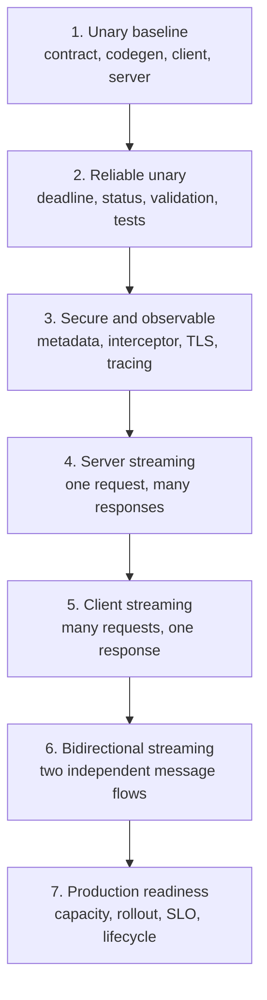
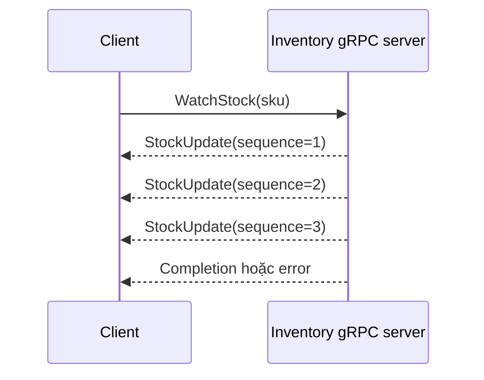
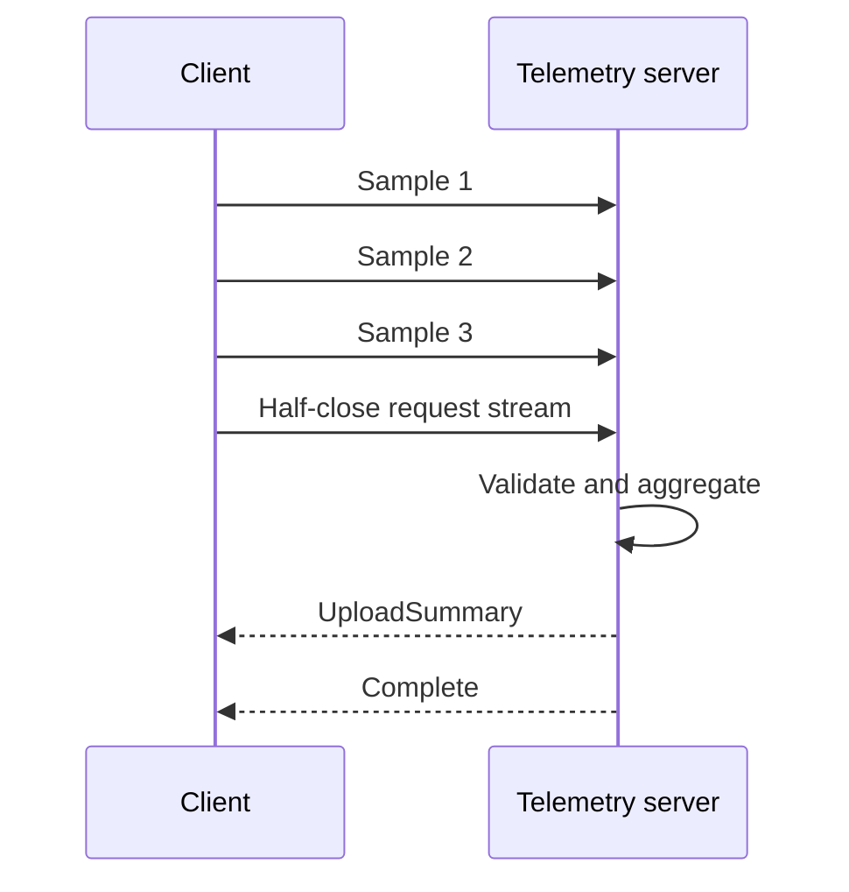
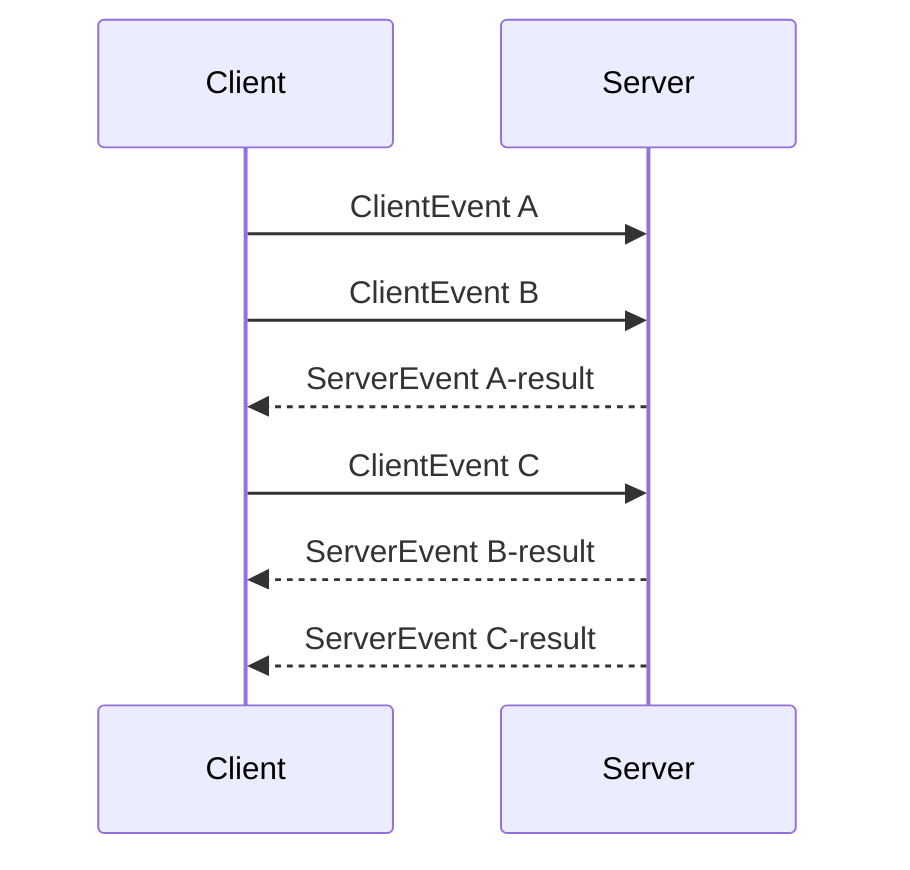

# Lộ trình từ unary RPC đến streaming và production

Khi bắt đầu với gRPC trong Spring, cách học hiệu quả là triển khai một **unary RPC nhỏ chạy được từ client đến server**, sau đó bổ sung các yêu cầu về độ tin cậy và bảo mật, rồi mới mở rộng sang streaming và vận hành production. Unary giúp hiểu contract, code generation, stub, handler và status trong phạm vi dễ kiểm soát. Streaming thêm vòng đời dài, nhiều message và điều phối hai chiều. Production đòi hỏi hệ thống xử lý được tải, lỗi, rollout, bảo mật và shutdown một cách có chủ đích.

Bài thuộc chương **Nhập môn** của module **SPRING_GRPC**. Module tập trung phát triển dịch vụ gRPC trong hệ sinh thái Spring bằng Protocol Buffers, sinh mã Java và triển khai client/server cho unary hoặc streaming RPC; người học tiếp tục xử lý metadata, deadline, status, interceptor, TLS, kiểm thử tích hợp và giám sát hiệu năng, độ tin cậy. Lộ trình dưới đây sắp xếp các năng lực theo thứ tự phụ thuộc và đưa ra tiêu chí để biết khi nào có thể chuyển sang bước tiếp theo.

## 1. Bản đồ lộ trình



Đây là thứ tự học khuyến nghị, không phải yêu cầu mọi hệ thống phải dùng đủ bốn kiểu RPC. Một ứng dụng chỉ cần unary có thể dừng ở đó và vẫn vận hành production tốt. Chỉ thêm streaming khi nghiệp vụ thực sự cần trao đổi nhiều message trong một RPC.

| Giai đoạn | Năng lực cần đạt | Kết quả có thể kiểm chứng |
| --- | --- | --- |
| Unary baseline | Tạo contract, sinh mã, gọi stub và triển khai handler | Client gọi được server và nhận response đúng |
| Reliable unary | Validation, deadline, status, lỗi và test tích hợp | Timeout/lỗi có hành vi rõ ràng; test được các trường hợp chính |
| Secure and observable | Metadata, interceptor, TLS, logs/metrics/traces | Có thể xác thực, truy vết và đo RPC |
| Server streaming | Server gửi nhiều message trong một RPC | Client nhận được chuỗi cập nhật và xử lý kết thúc/hủy |
| Client streaming | Client gửi nhiều message, server trả kết quả cuối | Server nhận, xác thực và tổng hợp luồng request |
| Bidirectional streaming | Hai phía gửi/nhận độc lập trong cùng RPC | Xử lý được thứ tự, cancellation và tốc độ hai phía |
| Production readiness | Capacity, resilience, deployment, lifecycle và SLO | Dịch vụ có thể rollout, quan sát và phục hồi an toàn |

## 2. Giai đoạn 1 — Dựng unary RPC nhỏ làm nền tảng

Unary là kiểu RPC đơn giản nhất: một request và một response. Hãy chọn một nghiệp vụ đọc dễ kiểm chứng, chẳng hạn Order Service hỏi Inventory Service số lượng còn trong kho.

### 2.1. Định nghĩa contract trước

Ví dụ `inventory.proto`:

```protobuf
syntax = "proto3";

package commerce.inventory.v1;

option java_package = "com.example.inventory.grpc";
option java_multiple_files = true;

service InventoryService {
  rpc CheckStock(CheckStockRequest) returns (CheckStockReply);
}

message CheckStockRequest {
  string sku = 1;
  int32 quantity = 2;
}

message CheckStockReply {
  bool available = 1;
  int32 remaining = 2;
}
```

Trước khi viết Java, cần thống nhất:

- Tên package, service và method; đây là định danh API trên wire.
- Kiểu dữ liệu request/response và ý nghĩa từng field.
- Quy tắc đầu vào hợp lệ, ví dụ SKU không rỗng và quantity lớn hơn 0.
- Kết quả nghiệp vụ nào là response bình thường, kết quả nào là RPC error.
- Quy tắc tương thích khi thêm hoặc bỏ field trong các phiên bản sau.

Không dùng số field tùy tiện: field number là một phần của wire format. Không tái sử dụng số của field đã xóa; cân nhắc `reserved` khi schema tiến hóa.

### 2.2. Sinh mã và xác nhận output

Quá trình build dùng `protoc` để sinh Java message classes và plugin `protoc-gen-grpc-java` để sinh service descriptor, client stub và server base. Với Java/Spring, generated sources cần nằm trong source set để được compile cùng Protobuf/gRPC runtime dependencies.

Kết quả cần thấy về mặt khái niệm:

| Mã được sinh | Dùng ở đâu |
| --- | --- |
| `CheckStockRequest` | Client tạo request, server đọc request |
| `CheckStockReply` | Server tạo response, client đọc response |
| `InventoryServiceGrpc` | Cung cấp stub và API server |
| `InventoryServiceImplBase` | Lớp cơ sở để triển khai handler trong API gRPC Java tương ứng |

Không chỉnh sửa trực tiếp file Java được sinh. Khi contract thay đổi, sửa `.proto` và chạy lại code generation. Nếu có message class mà không có `*Grpc.java`, hãy kiểm tra plugin gRPC Java; nếu có source nhưng compile không được, kiểm tra generated source set và runtime dependencies.

### 2.3. Nối server handler với Spring business service

Server handler nhận request Protobuf, gọi bean nghiệp vụ và tạo response. Spring có thể quản lý handler bằng bean injection; gRPC runtime vẫn phải đăng ký handler vào server. Cách đăng ký cụ thể phụ thuộc starter hoặc cấu hình gRPC Java đang dùng.

Ví dụ chữ ký handler unary:

```java
@Override
public void checkStock(
        CheckStockRequest request,
        StreamObserver<CheckStockReply> observer) {
    int remaining = inventoryQuery.remaining(request.getSku());

    CheckStockReply reply = CheckStockReply.newBuilder()
        .setAvailable(remaining >= request.getQuantity())
        .setRemaining(remaining)
        .build();

    observer.onNext(reply);
    observer.onCompleted();
}
```

Đây là phần minh họa cốt lõi; lớp thực tế cần validation và mapping lỗi. Tách `inventoryQuery` thành Spring business service giúp kiểm thử nghiệp vụ độc lập với transport. Đừng giả định `@Service` hoặc `@Component` tự động công bố RPC nếu starter chưa cấu hình đăng ký.

### 2.4. Gọi từ client

Client dùng `ManagedChannel` và stub được sinh:

```java
CheckStockReply reply = inventoryStub
    .checkStock(CheckStockRequest.newBuilder()
        .setSku("SKU-123")
        .setQuantity(2)
        .build());
```

Trong ứng dụng Spring, channel và stub thường được quản lý theo lifecycle để tái sử dụng. Không tạo channel mới cho từng request. Đoạn gọi trên giả định stub đã được cấu hình và inject; địa chỉ, credentials và transport thuộc cấu hình client.

### Tiêu chí hoàn tất giai đoạn 1

- Contract compile được và generated message/service classes tồn tại.
- Server handler đã được đăng ký và server lắng nghe đúng endpoint.
- Client gọi được unary method qua gRPC, nhận đúng response.
- Bean nghiệp vụ không phụ thuộc trực tiếp vào chi tiết transport.
- Có ít nhất một test xác minh mapping request/response.

Khi chưa đạt các điểm này, chưa nên thêm streaming. Streaming sẽ làm khó xác định lỗi nếu contract, registration hoặc client channel còn chưa ổn định.

## 3. Giai đoạn 2 — Làm unary đáng tin cậy

Một RPC chạy được trên local chưa đủ cho hệ thống phân tán. Trước khi mở rộng kiểu giao tiếp, hãy làm rõ cách xử lý dữ liệu sai, timeout, lỗi server và kết quả không xác định.

### 3.1. Validation và ranh giới nghiệp vụ

Phân biệt:

- Request sai cấu trúc hoặc giá trị không hợp lệ: trả status như `INVALID_ARGUMENT`.
- Tài nguyên không tồn tại: dùng `NOT_FOUND` nếu contract coi đây là lỗi.
- Hết hàng: có thể trả response `available = false` với status `OK`, vì phép kiểm tra đã thực hiện thành công.
- Sự cố nội bộ: mapping sang status phù hợp, không để lộ stack trace hoặc dữ liệu nhạy cảm.

Không biến mọi kết quả nghiệp vụ không mong muốn thành RPC error. Client cần biết đó là “không đủ hàng” hay “không thể hỏi server”.

### 3.2. Deadline và timeout budget

Đặt deadline cho mỗi RPC theo ngân sách của request tổng thể:

```java
CheckStockReply reply = inventoryStub
    .withDeadlineAfter(250, TimeUnit.MILLISECONDS)
    .checkStock(request);
```

Con số 250 ms chỉ là ví dụ. Nếu một HTTP request của Order Service có ngân sách 700 ms và phải gọi nhiều downstream nối tiếp, không thể cấp toàn bộ 700 ms cho từng RPC. Hãy dùng latency p95/p99 và thời gian còn lại của request để phân bổ deadline.

Khi nhận `DEADLINE_EXCEEDED`, client chỉ biết chưa nhận kết quả đúng hạn. Server có thể đã thực hiện nghiệp vụ. Đặc biệt với thao tác ghi, timeout không chứng minh lệnh chưa commit.

### 3.3. Retry và idempotency

Chỉ retry khi biết method có thể được thử lại an toàn hoặc server hỗ trợ chống trùng. Với lệnh giữ hàng/thanh toán, một request ID ổn định có thể giúp server nhận diện lần gửi lặp:

```protobuf
message ReserveStockRequest {
  string request_id = 1;
  string sku = 2;
  int32 quantity = 3;
}
```

Server cần lưu kết quả theo request ID và bảo đảm xử lý kiểm tra trùng cùng cập nhật nghiệp vụ an toàn trước cạnh tranh đồng thời. Chỉ thêm field vào proto không tự tạo ra idempotency.

Retry policy cần có số lần tối đa, backoff, jitter, deadline còn lại và tập status được phép retry. Tránh retry liên tục khi server đang quá tải vì có thể tạo retry storm.

### 3.4. Kiểm thử unary qua ranh giới RPC

Tối thiểu cần kiểm tra:

| Trường hợp | Điều cần xác nhận |
| --- | --- |
| Request hợp lệ | Response đúng field và status `OK` |
| Request không hợp lệ | Status `INVALID_ARGUMENT` |
| Nghiệp vụ không tìm thấy dữ liệu | Mapping đúng contract |
| Server chậm | Client nhận deadline phù hợp |
| Server unavailable | Lỗi được nhận diện và không retry vô hạn |
| Kết nối mất sau commit | Cơ chế idempotency/truy vấn trạng thái tránh side effect trùng |

In-process gRPC test hữu ích để kiểm tra handler và stub, nhưng không xác minh đầy đủ HTTP/2, TLS, proxy hoặc deployment. Bổ sung test qua transport thực tế cho các rủi ro đó.

### Tiêu chí hoàn tất giai đoạn 2

- Validation và status mapping nhất quán.
- Deadline được đặt ở client và phối hợp với ngân sách request tổng.
- Retry chỉ bật cho method có ngữ nghĩa phù hợp.
- Thao tác ghi có idempotency hoặc cơ chế xác định trạng thái sau timeout.
- Có test cho success, invalid input, timeout và unavailable.

## 4. Giai đoạn 3 — Bổ sung bảo mật và khả năng quan sát

Trước khi mở rộng streaming, hãy chuẩn hóa cách các RPC được xác thực, theo dõi và vận hành. Các cơ chế này dùng được cho unary lẫn streaming.

### 4.1. Metadata và interceptor

Metadata mang thông tin điều khiển như authorization token, correlation ID hoặc trace context; không nên đưa token vào message nghiệp vụ. Client interceptor có thể gắn metadata chung, server interceptor có thể xác thực, ghi log hoặc đo thời lượng.

Spring có thể tạo interceptor bean và inject dịch vụ xác thực/telemetry. Nhưng interceptor phải được gắn vào gRPC channel/server hoặc đăng ký qua cơ chế của starter. Chỉ khai báo bean không bảo đảm interceptor được thực thi.

### 4.2. TLS và identity

- TLS bảo vệ dữ liệu trên đường truyền và xác thực server.
- mTLS có thể xác thực cả client lẫn server trong giao tiếp workload-to-workload.
- Authorization vẫn phải quyết định danh tính nào được gọi service/method và truy cập tài nguyên nào.
- Không dùng plaintext trên mạng production; cấu hình chứng chỉ, trust roots, rotation và policy theo môi trường.

TLS không tự động cấp quyền nghiệp vụ. Một client có kết nối TLS hợp lệ vẫn có thể không được phép gọi `ReserveStock`.

### 4.3. Metrics, logs và tracing

Theo dõi theo service/method/status:

- Số RPC và tỷ lệ lỗi.
- Latency p50/p95/p99.
- Số RPC/stream đang hoạt động.
- Kích thước message và lưu lượng.
- Channel/connection state.
- Thời gian ở handler, database và downstream.

Trace context nên đi xuyên các hop Order → Inventory → database. Tránh đưa SKU, token hoặc ID có cardinality cao vào metric label. Với streaming, cần thêm số stream đang mở, tuổi thọ stream, tốc độ message và lý do kết thúc.

### Tiêu chí hoàn tất giai đoạn 3

- TLS/mTLS được cấu hình và kiểm thử trên đường truyền phù hợp.
- Authentication/authorization được áp dụng ở gRPC server.
- Metadata và interceptor được xác minh bằng test.
- Logs, metrics và traces giúp tìm method chậm hoặc status lỗi.
- Không ghi secret hoặc dữ liệu nhạy cảm vào telemetry.

## 5. Giai đoạn 4 — Server streaming khi cần nhiều response

Unary kết thúc sau một response. Nếu client cần đăng ký và nhận nhiều cập nhật từ server trong cùng một phiên, server streaming có thể phù hợp.

Ví dụ theo dõi số lượng hàng:

```protobuf
service InventoryService {
  rpc WatchStock(WatchStockRequest) returns (stream StockUpdate);
}

message WatchStockRequest {
  string sku = 1;
}

message StockUpdate {
  string sku = 1;
  int32 remaining = 2;
  int64 sequence = 3;
}
```

Một request tạo một RPC; server gửi nhiều `StockUpdate` trên cùng RPC. Với gRPC Java, handler thường gọi `observer.onNext(update)` nhiều lần rồi kết thúc bằng `onCompleted()` hoặc `onError(...)`.



### Những vấn đề mới xuất hiện

**Vòng đời:** stream có thể kéo dài; cần xác định điều kiện kết thúc, deadline, cancellation và graceful shutdown.

**Tốc độ:** producer có thể tạo update nhanh hơn client xử lý. HTTP/2 flow control điều tiết byte, nhưng ứng dụng vẫn phải giới hạn buffer và xử lý consumer chậm.

**Mất kết nối:** gRPC stream không tự lưu bền hoặc phát lại event sau khi client offline. Nếu cần resume, có thể dùng sequence/cursor và API đọc tiếp, hoặc chọn broker có retention/replay.

**Tài nguyên:** stream lâu giữ state, buffer và slot concurrency. Cần giới hạn số stream, message size và thời gian tồn tại theo chính sách.

### Tiêu chí hoàn tất giai đoạn 4

- Client nhận được nhiều message trên cùng RPC.
- Server kết thúc đúng bằng completion/error.
- Client cancellation dừng nguồn phát và giải phóng tài nguyên.
- Consumer chậm không làm buffer tăng vô hạn.
- Có quy tắc reconnect/resume nếu nghiệp vụ cần không bỏ lỡ update.

## 6. Giai đoạn 5 — Client streaming khi server cần tổng hợp nhiều request

Client streaming phù hợp khi client gửi nhiều message trong một RPC và server chỉ trả một kết quả cuối cùng. Ví dụ một client gửi các mẫu đo để server tính thống kê theo lô.

```protobuf
service TelemetryService {
  rpc UploadSamples(stream Sample) returns (UploadSummary);
}

message Sample {
  string sensor_id = 1;
  int64 timestamp_ms = 2;
  double value = 3;
}

message UploadSummary {
  int32 accepted = 1;
  int32 rejected = 2;
}
```

Luồng khái quát:



Ở phía server, method thường nhận một observer để trả response và trả về một observer khác để nhận các request tiếp theo. Server có thể xử lý từng message hoặc tích lũy theo giới hạn; không nên giữ một batch không giới hạn trong bộ nhớ.

Các quyết định cần có:

- Giới hạn số message và tổng byte mỗi RPC.
- Validation theo từng message và quy tắc xử lý message lỗi.
- Khi nào ghi dữ liệu: từng message, theo batch hay khi stream hoàn tất.
- Hành vi nếu client ngắt giữa chừng.
- Có cần idempotency hoặc sequence để tránh ghi trùng khi client gửi lại batch không.

### Tiêu chí hoàn tất giai đoạn 5

- Client gửi nhiều request và half-close đúng.
- Server chỉ trả kết quả cuối khi hoàn tất theo contract.
- Giới hạn batch/message và bộ nhớ được kiểm soát.
- Ngắt giữa chừng có hành vi rõ: commit từng phần, rollback hoặc lưu trạng thái theo thiết kế.
- Test được empty stream, message lỗi và client disconnect.

## 7. Giai đoạn 6 — Bidirectional streaming khi hai phía cần trao đổi độc lập

Bidirectional streaming cho phép client và server gửi nhiều message trong cùng một RPC. Hai chiều không cần gửi theo cặp một-một; một phía có thể gửi nhiều message trong khi phía kia phản hồi theo nhịp riêng.

Ví dụ phiên đồng bộ trạng thái:

```protobuf
service SyncService {
  rpc Exchange(stream ClientEvent) returns (stream ServerEvent);
}

message ClientEvent {
  string event_id = 1;
  string payload = 2;
}

message ServerEvent {
  string event_id = 1;
  string result = 2;
}
```



Hai phía có thể đọc và ghi độc lập. Vì vậy, code client/server thường dùng async stub và observer; phải thiết kế rõ:

- Quan hệ giữa request event và response event, ví dụ correlation ID.
- Có bảo đảm thứ tự hay không và thứ tự được xác định theo phạm vi nào.
- Điều gì xảy ra khi một phía gửi nhanh hơn phía kia.
- Cách kết thúc một chiều, kết thúc cả RPC và xử lý lỗi.
- Cancellation, deadline, heartbeat, reconnect và khôi phục phiên.
- Giới hạn buffer và số phiên đồng thời.

Bidirectional streaming không tự biến gRPC thành message broker. Khi client offline nhiều giờ và cần nhận lại mọi event, cần cơ chế lưu bền/cursor/replay ở tầng ứng dụng hoặc broker.

### Tiêu chí hoàn tất giai đoạn 6

- Hai phía gửi và nhận độc lập trong cùng RPC.
- Correlation và thứ tự message có quy tắc rõ.
- Consumer chậm được kiểm soát.
- Cancellation/error kết thúc tài nguyên ở cả hai phía.
- Có chiến lược reconnect/resume phù hợp với yêu cầu dữ liệu.

## 8. Giai đoạn 7 — Chuẩn bị production

Khi unary/streaming hoạt động trong môi trường test, cần chuẩn bị hệ thống cho tải thật, rollout và sự cố. Production readiness không phải một loại RPC; đó là tập yêu cầu áp dụng cho tất cả method.

### 8.1. Contract và rollout

- Version hóa Protobuf package và quản lý field number.
- Kiểm tra tương thích client cũ/server mới trong rolling deployment.
- Không đổi ý nghĩa field hoặc method mà không có kế hoạch migration.
- Phát hành contract/generated library có version rõ.
- Có quy trình deprecation cho client không thể nâng cấp đồng thời.

### 8.2. Bảo vệ tài nguyên và khả năng chịu lỗi

- Giới hạn message size, concurrent RPC, active stream và thời gian sống stream.
- Đặt deadline ở client và timeout ở downstream.
- Retry có backoff/jitter, giới hạn và chỉ dùng khi an toàn.
- Thiết kế idempotency cho thao tác ghi.
- Cân nhắc load balancing, health checking và readiness.
- Tránh retry storm và cascading failure; dùng bulkhead/circuit breaker khi phù hợp với kiến trúc.

### 8.3. Server lifecycle và deployment

- Server khởi động sau khi cấu hình/credentials hợp lệ.
- Readiness chỉ báo sẵn sàng khi service thực sự có thể nhận RPC.
- Graceful shutdown ngừng nhận request mới và xử lý các RPC đang hoạt động theo thời hạn.
- Streaming cần chính sách đóng hoặc drain rõ ràng.
- Channel client được tái sử dụng và đóng theo lifecycle.
- Kiểm tra HTTP/2, TLS termination, proxy và service mesh trong môi trường triển khai thật.

### 8.4. SLO và telemetry

Xác định mục tiêu cho:

| Chỉ số | Câu hỏi |
| --- | --- |
| Availability | Tỷ lệ RPC thành công theo service/method là bao nhiêu? |
| Latency | p95/p99 có nằm trong ngân sách không? |
| Error rate | Status nào tăng và từ client/server/downstream? |
| Throughput | Server xử lý bao nhiêu RPC/message mỗi giây? |
| Concurrency | Có bao nhiêu RPC/stream hoạt động đồng thời? |
| Resource | CPU, heap, buffer, connection và thread có gần giới hạn? |
| Stream health | Stream sống bao lâu, kết thúc vì lý do nào, message rate ra sao? |

Đo theo service/method/status và tránh metric label có cardinality cao như token, SKU hoặc user ID. Dùng trace để phân biệt thời gian ở client, transport, handler và downstream.

### 8.5. Kiểm thử production-like

Ngoài unit và in-process tests, cần test trên transport thật cho:

- TLS/mTLS và authentication/authorization.
- Proxy/load balancer/HTTP2.
- Deadline, cancellation và server restart.
- Retry/idempotency khi response bị mất.
- Streaming với client chậm, disconnect và reconnect.
- Load/concurrency, message size và resource exhaustion.
- Rolling upgrade giữa client/server khác phiên bản.

## 9. Không phải hệ thống nào cũng cần đi đến bidirectional streaming

Lộ trình là cách học tăng dần năng lực, không phải checklist buộc mọi sản phẩm phải triển khai đủ bốn cardinality.

| Nhu cầu | Kiểu thường phù hợp |
| --- | --- |
| Tra cứu một lần và nhận một kết quả | Unary |
| Một yêu cầu đăng ký, server gửi nhiều cập nhật | Server streaming |
| Client tải một luồng dữ liệu để server tổng hợp | Client streaming |
| Hai phía trao đổi liên tục trong một phiên | Bidirectional streaming |
| Consumer offline và cần nhận lại event đã phát | Messaging có retention/replay hoặc cơ chế lưu bền riêng |
| Tác vụ dài, chỉ cần kiểm tra trạng thái định kỳ | Unary status API hoặc event notification; không nhất thiết giữ stream mãi |

Hãy ưu tiên kiểu RPC đơn giản nhất đáp ứng được ngữ nghĩa nghiệp vụ. Streaming thêm lợi ích khi cần nhiều message trên một phiên, nhưng cũng thêm yêu cầu về flow control, cancellation, reconnect, resource management và quan sát.

## 10. Kế hoạch thực hành theo các mốc có thể đánh giá

Có thể dùng các mốc sau để tự đánh giá tiến độ:

| Mốc | Bài thực hành | Điều kiện đạt |
| --- | --- | --- |
| M1 — Unary | Tạo InventoryService.CheckStock từ proto | Client gọi server, nhận response đúng |
| M2 — Reliable unary | Thêm validation, deadline và status mapping | Test được invalid input, timeout và unavailable |
| M3 — Secure unary | Thêm TLS, authentication và interceptor | RPC hợp lệ được phép; request sai quyền bị từ chối |
| M4 — Server stream | Thêm WatchStock | Client nhận nhiều update và xử lý cancellation |
| M5 — Client stream | Thêm UploadSamples | Server nhận nhiều message, giới hạn batch và trả summary |
| M6 — Bidi stream | Thêm Exchange | Hai phía gửi/nhận độc lập, có correlation và kết thúc rõ |
| M7 — Production | Thêm readiness, graceful shutdown, metrics, trace và load test | Có số liệu SLO và kiểm chứng rollout/failure |

Không chuyển sang mốc tiếp theo chỉ vì code compile được. Mỗi mốc phải có **hành vi chạy được và bằng chứng kiểm thử**. Ví dụ, M4 cần chứng minh server gửi nhiều response trên một RPC và cancellation giải phóng nguồn dữ liệu, không chỉ chứng minh method có từ khóa `stream`.

## 11. Những lỗi thường gặp khi học theo lộ trình

| Cách làm dễ gây vấn đề | Cách tiếp cận tốt hơn |
| --- | --- |
| Bắt đầu bằng bidirectional streaming khi chưa hiểu unary | Làm unary end-to-end trước để nắm contract, stub, handler và status |
| Thêm retry trước khi hiểu side effect | Xác định idempotency và kết quả không rõ sau timeout |
| Xem deadline như timeout của toàn bộ ứng dụng | Phân bổ ngân sách theo từng hop và request tổng |
| Chỉ test gọi trực tiếp handler | Test qua stub/server, sau đó test transport thật cho TLS/HTTP2 |
| Tạo channel mới cho mỗi RPC | Tái sử dụng channel theo lifecycle |
| Giữ stream vô hạn mà không giới hạn buffer | Thiết kế flow control, cancellation, timeout và giới hạn tài nguyên |
| Cho rằng Spring bean tự động là gRPC endpoint | Kiểm tra cơ chế đăng ký handler với server runtime |
| Đưa toàn bộ logic nghiệp vụ vào handler | Tách adapter gRPC khỏi Spring business service |
| Chỉ đo thời gian database | Đo latency end-to-end và theo service/method/status |
| Rollout contract mới cùng lúc mọi client | Thiết kế schema compatibility và rollout lệch phiên bản |

## 12. Checklist chuyển một gRPC service từ học tập sang production

Trước khi công bố một service, hãy xác nhận:

- [ ] Contract có package/version, field number và ngữ nghĩa method rõ.
- [ ] Generated code được tạo tự động trong build, không sửa tay.
- [ ] Server handler đã đăng ký đúng và Spring dependency được inject.
- [ ] Client channel/stub được quản lý theo lifecycle.
- [ ] Validation, status mapping và deadline đã được định nghĩa.
- [ ] Retry chỉ áp dụng với method an toàn; thao tác ghi có idempotency.
- [ ] TLS/mTLS, authentication và authorization đã được kiểm thử.
- [ ] Metadata/interceptor không làm lộ secret.
- [ ] Streaming có giới hạn, cancellation, completion và reconnect policy.
- [ ] Metrics, logs, traces và health/readiness hỗ trợ vận hành.
- [ ] Test bao phủ success, lỗi, timeout, server restart và client/server version skew.
- [ ] Có kế hoạch graceful shutdown, rollout và rollback.

## 13. Ghi nhớ

Lộ trình hợp lý cho **SPRING_GRPC** là bắt đầu từ **unary RPC** để hiểu contract Protobuf, code generation, client stub, server handler và Spring integration. Sau đó làm unary đáng tin cậy bằng validation, status, deadline, retry có kiểm soát và test. Tiếp theo bổ sung bảo mật và observability. Khi nghiệp vụ cần nhiều message, học lần lượt server streaming, client streaming rồi bidirectional streaming. Cuối cùng chuẩn bị production bằng schema compatibility, capacity limits, graceful shutdown, SLO, telemetry và kiểm thử trên hạ tầng thật.

Điểm quan trọng nhất là **mỗi giai đoạn bổ sung một năng lực có thể kiểm chứng**. Không cần streaming nếu unary đã giải quyết đúng bài toán; không nên đưa một RPC vào production chỉ vì demo chạy được. Khi có contract rõ, hành vi lỗi có chủ đích và bằng chứng vận hành, bạn mới có nền tảng để mở rộng dịch vụ gRPC trong Spring một cách an toàn.

### Tài liệu tham khảo

- [gRPC – Java basics](https://grpc.io/docs/languages/java/basics/)
- [gRPC – Core concepts, architecture and lifecycle](https://grpc.io/docs/what-is-grpc/core-concepts/)
- [gRPC – Deadlines](https://grpc.io/docs/guides/deadlines/)
- [gRPC – Cancellation](https://grpc.io/docs/guides/cancellation/)
- [gRPC – Retry](https://grpc.io/docs/guides/retry/)
- [gRPC – Performance best practices](https://grpc.io/docs/guides/performance/)
- [Protocol Buffers – Proto3 language guide](https://protobuf.dev/programming-guides/proto3/)
