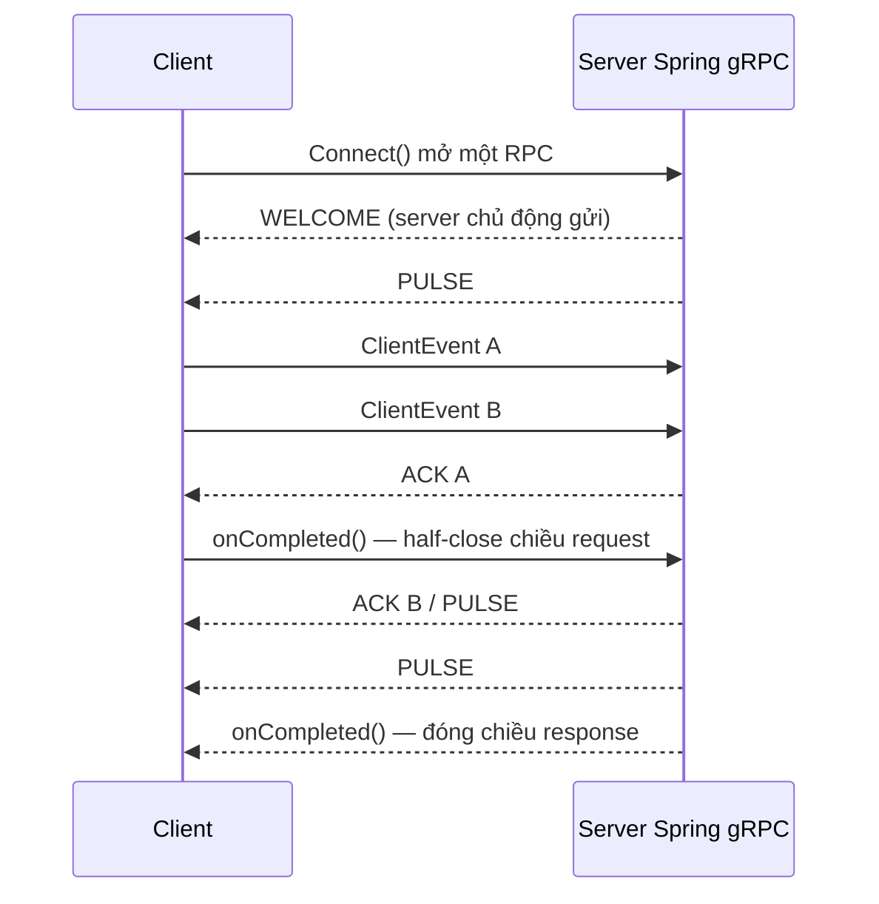

# Hai chiều streaming độc lập trong một RPC

## 1. Bài toán: một kết nối, hai luồng hoạt động riêng

Giả sử ứng dụng giám sát vận hành có một dashboard kết nối tới backend Spring. Dashboard liên tục gửi thao tác của người dùng (đánh dấu sự kiện, đổi bộ lọc); đồng thời backend chủ động đẩy cảnh báo và nhịp cập nhật trạng thái. Cảnh báo có thể đến **khi người dùng chưa gửi thao tác nào**; một thao tác gửi đi cũng không nhất thiết tạo đúng một thông báo trả về.

Đó là tình huống phù hợp với **bidirectional streaming RPC** của gRPC: client gửi một chuỗi request, server gửi một chuỗi response, cả hai cùng nằm trong **một lần gọi RPC** trên HTTP/2 và sử dụng thông điệp được định nghĩa bằng Protocol Buffers.

Sau bài này, người học có thể:

- Khai báo phương thức `stream Request` → `stream Response` trong `.proto`, sinh kiểu Java và triển khai bằng gRPC Java trong ứng dụng Spring.
- Phân biệt **hai chiều độc lập** với cơ chế hỏi–đáp từng cặp và với hai RPC streaming tách biệt.
- Điều khiển vòng đời `onNext`, `onCompleted`, `onError`, half-close, deadline và cancellation mà không vô tình đóng chiều còn lại.
- Nhận diện vấn đề thứ tự thông điệp, truy cập đồng thời và flow control khi nhiều nguồn cùng phát dữ liệu.
- Thiết kế kiểm thử và giám sát phù hợp cho một RPC có thời gian sống dài.

## 2. Bản chất của hai chiều độc lập

Trong bidirectional streaming, lời gọi tạo ra **hai luồng thông điệp có thứ tự riêng**:

| Hướng | Người phát | Người nhận | Số lượng thông điệp |
| --- | --- | --- | --- |
| Request stream | Client | Server | 0 đến nhiều |
| Response stream | Server | Client | 0 đến nhiều |

Mỗi phía có thể gửi khi có dữ liệu, không cần chờ phía kia gửi trước. Việc nhận một request có thể dẫn tới một response, nhiều response hoặc không có response nào; server cũng có thể tự phát response theo timer, sự kiện từ hệ thống hoặc thay đổi của dữ liệu.

Ví dụ dưới đây minh họa **một lịch trình có thể xảy ra**, không phải thứ tự bắt buộc giữa hai chiều:



**Hai bảo đảm cần nhớ:** gRPC duy trì thứ tự các thông điệp **trong từng chiều** của một RPC; nó không đưa ra một thứ tự toàn cục giữa các thông điệp gửi theo hai chiều khác nhau. Thời điểm `ACK B` và `PULSE #2` phụ thuộc lịch thực thi. Nếu nghiệp vụ cần liên kết sự kiện, hãy thêm `event_id`, `correlation_id`, `sequence` hoặc dấu thời gian trong Protobuf và tự định nghĩa quy tắc xử lý.

So sánh nhanh các kiểu RPC:

| Kiểu RPC | Client gửi | Server gửi | Cách sử dụng điển hình |
| --- | --- | --- | --- |
| Unary | 1 | 1 | Tra cứu chi tiết một đối tượng |
| Server streaming | 1 | N | Xem tiến độ một tác vụ |
| Client streaming | N | 1 | Tải nhiều bản ghi rồi tổng hợp |
| **Bidirectional streaming** | **N** | **N** | Cộng tác trực tiếp, tín hiệu thời gian thực, trao đổi song song |

Bidirectional streaming không đồng nghĩa với *mỗi request có đúng một response*. Nếu code server luôn trả một `ACK` sau `onNext` thì đó chỉ là **một lựa chọn nghiệp vụ**; giao thức vẫn cho phép server đẩy thông điệp hoàn toàn độc lập.

## 3. Thiết kế hợp đồng Protocol Buffers

Tạo hợp đồng `live_room.proto` (thư mục nguồn Protobuf tùy cấu hình dự án):

```proto
syntax = "proto3";

package live.v1;

option java_multiple_files = true;
option java_package = "com.example.live.v1";

service LiveRoom {
  rpc Connect(stream ClientEvent) returns (stream ServerEvent);
}

message ClientEvent {
  string event_id = 1;
  string message = 2;
}

message ServerEvent {
  string kind = 1;       // WELCOME, ACK, PULSE, ...
  string message = 2;
  int64 sequence = 3;    // Thứ tự sự kiện ở chiều server -> client
  string event_id = 4;   // Tham chiếu request khi kind = ACK
}
```

Từ định nghĩa này, bộ sinh mã `protoc` và plugin Java gRPC tạo các message Java cùng lớp dịch vụ `LiveRoomGrpc`. Điều quan trọng ở chữ ký phương thức server là:

```java
StreamObserver<ClientEvent> connect(StreamObserver<ServerEvent> responseObserver)
```

`responseObserver` là **đầu ra server → client**; kết quả trả về là `StreamObserver<ClientEvent>` để **nhận các request client → server**. Hai observer có trách nhiệm khác nhau, có thể hoạt động ở các thời điểm khác nhau, nhưng dùng chung một RPC.

Trong hệ sinh thái Spring gRPC, ứng dụng cần có các dependency tương thích cho Spring gRPC, gRPC Java, Protobuf và cấu hình sinh mã. Ví dụ bên dưới giả định những lớp `LiveRoomGrpc`, `ClientEvent`, `ServerEvent` đã được sinh thành công. Spring có thể đăng ký một implementation của `BindableService` thông qua Spring bean `@Service`, sau đó gắn nó vào gRPC server do framework quản lý.

## 4. Xây dựng server: chủ động đẩy dữ liệu kể cả khi không có request

Ví dụ dùng một `ScheduledExecutorService` được Spring quản lý để phát ba nhịp `PULSE`. Đồng thời, server trả `ACK` khi nhận `ClientEvent`. Nhờ vậy có thể quan sát rõ hai nguồn phát độc lập. Trong thực tế, timer có thể được thay bằng luồng sự kiện từ Kafka, thay đổi trạng thái ứng dụng hoặc cơ chế publish/subscribe.

Khai báo executor dùng chung, tránh tự tạo một thread pool cho từng RPC:

```java
package com.example.live;

import java.util.concurrent.Executors;
import java.util.concurrent.ScheduledExecutorService;
import org.springframework.context.annotation.Bean;
import org.springframework.context.annotation.Configuration;

@Configuration
public class StreamingConfig {
    @Bean(destroyMethod = "shutdown")
    ScheduledExecutorService streamingScheduler() {
        return Executors.newScheduledThreadPool(2);
    }
}
```

Triển khai service. `writeLock` bảo đảm các callback đến từ thread xử lý request và thread scheduler không đồng thời ghi vào **cùng một** `responseObserver`:

```java
package com.example.live;

import com.example.live.v1.ClientEvent;
import com.example.live.v1.LiveRoomGrpc;
import com.example.live.v1.ServerEvent;
import io.grpc.stub.ServerCallStreamObserver;
import io.grpc.stub.StreamObserver;
import java.util.concurrent.ScheduledExecutorService;
import java.util.concurrent.ScheduledFuture;
import java.util.concurrent.TimeUnit;
import java.util.concurrent.atomic.AtomicBoolean;
import java.util.concurrent.atomic.AtomicInteger;
import java.util.concurrent.atomic.AtomicReference;
import org.springframework.stereotype.Service;

@Service
public class LiveRoomService extends LiveRoomGrpc.LiveRoomImplBase {
    private final ScheduledExecutorService scheduler;

    public LiveRoomService(ScheduledExecutorService scheduler) {
        this.scheduler = scheduler;
    }

    @Override
    public StreamObserver<ClientEvent> connect(
            StreamObserver<ServerEvent> responseObserver) {

        ServerCallStreamObserver<ServerEvent> output =
                (ServerCallStreamObserver<ServerEvent>) responseObserver;

        Object writeLock = new Object();
        AtomicBoolean ended = new AtomicBoolean(false);
        AtomicInteger sequence = new AtomicInteger();
        AtomicInteger pulseCount = new AtomicInteger();
        AtomicReference<ScheduledFuture<?>> timer = new AtomicReference<>();

        Runnable stop = () -> {
            ended.set(true);
            ScheduledFuture<?> job = timer.get();
            if (job != null) {
                job.cancel(false);
            }
        };

        // Phải đăng ký trước khi trả request observer về cho gRPC.
        output.setOnCancelHandler(stop);

        synchronized (writeLock) {
            if (!output.isCancelled()) {
                responseObserver.onNext(ServerEvent.newBuilder()
                        .setKind("WELCOME")
                        .setMessage("Đã kết nối")
                        .setSequence(sequence.incrementAndGet())
                        .build());
            }
        }

        // Nguồn phát riêng của server, không phụ thuộc onNext(request).
        ScheduledFuture<?> job = scheduler.scheduleAtFixedRate(() -> {
            synchronized (writeLock) {
                if (ended.get() || output.isCancelled()) {
                    stop.run();
                    return;
                }

                int n = pulseCount.incrementAndGet();
                responseObserver.onNext(ServerEvent.newBuilder()
                        .setKind("PULSE")
                        .setMessage("Nhịp cập nhật " + n)
                        .setSequence(sequence.incrementAndGet())
                        .build());

                if (n == 3) { // Kết thúc ví dụ sau ba nhịp.
                    stop.run();
                    responseObserver.onCompleted();
                }
            }
        }, 1, 1, TimeUnit.SECONDS);

        timer.set(job);
        if (ended.get()) {
            job.cancel(false);
        }

        return new StreamObserver<>() {
            @Override
            public void onNext(ClientEvent event) {
                synchronized (writeLock) {
                    if (ended.get() || output.isCancelled()) {
                        return;
                    }
                    responseObserver.onNext(ServerEvent.newBuilder()
                            .setKind("ACK")
                            .setMessage("Đã nhận: " + event.getMessage())
                            .setEventId(event.getEventId())
                            .setSequence(sequence.incrementAndGet())
                            .build());
                }
            }

            @Override
            public void onError(Throwable cause) {
                // Client hủy/đứt kết nối: dừng công việc của phiên này.
                stop.run();
            }

            @Override
            public void onCompleted() {
                // Client chỉ đóng chiều gửi request (half-close).
                // Server vẫn tiếp tục phát PULSE rồi tự kết thúc.
            }
        };
    }
}
```

Điểm mấu chốt nằm ở **hai callback độc lập**: `onNext(ClientEvent)` xử lý request khi chúng tới, còn tác vụ `scheduleAtFixedRate` chủ động gửi `ServerEvent` mỗi giây. Không có câu lệnh nào bắt server phải đợi request rồi mới được gửi `PULSE`.

Đây là ví dụ với lượng dữ liệu nhỏ và thời gian sống hữu hạn để tập trung vào cấu trúc. Trong hệ thống tải lớn, không thể dựa vào việc `onNext` gửi bao nhiêu cũng được: cần kiểm soát nhịp phát, bộ đệm, lỗi trong tác vụ nền và lifecycle khi huỷ. Các điểm đó được trình bày ở phần 7.

## 5. Xây dựng client: phát request và nhận response không chặn nhau

Client dùng asynchronous stub vì bidirectional streaming được cung cấp dưới dạng observer bất đồng bộ. Sau khi gọi `connect(responseObserver)`, client nhận lại `requestObserver` để gửi sự kiện bất cứ lúc nào.

```java
package com.example.live;

import com.example.live.v1.ClientEvent;
import com.example.live.v1.LiveRoomGrpc;
import com.example.live.v1.ServerEvent;
import io.grpc.ManagedChannel;
import io.grpc.ManagedChannelBuilder;
import io.grpc.stub.StreamObserver;
import java.util.concurrent.CountDownLatch;
import java.util.concurrent.TimeUnit;

public class LiveRoomClientDemo {
    public static void main(String[] args) throws InterruptedException {
        // Chỉ dùng plaintext cho ví dụ chạy cục bộ.
        ManagedChannel channel = ManagedChannelBuilder
                .forAddress("localhost", 9090)
                .usePlaintext()
                .build();

        try {
            CountDownLatch finished = new CountDownLatch(1);
            LiveRoomGrpc.LiveRoomStub stub = LiveRoomGrpc.newStub(channel)
                    .withDeadlineAfter(8, TimeUnit.SECONDS);

            StreamObserver<ServerEvent> incoming = new StreamObserver<>() {
                @Override
                public void onNext(ServerEvent event) {
                    System.out.printf("%s #%d: %s%n",
                            event.getKind(),
                            event.getSequence(),
                            event.getMessage());
                }

                @Override
                public void onError(Throwable error) {
                    System.err.println("RPC thất bại: " + error);
                    finished.countDown();
                }

                @Override
                public void onCompleted() {
                    System.out.println("Server đã kết thúc response stream.");
                    finished.countDown();
                }
            };

            StreamObserver<ClientEvent> outgoing = stub.connect(incoming);
            outgoing.onNext(ClientEvent.newBuilder()
                    .setEventId("evt-1").setMessage("Mở dashboard").build());
            outgoing.onNext(ClientEvent.newBuilder()
                    .setEventId("evt-2").setMessage("Đổi bộ lọc").build());

            outgoing.onCompleted(); // Ngừng gửi, vẫn tiếp tục nhận PULSE.

            if (!finished.await(7, TimeUnit.SECONDS)) {
                throw new IllegalStateException("Chưa nhận tín hiệu kết thúc");
            }
        } finally {
            channel.shutdownNow().awaitTermination(2, TimeUnit.SECONDS);
        }
    }
}
```

Trong ví dụ này, client có thể nhận `WELCOME` ngay khi mở RPC, nhận `ACK` sau khi gửi sự kiện, và vẫn tiếp tục nhận `PULSE` sau `outgoing.onCompleted()`. Các bản tin trên **cùng chiều response** được quan sát theo đúng thứ tự mà server phát; khoảng xen kẽ giữa `ACK` và `PULSE` có thể thay đổi.

Để thử nghiệm cục bộ, chạy Spring gRPC server ở cổng mà client trỏ tới (ví dụ `9090`, tùy cấu hình dự án), rồi chạy lớp client. Việc khởi tạo dependency, plugin sinh mã và cổng server cần khớp với phiên bản Spring gRPC đang dùng; không nên sao chép một bộ tọa độ thư viện từ phiên bản khác mà chưa đối chiếu.

## 6. Hiểu chính xác vòng đời của một RPC

Hai chiều dữ liệu độc lập **không có nghĩa hai RPC độc lập**. Deadline, xác thực, metadata, status cuối cùng và hủy cuộc gọi đều thuộc cùng một RPC.

| Sự kiện | Điều gì xảy ra? | Việc ứng dụng nên làm |
| --- | --- | --- |
| Client gọi `outgoing.onNext(x)` | Gửi thêm một request message | Không suy ra server phải trả ngay |
| Server gọi `responseObserver.onNext(y)` | Gửi thêm một response message | Không suy ra client vừa gửi request |
| Client gọi `outgoing.onCompleted()` | Client **half-close** chiều request | Server nhận `onCompleted()` ở request observer, vẫn có thể tiếp tục phát response |
| Server gọi `responseObserver.onCompleted()` | Server hoàn tất response với status thành công | Client nhận `onCompleted()`; không gửi tiếp trên RPC đã kết thúc |
| Một phía gọi `onError(t)` | Kết thúc/hủy RPC với lỗi tương ứng | Dừng phát, giải phóng timer, subscription, bộ đệm |
| Client hủy hoặc deadline hết | RPC bị hủy hoặc quá hạn | Server kiểm tra cancellation và dừng công việc nền |

**Tình huống hay nhầm:** trong `onCompleted()` của request observer phía server, nếu luôn gọi ngay `responseObserver.onCompleted()`, bạn đã biến half-close của client thành điều kiện đóng chiều server. Với bài toán cần đẩy thông báo tiếp tục, hành vi đó là sai nghiệp vụ.

Ngược lại, không được giả định rằng sau khi server đã hoàn tất response stream thì client luôn còn quyền ghi request. Một terminal status kết thúc RPC; các lần ghi muộn có thể thất bại hoặc bị loại bỏ. Mỗi observer chỉ được nhận **một sự kiện kết thúc** (`onCompleted` hoặc `onError`), sau đó không được `onNext` nữa.

## 7. Đồng thời, flow control và độ tin cậy

### 7.1. Gửi song song phải được tuần tự hóa

`StreamObserver` không mặc nhiên thread-safe cho nhiều thread cùng ghi. Trong service mẫu, `writeLock` giúp bảo vệ các lần gọi `responseObserver.onNext` và `responseObserver.onCompleted` khỏi đan xen giữa timer và luồng xử lý request. Trong ứng dụng lớn có nhiều nguồn dữ liệu, một lựa chọn dễ mở rộng là tập trung tất cả bản tin đầu ra vào **một hàng đợi có giới hạn**, rồi dùng một writer cho mỗi RPC để gửi chúng.

Không nên dùng một khóa toàn cục cho mọi phiên, bởi điều đó biến các kết nối độc lập thành một nút nghẽn. Giữ trạng thái như `sequence`, subscription, buffer và cờ kết thúc **theo từng RPC**.

### 7.2. Flow control không đồng nghĩa `onNext` tự chặn

gRPC chạy trên HTTP/2 với flow control, nhưng ứng dụng vẫn có thể tạo dữ liệu nhanh hơn bên nhận tiêu thụ. Với luồng đầu ra, `ServerCallStreamObserver`/`ClientCallStreamObserver` cung cấp `isReady()` và `setOnReadyHandler(...)`. `isReady() == false` là tín hiệu **tạm ngừng phát thêm** và không nên tích lũy vô hạn trong bộ nhớ.

Quy trình thực tế:

1. Đưa sự kiện cần gửi vào queue có **giới hạn số phần tử hoặc số byte**.
2. Khi observer sẵn sàng, lấy từng sự kiện ra để gửi theo đúng thứ tự.
3. Nếu `isReady()` chuyển sang `false`, ngừng drain và chờ `onReadyHandler` gọi lại; trong callback vẫn phải **kiểm tra lại** `isReady()`.
4. Xác định chính sách khi đầy queue: chặn nguồn dữ liệu ở tầng phù hợp, gộp các bản tin trạng thái cũ, loại thông điệp có thể mất, hoặc kết thúc phiên với status hợp lý.

Đối với luồng **đầu vào**, khi cần kiểm soát việc nhận, server có thể gọi `disableAutoRequest()` trên `ServerCallStreamObserver` trong lúc khởi tạo RPC, sau đó dùng `request(1)` để yêu cầu phát tiếp khi đã xử lý xong một message. Client có API tương tự qua `ClientResponseObserver.beforeStart(...)` và `ClientCallStreamObserver`. Chế độ tự động mặc định phù hợp với ví dụ đơn giản; hãy bật manual flow control khi pipeline nhận bất đồng bộ hoặc có bộ đệm dễ quá tải.

### 7.3. Deadline, cancellation và lỗi

Deadline của gRPC áp dụng cho **toàn bộ RPC**, không được làm mới sau từng message. Một stream dài hạn cần chiến lược deadline phù hợp, reconnect và phục hồi state. Khi `DEADLINE_EXCEEDED` hoặc `CANCELLED`, đừng để timer, listener hay công việc đang tính tiếp tục chạy âm thầm.

Các trường hợp lỗi điển hình:

| Tình huống | Mã gRPC gợi ý | Cách ứng xử |
| --- | --- | --- |
| Payload không hợp lệ | `INVALID_ARGUMENT` | Từ chối RPC hoặc gửi thông báo lỗi nghiệp vụ theo contract |
| Thiếu xác thực | `UNAUTHENTICATED` | Chặn từ interceptor, không phát dữ liệu riêng tư |
| Không đủ quyền | `PERMISSION_DENIED` | Kết thúc phiên phù hợp |
| Server quá tải | `RESOURCE_EXHAUSTED` | Giới hạn queue/tần suất, áp dụng backoff phía client |
| Lỗi nội bộ | `INTERNAL` | Ghi log kèm correlation ID; không lộ chi tiết nhạy cảm |
| Hết hạn hoặc hủy | `DEADLINE_EXCEEDED`, `CANCELLED` | Dừng nguồn phát và giải phóng tài nguyên |

Một ví dụ kết thúc bằng trạng thái chuẩn ở server:

```java
responseObserver.onError(
    io.grpc.Status.INVALID_ARGUMENT
        .withDescription("event_id không được rỗng")
        .asRuntimeException());
```

Trong luồng thật, hãy bảo đảm thao tác này chỉ diễn ra **một lần** và không còn callback phát `onNext` sau đó. Với timer hoặc subscription chạy nền, cần đóng nguồn phát trước khi báo terminal status và xử lý mọi lỗi bất đồng bộ, tránh để RPC bị treo.

### 7.4. Metadata, TLS, retry và khả năng khôi phục

- **Metadata** như token hoặc tracing context thường gắn với lúc **khởi tạo RPC**, không tự đổi theo từng message. Có thể dùng `ClientInterceptor`/`ServerInterceptor` để truyền và kiểm tra metadata; nếu dữ liệu thay đổi theo từng sự kiện, đặt nó vào message Protobuf.
- **TLS/mTLS** bảo vệ kênh và xác thực peer. `usePlaintext()` trong client mẫu chỉ để thử trên máy phát triển. Trong triển khai thật, cấu hình kênh TLS, chứng chỉ và chính sách xác thực tương thích giữa client và server.
- **Retry/resume** với stream dài hạn không thể coi là "gửi lại toàn bộ từ đầu" một cách an toàn. Nếu có nguy cơ trùng/lỡ message, hãy dùng `event_id`, số thứ tự, ACK nghiệp vụ, cursor hoặc token resume; chỉ replay các sự kiện thỏa mãn quy tắc idempotency.
- **Quan sát hệ thống** nên đo số stream đang mở, tốc độ message/byte theo chiều, độ trễ giữa sự kiện và xử lý, mức đầy queue, số lần cancel/deadline, số lần reconnect và phân bố status. Spring gRPC hỗ trợ tích hợp observability với Micrometer; luôn gắn trace/correlation ID nhất quán cho cả phiên.

## 8. Kiểm thử cho đúng tính độc lập

Với integration test, có thể chạy service thật qua gRPC **in-process server/channel** để kiểm tra callback và status mà không phụ thuộc cổng mạng. `spring-grpc-test` hỗ trợ mô hình kiểm thử in-process trong ngữ cảnh Spring; hoặc dùng trực tiếp `InProcessServerBuilder` và `InProcessChannelBuilder` của gRPC Java. Khi kiểm thử logic timer, nên tiêm clock/scheduler có thể điều khiển để không phụ thuộc thời gian ngủ thật.

Những kịch bản cần chứng minh:

| Kịch bản | Kỳ vọng |
| --- | --- |
| Client mở `Connect` nhưng chưa gửi `ClientEvent` | Vẫn nhận `WELCOME` và `PULSE` từ server |
| Client gửi hai message liên tiếp | Server nhận đúng thứ tự; nếu có ACK, từng `event_id` liên hệ đúng sự kiện |
| Client gọi `onCompleted()` ngay sau khi gửi | Chiều response vẫn hoạt động cho đến khi server tự hoàn tất |
| Client hủy giữa stream | Job định kỳ và subscription được thu dọn; không phát tiếp |
| Có nhiều phiên cùng lúc | Sequence, queue và trạng thái kết thúc được tách theo RPC |
| Bên nhận chậm, queue đầy | Hệ thống thực thi chính sách flow control đã công bố, không tăng bộ nhớ vô hạn |
| Deadline hết hoặc dữ liệu lỗi | Kết thúc với status dự kiến, không có `onNext` sau terminal event |

Vì hai chiều độc lập, **đừng viết assertion đòi toàn bộ output phải xen kẽ chính xác theo input**. Hãy kiểm tra thứ tự *trong mỗi chiều*, liên kết bằng ID và các mốc nhân quả thật sự được hợp đồng bảo đảm.

## 9. Các sai lầm thường gặp

1. **Phản hồi 1:1 rồi tưởng đó là nghĩa bắt buộc của bidi.** Server có thể push chủ động, còn response không cần khớp số lượng request.
2. **Gọi `responseObserver.onCompleted()` khi request observer nhận `onCompleted()`.** Điều này cắt mất những bản tin server vẫn muốn đẩy sau khi client half-close.
3. **Cho nhiều thread gọi `onNext` trên cùng observer mà không điều phối.** Dễ gặp race, đảo thứ tự hoặc đẩy dữ liệu sau terminal event.
4. **Dùng queue không giới hạn vì nghĩ HTTP/2 đã lo backpressure.** Có thể làm đầy heap khi producer nhanh hơn consumer.
5. **Không hủy timer/subscription khi client bỏ đi.** Gây rò rỉ tác vụ và tài nguyên theo số kết nối.
6. **Nhầm deadline với timeout cho từng message.** Deadline là hạn của lời gọi RPC; stream sống lâu cần cấu hình và cơ chế tái kết nối rõ ràng.
7. **Tự động retry stream không có idempotency.** Gây mất hoặc nhân đôi sự kiện khi kết nối gián đoạn.

## 10. Bài tập vận dụng

Nâng cấp `LiveRoom` thành một bảng thông báo thời gian thực:

- Thay `PULSE` định kỳ bằng event publisher trong Spring. Khi có cảnh báo mới, server phát tới các phiên đang subscribe, kể cả phiên không gửi request nào.
- Thêm `Subscribe`/`Unsubscribe` vào message client (dùng `oneof`), quản lý danh sách chủ đề quan tâm theo từng RPC.
- Dùng hàng đợi có giới hạn cho từng phiên và `isReady()` để bảo vệ bộ nhớ; định nghĩa chính sách khi client nhận quá chậm.
- Thêm `last_seen_sequence` để nối lại phiên sau reconnect; viết test cho gửi trùng, bỏ sót và hết deadline.

**Tiêu chí hoàn thành:** một client có thể ngừng gửi trong khi vẫn nhận được cập nhật chủ động từ server; hai client khác nhau không chia sẻ nhầm trạng thái; và mỗi RPC kết thúc/hủy đều thu dọn tài nguyên của phiên.

### Tài liệu tham khảo

- [Spring gRPC Reference – GRPC Server](https://docs.spring.io/spring-grpc/reference/server.html): đăng ký `BindableService` trong Spring, interceptor, in-process test, observability và TLS.
- [gRPC Java – StreamObserver API](https://grpc.github.io/grpc-java/javadoc/io/grpc/stub/StreamObserver.html): quy tắc callback, terminal event và an toàn khi truy cập đồng thời.
- [gRPC Java – Manual Flow Control](https://github.com/grpc/grpc-java/blob/master/examples/src/main/java/io/grpc/examples/manualflowcontrol/README.md): quyền điều tiết luồng đến/đi, `isReady()` và `request(1)`.
