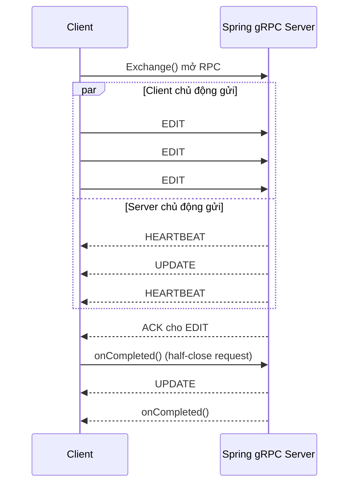
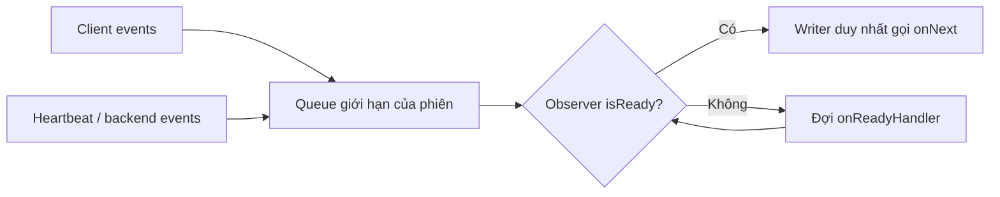

# Client và server gửi message đồng thời

## 1. Mục tiêu của bài học

Một ứng dụng cộng tác thời gian thực dùng **Spring gRPC** cần vừa nhận thao tác từ trình duyệt, vừa gửi thay đổi trạng thái từ hệ thống. Ví dụ, người dùng gửi lệnh `EDIT`, `PING` hoặc `SUBSCRIBE` trong lúc server vẫn phát các thông báo `UPDATE` và `HEARTBEAT`. Nếu client chờ nhận phản hồi rồi mới gửi thao tác kế tiếp, hoặc server chờ request rồi mới phát cập nhật, toàn bộ ứng dụng trở nên chậm và có thể rơi vào trạng thái chờ lẫn nhau.

**Bidirectional streaming** giải quyết bài toán này bằng cách cho **client và server cùng gửi nhiều message trong một RPC**. Mỗi bên có một luồng gửi và một luồng nhận. Trên một kết nối HTTP/2, các bản tin Protobuf có thể di chuyển theo hai chiều mà không cần ghép cứng từng request với từng response.

Sau bài này, người học có thể:

- Khai báo phương thức `rpc Exchange(stream ClientEvent) returns (stream ServerEvent)` và sử dụng mã Java do Protobuf/gRPC sinh ra.
- Tổ chức vòng phát và vòng nhận bất đồng bộ ở **cả client lẫn server**.
- Gửi thông báo server định kỳ ngay cả khi client đang gửi hoặc tạm dừng gửi.
- Tuần tự hóa các lần gọi `onNext()` khi có nhiều thread cùng ghi vào **một** `StreamObserver`.
- Kiểm soát `onCompleted()`, `onError()`, deadline, cancellation, flow control và tài nguyên theo từng RPC.
- Kiểm thử khả năng giao tiếp hai chiều cùng lúc mà không phụ thuộc vào một thứ tự xen kẽ ngẫu nhiên.

## 2. “Đồng thời” có nghĩa gì trong gRPC?

Trong kiểu unary, request đi trước response theo một mẫu hỏi–đáp đơn giản. Với bidirectional streaming, **mỗi phía có thể chủ động phát bản tin khi có dữ liệu**:



Sơ đồ cho thấy hai hoạt động **có thể chồng lấn về thời gian**, chứ không quy định chính xác bản tin nào đi trước bản tin nào giữa hai chiều. Server nhận `EDIT` và client nhận `UPDATE` thông qua hai callback độc lập. Chúng có thể chạy trên những thread khác nhau.

Có ba nguyên tắc quan trọng:

1. **Thứ tự trong từng chiều được bảo toàn.** Nếu client gọi `onNext(A)` rồi `onNext(B)` một cách tuần tự trên request stream, server nhận `A` trước `B`. Tương tự, client nhận response theo thứ tự server phát. Không có thứ tự toàn cục giữa request stream và response stream.
2. **Đồng thời không có nghĩa hai thread được ghi cùng lúc lên cùng observer.** `StreamObserver` không bảo đảm thread-safe với nhiều người ghi; ứng dụng phải khóa hoặc điều phối bằng một writer duy nhất. Hai observer **khác nhau**, đại diện cho hai chiều, có thể được dùng đồng thời.
3. **Một RPC có hai chiều dữ liệu nhưng một vòng đời chung.** Client kết thúc chiều request bằng `onCompleted()` chưa buộc server dừng chiều response; tuy nhiên deadline, lỗi hoặc hủy RPC có thể kết thúc toàn bộ cuộc gọi.

Một cách triển khai phổ biến là giữ luồng nhận dựa trên callback, còn luồng phát lấy dữ liệu từ executor, timer hoặc message broker. Không cần tạo một thread riêng chỉ để liên tục gọi `onNext` nếu không có dữ liệu.

## 3. Thiết kế hợp đồng Protobuf

Ví dụ một kênh sự kiện hai chiều có client gửi thao tác và server gửi xác nhận hoặc thông báo chủ động:

```proto
syntax = "proto3";

package collaboration.v1;

option java_package = "com.example.collaboration.v1";
option java_multiple_files = true;

service Collaboration {
  rpc Exchange(stream ClientEvent) returns (stream ServerEvent);
}

message ClientEvent {
  string event_id = 1;    // ID để nối ACK với thao tác
  string content = 2;     // Nội dung thao tác
}

message ServerEvent {
  string type = 1;        // ACK hoặc HEARTBEAT
  string content = 2;
  string reply_to = 3;    // event_id của client, nếu là ACK
  int64 sequence = 4;     // Thứ tự message server phát
}
```

Sau khi cấu hình `protoc` và plugin `protoc-gen-grpc-java` tương thích với dự án, các lớp `CollaborationGrpc`, `ClientEvent` và `ServerEvent` được sinh tự động. Server triển khai:

```java
StreamObserver<ClientEvent> exchange(
        StreamObserver<ServerEvent> responseObserver)
```

`responseObserver` đại diện chiều **server → client**. Observer mà `exchange(...)` trả về nhận chiều **client → server**. Với client, async stub `CollaborationGrpc.newStub(channel)` cũng dùng hai observer:

```java
StreamObserver<ClientEvent> requestObserver =
        stub.exchange(responseObserver);
```

Ở cả hai phía, `onNext(message)` là thao tác **phát bản tin** trên observer đầu ra; `onNext(message)` của observer đầu vào là callback **xử lý bản tin nhận được**. Phân biệt rõ hai vai trò này sẽ giúp tránh nhầm hướng dữ liệu khi lập trình bất đồng bộ.

## 4. Server Spring: timer phát HEARTBEAT trong lúc nhận request

Ví dụ sau dùng một `ScheduledExecutorService` do Spring quản lý. Khi client mở `Exchange`, server bắt đầu phát sáu bản tin `HEARTBEAT`, cách nhau khoảng 300 ms. Nếu client gửi `ClientEvent` trong khoảng đó, server phát thêm `ACK`. Hai nguồn sự kiện có thể hoạt động song song.

### 4.1. Executor dùng chung

```java
package com.example.collaboration;

import java.util.concurrent.Executors;
import java.util.concurrent.ScheduledExecutorService;
import org.springframework.context.annotation.Bean;
import org.springframework.context.annotation.Configuration;

@Configuration
public class CollaborationConfig {
    @Bean(destroyMethod = "shutdown")
    ScheduledExecutorService collaborationScheduler() {
        return Executors.newScheduledThreadPool(2);
    }
}
```

Executor là bean dùng chung giữa các cuộc gọi. Trạng thái phiên vẫn phải được tạo **riêng cho mỗi RPC**, tránh việc hai client dùng lẫn số thứ tự, cờ kết thúc hoặc timer.

### 4.2. Implementation của dịch vụ

```java
package com.example.collaboration;

import com.example.collaboration.v1.ClientEvent;
import com.example.collaboration.v1.CollaborationGrpc;
import com.example.collaboration.v1.ServerEvent;
import io.grpc.Status;
import io.grpc.stub.ServerCallStreamObserver;
import io.grpc.stub.StreamObserver;
import java.util.concurrent.ScheduledExecutorService;
import java.util.concurrent.ScheduledFuture;
import java.util.concurrent.TimeUnit;
import org.springframework.stereotype.Service;

@Service
public class CollaborationService
        extends CollaborationGrpc.CollaborationImplBase {

    private final ScheduledExecutorService scheduler;

    public CollaborationService(ScheduledExecutorService scheduler) {
        this.scheduler = scheduler;
    }

    @Override
    public StreamObserver<ClientEvent> exchange(
            StreamObserver<ServerEvent> responseObserver) {

        ServerCallStreamObserver<ServerEvent> output =
                (ServerCallStreamObserver<ServerEvent>) responseObserver;
        Session session = new Session(output);

        // Nếu client huỷ hoặc mất kết nối, hủy nguồn phát nền.
        output.setOnCancelHandler(session::cancel);
        session.start(scheduler);

        return new StreamObserver<>() {
            @Override
            public void onNext(ClientEvent event) {
                session.acknowledge(event);
            }

            @Override
            public void onError(Throwable error) {
                session.cancel();
            }

            @Override
            public void onCompleted() {
                // Client đã ngừng gửi, nhưng server có thể vẫn đang
                // phát HEARTBEAT. Chờ đủ điều kiện mới đóng response.
                session.inputCompleted();
            }
        };
    }

    private static final class Session {
        private final ServerCallStreamObserver<ServerEvent> output;
        private final Object writeLock = new Object();
        private ScheduledFuture<?> heartbeatJob;
        private long nextSequence = 0;
        private int heartbeats = 0;
        private boolean inputDone = false;
        private boolean ended = false;

        Session(ServerCallStreamObserver<ServerEvent> output) {
            this.output = output;
        }

        void start(ScheduledExecutorService scheduler) {
            synchronized (writeLock) {
                if (ended) {
                    return;
                }
                heartbeatJob = scheduler.scheduleAtFixedRate(
                        this::heartbeat, 0, 300, TimeUnit.MILLISECONDS);
            }
        }

        private void heartbeat() {
            synchronized (writeLock) {
                if (ended || output.isCancelled()) {
                    cancelLocked();
                    return;
                }
                // Chỉ gửi tối đa 6 nhịp minh họa.
                if (heartbeats < 6) {
                    heartbeats++;
                    sendLocked("HEARTBEAT",
                            "Nhịp " + heartbeats, "");
                }
                if (heartbeats == 6) {
                    stopTimerLocked();
                    finishIfReadyLocked();
                }
            }
        }

        void acknowledge(ClientEvent event) {
            synchronized (writeLock) {
                if (ended || output.isCancelled()) {
                    cancelLocked();
                    return;
                }
                if (event.getEventId().isBlank()) {
                    failLocked(Status.INVALID_ARGUMENT
                            .withDescription("event_id bắt buộc"));
                    return;
                }
                sendLocked("ACK",
                        "Đã nhận: " + event.getContent(),
                        event.getEventId());
            }
        }

        void inputCompleted() {
            synchronized (writeLock) {
                inputDone = true;
                finishIfReadyLocked();
            }
        }

        void cancel() {
            synchronized (writeLock) {
                cancelLocked();
            }
        }

        // Chỉ gọi khi đã giữ writeLock.
        private void sendLocked(String type,
                String content, String replyTo) {
            output.onNext(ServerEvent.newBuilder()
                    .setType(type)
                    .setContent(content)
                    .setReplyTo(replyTo)
                    .setSequence(++nextSequence)
                    .build());
        }

        private void finishIfReadyLocked() {
            if (!ended && inputDone && heartbeats == 6) {
                ended = true;
                stopTimerLocked();
                output.onCompleted();
            }
        }

        private void failLocked(Status status) {
            if (!ended) {
                ended = true;
                stopTimerLocked();
                output.onError(status.asRuntimeException());
            }
        }

        private void cancelLocked() {
            ended = true;
            stopTimerLocked();
        }

        private void stopTimerLocked() {
            if (heartbeatJob != null) {
                heartbeatJob.cancel(false);
            }
        }
    }
}
```

Hai đường gửi message khác nhau cùng tồn tại trong `Session`:

- `heartbeat()` chạy trên **thread của scheduler**, phát `HEARTBEAT` mà không chờ `ClientEvent`.
- `acknowledge()` được gọi khi gRPC nhận **request message** từ client, phát `ACK` liên kết qua `reply_to`.

Cả hai phương thức đều lấy `writeLock` trước khi gọi `output.onNext()`. Khóa này bảo vệ observer đầu ra và bảo đảm `sequence` phản ánh chính xác thứ tự phát, kể cả khi timer và request callback sẵn sàng đồng thời. Việc đồng bộ bên server **không ngăn client tiếp tục gửi request**; nó chỉ tuần tự hóa các lần ghi cùng chiều response.

Ví dụ chủ ý chờ cả hai điều kiện `inputDone` và `heartbeats == 6` rồi mới gọi `output.onCompleted()`. Như vậy, client có thể hoàn tất chiều gửi trước khi server phát xong. Nếu server phát đủ sáu nhịp trước, nó chờ client half-close; trong ứng dụng thực tế nên có deadline hoặc cơ chế kết thúc phiên rõ ràng để không giữ stream vô hạn.

> **Phạm vi của mẫu:** đoạn code trên minh họa giao tiếp đồng thời với lượng message nhỏ. Với sản phẩm thực, cần bao thêm cơ chế xử lý exception từ publisher/timer, giới hạn queue, `isReady()` và bảo vệ terminal event khi việc gửi gặp lỗi. Không nên cho một producer không giới hạn đẩy trực tiếp vào `output.onNext()` như ví dụ này.

## 5. Client Java: gửi từ một executor, nhận trong callback gRPC

Client sử dụng asynchronous stub; thao tác gửi được đưa vào một executor, còn response được xử lý bằng callback `StreamObserver<ServerEvent>`. Nhờ vậy thao tác gửi không chặn khả năng nhận.

```java
package com.example.collaboration;

import com.example.collaboration.v1.ClientEvent;
import com.example.collaboration.v1.CollaborationGrpc;
import com.example.collaboration.v1.ServerEvent;
import io.grpc.ManagedChannel;
import io.grpc.ManagedChannelBuilder;
import io.grpc.stub.StreamObserver;
import java.util.concurrent.CountDownLatch;
import java.util.concurrent.ExecutorService;
import java.util.concurrent.Executors;
import java.util.concurrent.Future;
import java.util.concurrent.TimeUnit;

public class CollaborationClientDemo {
    public static void main(String[] args) throws Exception {
        ManagedChannel channel = ManagedChannelBuilder
                .forAddress("localhost", 9090)
                .usePlaintext() // Chỉ dùng khi thử nghiệm cục bộ.
                .build();

        ExecutorService sender = Executors.newSingleThreadExecutor();
        CountDownLatch responseEnded = new CountDownLatch(1);

        try {
            CollaborationGrpc.CollaborationStub stub =
                    CollaborationGrpc.newStub(channel)
                            .withDeadlineAfter(10, TimeUnit.SECONDS);

            StreamObserver<ServerEvent> incoming =
                    new StreamObserver<>() {
                @Override
                public void onNext(ServerEvent event) {
                    System.out.printf(
                            "[NHẬN] type=%s seq=%d replyTo=%s content=%s%n",
                            event.getType(),
                            event.getSequence(),
                            event.getReplyTo(),
                            event.getContent());
                }

                @Override
                public void onError(Throwable error) {
                    System.err.println("[NHẬN] lỗi: " + error);
                    responseEnded.countDown();
                }

                @Override
                public void onCompleted() {
                    System.out.println("[NHẬN] server hoàn tất");
                    responseEnded.countDown();
                }
            };

            StreamObserver<ClientEvent> outgoing =
                    stub.exchange(incoming);

            Future<?> sendTask = sender.submit(() -> {
                try {
                    for (int i = 1; i <= 4; i++) {
                        String id = "edit-" + i;
                        outgoing.onNext(ClientEvent.newBuilder()
                                .setEventId(id)
                                .setContent("Thay đổi " + i)
                                .build());
                        System.out.println("[GỬI] " + id);
                        TimeUnit.MILLISECONDS.sleep(220);
                    }
                    outgoing.onCompleted(); // Chỉ đóng chiều request.
                } catch (InterruptedException interrupted) {
                    Thread.currentThread().interrupt();
                    // Khi dừng producer trước khi half-close, huỷ RPC.
                    outgoing.onError(
                            io.grpc.Status.CANCELLED
                                    .withDescription("Dừng producer")
                                    .asRuntimeException());
                }
            });

            // Vẫn nhận được HEARTBEAT/ACK trong lúc sendTask đang chạy.
            if (!responseEnded.await(9, TimeUnit.SECONDS)) {
                throw new IllegalStateException("RPC chưa kết thúc đúng hạn");
            }
            sendTask.get(); // Nhận biết lỗi từ tác vụ phát request.
        } finally {
            sender.shutdownNow();
            channel.shutdownNow()
                    .awaitTermination(2, TimeUnit.SECONDS);
        }
    }
}
```

Ví dụ chạy với server gRPC được cấu hình ở `localhost:9090`; cổng và dependency thực tế phụ thuộc cấu hình Spring gRPC của dự án. Client lần lượt phát bốn sự kiện, mỗi sự kiện cách nhau 220 ms; server định kỳ gửi heartbeat mỗi 300 ms. Bởi hai nhịp **khác nhau**, log sẽ có dạng xen kẽ nhưng không có một thứ tự cố định:

```text
[GỬI] edit-1
[NHẬN] type=HEARTBEAT seq=1 ...
[NHẬN] type=ACK seq=2 replyTo=edit-1 ...
[GỬI] edit-2
[NHẬN] type=HEARTBEAT seq=3 ...
[GỬI] edit-3
[NHẬN] type=ACK seq=4 replyTo=edit-2 ...
...
[NHẬN] server hoàn tất
```

Đây chỉ là một kết quả minh họa; không nên dùng chuỗi log này làm assertion thứ tự tuyệt đối. Thực tế, `ACK` có thể xuất hiện trước hoặc sau heartbeat gần nó tùy lịch xử lý. Dữ liệu cần nối lại với đúng request dựa vào `reply_to`, không dựa vào vị trí của bản tin trong log.

**Lưu ý về producer:** có đúng **một** thread gọi `outgoing.onNext()` trong client mẫu. Nếu UI thread, timer và message broker cùng phát vào `outgoing`, hãy gom thông điệp vào queue có giới hạn và dùng một writer, hoặc bảo vệ các lần ghi bằng cùng một cơ chế đồng bộ. Việc gRPC gọi `incoming.onNext()` đồng thời với thread gửi là hợp lệ, vì đó là **hai observer khác nhau**.

## 6. Những vấn đề đồng thời quan trọng

### 6.1. Không chặn callback nhận để đợi bên gửi

Một phản ví dụ dễ tạo deadlock là để server chỉ xử lý request sau khi nhận một `READY`, trong khi client lại chờ `READY_ACK` trước khi gửi `READY`. Nếu hai phía đều gọi blocking wait theo điều kiện không ai kích hoạt, cả RPC đứng yên dù transport vẫn hoạt động.

Trong gRPC Java, các callback `onNext()` nên xử lý nhanh, tránh `Thread.sleep()`, truy vấn chậm hoặc chờ một điều kiện liên quan đến callback khác trên cùng executor. Với công việc nặng, chuyển sang executor dành riêng rồi phát kết quả an toàn trên response observer. Cần xét thứ tự nghiệp vụ nếu nhiều tác vụ hoàn thành không theo thứ tự nhận.

### 6.2. Thread-safe theo *mỗi* observer

Xem hai thao tác sau:

| Hoạt động | Có thể chạy song song không? | Điều kiện |
| --- | --- | --- |
| Client gọi `outgoing.onNext(A)` trong lúc callback `incoming.onNext(B)` chạy | **Có** | Hai observer khác nhau |
| Hai thread client đồng thời gọi `outgoing.onNext(...)` | **Không an toàn nếu không điều phối** | Dùng một writer hoặc đồng bộ |
| Server timer và callback request cùng gọi `output.onNext(...)` | **Cần bảo vệ** | Khóa/queue per RPC như `writeLock` |
| Một thread gọi `output.onNext(...)`, thread khác gọi `output.onCompleted()` | **Cần bảo vệ** | Đảm bảo không `onNext` sau terminal event |

Chỉ nên có **một sự kiện terminal** trên mỗi observer: hoặc `onCompleted()`, hoặc `onError(Throwable)`. Sau terminal event không được gửi thêm `onNext()`. Một cờ `ended` được bảo vệ bởi cùng khóa ghi giúp phối hợp giữa timer, callback, cancellation và kết thúc bình thường.

### 6.3. Tính đúng đắn của thứ tự và liên kết nghiệp vụ

Transport bảo đảm thứ tự nhận **trên một stream theo từng chiều**; nó không bảo đảm `HEARTBEAT` nào sẽ nằm trước `ACK` nào giữa các producer. Khi nhiều nguồn phát server được hợp nhất bằng một lock, thứ tự server thực tế là thứ tự chúng lấy được lock và gọi `onNext`. Đừng nhầm điều đó với thứ tự thời gian mà các sự kiện nghiệp vụ *phát sinh*.

Nếu cần hội thoại có trạng thái hoặc kiểm soát trùng lặp, hãy bổ sung:

- `event_id` để định danh request.
- `reply_to` để client biết ACK thuộc request nào.
- `sequence` do server tăng theo từng RPC hoặc theo từng kênh sự kiện.
- Idempotency key, version hoặc cursor khi cần replay sau mất kết nối.

Ở hệ thống nhiều server, `sequence` theo từng RPC **không phải** số thứ tự toàn cục cho mọi client; muốn có thứ tự toàn cục phải quy định nguồn cấp sequence và cách hợp nhất sự kiện riêng.

## 7. Flow control và bảo vệ hệ thống khi gửi nhanh

Vì client và server có thể cùng phát nhiều message, cả hai đều có nguy cơ tạo dữ liệu nhanh hơn bên kia đọc. HTTP/2 có **flow control**, nhưng API `onNext()` không nhất thiết chặn ứng dụng đến khi peer xử lý xong. Nếu cứ tạo message và giữ trong bộ đệm không giới hạn, ứng dụng vẫn có thể hết bộ nhớ.

Trong gRPC Java:

- `ServerCallStreamObserver<ServerEvent>` cho server và `ClientCallStreamObserver<ClientEvent>` cho client cung cấp `isReady()` và `setOnReadyHandler(...)`. Khi `isReady()` là `false`, ngừng drain queue và chờ callback; callback cần kiểm tra lại readiness.
- Khi dùng **manual inbound flow control**, server có thể cấu hình `disableAutoRequest()` rồi `request(n)` trên `ServerCallStreamObserver`. Client có thể điều khiển response stream qua `ClientResponseObserver.beforeStart(...)` và `ClientCallStreamObserver`.
- Queue của từng RPC nên có giới hạn rõ ràng; khi đầy, lựa chọn chặn producer ở tầng phù hợp, gộp message trạng thái có thể thay thế, bỏ message không thiết yếu hoặc kết thúc RPC với status thích hợp.

Một mô hình writer đầu ra có giới hạn:



Không nên gọi `onNext()` ngay trong nhiều callback của các producer nếu đã chọn mô hình queue. Tất cả nên đi qua một đường ghi để bảo đảm thứ tự, giới hạn bộ nhớ và nhất quán với terminal event.

## 8. Vòng đời, deadline và lỗi trong một cuộc gọi song công

| Sự kiện | Hành vi cần hiểu | Xử lý |
| --- | --- | --- |
| `outgoing.onCompleted()` ở client | Client **half-close request stream** | Server vẫn có thể gửi response |
| `onCompleted()` của request observer server | Không còn request mới | Đánh dấu `inputDone`; chỉ kết thúc response khi nghiệp vụ hoàn tất |
| `responseObserver.onCompleted()` ở server | Kết thúc thành công response stream và RPC | Client nhận terminal callback, giải phóng nguồn phát |
| `onError(t)` | Lỗi kết thúc luồng/RPC | Dừng timer, queue, subscription; ghi nhận status |
| `CANCELLED` / `DEADLINE_EXCEEDED` | Client hủy hoặc RPC hết thời hạn | Không để background job phát tiếp |

Deadline là hạn của **toàn bộ RPC**, không tự được gia hạn bởi heartbeat. Trong ví dụ, client đặt deadline 10 giây để tránh treo vô thời hạn. Với ứng dụng có stream sống hàng giờ, cần chính sách deadline, reconnect và khôi phục sự kiện rõ ràng; không dựa vào việc một kết nối sẽ luôn tồn tại.

Trong Spring gRPC, metadata và interceptor có thể gắn thông tin xác thực, tracing hoặc correlation ID cho **cuộc gọi**; thông tin thay đổi theo từng message nên đặt trong Protobuf. Sử dụng TLS/mTLS ở môi trường triển khai thực tế; `usePlaintext()` chỉ phù hợp khi học trên localhost. Mã lỗi phù hợp có thể là `INVALID_ARGUMENT`, `UNAUTHENTICATED`, `PERMISSION_DENIED`, `RESOURCE_EXHAUSTED` hoặc `INTERNAL` tùy nguyên nhân.

**Lỗi bất đồng bộ cần được bắt đúng chỗ:** exception bên trong tác vụ scheduler có thể làm tác vụ ngừng lặp mà RPC vẫn còn mở. Trong triển khai sản xuất, bao `try/catch` quanh nguồn phát, phối hợp một lần terminal qua cùng khóa, báo `onError(Status...)` khi còn có thể và luôn hủy tài nguyên của phiên. Cũng cần xử lý timeout chờ response và việc hủy client producer một cách nhất quán.

## 9. Kiểm thử việc gửi và nhận đồng thời

Có thể dùng gRPC in-process server/channel để chạy integration test mà không cần cổng TCP; trong ứng dụng Spring, khởi tạo Spring context chứa service và thay scheduler bằng test scheduler điều khiển được thời gian. Không nên kiểm thử bằng cách chờ `Thread.sleep()` tùy ý rồi so sánh chính xác thứ tự xen kẽ giữa hai chiều.

| Tình huống kiểm thử | Bằng chứng mong đợi |
| --- | --- |
| Client mở RPC, chưa gửi request | Server vẫn có thể phát `HEARTBEAT` |
| Client gửi liên tiếp bốn event trong khi server phát heartbeat | Nhận đủ ACK gắn với `event_id` và heartbeat theo hợp đồng |
| Hai thread gọi vào cùng một response observer ở server | Không mất/nhân bản event; `sequence` tăng đều vì đã điều phối |
| Client half-close sớm | Server phát tiếp và hoàn tất khi công việc của nó kết thúc |
| Timer hoàn tất trước khi client half-close | Response chưa đóng cho đến khi có điều kiện kết thúc đã thiết kế |
| Hủy client giữa chừng | Timer dừng, không còn message mới, tài nguyên được thu dọn |
| Bên nhận chậm và queue đầy | Giới hạn bộ nhớ được giữ, áp dụng chính sách backpressure |
| Deadline hết hoặc payload không hợp lệ | Nhận đúng status, không xuất hiện `onNext` sau terminal |

Để thử concurrency một cách có thể lặp lại, dùng `CountDownLatch`/`CyclicBarrier` trong test để kích hoạt producer và callback gần cùng thời điểm, rồi kiểm tra tập message và sequence bằng ID. Đừng coi vị trí xen kẽ giữa `ACK` và `HEARTBEAT` là một phần của contract nếu contract không hứa điều đó.

Những chỉ số đáng quan sát khi vận hành gồm số active RPC, số message/byte theo từng chiều, kích thước queue, thời gian chờ gửi, tỷ lệ `CANCELLED`/`DEADLINE_EXCEEDED`, số producer đã dừng nhưng stream vẫn mở, và độ trễ từ khi tạo sự kiện đến lúc peer nhận/xác nhận.

## 10. Bài tập thực hành

Mở rộng service `Collaboration` thành kênh cộng tác theo phòng:

1. Client gửi `JOIN(room_id)`, `EDIT(event_id, payload)` và `LEAVE` qua cùng request stream (dùng `oneof` trong Protobuf).
2. Server push `USER_JOINED`, `DOCUMENT_UPDATED` và `USER_LEFT` cho các client cùng phòng, kể cả người không gửi request tại thời điểm nhận cập nhật.
3. Giữ một writer và bounded queue cho mỗi RPC; định nghĩa rõ cách xử lý client nhận chậm.
4. Viết test hai client gửi `EDIT` đồng thời: mỗi client đều nhận cập nhật, không có lời gọi `onNext` đồng thời vào cùng observer, và mọi stream hủy đều thu hồi subscription.
5. Thêm `event_id` cùng số thứ tự hoặc cursor để phát hiện message trùng khi reconnect.

**Tiêu chí hoàn thành:** client và server đều gửi được khi phía kia đang bận gửi hoặc tạm ngừng gửi; ứng dụng bảo toàn thứ tự trong từng chiều, phân biệt ACK bằng ID, kết thúc RPC nhất quán và không giữ tác vụ nền sau khi hủy.

### Tài liệu tham khảo

- [gRPC Core concepts: Bidirectional streaming RPC](https://grpc.io/docs/what-is-grpc/core-concepts/): khả năng đọc/ghi độc lập và thứ tự trong mỗi stream.
- [gRPC Java StreamObserver API](https://grpc.github.io/grpc-java/javadoc/io/grpc/stub/StreamObserver.html): callback, terminal events và giới hạn thread safety.
- [gRPC Java ServerCallStreamObserver API](https://grpc.github.io/grpc-java/javadoc/io/grpc/stub/ServerCallStreamObserver.html): hủy RPC và kiểm soát flow control.
- [Spring gRPC Reference](https://docs.spring.io/spring-grpc/reference/): đăng ký dịch vụ gRPC với Spring và các tích hợp liên quan.
