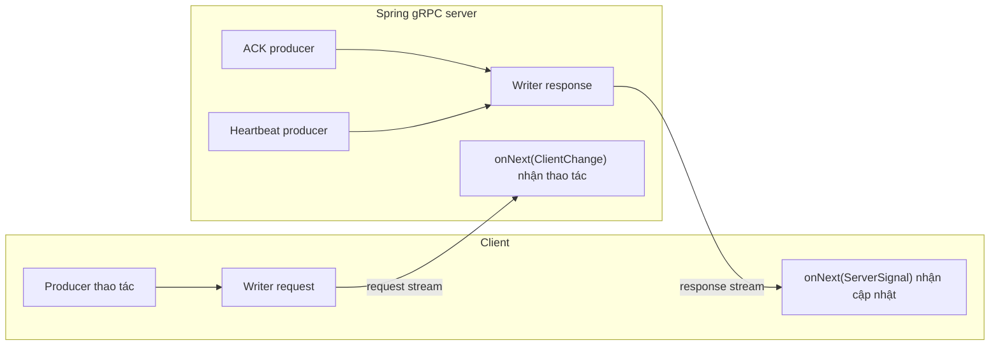
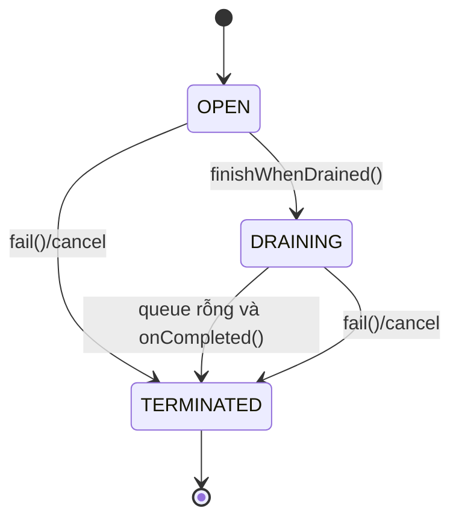

# Điều phối onNext ở cả hai phía

## 1. Vì sao cần điều phối khi cả client và server đều có `onNext`?

Trong dịch vụ **SPRING_GRPC**, hợp đồng Protocol Buffers có thể khai báo một RPC hai chiều để client gửi sự kiện trong lúc server chủ động phát cập nhật. Chẳng hạn, ứng dụng biên tập tài liệu có nhiều thao tác `CHANGE` từ người dùng, còn server gửi `ACK`, cảnh báo hoặc thông báo định kỳ. Hai chiều đều hoạt động trong **một RPC bidirectional streaming**.

Điểm dễ nhầm là tên phương thức `onNext` xuất hiện ở cả phía phát và phía nhận:

- Khi gọi `outgoing.onNext(message)`, ứng dụng **gửi** một message sang phía kia.
- Khi gRPC gọi callback `incoming.onNext(message)`, ứng dụng **nhận** một message từ phía kia.
- Client và server **có thể** gửi ở cùng thời điểm; nhưng nếu hai producer cùng ghi vào **một observer đầu ra**, ứng dụng phải điều phối để tránh truy cập đồng thời và bảo đảm không ghi sau khi stream kết thúc.

Vì vậy, “điều phối `onNext`” gồm ba việc: xác định đúng chiều dữ liệu, gom nhiều nguồn phát vào một đường ghi an toàn và đồng bộ lần kết thúc stream với các message còn chờ.

**Mục tiêu học tập:** sau bài này, người học có thể phân biệt observer gửi/nhận ở từng phía, tạo bộ gửi có giới hạn và tuân theo `isReady()`, phối hợp nhiều producer bằng một khóa/queue theo RPC, sử dụng `ClientResponseObserver.beforeStart()`, xử lý half-close, lỗi, deadline, cancellation và kiểm thử các race condition điển hình.

## 2. Bốn vị trí `onNext` trong một RPC hai chiều

Cho hợp đồng `rpc Sync(stream ClientChange) returns (stream ServerSignal)`:

| Vị trí | Câu lệnh hoặc callback | Vai trò | Ai cung cấp message? |
| --- | --- | --- | --- |
| Client, đầu ra | `requestObserver.onNext(ClientChange)` | **Gửi** request | Logic client |
| Server, đầu vào | `requestObserver.onNext(ClientChange)` | **Nhận** request | gRPC gọi callback của service |
| Server, đầu ra | `responseObserver.onNext(ServerSignal)` | **Gửi** response | Logic server |
| Client, đầu vào | `responseObserver.onNext(ServerSignal)` | **Nhận** response | gRPC gọi callback của client |

Tên `requestObserver` và `responseObserver` có thể trùng giữa các đoạn code, nhưng **đối tượng và trách nhiệm khác nhau**. Ở server, `responseObserver` là tham số đầu ra; server trả về một `StreamObserver<ClientChange>` để nhận request. Ở client, async stub trả về một `StreamObserver<ClientChange>` để gửi request; client tự cung cấp `StreamObserver<ServerSignal>` để nhận response.



Các mũi tên chỉ đường đi của dữ liệu, **không** phải một lịch cố định. Mỗi chiều có thứ tự riêng do các lần gọi `onNext` được tuần tự hóa; không có thứ tự toàn cục giữa hai chiều.

## 3. Contract Protobuf dành cho ví dụ

Định nghĩa `collaboration.proto`:

```proto
syntax = "proto3";

package collaboration.v1;

option java_multiple_files = true;
option java_package = "com.example.collaboration.v1";

service Collaboration {
  rpc Sync(stream ClientChange) returns (stream ServerSignal);
}

message ClientChange {
  string change_id = 1;
  string content = 2;
}

message ServerSignal {
  string kind = 1;       // ACK hoặc HEARTBEAT
  string reply_to = 2;   // change_id tương ứng với ACK
  string content = 3;
}
```

Plugin `protoc` và `protoc-gen-grpc-java` sinh ra `ClientChange`, `ServerSignal` và `CollaborationGrpc`. Các ví dụ Java bên dưới giả định ứng dụng Spring đã có dependency gRPC Java, Spring gRPC và bước sinh mã tương thích với phiên bản dự án.

## 4. Quy tắc an toàn trước khi viết code

### 4.1. Một observer đầu ra nên có một đường ghi

`StreamObserver` của gRPC Java **không được bảo đảm thread-safe khi nhiều thread cùng gọi phương thức trên cùng đối tượng**. Với server, hai producer sau đây có thể chạy cùng lúc:

```java
// Thread xử lý request:
responseObserver.onNext(ack);

// Thread scheduler:
responseObserver.onNext(heartbeat);
```

Không nên để hai lời gọi trên xảy ra đồng thời nếu không có điều phối. Có hai cách:

1. **Khóa theo từng RPC:** bảo vệ tất cả `onNext`, `onCompleted`, `onError` và cờ trạng thái bằng cùng một khóa. Phù hợp cho bài toán nhỏ.
2. **Hàng đợi + một writer:** mọi producer đưa message vào queue; writer lấy và gọi `onNext` tuần tự. Có thể gắn giới hạn queue và tạm dừng khi `isReady() == false`. Phù hợp hơn với nguồn phát nhiều và receiver chậm.

Bài này dùng cách thứ hai, với một **mailbox** gom các message đầu ra. Mailbox có một khóa ngắn để bảo vệ queue và thao tác ghi; mỗi phiên RPC có mailbox riêng, tránh khóa chung cho tất cả client.

### 4.2. Đóng stream phải đi qua cùng cơ chế điều phối

Nếu thread A phát `onNext` còn thread B gọi `onCompleted`, chỉ dựa vào cờ `boolean` thông thường là chưa đủ. Có thể xuất hiện `onNext` sau terminal event, hoặc hai lần terminal.

Mailbox duy trì các trạng thái:



- `OPEN`: nhận thêm message vào queue và cố gắng gửi.
- `DRAINING`: từ chối message mới, nhưng đợi gửi hết message đã nhận trước khi `onCompleted()`.
- `TERMINATED`: không còn `onNext()`; mọi producer phải dừng hoặc bỏ qua kết quả muộn.

**Lưu ý:** trạng thái `DRAINING` chỉ là mô hình điều phối của ứng dụng, không phải trạng thái mới của giao thức gRPC.

## 5. Viết một mailbox điều phối `onNext` dùng chung

Lớp sau nhận `CallStreamObserver<T>`, lớp nền của `ServerCallStreamObserver<T>` và `ClientCallStreamObserver<T>`. Điều này cho phép dùng **cùng một nguyên tắc ở cả client và server**.

```java
package com.example.collaboration;

import io.grpc.Status;
import io.grpc.stub.CallStreamObserver;
import java.util.ArrayDeque;
import java.util.Deque;
import java.util.Objects;

public final class OutboundMailbox<T> {
    private final CallStreamObserver<T> stream;
    private final Deque<T> queue = new ArrayDeque<>();
    private final int capacity;
    private boolean accepting = true;
    private boolean terminated = false;

    public OutboundMailbox(CallStreamObserver<T> stream, int capacity) {
        this.stream = Objects.requireNonNull(stream);
        if (capacity <= 0) {
            throw new IllegalArgumentException("capacity phải > 0");
        }
        this.capacity = capacity;
    }

    // Producer bất kỳ gọi vào đây thay vì gọi stream.onNext trực tiếp.
    public synchronized boolean offer(T message) {
        if (!accepting || terminated) {
            return false;
        }
        if (queue.size() >= capacity) {
            failLocked(Status.RESOURCE_EXHAUSTED
                    .withDescription("Hàng đợi gửi đã đầy")
                    .asRuntimeException());
            return false;
        }
        queue.addLast(Objects.requireNonNull(message));
        drainLocked();
        return !terminated;
    }

    // Đăng ký callback này bằng stream.setOnReadyHandler(...).
    public synchronized void onReady() {
        drainLocked();
    }

    // Nguồn phát đã hoàn tất; đợi queue rỗng rồi half-close đầu ra.
    public synchronized void finishWhenDrained() {
        if (terminated) {
            return;
        }
        accepting = false;
        drainLocked();
    }

    // Kết thúc lỗi: không cho phép gửi tiếp.
    public synchronized void fail(Throwable cause) {
        failLocked(cause);
    }

    // Peer đã hủy/hoàn tất RPC: ngừng phát, không báo terminal lần nữa.
    public synchronized void abandon() {
        accepting = false;
        terminated = true;
        queue.clear();
    }

    private void failLocked(Throwable cause) {
        if (terminated) {
            return;
        }
        accepting = false;
        terminated = true;
        queue.clear();
        stream.onError(cause);
    }

    private void drainLocked() {
        if (terminated) {
            return;
        }
        while (!queue.isEmpty() && stream.isReady()) {
            T next = queue.removeFirst();
            try {
                stream.onNext(next);
            } catch (RuntimeException ex) {
                failLocked(Status.INTERNAL
                        .withDescription("Không gửi được message")
                        .withCause(ex)
                        .asRuntimeException());
                return;
            }
        }
        if (!accepting && queue.isEmpty() && !terminated) {
            terminated = true;
            stream.onCompleted();
        }
    }
}
```

Điểm cần quan sát:

- Tất cả lời gọi `stream.onNext()`, `stream.onError()` và `stream.onCompleted()` đều nằm trong **các phương thức `synchronized` của cùng một mailbox**. Khi một producer khác đến, nó phải chờ lượt ghi.
- `offer()` chỉ thêm dữ liệu khi mailbox đang `OPEN`; queue đầy sẽ kết thúc RPC bằng `RESOURCE_EXHAUSTED`. Đây là một chính sách minh họa rõ ràng; hệ thống thật có thể chọn gộp sự kiện trạng thái hoặc backpressure upstream.
- `isReady()` được kiểm tra **mỗi vòng drain**. Khi transport chưa sẵn sàng, dữ liệu tiếp tục đợi trong queue giới hạn; `onReady()` thử drain lại sau khi gRPC báo khả năng ghi.
- `finishWhenDrained()` bảo toàn các message đã được chấp nhận, sau đó phát **một** `onCompleted()`. `abandon()` chỉ dùng khi RPC đã bị huỷ/kết thúc từ phía khác, tránh gọi terminal thêm lần nữa.

Mẫu này chủ yếu minh họa sự phối hợp và dùng với thông điệp nhỏ. `onNext()` thường trả về nhanh nhưng không có nghĩa peer đã xử lý message; khi yêu cầu throughput cao, cân nhắc một writer executor/actor dành cho phiên để callback nhận không phải trực tiếp thực hiện việc drain. Nếu ngay cả `onError()` của transport cũng ném exception, cần logging và teardown ở tầng sở hữu RPC, không cố phát terminal lần thứ hai.

## 6. Phía server: ACK và HEARTBEAT dùng chung một writer

Server sau có hai nguồn phát: callback nhận `ClientChange` để sinh `ACK`, và scheduler để sinh `HEARTBEAT`. Cả hai đều đưa message vào một `OutboundMailbox<ServerSignal>`.

### 6.1. Scheduler được Spring quản lý

```java
package com.example.collaboration;

import java.util.concurrent.Executors;
import java.util.concurrent.ScheduledExecutorService;
import org.springframework.context.annotation.Bean;
import org.springframework.context.annotation.Configuration;

@Configuration
public class StreamingConfig {
    @Bean(destroyMethod = "shutdown")
    ScheduledExecutorService streamingScheduler() {
        return Executors.newScheduledThreadPool(2);
    }
}
```

### 6.2. Triển khai dịch vụ

```java
package com.example.collaboration;

import com.example.collaboration.v1.ClientChange;
import com.example.collaboration.v1.CollaborationGrpc;
import com.example.collaboration.v1.ServerSignal;
import io.grpc.Status;
import io.grpc.stub.ServerCallStreamObserver;
import io.grpc.stub.StreamObserver;
import java.util.concurrent.ScheduledExecutorService;
import java.util.concurrent.ScheduledFuture;
import java.util.concurrent.TimeUnit;
import java.util.concurrent.atomic.AtomicBoolean;
import java.util.concurrent.atomic.AtomicInteger;
import java.util.concurrent.atomic.AtomicReference;
import org.springframework.stereotype.Service;

@Service
public class CollaborationService
        extends CollaborationGrpc.CollaborationImplBase {

    private final ScheduledExecutorService scheduler;

    public CollaborationService(ScheduledExecutorService scheduler) {
        this.scheduler = scheduler;
    }

    @Override
    public StreamObserver<ClientChange> sync(
            StreamObserver<ServerSignal> responseObserver) {
        ServerCallStreamObserver<ServerSignal> transport =
                (ServerCallStreamObserver<ServerSignal>) responseObserver;
        OutboundMailbox<ServerSignal> outgoing =
                new OutboundMailbox<>(transport, 32);

        AtomicBoolean cancelled = new AtomicBoolean();
        AtomicBoolean inputDone = new AtomicBoolean();
        AtomicBoolean pulsesDone = new AtomicBoolean();
        AtomicInteger pulseCount = new AtomicInteger();
        AtomicReference<ScheduledFuture<?>> job = new AtomicReference<>();

        Runnable stopTimer = () -> {
            ScheduledFuture<?> future = job.get();
            if (future != null) {
                future.cancel(false);
            }
        };
        Runnable cancelSession = () -> {
            cancelled.set(true);
            stopTimer.run();
            outgoing.abandon();
        };
        Runnable finishIfReady = () -> {
            if (!cancelled.get() && inputDone.get() && pulsesDone.get()) {
                outgoing.finishWhenDrained();
            }
        };

        // Đăng ký handler trước khi trả request observer cho gRPC.
        transport.setOnReadyHandler(outgoing::onReady);
        transport.setOnCancelHandler(cancelSession);

        ScheduledFuture<?> future = scheduler.scheduleAtFixedRate(() -> {
            if (cancelled.get() || transport.isCancelled()) {
                cancelSession.run();
                return;
            }
            int n = pulseCount.incrementAndGet();
            if (!outgoing.offer(ServerSignal.newBuilder()
                    .setKind("HEARTBEAT")
                    .setContent("Nhịp " + n)
                    .build())) {
                cancelSession.run();
                return;
            }
            if (n == 5) {
                pulsesDone.set(true);
                stopTimer.run();
                finishIfReady.run();
            }
        }, 100, 250, TimeUnit.MILLISECONDS);

        job.set(future);
        if (cancelled.get() || pulsesDone.get()) {
            future.cancel(false);
        }

        return new StreamObserver<>() {
            @Override
            public void onNext(ClientChange change) {
                if (cancelled.get()) {
                    return;
                }
                if (change.getChangeId().isBlank()) {
                    cancelled.set(true);
                    stopTimer.run();
                    outgoing.fail(Status.INVALID_ARGUMENT
                            .withDescription("change_id bắt buộc")
                            .asRuntimeException());
                    return;
                }
                boolean accepted = outgoing.offer(ServerSignal.newBuilder()
                        .setKind("ACK")
                        .setReplyTo(change.getChangeId())
                        .setContent("Đã nhận " + change.getContent())
                        .build());
                if (!accepted) {
                    cancelSession.run();
                }
            }

            @Override
            public void onError(Throwable cause) {
                // RPC từ client thất bại: hủy tác vụ của phiên.
                cancelSession.run();
            }

            @Override
            public void onCompleted() {
                // Client half-close chiều request, chưa bắt server dừng.
                inputDone.set(true);
                finishIfReady.run();
            }
        };
    }
}
```

Tại sao ví dụ này an toàn hơn việc gọi `responseObserver.onNext()` từ hai thread?

1. `onNext(ClientChange)` của server chỉ **nhận** request rồi đưa ACK vào mailbox.
2. Scheduler chỉ đưa HEARTBEAT vào **cùng mailbox**; không chạm trực tiếp `transport.onNext()`.
3. Mailbox tuần tự hóa việc ghi, và `onReadyHandler` tiếp tục drain nếu transport đã tạm ngừng nhận dữ liệu.
4. Server chỉ kết thúc response khi **client đã half-close** và **năm heartbeat đã phát xong**, đồng thời queue đã được drain.
5. Khi client hủy, `setOnCancelHandler` dừng timer và xóa queue, tránh việc producer tiếp tục phát vào RPC đã mất.

Các thông điệp ACK và HEARTBEAT có thể xen kẽ khác nhau mỗi lần chạy. Muốn theo dõi ACK nào thuộc thao tác nào, client sử dụng `reply_to` thay vì dựa vào vị trí của bản tin.

## 7. Phía client: điều phối `onNext` và đăng ký `onReady` đúng thời điểm

Với gRPC Java, `ClientResponseObserver<Request, Response>` cho phép nhận `ClientCallStreamObserver<Request>` trong `beforeStart()`. Đây là nơi thích hợp để đăng ký `setOnReadyHandler` và thiết lập flow control trước khi bắt đầu gửi request.

```java
package com.example.collaboration;

import com.example.collaboration.v1.ClientChange;
import com.example.collaboration.v1.CollaborationGrpc;
import com.example.collaboration.v1.ServerSignal;
import io.grpc.ManagedChannel;
import io.grpc.ManagedChannelBuilder;
import io.grpc.Status;
import io.grpc.stub.ClientCallStreamObserver;
import io.grpc.stub.ClientResponseObserver;
import java.util.concurrent.CountDownLatch;
import java.util.concurrent.ExecutorService;
import java.util.concurrent.Executors;
import java.util.concurrent.Future;
import java.util.concurrent.TimeUnit;
import java.util.concurrent.atomic.AtomicReference;

public class CollaborationClientDemo {
    public static void main(String[] args) throws Exception {
        ManagedChannel channel = ManagedChannelBuilder
                .forAddress("localhost", 9090)
                .usePlaintext() // Chỉ sử dụng trên máy phát triển.
                .build();
        ExecutorService producerExecutor =
                Executors.newSingleThreadExecutor();
        CountDownLatch responseFinished = new CountDownLatch(1);
        AtomicReference<OutboundMailbox<ClientChange>> writerRef =
                new AtomicReference<>();

        try {
            CollaborationGrpc.CollaborationStub stub =
                    CollaborationGrpc.newStub(channel)
                            .withDeadlineAfter(6, TimeUnit.SECONDS);

            ClientResponseObserver<ClientChange, ServerSignal> incoming =
                    new ClientResponseObserver<>() {
                @Override
                public void beforeStart(
                        ClientCallStreamObserver<ClientChange> requestStream) {
                    OutboundMailbox<ClientChange> writer =
                            new OutboundMailbox<>(requestStream, 16);
                    requestStream.setOnReadyHandler(writer::onReady);
                    writerRef.set(writer);
                }

                @Override
                public void onNext(ServerSignal response) {
                    System.out.printf("[NHẬN] %s ref=%s %s%n",
                            response.getKind(),
                            response.getReplyTo(),
                            response.getContent());
                }

                @Override
                public void onError(Throwable error) {
                    System.err.println("[NHẬN] lỗi RPC: " + error);
                    OutboundMailbox<ClientChange> writer = writerRef.get();
                    if (writer != null) {
                        writer.abandon();
                    }
                    responseFinished.countDown();
                }

                @Override
                public void onCompleted() {
                    System.out.println("[NHẬN] server hoàn tất");
                    OutboundMailbox<ClientChange> writer = writerRef.get();
                    if (writer != null) {
                        writer.abandon();
                    }
                    responseFinished.countDown();
                }
            };

            // beforeStart() thiết lập writer trước khi lời gọi trả về.
            stub.sync(incoming);
            OutboundMailbox<ClientChange> writer = writerRef.get();
            if (writer == null) {
                throw new IllegalStateException("Chưa khởi tạo writer");
            }

            Future<?> producer = producerExecutor.submit(() -> {
                try {
                    for (int i = 1; i <= 5; i++) {
                        boolean accepted = writer.offer(ClientChange
                                .newBuilder()
                                .setChangeId("change-" + i)
                                .setContent("Chỉnh sửa #" + i)
                                .build());
                        if (!accepted) {
                            return; // RPC đã đóng hoặc queue đã đầy.
                        }
                        TimeUnit.MILLISECONDS.sleep(180);
                    }
                    writer.finishWhenDrained();
                } catch (InterruptedException interrupted) {
                    Thread.currentThread().interrupt();
                    writer.fail(Status.CANCELLED
                            .withDescription("Producer bị dừng")
                            .asRuntimeException());
                }
            });

            // Thread chính chờ terminal callback; thread producer vẫn gửi.
            if (!responseFinished.await(5, TimeUnit.SECONDS)) {
                throw new IllegalStateException("RPC chưa kết thúc");
            }
            producer.get(1, TimeUnit.SECONDS);
        } finally {
            producerExecutor.shutdownNow();
            channel.shutdownNow()
                    .awaitTermination(2, TimeUnit.SECONDS);
        }
    }
}
```

Tại client, luồng producer gọi `writer.offer(ClientChange)`, còn gRPC gọi `incoming.onNext(ServerSignal)` khi nhận response. **Hai hoạt động có thể diễn ra đồng thời**, vì chúng liên quan hai observer khác nhau. Nếu sau này thêm nhiều nguồn thao tác như UI, timer hay Kafka consumer, tất cả đều gửi qua `writer.offer()` thay vì trực tiếp gọi `ClientCallStreamObserver.onNext()`.

Server ví dụ phát năm HEARTBEAT cách khoảng 250 ms; client phát năm request cách khoảng 180 ms. Log nhận ACK và HEARTBEAT có thể xen nhau, nhưng không nên viết test yêu cầu một lịch xen kẽ cụ thể.

## 8. Thứ tự, flow control và hiệu năng

### 8.1. Thứ tự được xác định ở đâu?

Giả sử producer A tạo ACK trước về mặt thời gian, nhưng producer B lấy được khóa mailbox trước và đưa HEARTBEAT vào queue. **Thứ tự gửi trên response stream** là thứ tự mailbox gọi `stream.onNext()`, không nhất thiết là thời điểm tạo sự kiện nghiệp vụ.

Nếu cần thứ tự nghiệp vụ rõ ràng, hãy cấp số `sequence` trong **cùng vùng điều phối** nơi enqueue hoặc ghi; không cấp sequence ở nhiều producer độc lập rồi giả định nó phản ánh đúng thứ tự truyền. Nếu cần phát lại sau reconnect, định nghĩa thêm `event_id`, `cursor`, quy tắc deduplication và idempotency.

### 8.2. `isReady()` không thay thế queue giới hạn

`isReady()` phản ánh khả năng gRPC tiếp nhận thêm dữ liệu vào bộ đệm tại thời điểm kiểm tra; nó **không xác nhận peer đã xử lý message**. Sự sẵn sàng có thể thay đổi bất cứ lúc nào. Vì vậy, trong `onReadyHandler`, hãy kiểm tra lại `isReady()` trước từng lần phát; nếu queue đầy, phải có chính sách rõ ràng.

| Nhu cầu | Biện pháp | Điểm cần chú ý |
| --- | --- | --- |
| Message bắt buộc, không được mất | Giới hạn queue, gây backpressure về producer | Không block transport callback vô hạn |
| Bản tin trạng thái mới thay thế bản cũ | Gộp/cập nhật bản tin chưa gửi | Không áp dụng cho sự kiện có ý nghĩa kiểm toán |
| Client quá chậm và không thể xử lý kịp | Kết thúc bằng `RESOURCE_EXHAUSTED` | Client cần backoff và reconnect hợp lý |
| Pipeline xử lý inbound bất đồng bộ | Manual inbound flow control | Chỉ `request(n)` khi có khả năng xử lý |

Ở phía server, `ServerCallStreamObserver` có `disableAutoRequest()` và `request(n)` để điều tiết **message đi vào server**. Ở phía client, thiết lập tương đương thường được đặt trong `ClientResponseObserver.beforeStart()` thông qua `ClientCallStreamObserver`. Tách biệt hai cơ chế: `isReady()` điều tiết **đầu ra**, còn `request(n)` điều tiết **đầu vào**.

### 8.3. Không chờ lẫn nhau trong callback

Không nên giữ khóa mail­box rồi chờ network, chờ `Future.get()` hoặc chờ phía kia gửi một message. Tác vụ nặng như ghi database hoặc kiểm tra nghiệp vụ phức tạp nên chuyển sang executor phù hợp. Khi tác vụ hoàn thành, nó đưa kết quả vào mailbox. Cách này tránh chiếm thread gRPC callback quá lâu, đồng thời vẫn bảo vệ thứ tự gửi.

## 9. Terminal event, deadline, metadata và TLS

Trong một RPC hai chiều, `onCompleted()` ở phía **client gửi request** tạo half-close của request stream; server có thể tiếp tục gửi message. Ngược lại, khi server gọi `onCompleted()` cho response stream, RPC kết thúc thành công. Lỗi hoặc hủy có thể cắt ngang cả hai chiều.

| Tình huống | Phản ứng cần có |
| --- | --- |
| Client gọi `finishWhenDrained()` | Xả request còn chờ, rồi gửi `onCompleted()`; vẫn tiếp tục nhận response |
| Server nhận request `onCompleted()` | Ghi nhận client đã gửi hết; không nhất thiết đóng response ngay |
| Client hủy hoặc deadline hết | Server dừng producer/timer; mailbox bỏ queue và không phát tiếp |
| Giá trị request không hợp lệ | Server phát một `onError(Status.INVALID_ARGUMENT...)` rồi dừng |
| Queue đầy | Áp dụng chính sách đã chọn, ví dụ `RESOURCE_EXHAUSTED` |
| Server đã gửi terminal | Bỏ các kết quả hoàn thành muộn; không `onNext` hoặc terminal lần hai |

Deadline của gRPC áp dụng cho **toàn RPC**, không được làm mới bởi các `onNext()`. Trong dịch vụ có stream sống lâu, thiết kế timeout, reconnect, resume token và giám sát rõ ràng. Với Spring gRPC, metadata/credentials, interceptor và tracing gắn với lời gọi; thông tin thay đổi theo từng sự kiện nên nằm trong Protobuf message. Kênh thực tế cần TLS/mTLS theo yêu cầu bảo mật, còn `usePlaintext()` trong ví dụ chỉ dành cho môi trường học cục bộ.

Để vận hành, nên đo số RPC đang mở, số message theo chiều, thời gian chờ trong queue, queue đầy, tần suất `isReady() == false`, tỷ lệ `CANCELLED`/`DEADLINE_EXCEEDED`, số producer còn hoạt động sau cancel và lỗi status từ server. Những chỉ số này giúp phân biệt lỗi transport với lỗi do ứng dụng gửi quá nhanh.

## 10. Kiểm thử khả năng điều phối

Dùng gRPC in-process server/channel cho integration test và scheduler có thể điều khiển để kiểm thử điều kiện cạnh tranh ổn định. Với nhiều producer, `CountDownLatch` hoặc `CyclicBarrier` có thể làm chúng phát gần cùng thời điểm rồi kiểm tra kết quả.

| Kịch bản | Điều kiện đạt |
| --- | --- |
| Client chưa gửi gì | Server vẫn gửi được HEARTBEAT; callback client nhận đúng message |
| ACK và HEARTBEAT phát đồng thời | Không phát `onNext` đồng thời vào cùng response observer; mọi message được chấp nhận đều có mặt |
| Hai producer client cùng gửi | Mailbox tuần tự hóa request; server không thấy message bị trộn hỏng |
| Client half-close trước heartbeat cuối | Server vẫn tiếp tục response và kết thúc khi đủ điều kiện |
| `isReady()` chuyển `false` rồi `true` | Mailbox giữ message trong giới hạn và drain trở lại sau `onReady` |
| Receiver chậm khiến queue đầy | RPC nhận status/chính sách overload dự kiến; bộ nhớ không tăng vô hạn |
| `onCompleted()` và producer tới cùng lúc | Không có `onNext` sau terminal, không có hai terminal events |
| Hủy RPC hoặc hết deadline | Timer/subscription dừng, không gửi thêm và không rò rỉ tài nguyên |
| Nhiều client đồng thời | Mỗi RPC có queue, khóa và trạng thái độc lập |

Ví dụ tiêu chí assertion: so sánh **tập `change_id` đã nhận ACK**, kiểm tra số heartbeat theo hợp đồng và thứ tự trong **mỗi** chiều; không yêu cầu `ACK` luôn nằm trước `HEARTBEAT` nếu hai sự kiện do các producer độc lập phát.

## 11. Bài tập vận dụng

Mở rộng `Collaboration.Sync` để phục vụ nhóm cộng tác:

1. Cho client gửi `EDIT`, `JOIN`, `LEAVE` và `PING` qua một request stream (dùng `oneof` trong Protobuf).
2. Cho server phát `ACK`, `REMOTE_EDIT` và `HEARTBEAT` từ nhiều nguồn, nhưng **chỉ một writer** được phép ghi vào response stream của mỗi phiên.
3. Thay chính sách `RESOURCE_EXHAUSTED` tức thì bằng queue có giới hạn và một lựa chọn gộp bản tin `HEARTBEAT` cũ; không được gộp hoặc làm mất `EDIT`.
4. Bổ sung `sequence` cấp tại mailbox, `reply_to` cho ACK và cursor để resume sau reconnect.
5. Viết kiểm thử race giữa `offer()`, `finishWhenDrained()`, `abandon()` và `onReady()`.

**Tiêu chí hoàn thành:** client lẫn server phát và nhận message song song; mọi producer trên một phía đều đi qua cùng cơ chế điều phối, message giữ đúng thứ tự gửi, không có `onNext` sau terminal event và tài nguyên được thu dọn khi RPC kết thúc.

### Tài liệu tham khảo

- [gRPC Core concepts – Bidirectional streaming](https://grpc.io/docs/what-is-grpc/core-concepts/): hai luồng message và thứ tự theo từng chiều.
- [gRPC Java – StreamObserver](https://grpc.github.io/grpc-java/javadoc/io/grpc/stub/StreamObserver.html): callback, terminal event và yêu cầu về đồng thời.
- [gRPC Java – CallStreamObserver](https://grpc.github.io/grpc-java/javadoc/io/grpc/stub/CallStreamObserver.html): `isReady()`, `onReadyHandler`, inbound flow control.
- [gRPC Java – ClientResponseObserver](https://grpc.github.io/grpc-java/javadoc/io/grpc/stub/ClientResponseObserver.html): cấu hình request observer ở `beforeStart()`.
- [Spring gRPC Reference](https://docs.spring.io/spring-grpc/reference/): tích hợp service, client, TLS và observability trong Spring.
