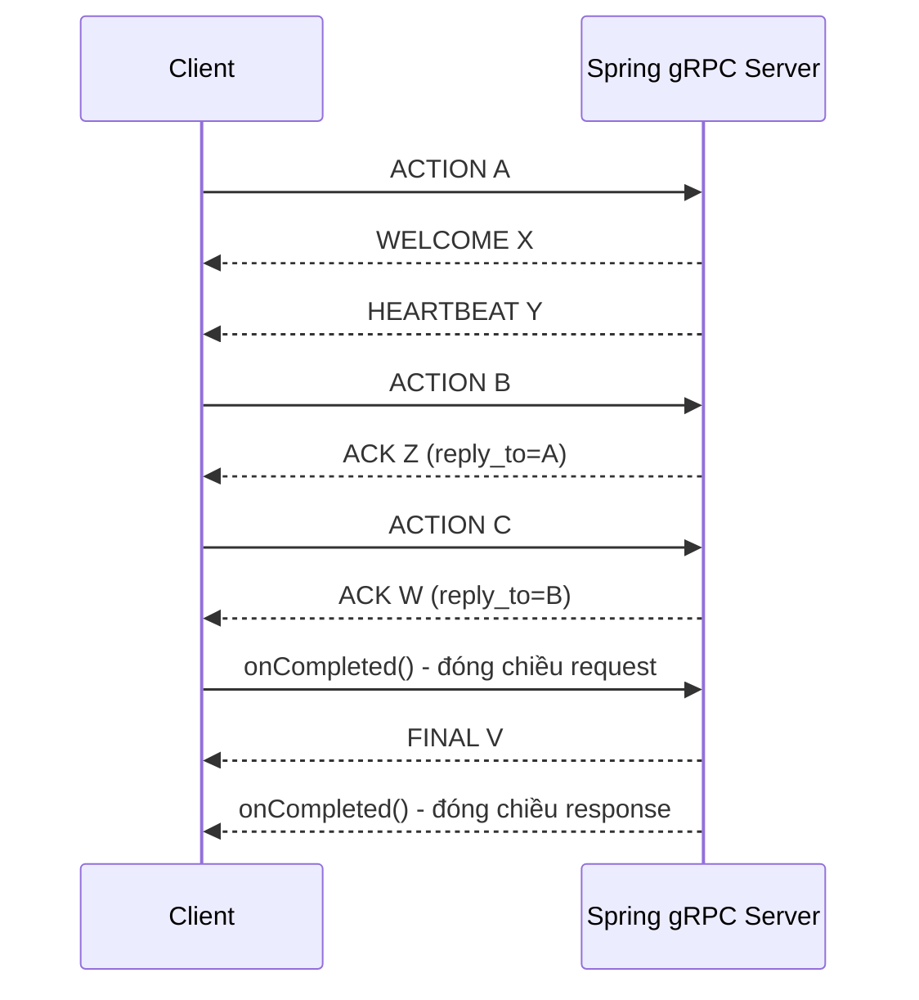
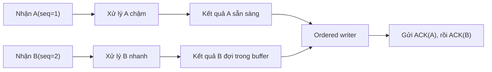

# Thứ tự message theo từng hướng

## 1. Bài toán: gửi đúng thứ tự có nghĩa là gì?

Một ứng dụng cộng tác sử dụng **Spring gRPC** cho phép client gửi các chỉnh sửa lên server trong khi server liên tục phát xác nhận và thông báo trạng thái. Client gửi `CHANGE #1`, `CHANGE #2` rồi `CHANGE #3`; đồng thời server có thể phát `WELCOME`, `ACK` và `HEARTBEAT`. Khi quan sát log, các dòng từ hai phía xen kẽ nhau theo nhiều cách. Điều đó có làm mất thứ tự message không?

Câu trả lời phụ thuộc vào **hướng của luồng**:

- Trong một RPC bidirectional streaming, gRPC bảo toàn **thứ tự message được gửi trên từng chiều**. Client gửi tuần tự A rồi B trên request stream thì server nhận A rồi B, nếu cả hai được chuyển tới thành công.
- Tương tự, server gửi tuần tự X rồi Y trên response stream thì client nhận X rồi Y.
- **Không có một thứ tự tổng thể giữa A, B với X, Y.** Client và server gửi độc lập; không thể dựa vào thời điểm quan sát log ở hai máy để kết luận bên nào gửi trước.

Đây là nền tảng khi phát triển dịch vụ gRPC trong hệ sinh thái Spring bằng Protocol Buffers và Java async stub. Sau bài học, người học có thể xác định chính xác phạm vi của bảo đảm thứ tự, thiết kế message có ID/sequence, phân biệt thứ tự truyền với thứ tự xử lý nghiệp vụ, viết server/client an toàn và kiểm thử các tình huống đảo thứ tự do xử lý bất đồng bộ.

## 2. Một RPC, hai thứ tự độc lập

Hợp đồng song công có dạng:

```proto
rpc Exchange(stream ClientAction) returns (stream ServerEvent);
```

Một lời gọi `Exchange` tạo ra hai dòng message:

| Chiều | Ai gọi `onNext` để phát? | Ai nhận callback `onNext`? | Thứ tự được gRPC giữ |
| --- | --- | --- | --- |
| Request | Client gọi `requestObserver.onNext(action)` | Server nhận `onNext(ClientAction)` | Thứ tự các request **trong chính RPC đó** |
| Response | Server gọi `responseObserver.onNext(event)` | Client nhận `onNext(ServerEvent)` | Thứ tự các response **trong chính RPC đó** |

Ví dụ một lịch truyền hợp lệ:



Trong hình, server nhận `A → B → C`; client nhận `X → Y → Z → W → V`. Những mối quan hệ này được giữ riêng cho từng chiều. Không được suy ra rằng `Y` xảy ra *trước* `B` theo một đồng hồ toàn cục, hoặc `Z` là response trực tiếp cho message mới nhất từ client.

### 2.1. Giao thức bảo đảm gì và không bảo đảm gì?

| Giả định | Đúng hay sai? | Giải thích |
| --- | --- | --- |
| Client tuần tự phát A rồi B trên **cùng request stream**, server nhận B trước A | **Sai** nếu A và B đều được giao thành công | Thứ tự các message cùng chiều được bảo toàn |
| Server tuần tự phát X rồi Y trên **cùng response stream**, client nhận Y trước X | **Sai** nếu cả hai được giao thành công | Giao thức không tự hoán đổi các message đã phát theo thứ tự |
| Client gửi A rồi B thì server chắc chắn xử lý nghiệp vụ A xong trước B | **Sai** | Server có thể đưa A và B lên hai tác vụ xử lý bất đồng bộ |
| Client gửi A rồi B thì server bắt buộc trả ACK(A) rồi ACK(B) | **Sai** | Response stream có thứ tự *gửi của server*; server có thể chủ động gửi ACK(B) trước |
| Server có thể gửi X khi client chưa gửi A | **Đúng** | Hai chiều hoạt động độc lập |
| Hai RPC riêng gọi trên cùng `ManagedChannel` luôn nhận message theo một thứ tự toàn cục | **Sai** | HTTP/2 multiplex nhiều stream; mỗi RPC có chuỗi riêng |
| `onNext` trả về nghĩa là peer đã xử lý xong message | **Sai** | `onNext` không phải cơ chế xác nhận nghiệp vụ |

**Điều kiện quan trọng:** bảo đảm thứ tự là quy tắc cho các message **được chuyển tới thành công**. Nếu RPC bị hủy, deadline hết, mạng đứt hoặc phía phát lỗi, không được giả định mọi message đã gọi `onNext` đều tới phía nhận. Muốn xác nhận việc lưu hoặc áp dụng dữ liệu, cần ACK ở tầng ứng dụng.

### 2.2. Thứ tự chuyển tiếp khác thứ tự hoàn thành

Hãy phân biệt ba mốc:

1. **Thứ tự ghi vào request stream:** client gọi `onNext(A)`, rồi `onNext(B)`.
2. **Thứ tự callback nhận:** server nhận `onNext(A)`, rồi `onNext(B)`.
3. **Thứ tự tác vụ xử lý hoàn thành:** xử lý A mất 300 ms, xử lý B mất 20 ms; kết quả B có thể hoàn tất trước A.

Nếu server gửi ngay kết quả khi từng tác vụ xong, response stream có thể chứa `ACK(B)` trước `ACK(A)`. Client vẫn nhận các response theo **đúng thứ tự server đã phát**. Vì thế, không có mâu thuẫn với bảo đảm của gRPC.

## 3. Thiết kế Protobuf để quan sát thứ tự

Tạo hợp đồng `timeline.proto`:

```proto
syntax = "proto3";

package timeline.v1;

option java_multiple_files = true;
option java_package = "com.example.timeline.v1";

service Timeline {
  rpc Exchange(stream ClientAction) returns (stream ServerEvent);
}

message ClientAction {
  string action_id = 1;       // Định danh duy nhất cho thao tác
  int64 client_sequence = 2;  // 1, 2, 3, ... trong cùng phiên
  string content = 3;
}

message ServerEvent {
  string kind = 1;            // WELCOME, ACK, HEARTBEAT
  int64 server_sequence = 2;  // 1, 2, 3, ... trong cùng phiên
  string reply_to = 3;        // action_id tương ứng với ACK
  string content = 4;
}
```

Sau bước sinh mã bằng `protoc` và plugin Java gRPC, ứng dụng có `TimelineGrpc`, `ClientAction`, `ServerEvent`. Hai trường sequence phục vụ những mục đích khác nhau:

- `client_sequence` do **client** cấp tăng dần cho các request; server kiểm tra có vi phạm hợp đồng ứng dụng hay không.
- `server_sequence` do **server** cấp khi thực sự phát response; client dùng nó để kiểm tra thứ tự, phát hiện khoảng trống hoặc trùng trong giao thức nghiệp vụ.
- `action_id` và `reply_to` dùng để nối một ACK với thao tác gốc ngay cả khi response xen giữa `HEARTBEAT` hoặc kết quả xử lý đến không theo thứ tự request.

**Sequence là quy ước của ứng dụng.** gRPC vốn đã giữ thứ tự trên từng chiều, không đòi có trường sequence. Nhưng sequence giúp giám sát, xây dựng kiểm thử, deduplication và khôi phục sau reconnect. Ví dụ bên dưới cấp sequence **riêng cho từng RPC**; nó không phải bộ đếm toàn cục cho tất cả phiên.

## 4. Server Spring: bảo đảm thứ tự phát từ nhiều nguồn

Giả sử server có hai nguồn tạo response:

- `ACK` được tạo khi nhận request `ClientAction`.
- `HEARTBEAT` được tạo từ scheduler, không phụ thuộc client có gửi request hay không.

Cả hai nguồn đều cần ghi vào **một response observer**. `StreamObserver` không bảo đảm thread-safe khi nhiều thread cùng gọi phương thức trên một đối tượng, vì vậy server phải **tuần tự hóa các lời gọi ghi**. Một khóa **theo từng RPC** là cách triển khai dễ kiểm tra trong ví dụ nhỏ.

### 4.1. Đăng ký executor trong Spring

```java
package com.example.timeline;

import java.util.concurrent.Executors;
import java.util.concurrent.ScheduledExecutorService;
import org.springframework.context.annotation.Bean;
import org.springframework.context.annotation.Configuration;

@Configuration
public class TimelineConfiguration {
    @Bean(destroyMethod = "shutdown")
    ScheduledExecutorService timelineScheduler() {
        return Executors.newScheduledThreadPool(2);
    }
}
```

### 4.2. Triển khai gRPC service

```java
package com.example.timeline;

import com.example.timeline.v1.ClientAction;
import com.example.timeline.v1.ServerEvent;
import com.example.timeline.v1.TimelineGrpc;
import io.grpc.Status;
import io.grpc.stub.ServerCallStreamObserver;
import io.grpc.stub.StreamObserver;
import java.util.concurrent.ScheduledExecutorService;
import java.util.concurrent.ScheduledFuture;
import java.util.concurrent.TimeUnit;
import org.springframework.stereotype.Service;

@Service
public class TimelineService extends TimelineGrpc.TimelineImplBase {
    private final ScheduledExecutorService scheduler;

    public TimelineService(ScheduledExecutorService scheduler) {
        this.scheduler = scheduler;
    }

    @Override
    public StreamObserver<ClientAction> exchange(
            StreamObserver<ServerEvent> responseObserver) {
        ServerCallStreamObserver<ServerEvent> output =
                (ServerCallStreamObserver<ServerEvent>) responseObserver;
        Session session = new Session(output);
        output.setOnCancelHandler(session::cancel);

        // Server có thể gửi trước khi client gửi request đầu tiên.
        session.welcome();
        ScheduledFuture<?> timer = scheduler.scheduleAtFixedRate(
                session::heartbeat, 300, 300, TimeUnit.MILLISECONDS);
        session.attachTimer(timer);

        return new StreamObserver<>() {
            @Override
            public void onNext(ClientAction action) {
                session.handle(action);
            }

            @Override
            public void onError(Throwable error) {
                session.cancel();
            }

            @Override
            public void onCompleted() {
                // Chỉ request stream đã half-close.
                session.requestCompleted();
            }
        };
    }

    // Một phiên, một trạng thái thứ tự và một khóa ghi.
    private static final class Session {
        private final ServerCallStreamObserver<ServerEvent> output;
        private long expectedClientSequence = 1;
        private long nextServerSequence = 1;
        private int heartbeats = 0;
        private boolean requestDone = false;
        private boolean terminated = false;
        private ScheduledFuture<?> timer;

        Session(ServerCallStreamObserver<ServerEvent> output) {
            this.output = output;
        }

        synchronized void attachTimer(ScheduledFuture<?> future) {
            timer = future;
            if (terminated || heartbeats == 3) {
                future.cancel(false);
            }
        }

        synchronized void welcome() {
            if (!terminated && !output.isCancelled()) {
                send("WELCOME", "", "Kết nối đã mở");
            }
        }

        synchronized void handle(ClientAction action) {
            if (terminated || output.isCancelled()) {
                cancel();
                return;
            }
            if (action.getActionId().isBlank()) {
                fail(Status.INVALID_ARGUMENT
                        .withDescription("action_id bắt buộc"));
                return;
            }
            if (action.getClientSequence() != expectedClientSequence) {
                fail(Status.FAILED_PRECONDITION
                        .withDescription("client_sequence không liên tục"));
                return;
            }

            // Chỉ tăng sau khi đã kiểm tra thông điệp đầu vào.
            expectedClientSequence++;
            send("ACK", action.getActionId(),
                    "Đã nhận: " + action.getContent());
        }

        synchronized void heartbeat() {
            if (terminated || output.isCancelled()) {
                cancel();
                return;
            }
            if (heartbeats >= 3) {
                stopTimer();
                return;
            }
            heartbeats++;
            send("HEARTBEAT", "", "Nhịp " + heartbeats);
            if (heartbeats == 3) {
                stopTimer();
                finishIfReady();
            }
        }

        synchronized void requestCompleted() {
            requestDone = true;
            finishIfReady();
        }

        synchronized void cancel() {
            terminated = true;
            stopTimer();
        }

        // Chỉ gọi từ vùng synchronized của Session.
        private void send(String kind, String replyTo, String content) {
            output.onNext(ServerEvent.newBuilder()
                    .setKind(kind)
                    .setServerSequence(nextServerSequence++)
                    .setReplyTo(replyTo)
                    .setContent(content)
                    .build());
        }

        private void finishIfReady() {
            if (!terminated && requestDone && heartbeats == 3) {
                terminated = true;
                stopTimer();
                output.onCompleted();
            }
        }

        private void fail(Status status) {
            if (!terminated) {
                terminated = true;
                stopTimer();
                output.onError(status.asRuntimeException());
            }
        }

        private void stopTimer() {
            if (timer != null) {
                timer.cancel(false);
            }
        }
    }
}
```

Ở đây, tất cả lời gọi `send(...)` đều diễn ra khi đang giữ khóa của **cùng đối tượng `Session`**. Bộ đếm `server_sequence` tăng ngay trước `output.onNext` nên thứ tự client quan sát được trùng với thứ tự server thực sự phát, dù ACK và HEARTBEAT tranh lịch chạy.

Việc `Session.handle()` xử lý tuần tự trong callback nhận cũng khiến các ACK được tạo ngay theo thứ tự request đến trong **ví dụ này**. Đó là quyết định của implementation, không phải cam kết tự động của mọi dịch vụ gRPC. Nếu xử lý chuyển sang nhiều tác vụ bất đồng bộ thì phải xem xét lại thứ tự ACK.

Client có thể gọi `onCompleted()` sau các thao tác; server **không đóng response ngay**, mà chờ phát đủ ba HEARTBEAT. Server cũng có thể phát đủ ba nhịp trước khi client half-close, khi đó server đợi chiều request hoàn tất. Hệ thống thực tế cần deadline hoặc chính sách kết thúc phiên để tránh stream giữ lâu vô hạn.

> Mẫu service tập trung vào thứ tự và vòng đời của một lượng message nhỏ. Trong sản phẩm, phải bổ sung xử lý exception từ tác vụ scheduler và lời gọi gửi, bảo vệ flow control, giới hạn queue, và dọn tài nguyên khi RPC hủy hoặc hết deadline. Đừng để một nguồn phát vô hạn gọi `onNext` mà không kiểm tra khả năng ghi.

## 5. Client: một writer giữ thứ tự request

Với async stub, client nhận `StreamObserver<ClientAction>` để phát request và cung cấp callback riêng để nhận response. Để nhiều thành phần UI không ghi đồng thời vào cùng một observer, một cách đơn giản là dùng **single-thread executor** làm writer cho phiên.

```java
package com.example.timeline;

import com.example.timeline.v1.ClientAction;
import com.example.timeline.v1.ServerEvent;
import com.example.timeline.v1.TimelineGrpc;
import io.grpc.ManagedChannel;
import io.grpc.ManagedChannelBuilder;
import io.grpc.stub.StreamObserver;
import java.util.concurrent.CountDownLatch;
import java.util.concurrent.ExecutorService;
import java.util.concurrent.Executors;
import java.util.concurrent.Future;
import java.util.concurrent.TimeUnit;
import java.util.concurrent.atomic.AtomicLong;

public class TimelineClientDemo {
    public static void main(String[] args) throws Exception {
        ManagedChannel channel = ManagedChannelBuilder
                .forAddress("localhost", 9090)
                .usePlaintext()   // Chỉ dùng cho chạy thử cục bộ.
                .build();
        ExecutorService writer = Executors.newSingleThreadExecutor();
        CountDownLatch responseDone = new CountDownLatch(1);
        AtomicLong expectedServerSequence = new AtomicLong(1);

        try {
            TimelineGrpc.TimelineStub stub = TimelineGrpc
                    .newStub(channel)
                    .withDeadlineAfter(8, TimeUnit.SECONDS);

            StreamObserver<ServerEvent> responses = new StreamObserver<>() {
                @Override
                public void onNext(ServerEvent event) {
                    long expected = expectedServerSequence.getAndIncrement();
                    if (event.getServerSequence() != expected) {
                        System.err.printf(
                                "Sai sequence: nhận %d, đợi %d%n",
                                event.getServerSequence(), expected);
                    }
                    System.out.printf("%d %s reply_to=%s %s%n",
                            event.getServerSequence(),
                            event.getKind(),
                            event.getReplyTo(),
                            event.getContent());
                }

                @Override
                public void onError(Throwable error) {
                    System.err.println("RPC lỗi: " + error);
                    responseDone.countDown();
                }

                @Override
                public void onCompleted() {
                    System.out.println("Response stream kết thúc");
                    responseDone.countDown();
                }
            };

            StreamObserver<ClientAction> requests = stub.exchange(responses);
            Future<?> sending = writer.submit(() -> {
                try {
                    for (long seq = 1; seq <= 3; seq++) {
                        requests.onNext(ClientAction.newBuilder()
                                .setActionId("action-" + seq)
                                .setClientSequence(seq)
                                .setContent("Chỉnh sửa " + seq)
                                .build());
                        TimeUnit.MILLISECONDS.sleep(180);
                    }
                    requests.onCompleted(); // Chỉ đóng chiều gửi.
                } catch (InterruptedException interrupted) {
                    Thread.currentThread().interrupt();
                    requests.onError(interrupted);
                }
            });

            // Vẫn nhận WELCOME, ACK, HEARTBEAT khi writer đang gửi.
            if (!responseDone.await(7, TimeUnit.SECONDS)) {
                throw new IllegalStateException("Chưa thấy terminal callback");
            }
            sending.get(); // Lộ lỗi ở task phát request nếu có.
        } finally {
            writer.shutdownNow();
            channel.shutdownNow().awaitTermination(2, TimeUnit.SECONDS);
        }
    }
}
```

Trong mẫu này, ba lệnh `requests.onNext` được gọi **tuần tự** trên một thread, nên server thấy `client_sequence = 1, 2, 3` nếu những request đó được giao thành công. Đồng thời, callback `responses.onNext` nhận các server event, kể cả khi client vẫn đang gửi. Đây là hai observer khác nhau; không cần khóa chung chỉ để cho phép chúng hoạt động ở hai chiều.

Khi ứng dụng có nhiều producer cùng muốn gửi request, hãy đưa chúng vào **một queue có giới hạn** rồi giao một writer lấy message ra. Chỉ cấp `client_sequence` khi writer xác định thứ tự phát, nếu không hai producer có thể cấp số 1, 2 nhưng message số 2 vào queue trước số 1.

Log hợp lệ có thể là:

```text
1 WELCOME reply_to= ...
2 ACK reply_to=action-1 ...
3 HEARTBEAT reply_to= ...
4 ACK reply_to=action-2 ...
5 HEARTBEAT reply_to= ...
6 ACK reply_to=action-3 ...
7 HEARTBEAT reply_to= ...
Response stream kết thúc
```

Nhưng ACK và HEARTBEAT **có thể xen kẽ khác** giữa các lần chạy. Điều ứng dụng cần kiểm tra là sequence phía server tăng liên tục trong **thứ tự nhận response**, không phải một lịch xen kẽ tuyệt đối với request.

## 6. Vì sao ACK có thể đến không đúng thứ tự request?

Xét server xử lý request bất đồng bộ:

```java
// Ý tưởng minh họa: tác vụ được gửi đi nhưng có thể hoàn thành khác thứ tự.
executor.execute(() -> processAndPublishAck(actionA)); // Mất 300 ms
executor.execute(() -> processAndPublishAck(actionB)); // Mất 20 ms
```

Server vẫn nhận A trước B; nhưng nếu việc `processAndPublishAck` hoàn thành nhanh hơn cho B, ACK(B) có thể được gửi trước ACK(A). Chỉ khi server **đã ghi** ACK(B) rồi ACK(A), gRPC mới bảo toàn thứ tự ACK(B) → ACK(A) trên response stream.

Để tránh nhầm lẫn, dùng `reply_to` để tương quan message:

| Server nhận | Thời gian xử lý giả định | Server gửi sau xử lý | Client nhận |
| --- | --- | --- | --- |
| A, `action_id=a` | 300 ms | `ACK(a)` sau | Theo thứ tự server thực sự gửi |
| B, `action_id=b` | 20 ms | `ACK(b)` trước | `ACK(b)` có thể đến trước `ACK(a)` |

### 6.1. Khi nghiệp vụ bắt buộc ACK theo thứ tự request

Nếu hợp đồng quy định phải trả `ACK(A)` trước `ACK(B)`, server cần một bộ **tái sắp xếp kết quả**:

1. Gán mỗi request một `client_sequence` khi nhận.
2. Chạy xử lý đồng thời, nhưng lưu kết quả hoàn thành vào bảng tạm `sequence → result`.
3. Duy trì `nextAckSequence`. Chỉ phát kết quả có sequence bằng giá trị này.
4. Sau khi gửi, tăng `nextAckSequence` và phát liên tiếp các kết quả đã sẵn sàng tiếp theo.
5. Giới hạn số tác vụ và dung lượng kết quả chờ; nếu A bị treo, B không thể phát trước theo quy tắc này.



Chi phí của yêu cầu này là **head-of-line blocking**: B phải đợi A dù B đã xong. Nếu nghiệp vụ chỉ cần biết ACK ứng với thao tác nào, `action_id`/`reply_to` thường đủ; không cần bắt tất cả kết quả hoàn thành theo cùng thứ tự.

### 6.2. Tránh lỗi khi có nhiều thread gọi `onNext`

Đoạn sau không an toàn nếu hai thread dùng chung một observer:

```java
// Hai worker riêng biệt có thể chạy đồng thời:
worker1.execute(() -> responseObserver.onNext(eventA));
worker2.execute(() -> responseObserver.onNext(eventB));
```

Sử dụng một trong hai cơ chế:

- Khóa per RPC bảo vệ toàn bộ `onNext`, `onCompleted`, `onError` và bộ đếm sequence.
- Queue per RPC cùng một writer thực hiện mọi `onNext`. Cách này phù hợp khi có nhiều producer và cần backpressure.

Thứ tự cuối cùng là thứ tự tại **điểm tuần tự hóa** (khóa hoặc writer), không mặc nhiên là thứ tự các thread tạo sự kiện. Nếu yêu cầu thứ tự theo thời gian nghiệp vụ, phải thiết kế việc cấp sequence/ghi nhận sự kiện ở một nguồn có thẩm quyền.

## 7. Flow control ảnh hưởng đến thời điểm, không đảo thứ tự

gRPC dùng HTTP/2 flow control. Khi bên nhận chậm, thư viện có thể trì hoãn vận chuyển message, nhưng điều đó không cho phép message sau vượt message trước trên **cùng chiều của cùng RPC**. Tuy nhiên `StreamObserver.onNext` không nhất thiết block tới lúc peer xử lý xong, nên nếu ứng dụng tiếp tục phát dữ liệu vô hạn, bộ nhớ vẫn có thể tăng.

Trên gRPC Java, `ServerCallStreamObserver` và `ClientCallStreamObserver` cung cấp `isReady()`/`setOnReadyHandler(...)` cho chiều gửi. Một writer phù hợp:

1. Nhận event từ producer vào queue **có giới hạn**.
2. Khi observer sẵn sàng, lấy message đầu queue và gọi `onNext` theo FIFO.
3. Khi `isReady()` là `false`, ngừng drain. `onReadyHandler` đánh thức writer, và writer **kiểm tra lại** `isReady()` trước khi gửi.
4. Khi queue đầy, áp dụng chính sách rõ ràng: làm chậm producer, gộp bản tin trạng thái có thể thay thế, hoặc trả `RESOURCE_EXHAUSTED`.

`isReady() == true` chỉ phản ánh khả năng gRPC nhận thêm dữ liệu đầu ra tại thời điểm đó, **không phải ACK nghiệp vụ**. Nếu cần kiểm soát message nhận vào, `disableAutoRequest()` và `request(n)` dùng cho **inbound manual flow control**; không nên nhầm chúng với cơ chế ready của chiều gửi.

Trong mô hình có queue, hãy phát số sequence ở nơi **writer quyết định thứ tự cuối cùng**, không tăng sequence trong nhiều producer trước khi vào queue. Một queue FIFO không đảm bảo thứ tự tổng thể giữa các luồng producer nếu không có cách xác định thứ tự đầu vào chung.

## 8. Half-close, lỗi và giới hạn phạm vi thứ tự

Trong bidirectional streaming, client gọi `requestObserver.onCompleted()` để **half-close chiều request**. Server nhận callback `onCompleted()` sau các request đã nhận thành công trên stream đó. Server vẫn có thể gửi thêm response rồi tự kết thúc bằng `responseObserver.onCompleted()`.

| Tình huống | Điều có thể dựa vào | Điều không nên giả định |
| --- | --- | --- |
| Client gửi A, B rồi `onCompleted()` và RPC hoàn tất bình thường | Server nhận request theo thứ tự A, B rồi kết thúc chiều request | Server bắt buộc gửi đúng hai response |
| Server gửi WELCOME, ACK, HEARTBEAT rồi hoàn tất thành công | Client nhận response đúng thứ tự server phát | ACK nhất thiết là response gần nhất cho request vừa gửi |
| RPC bị cancel hoặc deadline hết | Các message đã được giao vẫn không bị đảo thứ tự trong chiều đó | Tất cả `onNext` trước cancel đều được giao thành công |
| Client reconnect và tạo RPC mới | Mỗi RPC mới lại có thứ tự truyền theo chiều riêng | Server tự nối thứ tự giữa RPC cũ và RPC mới |
| Có nhiều RPC trên cùng channel | Mỗi RPC có chuỗi message riêng | Có thứ tự toàn cục cho mọi RPC |

Deadline áp dụng cho **toàn lời gọi**, không được gia hạn mỗi lần gửi message. Với Spring gRPC, metadata và interceptor có thể truyền token, correlation ID, tracing context cho cuộc gọi; dữ liệu đổi theo từng sự kiện phải nằm trong message Protobuf. Trong môi trường triển khai, sử dụng TLS/mTLS theo yêu cầu; `usePlaintext()` trong client mẫu chỉ dành cho localhost.

### 8.1. Thứ tự giữa các lần reconnect

Nếu mạng ngắt sau khi client gọi `onNext(A)` nhưng trước khi nhận ACK, client không biết A đã được server áp dụng hay chưa. Kết nối lại và gửi lại A có thể tạo **bản sao**; không gửi lại có thể gây **mất sự kiện**. Chỉ dựa vào sequence của stream không đủ.

Một hợp đồng có thể khôi phục cần có:

- `action_id` duy nhất/idempotency key để server nhận biết sự kiện gửi lại.
- `last_applied_sequence` hoặc cursor được server lưu bền vững nếu cần phát lại theo thứ tự nghiệp vụ.
- ACK xác nhận *mốc nghiệp vụ* cụ thể, ví dụ đã ghi vào storage, thay vì chỉ xác nhận nhận message vào callback.
- Quy tắc replay và deduplication rõ ràng; những message đã xác nhận không bị áp dụng lần hai.

Khi triển khai nhiều instance server, cần quy định nơi cấp số thứ tự **toàn cục** nếu nghiệp vụ đòi hỏi. `server_sequence` tăng trong một RPC chỉ giúp quan sát đúng stream đó.

## 9. Kiểm thử chính xác thứ tự theo từng chiều

Integration test có thể dùng `InProcessServerBuilder` và `InProcessChannelBuilder` của gRPC Java, hoặc cấu hình in-process tương ứng trong Spring gRPC. Dùng scheduler/clock kiểm soát được khi kiểm thử heartbeat, tránh phụ thuộc vào thời điểm `sleep` ngoài ý muốn.

| Kịch bản | Assertion nên có |
| --- | --- |
| Client phát ba request A, B, C từ một writer | Server ghi lại chuỗi nhận đúng `A → B → C` |
| Server phát ba response X, Y, Z từ một writer | Client ghi lại chuỗi nhận đúng `X → Y → Z` |
| Heartbeat và ACK tranh nhau phát | `server_sequence` liên tục; không yêu cầu thứ tự xen kẽ cố định |
| A xử lý chậm, B xử lý nhanh ở server | Có thể nhận ACK(B) trước ACK(A) nếu server gửi theo thứ tự hoàn thành; vẫn nối đúng `reply_to` |
| Server bật ordered ACK | ACK phát theo `client_sequence` dù tác vụ hoàn thành khác thứ tự |
| Hai producer cùng ghi response | Không có lời gọi ghi đồng thời vào một observer; kết quả theo thứ tự tại writer |
| Client half-close khi server còn heartbeat | Server có thể tiếp tục phát response và kết thúc bình thường |
| Cancel giữa lúc gửi | Không giả định delivery đầy đủ; không có `onNext` sau terminal, timer/subscription được dừng |
| Hai RPC cùng `ManagedChannel` | Mỗi RPC có sequence riêng; test không so sánh thứ tự chéo hai RPC |

Để kiểm thử race condition, có thể dùng `CountDownLatch` hoặc `CyclicBarrier` kích hoạt nhiều producer gần đồng thời rồi quan sát bản tin ở phía nhận. Hãy kiểm tra **ID, sequence, tính đầy đủ và điều kiện nghiệp vụ**, thay vì so sánh nguyên văn log xen kẽ của hai chiều.

Trong vận hành, các chỉ số hữu ích gồm số stream đang mở, message/byte theo chiều, thời gian xử lý request, độ dài queue, số lần writer thiếu readiness, tỷ lệ `CANCELLED` và `DEADLINE_EXCEEDED`, kết quả xử lý trễ, bản tin trùng và khoảng trống trong sequence nghiệp vụ.

## 10. Sai lầm thường gặp

1. **Suy ra một thứ tự chung cho cả request lẫn response.** Hai chiều độc lập, không có một vị trí xen kẽ duy nhất mà giao thức bắt buộc.
2. **Nhầm thứ tự callback nhận với thứ tự xử lý hoàn thành.** Khi tách xử lý sang executor, kết quả hoàn thành có thể đổi vị trí.
3. **Giả định response thứ N thuộc request thứ N.** Bidi cho phép server chủ động push và nhiều response cho một request; hãy dùng `reply_to`.
4. **Cho nhiều thread gọi `onNext` lên cùng observer.** Dùng khóa hoặc một writer để tuần tự hóa và phối hợp terminal event.
5. **Tăng sequence trước khi đưa vào queue nhiều producer.** Số thứ tự có thể khác thứ tự gửi thực tế; hãy cấp tại điểm tuần tự hóa.
6. **Cho rằng `onNext` thành công là message đã được lưu ở phía kia.** Cần ACK nghiệp vụ nếu muốn biết thao tác đã được áp dụng.
7. **Dùng lại sequence trong RPC mới như thể đó là lịch sử toàn hệ thống.** Thiết kế cursor, idempotency và trạng thái bền vững cho reconnect.

## 11. Bài tập vận dụng

Mở rộng dịch vụ `Timeline.Exchange` thành một kênh biên tập có hai loại response: `ACK` và `REMOTE_CHANGE`.

1. Cho hai client cùng gửi các thao tác có `action_id` và `client_sequence`; mỗi client dùng một writer để giữ thứ tự request của riêng mình.
2. Server thêm nguồn `REMOTE_CHANGE` từ các phiên khác; mọi response của một phiên phải đi qua một writer/queue chung trước khi gọi `onNext`.
3. Dùng `reply_to` để liên kết ACK; viết thử nghiệm cho trường hợp B xử lý xong trước A. Sau đó thêm lựa chọn phát ACK theo thứ tự request và quan sát trade-off độ trễ.
4. Cấp `server_sequence` tại điểm gửi, kiểm tra chuỗi liên tục ở client; không đòi một thứ tự toàn cục giữa hai RPC.
5. Thêm ACK bền vững, idempotency key và cursor khôi phục sau khi mạng ngắt, kiểm thử gửi lại một `action_id` mà không áp dụng thao tác hai lần.

**Tiêu chí hoàn thành:** request và response đều giữ đúng thứ tự **trong từng hướng của một RPC**; xử lý bất đồng bộ không bị nhầm là bảo đảm thứ tự nghiệp vụ; các response liên hệ bằng ID; chương trình ngừng phát an toàn khi stream kết thúc hoặc bị hủy.

### Tài liệu tham khảo

- [gRPC Core concepts](https://grpc.io/docs/what-is-grpc/core-concepts/): bidirectional streaming, thứ tự message và vòng đời một RPC.
- [gRPC Java StreamObserver API](https://grpc.github.io/grpc-java/javadoc/io/grpc/stub/StreamObserver.html): các callback và giới hạn thread safety.
- [gRPC Java CallStreamObserver API](https://grpc.github.io/grpc-java/javadoc/io/grpc/stub/CallStreamObserver.html): `isReady()`, `onReadyHandler` và flow control.
- [Spring gRPC Reference](https://docs.spring.io/spring-grpc/reference/): tích hợp service, client, kiểm thử, security và observability.
