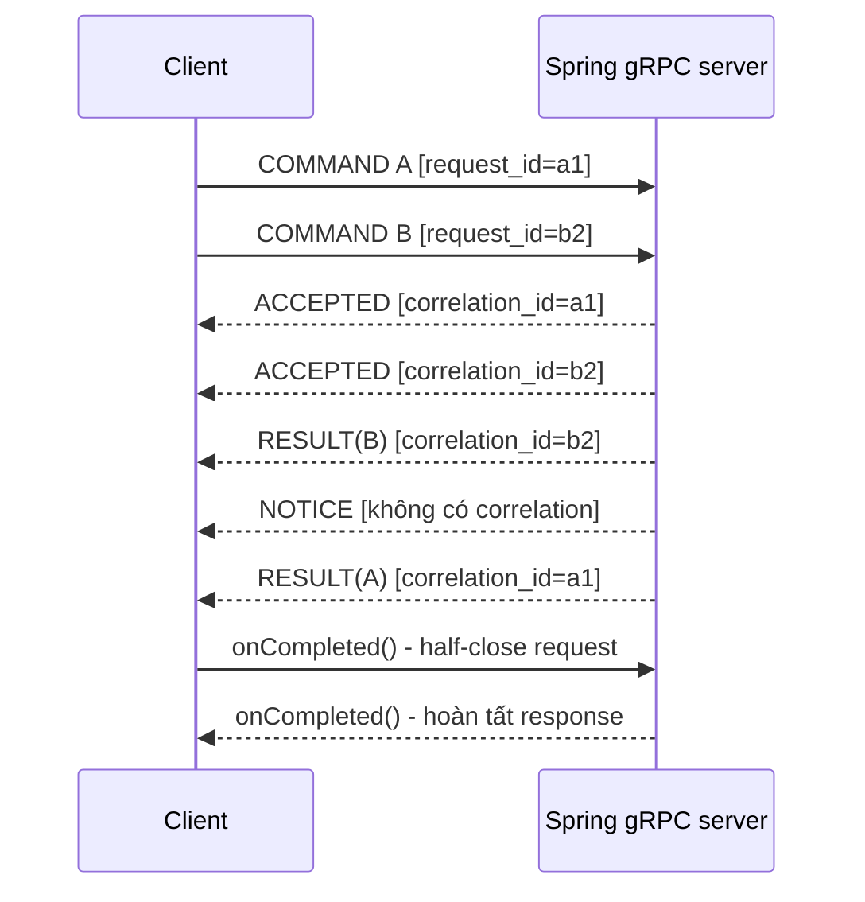

# Correlation giữa request và response

## 1. Vì sao bidirectional streaming cần correlation?

Trong một RPC unary, client gửi một request và nhận một response nên mối liên hệ giữa chúng thường đã rõ từ chính lời gọi. Với **bidirectional streaming** của gRPC, client có thể gửi nhiều request liên tiếp trong khi server chủ động phát nhiều response. Số lượng và thời điểm phát message của hai phía độc lập; một response không nhất thiết là câu trả lời cho request vừa được gửi gần nhất.

Ví dụ một ứng dụng hỗ trợ khách hàng chạy trên **Spring gRPC**:

- Client gửi lệnh tra cứu `A` và lệnh cập nhật `B` mà không chờ kết quả của `A`.
- Server phát `ACCEPTED(A)` và `ACCEPTED(B)` để xác nhận đã tiếp nhận.
- Tác vụ `B` xử lý nhanh, nên `RESULT(B)` đến trước `RESULT(A)`.
- Giữa các kết quả, server gửi `NOTICE` thông báo bảo trì; message này **không thuộc** lệnh nào.

Nếu client ghép response đầu tiên với request đầu tiên, response thứ hai với request thứ hai, kết quả sẽ bị gán nhầm. Giải pháp là đặt một **mã định danh request** vào message và yêu cầu mọi response liên quan mang lại mã đó.

Sau bài này, người học có thể:

1. Phân biệt `request_id`, `correlation_id`, `trace_id` và số thứ tự message.
2. Thiết kế hợp đồng Protocol Buffers cho phản hồi một-nhiều, kết quả đến khác thứ tự và server push độc lập.
3. Triển khai server Spring gRPC trả ACK và kết quả xử lý bất đồng bộ cùng với thông báo chủ động.
4. Cài đặt client Java dùng bảng ánh xạ `request_id → tác vụ đang chờ` để định tuyến đúng response.
5. Xử lý request trùng, request không có response, hủy RPC, deadline và reconnect.
6. Kiểm thử correlation dựa trên ID và trạng thái thay vì dựa trên vị trí message.

## 2. Correlation là quan hệ nghiệp vụ, không phải thứ tự vận chuyển

gRPC giữ **thứ tự message theo từng chiều** của một RPC nếu các message được giao thành công. Điều này không có nghĩa kết quả xử lý phải theo thứ tự request. Server nhận `A` rồi `B`, xử lý cả hai đồng thời và có thể phát `RESULT(B)` trước `RESULT(A)`. Client vẫn nhận response đúng thứ tự server **thực sự phát**.



| Quan hệ | Có được gRPC tự xác định không? | Cần làm gì? |
| --- | --- | --- |
| Thứ tự request A trước B trên cùng stream | Có, trong phạm vi message được giao | Gửi tuần tự qua một writer |
| Thứ tự các response mà server đã phát | Có, trong cùng response stream | Tuần tự hóa `onNext` ở server |
| `RESULT(B)` thuộc request B | **Không** | Dùng `correlation_id=b2` |
| Một request có một hay nhiều response | **Không** | Định nghĩa hợp đồng nghiệp vụ |
| NOTICE chủ động thuộc request nào | Có thể không thuộc request nào | Phân biệt message push và message correlated |
| Request được thực thi thành công hay chưa | **Không** chỉ từ thứ tự/ACK transport | Có trạng thái kết quả nghiệp vụ |

Trong ví dụ này, **correlation** là việc client tìm ra request logic gốc khi nhận một message liên quan. Một request có thể nhận zero, một hoặc nhiều response tùy hợp đồng; không được suy ra tương quan theo số thứ tự xuất hiện trong stream.

### 2.1. Phân biệt các loại định danh

| Trường | Phạm vi và mục đích | Gợi ý |
| --- | --- | --- |
| `request_id` | Định danh một thao tác logic do client tạo | UUID/ULID; duy nhất trong phạm vi hệ thống cần đối chiếu |
| `correlation_id` | Có trong response liên quan, trỏ về `request_id` | Giữ nguyên giá trị, kể cả kết quả đến muộn |
| `trace_id` | Kết nối các span phục vụ distributed tracing | Thường lấy từ tracing context/metadata của RPC |
| `stream_id` hoặc `session_id` nghiệp vụ | Nhận diện phiên, phòng hoặc lượt kết nối | Dùng khi ứng dụng cần quản lý state theo phiên |
| `sequence` | Xác định thứ tự phát hoặc thứ tự sự kiện | Không thay thế định danh request |
| `idempotency_key` | Nhận biết thao tác gửi lại cần tránh thực thi hai lần | Có thể dùng cùng `request_id` nếu contract quy định |

Không nên nhầm `correlation_id` với request ID ở tầng HTTP hay ID nội bộ của HTTP/2 stream. Một RPC gRPC có metadata/tracing của **lời gọi**, trong khi `request_id` của bài này là dữ liệu bên trong **từng message Protobuf**. Token xác thực và metadata gắn với RPC thường không đổi theo từng message.

## 3. Thiết kế hợp đồng Protocol Buffers

Ví dụ `support_session.proto` cho một phiên gRPC song công:

```proto
syntax = "proto3";

package support.v1;

option java_multiple_files = true;
option java_package = "com.example.support.v1";

service SupportSession {
  rpc Converse(stream ClientCommand) returns (stream ServerMessage);
}

message ClientCommand {
  string request_id = 1;  // Client cấp cho thao tác logic
  string payload = 2;
}

message ServerMessage {
  // Để rỗng chỉ cho loại NOTICE chủ động.
  string correlation_id = 1;

  oneof body {
    Accepted accepted = 2;
    Result result = 3;
    Notice notice = 4;
  }
}

message Accepted {
  string note = 1;        // Tiếp nhận; chưa bảo đảm xử lý xong
}

message Result {
  bool success = 1;
  string data = 2;
  string error_code = 3;  // Mã lỗi nghiệp vụ khi success=false
}

message Notice {
  string text = 1;        // Server push, không liên kết một request
}
```

Sau khi chạy bước sinh mã `protoc` và `protoc-gen-grpc-java` tương ứng với cấu hình Spring gRPC của dự án, Java có `SupportSessionGrpc`, `ClientCommand`, `ServerMessage`, `Accepted`, `Result` và `Notice`.

Các quy tắc của contract này:

- Mỗi `ClientCommand` **bắt buộc** có `request_id` không rỗng. Một ID nhận diện một thao tác logic; cùng ID không được dùng cho hai thao tác khác nhau.
- Mọi `Accepted` và `Result` phải mang `correlation_id` bằng `request_id` gốc. Client không cần đoán theo thứ tự.
- `Accepted` chỉ có nghĩa server đã tiếp nhận message trong ví dụ, **không** phải xác nhận dữ liệu đã lưu bền vững.
- `Result` là kết quả cuối cùng của thao tác. Một request có thể nhận `Accepted` rồi `Result`; contract mở rộng có thể bổ sung nhiều `Progress` với cùng correlation ID.
- `Notice` là thông báo độc lập; trong hợp đồng hiện tại `correlation_id` rỗng. Client phải phân nhánh theo `oneof body`, không chỉ kiểm tra ID.
- Lỗi nghiệp vụ của **một thao tác** có thể nằm trong `Result(success=false, error_code=...)`, để các thao tác khác tiếp tục. `onError(Status...)` là lỗi kết thúc **toàn RPC**, cần dùng có chủ đích.

### 3.1. Vì sao dùng `oneof`?

Nếu một message vừa có `ACK`, vừa có `NOTICE` và vừa có `RESULT` dưới dạng các trường độc lập, client phải suy đoán tổ hợp hợp lệ. `oneof` làm rõ mỗi `ServerMessage` mang **một loại nội dung**. Java sinh `getBodyCase()` với các nhánh `ACCEPTED`, `RESULT`, `NOTICE` và `BODY_NOT_SET`; client dùng nó để xử lý từng loại.

Trong schema production, có thể thay chuỗi `error_code` bằng enum có quy tắc tương thích ngược; bổ sung thời điểm tạo, tenant ID hoặc cursor khi ứng dụng thật sự cần. Không đặt dữ liệu nhạy cảm như access token trong `request_id` vì ID thường xuất hiện trong log.

## 4. Triển khai server Spring gRPC với kết quả đến không theo thứ tự request

Ví dụ server sau:

1. Nhận một `ClientCommand`, gửi `Accepted` với đúng `request_id`.
2. Lập lịch hoàn tất thao tác trong executor; thao tác bắt đầu bằng `slow:` mất lâu hơn `fast:`.
3. Gửi `Result` khi từng thao tác xong, vẫn mang cùng correlation ID.
4. Chủ động gửi một `Notice` trong lúc chờ các tác vụ.
5. Chỉ đóng response khi client đã half-close request stream **và** mọi tác vụ đang chờ cùng thông báo chủ động đã hoàn tất.

Mục đích là chứng minh `Result` có thể đến lệch thứ tự request mà client vẫn liên kết đúng.

### 4.1. Executor được Spring quản lý

```java
package com.example.support;

import java.util.concurrent.Executors;
import java.util.concurrent.ScheduledExecutorService;
import org.springframework.context.annotation.Bean;
import org.springframework.context.annotation.Configuration;

@Configuration
public class SupportStreamingConfig {
    @Bean(destroyMethod = "shutdown")
    ScheduledExecutorService supportScheduler() {
        return Executors.newScheduledThreadPool(4);
    }
}
```

### 4.2. Service: giữ correlation ngay cả khi xử lý bất đồng bộ

```java
package com.example.support;

import com.example.support.v1.Accepted;
import com.example.support.v1.ClientCommand;
import com.example.support.v1.Notice;
import com.example.support.v1.Result;
import com.example.support.v1.ServerMessage;
import com.example.support.v1.SupportSessionGrpc;
import io.grpc.Status;
import io.grpc.stub.ServerCallStreamObserver;
import io.grpc.stub.StreamObserver;
import java.util.ArrayList;
import java.util.HashSet;
import java.util.List;
import java.util.Set;
import java.util.concurrent.RejectedExecutionException;
import java.util.concurrent.ScheduledExecutorService;
import java.util.concurrent.ScheduledFuture;
import java.util.concurrent.TimeUnit;
import org.springframework.stereotype.Service;

@Service
public class SupportSessionService
        extends SupportSessionGrpc.SupportSessionImplBase {

    private final ScheduledExecutorService scheduler;

    public SupportSessionService(ScheduledExecutorService scheduler) {
        this.scheduler = scheduler;
    }

    @Override
    public StreamObserver<ClientCommand> converse(
            StreamObserver<ServerMessage> responseObserver) {

        ServerCallStreamObserver<ServerMessage> output =
                (ServerCallStreamObserver<ServerMessage>) responseObserver;
        Session session = new Session(output, scheduler);
        output.setOnCancelHandler(session::cancel);
        session.start();

        return new StreamObserver<>() {
            @Override
            public void onNext(ClientCommand command) {
                session.accept(command);
            }

            @Override
            public void onError(Throwable cause) {
                // Client huỷ/đứt kết nối: dừng các tác vụ chưa hoàn tất.
                session.cancel();
            }

            @Override
            public void onCompleted() {
                // Client chỉ đóng chiều gửi request.
                session.inputCompleted();
            }
        };
    }

    private static final class Session {
        private final Object writeLock = new Object();
        private final ServerCallStreamObserver<ServerMessage> output;
        private final ScheduledExecutorService scheduler;
        private final Set<String> seenIds = new HashSet<>();
        private final List<ScheduledFuture<?>> jobs = new ArrayList<>();

        private boolean stopped;
        private boolean inputDone;
        private boolean noticeDone;
        private int pendingResults;

        Session(ServerCallStreamObserver<ServerMessage> output,
                ScheduledExecutorService scheduler) {
            this.output = output;
            this.scheduler = scheduler;
        }

        void start() {
            synchronized (writeLock) {
                try {
                    jobs.add(scheduler.schedule(
                            this::sendNotice, 200, TimeUnit.MILLISECONDS));
                } catch (RejectedExecutionException ex) {
                    failLocked(Status.UNAVAILABLE
                            .withDescription("Scheduler không nhận tác vụ")
                            .withCause(ex));
                }
            }
        }

        void accept(ClientCommand command) {
            synchronized (writeLock) {
                if (stopped || output.isCancelled()) {
                    cancelLocked();
                    return;
                }

                String requestId = command.getRequestId();
                if (requestId.isBlank()) {
                    failLocked(Status.INVALID_ARGUMENT
                            .withDescription("request_id không được rỗng"));
                    return;
                }
                if (!seenIds.add(requestId)) {
                    failLocked(Status.ALREADY_EXISTS
                            .withDescription("request_id bị trùng trong phiên"));
                    return;
                }

                boolean sent = emitLocked(ServerMessage.newBuilder()
                        .setCorrelationId(requestId)
                        .setAccepted(Accepted.newBuilder()
                                .setNote("Đã tiếp nhận")
                                .build())
                        .build());
                if (!sent) {
                    return;
                }

                // Minh họa hai request có thể hoàn thành khác thứ tự.
                long delayMillis = command.getPayload().startsWith("slow:")
                        ? 500 : 100;
                pendingResults++;
                try {
                    ScheduledFuture<?> job = scheduler.schedule(
                            () -> complete(requestId, command.getPayload()),
                            delayMillis, TimeUnit.MILLISECONDS);
                    jobs.add(job);
                } catch (RejectedExecutionException ex) {
                    pendingResults--;
                    failLocked(Status.UNAVAILABLE
                            .withDescription("Không lên lịch xử lý được")
                            .withCause(ex));
                }
            }
        }

        private void complete(String requestId, String payload) {
            synchronized (writeLock) {
                if (stopped || output.isCancelled()) {
                    cancelLocked();
                    return;
                }
                boolean sent = emitLocked(ServerMessage.newBuilder()
                        .setCorrelationId(requestId)
                        .setResult(Result.newBuilder()
                                .setSuccess(true)
                                .setData("Hoàn tất: " + payload)
                                .build())
                        .build());
                if (!sent) {
                    return;
                }
                pendingResults--;
                finishIfReadyLocked();
            }
        }

        private void sendNotice() {
            synchronized (writeLock) {
                if (stopped || output.isCancelled()) {
                    cancelLocked();
                    return;
                }
                boolean sent = emitLocked(ServerMessage.newBuilder()
                        // Không set correlation_id cho thông báo độc lập.
                        .setNotice(Notice.newBuilder()
                                .setText("Hệ thống vẫn đang hoạt động")
                                .build())
                        .build());
                if (!sent) {
                    return;
                }
                noticeDone = true;
                finishIfReadyLocked();
            }
        }

        void inputCompleted() {
            synchronized (writeLock) {
                inputDone = true;
                finishIfReadyLocked();
            }
        }

        void cancel() {
            synchronized (writeLock) {
                cancelLocked();
            }
        }

        // Mọi thao tác ghi response đều tuần tự trên cùng writeLock.
        private boolean emitLocked(ServerMessage message) {
            if (stopped) {
                return false;
            }
            try {
                output.onNext(message);
                return true;
            } catch (RuntimeException ex) {
                // Observer không còn dùng được; không ghi tiếp.
                cancelLocked();
                return false;
            }
        }

        private void finishIfReadyLocked() {
            if (!stopped && inputDone && noticeDone
                    && pendingResults == 0) {
                stopped = true;
                cancelJobsLocked();
                output.onCompleted();
            }
        }

        private void failLocked(Status status) {
            if (!stopped) {
                stopped = true;
                cancelJobsLocked();
                output.onError(status.asRuntimeException());
            }
        }

        private void cancelLocked() {
            stopped = true;
            cancelJobsLocked();
        }

        private void cancelJobsLocked() {
            for (ScheduledFuture<?> job : jobs) {
                job.cancel(false);
            }
        }
    }
}
```

**Chú ý việc giữ ID:** `requestId` được lấy từ message đầu vào và truyền vào lambda của chính tác vụ đó. Dù tác vụ nhanh hoàn thành trước tác vụ chậm, response vẫn có `correlation_id` đúng. Không dùng biến toàn cục kiểu `lastRequestId`, vì nó có thể đã bị request tiếp theo ghi đè.

Khóa `writeLock` làm cho những lần gọi `output.onNext()`, `output.onCompleted()` và `output.onError()` không xảy ra đồng thời trong một phiên. Không có khóa chung giữa tất cả các RPC. Với lưu lượng lớn, nên thay ghi trực tiếp bằng **queue có giới hạn + một writer**, sử dụng `isReady()`/`setOnReadyHandler(...)` để quản lý backpressure. Đây là ví dụ hữu hạn để thấy rõ correlation, chưa phải implementation tối ưu cho hệ thống nhiều kết nối và producer liên tục.

Đoạn `seenIds` chỉ phát hiện ID trùng **trong một RPC đang sống**. Nó không cung cấp idempotency qua reconnect, failover hoặc các instance Spring khác. Trường hợp đó cần bộ lưu trạng thái đã xử lý ở tầng nghiệp vụ, thường có thời hạn lưu và khóa định danh phù hợp.

## 5. Client: định tuyến response đến đúng thao tác đang chờ

Client dùng asynchronous stub và một map `request_id → CompletableFuture`. Khi gửi message, client đăng ký phần tử trong map **trước khi gọi `onNext`**, bởi server có thể phản hồi rất nhanh. Callback nhận response đọc `correlation_id` và hoàn tất đúng future khi có `Result`. Các `Notice` được xử lý riêng, không lấy một phần tử bất kỳ của map để ghép.

```java
package com.example.support;

import com.example.support.v1.ClientCommand;
import com.example.support.v1.ServerMessage;
import com.example.support.v1.SupportSessionGrpc;
import io.grpc.ManagedChannel;
import io.grpc.ManagedChannelBuilder;
import io.grpc.stub.StreamObserver;
import java.util.Map;
import java.util.UUID;
import java.util.concurrent.CompletableFuture;
import java.util.concurrent.ConcurrentHashMap;
import java.util.concurrent.CountDownLatch;
import java.util.concurrent.TimeUnit;
import java.util.concurrent.atomic.AtomicReference;

public class SupportSessionClientDemo {
    public static void main(String[] args) throws Exception {
        ManagedChannel channel = ManagedChannelBuilder
                .forAddress("localhost", 9090)
                .usePlaintext() // Chỉ để thử nghiệm trên localhost.
                .build();

        Map<String, CompletableFuture<String>> pending =
                new ConcurrentHashMap<>();
        CountDownLatch finished = new CountDownLatch(1);
        AtomicReference<Throwable> rpcError = new AtomicReference<>();

        try {
            SupportSessionGrpc.SupportSessionStub stub =
                    SupportSessionGrpc.newStub(channel)
                            .withDeadlineAfter(5, TimeUnit.SECONDS);

            StreamObserver<ServerMessage> incoming = new StreamObserver<>() {
                @Override
                public void onNext(ServerMessage message) {
                    switch (message.getBodyCase()) {
                        case ACCEPTED -> {
                            System.out.println("ACCEPTED cho: "
                                    + message.getCorrelationId());
                        }
                        case RESULT -> {
                            String id = message.getCorrelationId();
                            System.out.println("RESULT cho: " + id);
                            CompletableFuture<String> future = pending.get(id);
                            if (future == null) {
                                System.err.println("Response không khớp: " + id);
                                return;
                            }
                            if (message.getResult().getSuccess()) {
                                future.complete(message.getResult().getData());
                            } else {
                                future.completeExceptionally(
                                        new IllegalStateException(
                                                message.getResult()
                                                        .getErrorCode()));
                            }
                        }
                        case NOTICE -> System.out.println("NOTICE: "
                                + message.getNotice().getText());
                        case BODY_NOT_SET ->
                                System.err.println("Message không có body");
                    }
                }

                @Override
                public void onError(Throwable cause) {
                    rpcError.set(cause);
                    pending.values().forEach(
                            future -> future.completeExceptionally(cause));
                    finished.countDown();
                }

                @Override
                public void onCompleted() {
                    pending.forEach((id, future) -> {
                        if (!future.isDone()) {
                            future.completeExceptionally(
                                    new IllegalStateException(
                                            "Thiếu Result cho request_id=" + id));
                        }
                    });
                    finished.countDown();
                }
            };

            StreamObserver<ClientCommand> outgoing = stub.converse(incoming);

            String slowId = UUID.randomUUID().toString();
            String fastId = UUID.randomUUID().toString();
            pending.put(slowId, new CompletableFuture<>());
            pending.put(fastId, new CompletableFuture<>());

            outgoing.onNext(ClientCommand.newBuilder()
                    .setRequestId(slowId)
                    .setPayload("slow: tải báo cáo")
                    .build());
            outgoing.onNext(ClientCommand.newBuilder()
                    .setRequestId(fastId)
                    .setPayload("fast: kiểm tra trạng thái")
                    .build());

            outgoing.onCompleted(); // Chỉ half-close chiều request.

            if (!finished.await(4, TimeUnit.SECONDS)) {
                throw new IllegalStateException("Chưa kết thúc RPC đúng hạn");
            }
            if (rpcError.get() != null) {
                throw new IllegalStateException("RPC thất bại", rpcError.get());
            }

            // Tìm kết quả bằng request_id, không dựa vào thứ tự response.
            System.out.println("slow => "
                    + pending.get(slowId).get(1, TimeUnit.SECONDS));
            System.out.println("fast => "
                    + pending.get(fastId).get(1, TimeUnit.SECONDS));
        } finally {
            channel.shutdownNow().awaitTermination(2, TimeUnit.SECONDS);
        }
    }
}
```

Ví dụ sử dụng Java hỗ trợ cú pháp `switch ->` và `String.isBlank()`. Với server gRPC cấu hình ở `localhost:9090`, một trình tự quan sát **có thể** là:

```text
ACCEPTED cho: <slowId>
ACCEPTED cho: <fastId>
RESULT cho: <fastId>
NOTICE: Hệ thống vẫn đang hoạt động
RESULT cho: <slowId>
slow => Hoàn tất: slow: tải báo cáo
fast => Hoàn tất: fast: kiểm tra trạng thái
```

Các giá trị `<slowId>` và `<fastId>` biểu thị UUID được sinh khi chạy; thứ tự `NOTICE` có thể thay đổi theo lịch thực thi. Điểm ổn định là client hoàn tất **đúng future gắn với ID**, bất kể thứ tự nhận. Nếu client muốn biết request được *tiếp nhận* hay *xử lý xong*, nên quản lý trạng thái riêng (ví dụ `SENT → ACCEPTED → SUCCEEDED/FAILED`) cho từng ID.

**Lưu ý vòng đời của `pending`:** trong ứng dụng thực, xóa entry sau khi consumer đã lấy kết quả hoặc lưu trong cấu trúc có thời hạn. Nếu người dùng chờ lâu, cần timeout/cancellation theo thao tác. Khi RPC kết thúc thành công nhưng một request còn thiếu `Result`, client không nên giữ future mãi; hãy hoàn tất nó bằng lỗi protocol/incomplete-response và ghi log correlation ID.

## 6. Các trường hợp correlation dễ sai

### 6.1. Nhiều response cho một request

Một thao tác tạo báo cáo có thể phát `Accepted(id)`, nhiều `Progress(id)` rồi `Result(id)`. Nếu client xóa `pending[id]` ngay tại `Accepted`, các cập nhật sau sẽ thành message “không xác định”. Hãy xác định loại nào là **trung gian**, loại nào là **kết thúc logic** của request.

| Loại response | `correlation_id` | Có hoàn tất request không? |
| --- | --- | --- |
| `Accepted` | ID của request | Không |
| `Progress` (nếu schema mở rộng) | ID của request | Không |
| `Result(success=true)` | ID của request | Có |
| `Result(success=false)` | ID của request | Có, với kết quả lỗi nghiệp vụ |
| `Notice` chủ động | Rỗng theo contract này | Không thuộc request nào |

### 6.2. Response đến khác thứ tự request

Kết quả xử lý bất đồng bộ có thể hoàn tất khác thứ tự nhận request. Không được giả định “response thứ N ứng với request thứ N”. Dùng map theo ID, có thể bổ sung trạng thái, deadline riêng và logic phát hiện response bị trùng hoặc kết quả đến sau khi request đã timeout.

### 6.3. Một request không có response hoặc gửi một lần nhận nhiều lần

RPC có thể bị huỷ trước khi kết quả được tạo; server cũng có thể chủ đích chỉ gửi `Accepted` nếu contract cho phép. Hãy ghi rõ số lượng và loại message mà ứng dụng phải phát cho từng lệnh. Nếu `Result` là bắt buộc, việc đóng RPC thành công trong khi còn request chưa hoàn tất là lỗi của **contract ứng dụng**, không phải bằng chứng gRPC đã đảo thứ tự.

Client nên phân biệt ba trạng thái `pending`:

1. **Đang chờ:** chưa có kết quả cuối cùng; có thể đã nhận ACK/progress.
2. **Hoàn tất:** nhận `Result`; lưu/xóa entry theo chính sách lưu kết quả.
3. **Hủy/hết hạn:** ngừng chờ; nếu response đến muộn thì bỏ qua hoặc ghi nhận theo quy tắc rõ ràng.

### 6.4. ID trùng và response không có ID

Nếu client dùng cùng `request_id` cho hai thao tác **khác nhau**, map có thể ghi đè future và trả kết quả cho sai người gọi. Dùng UUID/ULID hoặc một bộ cấp ID có tính duy nhất phù hợp. Khi server nhận request ID trùng trong **cùng stream**, có thể từ chối `ALREADY_EXISTS` như ví dụ. Khi client nhận response correlated nhưng ID không tồn tại, cần coi đó là vấn đề protocol hoặc message đến muộn/đã dọn trạng thái; đừng mặc nhiên gắn nó với request mới nhất.

Thông báo độc lập **không nên mượn correlation ID của request gần nhất**. Nếu server phát thông báo cho toàn phiên, schema có thể phân biệt `Notice` bằng `oneof` và không set `correlation_id`; một thông báo có ID riêng phục vụ deduplication nếu cần.

## 7. Correlation khi reconnect, retry và idempotency

Giả sử client gửi request `id=K`, server đã xử lý thành công nhưng mạng ngắt trước khi `Result(K)` tới client. Khi reconnect, có hai nguy cơ:

- **Gửi lại K:** server có thể xử lý lặp, nếu không có kiểm tra idempotency bền vững.
- **Không gửi lại K:** client không biết trạng thái cuối cùng của thao tác.

Correlation cho phép đối chiếu message; nó **không tự bảo đảm exactly-once processing**. Muốn thực thi an toàn qua retry:

1. Tạo `request_id` ổn định cho **một thao tác logic**. Khi retry thao tác đó, giữ nguyên ID; khi tạo thao tác mới, cấp ID mới.
2. Server lưu `request_id` cùng trạng thái/đầu ra trong một kho có tính nhất quán phù hợp (database, idempotency table hoặc event log).
3. Với ID đã hoàn tất, server trả lại kết quả đã lưu; với ID đang xử lý, trả trạng thái phù hợp hoặc đăng ký theo dõi; với ID trùng nhưng payload khác, báo xung đột.
4. Xác định retention TTL cho bảng ID và phạm vi khóa, ví dụ `tenant_id + request_id` để tránh trùng giữa khách hàng.
5. Nếu phải phát lại nhiều kết quả, thêm cursor hoặc số thứ tự nghiệp vụ; chỉ dùng correlation ID là chưa đủ để biết client đã nhận tới bản tin nào.

Một `Set` ID trong biến `Session` của ví dụ chỉ sống bằng RPC, nên không hỗ trợ deduplication giữa hai kết nối. Cũng không nên dựa vào khả năng tự retry của gRPC để tin rằng stream có thể tiếp tục từ message trước đó; một lần gọi bidi mới cần giao thức resume và idempotency do ứng dụng định nghĩa.

## 8. Error, deadline, cancellation và bảo mật

Trong bidirectional streaming, cả hai chiều chia sẻ **một RPC**. Client có thể gọi `outgoing.onCompleted()` để half-close request stream, trong khi server vẫn gửi `Result` và `Notice`. Ngược lại, `responseObserver.onError(Status...)` kết thúc toàn lời gọi với lỗi gRPC; tất cả request đang chờ cần được xử lý theo chính sách thất bại/hủy.

| Tình huống | Cách xử lý correlation |
| --- | --- |
| `Result(success=false)` cho một ID | Hoàn tất **chỉ** thao tác liên quan bằng lỗi nghiệp vụ; giữ stream nếu hợp đồng cho phép |
| `INVALID_ARGUMENT` hoặc `UNAUTHENTICATED` toàn RPC | Kết thúc stream; mọi pending request chưa có kết quả phải được giải quyết với lỗi |
| Client half-close nhưng server còn task | Server tiếp tục trả message correlated, rồi tự hoàn tất response |
| Deadline hết | Ghi nhận các ID chưa có kết quả; dừng producer/queue; xác minh trước khi retry |
| Client cancel | Server hủy timer và tác vụ còn chờ; không gửi `onNext` sau terminal |
| Response không có `correlation_id` trong nhánh Result | Coi là vi phạm hợp đồng, không gắn nhầm vào request khác |
| Notice có payload độc lập | Xử lý trong luồng push riêng; không hoàn tất future của request |

Deadline của gRPC là hạn cho **cả RPC**, không được làm mới sau mỗi message. Một request có timeout riêng có thể hết hạn trước RPC; khi đó client nên đánh dấu future tương ứng đã hết hạn nhưng không tự giả định các message còn lại của phiên phải thất bại.

Với Spring gRPC, interceptor và metadata thường dùng cho xác thực, quyền truy cập, tracing và các thông số của **lời gọi**. Nếu cần truyền ID theo **từng message**, hãy đưa vào Protobuf thay vì cố đổi metadata giữa stream. Sử dụng TLS/mTLS cho triển khai thực tế; `usePlaintext()` trong ví dụ chỉ dành cho môi trường phát triển cục bộ.

Khi ghi log, nên có các trường `rpc_method`, `session_id` (nếu ứng dụng có), `request_id`, `correlation_id`, `event_type`, `status`, `duration`. Không dùng ID có chứa token hoặc thông tin bí mật. Distributed trace giúp quan sát toàn cuộc gọi, nhưng vẫn cần ID ở tầng message để liên kết nhiều thao tác trong cùng RPC.

## 9. Kiểm thử correlation có hệ thống

Có thể dùng gRPC in-process server/channel cùng test scheduler để kiểm tra service mà không phụ thuộc cổng TCP. Nên điều khiển thời điểm hoàn thành các task để tạo kết quả lệch thứ tự, thay vì dựa vào `Thread.sleep()` và giả định một lịch chạy cố định.

| Kịch bản | Assertion chính |
| --- | --- |
| Client gửi A, B; B xử lý xong trước | `Result(B).correlation_id == B.request_id` và tương tự cho A |
| Một request có Accepted rồi Result | Cả hai mang cùng ID; Accepted không làm future kết thúc |
| Server gửi Notice giữa hai Result | Notice có nhánh `NOTICE`, không được gắn vào A hoặc B |
| Nhiều request chạy cùng lúc | Mỗi kết quả định tuyến đúng future theo ID |
| Hai request trùng ID trong cùng phiên | Server thực thi chính sách duplicate đã khai báo |
| Server trả Result thiếu/không khớp ID | Client phát hiện protocol error, không gắn theo vị trí |
| Client half-close sớm | Vẫn nhận kết quả từ những task còn chạy |
| Cancel giữa phiên | Các future đang chờ nhận lỗi/hủy; không rò rỉ executor, timer, subscription |
| RPC kết thúc khi còn pending | Client giải quyết future thiếu kết quả thay vì chờ vô hạn |
| Retry qua reconnect với cùng ID | Server dùng kho idempotency bền vững để tránh thực thi lặp |

Với mỗi callback `onNext(ServerMessage)`, test nên kiểm tra cả **loại message, correlation ID, trạng thái pending** và nội dung nghiệp vụ. Không viết assertion kiểu “response #1 phải thuộc request #1”; đó chính là lỗi thiết kế mà correlation cần tránh.

Các chỉ số vận hành hữu ích gồm số request đang pending trên mỗi RPC, thời gian từ gửi đến `Accepted`, thời gian từ gửi đến `Result`, số response không khớp ID, số ID trùng, độ trễ xử lý, request timeout, reconnect và tỷ lệ các mã gRPC status. Khi có nhiều request trong một RPC, đo latency **theo thao tác** cho kết quả có ý nghĩa hơn chỉ đo thời gian sống của stream.

## 10. Bài tập vận dụng

Nâng cấp `SupportSession.Converse` thành kênh xử lý tác vụ có progress:

1. Bổ sung `Progress` vào `oneof body`, với trường `percent` và `correlation_id`; quy định có thể có nhiều `Progress` nhưng đúng một kết quả cuối cùng cho mỗi request.
2. Gửi ba request trong cùng RPC, cho request thứ hai hoàn tất nhanh hơn request thứ nhất. Client phải hiển thị kết quả theo ID, không dùng FIFO response.
3. Tạo `RequestTracker` quản lý `NEW`, `ACCEPTED`, `RUNNING`, `SUCCEEDED`, `FAILED`, `TIMED_OUT`, và xóa state đúng lúc.
4. Thêm `Notice` độc lập của server; kiểm tra rằng nó không làm thay đổi bất kỳ request đang chờ nào.
5. Mô phỏng mạng gián đoạn sau khi server hoàn tất thao tác nhưng trước khi client nhận Result. Thêm kho idempotency và test retry bằng cùng `request_id`.
6. Cấu hình deadline, TLS trong môi trường phù hợp và tracing; đo tỷ lệ response không tương quan cùng độ trễ từ gửi tới kết quả.

**Tiêu chí hoàn thành:** một request có thể nhận nhiều response; kết quả về không theo thứ tự vẫn được xử lý đúng; Notice không bị gán nhầm; mọi pending request được thu dọn khi RPC hoàn tất, lỗi hoặc hủy; retry không lặp thao tác đã được áp dụng.

### Tài liệu tham khảo

- [gRPC Core concepts](https://grpc.io/docs/what-is-grpc/core-concepts/): bidirectional streaming, vòng đời và thứ tự message.
- [gRPC Java StreamObserver](https://grpc.github.io/grpc-java/javadoc/io/grpc/stub/StreamObserver.html): callback gửi/nhận và terminal status.
- [gRPC Java ServerCallStreamObserver](https://grpc.github.io/grpc-java/javadoc/io/grpc/stub/ServerCallStreamObserver.html): cancel handler và flow control.
- [Spring gRPC Reference](https://docs.spring.io/spring-grpc/reference/): gRPC server/client, interceptor, testing và bảo mật trong Spring.
