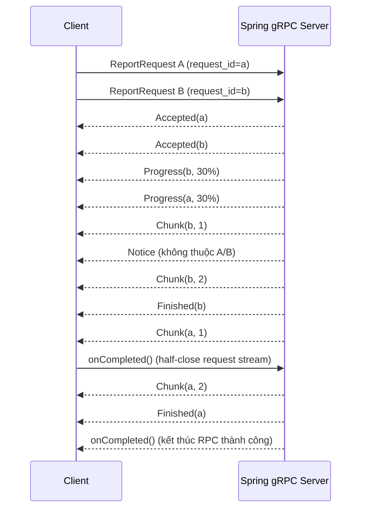
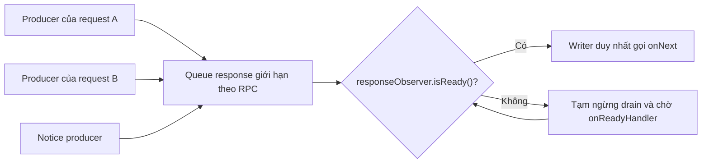

# Nhiều response cho một request

## 1. Một request có thể tạo ra cả một chuỗi response

Trong hệ sinh thái **SPRING_GRPC**, một dịch vụ xử lý báo cáo có thể cần nhiều giây để tổng hợp dữ liệu. Nếu client chỉ nhận một response cuối cùng, người dùng khó biết server đã tiếp nhận thao tác hay đang xử lý tới đâu. Với **bidirectional streaming RPC**, client có thể gửi một `ReportRequest`, còn server phát lần lượt `Accepted`, các cập nhật `Progress`, nhiều mảnh kết quả `Chunk` rồi `Finished`, tất cả đều gắn với request gốc. Trong lúc đó, client vẫn có thể gửi những request khác và server vẫn có thể phát thông báo chủ động.

Đây là mô hình **một request logic → nhiều response logic** bên trong một RPC hai chiều. Không phải mỗi lần `requestObserver.onNext(request)` sẽ tự động được gRPC ghép với đúng một lần `responseObserver.onNext(response)`; ứng dụng phải định nghĩa loại message và quan hệ của chúng.

Sau bài học, người học có thể:

- Phân biệt **server streaming** (một request message ban đầu, nhiều response) với **bidirectional streaming** (nhiều request, mỗi request có thể tạo nhiều response).
- Thiết kế hợp đồng Protocol Buffers có `request_id`, `oneof` cho các loại response và thông điệp kết thúc **từng tác vụ**.
- Triển khai server Spring gRPC phát tiến độ và kết quả từng phần từ những tác vụ xử lý đồng thời.
- Triển khai client Java ghép tất cả response cùng `request_id` vào đúng tác vụ, kể cả khi các response xen kẽ nhau.
- Phân biệt `Finished` của một request với `StreamObserver.onCompleted()` của toàn RPC.
- Xử lý thứ tự chunk, backpressure, request bị lỗi, cancellation, deadline và kiểm thử nhiều response.

## 2. Hai tầng vòng đời: request logic và RPC

Một RPC bidirectional streaming chứa **một request stream và một response stream**. Giao thức bảo toàn thứ tự message được chuyển tới thành công *trong từng chiều*, nhưng không định nghĩa request nào cần bao nhiêu response.

Giả sử client gửi hai yêu cầu `A` và `B`, trong đó `B` xử lý nhanh hơn:



Sơ đồ chỉ là **một thứ tự xen kẽ hợp lệ**. Cần phân biệt hai điểm kết thúc:

| Sự kiện | Phạm vi | Hệ quả |
| --- | --- | --- |
| `Finished(request_id=b)` | **Một** tác vụ B | B đã có trạng thái cuối; A và các thông báo khác vẫn có thể tiếp tục |
| `Finished(request_id=a)` | **Một** tác vụ A | A đã kết thúc logic; RPC vẫn có thể còn mở |
| Client gọi `requestObserver.onCompleted()` | Chiều **client → server** | Client không gửi thêm request; server vẫn có thể phát response |
| Server gọi `responseObserver.onCompleted()` | Toàn **RPC thành công** | Client nhận callback `onCompleted()`; không còn response mới |
| Một phía báo lỗi RPC/hủy/deadline | Toàn **RPC** | Các tác vụ chưa hoàn tất cần được dọn dẹp và xử lý theo chính sách ứng dụng |

Thông điệp `Finished` là **message nghiệp vụ thông thường**, không phải terminal callback của gRPC. Một server có thể phát `Finished(A)`, `Finished(B)` và `Notice` trước khi `onCompleted()` kết thúc RPC.

### 2.1. Bidirectional streaming khác server streaming ở điểm nào?

| Đặc điểm | Server streaming | Bidirectional streaming |
| --- | --- | --- |
| Số request message trong một RPC | Một | Không đến nhiều |
| Số response message | Không đến nhiều | Không đến nhiều |
| Client gửi request tiếp theo khi đang nhận response | Cần một RPC khác | Có thể gửi trên cùng RPC |
| Nhiều tác vụ logic cùng tồn tại trong một RPC | Không phải mẫu mặc định | Có thể định nghĩa bằng `request_id` |
| Ghép response với request | Thường rõ từ RPC ban đầu | Phải thiết kế **correlation** theo từng message |

Nếu client chỉ gọi một thao tác rồi muốn nhận nhiều kết quả, server streaming có thể đã đủ. Bidirectional streaming đặc biệt có ích khi client cần **gửi thêm công việc, điều khiển phiên hoặc tương tác** trong lúc đang nhận tiến độ và dữ liệu của những request trước.

## 3. Hợp đồng Protobuf: trạng thái, tiến độ và nhiều chunk

Tạo `report_pipeline.proto`:

```proto
syntax = "proto3";

package report.v1;

option java_multiple_files = true;
option java_package = "com.example.report.v1";

service ReportPipeline {
  rpc Process(stream ReportRequest) returns (stream ReportEvent);
}

message ReportRequest {
  string request_id = 1;
  string query = 2;
}

message ReportEvent {
  // Rỗng chỉ khi body = notice.
  string request_id = 1;

  oneof body {
    Accepted accepted = 2;
    Progress progress = 3;
    ResultChunk chunk = 4;
    Finished finished = 5;
    Notice notice = 6;
  }
}

message Accepted {
  string detail = 1;
}

message Progress {
  int32 percent = 1;       // 0..100, quy ước của ứng dụng
  string phase = 2;
}

message ResultChunk {
  int32 index = 1;         // Bắt đầu từ 1, tăng liên tục cho mỗi request
  string content = 2;
}

message Finished {
  bool success = 1;
  int32 total_chunks = 2;  // Số chunk đã phát cho request
  string error_code = 3;   // Có giá trị khi success=false
}

message Notice {
  string text = 1;         // Server push, không gắn request_id
}
```

Sau bước sinh mã từ `protoc` và `protoc-gen-grpc-java`, Java có các lớp `ReportPipelineGrpc`, `ReportRequest`, `ReportEvent`, `Progress`, `ResultChunk`, `Finished` và các kiểu message liên quan. Ví dụ phía dưới giả định ứng dụng đã cấu hình Spring gRPC, dependency Java và plugin sinh mã tương thích.

**Hợp đồng nghiệp vụ của ví dụ:**

1. Mỗi `ReportRequest` phải có `request_id` không rỗng và duy nhất trong phiên RPC. Mỗi ID chỉ dùng cho một tác vụ logic.
2. Server có thể phát một `Accepted`, không hoặc nhiều `Progress`, không hoặc nhiều `ResultChunk`, rồi **đúng một `Finished`** cho request đã được nhận hợp lệ nếu RPC không thất bại trước đó.
3. Mọi response thuộc request mang **cùng `request_id`**. Các response của A và B được phép xen kẽ; thứ tự chỉ cần đúng *theo từng request* như contract quy định.
4. `ResultChunk.index` bắt đầu từ 1 và tăng liên tục **riêng cho mỗi request**. `Finished.total_chunks` xác nhận số chunk của tác vụ.
5. `Notice` không thuộc request nào và có `request_id` rỗng. Client không được coi nó là tiến độ của request gần nhất.
6. `Finished(success=false)` kết thúc **một tác vụ** với lỗi nghiệp vụ. Lỗi gRPC như `INVALID_ARGUMENT`, `UNAVAILABLE` hoặc `CANCELLED` có thể kết thúc **toàn bộ RPC**.

Các loại message nằm trong `oneof` giúp client phân nhánh bằng `getBodyCase()`, thay vì phải đoán loại dữ liệu từ một trường string tự do. Trong hệ thống thật, có thể thêm thời gian tạo sự kiện, cursor, enum trạng thái hoặc mã lỗi chi tiết; chỉ thêm khi contract đã nêu rõ ý nghĩa và tương thích phiên bản.

### 3.1. Không được dùng thứ tự toàn stream để ghép kết quả

Nếu server xử lý A và B trên hai tác vụ độc lập, `Chunk(B,1)` có thể xuất hiện trước `Chunk(A,1)`. Điều này hợp lệ: gRPC bảo toàn thứ tự **các lần gửi thực tế trên response stream**, không buộc server trả hết kết quả A trước khi bắt đầu B.

Client nên có bảng trạng thái:

| `request_id` | Trạng thái | Chunk đã nhận | Tiến độ gần nhất |
| --- | --- | --- | --- |
| `a` | `RUNNING` | `1` | `70%` |
| `b` | `FINISHED` | `1, 2` | `100%` |

Mỗi lần client nhận một `ReportEvent`, nó tìm đúng state theo `request_id`; không dùng một biến `currentRequest` toàn phiên, vì biến đó có thể bị request tiếp theo ghi đè.

## 4. Server Spring gRPC: một request phát nhiều response

Ta tạo một server mô phỏng xử lý báo cáo theo bốn nhịp: `Progress(25%)`, `Chunk(1)`, `Progress(80%) + Chunk(2)`, rồi `Finished`. Các tác vụ có thể hoàn thành khác thời điểm. Server cũng phát một `Notice` độc lập.

### 4.1. Executor dùng chung trong Spring

```java
package com.example.report;

import java.util.concurrent.Executors;
import java.util.concurrent.ScheduledExecutorService;
import org.springframework.context.annotation.Bean;
import org.springframework.context.annotation.Configuration;

@Configuration
public class ReportStreamingConfig {
    @Bean(destroyMethod = "shutdown")
    ScheduledExecutorService reportScheduler() {
        return Executors.newScheduledThreadPool(4);
    }
}
```

Không tạo một thread pool cho mỗi RPC. Executor được dùng chung, còn state, các future và khóa ghi thuộc từng phiên.

### 4.2. Service và trạng thái theo từng RPC

```java
package com.example.report;

import com.example.report.v1.Accepted;
import com.example.report.v1.Finished;
import com.example.report.v1.Notice;
import com.example.report.v1.Progress;
import com.example.report.v1.ReportEvent;
import com.example.report.v1.ReportPipelineGrpc;
import com.example.report.v1.ReportRequest;
import com.example.report.v1.ResultChunk;
import io.grpc.Status;
import io.grpc.stub.ServerCallStreamObserver;
import io.grpc.stub.StreamObserver;
import java.util.ArrayList;
import java.util.HashSet;
import java.util.List;
import java.util.Set;
import java.util.concurrent.RejectedExecutionException;
import java.util.concurrent.ScheduledExecutorService;
import java.util.concurrent.ScheduledFuture;
import java.util.concurrent.TimeUnit;
import org.springframework.stereotype.Service;

@Service
public class ReportPipelineService
        extends ReportPipelineGrpc.ReportPipelineImplBase {

    private final ScheduledExecutorService scheduler;

    public ReportPipelineService(ScheduledExecutorService scheduler) {
        this.scheduler = scheduler;
    }

    @Override
    public StreamObserver<ReportRequest> process(
            StreamObserver<ReportEvent> responseObserver) {
        ServerCallStreamObserver<ReportEvent> output =
                (ServerCallStreamObserver<ReportEvent>) responseObserver;
        Session session = new Session(output, scheduler);
        output.setOnCancelHandler(session::cancel);
        session.start();

        return new StreamObserver<>() {
            @Override
            public void onNext(ReportRequest request) {
                session.accept(request);
            }

            @Override
            public void onError(Throwable error) {
                session.cancel();
            }

            @Override
            public void onCompleted() {
                // Client half-close; kết quả đang chạy vẫn được phát.
                session.inputCompleted();
            }
        };
    }

    private static final class Session {
        private final ServerCallStreamObserver<ReportEvent> output;
        private final ScheduledExecutorService scheduler;
        private final Set<String> seenIds = new HashSet<>();
        private final List<ScheduledFuture<?>> jobs = new ArrayList<>();

        private int activeJobs;
        private boolean inputDone;
        private boolean noticeDone;
        private boolean terminated;

        Session(ServerCallStreamObserver<ReportEvent> output,
                ScheduledExecutorService scheduler) {
            this.output = output;
            this.scheduler = scheduler;
        }

        synchronized void start() {
            try {
                jobs.add(scheduler.schedule(
                        this::notice, 150, TimeUnit.MILLISECONDS));
            } catch (RejectedExecutionException ex) {
                fail(Status.UNAVAILABLE.withDescription(
                        "Không thể lên lịch thông báo"));
            }
        }

        synchronized void accept(ReportRequest request) {
            if (terminated || output.isCancelled()) {
                cancel();
                return;
            }
            String id = request.getRequestId();
            if (id.isBlank() || request.getQuery().isBlank()) {
                fail(Status.INVALID_ARGUMENT.withDescription(
                        "request_id và query không được rỗng"));
                return;
            }
            if (!seenIds.add(id)) {
                fail(Status.ALREADY_EXISTS.withDescription(
                        "request_id trùng trong cùng phiên"));
                return;
            }
            if (activeJobs >= 32) {
                fail(Status.RESOURCE_EXHAUSTED.withDescription(
                        "Quá nhiều tác vụ đang chạy"));
                return;
            }

            if (!emit(ReportEvent.newBuilder()
                    .setRequestId(id)
                    .setAccepted(Accepted.newBuilder()
                            .setDetail("Đã tiếp nhận").build())
                    .build())) {
                return;
            }

            // "slow:" chạy chậm hơn "fast:" để quan sát xen kẽ.
            long period = request.getQuery().startsWith("slow:") ? 350 : 160;
            Job task = new Job(id, request.getQuery());
            activeJobs++;
            try {
                task.future = scheduler.scheduleAtFixedRate(
                        () -> tick(task), period, period,
                        TimeUnit.MILLISECONDS);
                jobs.add(task.future);
            } catch (RejectedExecutionException ex) {
                activeJobs--;
                fail(Status.UNAVAILABLE.withDescription(
                        "Không thể lên lịch tác vụ"));
            }
        }

        synchronized void tick(Job task) {
            if (terminated || output.isCancelled()) {
                cancel();
                return;
            }
            boolean sent;
            switch (task.step) {
                case 0 -> sent = emit(ReportEvent.newBuilder()
                        .setRequestId(task.id)
                        .setProgress(Progress.newBuilder()
                                .setPercent(25).setPhase("Đang đọc dữ liệu")
                                .build())
                        .build());
                case 1 -> sent = emit(chunk(task, 1, "Phần một: "));
                case 2 -> {
                    sent = emit(ReportEvent.newBuilder()
                            .setRequestId(task.id)
                            .setProgress(Progress.newBuilder()
                                    .setPercent(80)
                                    .setPhase("Đang tổng hợp")
                                    .build())
                            .build());
                    if (sent) {
                        sent = emit(chunk(task, 2, "Phần hai: "));
                    }
                }
                case 3 -> {
                    sent = emit(ReportEvent.newBuilder()
                            .setRequestId(task.id)
                            .setFinished(Finished.newBuilder()
                                    .setSuccess(true)
                                    .setTotalChunks(2).build())
                            .build());
                    if (sent) {
                        task.future.cancel(false);
                        activeJobs--;
                        tryComplete();
                    }
                }
                default -> {
                    return;
                }
            }
            if (sent) {
                task.step++;
            }
        }

        private ReportEvent chunk(Job task, int index, String prefix) {
            return ReportEvent.newBuilder()
                    .setRequestId(task.id)
                    .setChunk(ResultChunk.newBuilder()
                            .setIndex(index)
                            .setContent(prefix + task.query)
                            .build())
                    .build();
        }

        synchronized void notice() {
            if (terminated || output.isCancelled()) {
                cancel();
                return;
            }
            if (emit(ReportEvent.newBuilder()
                    // Notice không có request_id.
                    .setNotice(Notice.newBuilder()
                            .setText("Hệ thống vẫn hoạt động").build())
                    .build())) {
                noticeDone = true;
                tryComplete();
            }
        }

        synchronized void inputCompleted() {
            inputDone = true;
            tryComplete();
        }

        synchronized void cancel() {
            terminated = true;
            cancelJobs();
        }

        // Session chỉ ghi một observer trong các phương thức synchronized.
        private boolean emit(ReportEvent event) {
            if (terminated) {
                return false;
            }
            try {
                output.onNext(event);
                return true;
            } catch (RuntimeException ex) {
                cancel();
                return false;
            }
        }

        private void tryComplete() {
            if (!terminated && inputDone && noticeDone && activeJobs == 0) {
                terminated = true;
                cancelJobs();
                output.onCompleted();
            }
        }

        private void fail(Status status) {
            if (!terminated) {
                terminated = true;
                cancelJobs();
                output.onError(status.asRuntimeException());
            }
        }

        private void cancelJobs() {
            for (ScheduledFuture<?> job : jobs) {
                job.cancel(false);
            }
        }
    }

    private static final class Job {
        final String id;
        final String query;
        int step;
        ScheduledFuture<?> future;

        Job(String id, String query) {
            this.id = id;
            this.query = query;
        }
    }
}
```

**Cách đọc code:**

- `accept()` gọi `output.onNext(Accepted)` trước khi lập lịch các response khác, nhưng không chờ request tiếp theo. Một request được tiếp nhận có thể tạo **nhiều lần** `output.onNext()`.
- `tick(Job)` tạo `Progress`, hai `Chunk` và `Finished` với **cùng ID**. Job của A và B chạy với nhịp khác nhau nên các event của chúng có thể xen kẽ.
- Mọi phương thức gửi ở server đều được gọi trong vùng `synchronized` của cùng một `Session`. Do đó hai worker không ghi đồng thời vào cùng `StreamObserver`; các message đã gửi trên response stream có thứ tự rõ ràng.
- `Finished(A)` chỉ giảm `activeJobs` của A. Server gọi `output.onCompleted()` khi **client đã half-close**, tác vụ đang chạy bằng 0 và thông báo chủ động đã gửi.
- Khi client cancel, `setOnCancelHandler` gọi `cancel()` để hủy các future của phiên. Một session khác có state và jobs riêng.

Đây là **mô phỏng hữu hạn** để học mô hình nhiều response: số chunk cố định bằng hai, message nhỏ và không có I/O dài. Ứng dụng production cần xử lý ngoại lệ từ scheduler, cơ chế queue có giới hạn, khả năng `isReady()`, chính sách khi bên nhận chậm và shutdown rõ ràng. Không nên dùng `scheduleAtFixedRate` để mô phỏng mọi loại công việc thật; ở hệ thống thực, tiến độ nên phản ánh các mốc xử lý thực tế.

## 5. Client Java: gom nhiều response về cùng request

Ở client, một `RequestState` quản lý tiến độ, chunk và trạng thái hoàn thành cho mỗi `request_id`. Bảng `ConcurrentHashMap<String, RequestState>` cho phép callback bất đồng bộ định tuyến response đúng request. Quan trọng: phải đưa state vào map **trước khi gửi** request; server có thể phát `Accepted` rất nhanh.

```java
package com.example.report;

import com.example.report.v1.ReportEvent;
import com.example.report.v1.ReportPipelineGrpc;
import com.example.report.v1.ReportRequest;
import io.grpc.ManagedChannel;
import io.grpc.ManagedChannelBuilder;
import io.grpc.stub.StreamObserver;
import java.util.Map;
import java.util.UUID;
import java.util.concurrent.CompletableFuture;
import java.util.concurrent.ConcurrentHashMap;
import java.util.concurrent.CountDownLatch;
import java.util.concurrent.TimeUnit;
import java.util.concurrent.atomic.AtomicReference;

public class ReportPipelineClientDemo {
    public static void main(String[] args) throws Exception {
        ManagedChannel channel = ManagedChannelBuilder
                .forAddress("localhost", 9090)
                .usePlaintext() // Chỉ dùng khi thử nghiệm cục bộ.
                .build();
        Map<String, RequestState> states = new ConcurrentHashMap<>();
        CountDownLatch rpcDone = new CountDownLatch(1);
        AtomicReference<Throwable> rpcError = new AtomicReference<>();

        try {
            ReportPipelineGrpc.ReportPipelineStub stub =
                    ReportPipelineGrpc.newStub(channel)
                            .withDeadlineAfter(6, TimeUnit.SECONDS);

            StreamObserver<ReportEvent> incoming = new StreamObserver<>() {
                @Override
                public void onNext(ReportEvent event) {
                    if (event.getBodyCase()
                            == ReportEvent.BodyCase.NOTICE) {
                        System.out.println("NOTICE: "
                                + event.getNotice().getText());
                        return;
                    }

                    RequestState state = states.get(event.getRequestId());
                    if (state == null) {
                        System.err.println("Không khớp request_id: "
                                + event.getRequestId());
                        return;
                    }

                    switch (event.getBodyCase()) {
                        case ACCEPTED -> state.accepted();
                        case PROGRESS -> state.progress(
                                event.getProgress().getPercent(),
                                event.getProgress().getPhase());
                        case CHUNK -> state.chunk(
                                event.getChunk().getIndex(),
                                event.getChunk().getContent());
                        case FINISHED -> state.finished(
                                event.getFinished().getSuccess(),
                                event.getFinished().getTotalChunks(),
                                event.getFinished().getErrorCode());
                        case NOTICE, BODY_NOT_SET ->
                                state.fail("Event thiếu body hợp lệ");
                    }
                }

                @Override
                public void onError(Throwable error) {
                    rpcError.set(error);
                    states.values().forEach(state -> state.fail(
                            "RPC thất bại: " + error.getMessage()));
                    rpcDone.countDown();
                }

                @Override
                public void onCompleted() {
                    // RPC thành công không bảo đảm mọi request có Finished.
                    states.values().forEach(RequestState::failIfPending);
                    rpcDone.countDown();
                }
            };

            StreamObserver<ReportRequest> outgoing = stub.process(incoming);
            String slowId = UUID.randomUUID().toString();
            String fastId = UUID.randomUUID().toString();
            RequestState slow = new RequestState(slowId);
            RequestState fast = new RequestState(fastId);
            states.put(slowId, slow);
            states.put(fastId, fast);

            outgoing.onNext(ReportRequest.newBuilder()
                    .setRequestId(slowId)
                    .setQuery("slow: doanh thu quý")
                    .build());
            outgoing.onNext(ReportRequest.newBuilder()
                    .setRequestId(fastId)
                    .setQuery("fast: số đơn hàng")
                    .build());
            outgoing.onCompleted(); // Chỉ half-close chiều gửi request.

            if (!rpcDone.await(5, TimeUnit.SECONDS)) {
                throw new IllegalStateException("RPC chưa hoàn tất");
            }
            if (rpcError.get() != null) {
                throw new IllegalStateException(
                        "RPC kết thúc lỗi", rpcError.get());
            }
            System.out.println("SLOW: "
                    + slow.result().get(1, TimeUnit.SECONDS));
            System.out.println("FAST: "
                    + fast.result().get(1, TimeUnit.SECONDS));
        } finally {
            channel.shutdownNow()
                    .awaitTermination(2, TimeUnit.SECONDS);
        }
    }

    private static final class RequestState {
        private final String id;
        private final StringBuilder resultText = new StringBuilder();
        private final CompletableFuture<String> result =
                new CompletableFuture<>();
        private int nextChunkIndex = 1;
        private int lastProgress = 0;
        private boolean wasAccepted;

        RequestState(String id) {
            this.id = id;
        }

        synchronized void accepted() {
            if (result.isDone()) {
                return;
            }
            wasAccepted = true;
            System.out.println(id + " ACCEPTED");
        }

        synchronized void progress(int percent, String phase) {
            if (result.isDone()) {
                return;
            }
            if (!wasAccepted || percent < lastProgress || percent > 100) {
                fail("Progress không hợp lệ");
                return;
            }
            lastProgress = percent;
            System.out.println(id + " PROGRESS " + percent + "% " + phase);
        }

        synchronized void chunk(int index, String text) {
            if (result.isDone()) {
                return;
            }
            if (!wasAccepted || index != nextChunkIndex) {
                fail("Chunk thiếu hoặc sai thứ tự: " + index);
                return;
            }
            nextChunkIndex++;
            resultText.append(text);
            System.out.println(id + " CHUNK #" + index);
        }

        synchronized void finished(
                boolean success, int totalChunks, String errorCode) {
            if (result.isDone()) {
                return;
            }
            if (!wasAccepted || totalChunks != nextChunkIndex - 1) {
                fail("Finished không khớp số chunk");
                return;
            }
            if (success) {
                result.complete(resultText.toString());
            } else {
                fail("Lỗi nghiệp vụ: " + errorCode);
            }
            System.out.println(id + " FINISHED");
        }

        synchronized void failIfPending() {
            if (!result.isDone()) {
                fail("RPC đã đóng khi thiếu Finished cho " + id);
            }
        }

        synchronized void fail(String reason) {
            result.completeExceptionally(
                    new IllegalStateException(reason));
        }

        CompletableFuture<String> result() {
            return result;
        }
    }
}
```

Với Java hỗ trợ cú pháp `switch ->` và `String.isBlank()`, chạy server ở cổng phù hợp với cấu hình Spring gRPC (ví dụ `localhost:9090`) rồi chạy client. Các lần `onNext(ReportEvent)` của client đến trong **một response stream**, nhưng mỗi callback được điều phối đến state theo `request_id`.

Một lịch log **có thể** quan sát:

```text
<slowId> ACCEPTED
<fastId> ACCEPTED
NOTICE: Hệ thống vẫn hoạt động
<fastId> PROGRESS 25% Đang đọc dữ liệu
<fastId> CHUNK #1
<slowId> PROGRESS 25% Đang đọc dữ liệu
<fastId> PROGRESS 80% Đang tổng hợp
<fastId> CHUNK #2
<fastId> FINISHED
<slowId> CHUNK #1
<slowId> PROGRESS 80% Đang tổng hợp
<slowId> CHUNK #2
<slowId> FINISHED
SLOW: Phần một: slow: doanh thu quýPhần hai: slow: doanh thu quý
FAST: Phần một: fast: số đơn hàngPhần hai: fast: số đơn hàng
```

Các giá trị `<slowId>`/`<fastId>` là UUID sinh lúc chạy. Log là một ví dụ, **không phải thứ tự xen kẽ được giao thức bảo đảm**. Kết quả cuối vẫn đúng vì các `Chunk` của cùng request được cộng dồn theo `index`. Nếu cần ngăn lưu vô hạn, ứng dụng thật phải giới hạn số byte, số chunk và thời gian tồn tại của `RequestState`.

## 6. Ba vấn đề dễ nhầm khi có nhiều response

### 6.1. `Accepted` không tương đương `Finished`

`Accepted` chỉ nói server đã nhận và tiếp nhận request theo quy tắc ví dụ. Nó không chứng minh tác vụ đã hoàn tất hoặc dữ liệu đã ghi bền vững. `Progress(100%)` cũng không tự kết thúc request nếu contract quy định chỉ `Finished` là kết quả cuối cùng.

| Loại message | Bao nhiêu lần/request? | Có kết thúc request? |
| --- | --- | --- |
| `Accepted` | Theo ví dụ: một lần | Không |
| `Progress` | Không đến nhiều | Không |
| `ResultChunk` | Không đến nhiều | Không |
| `Finished` | Một lần nếu request được xử lý xong và RPC còn sống | **Có** |
| `Notice` | Không thuộc request nào | Không |

Client chỉ hoàn tất `CompletableFuture` khi gặp `Finished`; nếu hoàn tất từ `Accepted` thì những cập nhật sau sẽ bị coi là không có request. Trong thiết kế hỗ trợ nhiều nhánh lỗi, `Finished(success=false)` có thể kết thúc một request trong khi những request khác tiếp tục trên cùng RPC.

### 6.2. Một request nhận nhiều chunk, có thứ tự riêng

Nếu một request tạo 100 mảnh kết quả, client không nên chỉ `StringBuilder.append()` mà không kiểm tra loại và thứ tự. Mỗi `Chunk` mang `index` và cần được định nghĩa một trong hai chính sách:

- **Phát tuần tự:** server phát `Chunk(1)`, `Chunk(2)`, ... trên cùng response observer. Client kiểm tra index liên tục và ghép nối trực tiếp.
- **Xử lý song song, phát có kiểm soát:** server có thể xử lý nhiều chunk đồng thời, nhưng phải **đặt lại thứ tự trước khi phát** nếu contract yêu cầu index liên tục theo thứ tự nhận. Nếu contract cho phép chunk đến bất kỳ thứ tự nào, client phải có buffer theo index, quy tắc phát hiện thiếu chunk và giới hạn bộ nhớ.

Ví dụ server phía trên áp dụng chính sách thứ nhất cho từng request; hai request khác nhau vẫn có thể xen kẽ trên toàn response stream. Một trường `sequence` toàn phiên giúp quan sát thứ tự gửi thực tế, còn `chunk.index` giải quyết thứ tự nội dung **trong một request**; chúng không thể thay thế nhau.

### 6.3. `Finished` của tác vụ không được đóng stream

Sai lầm phổ biến:

```java
// Sai nếu còn request khác đang chạy trên cùng RPC.
responseObserver.onNext(finishedForA);
responseObserver.onCompleted();
```

Sau `onCompleted()`, server không thể gửi `Progress(B)` hay `Finished(B)` nữa. Thay vào đó, quản lý số request đang chạy, trạng thái half-close của client và nguồn push của server. Server chỉ đóng response khi **đã thỏa điều kiện kết thúc toàn RPC**.

## 7. Flow control, giới hạn tài nguyên và lỗi từng request

Nhiều response cho một request có thể khiến server phát dữ liệu **nhanh hơn client tiêu thụ**. gRPC Java dùng HTTP/2 flow control, nhưng `onNext()` không phải phép chờ cho đến khi peer xử lý xong. Nếu một báo cáo phát hàng nghìn chunk lớn vào bộ đệm không giới hạn, ứng dụng vẫn có thể hết bộ nhớ.

Trong triển khai tải cao, một thiết kế phù hợp là:



Các nguyên tắc:

1. Có một **writer duy nhất** hoặc khóa theo RPC cho `onNext`/`onCompleted`/`onError`. `StreamObserver` không bảo đảm thread-safe nếu nhiều thread cùng ghi một đối tượng.
2. Với `ServerCallStreamObserver` và `ClientCallStreamObserver`, kiểm tra `isReady()`, đăng ký `setOnReadyHandler(...)` và **kiểm tra lại readiness** trong callback trước khi gửi tiếp.
3. Queue phải **có giới hạn theo số lượng và/hoặc byte**; áp dụng backpressure upstream, ghi dữ liệu lớn ra storage hoặc trả `RESOURCE_EXHAUSTED` khi cần.
4. Giới hạn số request đồng thời trên mỗi RPC, tổng kích thước chunk và thời gian lưu kết quả chưa được consumer xử lý. Có thể dùng cursor hoặc đường dẫn object storage khi kết quả quá lớn.
5. Khi client xử lý inbound bất đồng bộ, dùng manual inbound flow control (`disableAutoRequest()` và `request(n)` ở API thích hợp) để không yêu cầu tiếp nhiều message hơn năng lực xử lý.
6. Nếu một **request** sai dữ liệu nhưng những request khác vẫn hợp lệ, cân nhắc phát `Finished(success=false)` cho ID đó; chỉ dùng `responseObserver.onError(Status...)` khi chủ ý dừng **cả RPC**.

Trong ví dụ mẫu, server dùng khóa và vài message nhỏ để dễ quan sát. Chính sách đầy queue, lỗi khi gửi, lỗi producer và hủy bất đồng bộ cần được bổ sung trước khi đưa vào môi trường production.

## 8. Deadline, cancellation, metadata, TLS và reconnect

**Deadline** áp dụng cho **toàn RPC**. Sau khi phát `Accepted`, server không được hiểu rằng deadline của request vừa được gia hạn. Nếu stream bị `DEADLINE_EXCEEDED` hoặc `CANCELLED`, tất cả request chưa nhận `Finished` phải được đánh dấu trạng thái chưa xác định hoặc thất bại theo quy tắc nghiệp vụ; server phải dừng producer, timer và subscription.

Một số ứng dụng cần **hủy một tác vụ** nhưng giữ RPC sống để xử lý các tác vụ khác. Đó là hành vi nghiệp vụ cần khai báo bằng command riêng, ví dụ:

```proto
// Phương án mở rộng hợp đồng; không thay trực tiếp vào schema ở trên.
message CancelJob {
  string target_request_id = 1;
}
```

Nếu thêm `CancelJob` vào request `oneof`, server phải kiểm tra quyền hủy, đánh dấu task tương ứng và phát `Finished(success=false, error_code="CANCELLED_BY_USER")` cho **request gốc**. Đó là khác với việc gọi `requestObserver.onError()` hoặc cancel call, vốn kết thúc cả phiên.

**Metadata** và interceptor của Spring gRPC thường gắn với **lời gọi** (xác thực, quyền, trace context). `request_id` gắn với từng tác vụ nên nên nằm trong **message Protobuf**. Không dùng request ID chứa token hoặc thông tin nhạy cảm. Khi triển khai thực tế, dùng TLS/mTLS theo yêu cầu hệ thống; `usePlaintext()` trong mã client chỉ để kiểm thử localhost.

Khi reconnect, một `request_id` có thể đã được xử lý xong phía server nhưng client chưa nhận `Finished`. Gửi lại request có thể tạo tác vụ trùng; **correlation không tự bảo đảm exactly-once**. Cần idempotency key ổn định, kho lưu trạng thái tác vụ và quy tắc resume theo cursor/chunk index:

- Nếu ID đã hoàn tất, server trả kết quả đã lưu hoặc một trạng thái truy vấn phù hợp.
- Nếu ID đang xử lý, client tiếp tục theo dõi theo hợp đồng.
- Nếu cần phát lại chunk, dùng định danh ổn định và cursor, xác minh không ghép chunk lặp.
- Tách `session_id`/RPC mới khỏi `request_id` của thao tác logic để theo dõi xuyên reconnect.

## 9. Kiểm thử nhiều response trong Spring gRPC

Có thể dùng in-process server/channel của gRPC Java hoặc cấu hình kiểm thử Spring gRPC tương ứng, kết hợp scheduler điều khiển được để tái hiện những lịch xử lý khác nhau. Test nên kiểm tra **tập response theo từng ID**, số lượng chunk, sự kiện kết thúc và thứ tự **trong mỗi request**, thay vì cố định trình tự xen kẽ toàn bộ response.

| Kịch bản | Điều kiện đạt |
| --- | --- |
| Một request phát Accepted, Progress, hai Chunk, Finished | Tất cả message mang cùng ID, index 1 rồi 2, `Finished.total_chunks=2` |
| Hai request A/B, B hoàn thành trước | Client ghép chunk và hoàn tất đúng state của từng ID |
| Notice xuất hiện giữa các response | `Notice` không làm thay đổi state của A hoặc B |
| Client half-close ngay sau khi gửi hai request | Server vẫn phát đủ response còn lại rồi mới `onCompleted()` |
| Một request phát `Finished` | RPC vẫn mở nếu request khác còn chạy |
| Server phát thiếu chunk #2 nhưng `Finished.total_chunks=2` | Client phát hiện thiếu chunk, không báo kết quả đầy đủ |
| Hai `Finished` cho cùng ID | Client phát hiện duplicate/vi phạm contract, không hoàn tất hai lần |
| Bên nhận chậm/queue đầy | Không tăng bộ nhớ vô hạn, áp dụng backpressure hoặc status quá tải |
| Deadline hết/hủy RPC giữa chừng | Tác vụ nền được dừng; mọi state còn chờ được giải quyết |
| Reconnect và gửi lại ID đã hoàn tất | Server thực hiện chính sách idempotency và không nhân đôi tác vụ |

Các số liệu vận hành quan trọng gồm **message/byte theo chiều**, số response trung bình cho mỗi request, số active request trên mỗi RPC, kích thước queue, latency từ `Accepted` đến `Finished`, tốc độ chunk, số request thiếu kết quả, cancel/deadline và số lần reconnect. Chỉ đo thời gian sống RPC là chưa đủ vì một RPC có thể chứa nhiều tác vụ độc lập với thời gian hoàn thành khác nhau.

## 10. Sai lầm phổ biến và cách tránh

1. **Ghép response thứ N với request thứ N.** Một request có thể tạo nhiều message; dùng `request_id` và loại response.
2. **Xóa state khi nhận Accepted hoặc Progress(100%).** Chỉ `Finished` mới là terminal event của request theo hợp đồng này.
3. **Gọi `responseObserver.onCompleted()` sau khi hoàn tất tác vụ đầu tiên.** Phải đợi điều kiện kết thúc toàn RPC.
4. **Gom chunk bằng một StringBuilder chung cho cả phiên.** Dùng state/buffer riêng theo ID và kiểm tra `chunk.index`.
5. **Để nhiều thread gửi trực tiếp vào cùng response observer.** Tuần tự hóa một writer/queue hoặc khóa theo RPC.
6. **Cho phép số response và kích thước buffer vô hạn.** Dùng quota, giới hạn queue, flow control và chiến lược lưu kết quả lớn.
7. **Giả định `onNext()` thành công là peer đã xử lý chunk.** Cần xác nhận ứng dụng nếu yêu cầu durable delivery.
8. **Retry stream mới mà không có idempotency/resume.** Có thể phát lại chunk hoặc thực thi tác vụ trùng.

## 11. Bài tập vận dụng

Mở rộng `ReportPipeline.Process` thành dịch vụ xuất báo cáo thực:

1. Thêm `progress.phase` theo các bước đọc dữ liệu, tổng hợp, xuất file và ghi kết quả; mỗi tác vụ có thể phát nhiều lần `Progress`.
2. Cho client gửi ba request trong cùng RPC; một request tạo 0 chunk và kết thúc lỗi nghiệp vụ, hai request còn lại tạo các số chunk khác nhau và hoàn tất bình thường.
3. Viết `ReportRequestTracker` theo ID, phát hiện ID lạ, chunk trùng/thiếu, `Finished` lặp và request còn pending khi RPC kết thúc.
4. Thêm queue có giới hạn và `onReadyHandler` vào server; đo mức dùng bộ nhớ khi client cố ý nhận chậm.
5. Bổ sung command hủy **một** tác vụ mà vẫn giữ stream và các tác vụ khác chạy; xác minh event cuối của đúng request.
6. Thử reconnect giữa chunk #2 và #3, thiết kế cursor/idempotency để client có thể hoàn thiện kết quả mà không nhân đôi dữ liệu.

**Tiêu chí hoàn thành:** mỗi request nhận được một chuỗi response đúng hợp đồng, client ghép theo ID và index, `Finished` chỉ kết thúc tác vụ tương ứng, và RPC chỉ kết thúc khi tất cả công việc của phiên được giải quyết hoặc khi có lỗi/hủy ở cấp RPC.

### Tài liệu tham khảo

- [gRPC Core concepts](https://grpc.io/docs/what-is-grpc/core-concepts/): các kiểu streaming, thứ tự message và vòng đời RPC.
- [gRPC Java StreamObserver API](https://grpc.github.io/grpc-java/javadoc/io/grpc/stub/StreamObserver.html): `onNext`, `onError`, `onCompleted` và thread safety.
- [gRPC Java ServerCallStreamObserver API](https://grpc.github.io/grpc-java/javadoc/io/grpc/stub/ServerCallStreamObserver.html): cancellation và flow control.
- [Spring gRPC Reference](https://docs.spring.io/spring-grpc/reference/): dịch vụ gRPC trong Spring, tích hợp client, bảo mật và kiểm thử.
