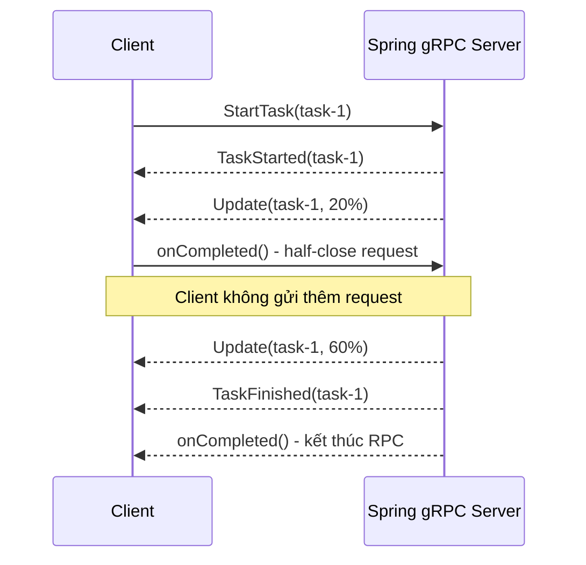

# Hủy một phía và kết thúc stream

## 1. Phân biệt half-close, hủy tác vụ và hủy RPC

Trong **bidirectional streaming** của Spring gRPC, client có thể ngừng gửi request trong khi vẫn nhận response. Đây là thao tác *half-close* của chiều client → server. Nó khác với việc hủy một tác vụ nghiệp vụ và khác hẳn với việc hủy toàn bộ RPC.

Hãy hình dung một dashboard đang theo dõi tác vụ xử lý báo cáo:

- Client gửi lệnh bắt đầu theo dõi.
- Server phát tiến độ nhiều lần.
- Người dùng có thể yêu cầu dừng tác vụ báo cáo nhưng vẫn giữ kết nối để gửi lệnh khác.
- Người dùng cũng có thể ngừng gửi lệnh mới nhưng tiếp tục nhận tiến độ của tác vụ đang chạy.
- Khi người dùng đóng hẳn màn hình, client có thể hủy RPC; server phải dừng timer và công việc nền của phiên.

Ba hành động trên có phạm vi khác nhau:

| Hành động | Phạm vi | RPC còn hoạt động không? |
| --- | --- | --- |
| Client gọi `requestObserver.onCompleted()` | Đóng chiều request client → server (half-close) | **Có**; server vẫn được gửi response |
| Client gửi command `CancelTask` | Hủy một tác vụ theo quy tắc ứng dụng | **Có**; các tác vụ và command khác vẫn có thể tiếp tục |
| Client gọi `ClientCallStreamObserver.cancel(...)` | Hủy toàn bộ RPC | **Không**; cả hai chiều kết thúc |
| Server gọi `responseObserver.onCompleted()` | Kết thúc thành công response stream | **Không**; RPC kết thúc |
| Một phía kết thúc bằng `onError(...)` | Kết thúc RPC với lỗi | **Không** |

Điểm quan trọng: gRPC không cung cấp một thao tác transport để server chỉ “half-close response” rồi tiếp tục nhận request trong cùng RPC. Khi server gọi `responseObserver.onCompleted()`, toàn bộ RPC hoàn tất. Nếu cần dừng một luồng công việc riêng mà vẫn giữ RPC mở, hãy định nghĩa **command hủy tác vụ ở tầng ứng dụng**.

Sau bài học, người học có thể:

- Phân biệt half-close, hủy tác vụ và cancellation của toàn RPC.
- Xử lý đúng `onCompleted()`, `onError()`, `cancel()` và `setOnCancelHandler()` trong gRPC Java.
- Viết service Spring gRPC dừng publisher/timer khi tác vụ bị hủy hoặc client rời đi.
- Cho client half-close request stream nhưng tiếp tục nhận response cho tới khi server hoàn tất.
- Kiểm thử tài nguyên được giải phóng khi RPC bị hủy hoặc deadline hết.

## 2. Vòng đời hai chiều trong một RPC

Một RPC bidi có hai luồng message độc lập nhưng chia sẻ **một vòng đời RPC**:



Trong tình huống này, client đã đóng chiều gửi nhưng vẫn nhận được hai response sau đó. Server chỉ gọi `onCompleted()` cho response khi tác vụ hoàn tất và không còn công việc cần phát.

Nếu client gọi `cancel()` thay vì `onCompleted()`, đó là một hành động khác:

```mermaid
sequenceDiagram
    participant C as Client
    participant S as Spring gRPC Server
    C->>S: StartTask(task-1)
    S-->>C: TaskStarted(task-1)
    S-->>C: Update(task-1, 20%)
    C-xS: ClientCallStreamObserver.cancel()
    Note over S: setOnCancelHandler được kích hoạt
    Note over S: Hủy timer và công việc của phiên
    Note over C: RPC kết thúc; không chờ TaskFinished
```

Khi RPC bị cancel, không thể trông đợi server gửi thêm `TaskFinished` qua chính RPC đó. Nếu client cần một xác nhận hủy đáng tin cậy, hãy gửi command hủy tác vụ khi RPC còn sống và nhận `TaskCancelled`; sau đó mới half-close hoặc tiếp tục dùng phiên.

## 3. Hợp đồng Protobuf: tách command hủy tác vụ khỏi cancellation của RPC

Ví dụ `task_control.proto`:

```proto
syntax = "proto3";

package task.v1;

option java_multiple_files = true;
option java_package = "com.example.task.v1";

service TaskControl {
  rpc Watch(stream ClientCommand) returns (stream ServerEvent);
}

message ClientCommand {
  string task_id = 1;
  oneof command {
    StartTask start = 2;
    CancelTask cancel_task = 3;
  }
}

message StartTask {
  string description = 1;
}

message CancelTask {
  string reason = 1;
}

message ServerEvent {
  string task_id = 1;
  oneof event {
    TaskStarted started = 2;
    TaskUpdate update = 3;
    TaskCancelled cancelled = 4;
    TaskFinished finished = 5;
  }
}

message TaskStarted {
  string detail = 1;
}

message TaskUpdate {
  int32 percent = 1;
  string detail = 2;
}

message TaskCancelled {
  bool was_running = 1;
  string reason = 2;
}

message TaskFinished {
  bool success = 1;
  string detail = 2;
}
```

Sau khi sinh mã bằng `protoc` và plugin Java gRPC, service sử dụng `TaskControlGrpc.TaskControlImplBase`. Contract quy định:

- `StartTask` bắt đầu một tác vụ có `task_id`.
- `CancelTask` dừng **tác vụ có task_id đó**, nếu nó còn chạy; server phát `TaskCancelled` trong response stream.
- `TaskFinished` là kết quả cuối của một tác vụ, không kết thúc RPC.
- Client gọi `onCompleted()` để ngừng gửi command mới. Server vẫn phát update cho tác vụ đang chạy.
- Client dùng API cancellation của call để hủy toàn bộ RPC khi không cần nhận hoặc gửi dữ liệu nữa.

Ví dụ giữ một tác vụ đang chạy tại một thời điểm trên mỗi RPC để làm rõ vòng đời. Hệ thống có nhiều tác vụ đồng thời có thể mở rộng thành map `task_id → TaskState`; nguyên tắc về half-close và RPC cancellation vẫn giữ nguyên.

## 4. Server Spring gRPC: dừng tác vụ, half-close và cleanup

Server cần xử lý ba đường kết thúc khác nhau:

1. Nhận command `CancelTask`: dừng publisher của tác vụ, phát `TaskCancelled`, giữ RPC mở nếu request stream chưa half-close.
2. Nhận callback `onCompleted()` từ request observer: đánh dấu client đã ngừng gửi; nếu tác vụ vẫn chạy thì tiếp tục phát update.
3. Nhận cancellation của RPC: dừng mọi tác vụ và timer, không cố gửi thêm response.

### 4.1. Executor dùng chung

```java
package com.example.task;

import java.util.concurrent.Executors;
import java.util.concurrent.ScheduledExecutorService;
import org.springframework.context.annotation.Bean;
import org.springframework.context.annotation.Configuration;

@Configuration
public class TaskStreamingConfig {
    @Bean(destroyMethod = "shutdown")
    ScheduledExecutorService taskScheduler() {
        return Executors.newScheduledThreadPool(2);
    }
}
```

### 4.2. Service và state theo từng RPC

```java
package com.example.task;

import com.example.task.v1.ClientCommand;
import com.example.task.v1.ServerEvent;
import com.example.task.v1.TaskCancelled;
import com.example.task.v1.TaskControlGrpc;
import com.example.task.v1.TaskFinished;
import com.example.task.v1.TaskStarted;
import com.example.task.v1.TaskUpdate;
import io.grpc.Status;
import io.grpc.stub.ServerCallStreamObserver;
import io.grpc.stub.StreamObserver;
import java.util.concurrent.ScheduledExecutorService;
import java.util.concurrent.ScheduledFuture;
import java.util.concurrent.TimeUnit;
import org.springframework.stereotype.Service;

@Service
public class TaskControlService extends TaskControlGrpc.TaskControlImplBase {
    private final ScheduledExecutorService scheduler;

    public TaskControlService(ScheduledExecutorService scheduler) {
        this.scheduler = scheduler;
    }

    @Override
    public StreamObserver<ClientCommand> watch(
            StreamObserver<ServerEvent> responseObserver) {
        ServerCallStreamObserver<ServerEvent> output =
                (ServerCallStreamObserver<ServerEvent>) responseObserver;
        Session session = new Session(output, scheduler);

        // Handler này báo rằng toàn RPC đã bị hủy.
        output.setOnCancelHandler(session::rpcCancelled);

        return new StreamObserver<>() {
            @Override
            public void onNext(ClientCommand command) {
                session.handle(command);
            }

            @Override
            public void onError(Throwable error) {
                // Lỗi/hủy ở chiều inbound cũng phải dọn state của phiên.
                session.rpcCancelled();
            }

            @Override
            public void onCompleted() {
                // Chỉ half-close request stream; response có thể tiếp tục.
                session.requestHalfClosed();
            }
        };
    }

    private static final class Session {
        private final ServerCallStreamObserver<ServerEvent> output;
        private final ScheduledExecutorService scheduler;
        private String taskId;
        private String taskDescription;
        private ScheduledFuture<?> publisher;
        private int updates;
        private boolean taskRunning;
        private boolean requestDone;
        private boolean rpcEnded;

        Session(ServerCallStreamObserver<ServerEvent> output,
                ScheduledExecutorService scheduler) {
            this.output = output;
            this.scheduler = scheduler;
        }

        synchronized void handle(ClientCommand command) {
            if (rpcEnded || output.isCancelled()) {
                cleanupAfterCancellation();
                return;
            }
            switch (command.getCommandCase()) {
                case START -> startTask(command.getTaskId(),
                        command.getStart().getDescription());
                case CANCEL_TASK -> cancelTask(command.getTaskId(),
                        command.getCancelTask().getReason());
                case COMMAND_NOT_SET -> fail(Status.INVALID_ARGUMENT
                        .withDescription("Command chưa được thiết lập"));
            }
        }

        private void startTask(String id, String description) {
            if (id.isBlank()) {
                fail(Status.INVALID_ARGUMENT
                        .withDescription("task_id không được rỗng"));
                return;
            }
            if (requestDone) {
                fail(Status.FAILED_PRECONDITION
                        .withDescription("Request stream đã half-close"));
                return;
            }
            if (taskRunning) {
                fail(Status.ALREADY_EXISTS
                        .withDescription("Phiên đã có tác vụ đang chạy"));
                return;
            }

            taskId = id;
            taskDescription = description;
            updates = 0;
            taskRunning = true;
            if (!emit(ServerEvent.newBuilder()
                    .setTaskId(taskId)
                    .setStarted(TaskStarted.newBuilder()
                            .setDetail("Đã bắt đầu: " + description)
                            .build())
                    .build())) {
                return;
            }

            try {
                // Delay khác 0 để publisher được gán trước tick đầu tiên.
                publisher = scheduler.scheduleAtFixedRate(
                        this::publishUpdate, 500, 500, TimeUnit.MILLISECONDS);
            } catch (RuntimeException error) {
                taskRunning = false;
                fail(Status.UNAVAILABLE
                        .withDescription("Không thể khởi động publisher")
                        .withCause(error));
            }
        }

        private synchronized void publishUpdate() {
            if (rpcEnded || output.isCancelled()) {
                cleanupAfterCancellation();
                return;
            }
            if (!taskRunning) {
                return;
            }

            updates++;
            if (!emit(ServerEvent.newBuilder()
                    .setTaskId(taskId)
                    .setUpdate(TaskUpdate.newBuilder()
                            .setPercent(updates * 30)
                            .setDetail("Đang xử lý " + taskDescription)
                            .build())
                    .build())) {
                return;
            }

            if (updates == 3) {
                taskRunning = false;
                stopPublisher();
                emit(ServerEvent.newBuilder()
                        .setTaskId(taskId)
                        .setFinished(TaskFinished.newBuilder()
                                .setSuccess(true)
                                .setDetail("Tác vụ hoàn tất")
                                .build())
                        .build());
                finishRpcIfReady();
            }
        }

        private void cancelTask(String requestedId, String reason) {
            boolean matched = taskRunning && taskId.equals(requestedId);
            if (matched) {
                taskRunning = false;
                stopPublisher();
            }
            emit(ServerEvent.newBuilder()
                    .setTaskId(requestedId)
                    .setCancelled(TaskCancelled.newBuilder()
                            .setWasRunning(matched)
                            .setReason(matched
                                    ? reason : "Tác vụ không còn chạy")
                            .build())
                    .build());
            finishRpcIfReady();
        }

        synchronized void requestHalfClosed() {
            requestDone = true;
            finishRpcIfReady();
        }

        synchronized void rpcCancelled() {
            cleanupAfterCancellation();
        }

        private void finishRpcIfReady() {
            if (!rpcEnded && requestDone && !taskRunning) {
                rpcEnded = true;
                stopPublisher();
                output.onCompleted();
            }
        }

        private boolean emit(ServerEvent event) {
            if (rpcEnded || output.isCancelled()) {
                cleanupAfterCancellation();
                return false;
            }
            try {
                output.onNext(event);
                return true;
            } catch (RuntimeException error) {
                cleanupAfterCancellation();
                return false;
            }
        }

        private void fail(Status status) {
            if (!rpcEnded) {
                rpcEnded = true;
                taskRunning = false;
                stopPublisher();
                output.onError(status.asRuntimeException());
            }
        }

        private void cleanupAfterCancellation() {
            if (!rpcEnded) {
                rpcEnded = true;
                taskRunning = false;
                stopPublisher();
            }
        }

        private void stopPublisher() {
            if (publisher != null) {
                publisher.cancel(false);
                publisher = null;
            }
        }
    }
}
```

Điểm cần chú ý:

- `requestHalfClosed()` chỉ đặt `requestDone = true`. Nếu `taskRunning` còn đúng, server **không** gọi `output.onCompleted()`; publisher vẫn phát update.
- `cancelTask()` dừng publisher và phát `TaskCancelled`. Đây là hủy **một tác vụ**, không hủy RPC.
- `rpcCancelled()` được gọi từ `setOnCancelHandler`; nó dừng publisher và đánh dấu phiên kết thúc. Không cố gọi `output.onCompleted()` sau khi peer đã cancel.
- `finishRpcIfReady()` chỉ hoàn tất response khi client đã half-close **và** tác vụ không còn chạy.
- Các phương thức điều phối trạng thái và ghi response được đồng bộ theo từng `Session`; không dùng một khóa toàn cục cho mọi client.

Mẫu trên minh họa một publisher định kỳ và một tác vụ đang chạy mỗi phiên. Ứng dụng production cần bổ sung queue có giới hạn, `isReady()`/`setOnReadyHandler(...)`, xử lý exception của scheduler, quota số phiên và chính sách lưu trạng thái tác vụ nếu cần phục hồi sau reconnect.

## 5. Client: half-close, hủy tác vụ và hủy toàn RPC

Client dùng `ClientResponseObserver` để lấy `ClientCallStreamObserver` trong `beforeStart()`. Đối tượng này cung cấp `cancel(message, cause)` để hủy **toàn bộ call**. Observer trả về từ async stub vẫn dùng để phát command; gọi `onCompleted()` trên observer đó chỉ half-close chiều request.

### 5.1. Hủy một tác vụ rồi half-close request

```java
package com.example.task;

import com.example.task.v1.ClientCommand;
import com.example.task.v1.ServerEvent;
import com.example.task.v1.TaskControlGrpc;
import io.grpc.ManagedChannel;
import io.grpc.ManagedChannelBuilder;
import io.grpc.stub.ClientCallStreamObserver;
import io.grpc.stub.ClientResponseObserver;
import io.grpc.stub.StreamObserver;
import java.util.concurrent.CountDownLatch;
import java.util.concurrent.TimeUnit;
import java.util.concurrent.atomic.AtomicReference;

public class TaskControlClientDemo {
    public static void main(String[] args) throws Exception {
        ManagedChannel channel = ManagedChannelBuilder
                .forAddress("localhost", 9090)
                .usePlaintext() // Chỉ dùng cho ví dụ localhost.
                .build();
        AtomicReference<ClientCallStreamObserver<ClientCommand>> callRef =
                new AtomicReference<>();
        CountDownLatch rpcFinished = new CountDownLatch(1);

        try {
            TaskControlGrpc.TaskControlStub stub =
                    TaskControlGrpc.newStub(channel)
                            .withDeadlineAfter(5, TimeUnit.SECONDS);

            ClientResponseObserver<ClientCommand, ServerEvent> incoming =
                    new ClientResponseObserver<>() {
                @Override
                public void beforeStart(
                        ClientCallStreamObserver<ClientCommand> requestStream) {
                    callRef.set(requestStream);
                }

                @Override
                public void onNext(ServerEvent event) {
                    System.out.println("Nhận event cho " + event.getTaskId()
                            + ": " + event.getEventCase());
                }

                @Override
                public void onError(Throwable error) {
                    System.err.println("RPC lỗi/hủy: " + error);
                    rpcFinished.countDown();
                }

                @Override
                public void onCompleted() {
                    System.out.println("Server hoàn tất response stream");
                    rpcFinished.countDown();
                }
            };

            StreamObserver<ClientCommand> outgoing = stub.watch(incoming);

            outgoing.onNext(ClientCommand.newBuilder()
                    .setTaskId("report-42")
                    .setStart(com.example.task.v1.StartTask.newBuilder()
                            .setDescription("Xuất báo cáo")
                            .build())
                    .build());

            // Minh họa: để tác vụ chạy một lúc rồi yêu cầu hủy ở tầng ứng dụng.
            TimeUnit.MILLISECONDS.sleep(650);
            outgoing.onNext(ClientCommand.newBuilder()
                    .setTaskId("report-42")
                    .setCancelTask(com.example.task.v1.CancelTask.newBuilder()
                            .setReason("Người dùng dừng báo cáo")
                            .build())
                    .build());

            // Ngừng gửi command mới; vẫn nhận TaskCancelled và terminal callback.
            outgoing.onCompleted();

            if (!rpcFinished.await(4, TimeUnit.SECONDS)) {
                throw new IllegalStateException("RPC chưa kết thúc đúng hạn");
            }
        } finally {
            channel.shutdownNow().awaitTermination(2, TimeUnit.SECONDS);
        }
    }

    // Gọi phương thức này khi muốn hủy toàn bộ RPC, ví dụ đóng màn hình.
    static void cancelWholeRpc(
            AtomicReference<ClientCallStreamObserver<ClientCommand>> callRef) {
        ClientCallStreamObserver<ClientCommand> call = callRef.get();
        if (call != null) {
            call.cancel("Người dùng rời phiên", null);
        }
    }
}
```

Ví dụ trên thực hiện theo thứ tự: gửi `StartTask`, đợi một khoảng ngắn, gửi `CancelTask`, rồi gọi `outgoing.onCompleted()`. Server dừng publisher, phát `TaskCancelled`, thấy request stream đã half-close và không còn tác vụ nên kết thúc response thành công.

Khoảng `sleep` chỉ dùng để minh họa tương tác; số update nhận được phụ thuộc lịch scheduler và không phải một assertion kiểm thử. Trong ứng dụng thực, thao tác hủy được kích hoạt từ sự kiện UI hoặc command của hệ thống, không cần chờ bằng `sleep`.

### 5.2. Hủy toàn bộ RPC

Khi người dùng đóng màn hình và không còn cần bất kỳ response nào, client gọi:

```java
ClientCallStreamObserver<ClientCommand> call = callRef.get();
if (call != null) {
    call.cancel("Người dùng đóng màn hình", null);
}
```

Đây là **transport cancellation**. Callback `onError` ở client thường nhận status `CANCELLED`; server nhận tín hiệu hủy qua `setOnCancelHandler` hoặc kiểm tra `isCancelled()`, rồi dừng publisher. Không gửi `CancelTask` trước khi hủy toàn call nếu mục tiêu là dừng ngay cả phiên và không cần nhận xác nhận nghiệp vụ.

## 6. Các trường hợp kết thúc và xử lý đúng

| Tình huống | Client | Server |
| --- | --- | --- |
| Client gọi `outgoing.onCompleted()` | Không gửi command mới; vẫn nhận response | Nhận `onCompleted()` ở request observer; tiếp tục task đang chạy |
| Client gửi `CancelTask` | Vẫn giữ RPC, chờ `TaskCancelled` | Dừng task phù hợp, phát event hủy, tiếp tục nhận command nếu input còn mở |
| Client gọi `call.cancel(...)` | Call kết thúc; callback terminal được gọi | Dừng timer/task/subscription; không phát thêm response |
| Server gọi `output.onCompleted()` | Nhận `onCompleted()`; không nhận response mới | RPC hoàn tất thành công; không nhận request mới |
| Server gọi `output.onError(...)` | Nhận lỗi terminal và status | RPC kết thúc lỗi; dừng mọi task |
| Deadline hết | Call kết thúc với `DEADLINE_EXCEEDED` hoặc trạng thái tương ứng | Cleanup như một cancellation; không trông đợi gửi kết quả cuối |

**Không nhầm `onError` với một command hủy tác vụ.** Gọi `onError` trên observer đầu vào hoặc đầu ra là sự kiện terminal của RPC. Nếu muốn hủy riêng một task mà các task khác vẫn chạy, hãy biểu diễn nó bằng message Protobuf như `CancelTask`, có ID và kết quả xác nhận.

## 7. Deadline, cancellation và tài nguyên nền

Deadline gRPC áp dụng cho **toàn bộ RPC**, không phải riêng từng task và không tự gia hạn sau mỗi update. Nếu một RPC chứa nhiều task, deadline hết sẽ ảnh hưởng tới tất cả task trong phiên. Nếu nghiệp vụ cần timeout độc lập theo từng task, lưu thời điểm bắt đầu/hạn xử lý trong state của task và phát `TaskFinished` với trạng thái timeout theo contract.

Khi RPC bị hủy, server cần dừng mọi hoạt động được tạo cho RPC:

- `ScheduledFuture.cancel(false)` để ngăn các lần chạy định kỳ tiếp theo.
- Đóng subscription tới event bus, message broker hoặc publisher.
- Hủy tác vụ nền nếu có API cancellation; nếu tác vụ không thể hủy tức thời, đánh dấu phiên đã kết thúc và bỏ qua kết quả hoàn thành muộn.
- Giải phóng queue, buffer và state của session sau khi không còn callback có thể sử dụng chúng.
- Không gọi `onNext`, `onCompleted` hoặc `onError` thêm sau terminal event.

Trong code production, dùng một cờ terminal được bảo vệ đồng bộ hoặc atomic state machine để bảo đảm chỉ một đường kết thúc thắng cuộc. Cancellation có thể xảy ra đồng thời với task tick hoặc client half-close; các đường này phải phối hợp trên cùng state theo RPC.

## 8. Kiểm thử half-close và cancellation

Có thể dùng gRPC in-process server/channel hoặc cấu hình kiểm thử Spring gRPC phù hợp. Nên tiêm scheduler có thể điều khiển để không phụ thuộc `Thread.sleep()` trong test.

| Kịch bản | Kết quả cần xác minh |
| --- | --- |
| Client gửi Start rồi half-close | Server vẫn phát các update và TaskFinished trước khi response hoàn tất |
| Client half-close khi task đang chạy | Server không gọi response `onCompleted()` quá sớm |
| Client gửi CancelTask khi request stream còn mở | Chỉ task tương ứng dừng; nhận TaskCancelled; RPC vẫn dùng được |
| Client gửi CancelTask rồi half-close | Server phát TaskCancelled, sau đó hoàn tất response thành công |
| Client cancel toàn call khi task đang chạy | Server cancellation handler dừng publisher; không có update mới sau cancel |
| Deadline hết khi task đang chạy | Server dừng tài nguyên; client không chờ TaskFinished vô hạn |
| Server lỗi khi xử lý command | RPC kết thúc với status đúng; task nền được dọn |
| CancelTask không khớp task hiện tại | Server trả kết quả nghiệp vụ phù hợp; không vô tình dừng task khác |
| Hai đường cancel và task hoàn tất chạy đồng thời | Chỉ một kết quả terminal của task/RPC được phát theo state machine |

Trong test, kiểm tra số lần terminal callback, số tick sau cancellation và việc future/timer đã bị hủy. Không chỉ kiểm tra client nhận được một message `TaskCancelled`; cần xác nhận producer thật sự dừng và tài nguyên không tiếp tục hoạt động sau khi RPC kết thúc.

## 9. Sai lầm thường gặp

1. **Gọi `outgoing.onCompleted()` rồi nghĩ RPC đã kết thúc.** Đây chỉ là half-close chiều request; response vẫn có thể tiếp tục.
2. **Gọi `responseObserver.onCompleted()` để dừng riêng chiều response.** Thao tác này hoàn tất toàn bộ RPC; không thể tiếp tục nhận request trên cùng call.
3. **Dùng `call.cancel()` để hủy một tác vụ.** Nó hủy cả RPC; dùng command `CancelTask` nếu cần giữ phiên.
4. **Không đăng ký `setOnCancelHandler`.** Timer và subscription có thể tiếp tục chạy sau khi client rời đi.
5. **Coi `TaskCancelled` là terminal callback của gRPC.** Đây là message nghiệp vụ; RPC vẫn mở cho tới khi có điều kiện kết thúc toàn phiên.
6. **Không đồng bộ cancellation với task tick.** Có thể phát update sau khi đã báo hủy; dùng state và khóa theo session.
7. **Không phân biệt deadline của RPC với timeout của task.** Nếu mỗi task có thời hạn riêng, ứng dụng phải tự quản lý thời hạn đó.

## 10. Bài tập vận dụng

Mở rộng `TaskControl.Watch` thành phiên theo dõi nhiều tác vụ:

1. Thay state đơn bằng map `task_id → TaskState`, cho phép bắt đầu nhiều task trong cùng RPC.
2. Gửi `CancelTask(task_id)` cho một task; những task còn lại vẫn tiếp tục phát update.
3. Thêm command `PauseTask`/`ResumeTask` ở tầng nghiệp vụ và xác định trạng thái hợp lệ của từng task.
4. Kiểm thử client half-close trong lúc nhiều task còn chạy; server chỉ kết thúc RPC sau khi tất cả task hoàn tất hoặc bị hủy.
5. Mô phỏng client cancel toàn RPC; xác minh tất cả publisher/subscription của mọi task được dừng.
6. Thêm timeout riêng cho task và so sánh với deadline toàn RPC.

**Tiêu chí hoàn thành:** người học có thể dừng một tác vụ mà vẫn giữ RPC mở, half-close chiều request mà vẫn nhận response, và hủy toàn RPC với cleanup đầy đủ khi phiên không còn cần thiết.

### Tài liệu tham khảo

- [gRPC Core concepts](https://grpc.io/docs/what-is-grpc/core-concepts/): vòng đời RPC, client/server streaming và thứ tự message.
- [gRPC Java ClientCallStreamObserver API](https://grpc.github.io/grpc-java/javadoc/io/grpc/stub/ClientCallStreamObserver.html): cancellation và điều khiển request stream.
- [gRPC Java ServerCallStreamObserver API](https://grpc.github.io/grpc-java/javadoc/io/grpc/stub/ServerCallStreamObserver.html): kiểm tra cancellation và đăng ký cancel handler.
- [gRPC Java StreamObserver API](https://grpc.github.io/grpc-java/javadoc/io/grpc/stub/StreamObserver.html): callback `onNext`, `onError`, `onCompleted`.
- [Spring gRPC Reference](https://docs.spring.io/spring-grpc/reference/): đăng ký dịch vụ và tích hợp gRPC trong Spring.
